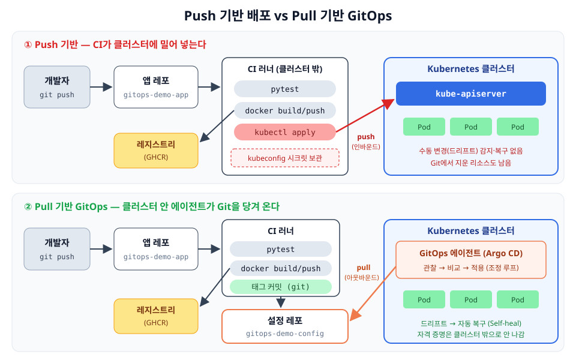
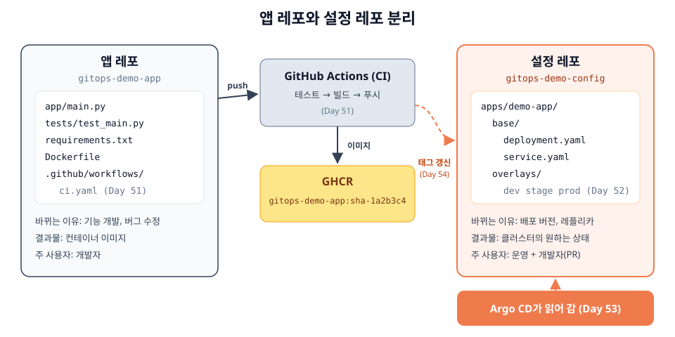
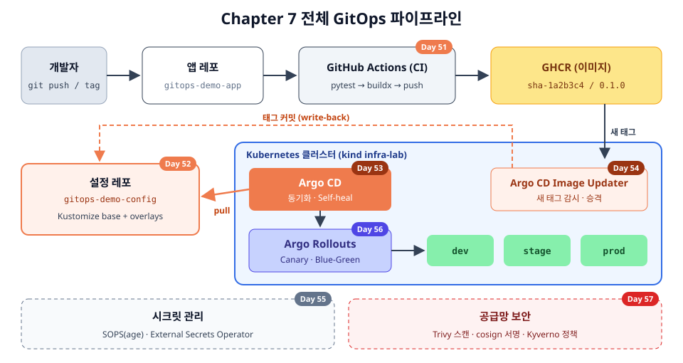

> **Chapter 7 · GitOps & CI/CD** | 난이도 ★★☆☆☆ | 예상 소요 1.5 ~ 2시간

## 🎯 오늘의 목표

- CI, Continuous Delivery, Continuous Deployment의 차이를 설명할 수 있다
- **Push 기반 배포**(CI가 `kubectl apply`)와 **Pull 기반 GitOps**(클러스터 안 에이전트가 Git을 조정 루프로 동기화)를 비교할 수 있다
- **OpenGitOps 4원칙**을 Day 08의 선언형 관리·조정 루프와 연결해 설명할 수 있다
- 앱 레포와 설정 레포를 **왜 분리하는지** 안다
- Chapter 7 실습 레포 `gitops-demo-app` / `gitops-demo-config`의 뼈대를 만들고, Push 방식으로 직접 배포해 **한계를 체감**한다

---

## 1. Chapter 7을 시작하며 — 지금까지 우리는 어떻게 배포했나?

Chapter 2부터 Chapter 6까지, 배포는 늘 이렇게 했습니다.

```bash
kubectl apply -f deployment.yaml      # Day 11
helm upgrade --install traefik ...    # Day 15~16
kubectl apply -f vllm.yaml            # Day 45
```

**내 PC의 터미널에서, 내 kubeconfig로, 내가 직접** 명령을 날렸습니다. 혼자 공부할 때는 충분하지만 팀과 운영 환경에서는 금방 문제가 드러납니다.

| 질문 | 수동 배포의 답 |
|---|---|
| 지금 운영 클러스터에 떠 있는 버전은? | "아마 어제 철수 님이 올린 거…" — 클러스터를 직접 열어 봐야 앎 |
| 누가, 언제, 왜 바꿨나? | 터미널 히스토리에만 있음 (또는 아무 데도 없음) |
| 어제 상태로 되돌리려면? | 어제 어떤 YAML을 apply했는지부터 찾아야 함 |
| 개발/스테이징/운영 설정이 어떻게 다른가? | 파일 복사본 3벌이 조금씩 어긋나 있음 |
| 운영 클러스터 접근 권한은? | 배포하는 모든 사람(그리고 모든 CI)에게 필요 |

Chapter 7의 목표는 이 질문들에 **"Git을 보면 된다"** 라고 답할 수 있게 만드는 것입니다.

---

## 2. CI와 CD — 용어부터 정리

| 용어 | 하는 일 | 결과물 | 이 챕터에서 |
|---|---|---|---|
| **CI** (Continuous Integration, 지속적 통합) | 코드가 push될 때마다 자동으로 빌드·테스트 | 테스트를 통과한 **이미지** | Day 51 GitHub Actions |
| **Continuous Delivery** (지속적 전달) | 언제든 배포 가능한 상태를 유지. 운영 반영은 **사람이 승인** | 배포 준비가 끝난 **매니페스트 변경** | Day 54 환경 승격(PR 머지) |
| **Continuous Deployment** (지속적 배포) | 테스트를 통과하면 운영까지 **자동 반영** | 실제로 바뀐 클러스터 | Day 53 Auto-sync (dev 환경) |

> 💡 "CD"는 문맥에 따라 Delivery일 수도 Deployment일 수도 있습니다. 차이는 **마지막 운영 반영 버튼을 사람이 누르느냐**입니다. 이 챕터에서는 dev는 자동(Deployment), prod는 PR 승인(Delivery)으로 나눠 씁니다.

CI는 "**무엇을** 배포할지(이미지)"를 만들고, CD는 "**어디에 어떻게** 배포할지(매니페스트를 클러스터에 반영)"를 담당합니다. 오늘의 주제인 Push vs Pull은 **CD를 누가 실행하느냐**의 차이입니다.

---

## 3. Push 기반 배포 vs Pull 기반 GitOps



### 3-1. Push 기반 — CI가 클러스터에 밀어 넣는다

가장 직관적인 방식입니다. CI 파이프라인의 마지막 단계에서 `kubectl apply`(또는 `helm upgrade`)를 실행합니다.

```
git push → CI: 테스트 → 이미지 빌드·푸시 → kubectl apply  ──▶  클러스터
```

- CI가 **클러스터 외부에서** apiserver로 접속하므로, CI에 **클러스터 관리자급 자격 증명(kubeconfig, 토큰)** 을 넣어야 합니다
- 배포는 **파이프라인이 도는 순간 한 번**만 일어납니다. 그 뒤 누군가 `kubectl edit`으로 바꾸면 아무도 모릅니다
- 클러스터가 사설망(홈랩, 사내망)에 있으면 외부 CI 러너가 **접근조차 못 합니다**

### 3-2. Pull 기반 — 클러스터 안의 에이전트가 Git을 당겨 온다

**GitOps 에이전트**(Argo CD, Flux)가 클러스터 **안에서** Git 레포를 주기적으로 읽고, 클러스터를 Git과 같게 맞춥니다.

```
git push → CI: 테스트 → 이미지 빌드·푸시 → (설정 레포의 이미지 태그 변경)
                                                  ▲
                         클러스터 안 에이전트 ─────┘ 주기적으로 pull → 비교 → 적용
```

Day 08의 **조정 루프**를 떠올려 보세요.

| | Day 08: Deployment 컨트롤러 | GitOps 에이전트 |
|---|---|---|
| 원하는 상태(Desired) | etcd에 저장된 Deployment `replicas: 3` | **Git 레포의 매니페스트** |
| 현재 상태(Actual) | 실제로 떠 있는 Pod 개수 | 클러스터에 실제로 있는 리소스 |
| 관찰 → 비교 → 조치 | Pod가 2개면 1개를 더 만든다 | Git과 다르면 Git대로 apply한다 (Self-heal) |

즉 GitOps는 **조정 루프를 한 층 위로 올린 것**입니다. Kubernetes가 "etcd ↔ Pod"를 맞추듯, GitOps 에이전트는 "Git ↔ 클러스터 리소스"를 맞춥니다.

### 3-3. 한눈에 비교

| 구분 | Push 기반 (CI가 apply) | Pull 기반 (GitOps) |
|---|---|---|
| 배포 실행 주체 | 클러스터 밖 CI 러너 | 클러스터 안 에이전트 |
| 클러스터 자격 증명 | **CI가 보관** (유출 시 클러스터 전체 위험) | 클러스터 밖으로 나가지 않음. 에이전트는 Git **읽기** 권한만 |
| 방화벽 | 러너 → apiserver 인바운드 허용 필요 | 클러스터 → Git **아웃바운드**만 필요 |
| 드리프트(수동 변경) | 감지·복구 없음 | 지속적으로 감지, 원하면 자동 복구 |
| 삭제(prune) | apply는 지운 파일을 삭제하지 않음 | Git에서 지우면 클러스터에서도 삭제 가능 |
| 롤백 | 파이프라인 재실행 / 수동 | **`git revert`** |
| 감사 기록 | CI 로그 (보관 기간 제한) | **Git 히스토리 = 배포 히스토리** |
| 진실의 원천 | 마지막 파이프라인 실행 결과 | Git |
| 대표 도구 | GitHub Actions + kubectl/helm, Jenkins | **Argo CD**(Day 53), Flux |

> ⚠️ Pull 방식이라고 CI가 없어지는 게 아닙니다. **CI는 여전히 테스트하고 이미지를 만듭니다.** 바뀌는 것은 "클러스터에 반영하는 마지막 한 걸음"을 누가 하느냐입니다.

---

## 4. OpenGitOps 4원칙

GitOps는 CNCF의 OpenGitOps 프로젝트가 4가지 원칙으로 정리해 두었습니다 ([opengitops.dev](https://opengitops.dev/)).

| # | 원칙 | 의미 | 이전 Day와 연결 | 이 챕터에서 |
|---|---|---|---|---|
| 1 | **Declarative** (선언형) | 시스템의 원하는 상태를 절차가 아니라 **선언**으로 표현 | Day 08 선언형 관리, Day 09 `kubectl apply` | 모든 것을 YAML(Kustomize, Day 52)로 |
| 2 | **Versioned and Immutable** (버전 관리·불변) | 원하는 상태를 덮어쓸 수 없게 저장하고, 버전과 **전체 이력**을 남김 | Day 02 이미지 태그·다이제스트 | Git 커밋, 불변 이미지 태그(Day 51) |
| 3 | **Pulled Automatically** (자동으로 당겨 옴) | 에이전트가 원천(Git)에서 원하는 상태를 **스스로** 가져옴 | — | Argo CD가 설정 레포를 폴링(Day 53) |
| 4 | **Continuously Reconciled** (지속적 조정) | 에이전트가 실제 상태를 계속 관찰하고 원하는 상태에 맞춤 | Day 08 조정 루프 | Auto-sync, Self-heal(Day 53) |

> 💡 원칙 2의 "불변"은 Git만이 아니라 **이미지 태그**에도 해당합니다. `latest` 같은 움직이는 태그를 쓰면 같은 매니페스트가 날마다 다른 이미지를 띄우므로, Git만 봐서는 무엇이 배포됐는지 알 수 없습니다. 그래서 Day 51에서 `sha-1a2b3c4`, `0.1.0` 같은 고정 태그를 만듭니다.

---

## 5. 앱 레포와 설정 레포를 분리하는 이유



GitOps에서는 보통 레포를 두 개로 나눕니다.

| | **앱 레포** `gitops-demo-app` | **설정 레포** `gitops-demo-config` |
|---|---|---|
| 내용 | 소스 코드, 테스트, Dockerfile, CI 워크플로 | Kubernetes 매니페스트(Kustomize base/overlays) |
| 바뀌는 이유 | 기능 개발, 버그 수정 | 배포 버전 변경, 레플리카·리소스·환경 설정 변경 |
| 결과물 | 컨테이너 이미지 (GHCR) | 클러스터의 원하는 상태 |
| 주로 쓰는 사람 | 개발자 | 플랫폼/운영 + 개발자(PR) |
| 누가 읽나 | CI(GitHub Actions) | GitOps 에이전트(Argo CD) |

분리하는 이유는 다음과 같습니다.

1. **배포 이력이 깔끔해진다** — 설정 레포의 커밋 로그가 곧 "어느 환경에 언제 무엇이 배포됐나"입니다. 코드 커밋 수백 개에 섞이지 않습니다
2. **무한 루프를 피한다** — 한 레포라면 "CI가 이미지 태그를 커밋 → 그 커밋이 다시 CI를 트리거"하는 고리가 생기기 쉽습니다
3. **권한을 나눌 수 있다** — 코드는 누구나 PR, 운영(prod) 설정 변경은 승인자만. 설정 레포에 브랜치 보호 규칙을 따로 걸 수 있습니다
4. **설정만 바꾸는 배포가 쉽다** — 레플리카 3 → 5는 코드 빌드 없이 설정 레포 커밋 하나로 끝납니다
5. **여러 앱을 한곳에서** — 설정 레포 하나에 demo-app, Chapter 6의 rag-api, vLLM 매니페스트를 모두 모을 수 있습니다

> 💡 작은 팀은 한 레포에 `app/`과 `deploy/` 폴더를 두는 **모노레포**로 시작하기도 합니다. 동작은 하지만 위 2번 루프를 경로 필터(`paths-ignore`)로 막아야 하는 등 신경 쓸 것이 늘어납니다. 이 챕터는 학습 효과가 큰 **분리형**으로 갑니다.

---

## 6. Chapter 7 전체 파이프라인



| Day | 파이프라인에서의 위치 | 오늘부터 쌓아 갈 것 |
|---|---|---|
| **50** | 전체 그림, Push 방식 체험 | 두 레포의 뼈대 |
| **51** | ① CI: 테스트 → 빌드 → GHCR 푸시 | `.github/workflows/ci.yaml` |
| **52** | ② 설정 레포를 환경별로 구조화 | `base/` + `overlays/dev,stage,prod` |
| **53** | ③ Argo CD가 설정 레포를 Pull → 동기화 | Application, Auto-sync, Self-heal |
| **54** | ④ 새 이미지 태그를 설정 레포에 자동 반영, dev → prod 승격 | Image Updater, 승격 PR |
| **55** | Git에 비밀번호를 안전하게 | SOPS, External Secrets |
| **56** | ⑤ 반영 방식을 점진적으로 | Argo Rollouts (Canary, Blue-Green) |
| **57** | 파이프라인 전체를 신뢰할 수 있게 | Trivy, cosign, Kyverno |

---

## 7. 실습 준비

> **실습 환경:** Windows 10/11 + Docker Desktop(WSL2) / macOS + Docker Desktop / Ubuntu 24.04 + Docker Engine.
> Day 09의 kind 클러스터 **`infra-lab`**(control-plane 1 + worker 2, `localhost:30080` 매핑)과 Day 15의 Traefik이 그대로 있다고 가정합니다. 추가로 **GitHub 계정**, `git`, Python 3.12, (선택) GitHub CLI `gh`가 필요합니다.

```bash
kubectl config current-context
# kind-infra-lab

kubectl get nodes
# NAME                      STATUS   ROLES           AGE   VERSION
# infra-lab-control-plane   Ready    control-plane   ...   v1.34.0
# infra-lab-worker          Ready    <none>          ...   v1.34.0
# infra-lab-worker2         Ready    <none>          ...   v1.34.0
```

> 💡 클러스터가 꺼져 있다면 Day 09의 `docker start infra-lab-control-plane infra-lab-worker infra-lab-worker2`. 지웠다면 Day 09의 `kind-infra-lab.yaml`로 다시 만드세요.

작업 폴더를 하나 만들고 그 아래에 두 레포를 나란히 둡니다.

```
~/gitops-lab/
├── gitops-demo-app/       # 앱 레포
└── gitops-demo-config/    # 설정 레포
```

---

## 8. 실습 ① 앱 레포 `gitops-demo-app` 만들기

Day 42의 RAG API처럼 FastAPI 앱이지만, GPU·모델 없이 어디서든 도는 **아주 작은 API**입니다. 응답에 버전·환경·Pod 이름을 담아 "지금 무엇이 배포됐는지"를 바로 볼 수 있게 합니다.

```
gitops-demo-app/
├── app/
│   ├── __init__.py
│   └── main.py
├── tests/
│   └── test_main.py
├── requirements.txt
├── requirements-dev.txt
├── pytest.ini
├── Dockerfile
└── .dockerignore
```

```python
# app/main.py
import os
import socket

from fastapi import FastAPI

app = FastAPI(title="gitops-demo-app")


@app.get("/")
def root():
    return {
        "app": "gitops-demo-app",
        "version": os.getenv("APP_VERSION", "dev"),
        "env": os.getenv("APP_ENV", "local"),
        "message": os.getenv("APP_MESSAGE", "hello, gitops"),
        "debug": os.getenv("DEBUG", "false"),
        "pod": socket.gethostname(),
    }


@app.get("/healthz")
def healthz():
    return {"status": "ok"}
```

`app/__init__.py`는 빈 파일입니다.

```python
# tests/test_main.py
from fastapi.testclient import TestClient

from app.main import app

client = TestClient(app)


def test_healthz():
    r = client.get("/healthz")
    assert r.status_code == 200
    assert r.json() == {"status": "ok"}


def test_root_reports_version_and_env(monkeypatch):
    monkeypatch.setenv("APP_VERSION", "1.2.3")
    monkeypatch.setenv("APP_ENV", "test")
    body = client.get("/").json()
    assert body["version"] == "1.2.3"
    assert body["env"] == "test"
```

```text
# requirements.txt
fastapi>=0.115,<1.0
uvicorn[standard]>=0.30
```

```text
# requirements-dev.txt
-r requirements.txt
pytest>=8
httpx>=0.27
```

```ini
# pytest.ini — 레포 루트를 import 경로에 추가 (from app.main import app 가능)
[pytest]
pythonpath = .
testpaths = tests
```

> 💡 `TestClient`는 내부적으로 `httpx`를 쓰므로 개발 의존성에 넣었습니다.

Dockerfile은 Day 03에서 배운 대로 **의존성 레이어를 먼저**, 코드를 나중에 복사하고, root가 아닌 사용자로 실행합니다(Day 07).

```dockerfile
# Dockerfile
FROM python:3.12-slim

ENV PYTHONDONTWRITEBYTECODE=1 \
    PYTHONUNBUFFERED=1
WORKDIR /app

COPY requirements.txt .
RUN pip install --no-cache-dir -r requirements.txt

COPY app/ ./app/

# CI가 빌드할 때 버전을 주입 (Day 51)
ARG APP_VERSION=dev
ENV APP_VERSION=${APP_VERSION}

RUN useradd --create-home --uid 10001 appuser
USER 10001

EXPOSE 8000
CMD ["uvicorn", "app.main:app", "--host", "0.0.0.0", "--port", "8000"]
```

```text
# .dockerignore
.git
.venv
__pycache__
.pytest_cache
tests
```

로컬에서 테스트하고 이미지를 만들어 봅니다.

```bash
cd ~/gitops-lab/gitops-demo-app
python -m venv .venv
source .venv/bin/activate          # Windows PowerShell: .venv\Scripts\Activate.ps1
pip install -r requirements-dev.txt
pytest
# ..                                                    [100%]
# 2 passed in 0.xxs

docker build -t gitops-demo-app:0.1.0 --build-arg APP_VERSION=0.1.0 .
docker run --rm -d --name demo -p 8000:8000 gitops-demo-app:0.1.0
curl http://localhost:8000/
# {"app":"gitops-demo-app","version":"0.1.0","env":"local","message":"hello, gitops","debug":"false","pod":"3f2c..."}
docker rm -f demo
```

GitHub에 레포로 올립니다. 웹(github.com → New repository, **Public**)에서 만들어도 되고, `gh`로 한 번에 해도 됩니다.

```bash
cat > .gitignore <<'EOF'
.venv/
__pycache__/
.pytest_cache/
EOF

git init -b main
git add .
git commit -m "feat: gitops-demo-app 초기 버전"
gh repo create gitops-demo-app --public --source=. --remote=origin --push
```

> 💡 **Public 레포**로 만드는 것을 권장합니다. GitHub Actions 사용량 제한이 느슨하고, Day 51에서 GHCR 이미지를 공개로 바꾸면 kind가 인증 없이 이미지를 받을 수 있습니다.

---

## 9. 실습 ② 설정 레포 `gitops-demo-config` 뼈대

설정 레포에는 **매니페스트만** 둡니다. 오늘은 평범한 YAML 두 개로 시작하고, Day 52에서 Kustomize `base/overlays` 구조로 키웁니다. 처음부터 그 자리를 잡아 둡니다.

```
gitops-demo-config/
├── README.md
└── apps/
    └── demo-app/
        └── base/
            ├── deployment.yaml
            └── service.yaml
        # overlays/dev, stage, prod  ← Day 52에서 추가
```

```yaml
# apps/demo-app/base/deployment.yaml
apiVersion: apps/v1
kind: Deployment
metadata:
  name: demo-app
  labels:
    app.kubernetes.io/name: demo-app
spec:
  replicas: 1
  selector:
    matchLabels:
      app.kubernetes.io/name: demo-app
  template:
    metadata:
      labels:
        app.kubernetes.io/name: demo-app
    spec:
      containers:
      - name: demo-app
        image: gitops-demo-app:0.1.0
        imagePullPolicy: IfNotPresent     # kind load로 넣은 로컬 이미지를 사용
        ports:
        - name: http
          containerPort: 8000
        env:
        - name: APP_ENV
          value: push-demo
        readinessProbe:
          httpGet:
            path: /healthz
            port: http
        livenessProbe:
          httpGet:
            path: /healthz
            port: http
        resources:
          requests:
            cpu: 50m
            memory: 64Mi
          limits:
            memory: 128Mi
```

```yaml
# apps/demo-app/base/service.yaml
apiVersion: v1
kind: Service
metadata:
  name: demo-app
  labels:
    app.kubernetes.io/name: demo-app
spec:
  selector:
    app.kubernetes.io/name: demo-app
  ports:
  - name: http
    port: 80
    targetPort: http
```

```bash
cd ~/gitops-lab/gitops-demo-config
echo "# gitops-demo-config — demo-app 배포 설정 (Chapter 7)" > README.md
git init -b main
git add .
git commit -m "chore: demo-app base 매니페스트"
gh repo create gitops-demo-config --public --source=. --remote=origin --push
```

> 💡 Probe(Day 10), Service(Day 12), requests/limits(Day 18)는 앞에서 배운 그대로입니다. 새로운 건 **이 파일들이 이제 Git에 있다**는 점뿐입니다.

---

## 10. 실습 ③ Push 방식으로 kind에 배포하기

"CI가 하는 일"을 손으로 흉내 내 봅시다. 실제 Push 파이프라인도 결국 이 명령들을 순서대로 실행합니다.

```bash
# (CI 단계 1) 테스트 & 빌드 — 위에서 끝냄: gitops-demo-app:0.1.0
# (CI 단계 2) 레지스트리에 푸시 — 오늘은 레지스트리 대신 kind 노드에 직접 넣기
kind load docker-image gitops-demo-app:0.1.0 --name infra-lab
# Image: "gitops-demo-app:0.1.0" with ID "sha256:..." not yet present on node "infra-lab-worker", loading...

# (CI 단계 3) 클러스터에 apply
kubectl create namespace demo-push
cd ~/gitops-lab/gitops-demo-config
kubectl apply -n demo-push -f apps/demo-app/base/
# deployment.apps/demo-app created
# service/demo-app created

kubectl -n demo-push rollout status deploy/demo-app
# deployment "demo-app" successfully rolled out
```

```bash
kubectl -n demo-push port-forward svc/demo-app 8080:80
```

다른 터미널에서:

```bash
curl http://localhost:8080/
# {"app":"gitops-demo-app","version":"0.1.0","env":"push-demo",...,"pod":"demo-app-6d9f7c..."}
```

실제 GitHub Actions로 Push 배포를 한다면 이런 모양이 됩니다. (**개념 예시, 실행하지 않음** — kind는 내 PC 안에 있어 GitHub의 러너가 접근할 수 없습니다.)

```yaml
# 개념 예시: Push 방식 배포 job
deploy:
  runs-on: ubuntu-latest
  needs: build
  steps:
  - uses: actions/checkout@v7
  - name: kubeconfig 복원          # 클러스터 자격 증명을 CI 시크릿에 보관해야 함!
    run: echo "${{ secrets.KUBECONFIG_B64 }}" | base64 -d > kubeconfig
  - name: 배포
    run: kubectl --kubeconfig kubeconfig apply -f k8s/
```

`secrets.KUBECONFIG_B64` 한 줄이 Push 방식의 가장 큰 약점입니다. 이 시크릿이 새면 **클러스터 전체가 새는 것**입니다.

---

## 11. 실습 ④ Push 방식의 한계 체감하기

### 11-1. "CI가 명령으로 바꾼 것"은 Git에 없다

새 버전을 만들어 CI가 흔히 하는 `kubectl set image`로 배포해 봅니다.

```bash
cd ~/gitops-lab/gitops-demo-app
docker build -t gitops-demo-app:0.2.0 --build-arg APP_VERSION=0.2.0 .
kind load docker-image gitops-demo-app:0.2.0 --name infra-lab

kubectl -n demo-push set image deploy/demo-app demo-app=gitops-demo-app:0.2.0
kubectl -n demo-push rollout status deploy/demo-app
```

배포는 성공했습니다. 그런데 **설정 레포는 여전히 `0.1.0`** 이라고 말합니다. `kubectl diff`로 "Git이 말하는 상태"와 "클러스터 실제 상태"를 비교해 봅시다.

```bash
cd ~/gitops-lab/gitops-demo-config
kubectl diff -n demo-push -f apps/demo-app/base/
```

```diff
-        image: gitops-demo-app:0.2.0
+        image: gitops-demo-app:0.1.0
```

`-`가 클러스터의 현재 값, `+`가 파일을 apply하면 될 값입니다. **Git이 진실의 원천이 아니게 된 것**입니다.

### 11-2. 손으로 바꾼 것(드리프트)은 아무도 되돌리지 않는다

장애 대응 중 누군가 급하게 레플리카를 늘렸다고 합시다.

```bash
kubectl -n demo-push scale deploy/demo-app --replicas=3
kubectl diff -n demo-push -f apps/demo-app/base/ | grep replicas
# -  replicas: 3
# +  replicas: 1
```

Day 11의 Deployment 컨트롤러는 Pod 개수를 `replicas: 3`에 맞춰 줄 뿐, **Git의 `replicas: 1`은 모릅니다.** Push 방식에는 Git ↔ 클러스터를 비교하는 조정 루프가 없으므로 이 차이는 다음 파이프라인 실행 때까지(또는 영원히) 남습니다.

> 💡 `kubectl diff`는 차이가 있으면 **종료 코드 1**을 돌려줍니다. 크론으로 돌려 드리프트를 감지하는 팀도 있지만, 그건 GitOps 에이전트를 손으로 만드는 셈입니다.

### 11-3. Git에서 지워도 클러스터에서는 안 지워진다

Service가 더 이상 필요 없다고 파일을 지우고 다시 apply해 봅니다.

```bash
git rm apps/demo-app/base/service.yaml
kubectl apply -n demo-push -f apps/demo-app/base/
# deployment.apps/demo-app configured

kubectl -n demo-push get svc
# NAME       TYPE        CLUSTER-IP     ...
# demo-app   ClusterIP   10.96.x.x      ...   ← 그대로 살아 있음
```

`kubectl apply -f`는 **파일에 있는 것만** 만들거나 고칩니다. 파일이 사라진 리소스를 지우는 일(prune)은 하지 않습니다. 실습을 위해 파일은 되돌려 둡니다.

```bash
git restore --staged apps/demo-app/base/service.yaml
git restore apps/demo-app/base/service.yaml
```

### 11-4. 체감한 한계 정리

| 겪은 일 | Push 방식의 원인 | GitOps에서는 (Day 53) |
|---|---|---|
| `set image` 후 Git과 클러스터가 다름 | 배포 명령이 Git을 거치지 않음 | 배포 = 설정 레포 커밋. Git이 곧 배포 상태 |
| 수동 `scale`이 그대로 남음 | 조정 루프 없음 | `OutOfSync` 표시, Self-heal로 자동 복구 |
| 지운 Service가 남음 | apply는 prune하지 않음 | Prune 옵션으로 Git에서 지운 리소스 삭제 |
| CI에 kubeconfig 필요 | 클러스터 밖에서 밀어 넣음 | 클러스터 안 에이전트가 Git을 당김 |

### 11-5. 정리

```bash
kubectl delete namespace demo-push
# port-forward 터미널은 Ctrl+C로 종료
```

> ⚠️ 두 레포(`gitops-demo-app`, `gitops-demo-config`)는 **지우지 마세요.** Day 51~57이 계속 이어서 씁니다.

---

## 12. Chapter 6 워크로드도 같은 방식으로

설정 레포는 demo-app 전용이 아닙니다. Chapter 6에서 만든 매니페스트도 같은 자리에 둘 수 있습니다.

```
gitops-demo-config/
└── apps/
    ├── demo-app/      # 이 챕터의 실습 앱
    ├── rag-api/       # Day 42~43 RAG API (FastAPI)
    └── vllm/          # Day 45 vLLM 서빙 (GPU 노드가 있는 클러스터용)
```

GPU가 없는 `infra-lab`에서는 demo-app만 동기화하고, GPU 노드가 있는 홈랩 클러스터에서는 vLLM까지 동기화하는 식으로 **클러스터마다 "무엇을 당겨 갈지"** 를 고를 수 있습니다. 이 구조를 Day 52(Kustomize)와 Day 53(Argo CD)에서 완성합니다.

---

## 13. 트러블슈팅

| 증상 | 원인 | 해결 |
|---|---|---|
| `pytest`가 `ModuleNotFoundError: No module named 'app'` | 레포 루트가 import 경로에 없음 | `pytest.ini`의 `pythonpath = .` 확인, 레포 루트에서 실행 |
| Pod가 `ErrImagePull` / `ImagePullBackOff` | 로컬 이미지를 kind 노드에 넣지 않음, 또는 `imagePullPolicy: Always` | `kind load docker-image ... --name infra-lab`, `imagePullPolicy: IfNotPresent` 확인 |
| `kind load`가 `no nodes found for cluster "kind"` | `--name` 생략 (기본 클러스터 이름은 `kind`) | `--name infra-lab` 추가 |
| `kubectl apply -n demo-push` 시 `namespaces "demo-push" not found` | 네임스페이스를 먼저 만들지 않음 | `kubectl create namespace demo-push` |
| `gh repo create` 시 `already exists` | 같은 이름의 레포가 계정에 있음 | 기존 레포를 쓰거나 `git remote add origin https://github.com/<계정>/gitops-demo-app.git` 후 `git push -u origin main` |
| `port-forward` 후 `curl` 응답 없음 | Pod가 아직 Ready 아님 | `kubectl -n demo-push get pods`, `describe`의 Events 확인 |

---

## 14. 핵심 정리

- **CI**는 테스트·빌드로 이미지를 만들고, **CD**는 그 이미지를 클러스터에 반영한다. Delivery와 Deployment의 차이는 운영 반영에 **사람 승인**이 있느냐
- **Push 방식**: CI가 클러스터 밖에서 `kubectl apply` → CI에 클러스터 자격 증명이 필요하고, 드리프트·prune·감사에 약하다
- **Pull 방식(GitOps)**: 클러스터 안 에이전트가 Git을 주기적으로 당겨 와 **조정 루프**로 맞춘다 (Day 08 조정 루프를 Git ↔ 클러스터로 확장)
- **OpenGitOps 4원칙**: Declarative · Versioned and Immutable · Pulled Automatically · Continuously Reconciled
- **앱 레포**(코드 → 이미지)와 **설정 레포**(매니페스트 → 클러스터 상태)를 분리하면 배포 이력·권한·루프 방지가 쉬워진다
- 실습 레포: `gitops-demo-app`(FastAPI + Dockerfile + 테스트), `gitops-demo-config`(`apps/demo-app/base/`) — Day 57까지 계속 사용

---

## 15. 셀프 체크

<details>
<summary>Q1. Push 방식과 Pull 방식에서 "배포를 실행하는 주체"는 각각 누구이며, 보안상 어떤 차이가 생기나?</summary>

Push는 클러스터 **밖**의 CI 러너가 apiserver에 접속해 apply합니다. 그래서 CI에 클러스터 자격 증명을 보관해야 하고, 러너에서 apiserver로 가는 접근을 열어야 합니다. Pull은 클러스터 **안**의 에이전트가 Git을 읽어 오므로 클러스터 자격 증명이 밖으로 나가지 않고, 아웃바운드(클러스터 → Git) 연결만 있으면 됩니다.
</details>

<details>
<summary>Q2. GitOps 에이전트의 동작을 Day 08의 조정 루프와 대응시켜 설명해 보라.</summary>

원하는 상태 = Git 레포의 매니페스트, 현재 상태 = 클러스터의 실제 리소스. 에이전트는 둘을 계속 **관찰 → 비교 → 조치(apply)** 합니다. Deployment 컨트롤러가 etcd의 `replicas`와 실제 Pod 수를 맞추는 것과 같은 원리를 한 층 위(Git ↔ 클러스터)에서 반복하는 것입니다.
</details>

<details>
<summary>Q3. 실습 11-1에서 <code>kubectl set image</code>로 배포한 뒤 <code>kubectl diff</code>가 차이를 보인 이유는?</summary>

배포 명령이 Git(설정 레포)을 거치지 않고 클러스터를 직접 바꿨기 때문입니다. 설정 레포는 여전히 `0.1.0`을 원하는 상태로 선언하고 있어, 클러스터(`0.2.0`)와 어긋났습니다. GitOps에서는 이미지 태그 변경을 **설정 레포 커밋**으로 하므로 이런 불일치가 생기지 않습니다.
</details>

<details>
<summary>Q4. 앱 레포와 설정 레포를 한 레포로 합치면 생기기 쉬운 문제 두 가지는?</summary>

① CI가 이미지 태그를 커밋하면 그 커밋이 다시 CI를 트리거하는 **루프**, ② 코드 커밋과 배포 커밋이 섞여 **배포 이력 추적과 권한 분리**(prod 설정은 승인자만)가 어려워지는 문제.
</details>

<details>
<summary>Q5. OpenGitOps의 "Versioned and Immutable" 원칙이 이미지 태그 선택에 주는 시사점은?</summary>

`latest`처럼 같은 이름이 다른 이미지를 가리킬 수 있는 태그를 쓰면 Git 매니페스트가 같아도 실제 배포물이 달라질 수 있습니다. `sha-1a2b3c4`나 `0.1.0`처럼 **하나의 빌드를 고정적으로 가리키는 태그**(또는 다이제스트)를 써야 Git만 보고 배포 상태를 알 수 있습니다.
</details>

---

## ⏭️ 다음 예고 — Day 51. GitHub Actions로 이미지 빌드·테스트·푸시

오늘은 테스트·빌드·`kind load`를 손으로 했습니다. 내일은 이 CI 단계를 **GitHub Actions**에 맡깁니다. 워크플로 문법(on, jobs, steps, matrix, permissions)을 익히고, push할 때마다 pytest → Buildx 빌드 → **GHCR** 푸시까지 자동으로 돌게 만듭니다. `sha-` 태그와 semver 태그, GHA 캐시, QEMU를 이용한 `linux/amd64,linux/arm64` 멀티 아키텍처 이미지까지 다룹니다.
