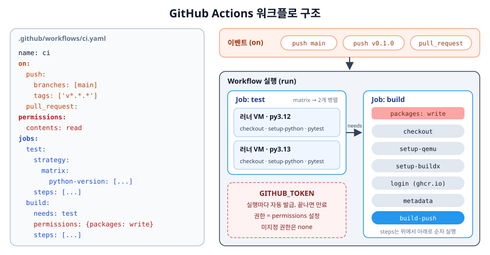
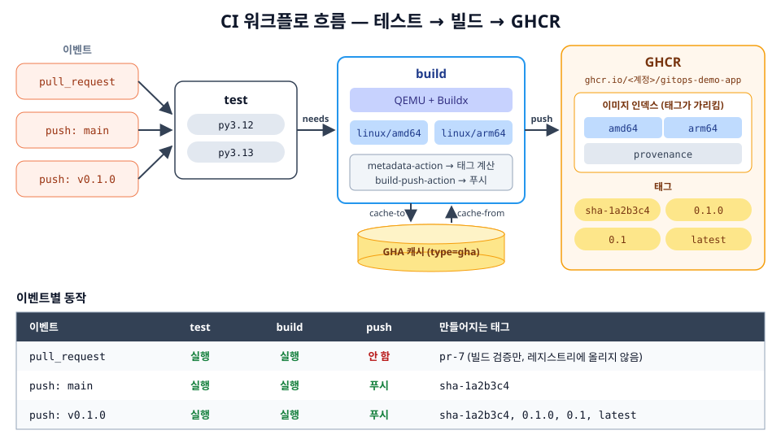

> **Chapter 7 · GitOps & CI/CD** | 난이도 ★★★☆☆ | 예상 소요 1.5 ~ 2시간

## 🎯 오늘의 목표

- GitHub Actions 워크플로의 구조(`on`, `jobs`, `steps`, `matrix`, `permissions`)를 읽고 쓸 수 있다
- push·PR마다 **pytest**를 Python 버전 매트릭스로 자동 실행한다
- Docker 공식 액션 4종(setup-buildx, login, metadata, build-push)으로 **GHCR**에 이미지를 푸시한다
- `GITHUB_TOKEN`과 `packages: write` 권한이 어떻게 연결되는지 안다
- `sha-` 태그·semver 태그, **GHA 캐시**(`type=gha`), **QEMU**로 `linux/amd64,linux/arm64` 멀티 아키텍처 이미지를 만든다

---

## 1. 어제 손으로 한 일을 CI에게

Day 50에서 우리는 이렇게 했습니다.

```bash
pytest                                                  # 테스트
docker build -t gitops-demo-app:0.1.0 ...               # 빌드
kind load docker-image gitops-demo-app:0.1.0 ...        # (레지스트리 대신) 배포 대상에 전달
```

이 세 줄에는 문제가 있습니다. **내 PC에서만** 돌았고, 테스트를 깜빡해도 막을 사람이 없으며, 이미지가 내 PC 안에만 있습니다. 오늘은 이것을 GitHub Actions로 옮겨 **push할 때마다 같은 절차가 깨끗한 환경에서** 돌게 합니다. 결과물은 누구나(그리고 Day 53의 Argo CD가 동기화하는 클러스터가) 받을 수 있는 레지스트리, **GHCR(GitHub Container Registry)** 에 올립니다.

| 항목 | Day 50 (수동) | Day 51 (CI) |
|---|---|---|
| 실행 환경 | 내 PC (환경마다 다름) | 매번 새로 만든 러너 VM |
| 테스트 | 기억나면 | push·PR마다 무조건, 실패하면 빌드 중단 |
| 이미지 태그 | 손으로 `0.1.0` | 커밋 SHA·Git 태그에서 **자동 계산** |
| 이미지 위치 | 로컬 Docker / kind 노드 | `ghcr.io/<계정>/gitops-demo-app` |
| 아키텍처 | 내 PC와 같은 것 하나 | `amd64` + `arm64` 동시 |

---

## 2. GitHub Actions 구조



| 개념 | 설명 | 비유 |
|---|---|---|
| **Workflow** | `.github/workflows/*.yaml` 파일 하나. 레포에 여러 개 둘 수 있음 | 자동화 시나리오 |
| **Event** (`on`) | 워크플로를 깨우는 사건: `push`, `pull_request`, `workflow_dispatch`(수동), `schedule` 등 | 방아쇠 |
| **Job** (`jobs`) | 하나의 **러너(VM)** 에서 실행되는 단위. 기본은 **병렬**, `needs`로 순서 지정 | 작업자 한 명 |
| **Step** (`steps`) | Job 안에서 **순서대로** 실행. `run`(셸 명령) 또는 `uses`(액션) | 작업 지시서 한 줄 |
| **Action** (`uses`) | 재사용 가능한 단계 묶음. `소유자/레포@버전` 형태 | 공구 |
| **Runner** (`runs-on`) | Job이 실행되는 머신. `ubuntu-latest` 같은 GitHub 호스팅 러너 또는 셀프 호스팅 | 작업대 |

> 💡 Job마다 **새 VM**입니다. test Job에서 설치한 패키지나 만든 파일은 build Job에 없습니다. 그래서 각 Job이 `actions/checkout`으로 코드를 다시 받습니다.

### 2-1. 핵심 문법 한눈에

```yaml
name: ci                         # Actions 탭에 보일 이름

on:                              # ① 언제 실행?
  push:
    branches: [main]             #    main 브랜치에 push
    tags: ['v*.*.*']             #    v1.2.3 같은 태그 push
  pull_request:
    branches: [main]             #    main으로 향하는 PR
  workflow_dispatch:             #    Actions 탭의 "Run workflow" 버튼

permissions:                     # ② GITHUB_TOKEN 권한 (최소 권한)
  contents: read

jobs:                            # ③ 무엇을?
  test:
    runs-on: ubuntu-latest
    strategy:
      matrix:                    #    같은 Job을 값만 바꿔 여러 번 (병렬)
        python-version: ['3.12', '3.13']
    steps:
      - uses: actions/checkout@v7          # 액션 사용
      - run: echo "py ${{ matrix.python-version }}"   # 셸 명령, ${{ }} 는 표현식
  build:
    needs: test                  #    test가 전부 성공해야 시작
    runs-on: ubuntu-latest
    steps:
      - run: echo build
```

| 키 | 기억할 점 |
|---|---|
| `on.push.tags` / `branches` | glob 패턴. 둘 다 쓰면 **둘 중 하나**만 맞아도 실행 (같은 이벤트의 `branches`와 `paths`는 **둘 다** 맞아야 함) |
| `strategy.matrix` | 조합 수만큼 Job이 생김. `fail-fast`(기본 `true`)면 하나가 실패할 때 나머지를 취소 |
| `needs` | Job 의존성. 없으면 모든 Job이 동시에 시작 |
| `if` | `if: github.event_name != 'pull_request'` 처럼 조건부 실행 |
| `${{ }}` | 표현식. `github.*`(이벤트 정보), `secrets.*`, `matrix.*`, `steps.<id>.outputs.*` 등 |
| `permissions` | 하나라도 지정하면 **지정하지 않은 권한은 전부 `none`** 이 됨. 워크플로 최상위 또는 Job 단위 |

### 2-2. `GITHUB_TOKEN`과 `permissions`

워크플로가 실행될 때마다 GitHub는 **그 실행 동안만 유효한 토큰** `GITHUB_TOKEN`을 자동으로 만들어 `secrets.GITHUB_TOKEN`으로 넣어 줍니다. 이 토큰이 무엇을 할 수 있는지를 `permissions`로 정합니다.

| 권한 | 오늘 필요한 이유 |
|---|---|
| `contents: read` | `actions/checkout`으로 코드 읽기 |
| `packages: write` | **GHCR에 이미지 푸시** (build Job에만) |

> ⚠️ 워크플로 전체에 `packages: write`를 주지 말고 **푸시하는 Job에만** 주세요. PR에서 도는 test Job까지 쓰기 권한을 가질 이유가 없습니다. 개인 액세스 토큰(PAT)을 시크릿에 넣는 방식도 가능하지만, 만료되지 않는 장기 토큰이 레포에 남으므로 GHCR 푸시에는 `GITHUB_TOKEN`이 권장됩니다.

---

## 3. Docker 공식 액션 4종 (+ QEMU)

> **버전 확인 (2026-11 기준, 각 GitHub 릴리스 페이지):** `actions/checkout@v7`, `actions/setup-python@v7`, `docker/setup-qemu-action@v4`, `docker/setup-buildx-action@v4`, `docker/login-action@v4`, `docker/metadata-action@v6`, `docker/build-push-action@v7`. 메이저 버전 태그(`@v7`)는 해당 메이저의 최신 릴리스를 가리킵니다. 글을 읽는 시점에 더 새 메이저가 나왔다면 릴리스 노트의 변경 사항을 확인하고 올리세요.

| 액션 | 하는 일 | Day 연결 |
|---|---|---|
| `docker/setup-qemu-action` | 러너에 QEMU 에뮬레이터(binfmt) 등록 → amd64 러너에서 arm64 바이너리 실행 가능 | Day 21 QEMU |
| `docker/setup-buildx-action` | **Buildx** 빌더(BuildKit) 생성. 멀티 플랫폼·캐시 내보내기 지원 | Day 02~03 레이어·빌드 |
| `docker/login-action` | 레지스트리 로그인 (`ghcr.io` + `GITHUB_TOKEN`) | Day 02 레지스트리 |
| `docker/metadata-action` | Git 이벤트(브랜치·태그·SHA·PR)로부터 **이미지 태그와 OCI 라벨을 계산** | Day 02 태그 |
| `docker/build-push-action` | `docker buildx build --push` 실행 | Day 03 Dockerfile |

### 3-1. metadata-action — 태그를 "계산"한다

| 태그 규칙 | 언제 생기나 | 예 |
|---|---|---|
| `type=sha` | 모든 이벤트 | `sha-1a2b3c4` (커밋 SHA 앞 7자리, `sha-` 접두사) |
| `type=semver,pattern={{version}}` | `v0.1.0` 같은 **semver Git 태그** push | `0.1.0` (앞의 `v` 제거) |
| `type=semver,pattern={{major}}.{{minor}}` | 위와 같음 | `0.1` |
| `type=ref,event=pr` | PR | `pr-7` |
| (자동) `latest` | 기본 `flavor: latest=auto` — semver 규칙이 태그를 만들 때 함께 | `latest` |

> 💡 GitOps에서는 매니페스트에 **`sha-1a2b3c4`나 `0.1.0` 같은 불변 태그**를 씁니다(Day 50 원칙 2). `latest`는 생기더라도 매니페스트에는 쓰지 않습니다. 단 prerelease 태그(`v0.2.0-rc.1`)는 `{{version}}` 태그만 만들고 `latest`는 건드리지 않습니다.

### 3-2. GHA 캐시 — `type=gha`

러너는 매번 새 VM이라 Docker 레이어 캐시가 없습니다. 그대로 두면 **매 빌드가 `pip install`부터 다시** 합니다. BuildKit은 레이어 캐시를 **GitHub Actions 캐시 저장소**에 내보내고 가져올 수 있습니다.

```yaml
cache-from: type=gha             # 이전 실행의 캐시 가져오기
cache-to: type=gha,mode=max      # 이번 빌드의 모든 레이어(중간 단계 포함)를 캐시로 저장
```

| `mode` | 저장하는 것 | 언제 |
|---|---|---|
| `min` (기본) | 최종 이미지에 들어간 레이어만 | 캐시 용량을 아끼고 싶을 때 |
| `max` | 멀티 스테이지의 **중간 스테이지까지** 전부 | 빌드 속도 우선 (권장) |

> ⚠️ `type=gha`는 GitHub Actions 안에서만 동작합니다(캐시 서비스 주소·토큰이 워크플로 환경 변수로만 주어짐). GitHub 캐시 서비스는 v2 API만 지원하며, GitHub 호스팅 러너의 Buildx/BuildKit은 이미 최신이라 별도 설정이 필요 없습니다. 셀프 호스팅 러너에서 "This legacy service is shutting down" 오류가 나면 Buildx를 올리세요.

### 3-3. QEMU로 멀티 아키텍처

Apple Silicon Mac, Raspberry Pi, AWS Graviton은 **arm64**, 대부분의 서버와 GitHub 러너는 **amd64**입니다. 한 태그로 둘 다 지원하려면 **매니페스트 리스트(이미지 인덱스)** 가 필요합니다.

```yaml
- uses: docker/setup-qemu-action@v4
- uses: docker/setup-buildx-action@v4
- uses: docker/build-push-action@v7
  with:
    platforms: linux/amd64,linux/arm64
```

`docker pull`하면 Docker가 **자기 아키텍처에 맞는 이미지**를 인덱스에서 골라 받습니다. arm64 쪽은 QEMU 에뮬레이션으로 빌드하므로 **느립니다**(컴파일이 많은 이미지는 수 배). 우리 앱은 pip가 미리 빌드된 wheel을 받아서 크게 문제되지 않습니다.

> 💡 arm64 빌드가 너무 느리면 **arm64 네이티브 러너**(공개 레포는 `ubuntu-24.04-arm` 러너 사용 가능)에서 플랫폼별로 따로 빌드한 뒤 인덱스로 합치는 방식이 있습니다. Docker 문서의 "Distribute build across multiple runners" 예제를 참고하세요. 오늘은 단순한 QEMU 방식으로 갑니다.

---

## 4. 실습 ① CI 워크플로 작성



> **실습 환경:** Day 50에서 만든 `gitops-demo-app` 레포(Public)와 로컬 클론. GitHub CLI `gh`가 있으면 편하지만 웹 UI로도 됩니다.

`gitops-demo-app`에 아래 파일을 만듭니다.

```yaml
# .github/workflows/ci.yaml
name: ci

on:
  push:
    branches: [main]
    tags: ['v*.*.*']
  pull_request:
    branches: [main]
  workflow_dispatch:

permissions:
  contents: read

concurrency:                       # 같은 브랜치에 연속 push하면 이전 실행 취소
  group: ci-${{ github.ref }}
  cancel-in-progress: true

jobs:
  test:
    name: test (py${{ matrix.python-version }})
    runs-on: ubuntu-latest
    strategy:
      fail-fast: false
      matrix:
        python-version: ['3.12', '3.13']
    steps:
      - uses: actions/checkout@v7

      - uses: actions/setup-python@v7
        with:
          python-version: ${{ matrix.python-version }}
          cache: pip                               # pip 다운로드 캐시
          cache-dependency-path: requirements*.txt

      - run: pip install -r requirements-dev.txt
      - run: pytest -v

  build:
    needs: test
    runs-on: ubuntu-latest
    permissions:
      contents: read
      packages: write                              # GHCR 푸시는 이 Job에만
    steps:
      - uses: actions/checkout@v7

      - name: 이미지 이름 (GHCR는 소문자만 허용)
        id: image
        env:
          OWNER: ${{ github.repository_owner }}
        run: echo "name=ghcr.io/${OWNER,,}/gitops-demo-app" >> "$GITHUB_OUTPUT"

      - uses: docker/setup-qemu-action@v4
      - uses: docker/setup-buildx-action@v4

      - name: GHCR 로그인
        if: github.event_name != 'pull_request'
        uses: docker/login-action@v4
        with:
          registry: ghcr.io
          username: ${{ github.actor }}
          password: ${{ secrets.GITHUB_TOKEN }}

      - name: 태그·라벨 계산
        id: meta
        uses: docker/metadata-action@v6
        with:
          images: ${{ steps.image.outputs.name }}
          tags: |
            type=sha
            type=semver,pattern={{version}}
            type=semver,pattern={{major}}.{{minor}}
            type=ref,event=pr

      - name: 빌드 & 푸시
        id: build
        uses: docker/build-push-action@v7
        with:
          context: .
          platforms: linux/amd64,linux/arm64
          push: ${{ github.event_name != 'pull_request' }}
          tags: ${{ steps.meta.outputs.tags }}
          labels: ${{ steps.meta.outputs.labels }}
          build-args: |
            APP_VERSION=${{ steps.meta.outputs.version }}
          cache-from: type=gha
          cache-to: type=gha,mode=max

      - name: 실행 요약
        run: |
          {
            echo "### 이미지"
            echo '```'
            echo "${{ steps.meta.outputs.tags }}"
            echo '```'
            echo "digest: \`${{ steps.build.outputs.digest }}\`"
          } >> "$GITHUB_STEP_SUMMARY"
```

줄마다 무엇을 하는지 짚어 봅시다.

| 부분 | 설명 |
|---|---|
| `tags: ['v*.*.*']` | `v0.1.0` 태그를 push하면 릴리스 빌드 |
| `concurrency` | 같은 `github.ref`에서 새 실행이 오면 진행 중인 실행을 취소해 러너 시간 절약 |
| `fail-fast: false` | 3.12가 실패해도 3.13 결과까지 보고 싶을 때 |
| `cache: pip` | setup-python이 pip 다운로드 캐시를 `requirements*.txt` 해시로 저장·복원 |
| `${OWNER,,}` | bash의 소문자 변환. GitHub 계정명에 대문자가 있으면 GHCR 푸시가 실패하므로 미리 소문자로 |
| `if: ... != 'pull_request'` | PR에서는 로그인·푸시를 하지 않음 (**빌드가 되는지만 확인**) |
| `context: .` | 체크아웃한 작업 디렉터리를 빌드 컨텍스트로 (생략하면 Git 컨텍스트를 직접 씀) |
| `build-args: APP_VERSION=...` | Day 50 Dockerfile의 `ARG APP_VERSION`에 계산된 버전 주입. main push면 `sha-1a2b3c4`, 태그 push면 `0.1.0` |
| `steps.build.outputs.digest` | 푸시된 이미지 인덱스의 `sha256:` 다이제스트 — Day 57 서명에서 사용 |

---

## 5. 실습 ② 첫 실행 — main에 push

```bash
cd ~/gitops-lab/gitops-demo-app
mkdir -p .github/workflows
# 위 ci.yaml 저장 후
git add .github/workflows/ci.yaml
git commit -m "ci: 테스트·빌드·GHCR 푸시 워크플로"
git push
```

GitHub 레포의 **Actions** 탭에서 실행을 볼 수 있습니다. 터미널에서는:

```bash
gh run list --limit 3
# STATUS  TITLE                                  WORKFLOW  BRANCH  EVENT  ID          ELAPSED  AGE
# *       ci: 테스트·빌드·GHCR 푸시 워크플로     ci        main    push   1234567890  1m2s     ...

gh run watch          # 진행 중인 실행을 골라 실시간으로 보기
```

완료되면 이런 모양입니다.

```
✓ main ci · 1234567890
Triggered via push about 3 minutes ago

JOBS
✓ test (py3.12) in 21s
✓ test (py3.13) in 23s
✓ build in 2m41s
```

> 💡 첫 build는 캐시가 없어 오래 걸립니다. 코드 한 줄만 바꿔 다시 push하면 `pip install` 레이어가 **GHA 캐시에서 복원**되어(로그에 `CACHED`) 훨씬 빨라집니다. 캐시 목록은 레포 **Actions → Caches**에서 볼 수 있습니다.

### 5-1. GHCR 패키지 확인 & 공개로 전환

GitHub 프로필 → **Packages** 탭에 `gitops-demo-app`이 생겼습니다. metadata-action이 넣은 `org.opencontainers.image.source` 라벨 덕분에 패키지가 레포와 연결되어 레포 오른쪽 사이드바의 **Packages**에도 보입니다.

새 패키지는 기본이 **비공개(private)** 입니다. kind 클러스터가 인증 없이 받을 수 있도록 공개로 바꿉니다.

1. 패키지 페이지 → **Package settings**
2. 맨 아래 **Danger Zone → Change visibility → Public**

> ⚠️ 회사 코드라면 공개하지 말고 클러스터에 `imagePullSecret`(Day 13의 `docker-registry` 타입 Secret)을 만들어 쓰세요. 이 시리즈의 데모 앱은 공개해도 무방합니다.

### 5-2. 로컬에서 받아 보기

```bash
# GitHub 계정명을 소문자로 (예: my-github-id)
export GH_USER=<your-github-username>

docker pull ghcr.io/$GH_USER/gitops-demo-app:sha-1a2b3c4     # 실제 실행 요약에 나온 태그로
docker run --rm -p 8000:8000 ghcr.io/$GH_USER/gitops-demo-app:sha-1a2b3c4
curl http://localhost:8000/
# {"app":"gitops-demo-app","version":"sha-1a2b3c4","env":"local",...}
```

`version`에 **커밋 SHA 태그**가 찍혀 있습니다. 응답만 보고도 "어떤 커밋이 떠 있는지" 알 수 있게 된 것입니다.

---

## 6. 실습 ③ 릴리스 — semver 태그 push

```bash
git tag v0.1.0
git push origin v0.1.0
```

태그 push 이벤트에서는 metadata-action이 태그를 여러 개 만듭니다. 실행 요약(Summary)에서 확인하세요.

```
ghcr.io/<계정>/gitops-demo-app:sha-1a2b3c4
ghcr.io/<계정>/gitops-demo-app:0.1.0
ghcr.io/<계정>/gitops-demo-app:0.1
ghcr.io/<계정>/gitops-demo-app:latest
```

같은 커밋이므로 `sha-1a2b3c4`와 `0.1.0`은 **같은 다이제스트**를 가리킵니다.

### 6-1. 멀티 아키텍처 확인

```bash
docker buildx imagetools inspect ghcr.io/$GH_USER/gitops-demo-app:0.1.0
```

```
Name:      ghcr.io/<계정>/gitops-demo-app:0.1.0
MediaType: application/vnd.oci.image.index.v1+json
Digest:    sha256:9c1e...

Manifests:
  Name:        ghcr.io/<계정>/gitops-demo-app:0.1.0@sha256:41ab...
  MediaType:   application/vnd.oci.image.manifest.v1+json
  Platform:    linux/amd64

  Name:        ghcr.io/<계정>/gitops-demo-app:0.1.0@sha256:7d02...
  MediaType:   application/vnd.oci.image.manifest.v1+json
  Platform:    linux/arm64

  Name:        ghcr.io/<계정>/gitops-demo-app:0.1.0@sha256:...
  MediaType:   application/vnd.oci.image.manifest.v1+json
  Platform:    unknown/unknown
  Annotations:
    vnd.docker.reference.type:   attestation-manifest
  ...
```

`linux/amd64`, `linux/arm64` 두 이미지가 **인덱스 하나**로 묶였습니다. `unknown/unknown`은 build-push-action이 기본으로 붙이는 **빌드 출처 증명(provenance attestation)** 으로, Day 57 공급망 보안에서 다시 봅니다.

### 6-2. PR 흐름 확인

```bash
git switch -c feat/message
# app/main.py 의 기본 메시지를 "hello, gitops v2" 로 바꾸고
# tests 에 기본 메시지를 확인하는 테스트를 하나 추가
git commit -am "feat: 기본 메시지 변경"
git push -u origin feat/message
gh pr create --fill
```

PR 화면 하단에 `test (py3.12)`, `test (py3.13)`, `build` 체크가 붙습니다. PR에서는 `push: false`이므로 **빌드만 하고 GHCR에는 올리지 않습니다.** 테스트를 일부러 깨뜨려 push해 보면 `build`가 `needs: test` 때문에 **건너뛰어지는(skipped)** 것도 확인할 수 있습니다.

> 💡 레포 **Settings → Branches(또는 Rules)** 에서 main 브랜치에 "Require status checks to pass"를 걸고 `test (py3.12)` 등을 필수로 지정하면, 테스트가 실패한 PR은 머지 버튼이 막힙니다. CI가 진짜 "관문"이 되는 순간입니다.

확인이 끝나면 PR은 머지하거나 닫아도 됩니다.

---

## 7. 액션 버전 관리 — 작은 보안 습관

`uses: docker/login-action@v4`의 `v4`는 **움직이는 태그**입니다. 액션 저장소가 탈취되면 `v4`가 악성 코드를 가리킬 수도 있습니다. Day 50에서 이미지 태그에 대해 했던 이야기와 똑같습니다.

| 방식 | 예 | 장단점 |
|---|---|---|
| 메이저 태그 | `docker/login-action@v4` | 편함. 패치가 자동 반영되지만 신뢰를 액션 저장소에 맡김 |
| 커밋 SHA 고정 | `docker/login-action@<40자리 SHA> # v4.x.x` | 불변. GitHub 공식 문서의 GHCR 예제도 이 방식. 업데이트는 Dependabot에게 |

SHA로 고정했다면 Dependabot이 액션 업데이트 PR을 올리게 해 두세요.

```yaml
# .github/dependabot.yml
version: 2
updates:
  - package-ecosystem: github-actions
    directory: /
    schedule:
      interval: weekly
```

공급망 보안 전반(Trivy, cosign, Kyverno)은 Day 57에서 다룹니다.

---

## 8. Chapter 6 워크로드라면?

Day 43의 RAG API 이미지도 같은 워크플로를 그대로 씁니다. `images:`의 이름과 `context`만 바꾸면 됩니다. 단, **vLLM처럼 CUDA 베이스 이미지를 쓰는 경우**는 다릅니다.

- CUDA 이미지는 수 GB라 GHA 캐시(레포당 용량 제한)를 금방 채웁니다 → `cache-to: type=registry,ref=ghcr.io/<계정>/rag-api:buildcache,mode=max` 처럼 **레지스트리 캐시**를 고려
- vLLM 공식 이미지를 그대로 쓴다면 빌드할 필요 없이 **태그만 설정 레포에서 관리**하면 됩니다 (Day 52)
- arm64 GPU 노드가 없다면 `platforms: linux/amd64`만 빌드해 시간을 아끼세요

---

## 9. 트러블슈팅

| 증상 | 원인 | 해결 |
|---|---|---|
| `denied: installation not allowed to Create organization package` / `permission_denied: write_package` | build Job에 `packages: write` 없음, 또는 패키지가 다른 레포에 연결돼 있음 | Job `permissions`에 `packages: write` 추가. 기존 패키지라면 Package settings → **Manage Actions access**에서 이 레포에 Write 부여 |
| `invalid reference format: repository name must be lowercase` | 계정명에 대문자 | 워크플로처럼 `${OWNER,,}`로 소문자 변환 |
| kind Pod가 `ErrImagePull` (`401 Unauthorized`) | GHCR 패키지가 private | 패키지를 Public으로 바꾸거나 `imagePullSecret` 사용 |
| PR에서만 build Job이 푸시 단계에서 `unauthorized` / `denied`로 실패 | 로그인은 PR에서 건너뛰는데 `push: true`로 고정되어 있음 | `push: ${{ github.event_name != 'pull_request' }}` 확인 |
| 태그를 push했는데 semver 태그(`0.1.0`)가 안 생김 | 태그 이름이 semver가 아님 (`release-1`, `v1.0` 등) | `v0.1.0`처럼 `vMAJOR.MINOR.PATCH`로. `on.push.tags` 패턴도 일치하는지 확인 |
| arm64 빌드가 `exec format error` | QEMU 미설정 | `docker/setup-qemu-action`이 `setup-buildx-action`보다 **먼저** 있는지 확인 |
| 매 빌드가 처음부터 다시 | `cache-to` 누락 또는 캐시 용량 초과로 축출 | `cache-to: type=gha,mode=max`, Actions → Caches에서 용량 확인 |
| `This legacy service is shutting down` | 셀프 호스팅 러너의 오래된 Buildx/BuildKit (캐시 v1 API) | `setup-buildx-action`의 `version: latest` 등으로 Buildx 업데이트 |

---

## 10. 핵심 정리

- 워크플로 = `on`(이벤트) → `jobs`(러너 VM 단위, 기본 병렬, `needs`로 순서) → `steps`(순차, `run` 또는 `uses`)
- `matrix`로 같은 Job을 값만 바꿔 병렬 실행, `permissions`는 지정하면 나머지가 `none` — **최소 권한, 쓰기는 필요한 Job에만**
- GHCR 푸시 = `docker/login-action` + `GITHUB_TOKEN` + `packages: write`
- `docker/metadata-action`이 Git 이벤트로 태그 계산: `sha-1a2b3c4`(모든 push), `0.1.0`·`0.1`·`latest`(semver 태그)
- `cache-from/to: type=gha`로 레이어 캐시 재사용, `mode=max`면 중간 스테이지까지
- QEMU + Buildx + `platforms: linux/amd64,linux/arm64` → 이미지 **인덱스 하나**에 두 아키텍처
- GitOps 매니페스트에는 `latest`가 아닌 **불변 태그**를 쓴다

---

## 11. 셀프 체크

<details>
<summary>Q1. test Job에서 <code>pip install</code>한 패키지를 build Job에서 그대로 쓸 수 없는 이유는?</summary>

Job마다 **새 러너 VM**에서 실행되기 때문입니다. Job 사이에 파일을 넘기려면 artifact 업로드/다운로드나 캐시를 써야 합니다. 그래서 build Job도 `actions/checkout`부터 다시 합니다.
</details>

<details>
<summary>Q2. 워크플로 최상위에 <code>permissions: contents: read</code>만 썼다. build Job이 GHCR에 푸시하려면?</summary>

build Job에 `permissions: { contents: read, packages: write }`를 지정합니다. `permissions`를 하나라도 지정하면 나머지는 `none`이 되므로 최상위 설정만으로는 `packages` 쓰기가 없습니다. Job 단위 `permissions`는 그 Job의 권한을 다시 정의합니다.
</details>

<details>
<summary>Q3. main 브랜치 push와 <code>v0.1.0</code> 태그 push에서 metadata-action이 만드는 태그는 각각?</summary>

main push: `sha-1a2b3c4`(오늘 설정 기준). 태그 push: `sha-1a2b3c4`, `0.1.0`, `0.1`, 그리고 `latest=auto` 기본값에 의해 `latest`.
</details>

<details>
<summary>Q4. <code>cache-to: type=gha,mode=max</code>에서 <code>mode=max</code>는 무엇을 더 저장하나?</summary>

최종 이미지에 포함된 레이어뿐 아니라 **멀티 스테이지 빌드의 중간 스테이지 레이어까지** 캐시로 내보냅니다. 빌더 스테이지가 무거운 Dockerfile에서 효과가 큽니다.
</details>

<details>
<summary>Q5. 같은 태그 <code>0.1.0</code>을 amd64 PC와 arm64 Mac에서 pull하면 어떻게 각자 맞는 이미지를 받나?</summary>

태그가 **이미지 인덱스(매니페스트 리스트)** 를 가리키고, 인덱스 안에 `linux/amd64`, `linux/arm64` 매니페스트가 있습니다. Docker(containerd)는 자신의 플랫폼에 맞는 매니페스트를 골라 해당 레이어만 받습니다.
</details>

---

## ⏭️ 다음 예고 — Day 52. Kustomize로 환경별(dev/stage/prod) 매니페스트 관리

이제 GHCR에 `sha-1a2b3c4`와 `0.1.0` 이미지가 있습니다. 그런데 설정 레포의 Deployment는 아직 Day 50의 로컬 이미지 `gitops-demo-app:0.1.0`을 가리키고, 환경도 하나뿐입니다. 내일은 **Kustomize**의 `base/overlays` 구조로 dev·stage·prod를 나누고, `images`로 환경마다 다른 태그를, `patches`와 `configMapGenerator`로 환경별 설정을 입혀 `infra-lab`에 dev를 배포합니다.
