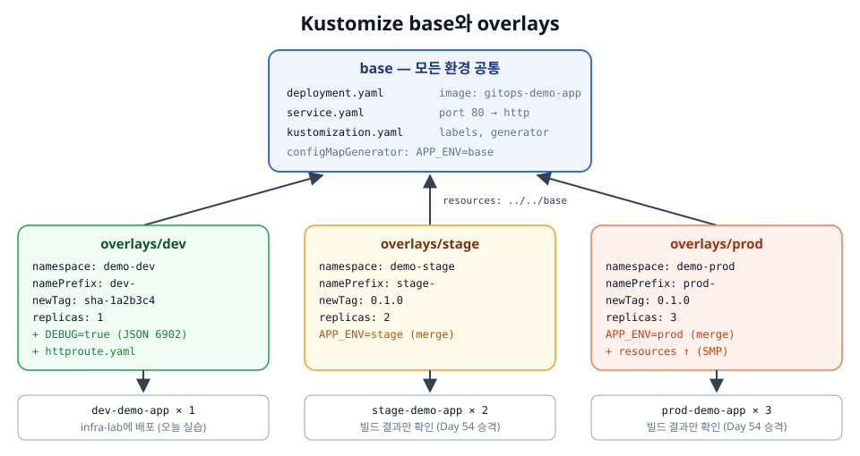
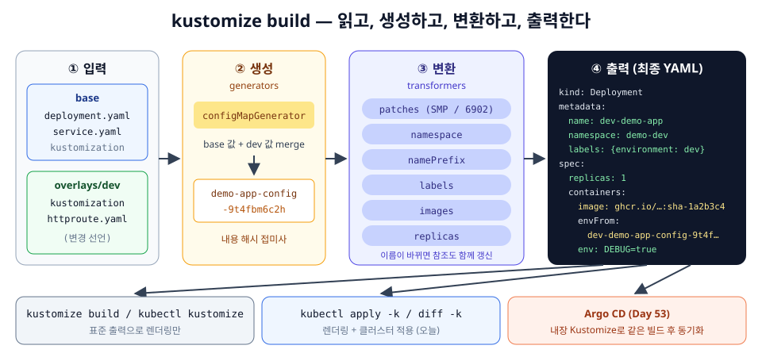
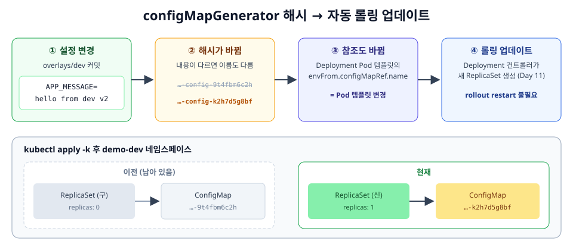

> **Chapter 7 · GitOps & CI/CD** | 난이도 ★★★☆☆ | 예상 소요 1.5 ~ 2시간

## 🎯 오늘의 목표

- 환경별 YAML 복사본이 왜 문제인지, Kustomize의 **base/overlays** 구조가 이를 어떻게 푸는지 설명할 수 있다
- `namePrefix`, `labels`, `images`, `replicas`, `patches`(strategic merge / JSON 6902), `configMapGenerator`를 쓸 수 있다
- `kustomize build`와 `kubectl apply -k`의 관계를 안다
- `gitops-demo-config`에 dev/stage/prod overlay를 만들고 `infra-lab`에 **dev**를 배포한다
- Helm(Day 16)과 Kustomize를 비교해 상황에 맞게 고를 수 있다

---

## 1. 왜 Kustomize인가 — 복사본 3벌의 문제

Day 51까지 설정 레포에는 Deployment·Service 한 벌만 있었습니다. 실제로는 환경이 여러 개입니다.

| | dev | stage | prod |
|---|---|---|---|
| 이미지 태그 | 최신 커밋 `sha-…` | 릴리스 후보 `0.1.0` | 검증된 `0.1.0` |
| 레플리카 | 1 | 2 | 3 |
| 리소스 | 작게 | 작게 | 넉넉하게 |
| 설정값 | `APP_ENV=dev`, 디버그 켬 | `APP_ENV=stage` | `APP_ENV=prod` |
| 네임스페이스 | `demo-dev` | `demo-stage` | `demo-prod` |

가장 쉬운 방법은 `dev/`, `stage/`, `prod/` 폴더에 YAML을 **복사**하는 것입니다. 하지만 probe 경로 하나를 고치려면 세 군데를 고쳐야 하고, 한 곳을 빼먹는 순간 환경끼리 어긋납니다. 그리고 그 차이가 "의도한 차이"인지 "실수"인지 아무도 모릅니다.

Kustomize의 답은 이렇습니다.

> **공통 부분은 base에 한 번만 쓰고, 환경마다 "달라지는 부분만" overlay에 선언한다.** 템플릿 문법 없이 순수 YAML만으로.

Kustomize는 Kubernetes SIG-CLI 프로젝트이고 **kubectl에 내장**되어 있습니다(`kubectl apply -k`, `kubectl kustomize`). Day 09에서 `kubectl version --client`에 `Kustomize Version`이 함께 나왔던 이유입니다. Day 13에서 맛본 `configMapGenerator`의 해시 접미사도 오늘 제대로 다룹니다.

---

## 2. base와 overlays



| 개념 | 설명 |
|---|---|
| **kustomization.yaml** | 디렉터리마다 하나. "어떤 리소스를 모아 어떻게 변환할지" 선언 |
| **base** | 환경과 무관한 공통 매니페스트. 혼자서도 빌드 가능 |
| **overlay** | `resources:`로 base를 참조하고, 그 위에 환경별 변경을 얹음 |
| **빌드** | base 리소스를 읽고 → overlay의 변환을 순서대로 적용 → 최종 YAML 출력. **클러스터에 아무것도 저장하지 않음** |

오늘 완성할 설정 레포 구조입니다.

```
gitops-demo-config/
└── apps/demo-app/
    ├── base/
    │   ├── kustomization.yaml      # 새로 추가
    │   ├── deployment.yaml         # Day 50 파일 수정
    │   └── service.yaml            # Day 50 그대로
    └── overlays/
        ├── dev/
        │   ├── kustomization.yaml
        │   └── httproute.yaml
        ├── stage/
        │   └── kustomization.yaml
        └── prod/
            ├── kustomization.yaml
            └── patch-resources.yaml
```

> 💡 Day 53에서 Argo CD Application이 `apps/demo-app/overlays/dev` 같은 **overlay 경로**를 가리키게 됩니다. 경로 이름을 그대로 맞춰 두세요.

---

## 3. 주요 필드 한눈에



| 필드 | 하는 일 | 예 |
|---|---|---|
| `resources` | 포함할 YAML 파일 또는 다른 kustomization 디렉터리(base) | `- ../../base` |
| `namespace` | 모든 네임스페이스 리소스의 `metadata.namespace` 설정 | `demo-dev` |
| `namePrefix` / `nameSuffix` | 모든 리소스 이름에 접두사/접미사. **참조(Service→ConfigMap 등)도 함께 변경** | `dev-` → `dev-demo-app` |
| `labels` | 모든 리소스에 라벨. `includeSelectors`/`includeTemplates`로 범위 지정 | `environment: dev` |
| `images` | 컨테이너 이미지의 이름·태그·다이제스트 교체 | `newTag: sha-1a2b3c4` |
| `replicas` | Deployment/StatefulSet 등의 레플리카 수 | `count: 3` |
| `patches` | 임의의 필드 수정. strategic merge 또는 JSON 6902 | 리소스 크기, env 추가 |
| `configMapGenerator` / `secretGenerator` | 리터럴·파일에서 ConfigMap/Secret 생성, 이름에 **내용 해시** 부착 | `demo-app-config-5f8k9b2m7t` |

### 3-1. `labels` vs 지원 중단된 `commonLabels`

| 필드 | 메타데이터 라벨 | 셀렉터·Pod 템플릿 |
|---|---|---|
| `commonLabels` (**deprecated**) | 추가 | **항상** 셀렉터에도 추가 |
| `labels` + 기본값 | 추가 | 건드리지 않음 (`includeSelectors`, `includeTemplates` 모두 기본 `false`) |
| `labels` + `includeTemplates: true` | 추가 | Pod 템플릿에는 추가, **셀렉터는 그대로** |
| `labels` + `includeSelectors: true` | 추가 | 셀렉터와 템플릿 모두 추가 (= `commonLabels`와 동일) |

> ⚠️ Deployment의 `spec.selector`는 **생성 후 변경할 수 없습니다**(Day 11). 이미 배포된 앱의 셀렉터에 라벨을 추가하게 되면 apply가 실패합니다. 그래서 오늘은 `includeTemplates: true`로 **Pod에는 라벨을 붙이되 셀렉터는 건드리지 않습니다.**

### 3-2. 두 가지 patch

| | Strategic Merge Patch (SMP) | JSON 6902 Patch |
|---|---|---|
| 모양 | 바꿀 부분만 담은 **부분 매니페스트** | `op`/`path`/`value` **연산 목록** |
| 리스트 처리 | `containers`는 `name` 기준으로 병합 (K8s 스키마를 앎) | 인덱스로 지정 (`/containers/0/...`) |
| 대상 지정 | 파일 안의 `kind`/`metadata.name`으로 자동 매칭 (`target` 생략 가능) | **`target` 필수** |
| 잘 맞는 곳 | 리소스 크기, probe, 볼륨 등 "덮어쓰기" | 필드 추가·삭제, 리스트의 특정 원소, CRD |

> 💡 예전 자료에서 보이는 `patchesStrategicMerge`, `patchesJson6902` 필드는 Kustomize v5에서 **deprecated**되었습니다. 지금은 둘 다 `patches:` 하나로 씁니다. 옛 파일은 `kustomize edit fix`로 변환할 수 있습니다.

---

## 4. 설치 & 버전

> **실습 환경:** Day 50~51의 `gitops-demo-config` 클론, Day 09의 kind `infra-lab`, Day 15의 Traefik + Gateway API. 작성 기준 **Kustomize v5.8.3**(standalone 최신, 2026-11 기준), kubectl 내장 Kustomize는 kubectl 버전에 따라 조금 더 낮은 v5.x입니다.

kubectl만 있어도 오늘 실습은 전부 됩니다. `kustomize edit` 같은 편집 명령을 쓰려면 standalone 바이너리를 설치합니다.

```bash
# macOS
brew install kustomize

# Windows (Chocolatey)
choco install kustomize

# Linux — 현재 디렉터리에 OS에 맞는 바이너리를 내려받는 공식 스크립트
curl -s "https://raw.githubusercontent.com/kubernetes-sigs/kustomize/master/hack/install_kustomize.sh" | bash
sudo mv kustomize /usr/local/bin/
```

```bash
kustomize version
# v5.8.3

kubectl version --client
# Client Version: v1.34.x
# Kustomize Version: v5.x.x
```

| 명령 | 하는 일 |
|---|---|
| `kustomize build <dir>` | 최종 YAML을 표준 출력으로 (standalone) |
| `kubectl kustomize <dir>` | 위와 같음 (kubectl 내장) |
| `kubectl apply -k <dir>` | 빌드 + apply를 한 번에 (= `kustomize build <dir> \| kubectl apply -f -`) |
| `kubectl diff -k <dir>` | 빌드 결과와 클러스터 현재 상태 비교 |
| `kubectl delete -k <dir>` | 빌드 결과에 있는 리소스 삭제 |

> ⚠️ kubectl 내장 버전은 standalone보다 늦게 따라옵니다. 최신 필드를 쓰다가 `kubectl kustomize`만 실패한다면 버전 차이를 의심하세요. Argo CD(Day 53)도 자체 내장 Kustomize를 씁니다.

---

## 5. 실습 ① base 만들기

Day 50의 base를 Kustomize용으로 다듬습니다. 바뀌는 점은 두 가지입니다.

1. 이미지를 **환경 중립적인 이름**으로 두고, 실제 레지스트리 주소·태그는 overlay의 `images`가 정한다
2. 환경 변수를 ConfigMap(`configMapGenerator`)에서 받는다 (`envFrom`, Day 13)

```yaml
# apps/demo-app/base/deployment.yaml
apiVersion: apps/v1
kind: Deployment
metadata:
  name: demo-app
  labels:
    app.kubernetes.io/name: demo-app
spec:
  replicas: 1
  selector:
    matchLabels:
      app.kubernetes.io/name: demo-app
  template:
    metadata:
      labels:
        app.kubernetes.io/name: demo-app
    spec:
      containers:
      - name: demo-app
        image: gitops-demo-app:0.1.0        # overlay의 images가 교체
        ports:
        - name: http
          containerPort: 8000
        envFrom:
        - configMapRef:
            name: demo-app-config           # 생성된 해시 이름으로 자동 치환됨
        readinessProbe:
          httpGet:
            path: /healthz
            port: http
        livenessProbe:
          httpGet:
            path: /healthz
            port: http
        resources:
          requests:
            cpu: 50m
            memory: 64Mi
          limits:
            memory: 128Mi
```

`service.yaml`은 Day 50 그대로 둡니다. base의 kustomization입니다.

```yaml
# apps/demo-app/base/kustomization.yaml
apiVersion: kustomize.config.k8s.io/v1beta1
kind: Kustomization

resources:
- deployment.yaml
- service.yaml

labels:
- pairs:
    app.kubernetes.io/part-of: gitops-demo
  includeTemplates: true

configMapGenerator:
- name: demo-app-config
  literals:
  - APP_ENV=base
  - APP_MESSAGE=hello, gitops
```

```bash
cd ~/gitops-lab/gitops-demo-config
kubectl kustomize apps/demo-app/base
```

출력에서 확인할 것(일부):

```yaml
apiVersion: v1
data:
  APP_ENV: base
  APP_MESSAGE: hello, gitops
kind: ConfigMap
metadata:
  labels:
    app.kubernetes.io/part-of: gitops-demo
  name: demo-app-config-b7c2m9h4kt      # ← 내용 해시 접미사 (값은 내용에 따라 다름)
---
...
      - envFrom:
        - configMapRef:
            name: demo-app-config-b7c2m9h4kt   # ← 참조도 같이 바뀜
```

> 💡 `kustomize build` 출력은 필드가 알파벳순으로 정렬되어 나옵니다. 원본 파일과 순서가 달라 보여도 내용은 같습니다.

> 💡 이제 base 폴더에 `kustomization.yaml`이 있으므로 Day 50처럼 `kubectl apply -f apps/demo-app/base/`를 하면 kustomization.yaml까지 리소스로 보내려다 실패합니다. 앞으로는 항상 **`-k`** 를 씁니다.

---

## 6. 실습 ② dev / stage / prod overlay

### 6-1. dev — 최신 커밋, 디버그 켜기, HTTPRoute로 노출

Day 51 실행 요약에서 확인한 **main 브랜치 빌드의 `sha-` 태그**를 씁니다. 아래 `<your-github-username>`과 `sha-1a2b3c4`는 각자의 값으로 바꾸세요.

```yaml
# apps/demo-app/overlays/dev/kustomization.yaml
apiVersion: kustomize.config.k8s.io/v1beta1
kind: Kustomization

namespace: demo-dev
namePrefix: dev-

resources:
- ../../base
- httproute.yaml

labels:
- pairs:
    environment: dev
  includeTemplates: true

images:
- name: gitops-demo-app                                  # base의 이미지 이름과 매칭
  newName: ghcr.io/<your-github-username>/gitops-demo-app
  newTag: sha-1a2b3c4

replicas:
- name: demo-app                                         # 접두사 붙기 전 base 이름
  count: 1

configMapGenerator:
- name: demo-app-config
  behavior: merge                                        # base의 ConfigMap에 값 덮어쓰기
  literals:
  - APP_ENV=dev
  - APP_MESSAGE=hello from dev

patches:
- target:                                                # JSON 6902는 target 필수
    kind: Deployment
    name: demo-app
  patch: |-
    - op: add
      path: /spec/template/spec/containers/0/env
      value:
      - name: DEBUG
        value: "true"
```

dev만 Day 15의 Traefik Gateway로 노출합니다.

```yaml
# apps/demo-app/overlays/dev/httproute.yaml
apiVersion: gateway.networking.k8s.io/v1
kind: HTTPRoute
metadata:
  name: demo-app
spec:
  parentRefs:
  - name: traefik-gateway
    namespace: traefik
  hostnames:
  - "dev.demo.example.test"
  rules:
  - backendRefs:
    - name: dev-demo-app      # ⚠️ 접두사가 붙은 Service 이름을 직접 적음
      port: 80
```

> ⚠️ Kustomize는 Deployment→ConfigMap, Service→Pod 같은 **내장 리소스의 참조**는 알아서 바꿔 주지만, HTTPRoute 같은 **CRD의 `backendRefs`는 모릅니다.** 그래서 `namePrefix`가 적용된 최종 이름(`dev-demo-app`)을 직접 써야 합니다. (HTTPRoute 자신의 `metadata.name`과 `namespace`는 일반 필드라 자동으로 바뀝니다.)

이미지 태그는 손으로 고쳐도 되지만, CI나 스크립트에서는 `kustomize edit`를 씁니다. Day 54의 Image Updater도 결국 이 파일의 `newTag`를 바꾸는 일을 합니다.

```bash
cd apps/demo-app/overlays/dev
export GH_USER=<your-github-username>
kustomize edit set image gitops-demo-app=ghcr.io/$GH_USER/gitops-demo-app:sha-1a2b3c4
cd -
```

### 6-2. stage — 릴리스 태그, 레플리카 2

```yaml
# apps/demo-app/overlays/stage/kustomization.yaml
apiVersion: kustomize.config.k8s.io/v1beta1
kind: Kustomization

namespace: demo-stage
namePrefix: stage-

resources:
- ../../base

labels:
- pairs:
    environment: stage
  includeTemplates: true

images:
- name: gitops-demo-app
  newName: ghcr.io/<your-github-username>/gitops-demo-app
  newTag: 0.1.0

replicas:
- name: demo-app
  count: 2

configMapGenerator:
- name: demo-app-config
  behavior: merge
  literals:
  - APP_ENV=stage
```

### 6-3. prod — 레플리카 3, 리소스 증설(strategic merge)

```yaml
# apps/demo-app/overlays/prod/kustomization.yaml
apiVersion: kustomize.config.k8s.io/v1beta1
kind: Kustomization

namespace: demo-prod
namePrefix: prod-

resources:
- ../../base

labels:
- pairs:
    environment: prod
  includeTemplates: true

images:
- name: gitops-demo-app
  newName: ghcr.io/<your-github-username>/gitops-demo-app
  newTag: 0.1.0

replicas:
- name: demo-app
  count: 3

configMapGenerator:
- name: demo-app-config
  behavior: merge
  literals:
  - APP_ENV=prod

patches:
- path: patch-resources.yaml          # SMP: 파일 안의 kind/name으로 대상 자동 매칭
```

```yaml
# apps/demo-app/overlays/prod/patch-resources.yaml
apiVersion: apps/v1
kind: Deployment
metadata:
  name: demo-app
spec:
  template:
    spec:
      containers:
      - name: demo-app                 # 이 name으로 base의 컨테이너와 병합
        resources:
          requests:
            cpu: 200m
            memory: 128Mi
          limits:
            memory: 256Mi
```

### 6-4. 빌드 결과 비교

```bash
kubectl kustomize apps/demo-app/overlays/prod | grep -E "name: prod-|replicas:|image:|cpu:|APP_ENV"
```

```
  APP_ENV: prod
  name: prod-demo-app-config-6dk2t8f9gm
  name: prod-demo-app
  name: prod-demo-app
  replicas: 3
            name: prod-demo-app-config-6dk2t8f9gm
        image: ghcr.io/<your-github-username>/gitops-demo-app:0.1.0
            cpu: 200m
```

환경 사이의 **의도한 차이만** 보고 싶으면 두 빌드 결과를 diff 합니다.

```bash
diff <(kubectl kustomize apps/demo-app/overlays/stage) <(kubectl kustomize apps/demo-app/overlays/prod)
```

PR 리뷰 때 "prod에서 정확히 무엇이 바뀌나"를 이렇게 확인하는 습관이 GitOps의 핵심입니다.

---

## 7. 실습 ③ infra-lab에 dev 배포

> ⚠️ Day 50의 Push 실습(`demo-push` 네임스페이스)이 남아 있다면 먼저 지우세요: `kubectl delete namespace demo-push --ignore-not-found`. 또 Day 51에서 GHCR 패키지를 **Public**으로 바꿨는지 확인하세요.

```bash
kubectl config current-context        # kind-infra-lab
kubectl create namespace demo-dev

cd ~/gitops-lab/gitops-demo-config
kubectl diff -k apps/demo-app/overlays/dev      # 무엇이 생길지 미리 보기 (새로 생기는 것만 +)
kubectl apply -k apps/demo-app/overlays/dev
```

```
configmap/dev-demo-app-config-9t4fbm6c2h created
service/dev-demo-app created
deployment.apps/dev-demo-app created
httproute.gateway.networking.k8s.io/dev-demo-app created
```

```bash
kubectl -n demo-dev rollout status deploy/dev-demo-app
kubectl -n demo-dev get pods --show-labels
# NAME                            READY   STATUS    ...   LABELS
# dev-demo-app-7c9d8b6f5d-x2k4p   1/1     Running   ...   app.kubernetes.io/name=demo-app,app.kubernetes.io/part-of=gitops-demo,environment=dev,pod-template-hash=...
```

Day 15처럼 `--connect-to`로 Traefik(`localhost:30080`)을 거쳐 접속합니다.

```bash
curl --connect-to dev.demo.example.test:80:127.0.0.1:30080 http://dev.demo.example.test/
```

```json
{"app":"gitops-demo-app","version":"sha-1a2b3c4","env":"dev","message":"hello from dev","debug":"true","pod":"dev-demo-app-7c9d8b6f5d-x2k4p"}
```

| 응답 필드 | 어디서 왔나 |
|---|---|
| `version: sha-1a2b3c4` | Day 51 CI가 `APP_VERSION` build-arg로 이미지에 구움 + dev overlay `images.newTag` |
| `env`, `message` | base `configMapGenerator` + dev `behavior: merge` |
| `debug: "true"` | dev의 JSON 6902 patch |
| `pod: dev-…` | `namePrefix: dev-` |

> 💡 Traefik이 없다면 `kubectl -n demo-dev port-forward svc/dev-demo-app 8080:80` 후 `curl http://localhost:8080/`로 확인해도 됩니다.

### 7-1. configMapGenerator의 해시 접미사가 롤링 업데이트를 일으킨다



Day 13에서 "ConfigMap을 바꿔도 환경 변수는 Pod를 재시작해야 반영된다"고 배웠습니다. 해시 접미사가 이 문제를 어떻게 푸는지 봅시다. dev overlay의 메시지를 바꿉니다.

```yaml
  # overlays/dev/kustomization.yaml 의 configMapGenerator
  - APP_MESSAGE=hello from dev v2
```

```bash
kubectl diff -k apps/demo-app/overlays/dev | grep -E "^[-+] +name: dev-demo-app-config"
# (일부) Deployment의 envFrom 참조가 바뀌는 부분
# -            name: dev-demo-app-config-9t4fbm6c2h
# +            name: dev-demo-app-config-k2h7d5g8bf

kubectl apply -k apps/demo-app/overlays/dev
# configmap/dev-demo-app-config-k2h7d5g8bf created
# service/dev-demo-app unchanged
# deployment.apps/dev-demo-app configured
# httproute.gateway.networking.k8s.io/dev-demo-app unchanged
```

내용이 바뀌면 → 해시가 바뀌고 → **새 이름의 ConfigMap**이 생기고 → Deployment의 `envFrom` 참조가 바뀌어 → Pod 템플릿이 변경되므로 **자동으로 롤링 업데이트**(Day 11)가 일어납니다. `kubectl rollout restart`가 필요 없습니다.

```bash
curl --connect-to dev.demo.example.test:80:127.0.0.1:30080 http://dev.demo.example.test/
# {...,"message":"hello from dev v2",...}

kubectl -n demo-dev get configmap
# NAME                            DATA   AGE
# dev-demo-app-config-9t4fbm6c2h   2      10m    ← 이전 것이 남아 있음
# dev-demo-app-config-k2h7d5g8bf   2      30s
# kube-root-ca.crt                 1      10m
```

> 💡 예전 ConfigMap이 남는 건 Day 50에서 본 "`apply`는 prune하지 않는다" 그대로입니다. 덕분에 롤백 시 이전 ReplicaSet이 참조할 ConfigMap이 살아 있다는 장점도 있습니다. Day 53의 Argo CD는 Git에 없는 리소스를 Prune으로 정리합니다.

변경 사항은 설정 레포에 커밋해 둡니다. **이 커밋이 곧 "dev에 무엇을 배포했나"의 기록**이 됩니다.

```bash
git add apps/
git commit -m "feat(demo-app): Kustomize base/overlays (dev, stage, prod)"
git push
```

> ⚠️ `demo-dev` 네임스페이스와 리소스는 **남겨 두세요.** Day 53에서 Argo CD가 이 리소스를 "이미 존재하는 상태"로 발견하고 Git과 비교하는 장면부터 시작합니다. 다시 처음부터 하고 싶다면 `kubectl delete -k apps/demo-app/overlays/dev`.

---

## 8. Chapter 6 워크로드도 같은 구조로

Day 45의 vLLM 매니페스트도 같은 방식으로 관리하면 "GPU가 있는 클러스터"와 "없는 클러스터"의 차이를 overlay로 표현할 수 있습니다.

```
apps/vllm/
├── base/                      # Deployment(vLLM), Service, PVC(모델 캐시)
└── overlays/
    ├── homelab-gpu/           # images: vllm/vllm-openai 태그, resources: nvidia.com/gpu: 1, 큰 모델
    └── cpu-dev/               # Ollama CPU 모드 같은 대체 이미지, 작은 모델, GPU 리소스 제거(JSON 6902 remove)
```

- 모델 ID·`--max-model-len` 같은 인자는 `configMapGenerator`로 → 바꾸면 해시 덕분에 자동 재배포
- GPU 요청 제거처럼 **리스트 원소 삭제**는 JSON 6902의 `op: remove`가 편함
- rag-api(Day 43)는 demo-app과 거의 같은 base에 `QDRANT_URL` 등만 ConfigMap으로

---

## 9. Helm과 비교 (Day 16)

| 구분 | Helm (Day 16) | Kustomize |
|---|---|---|
| 접근 방식 | **템플릿**: `{{ .Values.x }}`에 값 주입 | **패치**: 완성된 YAML 위에 변경을 덧씌움 |
| 입력 | 차트(templates/ + values.yaml) | 순수 Kubernetes YAML |
| 환경별 차이 | `values-dev.yaml`, `values-prod.yaml` | `overlays/dev`, `overlays/prod` |
| 패키징·배포 | 차트 저장소 / OCI 레지스트리, 버전 관리 | 없음 (Git 디렉터리가 단위) |
| 릴리스 개념 | 있음 (`helm history`, `helm rollback`) | 없음 (GitOps에서는 Git 히스토리가 대신) |
| 의존성 | `dependencies`로 다른 차트 포함 | `resources`로 다른 디렉터리·원격 base 포함 |
| 학습 곡선 | Go 템플릿 문법 | YAML만 알면 시작 가능 |
| 설치 | `helm` 바이너리 | **kubectl 내장** |
| 잘 맞는 곳 | 남이 만든 소프트웨어 배포(Traefik, Prometheus 등), 배포 가능한 패키지 제작 | 내 앱의 환경별 설정 관리 |

둘은 경쟁 관계라기보다 **함께 씁니다.** 흔한 패턴은 "외부 소프트웨어는 Helm 차트로, 우리 앱은 Kustomize로"이고, Kustomize의 `helmCharts` 필드로 차트를 렌더링한 뒤 patch를 얹을 수도 있습니다. Argo CD(Day 53)는 둘 다 네이티브로 이해합니다.

---

## 10. 트러블슈팅

| 증상 | 원인 | 해결 |
|---|---|---|
| `kubectl apply -f base/` 시 `no matches for kind "Kustomization"` | kustomization.yaml을 일반 리소스로 보냄 | `kubectl apply -k <dir>` 사용 |
| `behavior: merge` 사용 시 `merge and replace behaviors require an existing resource` 류 오류 | base에 같은 이름의 generator가 없음, 또는 이름 오타 | base의 `configMapGenerator.name`과 동일하게 (접두사 없는 이름) |
| `images`를 써도 이미지가 안 바뀜 | `name`이 매니페스트의 이미지 이름과 불일치 (태그·레지스트리까지 포함해 비교하지 않음) | base의 `image: gitops-demo-app:0.1.0`에서 **태그를 뺀 이름** `gitops-demo-app`으로 매칭 |
| HTTPRoute로 접속하면 404 / 500 | `backendRefs`에 접두사 없는 Service 이름 | `dev-demo-app`처럼 최종 이름 사용, `kubectl -n demo-dev get httproute dev-demo-app -o yaml`의 status 확인 |
| apply 시 `field is immutable` (selector) | `includeSelectors: true` 또는 `commonLabels`로 기존 Deployment 셀렉터 변경 | `labels`에 `includeTemplates: true`만 사용. 이미 바꿨다면 Deployment 삭제 후 재생성 |
| `namespaces "demo-dev" not found` | 네임스페이스 미생성 | `kubectl create namespace demo-dev` (Day 53에서는 Argo CD의 `CreateNamespace=true`로 대체) |
| Pod `ErrImagePull` (`401`/`403`) | GHCR 패키지가 private, 또는 `newTag`가 존재하지 않는 태그 | Day 51의 Public 전환 확인, 실행 요약의 실제 태그 사용 |
| `kubectl kustomize`는 실패, `kustomize build`는 성공 | kubectl 내장 Kustomize가 더 오래된 버전 | standalone으로 확인하거나 kubectl 업그레이드 |

---

## 11. 핵심 정리

- Kustomize = **base(공통) + overlay(환경별 차이)**, 템플릿 없이 순수 YAML 위에 변환을 쌓는다. kubectl에 내장(`-k`)
- `namespace` · `namePrefix`(참조까지 변경) · `labels`(셀렉터는 건드리지 않게 `includeTemplates`) · `images`(태그 교체) · `replicas`
- `patches` 하나로 **strategic merge**(부분 매니페스트, 리스트는 name으로 병합)와 **JSON 6902**(`op/path/value`, target 필수) 모두 처리. `patchesStrategicMerge`/`patchesJson6902`는 deprecated
- `configMapGenerator`는 이름에 **내용 해시**를 붙이고 참조도 바꾼다 → 설정 변경 = 자동 롤링 업데이트
- `kustomize build`/`kubectl kustomize`는 렌더링만, `kubectl apply -k`는 렌더링 + 적용, `kubectl diff -k`로 미리 보기
- CRD(HTTPRoute 등) 안의 이름 참조는 Kustomize가 모른다 → 최종 이름을 직접
- 외부 소프트웨어는 Helm, 내 앱의 환경 관리는 Kustomize — 함께 쓰는 경우가 많다

---

## 12. 셀프 체크

<details>
<summary>Q1. dev overlay의 <code>replicas</code>와 <code>patches.target</code>에 <code>dev-demo-app</code>이 아니라 <code>demo-app</code>을 쓴 이유는?</summary>

overlay가 참조하는 리소스는 base에서 온 `demo-app`이고, `namePrefix`는 빌드 과정에서 이름을 바꾸는 변환일 뿐입니다. Kustomize는 원래 이름으로 대상을 찾아 변환을 적용하고, 최종 출력에서 `dev-` 접두사를 붙입니다. 반면 HTTPRoute의 `backendRefs`처럼 Kustomize가 모르는 참조는 최종 이름을 직접 써야 합니다.
</details>

<details>
<summary>Q2. <code>labels</code>에서 <code>includeSelectors: true</code>를 피한 이유는?</summary>

Deployment의 `spec.selector`는 생성 후 바꿀 수 없습니다. 이미 배포된 Deployment의 셀렉터에 라벨이 추가되면 apply가 `field is immutable`로 실패합니다. `includeTemplates: true`면 Pod에는 라벨이 붙어 조회·모니터링에 쓸 수 있고 셀렉터는 그대로입니다.
</details>

<details>
<summary>Q3. prod의 리소스 변경을 strategic merge로, dev의 env 추가를 JSON 6902로 한 이유는?</summary>

SMP는 컨테이너 리스트를 `name`으로 병합하므로 "demo-app 컨테이너의 resources를 이 값으로" 같은 덮어쓰기를 부분 매니페스트로 자연스럽게 표현합니다. JSON 6902는 `op: add`로 특정 경로에 필드를 정확히 추가·삭제할 때 명확합니다. 어느 쪽으로도 가능하지만 의도가 더 잘 드러나는 쪽을 고릅니다.
</details>

<details>
<summary>Q4. configMapGenerator로 만든 ConfigMap의 값을 바꾸면 Pod가 자동으로 재시작되는 원리는?</summary>

내용이 바뀌면 이름의 해시 접미사가 바뀌어 **새 ConfigMap**이 만들어지고, Kustomize가 Deployment의 `envFrom.configMapRef.name`도 새 이름으로 바꿉니다. Pod 템플릿이 변경되었으므로 Deployment 컨트롤러가 롤링 업데이트를 수행합니다.
</details>

<details>
<summary>Q5. <code>kubectl apply -k</code>와 <code>kustomize build | kubectl apply -f -</code>의 차이는?</summary>

동작은 같습니다(빌드 후 apply). 차이는 Kustomize 버전으로, `-k`는 kubectl에 내장된 버전을, 파이프 방식은 설치한 standalone 버전을 씁니다. 최신 필드를 쓰거나 Argo CD의 내장 버전과 맞춰 확인할 때 이 차이가 중요해집니다.
</details>

---

## ⏭️ 다음 예고 — Day 53. Argo CD 설치와 첫 GitOps 배포 (Auto-sync, Self-heal)

오늘 `kubectl apply -k`를 친 사람은 여전히 **나**였습니다. Day 50의 Push 방식에서 손만 바뀐 셈이죠. 내일은 `infra-lab`에 **Argo CD**를 설치하고, `gitops-demo-config`의 `apps/demo-app/overlays/dev`를 가리키는 Application을 만들어 **클러스터가 스스로 Git을 당겨 오게** 합니다. Day 50에서 겪은 수동 `scale` 드리프트가 Self-heal로 되돌아가고, Git에서 지운 리소스가 Prune으로 사라지는 장면을 직접 확인합니다.
