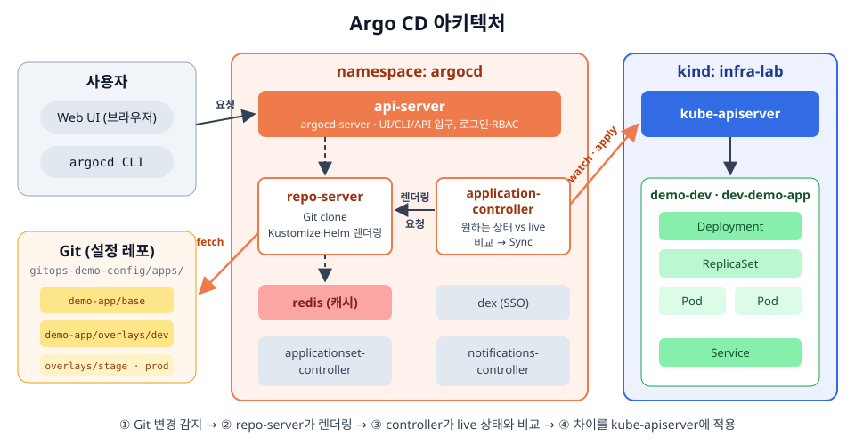
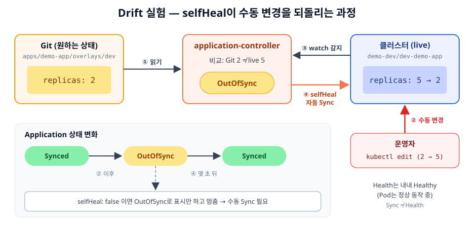
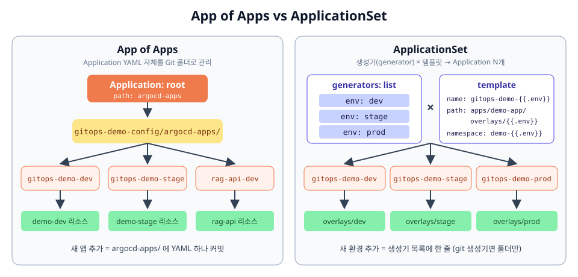

> **Chapter 7 · GitOps & CI/CD** | 난이도 ★★★☆☆ | 예상 소요 2 ~ 2.5시간

## 🎯 오늘의 목표

- Argo CD의 구성 요소(**api-server, repo-server, application-controller**)가 각각 무슨 일을 하는지 그림으로 설명할 수 있다
- kind 클러스터 `infra-lab`에 Argo CD를 설치하고 **UI·CLI**로 접속할 수 있다
- **Application** 리소스로 `gitops-demo-config`의 `apps/demo-app/overlays/dev`를 배포할 수 있다
- `automated`(prune, selfHeal) 동작을 **drift 실험**으로 직접 확인하고, **Sync 상태와 Health 상태**를 구분할 수 있다
- **App of Apps**와 **ApplicationSet**이 어떤 문제를 푸는지 안다

---

## 1. 지금까지 온 길

| Day | 만든 것 | 결과 |
|---|---|---|
| 50 | 앱 레포 `gitops-demo-app` + 설정 레포 `gitops-demo-config` 분리 | "무엇을 배포할지"는 설정 레포가 결정 |
| 51 | GitHub Actions 빌드 파이프라인 | `ghcr.io/<user>/gitops-demo-app:sha-1a2b3c4` 같은 이미지가 레지스트리에 쌓임 |
| 52 | Kustomize `apps/demo-app/base` + `overlays/dev·stage·prod` | 환경별 매니페스트를 `kubectl kustomize`로 렌더링, dev는 `kubectl apply -k`로 손으로 배포해 둠 |

아직 빠진 조각이 하나 있습니다. **누가 설정 레포의 내용을 클러스터에 적용하나요?** Day 50에서 본 Push 방식이라면 CI가 `kubectl apply`를 하겠지만, GitOps(Pull 방식)에서는 **클러스터 안의 에이전트가 Git을 지켜보다가 스스로 맞춥니다.** 그 에이전트가 오늘의 주인공 **Argo CD**입니다.

> 💡 Argo CD는 CNCF 졸업(Graduated) 프로젝트입니다. 같은 역할의 대표 도구로 **Flux**가 있는데, 개념(Git = 원하는 상태, 컨트롤러가 수렴)은 같고 UI·멀티 테넌시 방식이 다릅니다. 이 챕터는 Argo CD 생태계(Image Updater, Rollouts)를 이어 쓰기 위해 Argo CD를 고릅니다.

---

## 2. Argo CD 아키텍처



| 구성 요소 | 리소스 | 역할 |
|---|---|---|
| **api-server** | `argocd-server` (Deployment) | UI·CLI·API의 입구. 로그인/RBAC, "지금 Sync 해" 같은 요청을 받음 |
| **repo-server** | `argocd-repo-server` (Deployment) | Git을 clone해서 **매니페스트를 렌더링**(Kustomize, Helm, 평문 YAML). 클러스터에는 손대지 않음 |
| **application-controller** | `argocd-application-controller` (StatefulSet) | 렌더링 결과(원하는 상태)와 클러스터의 실제 상태(live)를 **계속 비교**하고, 필요하면 Kubernetes API로 적용 |
| redis | `argocd-redis` | 렌더링 결과·클러스터 상태 캐시 |
| dex | `argocd-dex-server` | GitHub·OIDC 등 외부 SSO 연동 (오늘은 안 씀) |
| applicationset-controller | `argocd-applicationset-controller` | ApplicationSet → Application 여러 개 생성 (9장) |
| notifications-controller | `argocd-notifications-controller` | Sync 성공/실패를 Slack 등으로 알림 |

핵심은 **역할 분리**입니다. Git에 접근하는 repo-server는 클러스터 쓰기 권한이 없고, 클러스터에 쓰는 application-controller는 Git을 직접 읽지 않습니다. Day 08에서 본 Kubernetes 컨트롤러와 똑같은 **조정 루프(reconcile loop)** 가 "Git ↔ 클러스터" 사이에서 한 번 더 돌고 있다고 보면 됩니다.

### Application — Argo CD에게 주는 "작업 지시서"

Argo CD는 자기 설정도 Kubernetes 리소스(CRD)로 받습니다.

| CRD | 의미 |
|---|---|
| **Application** | "이 Git 레포의 이 경로를 → 이 클러스터의 이 네임스페이스에 배포하라" |
| **AppProject** | Application을 묶는 울타리. 허용할 소스 레포·대상 클러스터·리소스 종류를 제한 (기본값 `default`) |
| **ApplicationSet** | Application을 템플릿으로 찍어내는 공장 |

---

## 3. 실습 준비

| 항목 | 기준 |
|---|---|
| 클러스터 | Day 09의 kind `infra-lab` (control-plane에 hostPort 30080) |
| 진입점 | Day 15의 Traefik (NodePort 30080) + Gateway API `traefik-gateway` |
| 설정 레포 | Day 52까지 만든 `https://github.com/<user>/gitops-demo-config` (`<user>`는 Day 51·52의 `<your-github-username>`, 소문자) |
| 이미지 | Day 51이 푸시한 `ghcr.io/<user>/gitops-demo-app:sha-xxxxxxx` |
| Argo CD | **v3.6.1** (2026-11 기준 최신 안정 버전) |

```bash
kubectl config use-context kind-infra-lab
kubectl get nodes
# infra-lab-control-plane   Ready   control-plane   ...
# infra-lab-worker          Ready   <none>          ...
# infra-lab-worker2         Ready   <none>          ...
```

Day 52에서 만든 설정 레포 구조를 다시 확인합니다. 오늘은 `apps/demo-app/overlays/dev`만 씁니다.

```
gitops-demo-config/
└── apps/demo-app/
    ├── base/                       # demo-app Deployment(포트 8000, /healthz) · Service · ConfigMap
    └── overlays/
        ├── dev/                    # namespace: demo-dev, namePrefix: dev-, newTag: sha-xxxxxxx, HTTPRoute
        ├── stage/                  # namespace: demo-stage, 릴리스 태그
        └── prod/                   # namespace: demo-prod
```

| Day 52에서 정한 값 | dev |
|---|---|
| 네임스페이스 | `demo-dev` |
| Deployment · Service | `dev-demo-app` (base 이름 `demo-app` + `namePrefix: dev-`) |
| 이미지 | kustomization `images[].name: gitops-demo-app` → `newName: ghcr.io/<user>/gitops-demo-app` |
| 접속 | Traefik HTTPRoute `dev.demo.example.test` (localhost:30080) |

> ⚠️ 설정 레포와 GHCR 패키지는 **Public**이라고 가정합니다(Private이면 10장 트러블슈팅 참고). Day 52 마지막에 `kubectl apply -k`로 만든 `demo-dev`의 리소스는 **그대로 둡니다.** Argo CD가 "이미 있는 리소스"를 발견해 Git과 비교하고, Sync하면서 자기 관리 대상으로 편입하는 장면부터 보게 됩니다.

로컬에서 렌더링이 되는지 먼저 확인해 두면, 이후 Argo CD 문제와 Kustomize 문제를 구분하기 쉽습니다.

```bash
git clone https://github.com/<user>/gitops-demo-config.git
kubectl kustomize gitops-demo-config/apps/demo-app/overlays/dev | grep -E "kind:|image:|namespace:"
```

---

## 4. 실습 ① Argo CD 설치

### 4-1. 공식 매니페스트로 설치 (오늘의 방법)

```bash
kubectl create namespace argocd
kubectl apply -n argocd --server-side --force-conflicts \
  -f https://raw.githubusercontent.com/argoproj/argo-cd/v3.6.1/manifests/install.yaml
```

| 옵션 | 이유 |
|---|---|
| URL의 `v3.6.1` | `stable` 브랜치 대신 **버전을 고정**. 문서 예시의 `stable`은 시간이 지나면 내용이 바뀜 |
| `--server-side` | ApplicationSet 등 일부 CRD가 client-side apply의 annotation 크기 한도(262KB)를 넘음 |
| `--force-conflicts` | 업그레이드할 때 이전 apply가 가진 필드 소유권을 가져옴 |

```bash
kubectl -n argocd rollout status deploy/argocd-server
kubectl -n argocd get pods
```

```
NAME                                                READY   STATUS    RESTARTS   AGE
argocd-application-controller-0                     1/1     Running   0          70s
argocd-applicationset-controller-6d8f7b9c4d-x2k8q   1/1     Running   0          70s
argocd-dex-server-7b6c9d5f8b-m4n7p                  1/1     Running   0          70s
argocd-notifications-controller-5c9f8d7b6d-q8w2z    1/1     Running   0          70s
argocd-redis-6f7d8c9b5d-h3j7k                       1/1     Running   0          70s
argocd-repo-server-8d7c6b5f9d-p9q4w                 1/1     Running   0          70s
argocd-server-5b8d9c7f6d-k2x8z                      1/1     Running   0          70s
```

2장 그림의 구성 요소가 그대로 Pod로 떠 있습니다. application-controller만 **StatefulSet**(`-0`)인 점도 보세요. 클러스터가 많아지면 샤드로 나눠 담당하기 때문입니다.

```bash
kubectl get crd | grep argoproj.io
# applications.argoproj.io
# applicationsets.argoproj.io
# appprojects.argoproj.io
```

### 4-2. (대안) Helm 차트로 설치

Day 16의 Helm으로 설치해도 결과는 같습니다. 차트 버전과 Argo CD 버전이 다르니 헷갈리지 마세요.

```bash
helm repo add argo https://argoproj.github.io/argo-helm
helm repo update
helm search repo argo/argo-cd --versions | head -3
# NAME          CHART VERSION   APP VERSION
# argo/argo-cd  10.18.0         v3.6.1

helm install argocd argo/argo-cd --version 10.18.0 \
  --namespace argocd --create-namespace
```

> 💡 매니페스트 방식은 "공식 문서 그대로"라 학습에 좋고, Helm 방식은 values 파일 하나로 설정(Ingress, 리소스, SSO)을 관리하기 좋습니다. **둘 중 하나만** 하세요. 이 챕터의 이후 Day(54·55)는 매니페스트 방식 설치를 기준으로 패치합니다.

---

## 5. 실습 ② 접속 — 비밀번호, UI, CLI

### 5-1. 초기 admin 비밀번호

설치 시 `admin` 계정의 임시 비밀번호가 `argocd-initial-admin-secret`에 만들어집니다. Day 13에서 본 Secret이므로 base64를 풀면 됩니다.

```bash
kubectl -n argocd get secret argocd-initial-admin-secret \
  -o jsonpath='{.data.password}' | base64 -d; echo
# 9xQ2mZ...  (설치마다 다름)
```

### 5-2. port-forward로 UI 열기 (가장 간단)

```bash
kubectl -n argocd port-forward svc/argocd-server 8080:443
```

브라우저에서 **https://localhost:8080** → 자체 서명 인증서 경고를 넘기고 `admin` / 위 비밀번호로 로그인합니다.

### 5-3. argocd CLI

```bash
# Linux (amd64) — 서버와 같은 버전으로 맞춤
VERSION=v3.6.1
curl -sSL -o argocd-linux-amd64 \
  https://github.com/argoproj/argo-cd/releases/download/${VERSION}/argocd-linux-amd64
sudo install -m 555 argocd-linux-amd64 /usr/local/bin/argocd
rm argocd-linux-amd64

# macOS
brew install argocd

# Windows: 릴리스 페이지에서 argocd-windows-amd64.exe를 받아 PATH에 argocd.exe로 둠

argocd version --client
# argocd: v3.6.1+...
```

port-forward가 떠 있는 상태에서 로그인합니다. (`--insecure`는 자체 서명 인증서 검증 생략)

```bash
ARGO_PW=$(kubectl -n argocd get secret argocd-initial-admin-secret -o jsonpath='{.data.password}' | base64 -d)
argocd login localhost:8080 --username admin --password "$ARGO_PW" --insecure
# 'admin:login' logged in successfully
# Context 'localhost:8080' updated

argocd account update-password      # 새 비밀번호로 변경
kubectl -n argocd delete secret argocd-initial-admin-secret   # 변경 후에는 지워도 됨
```

### 5-4. (선택) Day 15의 Traefik Gateway로 노출

매번 port-forward를 켜기 귀찮다면, Day 15에서 만든 `localhost:30080 → Traefik` 경로에 HTTPRoute를 하나 추가합니다. TLS는 Traefik 앞단에서 처리하거나 생략하는 구조이므로, argocd-server가 **HTTP로 응답**하도록 바꿉니다.

```bash
kubectl -n argocd patch configmap argocd-cmd-params-cm \
  --type merge -p '{"data":{"server.insecure":"true"}}'
kubectl -n argocd rollout restart deploy/argocd-server
```

```yaml
# argocd-route.yaml
apiVersion: gateway.networking.k8s.io/v1
kind: HTTPRoute
metadata:
  name: argocd-server
  namespace: argocd
spec:
  parentRefs:
  - name: traefik-gateway
    namespace: traefik          # Day 15: namespacePolicy from: All 이라 다른 NS에서 붙을 수 있음
  hostnames:
  - "argocd.localhost"
  rules:
  - backendRefs:
    - name: argocd-server
      port: 80
```

```bash
kubectl apply -f argocd-route.yaml
curl -s --connect-to argocd.localhost:80:127.0.0.1:30080 http://argocd.localhost/ | head -c 80
# <!doctype html><html lang="en"><head><meta charset="UTF-8"><title>Argo CD</title>...
```

브라우저(Chrome·Edge·Firefox)는 `*.localhost`를 자동으로 127.0.0.1로 보내므로 **http://argocd.localhost:30080** 으로 바로 열립니다.

> ⚠️ `server.insecure`를 켠 뒤에는 argocd-server가 TLS를 하지 않으므로, port-forward로 CLI 로그인할 때 `--insecure` 대신 **`--plaintext`** 를 씁니다. 운영 환경에서는 Gateway에 인증서(Day 15의 6-4)를 붙여 HTTPS로만 노출하세요.

---

## 6. 실습 ③ 첫 Application — dev overlay 배포

### 6-1. Application 매니페스트

```yaml
# app-gitops-demo-dev.yaml
apiVersion: argoproj.io/v1alpha1
kind: Application
metadata:
  name: gitops-demo-dev
  namespace: argocd                  # Application은 Argo CD 네임스페이스에 둠
  finalizers:
  - resources-finalizer.argocd.argoproj.io   # Application 삭제 시 배포된 리소스도 함께 삭제
spec:
  project: default
  source:
    repoURL: https://github.com/<user>/gitops-demo-config.git
    targetRevision: main             # 추적할 브랜치
    path: apps/demo-app/overlays/dev   # kustomization.yaml이 있으면 자동으로 Kustomize로 렌더링
  destination:
    server: https://kubernetes.default.svc   # Argo CD가 설치된 바로 그 클러스터
    namespace: demo-dev
  syncPolicy:
    automated:
      prune: true                    # Git에서 지운 리소스는 클러스터에서도 삭제
      selfHeal: true                 # 클러스터를 손으로 바꾸면 Git 상태로 되돌림
    syncOptions:
    - CreateNamespace=true           # demo-dev 네임스페이스가 없으면 생성
```

| 필드 | 의미 |
|---|---|
| `source` | **원하는 상태**가 어디 있는가 (레포 · 리비전 · 경로) |
| `destination` | 어디에 배포할 것인가 (클러스터 · 네임스페이스) |
| `syncPolicy.automated` | 없으면 **수동 Sync**. 있으면 Git이 바뀔 때 자동 적용 |
| `prune` | 기본값 false. 켜지 않으면 Git에서 지운 리소스가 클러스터에 고아로 남음 |
| `selfHeal` | 기본값 false. 켜지 않으면 수동 변경을 OutOfSync로 **표시만** 하고 되돌리지 않음 |

### 6-2. 적용과 확인

이 YAML도 설정 레포에 넣는 것이 정석이지만(9장 App of Apps), 첫 번째는 손으로 적용합니다.

```bash
kubectl apply -f app-gitops-demo-dev.yaml
argocd app get gitops-demo-dev
```

```
Name:               argocd/gitops-demo-dev
Project:            default
Server:             https://kubernetes.default.svc
Namespace:          demo-dev
Source:
- Repo:             https://github.com/<user>/gitops-demo-config.git
  Target:           main
  Path:             apps/demo-app/overlays/dev
Sync Policy:        Automated (Prune)
Sync Status:        Synced to main (3f9a1c2)
Health Status:      Healthy

GROUP                      KIND        NAMESPACE  NAME                       STATUS  HEALTH   MESSAGE
                           ConfigMap   demo-dev   dev-demo-app-config-xxxxx  Synced           configured
                           Service     demo-dev   dev-demo-app               Synced  Healthy  configured
apps                       Deployment  demo-dev   dev-demo-app               Synced  Healthy  configured
gateway.networking.k8s.io  HTTPRoute   demo-dev   dev-demo-app               Synced           configured
```

Day 52에서 손으로 만든 리소스라 메시지가 `created`가 아니라 **`configured`** 입니다. Argo CD가 기존 리소스에 추적용 어노테이션(`argocd.argoproj.io/tracking-id`)을 붙여 관리 대상으로 편입한 것입니다. (출력의 열·값은 예시이며 환경에 따라 조금 다릅니다.)

UI에서도 `gitops-demo-dev` 카드를 클릭하면 Application → Deployment → ReplicaSet → Pod 트리가 그려집니다. Day 11에서 `kubectl`로 하나씩 조회하던 계층 구조가 한눈에 보입니다.

```bash
kubectl -n demo-dev get deploy,svc,pods
kubectl -n demo-dev get deploy dev-demo-app -o jsonpath='{.metadata.annotations.argocd\.argoproj\.io/tracking-id}'; echo
# gitops-demo-dev:apps/Deployment:demo-dev/dev-demo-app
curl --connect-to dev.demo.example.test:80:127.0.0.1:30080 http://dev.demo.example.test/healthz
```

### 6-3. Git을 바꿔서 배포하기 — GitOps의 기본 동작

이제 **배포 = Git 커밋**입니다. dev의 레플리카를 2로 늘려 봅시다.

```bash
cd gitops-demo-config/apps/demo-app/overlays/dev
kustomize edit set replicas demo-app=2     # Day 52의 replicas 항목(접두사 붙기 전 이름 demo-app)을 1 → 2
git commit -am "dev: replicas 2" && git push
```

Argo CD는 기본적으로 **약 3분**(reconciliation 120초 + 최대 60초 jitter)마다 Git을 확인합니다. 기다리기 싫으면 즉시 새로 고칩니다.

```bash
argocd app get gitops-demo-dev --refresh   # Git을 다시 읽어 비교
kubectl -n demo-dev get pods               # 잠시 후 2개
```

> 💡 운영에서는 GitHub **Webhook**을 `https://<argocd>/api/webhook`으로 걸어 push 즉시 반영되게 합니다. kind처럼 외부에서 들어올 수 없는 환경에서는 폴링이나 `--refresh`로 충분합니다.

---

## 7. 실습 ④ Drift 실험 — Self-heal이 정말 되돌리나?



**Drift**(드리프트)는 클러스터의 실제 상태가 Git과 달라진 것을 말합니다. 장애 대응 중 누군가 `kubectl edit`으로 급하게 고친 값이 대표적입니다.

### 7-1. 손으로 바꿔 보기

```bash
kubectl -n demo-dev edit deploy dev-demo-app
# spec.replicas: 2 → 5 로 고치고 저장
```

```bash
kubectl -n demo-dev get deploy dev-demo-app -w
```

```
NAME           READY   UP-TO-DATE   AVAILABLE   AGE
dev-demo-app   2/2     2            2           12m
dev-demo-app   2/5     2            2           12m    ← 내가 바꿈
dev-demo-app   2/2     2            2           12m    ← 몇 초 만에 Argo CD가 2로 되돌림
```

application-controller는 Kubernetes Watch로 live 상태 변화를 바로 감지합니다. Git(2)과 live(5)가 다르니 **OutOfSync** → `selfHeal: true`이므로 즉시 Sync → 다시 **Synced**. 이력은 다음처럼 확인합니다.

```bash
argocd app history gitops-demo-dev
kubectl -n argocd get application gitops-demo-dev -o jsonpath='{.status.operationState.message}'; echo
```

### 7-2. selfHeal을 끄면?

```bash
argocd app set gitops-demo-dev --self-heal=false
kubectl -n demo-dev scale deploy dev-demo-app --replicas=5
argocd app get gitops-demo-dev | grep -E "Sync Status|Health"
# Sync Status:   OutOfSync from main (3f9a1c2)
# Health Status: Healthy
argocd app diff gitops-demo-dev     # Git과 live의 차이를 diff로 보여 줌
```

이번에는 5개가 그대로 유지되고 **OutOfSync로 표시만** 됩니다. 이 상태에서 `argocd app sync gitops-demo-dev`를 하면 Git 상태로 맞춰집니다. 실험이 끝나면 다시 켭니다.

```bash
argocd app set gitops-demo-dev --self-heal
```

> ⚠️ HPA(Day 18)가 레플리카를 조절하는 Deployment라면 Git의 `replicas`와 HPA가 계속 싸웁니다. 이런 경우 Git 매니페스트에서 `replicas` 필드를 빼거나, Application의 `spec.ignoreDifferences`로 `/spec/replicas`를 비교 대상에서 제외합니다.

### 7-3. prune 확인

```bash
# 설정 레포에서 Service를 리소스 목록에서 빼면(예: apps/demo-app/base/kustomization.yaml의 resources에서 service.yaml 제거)
# → push 후 refresh → Argo CD가 클러스터의 Service도 삭제
```

prune이 꺼져 있다면 Service는 클러스터에 남고 UI에 "삭제가 필요함(Requires pruning)"으로만 표시됩니다. 실험 후에는 원래대로 되돌려 push하세요.

---

## 8. Sync 상태 vs Health 상태

Argo CD 화면에는 상태가 **두 개** 붙어 있습니다. 둘은 서로 독립입니다.

| 구분 | 질문 | 값 |
|---|---|---|
| **Sync Status** | "클러스터가 **Git과 같은가?**" | `Synced` / `OutOfSync` / `Unknown` |
| **Health Status** | "리소스가 **정상 동작** 중인가?" | `Healthy` / `Progressing` / `Degraded` / `Suspended` / `Missing` / `Unknown` |

| 조합 | 흔한 상황 |
|---|---|
| Synced + Healthy | 정상. Git대로 배포됐고 Pod도 Ready |
| Synced + Degraded | Git대로 **잘못** 배포됨. 예: 존재하지 않는 이미지 태그 → `ImagePullBackOff` |
| Synced + Progressing | 롤링 업데이트 진행 중 (Day 11) |
| OutOfSync + Healthy | 누군가 손으로 바꿨지만 앱은 잘 돈다 (selfHeal 꺼짐) |
| OutOfSync + Missing | Git에는 있는데 클러스터에 아직 없음 (첫 Sync 전) |

Health 판단은 리소스 종류별 규칙으로 합니다. Deployment는 "원하는 레플리카가 모두 Available인가", Service(ClusterIP)는 존재하면 Healthy, PVC는 Bound인가 등입니다.

> 💡 "Synced인데 왜 안 되지?"의 답은 대부분 Health에 있습니다. **Sync는 Git과의 비교, Health는 Kubernetes 상태의 해석**이라고 기억하세요.

---

## 9. 여러 Application 다루기 — App of Apps, ApplicationSet



dev 하나는 손으로 `kubectl apply` 했지만, stage·prod, 그리고 Chapter 6의 rag-api·vLLM까지 늘어나면 Application YAML 자체도 Git으로 관리해야 합니다.

### 9-1. App of Apps — Application을 배포하는 Application

설정 레포에 Application YAML만 모아 두는 `argocd-apps/` 폴더를 만듭니다. (매니페스트가 있는 `apps/`와 구분)

```
gitops-demo-config/
├── apps/demo-app/...            # Day 52의 매니페스트
└── argocd-apps/
    ├── gitops-demo-dev.yaml     # 6-1의 Application
    ├── gitops-demo-stage.yaml
    └── rag-api-dev.yaml         # Chapter 6 rag-api 매니페스트도 같은 방식으로
```

그리고 `argocd-apps/` 폴더를 바라보는 **루트 Application** 하나만 손으로 만듭니다.

```yaml
# root-app.yaml
apiVersion: argoproj.io/v1alpha1
kind: Application
metadata:
  name: root
  namespace: argocd
spec:
  project: default
  source:
    repoURL: https://github.com/<user>/gitops-demo-config.git
    targetRevision: main
    path: argocd-apps                # 이 폴더의 YAML = Application들
  destination:
    server: https://kubernetes.default.svc
    namespace: argocd                # 자식 Application이 만들어질 곳
  syncPolicy:
    automated:
      prune: true
      selfHeal: true
```

이후 새 앱 추가 = `argocd-apps/`에 YAML 하나 커밋. 클러스터를 새로 만들어도 **루트 하나만 apply하면 전부 복원**됩니다(부트스트랩).

### 9-2. ApplicationSet — 템플릿으로 찍어내기

dev·stage·prod Application은 경로와 네임스페이스만 다르고 나머지는 똑같습니다. ApplicationSet은 **생성기(generator) × 템플릿**으로 이 반복을 없앱니다.

```yaml
# appset-gitops-demo.yaml
apiVersion: argoproj.io/v1alpha1
kind: ApplicationSet
metadata:
  name: gitops-demo
  namespace: argocd
spec:
  goTemplate: true
  goTemplateOptions: ["missingkey=error"]
  generators:
  - list:
      elements:
      - env: dev
      - env: stage
      - env: prod
  template:
    metadata:
      name: 'gitops-demo-{{.env}}'
    spec:
      project: default
      source:
        repoURL: https://github.com/<user>/gitops-demo-config.git
        targetRevision: main
        path: 'apps/demo-app/overlays/{{.env}}'
      destination:
        server: https://kubernetes.default.svc
        namespace: 'demo-{{.env}}'
      syncPolicy:
        syncOptions:
        - CreateNamespace=true
```

| 생성기 | 무엇으로 Application을 만드나 |
|---|---|
| `list` | 직접 적은 목록 (위 예) |
| `git` (directories) | 레포의 폴더 구조. `apps/demo-app/overlays/*`마다 하나씩 → 폴더만 추가하면 환경이 생김 |
| `cluster` | Argo CD에 등록된 클러스터마다 하나씩 (멀티 클러스터) |
| `matrix` / `merge` | 생성기 조합 (예: 클러스터 × 환경) |

| | App of Apps | ApplicationSet |
|---|---|---|
| 형태 | Application YAML을 폴더에 나열 | 템플릿 1개 + 생성기 |
| 앱마다 설정이 크게 다를 때 | 유리 | 템플릿이 복잡해짐 |
| 같은 모양을 N개 찍을 때 | 복붙 | **유리** |
| 흔한 조합 | 루트 App of Apps 안에 ApplicationSet을 넣기도 함 | |

> ⚠️ 위 ApplicationSet은 6-1에서 만든 `gitops-demo-dev`와 **이름이 같습니다.** 실습해 보려면 먼저 `kubectl -n argocd delete application gitops-demo-dev`로 지운 뒤 적용하세요. 또 template에 `automated`를 넣지 않았으니 stage·prod는 수동 Sync입니다 — Day 54의 승격 흐름에서 이 차이를 활용합니다.

---

## 10. 트러블슈팅

| 증상 | 원인 | 해결 |
|---|---|---|
| `kubectl apply` 시 `metadata.annotations: Too long` | client-side apply로 CRD를 적용 | `--server-side --force-conflicts` 를 붙여 다시 apply |
| Application이 `Unknown`, 메시지 `repository not found` / `authentication required` | 설정 레포가 Private | `argocd repo add https://github.com/<user>/gitops-demo-config.git --username <user> --password <PAT>` (읽기 권한 PAT) |
| Synced인데 Health가 `Degraded`, Pod는 `ImagePullBackOff` | GHCR 패키지가 Private이거나 태그 오타 | 패키지를 Public으로 바꾸거나 imagePullSecret 추가(Day 13의 6-5). 태그는 `kubectl kustomize apps/demo-app/overlays/dev \| grep image` 로 확인 |
| `ComparisonError: ... kustomization.yaml` | overlay 렌더링 실패 | 로컬에서 `kubectl kustomize apps/demo-app/overlays/dev` 로 같은 에러 재현 후 수정 |
| `namespaces "demo-dev" not found` | 네임스페이스 없음 | `syncOptions: - CreateNamespace=true` 추가 |
| HTTPRoute로 접속 시 리다이렉트 루프 / 307 반복 | argocd-server가 아직 HTTPS로 응답 | `server.insecure: "true"` 설정 후 `rollout restart deploy/argocd-server` |
| HPA를 켠 Deployment가 계속 OutOfSync | Git의 replicas와 HPA가 충돌 | `replicas` 제거 또는 `ignoreDifferences`로 `/spec/replicas` 제외 |
| Git을 바꿨는데 반영이 안 됨 | 폴링 주기(최대 약 3분) | `argocd app get <app> --refresh` 또는 Webhook 설정 |

---

## 11. 핵심 정리

- Argo CD = 클러스터 안에서 **Git(원하는 상태)과 live 상태를 계속 비교·수렴**시키는 GitOps 컨트롤러
- **repo-server**는 Git을 읽어 렌더링, **application-controller**는 비교·적용, **api-server**는 UI/CLI 입구
- **Application** = 소스(레포·리비전·경로) + 대상(클러스터·네임스페이스) + syncPolicy
- `automated.prune`은 Git에서 지운 것을 지우고, `automated.selfHeal`은 손으로 바꾼 것을 되돌린다 — 둘 다 **기본값은 꺼짐**
- **Sync Status**(Git과 같은가)와 **Health Status**(잘 돌아가는가)는 별개
- 앱이 많아지면 **App of Apps**(Application을 Git으로)와 **ApplicationSet**(템플릿 × 생성기)

---

## 12. 셀프 체크

<details>
<summary>Q1. repo-server와 application-controller의 역할을 나눈 이유는?</summary>

권한과 장애를 분리하기 위해서입니다. repo-server는 외부(Git)에서 가져온 내용을 렌더링하지만 클러스터 쓰기 권한이 없고, application-controller는 클러스터에 쓰지만 Git을 직접 다루지 않습니다. 렌더링이 무거워도(Helm, 플러그인) 비교·적용 루프에 영향이 적습니다.
</details>

<details>
<summary>Q2. <code>selfHeal: false</code> 상태에서 누군가 <code>kubectl scale</code>로 레플리카를 바꾸면 어떻게 되나?</summary>

변경은 그대로 유지되고 Application이 **OutOfSync**로 표시됩니다. 수동으로 Sync하거나 selfHeal을 켜야 Git 상태로 돌아갑니다. (Git이 바뀌었을 때의 자동 Sync는 `automated`가 있으면 그대로 동작합니다.)
</details>

<details>
<summary>Q3. Sync Status는 Synced인데 Health Status가 Degraded다. 무엇을 의심해야 하나?</summary>

Git에 적힌 대로 정확히 배포됐지만 **Git의 내용 자체가 잘못된** 경우입니다. 없는 이미지 태그, 잘못된 환경 변수, 실패하는 readinessProbe 등. Pod 이벤트(`kubectl describe pod`)와 로그를 봅니다.
</details>

<details>
<summary>Q4. <code>prune: true</code>를 기본으로 켜 두지 않는 이유는?</summary>

Git에서 리소스가 사라지면 클러스터에서도 **삭제**되기 때문입니다. 경로 실수나 잘못된 커밋 하나로 운영 리소스가 지워질 수 있어서 명시적으로 켜도록 되어 있습니다. (빈 결과가 렌더링되면 전부 지우지 않도록 막는 보호 장치 `allowEmpty: false`도 기본값입니다.)
</details>

<details>
<summary>Q5. 환경이 dev·stage·prod 세 개이고 앞으로 qa가 추가될 예정이다. App of Apps와 ApplicationSet 중 무엇이 편한가?</summary>

모양이 같은 Application을 반복해서 만드는 경우이므로 **ApplicationSet**이 편합니다. 특히 `git` directories 생성기를 쓰면 `apps/demo-app/overlays/qa` 폴더를 커밋하는 것만으로 Application이 자동 생성됩니다.
</details>

---

## ⏭️ 다음 예고 — Day 54. 이미지 태그 자동 갱신(Argo CD Image Updater)과 환경 승격 흐름

지금은 새 이미지가 나올 때마다 누군가 `apps/demo-app/overlays/dev`의 `newTag`를 손으로 바꿔 커밋해야 합니다. 내일은 **Argo CD Image Updater**가 레지스트리를 지켜보다가 dev 태그를 자동으로 갱신해 Git에 커밋하게 만들고, CI가 직접 커밋·PR을 만드는 방식과 비교한 뒤, **dev → stage → prod를 PR 승인으로 승격**하는 흐름을 완성합니다.
