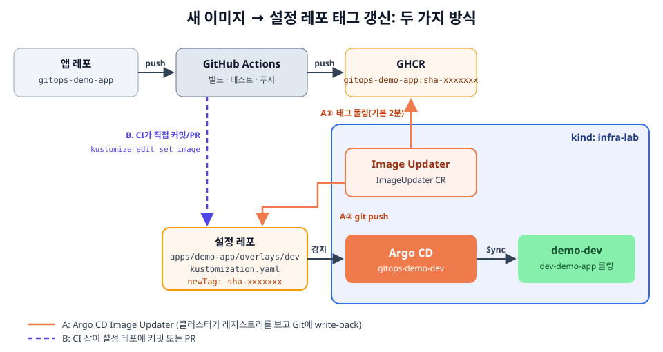
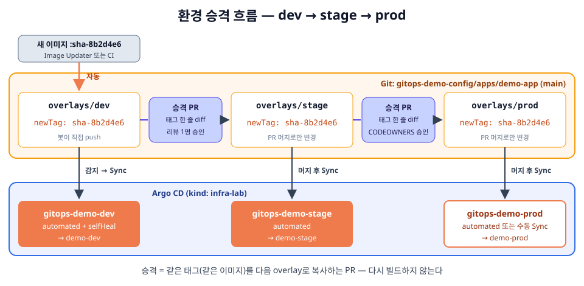

> **Chapter 7 · GitOps & CI/CD** | 난이도 ★★★☆☆ | 예상 소요 2 ~ 2.5시간

## 🎯 오늘의 목표

- "CI가 이미지를 푸시한 뒤 **설정 레포의 태그는 누가 바꾸나?**" 문제를 설명할 수 있다
- **Argo CD Image Updater v1.x**(CRD 방식)를 설치하고, dev 환경의 이미지 태그를 자동 갱신해 **Git에 write-back** 할 수 있다
- 대안인 "CI가 설정 레포에 `kustomize edit set image` 커밋/PR을 만드는 방식"과 장단점을 비교할 수 있다
- **dev → stage → prod 승격을 PR 승인**으로 통제하는 흐름을 구성할 수 있다

---

## 1. 빠진 고리 — 태그는 누가 바꾸나?

어제(Day 53)까지의 흐름을 다시 그려 보면 끊어진 곳이 하나 있습니다.

```
앱 레포 push → GitHub Actions → ghcr.io/<user>/gitops-demo-app:sha-xxxxxxx 푸시   (Day 51)
                                            ✂  여기가 끊겨 있음
설정 레포 apps/demo-app/overlays/dev 의 newTag 변경 → Argo CD 감지 → 클러스터 반영 (Day 52·53)
```

새 이미지가 레지스트리에 올라가도 `apps/demo-app/overlays/dev/kustomization.yaml`의 `newTag`는 그대로라서 Argo CD 입장에서는 **바뀐 게 없습니다.** GitOps에서는 "배포 = Git 커밋"이므로, 결국 **누군가 설정 레포에 태그 변경 커밋을 만들어야** 합니다. 방법은 크게 두 가지입니다.



| | A. Argo CD Image Updater | B. CI가 설정 레포에 커밋/PR |
|---|---|---|
| 누가 감지? | 클러스터 안의 컨트롤러가 **레지스트리를 폴링** | 앱 레포 CI가 빌드 직후 **직접 알고 있음** |
| 누가 커밋? | Image Updater (write-back) | CI 잡 (`kustomize edit set image` + `git push` 또는 PR) |
| 방향 | Pull (GitOps 철학에 더 가까움) | Push (CI가 다른 레포에 쓰기 권한 필요) |
| 필요한 비밀 | 설정 레포 쓰기 토큰을 **클러스터에** 둠 | 설정 레포 쓰기 토큰을 **앱 레포 CI 시크릿에** 둠 |
| 반영 지연 | 폴링 주기(기본 2분) + Argo CD 감지 | 빌드 직후 즉시 |
| 태그 규칙 | `semver`, `newest-build`, `digest` 등 전략으로 선택 | 워크플로 코드로 자유롭게 |
| 잘 맞는 곳 | 여러 팀의 이미지를 한 곳에서 자동 추적, dev 자동 배포 | 앱과 배포가 1:1, CI에서 테스트 결과로 분기하고 싶을 때 |

> 💡 둘 다 **"결과물이 Git 커밋"** 이라는 점이 핵심입니다. 클러스터의 Deployment를 직접 고치는 방식(`kubectl set image`)은 Day 53의 selfHeal에 의해 곧바로 되돌려집니다.

---

## 2. Argo CD Image Updater 이해하기

### 2-1. v1.x부터 바뀐 설정 방식 — 어노테이션 → CRD

Image Updater는 **v1.0.0에서 설정 방식이 크게 바뀌었습니다.** 인터넷의 많은 글이 아직 옛 방식이라 주의해야 합니다.

| | v0.x (예: 0.17) | **v1.x (현재, 2026-11 기준 v1.5.0)** |
|---|---|---|
| 설정 위치 | Application에 `argocd-image-updater.argoproj.io/image-list` 등 **어노테이션** | 별도 CR **`ImageUpdater`** (`argocd-image-updater.argoproj.io/v1alpha1`) |
| 실행 형태 | 주기적으로 도는 프로세스 | Kubernetes **컨트롤러** (CRD + reconcile) |
| 대상 Application 선택 | 어노테이션이 붙은 Application | CR의 `applicationRefs`(이름 패턴·라벨 셀렉터) |
| 마이그레이션 | — | CR에 `useAnnotations: true`를 주면 기존 어노테이션을 그대로 읽음 |

> ⚠️ 블로그 예제에서 Application에 `argocd-image-updater.argoproj.io/...` 어노테이션만 붙이는 방식은 **v0.x 문법**입니다. v1.x에서는 `ImageUpdater` CR이 반드시 있어야 하고, 이 글은 v1.x 기준으로 씁니다.

### 2-2. 동작 순서

1. `ImageUpdater` CR의 `applicationRefs`로 대상 Application(`gitops-demo-dev`)을 찾음
2. 레지스트리(GHCR)에서 `ghcr.io/<user>/gitops-demo-app`의 태그 목록을 조회 (기본 **2분** 간격)
3. `updateStrategy` + `allowTags` 규칙으로 "가장 적절한 태그"를 고름
4. 현재 배포된 태그와 다르면 **write-back**
   - `argocd`(기본값): Application 리소스의 파라미터만 바꿈 → Git에는 흔적이 없음
   - **`git`**: 설정 레포에 커밋을 push → Git이 진실의 원천으로 유지됨 (**오늘 쓰는 방법**)
5. Argo CD가 새 커밋을 감지해 Sync (Day 53의 automated)

### 2-3. 업데이트 전략

| `updateStrategy` | 고르는 기준 | 어울리는 태그 |
|---|---|---|
| `semver` | 시맨틱 버전 중 가장 높은 것 | `v1.4.2` 같은 릴리스 태그 |
| `newest-build` | 이미지 **빌드 시각**이 가장 최신인 것 | Day 51의 `sha-1a2b3c4` 태그 (순서가 없는 문자열) |
| `digest` | 같은 태그(예: `main`)의 다이제스트가 바뀌었는지 | 움직이는 태그 |
| `alphabetical` | 사전순 마지막 | 날짜 기반 태그(`2026-11-15-...`) |

Day 51은 main 브랜치 빌드마다 `sha-` + 커밋 SHA 7자리 태그(`type=sha`)를 붙였으므로 **`newest-build`** 를 쓰고, `allowTags`로 이 모양의 태그만 고르도록 제한합니다. 그래야 릴리스 빌드가 함께 만드는 `0.1.0`, `0.1` 같은 태그나 실수로 푸시된 `latest`가 dev에 끼어들지 않습니다.

---

## 3. 실습 ① Image Updater 설치

| 항목 | 기준 |
|---|---|
| 클러스터 | kind `infra-lab`, Day 53의 Argo CD v3.6.1 (`argocd` 네임스페이스) |
| Application | Day 53의 `gitops-demo-dev` (`apps/demo-app/overlays/dev`, automated + selfHeal) |
| Image Updater | **v1.5.0** |

공식 문서의 권장 방식대로 **Argo CD와 같은 네임스페이스**에 설치합니다. v1.x 컨트롤러는 기본적으로 **자기 네임스페이스만** 감시하므로, ImageUpdater CR과 Application이 모두 `argocd`에 있으면 추가 RBAC 설정이 필요 없습니다.

```bash
kubectl apply -n argocd \
  -f https://raw.githubusercontent.com/argoproj-labs/argocd-image-updater/stable/config/install.yaml

kubectl -n argocd rollout status deploy/argocd-image-updater-controller
kubectl get crd | grep image-updater
# imageupdaters.argocd-image-updater.argoproj.io
kubectl -n argocd get deploy argocd-image-updater-controller \
  -o jsonpath='{.spec.template.spec.containers[0].image}'; echo
# quay.io/argoprojlabs/argocd-image-updater:v1.5.0
```

> 💡 Helm을 쓴다면 Day 53과 같은 `argo` 저장소의 `argo/argocd-image-updater` 차트(차트 1.5.0 = 앱 v1.5.0)를 `--namespace argocd`로 설치하면 됩니다. URL의 `stable` 대신 `v1.5.0` 태그 경로를 쓰면 버전을 고정할 수 있습니다.

### 3-1. Git write-back용 토큰

Image Updater가 설정 레포에 push하려면 쓰기 권한이 필요합니다. GitHub에서 **Fine-grained personal access token**을 만듭니다.

- Repository access: **Only select repositories** → `gitops-demo-config` 하나만
- Permissions → Repository permissions → **Contents: Read and write**

```bash
kubectl -n argocd create secret generic git-creds \
  --from-literal=username=<user> \
  --from-literal=password=<github_pat_...>
```

> ⚠️ 이 Secret은 ImageUpdater CR과 **같은 네임스페이스**에 있어야 합니다. 토큰 권한은 설정 레포 하나, Contents 쓰기만으로 최소화하세요. 이 Secret 자체를 Git에 어떻게 안전하게 둘지는 Day 55의 주제입니다.

---

## 4. 실습 ② dev 이미지 태그 자동 갱신

### 4-1. ImageUpdater CR

```yaml
# imageupdater-gitops-demo-dev.yaml
apiVersion: argocd-image-updater.argoproj.io/v1alpha1
kind: ImageUpdater
metadata:
  name: gitops-demo-dev
  namespace: argocd
spec:
  writeBackConfig:
    method: "git:secret:git-creds"       # argocd 네임스페이스의 git-creds Secret으로 push
    gitConfig:
      branch: "main"
      writeBackTarget: "kustomization"   # Application 경로(apps/demo-app/overlays/dev)의 kustomization.yaml을 수정
  applicationRefs:
  - namePattern: "gitops-demo-dev"       # 대상 Application (와일드카드 가능: "gitops-demo-*")
    images:
    - alias: "app"
      imageName: "ghcr.io/<user>/gitops-demo-app"   # 레지스트리에서 조회할 실제 이미지
      commonUpdateSettings:
        updateStrategy: "newest-build"
        allowTags: "regexp:^sha-[0-9a-f]{7}$"  # Day 51의 sha-xxxxxxx 태그만 후보
      manifestTargets:
        kustomize:
          name: "gitops-demo-app"              # kustomization.yaml images[].name (Day 52)
```

| 필드 | 설명 |
|---|---|
| `method: git:secret:git-creds` | Git write-back + 인증 Secret 지정. `git`만 쓰면 Argo CD에 등록된 레포 자격 증명을 재사용 |
| `gitConfig.repository` | 생략하면 Application의 `spec.source.repoURL`을 그대로 씀 |
| `writeBackTarget` | 생략하면 경로에 `.argocd-source-<앱이름>.yaml` 파일을 새로 만듦. `kustomization`이면 `kustomize edit set image`처럼 **기존 kustomization.yaml을 수정** |
| `imageName` / `manifestTargets.kustomize.name` | 앞은 레지스트리에서 조회할 이미지, 뒤는 kustomization.yaml에서 찾을 `images[].name`. Day 52는 base 이미지 이름 `gitops-demo-app`을 `newName`으로 GHCR 경로로 바꾸는 구조라 둘이 다르므로 함께 적음 |
| `allowTags` | `regexp:<정규식>` 형식. 조건에 맞지 않는 태그는 무시 |

> 💡 `writeBackTarget: "kustomization:../../base"` 처럼 상대 경로를 주면 Application 경로 기준으로 다른 디렉터리의 kustomization을 고칠 수도 있습니다. 하지만 base를 고치면 stage·prod까지 같이 바뀌므로, **overlay를 고치는 것**이 환경 분리 원칙에 맞습니다.

```bash
kubectl apply -f imageupdater-gitops-demo-dev.yaml
kubectl -n argocd get imageupdater
kubectl -n argocd logs deploy/argocd-image-updater-controller -f
```

### 4-2. 새 이미지 푸시 → 자동 커밋 확인

앱 레포에서 아무 변경이나 커밋해서 Day 51 워크플로가 새 이미지를 푸시하게 합니다.

```bash
cd gitops-demo-app
# 예: main.py의 응답 메시지를 바꿈
git commit -am "feat: change greeting" && git push
# → Actions(ci.yaml)가 ghcr.io/<user>/gitops-demo-app:sha-8b2d4e6 푸시
```

2분 정도 지나면 컨트롤러 로그에 갱신 기록이 남고, 설정 레포에 커밋이 생깁니다.

```bash
cd gitops-demo-config && git pull
git log -1
```

```
commit 7c1e9a0...
Author: argocd-image-updater <noreply@argoproj.io>

    build: automatic update of gitops-demo-dev

    updates image ... tag 'sha-1a2b3c4' to 'sha-8b2d4e6'
```

커밋 작성자(`argocd-image-updater`)와 메시지 첫 줄은 기본값이며, `argocd-image-updater-config` ConfigMap의 `git.user`, `git.email`, `git.commit-message-template`으로 바꿀 수 있습니다.

```bash
git show --stat HEAD
#  apps/demo-app/overlays/dev/kustomization.yaml | 2 +-
grep -A3 "images:" apps/demo-app/overlays/dev/kustomization.yaml
# images:
# - name: gitops-demo-app
#   newName: ghcr.io/<user>/gitops-demo-app
#   newTag: sha-8b2d4e6
```

이제 Day 53과 똑같이 Argo CD가 커밋을 감지하고 롤링 업데이트(Day 11)를 합니다.

```bash
argocd app get gitops-demo-dev --refresh | grep -E "Sync Status|Health"
kubectl -n demo-dev get deploy dev-demo-app \
  -o jsonpath='{.spec.template.spec.containers[0].image}'; echo
# ghcr.io/<user>/gitops-demo-app:sha-8b2d4e6
curl --connect-to dev.demo.example.test:80:127.0.0.1:30080 http://dev.demo.example.test/
# {"app":"gitops-demo-app","version":"sha-8b2d4e6","env":"dev",...}
```

CR의 status에서도 결과를 볼 수 있습니다.

```bash
kubectl -n argocd describe imageupdater gitops-demo-dev
# Status:
#   Applications Matched:  1
#   Images Managed:        1
#   Recent Updates: ...    (갱신된 이미지·새 태그·시각)
```

> 💡 v1.5의 ImageUpdater CRD에는 `gitConfig.pullRequest`(github / gitlab / gitea / azuredevops) 필드도 있어서, 바로 push하지 않고 **PR을 여는** 방식으로도 쓸 수 있습니다. dev는 즉시 push, 그 이상의 환경은 사람이 확인하는 PR로 나누는 것이 일반적입니다.

---

## 5. 실습 ③ 대안 — CI가 설정 레포에 커밋하기

Image Updater 없이, Day 51의 앱 레포 워크플로에 **잡 하나를 추가**해도 같은 결과를 얻습니다. (두 방식을 동시에 켜면 서로의 커밋이 겹치니, 실습할 때는 4장의 ImageUpdater CR을 먼저 지우세요: `kubectl -n argocd delete imageupdater gitops-demo-dev`)

GitHub Actions의 기본 `GITHUB_TOKEN`은 **자기 레포에만** 쓸 수 있으므로, 설정 레포 쓰기 권한이 있는 토큰을 앱 레포 시크릿 `CONFIG_REPO_TOKEN`으로 등록합니다(3-1과 같은 권한의 PAT, 또는 GitHub App 토큰).

```yaml
# gitops-demo-app/.github/workflows/ci.yaml 의 jobs: 아래에 추가 (Day 51의 test → build 다음 단계)
  update-dev-config:
    needs: build
    if: github.event_name == 'push' && github.ref == 'refs/heads/main'   # 태그·PR 빌드는 제외
    runs-on: ubuntu-latest
    steps:
      - uses: actions/checkout@v7
        with:
          repository: ${{ github.repository_owner }}/gitops-demo-config
          token: ${{ secrets.CONFIG_REPO_TOKEN }}
          path: config

      - name: Bump dev image tag
        working-directory: config/apps/demo-app/overlays/dev
        env:
          OWNER: ${{ github.repository_owner }}
        run: |
          IMAGE="ghcr.io/${OWNER,,}/gitops-demo-app"     # Day 51과 같은 소문자 변환
          TAG="sha-${GITHUB_SHA::7}"                      # Day 51 metadata-action type=sha 와 같은 모양
          kustomize edit set image gitops-demo-app=${IMAGE}:${TAG}
          git config user.name  "github-actions[bot]"
          git config user.email "41898282+github-actions[bot]@users.noreply.github.com"
          git commit -am "dev: gitops-demo-app ${TAG}"
          git push
```

- `ubuntu-latest` 러너에는 `kustomize`, `yq`, `gh`가 이미 설치되어 있습니다.
- `kustomize edit set image gitops-demo-app=<새 이름>:<태그>`는 kustomization.yaml의 `images[]`에서 `gitops-demo-app` 항목을 찾아 `newName`·`newTag`를 바꿉니다. Day 52 6-1에서 손으로 친 명령을 CI가 대신하는 것입니다.

| 관점 | Image Updater | CI 커밋 |
|---|---|---|
| 구성 요소 | 클러스터에 컨트롤러 하나 더 | 워크플로 잡 하나 |
| "이 이미지가 테스트를 통과했나?" | 레지스트리에 있으면 후보 (태그 규칙으로만 제어) | `needs:`로 테스트 통과 후에만 커밋 |
| 앱 레포가 여러 개 | CR 하나로 패턴 매칭 | 레포마다 같은 잡 복사 |
| 클러스터가 여러 개 / 외부에서 못 들어옴 | 클러스터가 레지스트리만 보면 됨 | CI가 Git만 쓰면 됨 (둘 다 클러스터 접근 불필요) |
| 토큰 보관 위치 | 클러스터 Secret | GitHub Actions Secret |

어느 쪽이든 **dev는 자동, 그 위는 사람의 승인**이라는 원칙은 같습니다. 이제 그 "위"를 만들어 봅시다.

---

## 6. 실습 ④ 환경 승격 — dev → stage → prod



### 6-1. 승격(Promotion)이란

**같은 이미지(같은 태그)** 를 다음 환경의 overlay에 옮겨 적는 것입니다. 다시 빌드하지 않습니다. dev에서 검증된 바로 그 바이트가 stage·prod로 갑니다.

| 환경 | 태그 변경 방법 | Argo CD Sync | 승인 |
|---|---|---|---|
| dev | Image Updater 또는 CI가 **직접 push** | automated | 없음 (빠른 피드백) |
| stage | 승격 **PR** (dev 태그 복사) | automated | PR 리뷰 1명 |
| prod | 승격 **PR** (stage 태그 복사) | automated 또는 수동 Sync | CODEOWNERS 승인 필수 |

### 6-2. 승격 PR을 만드는 워크플로 (설정 레포)

설정 레포에 수동 실행(`workflow_dispatch`) 워크플로를 둡니다. 원본 환경의 태그를 읽어 대상 환경에 적고 PR을 엽니다.

```yaml
# gitops-demo-config/.github/workflows/promote.yml
name: promote

on:
  workflow_dispatch:
    inputs:
      from:
        description: "원본 환경"
        type: choice
        options: [dev, stage]
        required: true
      to:
        description: "대상 환경"
        type: choice
        options: [stage, prod]
        required: true

permissions:
  contents: write
  pull-requests: write

jobs:
  promote:
    runs-on: ubuntu-latest
    env:
      IMAGE: ghcr.io/<user>/gitops-demo-app        # 본인 계정(소문자)으로
      OVERLAYS: apps/demo-app/overlays
    steps:
      - uses: actions/checkout@v7

      - name: Read tag from source overlay
        id: src
        run: |
          TAG=$(yq '.images[] | select(.name == "gitops-demo-app") | .newTag' ${OVERLAYS}/${{ inputs.from }}/kustomization.yaml)
          echo "tag=${TAG}" >> "$GITHUB_OUTPUT"

      - name: Write tag to target overlay
        working-directory: ${{ env.OVERLAYS }}/${{ inputs.to }}
        run: kustomize edit set image gitops-demo-app=${IMAGE}:${{ steps.src.outputs.tag }}

      - uses: peter-evans/create-pull-request@v8
        with:
          branch: promote/${{ inputs.to }}
          commit-message: "promote(${{ inputs.to }}): gitops-demo-app ${{ steps.src.outputs.tag }}"
          title: "promote ${{ inputs.from }} → ${{ inputs.to }}: ${{ steps.src.outputs.tag }}"
          body: |
            `${{ inputs.from }}`에서 검증된 이미지를 `${{ inputs.to }}`로 승격합니다.
            - image: `${{ env.IMAGE }}:${{ steps.src.outputs.tag }}`
          delete-branch: true
```

> ⚠️ `GITHUB_TOKEN`으로 PR을 만들려면 설정 레포의 **Settings → Actions → General → Workflow permissions**에서 "Allow GitHub Actions to create and approve pull requests"를 켜야 합니다. 또 `GITHUB_TOKEN`으로 만든 PR은 다른 워크플로(예: PR 검사)를 트리거하지 않습니다. PR 검사가 필요하면 PAT나 GitHub App 토큰을 `token:` 입력으로 넘기세요.

실행은 Actions 탭의 **Run workflow** 버튼 또는 CLI로 합니다.

```bash
gh workflow run promote.yml -R <user>/gitops-demo-config -f from=dev -f to=stage
gh pr list -R <user>/gitops-demo-config
# #12  promote dev → stage: sha-8b2d4e6   promote/stage
```

PR의 diff는 딱 한 줄입니다. 리뷰어는 "어떤 이미지가 어느 환경으로 가는지"를 정확히 보고 승인합니다.

```diff
 images:
 - name: gitops-demo-app
   newName: ghcr.io/<user>/gitops-demo-app
-  newTag: 0.1.0
+  newTag: sha-8b2d4e6
```

### 6-3. 승인 규칙 걸기 — 브랜치 보호와 CODEOWNERS

```
# gitops-demo-config/.github/CODEOWNERS
/apps/demo-app/overlays/prod/   @<user>
```

설정 레포의 **Settings → Rules(Rulesets)** 또는 Branch protection에서 `main`에 다음을 켭니다.

- Require a pull request before merging (직접 push 금지)
- Require approvals: 1 이상
- Require review from Code Owners → `apps/demo-app/overlays/prod/`를 건드리는 PR은 지정된 사람이 승인해야 머지

> ⚠️ dev를 Image Updater나 CI가 `main`에 **직접 push**한다면, 그 봇(토큰 주인)이 규칙을 우회할 수 있어야 합니다. Rulesets의 bypass 목록에 봇을 넣거나, dev도 PR + 자동 머지로 바꾸는 방법이 있습니다. 개인 실습 레포라면 prod 경로만 CODEOWNERS로 보호하는 것으로 충분합니다.

### 6-4. Argo CD 쪽 설정

Day 53의 ApplicationSet처럼 stage·prod Application도 만들어 둡니다. PR이 머지되면 Argo CD가 해당 overlay의 변경을 감지해 배포합니다.

```bash
argocd app list
# NAME                     SYNC STATUS  HEALTH STATUS  ...
# argocd/gitops-demo-dev   Synced       Healthy
# argocd/gitops-demo-stage Synced       Healthy
# argocd/gitops-demo-prod  OutOfSync    Healthy        ← 수동 Sync로 둔 경우, PR 머지 후 상태
argocd app sync gitops-demo-prod                       # 배포 시점을 사람이 결정
```

prod에 `automated`를 켤지는 팀의 선택입니다. **PR 승인이 곧 배포**가 되게 하려면 켜고, "머지는 낮에, 배포는 점검 시간에"처럼 시점을 분리하려면 끄고 수동 Sync(또는 Argo CD Sync Window)를 씁니다.

> 💡 Chapter 6의 `rag-api`, vLLM 매니페스트도 같은 구조로 관리할 수 있습니다. 예를 들어 vLLM 서버 이미지 버전을 `semver` 전략의 ImageUpdater CR로 dev에만 자동 반영하고, GPU 노드가 있는 prod는 승격 PR로만 올리는 식입니다. 승격 단계가 많아지면 Argo 프로젝트 쪽의 **Kargo** 같은 승격 전용 도구도 검토해 볼 만합니다.

---

## 7. 트러블슈팅

| 증상 | 원인 | 해결 |
|---|---|---|
| Application에 어노테이션을 붙였는데 아무 일도 없음 | v0.x 문법. v1.x는 `ImageUpdater` CR이 있어야 동작 | 4-1처럼 CR 작성 (기존 어노테이션을 쓰려면 CR에 `useAnnotations: true`) |
| `kubectl describe imageupdater`에서 Applications Matched: 0 | CR과 Application의 네임스페이스가 다르거나 `namePattern` 오타 | 둘 다 `argocd`에 두고 `kubectl -n argocd get application`의 이름과 비교 |
| 로그에 `authentication required` / push 403 | 토큰 권한 부족 또는 Secret 위치 오류 | Contents: Read and write 확인, `git-creds`가 `argocd` 네임스페이스에 있는지 확인 |
| 새 이미지가 있는데 갱신 안 됨 | `allowTags`에 맞지 않거나 전략 불일치 | 태그 모양(`sha-` + 7자리) 확인, `newest-build`인지 확인 |
| 레지스트리 조회 시 401/403 | GHCR 패키지가 Private | 패키지를 Public으로 하거나 공식 문서의 Registries 설정(pullSecret)으로 인증 추가 |
| Image Updater 커밋과 CI 커밋이 충돌(`non-fast-forward`) | 두 방식을 동시에 사용 | 한 환경에는 한 방식만 |
| 승격 워크플로가 `GitHub Actions is not permitted to create or approve pull requests` | 레포 설정에서 PR 생성 허용 안 됨 | Settings → Actions → General에서 허용 |
| `yq` 결과가 `null` | `images[].name`이 `gitops-demo-app`이 아님 | `cat apps/demo-app/overlays/dev/kustomization.yaml`로 이름 확인 |

---

## 8. 핵심 정리

- GitOps에서 새 이미지를 배포하려면 결국 **설정 레포의 태그를 바꾸는 커밋**이 필요하다
- **Argo CD Image Updater v1.x**는 `ImageUpdater` CR(`argocd-image-updater.argoproj.io/v1alpha1`)로 설정한다 — 어노테이션 방식은 v0.x
- SHA 태그에는 `newest-build` + `allowTags: regexp:...`, 릴리스 태그에는 `semver`
- `method: git` write-back을 써야 변경이 Git에 남는다(기본값 `argocd`는 Application만 수정)
- 대안은 CI가 `kustomize edit set image`로 설정 레포에 커밋/PR — 테스트 통과 여부와 엮기 쉽다
- **승격 = 같은 태그를 다음 overlay로 복사하는 PR.** dev는 자동, stage·prod는 PR 승인(CODEOWNERS)으로 통제

---

## 9. 셀프 체크

<details>
<summary>Q1. Image Updater의 write-back 방식을 기본값(argocd) 대신 git으로 해야 하는 이유는?</summary>

`argocd` 방식은 클러스터의 Application 리소스만 바꾸므로 Git에는 아무 기록이 없습니다. Application을 다시 만들거나 App of Apps가 Git의 Application YAML로 덮어쓰면 변경이 사라집니다. `git` 방식은 커밋으로 남아 **Git이 진실의 원천**이라는 GitOps 원칙을 지킵니다.
</details>

<details>
<summary>Q2. 커밋 SHA 태그에 <code>semver</code> 전략을 쓰면 어떻게 되나?</summary>

SHA는 시맨틱 버전이 아니므로 비교할 수 없어 후보가 되지 않습니다. 순서가 없는 태그는 **빌드 시각**으로 고르는 `newest-build`가 맞습니다.
</details>

<details>
<summary>Q3. 승격할 때 stage용 이미지를 새로 빌드하지 않는 이유는?</summary>

다시 빌드하면 베이스 이미지나 의존성이 바뀌어 **dev에서 검증한 것과 다른 바이트**가 될 수 있습니다. 같은 태그(이상적으로는 같은 다이제스트)를 그대로 옮겨야 "검증된 것을 배포한다"가 성립합니다.
</details>

<details>
<summary>Q4. CI 방식에서 기본 <code>GITHUB_TOKEN</code>으로 설정 레포에 push할 수 없는 이유와 해결책은?</summary>

`GITHUB_TOKEN`은 워크플로가 실행되는 **그 레포**에만 권한이 있습니다. 설정 레포 하나에 Contents 쓰기 권한만 준 fine-grained PAT나 GitHub App 설치 토큰을 시크릿으로 등록해 `actions/checkout`의 `token:`으로 넘깁니다.
</details>

<details>
<summary>Q5. prod Application에 automated sync를 켜면 승인 절차가 사라지는가?</summary>

아닙니다. 승인은 **PR 머지 단계**(브랜치 보호 + CODEOWNERS)에서 이루어지고, automated는 머지된 결과를 바로 반영할 뿐입니다. 배포 시점까지 사람이 정하고 싶다면 automated를 끄고 수동 Sync나 Sync Window를 씁니다.
</details>

---

## ⏭️ 다음 예고 — Day 55. GitOps 시크릿 관리 — SOPS, External Secrets

오늘 `git-creds` 토큰은 `kubectl create secret`으로 손으로 만들었습니다. "모든 것을 Git에"라는 GitOps 원칙과 "비밀번호는 Git에 두면 안 된다"는 원칙은 어떻게 화해할까요? 내일은 **SOPS + age**로 암호화한 Secret을 커밋하고 Argo CD에서 복호화하는 방법, 그리고 **External Secrets Operator**로 외부 비밀 저장소의 값을 끌어오는 방법을 비교합니다.
