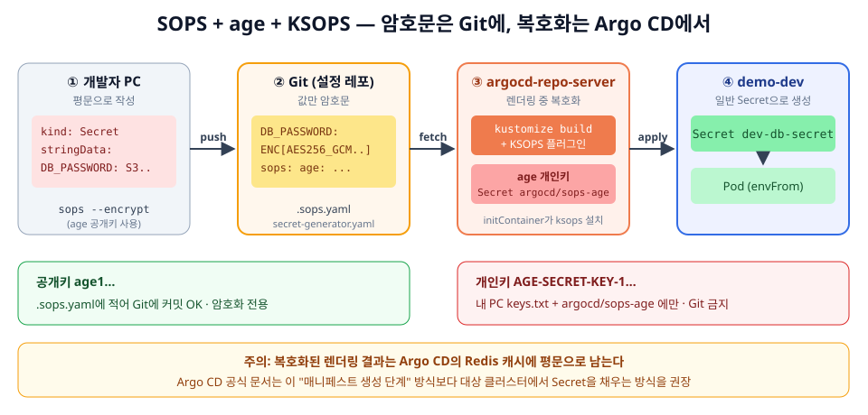
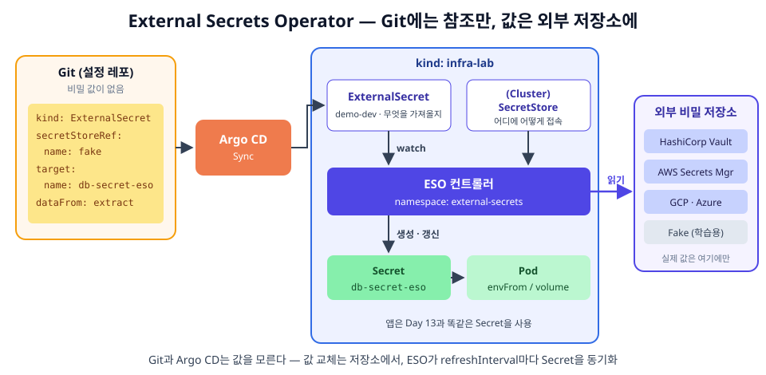

> **Chapter 7 · GitOps & CI/CD** | 난이도 ★★★★☆ | 예상 소요 2.5 ~ 3시간

## 🎯 오늘의 목표

- GitOps에서 Secret을 **평문(또는 base64)으로 커밋하면 안 되는 이유**를 Day 13과 연결해 설명할 수 있다
- **SOPS + age**로 Secret을 암호화해 커밋하고, **KSOPS**로 Argo CD가 복호화해 배포하게 만들 수 있다
- **External Secrets Operator**(SecretStore / ExternalSecret)로 외부 저장소의 값을 Secret으로 동기화할 수 있다
- SOPS, External Secrets, Sealed Secrets의 차이를 표로 비교하고 상황에 맞게 고를 수 있다

---

## 1. GitOps와 Secret의 충돌

GitOps의 원칙은 "**클러스터에 있어야 할 모든 것은 Git에**"입니다. Day 53~54에서 Deployment, Service, 이미지 태그까지 전부 `gitops-demo-config`에 넣었습니다. 그런데 DB 비밀번호는요?

Day 13에서 확인한 사실을 다시 떠올려 봅시다.

| Day 13에서 본 것 | GitOps에서의 의미 |
|---|---|
| Secret의 `data`는 **base64 인코딩일 뿐** 암호화가 아님 | YAML을 커밋하면 `base64 -d` 한 번으로 평문이 나옴 |
| 기본 설정의 etcd에는 Secret이 **평문으로** 저장됨 | 클러스터 안보다 **Git이 더 넓게 퍼짐** — 클론, 포크, CI 캐시, 노트북 |
| RBAC로 `get secret` 권한을 제한 | Git 레포는 Kubernetes RBAC와 무관. 레포 읽기 권한 = 비밀번호 읽기 권한 |

게다가 Git은 **이력을 영원히 기억**합니다. 실수로 평문 Secret을 한 번 push하면, 다음 커밋에서 지워도 과거 커밋에 남아 있습니다. 이 경우 정답은 이력 정리가 아니라 **그 비밀번호를 즉시 교체(rotate)** 하는 것입니다.

> ⚠️ Day 54에서 `kubectl create secret generic git-creds ...`로 손으로 만든 토큰이 바로 이 문제입니다. 클러스터를 새로 만들면 Git만으로는 복원이 안 되고, 그렇다고 YAML로 커밋할 수도 없습니다.

### 해결 방향은 두 가지

| 방향 | 아이디어 | 대표 도구 |
|---|---|---|
| **① 암호화해서 Git에 넣는다** | Git에는 암호문만, 복호화 키는 클러스터(또는 KMS)에 | **SOPS**(+ KSOPS), Sealed Secrets |
| **② Git에는 "참조"만 넣는다** | 값은 외부 비밀 저장소에, Git에는 "어디서 가져올지"만 | **External Secrets Operator**, Secrets Store CSI Driver |

| 오늘 쓰는 버전 (2026-11 기준) | |
|---|---|
| SOPS | v3.13.3 |
| age | v1.3.2 (Ubuntu 24.04 apt 패키지는 더 낮은 버전이지만 실습에는 충분) |
| KSOPS | v4.5.1 |
| External Secrets Operator | v2.15.0 (Helm 차트 2.15.0) |
| Argo CD | v3.6.1 (Day 53) |

---

## 2. SOPS + age 개념



**SOPS**(Secrets OPerationS)는 YAML/JSON의 **구조(키)는 그대로 두고 값만** 암호화하는 도구입니다. 그래서 암호화된 파일도 diff와 코드 리뷰가 가능합니다.

**age**는 단순한 공개키 암호화 도구입니다. GPG보다 키 관리가 훨씬 간단해서 SOPS와 함께 가장 많이 쓰입니다.

| 키 | 모양 | 어디에 |
|---|---|---|
| 공개키(recipient) | `age1...` | `.sops.yaml`에 적어 **Git에 커밋해도 됨**. 암호화에만 쓰임 |
| 개인키(identity) | `AGE-SECRET-KEY-1...` | **절대 Git 금지.** 내 PC(`~/.config/sops/age/keys.txt`)와 Argo CD repo-server에만 |

> 💡 SOPS는 age 외에 AWS KMS, GCP KMS, Azure Key Vault, HashiCorp Vault Transit도 지원합니다. 클라우드에서는 개인키 파일 대신 KMS를 쓰면 "키 파일을 어디에 보관하나" 문제가 IAM 권한 문제로 바뀝니다.

---

## 3. 실습 ① SOPS + age로 Secret 암호화

### 3-1. 설치 (Ubuntu 24.04 / WSL2)

```bash
# age (age, age-keygen)
sudo apt-get update && sudo apt-get install -y age

# sops — GitHub 릴리스 바이너리
SOPS_VERSION=v3.13.3
curl -LO https://github.com/getsops/sops/releases/download/${SOPS_VERSION}/sops-${SOPS_VERSION}.linux.amd64
sudo install -m 755 sops-${SOPS_VERSION}.linux.amd64 /usr/local/bin/sops
rm sops-${SOPS_VERSION}.linux.amd64

sops --version
# sops 3.13.3 ...
age --version
```

> 💡 macOS는 `brew install sops age`. Windows는 릴리스의 `sops-v3.13.3.amd64.exe`를 받거나 WSL2에서 실습하세요.

### 3-2. age 키 만들기

```bash
mkdir -p ~/.config/sops/age
age-keygen -o ~/.config/sops/age/keys.txt
# Public key: age1qz8...x7k     ← 이 값을 복사

cat ~/.config/sops/age/keys.txt
# # created: 2026-11-15T10:00:00+09:00
# # public key: age1qz8...x7k
# AGE-SECRET-KEY-1...           ← 개인키. 절대 커밋 금지
```

`sops`는 리눅스에서 기본으로 `~/.config/sops/age/keys.txt`를 찾아 복호화합니다(다른 위치라면 `SOPS_AGE_KEY_FILE` 환경 변수).

### 3-3. `.sops.yaml` — 어떤 파일을 어떤 키로

설정 레포 루트에 규칙 파일을 둡니다.

```yaml
# gitops-demo-config/.sops.yaml
creation_rules:
  - path_regex: .*\.sops\.yaml$
    encrypted_regex: ^(data|stringData)$     # Secret의 값만 암호화, metadata는 평문 유지
    age: age1qz8...x7k                       # 3-2의 공개키 (여러 개면 쉼표로 구분)
```

### 3-4. 평문 작성 → 즉시 암호화

```bash
cd gitops-demo-config
mkdir -p apps/demo-app/overlays/dev/secrets
cat > apps/demo-app/overlays/dev/secrets/db-secret.sops.yaml <<'EOF'
apiVersion: v1
kind: Secret
metadata:
  name: db-secret
type: Opaque
stringData:
  DB_USER: app
  DB_PASSWORD: S3cr3t-dev!
EOF

sops --encrypt --in-place apps/demo-app/overlays/dev/secrets/db-secret.sops.yaml
cat apps/demo-app/overlays/dev/secrets/db-secret.sops.yaml
```

```yaml
apiVersion: v1
kind: Secret
metadata:
    name: db-secret
type: Opaque
stringData:
    DB_USER: ENC[AES256_GCM,data:3x9k,iv:...,tag:...,type:str]
    DB_PASSWORD: ENC[AES256_GCM,data:Qm8vR2...,iv:...,tag:...,type:str]
sops:
    age:
        - recipient: age1qz8...x7k
          enc: |
            -----BEGIN AGE ENCRYPTED FILE-----
            ...
            -----END AGE ENCRYPTED FILE-----
    lastmodified: "2026-11-15T01:00:00Z"
    mac: ENC[AES256_GCM,data:...,type:str]
    encrypted_regex: ^(data|stringData)$
    version: 3.13.3
```

키 이름(`DB_USER`, `DB_PASSWORD`)과 `metadata`는 보이고 **값만 암호문**입니다. 맨 아래 `sops:` 블록에는 "이 파일의 데이터 키를 age 공개키로 암호화한 것"과 변조 검출용 `mac`이 들어 있습니다.

```bash
sops --decrypt apps/demo-app/overlays/dev/secrets/db-secret.sops.yaml   # 개인키가 있으니 평문 확인 가능
sops edit apps/demo-app/overlays/dev/secrets/db-secret.sops.yaml        # 에디터에서 평문으로 열고, 저장 시 다시 암호화
```

> ⚠️ 암호화된 파일을 **텍스트 에디터로 직접 고치면** `mac` 검증에 실패해 복호화가 안 됩니다. 값 변경은 항상 `sops edit`로 하세요. 그리고 `--in-place` 전에 `git add` 하지 않도록 순서를 지키세요. 평문이 한 번이라도 커밋되면 1장의 "즉시 교체" 규칙이 적용됩니다.

---

## 4. 실습 ② KSOPS로 Argo CD에서 복호화

Argo CD는 Git에서 매니페스트를 가져와 `kustomize build`를 합니다(Day 53의 repo-server). 이 과정에 **복호화 단계**를 끼워 넣는 것이 **KSOPS**(kustomize-sops)입니다. KSOPS는 Kustomize의 **exec KRM 플러그인**으로 동작합니다.

### 4-1. overlay에 KSOPS 생성기 추가

```yaml
# apps/demo-app/overlays/dev/secret-generator.yaml
apiVersion: viaduct.ai/v1
kind: ksops
metadata:
  name: db-secret-generator
  annotations:
    config.kubernetes.io/function: |
      exec:
        path: ksops
files:
  - ./secrets/db-secret.sops.yaml
```

```yaml
# apps/demo-app/overlays/dev/kustomization.yaml (Day 52 내용에 generators만 추가, 나머지는 그대로)
apiVersion: kustomize.config.k8s.io/v1beta1
kind: Kustomization

namespace: demo-dev
namePrefix: dev-

resources:
- ../../base
- httproute.yaml

generators:
- ./secret-generator.yaml

images:
- name: gitops-demo-app
  newName: ghcr.io/<user>/gitops-demo-app
  newTag: sha-8b2d4e6
# ... (labels, replicas, configMapGenerator, patches는 Day 52 그대로)
```

로컬에서 먼저 확인합니다. KSOPS 바이너리가 필요합니다(공식 설치 스크립트가 최신 릴리스를 받아 설치).

```bash
curl -s https://raw.githubusercontent.com/viaduct-ai/kustomize-sops/master/scripts/install-ksops-archive.sh | bash
kustomize build --enable-alpha-plugins --enable-exec apps/demo-app/overlays/dev | grep -A6 "kind: Secret"
# kind: Secret
# metadata:
#   name: dev-db-secret        ← namePrefix: dev- 가 생성된 Secret에도 붙음
#   namespace: demo-dev
# stringData:
#   DB_PASSWORD: S3cr3t-dev!    ← 렌더링 결과에서만 평문
```

KSOPS가 만든 Secret도 일반 리소스처럼 `namePrefix`가 붙어 **`dev-db-secret`** 이 됩니다. base의 Deployment에서 Day 13처럼 `envFrom: - secretRef: name: db-secret`으로 참조해 두면, Kustomize가 Deployment→Secret 참조도 `dev-db-secret`으로 함께 바꿔 줍니다(내장 리소스 간 참조라서 가능 — Day 52의 HTTPRoute `backendRefs`와 다른 점).

### 4-2. Argo CD repo-server에 KSOPS와 age 키 넣기

**① 개인키를 Secret으로** — 이것만은 Git이 아니라 손(또는 별도 부트스트랩 절차)으로 넣습니다.

```bash
kubectl -n argocd create secret generic sops-age \
  --from-file=keys.txt=$HOME/.config/sops/age/keys.txt
```

**② Kustomize 플러그인 허용** — Argo CD가 `kustomize build`에 플래그를 붙이게 합니다.

```bash
kubectl -n argocd patch configmap argocd-cm --type merge \
  -p '{"data":{"kustomize.buildOptions":"--enable-alpha-plugins --enable-exec"}}'
```

**③ repo-server 패치** — initContainer가 KSOPS(와 KSOPS용 kustomize)를 공유 볼륨에 복사하고, age 키를 마운트합니다. KSOPS README의 패치에 age 키 부분을 더한 것입니다.

```yaml
# argocd-repo-server-ksops-patch.yaml
spec:
  template:
    spec:
      volumes:
        - name: custom-tools
          emptyDir: {}
        - name: sops-age
          secret:
            secretName: sops-age
      initContainers:
        - name: install-ksops
          image: viaductoss/ksops:v4.5.1
          command: ["/usr/local/bin/ksops", "install", "--with-kustomize", "/custom-tools"]
          volumeMounts:
            - mountPath: /custom-tools
              name: custom-tools
      containers:
        - name: argocd-repo-server
          env:
            - name: SOPS_AGE_KEY_FILE
              value: /.config/sops/age/keys.txt
          volumeMounts:
            - mountPath: /usr/local/bin/kustomize
              name: custom-tools
              subPath: kustomize
            - mountPath: /usr/local/bin/ksops
              name: custom-tools
              subPath: ksops
            - mountPath: /.config/sops/age
              name: sops-age
```

```bash
kubectl -n argocd patch deployment argocd-repo-server --patch-file argocd-repo-server-ksops-patch.yaml
kubectl -n argocd rollout status deploy/argocd-repo-server
kubectl -n argocd exec deploy/argocd-repo-server -- ksops --help >/dev/null && echo "ksops OK"
```

> 💡 Helm으로 Argo CD를 설치했다면 같은 내용을 `configs.cm`과 `repoServer.volumes / initContainers / volumeMounts / env` values로 넣습니다(KSOPS README에 예시가 있습니다).

### 4-3. 커밋하고 확인

```bash
git add .sops.yaml apps/demo-app/overlays/dev/secret-generator.yaml apps/demo-app/overlays/dev/secrets/ apps/demo-app/overlays/dev/kustomization.yaml
git commit -m "dev: add db-secret (sops)" && git push

argocd app get gitops-demo-dev --refresh | grep -E "Secret|Sync Status"
kubectl -n demo-dev get secret dev-db-secret -o jsonpath='{.data.DB_PASSWORD}' | base64 -d; echo
# S3cr3t-dev!
```

Git에는 암호문만, 클러스터에는 정상 Secret이 생겼습니다. 비밀번호를 바꿀 때는 `sops edit` → 커밋 → Argo CD가 자동 반영합니다. **Secret 변경도 PR로 리뷰**할 수 있다는 것이 SOPS 방식의 큰 장점입니다(값은 암호문이지만 "누가 언제 어떤 키를 바꿨는지"는 보입니다).

> ⚠️ **알고 쓰기**: Argo CD 공식 문서는 repo-server에서 비밀을 주입·복호화하는 "매니페스트 생성 단계" 방식을 권장하지 않습니다. 렌더링 결과가 **Redis 캐시에 평문으로** 남고 repo-server API로도 조회될 수 있기 때문입니다. KSOPS도 같은 구조이므로, 쓴다면 NetworkPolicy로 Redis·repo-server 접근을 막고 Argo CD 전용 클러스터를 고려하세요. 공식 문서가 권장하는 것은 다음 장의 **"대상 클러스터에서 Secret을 채우는" 방식**(External Secrets, Sealed Secrets 등)입니다.

---

## 5. External Secrets Operator 개념



**External Secrets Operator(ESO)** 는 "값은 이미 외부 비밀 저장소(AWS Secrets Manager, GCP Secret Manager, Azure Key Vault, HashiCorp Vault 등)에 있다"는 전제에서 출발합니다. Git에는 **어디서 무엇을 가져올지**만 적습니다.

| 리소스 | 범위 | 역할 |
|---|---|---|
| **SecretStore** | 네임스페이스 | "이 저장소에 이 인증 정보로 접속한다" (Vault 주소, AWS 리전 등) |
| **ClusterSecretStore** | 클러스터 전체 | SecretStore와 같지만 모든 네임스페이스에서 참조 가능 |
| **ExternalSecret** | 네임스페이스 | "저장소의 이 키를 읽어 → 이 이름의 Kubernetes Secret으로 만들어라" + 갱신 주기 |

ESO 컨트롤러가 ExternalSecret을 보고 저장소에서 값을 읽어 **일반 Kubernetes Secret을 생성·갱신**합니다. 앱 입장에서는 Day 13의 Secret과 똑같습니다. Argo CD는 ExternalSecret만 배포하고 실제 값은 전혀 모릅니다.

---

## 6. 실습 ③ External Secrets Operator

### 6-1. 설치 (Helm)

```bash
helm repo add external-secrets https://charts.external-secrets.io
helm repo update
helm install external-secrets external-secrets/external-secrets \
  --version 2.15.0 \
  -n external-secrets --create-namespace

kubectl -n external-secrets rollout status deploy/external-secrets
kubectl get crd | grep external-secrets.io | head -5
# clustersecretstores.external-secrets.io
# externalsecrets.external-secrets.io
# secretstores.external-secrets.io
# ...
```

> 💡 GitOps답게 하려면 이 Helm 설치도 Argo CD Application(차트 소스)으로 만들어 Day 53의 App of Apps 아래에 두면 됩니다. CRD를 Helm이 관리하므로 기본값 그대로 설치합니다.

### 6-2. 로컬 실습용 저장소 — Fake provider

클라우드 계정 없이 흐름을 익히기 위해, ESO에 내장된 **Fake provider**를 씁니다. 저장소 내용이 매니페스트에 직접 적히므로 **학습·테스트 전용**입니다.

```yaml
# clustersecretstore-fake.yaml
apiVersion: external-secrets.io/v1
kind: ClusterSecretStore
metadata:
  name: fake
spec:
  provider:
    fake:
      data:
      - key: "/gitops-demo/dev/db"
        value: '{"DB_USER": "app", "DB_PASSWORD": "S3cr3t-from-store"}'
        version: "v1"
```

```yaml
# apps/demo-app/overlays/dev/externalsecret-db.yaml  ← 설정 레포에 커밋해도 안전 (값이 없음)
apiVersion: external-secrets.io/v1
kind: ExternalSecret
metadata:
  name: db-secret
spec:
  refreshInterval: 1h                # 저장소를 다시 읽는 주기
  secretStoreRef:
    name: fake
    kind: ClusterSecretStore
  target:
    name: db-secret-eso              # 만들어질 Kubernetes Secret 이름
  dataFrom:
  - extract:                         # JSON 값을 풀어 키마다 Secret 항목으로
      key: /gitops-demo/dev/db
      version: v1
```

```bash
kubectl apply -f clustersecretstore-fake.yaml
kubectl -n demo-dev apply -f apps/demo-app/overlays/dev/externalsecret-db.yaml   # 흐름 확인용으로 직접 적용

kubectl get clustersecretstore fake
# NAME   AGE   STATUS   CAPABILITIES   READY
# fake   10s   Valid    ReadWrite      True

kubectl -n demo-dev get externalsecret db-secret
# NAME        STORETYPE            STORE   REFRESH INTERVAL   STATUS         READY
# db-secret   ClusterSecretStore   fake    1h                 SecretSynced   True

kubectl -n demo-dev get secret db-secret-eso -o jsonpath='{.data.DB_PASSWORD}' | base64 -d; echo
# S3cr3t-from-store
```

실제로는 ExternalSecret YAML을 `apps/demo-app/overlays/dev/kustomization.yaml`의 `resources`에 넣어 Argo CD가 배포하게 합니다. 이때 `namePrefix`로 ExternalSecret 이름은 `dev-db-secret`이 되지만, CRD 필드인 `spec.target.name`(`db-secret-eso`)은 Kustomize가 모르므로 **적힌 그대로** 쓰입니다(Day 52 HTTPRoute `backendRefs`와 같은 이유). 그리고 ClusterSecretStore는 플랫폼 팀이 관리하는 별도 Application으로 둡니다.

### 6-3. (선택) 진짜 저장소처럼 — Vault dev 모드

Fake 대신 HashiCorp Vault를 **dev 모드**(메모리 저장, 자동 unseal, root 토큰 `root`)로 띄워 같은 흐름을 해볼 수 있습니다. dev 모드는 재시작하면 데이터가 사라지는 **실습 전용**입니다.

```bash
helm repo add hashicorp https://helm.releases.hashicorp.com
helm install vault hashicorp/vault -n vault --create-namespace \
  --set server.dev.enabled=true

kubectl -n vault exec vault-0 -- sh -c \
  'VAULT_TOKEN=root vault kv put secret/gitops-demo/dev/db DB_USER=app DB_PASSWORD=S3cr3t-from-vault'

kubectl -n demo-dev create secret generic vault-token --from-literal=token=root
```

```yaml
# secretstore-vault.yaml
apiVersion: external-secrets.io/v1
kind: SecretStore
metadata:
  name: vault-backend
  namespace: demo-dev
spec:
  provider:
    vault:
      server: "http://vault.vault.svc:8200"
      path: "secret"           # dev 모드가 만들어 둔 KV 엔진 경로
      version: "v2"            # KV v2
      auth:
        tokenSecretRef:
          name: vault-token
          key: token
---
apiVersion: external-secrets.io/v1
kind: ExternalSecret
metadata:
  name: db-secret-vault
  namespace: demo-dev
spec:
  refreshInterval: 1m
  secretStoreRef:
    name: vault-backend
    kind: SecretStore
  target:
    name: db-secret-vault
  dataFrom:
  - extract:
      key: gitops-demo/dev/db
```

```bash
kubectl apply -f secretstore-vault.yaml
kubectl -n demo-dev get externalsecret db-secret-vault      # STATUS SecretSynced
# Vault에서 값을 바꾸면 refreshInterval(1m) 안에 Secret도 바뀜
kubectl -n vault exec vault-0 -- sh -c \
  'VAULT_TOKEN=root vault kv put secret/gitops-demo/dev/db DB_USER=app DB_PASSWORD=rotated-123'
```

> ⚠️ 여기서는 편의상 root 토큰을 Secret으로 넣었습니다. 운영에서는 Vault의 **Kubernetes 인증**(ServiceAccount 토큰으로 로그인)이나 클라우드의 워크로드 아이덴티티(IRSA 등)를 써서, "저장소에 접속하기 위한 첫 번째 비밀"마저 없애는 것이 목표입니다.

> 💡 Secret 값이 바뀌어도 **이미 떠 있는 Pod의 환경 변수는 그대로**입니다(Day 13의 5-1). 볼륨 마운트로 받거나, Reloader 같은 도구로 롤링 재시작을 걸어야 반영됩니다.

---

## 7. Sealed Secrets — 비교만

**Sealed Secrets**(Bitnami)는 ①번 "암호화해서 Git에" 계열입니다. 클러스터에 컨트롤러를 설치하면 컨트롤러가 키 쌍을 만들고, 개발자는 `kubeseal` CLI로 **클러스터의 공개키**를 써서 Secret을 `SealedSecret` 리소스로 암호화해 커밋합니다. 복호화는 클러스터 안의 컨트롤러만 할 수 있습니다.

| | SOPS (+KSOPS) | Sealed Secrets |
|---|---|---|
| 복호화 위치 | Argo CD repo-server (매니페스트 생성 단계) | **대상 클러스터의 컨트롤러** |
| 암호화 키 | age/PGP/KMS — 팀이 관리 | 컨트롤러가 생성·보관 (백업 필수) |
| 로컬에서 평문 보기 | 개인키가 있으면 `sops --decrypt` | 불가 (클러스터만 복호화) — 수정은 다시 봉인 |
| Kubernetes 외 용도 | 아무 YAML/JSON/ENV 파일 | Kubernetes Secret 전용 |
| 클러스터 재구축 | 같은 age 키만 있으면 됨 | 컨트롤러 개인키를 백업해 두지 않으면 모든 SealedSecret 재생성 |

---

## 8. 방식 비교 — 무엇을 고를까

| 방식 | Git에 들어가는 것 | 실제 값의 원천 | Argo CD가 평문을 보나? | 장점 | 단점 | 어울리는 곳 |
|---|---|---|---|---|---|---|
| 평문/base64 Secret | **평문** | Git | 예 | 간단 | 사용 금지 | — |
| **SOPS + KSOPS** | 값만 암호화된 YAML | Git(암호문) | **예** (repo-server, Redis 캐시) | 리뷰·이력 관리, 외부 의존 없음, 클라우드 KMS 연동 | 키 배포·교체 관리, Argo CD 공식 비권장 구조 | 소규모 팀, 홈랩, 외부 저장소가 없을 때 |
| **Sealed Secrets** | SealedSecret(암호문) | Git(암호문) | 아니오 | 단순, 클러스터만 복호화 | 클러스터별로 다시 봉인, 키 백업 필수 | 클러스터 1~2개, Kubernetes 전용 |
| **External Secrets** | ExternalSecret(참조만) | **외부 저장소** | 아니오 | 값 교체가 Git과 분리, 자동 갱신, 클라우드 표준 | 외부 저장소 운영 필요, 저장소 접근 인증 설계 | 클라우드/기업 환경, 여러 클러스터, 순환 교체 |

> 💡 정리하면, **외부 비밀 저장소가 이미 있다면 External Secrets**, 없다면 **SOPS(또는 Sealed Secrets)** 가 무난합니다. Chapter 6의 LiteLLM 마스터 키나 Hugging Face 토큰(Day 40·45) 같은 값도 같은 방식으로 관리할 수 있습니다 — rag-api overlay에 ExternalSecret 하나만 커밋하면 됩니다.

---

## 9. 트러블슈팅

| 증상 | 원인 | 해결 |
|---|---|---|
| `sops --encrypt`: `no matching creation rules found` | `.sops.yaml`의 `path_regex`가 파일 경로와 안 맞음 | 파일명이 `.sops.yaml`로 끝나는지, 레포 루트에서 실행했는지 확인 |
| `sops --decrypt`: `failed to get the data key` | 개인키를 못 찾음 | `~/.config/sops/age/keys.txt` 위치 또는 `SOPS_AGE_KEY_FILE` 확인 |
| `MAC mismatch` | 암호화된 파일을 에디터로 직접 수정 | 원래 값으로 되돌리고 `sops edit`로 수정 |
| Argo CD `ComparisonError: ... external plugins disabled` | `kustomize.buildOptions` 미설정 | `argocd-cm`에 `--enable-alpha-plugins --enable-exec` 추가 |
| Argo CD `exec: "ksops": executable file not found` | repo-server 패치 누락 또는 롤아웃 전 | 4-2의 패치 적용 후 `rollout status` 확인 |
| repo-server에서 복호화 실패 | `sops-age` Secret 없음 / 다른 키로 암호화 | `kubectl -n argocd get secret sops-age`, `.sops.yaml`의 공개키와 keys.txt의 public key 비교 |
| ExternalSecret `SecretSyncedError` | 저장소 키 오타 / 인증 실패 | `kubectl describe externalsecret` 이벤트 확인, SecretStore가 `Valid`인지 확인 |
| ExternalSecret이 만든 Secret이 Argo CD에서 지워짐 | ESO가 만든 Secret과 같은 이름의 Secret을 Git에도 넣음 | Git에는 ExternalSecret만, Secret은 ESO가 소유하도록 이름 분리 |

---

## 10. 핵심 정리

- Secret의 base64는 암호화가 아니다(Day 13). Git은 이력을 영원히 기억하고 널리 복제되므로 **평문 Secret 커밋은 금지**, 유출 시 즉시 교체
- **SOPS + age**: 값만 암호화한 YAML을 커밋. 공개키는 `.sops.yaml`에, 개인키는 로컬과 클러스터에만
- **KSOPS**: Kustomize exec 플러그인으로 Argo CD repo-server에서 복호화. `kustomize.buildOptions` + repo-server 패치 + age 키 Secret이 필요
- Argo CD는 repo-server에서 비밀을 다루는 방식보다 **대상 클러스터에서 Secret을 채우는 방식**(ESO, Sealed Secrets)을 권장
- **External Secrets**: Git에는 SecretStore/ExternalSecret(참조)만, 값은 외부 저장소에서 ESO가 동기화
- 외부 저장소가 있으면 ESO, 없으면 SOPS 또는 Sealed Secrets

---

## 11. 셀프 체크

<details>
<summary>Q1. 평문 Secret을 실수로 push했다. 다음 커밋에서 파일을 지우면 해결되는가?</summary>

아닙니다. Git 이력과 이미 클론·포크된 사본에 남아 있습니다. **해당 비밀번호·토큰을 즉시 교체(rotate)** 하는 것이 우선이고, 이력 정리(git filter-repo 등)는 그다음의 보조 수단입니다.
</details>

<details>
<summary>Q2. <code>.sops.yaml</code>에 age 공개키를 적어 Git에 커밋해도 괜찮은 이유는?</summary>

공개키는 **암호화만** 할 수 있고 복호화는 할 수 없기 때문입니다. 누구나 새 Secret을 암호화해 PR을 올릴 수 있지만, 내용을 읽을 수 있는 것은 개인키를 가진 사람과 Argo CD repo-server뿐입니다.
</details>

<details>
<summary>Q3. SOPS의 <code>encrypted_regex: ^(data|stringData)$</code> 설정이 주는 이점은?</summary>

`metadata.name`, `kind` 등이 평문으로 남아 **어떤 Secret이 바뀌었는지 diff와 리뷰가 가능**하고, Kustomize가 리소스를 식별할 수 있습니다. 값만 숨기고 구조는 드러내는 것이 SOPS의 핵심입니다.
</details>

<details>
<summary>Q4. Argo CD 공식 문서가 KSOPS 같은 "매니페스트 생성 단계 복호화" 방식을 권장하지 않는 이유는?</summary>

repo-server가 렌더링한 결과(복호화된 Secret 포함)가 **Redis 캐시에 평문으로 저장**되고 repo-server API로도 조회될 수 있어, Argo CD 내부 구성 요소에 접근할 수 있는 사람이면 비밀을 볼 수 있기 때문입니다. 또 Secret 변경이 앱 Sync와 묶입니다.
</details>

<details>
<summary>Q5. External Secrets 방식에서 Git에 커밋되는 것과 커밋되지 않는 것은?</summary>

커밋되는 것: SecretStore/ClusterSecretStore(저장소 주소·인증 방식), ExternalSecret(어떤 키를 어떤 Secret으로). 커밋되지 않는 것: **실제 비밀 값**과, 가능하면 저장소 접속용 자격 증명(워크로드 아이덴티티나 Kubernetes 인증으로 대체).
</details>

---

## ⏭️ 다음 예고 — Day 56. Argo Rollouts로 점진적 배포 (Canary, Blue-Green)

이제 Git 커밋 하나로 이미지와 시크릿까지 배포됩니다. 그런데 새 버전이 prod에 **한 번에 100%** 나가는 것은 여전히 무섭습니다. 내일은 **Argo Rollouts**로 트래픽을 10% → 50% → 100%로 나눠 보내는 **Canary**와, 두 버전을 나란히 띄워 놓고 전환하는 **Blue-Green**을 Day 15의 Gateway API와 엮어 실습합니다.
