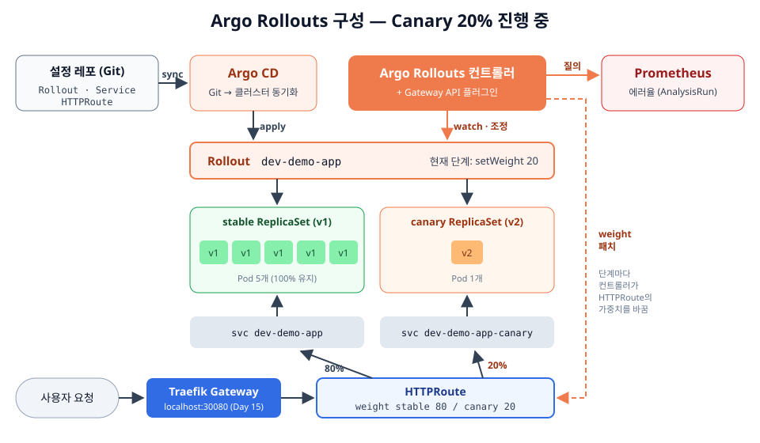
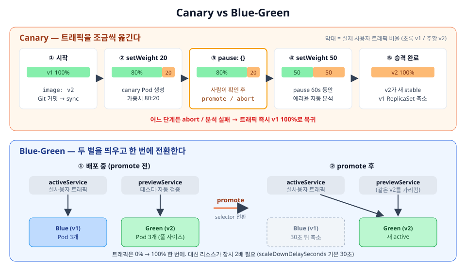
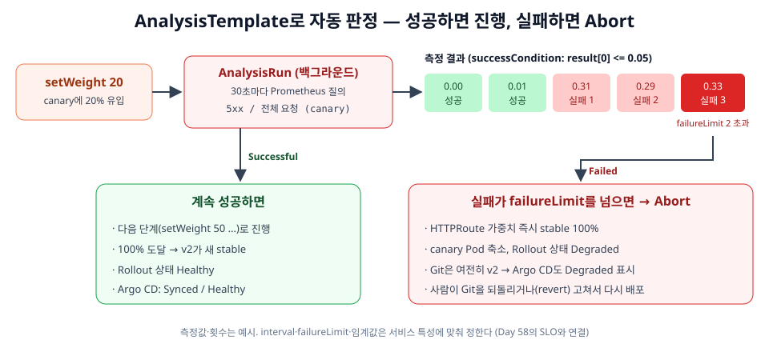

> **Chapter 7 · GitOps & CI/CD** | 난이도 ★★★★☆ | 예상 소요 2.5 ~ 3시간

## 🎯 오늘의 목표

- Deployment 롤링 업데이트(Day 11)의 한계와 **점진적 배포(Progressive Delivery)** 가 필요한 이유를 설명할 수 있다
- Argo Rollouts 컨트롤러와 `kubectl argo rollouts` 플러그인을 설치하고, Deployment를 **Rollout**으로 바꿀 수 있다
- **Canary**(setWeight, pause, promote/abort)와 **Blue-Green**(activeService, previewService)을 직접 돌려 본다
- Day 15의 **Gateway API(HTTPRoute)** 로 트래픽을 가중치로 나누고, Day 17의 **Prometheus** 에러율로 자동 롤백한다
- Argo CD와 함께 쓸 때 생기는 충돌(OutOfSync, Degraded)을 이해하고 피할 수 있다

---

## 1. 왜 점진적 배포인가?

Day 53부터 우리는 "Git에 커밋하면 배포된다"를 완성했습니다. 그런데 새 이미지가 **나쁜 버전**이면 어떻게 될까요? Argo CD는 Git을 충실히 따르므로 나쁜 버전도 **충실하게, 전부** 배포합니다.

Day 11의 Deployment 롤링 업데이트는 Pod를 조금씩 바꾸긴 하지만, 다음은 할 수 없습니다.

| 하고 싶은 것 | Deployment (RollingUpdate) | Argo Rollouts |
|---|---|---|
| 사용자 트래픽 **10%만** 새 버전으로 | 불가. Pod 개수 비율로만 대충 나뉨 | `setWeight: 10` 으로 정확히 (Gateway API 등 트래픽 라우터 사용) |
| 중간에 **멈춰서** 사람이 확인 | `kubectl rollout pause`는 있지만 단계 정의가 없음 | `pause: {}` 단계, `promote`로 다음 단계 |
| 지표를 보고 **자동 판정** | readinessProbe가 전부 (Pod가 떴는지만 봄) | `AnalysisTemplate`으로 에러율·지연 시간 판정 |
| 문제 시 **즉시** 되돌림 | `rollout undo`로 다시 롤링 (수십 초~분) | stable Pod가 그대로 살아 있어 트래픽만 즉시 복귀 |
| 새 버전을 운영 트래픽 없이 검증 | 불가 | Blue-Green의 `previewService` |

> 💡 **Progressive Delivery** = 지속적 배포(Day 50) + 점진적 노출 + 자동 판정. "배포(deploy)"와 "출시(release)"를 분리하는 생각입니다. 새 Pod가 떠 있는 것(배포)과 사용자가 그 Pod를 쓰는 것(출시)을 따로 통제합니다.

---

## 2. Argo Rollouts 아키텍처



| 구성 요소 | 역할 |
|---|---|
| **Rollout** (CRD) | Deployment를 대체하는 리소스. `spec.template`은 Deployment와 같고 `spec.strategy`에 canary/blueGreen 단계를 적음 |
| **Argo Rollouts 컨트롤러** | Rollout을 지켜보며 ReplicaSet을 만들고, 단계마다 Service selector와 트래픽 가중치를 바꿈 |
| **stable / canary ReplicaSet** | 현재 버전과 새 버전. Rollout이 ReplicaSet을 **직접** 관리 (Deployment를 거치지 않음) |
| **트래픽 라우터** | 가중치를 실제로 적용하는 곳. 오늘은 Gateway API 플러그인으로 **HTTPRoute의 weight** 를 바꿈 |
| **AnalysisTemplate / AnalysisRun** | "무엇을 측정해 성공으로 볼지" 정의(템플릿)와 그 실행 기록(런) |
| **kubectl argo rollouts** | 상태 보기, promote, abort, retry, 대시보드를 제공하는 kubectl 플러그인 |

### 2-1. 트래픽 분할: Traefik 네이티브 vs Gateway API 플러그인

Argo Rollouts는 트래픽 라우터를 두 갈래로 지원합니다. Day 15에서 Traefik을 설치했으므로 둘 다 쓸 수 있습니다.

| 방식 | 사용하는 리소스 | 비고 |
|---|---|---|
| Traefik 네이티브 연동 | Traefik 전용 CRD `TraefikService`(`traefik.io/v1alpha1`) | Rollouts에 내장. Traefik v3 기준 추가 설정 없음 |
| **Gateway API 플러그인** | 표준 `HTTPRoute` | `argoproj-labs/rollouts-plugin-trafficrouter-gatewayapi`. Traefik·Envoy Gateway·Cilium 등 **구현체와 무관** |

오늘은 **Gateway API 플러그인**을 씁니다. Day 15 7-3에서 손으로 고치던 HTTPRoute의 `weight`를, 이제 컨트롤러가 단계에 맞춰 대신 고칩니다. 나중에 Traefik을 다른 Gateway 구현체로 바꿔도 Rollout은 그대로입니다.

---

## 3. Canary vs Blue-Green



| 구분 | Canary | Blue-Green |
|---|---|---|
| 전환 방식 | 트래픽을 **조금씩** (20% → 50% → 100%) | 검증 후 **한 번에** (0% → 100%) |
| 필요 리소스 | stable + 소수의 canary Pod | 새 버전을 **풀 사이즈로** 하나 더 (잠시 2배) |
| 트래픽 라우터 | 정밀한 비율에는 필요 (없으면 Pod 수 비율로 근사) | 불필요 (Service selector만 바꿈) |
| 실사용자 영향 | 일부 사용자는 새 버전을 먼저 겪음 | promote 전에는 실사용자 영향 없음 |
| 잘 맞는 경우 | 트래픽이 많은 웹/API, 지표로 판정 가능할 때 | 버전이 섞이면 안 되는 앱, 사전 검증(스모크 테스트)이 중요할 때 |

---

## 4. 실습 환경

| 항목 | 값 |
|---|---|
| 클러스터 | Day 09의 kind `infra-lab` (Kubernetes v1.31+) |
| 진입점 | Day 15의 Traefik (NodePort 30080) + Gateway API CRD + Gateway `traefik-gateway` |
| 모니터링 | Day 17의 kube-prometheus-stack (릴리스명 `monitoring`, 네임스페이스 `monitoring`) |
| GitOps | Day 53의 Argo CD, Application `gitops-demo-dev` (설정 레포 `apps/demo-app/overlays/dev` → 네임스페이스 `demo-dev`) |
| 설정 레포 | Day 52 구조 그대로. base 이름 `demo-app`, dev overlay가 `namePrefix: dev-` 를 붙여 **`dev-demo-app`** |
| 접속 | HTTPRoute `dev.demo.example.test` (localhost:30080 경유, Day 52) |
| Argo Rollouts | **v1.10.2** (2026-11 기준 최신 안정 버전) |
| Gateway API 플러그인 | **v0.17.0** |

> ⚠️ `<user>` 는 본인 GitHub 계정(소문자)입니다. 명령의 리소스 이름은 dev 기준 최종 이름(`dev-demo-app`)입니다.

---

## 5. 실습 ① Argo Rollouts 설치

### 5-1. 컨트롤러

```bash
kubectl config use-context kind-infra-lab

kubectl create namespace argo-rollouts
kubectl apply -n argo-rollouts \
  -f https://github.com/argoproj/argo-rollouts/releases/download/v1.10.2/install.yaml

kubectl -n argo-rollouts rollout status deploy/argo-rollouts
kubectl get crd | grep argoproj.io
```

```
analysisruns.argoproj.io            ...
analysistemplates.argoproj.io       ...
clusteranalysistemplates.argoproj.io ...
experiments.argoproj.io             ...
rollouts.argoproj.io                ...
```

Argo CD가 이미 `applications.argoproj.io` 등을 만들어 두었으므로 목록에 함께 보입니다. 같은 `argoproj.io` 그룹이지만 서로 다른 프로젝트입니다.

> 💡 공식 문서 예시는 `releases/latest/download/install.yaml` 이지만, Day 53과 같은 이유로 **버전을 고정**합니다. 이 설치 자체도 설정 레포에 넣어 Argo CD가 관리하게 하는 것이 최종 형태입니다.

### 5-2. kubectl 플러그인

```bash
# Linux (amd64). Apple Silicon Mac은 Homebrew 권장
curl -LO https://github.com/argoproj/argo-rollouts/releases/download/v1.10.2/kubectl-argo-rollouts-linux-amd64
chmod +x ./kubectl-argo-rollouts-linux-amd64
sudo mv ./kubectl-argo-rollouts-linux-amd64 /usr/local/bin/kubectl-argo-rollouts

# macOS
brew install argoproj/tap/kubectl-argo-rollouts

kubectl argo rollouts version
# kubectl-argo-rollouts: v1.10.2+...
```

> 💡 Windows는 릴리스의 `kubectl-argo-rollouts-windows-amd64` 를 받아 `kubectl-argo-rollouts.exe` 로 이름을 바꾸고 PATH에 둡니다. kubectl은 PATH에서 `kubectl-<이름>` 실행 파일을 찾아 `kubectl <이름>` 서브커맨드로 붙여 줍니다.

### 5-3. Gateway API 플러그인 등록

플러그인은 컨트롤러가 **시작할 때 내려받는 실행 파일**입니다. `argo-rollouts-config` ConfigMap에 위치를 적습니다.

```yaml
# rollouts-gatewayapi-plugin.yaml
apiVersion: v1
kind: ConfigMap
metadata:
  name: argo-rollouts-config
  namespace: argo-rollouts
data:
  trafficRouterPlugins: |-
    - name: "argoproj-labs/gatewayAPI"
      location: "https://github.com/argoproj-labs/rollouts-plugin-trafficrouter-gatewayapi/releases/download/v0.17.0/gatewayapi-plugin-linux-amd64"
---
# 컨트롤러가 HTTPRoute의 weight를 고칠 수 있게 권한 부여
apiVersion: rbac.authorization.k8s.io/v1
kind: ClusterRole
metadata:
  name: argo-rollouts-gateway-api-plugin
rules:
- apiGroups: ["gateway.networking.k8s.io"]
  resources: ["httproutes"]
  verbs: ["get", "list", "watch", "update", "patch"]
---
apiVersion: rbac.authorization.k8s.io/v1
kind: ClusterRoleBinding
metadata:
  name: argo-rollouts-gateway-api-plugin
roleRef:
  apiGroup: rbac.authorization.k8s.io
  kind: ClusterRole
  name: argo-rollouts-gateway-api-plugin
subjects:
- kind: ServiceAccount
  name: argo-rollouts
  namespace: argo-rollouts
```

```bash
kubectl apply -f rollouts-gatewayapi-plugin.yaml
kubectl -n argo-rollouts rollout restart deploy/argo-rollouts
kubectl -n argo-rollouts logs deploy/argo-rollouts | grep -i plugin
# ... gatewayapi-plugin 다운로드·로드 관련 로그가 보이면 성공
```

> ⚠️ 바이너리는 **kind 노드의 CPU 아키텍처**와 맞아야 합니다. Apple Silicon Mac의 Docker Desktop이라면 노드가 arm64이므로 `gatewayapi-plugin-linux-arm64` 를 쓰세요. (`kubectl get nodes -o wide` 또는 `docker exec infra-lab-control-plane uname -m`)

---

## 6. 실습 ② 앱에 지표와 "고장 스위치" 넣기

자동 롤백을 보려면 **에러율을 잴 수 있는 지표**와, 일부러 **나쁜 버전을 만드는 방법**이 필요합니다. `gitops-demo-app`에 두 가지를 추가합니다.

```python
# app/main.py (Day 50 버전에서 바뀐 부분만)
import os
import random
import socket

from fastapi import FastAPI, HTTPException
from prometheus_fastapi_instrumentator import Instrumentator

app = FastAPI(title="gitops-demo-app")
Instrumentator().instrument(app).expose(app)   # GET /metrics 추가


@app.get("/")
def root():
    # FAIL_RATE=0.3 이면 요청의 약 30%를 500으로 응답 (나쁜 릴리스 흉내)
    if random.random() < float(os.getenv("FAIL_RATE", "0")):
        raise HTTPException(status_code=500, detail="injected failure")
    return {
        "app": "gitops-demo-app",
        "version": os.getenv("APP_VERSION", "dev"),
        "env": os.getenv("APP_ENV", "local"),
        "message": os.getenv("APP_MESSAGE", "hello, gitops"),
        "debug": os.getenv("DEBUG", "false"),
        "pod": socket.gethostname(),
    }

# /healthz 등 나머지 엔드포인트는 그대로
```

```text
# requirements.txt 에 한 줄 추가
prometheus-fastapi-instrumentator>=7.1
```

`prometheus-fastapi-instrumentator`는 `http_requests_total{handler, method, status}` 카운터를 노출합니다. `status`는 기본적으로 `2xx`, `5xx`처럼 **묶어서** 기록됩니다. 커밋하고 push하면 Day 51의 워크플로가 새 이미지를 GHCR에 올리고, Day 54의 Image Updater(또는 CI 커밋)가 dev 태그를 갱신합니다.

```bash
cd ~/gitops-lab/gitops-demo-app
git add . && git commit -m "feat: /metrics, FAIL_RATE 추가" && git push
```

---

## 7. 실습 ③ Deployment를 Rollout으로 바꾸기

이제 설정 레포를 고칩니다. Day 52의 구조에서 이렇게 바뀝니다.

```
gitops-demo-config/apps/demo-app/
├── base/
│   ├── rollout.yaml              # deployment.yaml → rollout.yaml
│   ├── service.yaml              # stable Service (기존 그대로)
│   ├── service-canary.yaml       # 새로 추가
│   ├── analysis-error-rate.yaml  # 새로 추가 (8장)
│   ├── servicemonitor.yaml       # 새로 추가 (8장)
│   └── kustomization.yaml
└── overlays/dev/
    ├── httproute.yaml            # backendRefs를 stable + canary 두 개로
    └── kustomization.yaml        # Deployment 대상 설정을 Rollout으로
```

### 7-1. Rollout 매니페스트

Deployment에서 바뀌는 것은 **apiVersion, kind, strategy** 세 곳뿐입니다. `template`은 Day 52의 것을 그대로 옮깁니다.

```yaml
# apps/demo-app/base/rollout.yaml
apiVersion: argoproj.io/v1alpha1          # apps/v1 → argoproj.io/v1alpha1
kind: Rollout                              # Deployment → Rollout
metadata:
  name: demo-app
  labels:
    app.kubernetes.io/name: demo-app
spec:
  replicas: 1
  revisionHistoryLimit: 3
  selector:
    matchLabels:
      app.kubernetes.io/name: demo-app
  template:                                # ↓ Day 52 Deployment의 template 그대로
    metadata:
      labels:
        app.kubernetes.io/name: demo-app
    spec:
      containers:
      - name: demo-app
        image: gitops-demo-app:0.1.0       # overlay의 images가 교체
        ports:
        - name: http
          containerPort: 8000
        envFrom:
        - configMapRef:
            name: demo-app-config
        readinessProbe:
          httpGet:
            path: /healthz
            port: http
        livenessProbe:
          httpGet:
            path: /healthz
            port: http
        resources:
          requests:
            cpu: 50m
            memory: 64Mi
          limits:
            memory: 128Mi
  strategy:
    canary:
      stableService: demo-app              # 기존 Service
      canaryService: demo-app-canary       # 새 버전 전용 Service
      analysis:                            # 백그라운드 분석 (8장)
        templates:
        - templateName: error-rate
        startingStep: 1                    # 첫 setWeight 이후부터 측정
        args:
        - name: canary-hash                # 새 버전 ReplicaSet의 해시
          valueFrom:
            podTemplateHashValue: Latest
        - name: env                        # Day 52 overlay가 붙인 environment 라벨
          valueFrom:
            fieldRef:
              fieldPath: metadata.labels['environment']
      steps:
      - setWeight: 20
      - pause: {}                 # 무기한 대기 → 사람이 promote
      - setWeight: 50
      - pause: {duration: 60s}    # 60초 대기 후 자동 진행
      - setWeight: 100
```

| 필드 | 의미 |
|---|---|
| `stableService` / `canaryService` | 컨트롤러가 두 Service의 selector에 `rollouts-pod-template-hash` 를 붙여 각각 stable / canary Pod만 가리키게 함 |
| `setWeight: 20` | canary로 가는 트래픽 비율. 트래픽 라우터가 없으면 Pod 수 비율로 근사 |
| `pause: {}` | 무기한 정지. `kubectl argo rollouts promote` 로 다음 단계 |
| `pause: {duration: 60s}` | 시간이 지나면 자동 진행 (`s`, `m`, `h`) |
| `podTemplateHashValue: Latest` | 분석에 넘길 값으로 **새 ReplicaSet의 해시**를 사용 (8장 쿼리에서 canary Pod만 고를 때 씀) |

트래픽 라우터(HTTPRoute) 설정이 base에 없는 이유는, **HTTPRoute가 dev overlay에만 있기 때문**입니다(Day 52). stage·prod처럼 HTTPRoute가 없는 환경에서는 같은 Rollout이 Pod 개수 비율로 카나리를 진행합니다.

> 💡 **기존 Deployment를 지우지 않고 옮기는 방법**도 있습니다. Rollout에 `template` 대신 `workloadRef`(`apiVersion: apps/v1`, `kind: Deployment`, `name`, `scaleDown`)를 적으면 Deployment의 Pod 템플릿을 참조합니다. 다만 Rollout이 Deployment를 0으로 줄이면 Argo CD의 Self-heal(Day 53)이 Git의 `replicas` 로 다시 늘립니다. GitOps에서는 Deployment의 `replicas: 0` 을 Git에 함께 커밋해야 합니다. 오늘은 단순하게 kind를 직접 바꿉니다.

### 7-2. canary Service

```yaml
# apps/demo-app/base/service-canary.yaml — service.yaml을 복사해 이름만 바꿈
apiVersion: v1
kind: Service
metadata:
  name: demo-app-canary
  labels:
    app.kubernetes.io/name: demo-app
spec:
  selector:
    app.kubernetes.io/name: demo-app   # 컨트롤러가 해시 라벨을 추가함
  ports:
  - name: http
    port: 80
    targetPort: http
```

### 7-3. base kustomization — Kustomize에게 Rollout 가르치기

Day 52에서 본 것처럼 Kustomize는 **내장 리소스의 참조만** 알아서 고칩니다. Rollout은 CRD라서 그대로 두면 세 가지가 깨집니다.

| 깨지는 것 | 이유 |
|---|---|
| `envFrom.configMapRef.name: demo-app-config` | configMapGenerator가 붙인 해시 접미사(`-b7c2m9h4kt`)가 Rollout에는 반영 안 됨 |
| `stableService`, `canaryService`, `templateName` | `namePrefix: dev-` 가 붙은 실제 이름(`dev-demo-app` 등)으로 안 바뀜 |
| overlay의 `replicas:` | Deployment·StatefulSet 등만 대상 |

Argo Rollouts가 공식으로 제공하는 **Kustomize 설정 파일**(`rollout-transform-kustomize-v5.yaml`)을 `configurations` 에 넣으면 이 참조들을 Rollout에서도 고쳐 줍니다.

```yaml
# apps/demo-app/base/kustomization.yaml
apiVersion: kustomize.config.k8s.io/v1beta1
kind: Kustomization

configurations:   # Rollout의 ConfigMap·Service·AnalysisTemplate 참조, replicas, 라벨을 Kustomize에 알려 줌
- https://raw.githubusercontent.com/argoproj/argo-rollouts/v1.10.2/docs/features/kustomize/rollout-transform-kustomize-v5.yaml

resources:
- rollout.yaml                 # deployment.yaml 대신
- service.yaml
- service-canary.yaml
- analysis-error-rate.yaml
- servicemonitor.yaml

labels:                        # ↓ Day 52 그대로
- pairs:
    app.kubernetes.io/part-of: gitops-demo
  includeTemplates: true

configMapGenerator:
- name: demo-app-config
  literals:
  - APP_ENV=base
  - APP_MESSAGE=hello, gitops
```

> 💡 원격 URL 대신 파일을 내려받아 레포에 두고 `- rollout-transform.yaml` 처럼 써도 됩니다. 인터넷이 막힌 환경이거나 Argo CD repo-server가 외부 URL을 못 받을 때는 그쪽이 안전합니다. 어느 쪽이든 **버전(v1.10.2)을 고정**합니다.

### 7-4. dev overlay

Day 52의 dev overlay에서 바꿀 곳은 네 군데입니다.

```yaml
# apps/demo-app/overlays/dev/kustomization.yaml (바뀐 부분에 ★)
apiVersion: kustomize.config.k8s.io/v1beta1
kind: Kustomization

namespace: demo-dev
namePrefix: dev-

configurations:   # ★ overlay의 namePrefix·replicas도 Rollout을 알아야 함
- https://raw.githubusercontent.com/argoproj/argo-rollouts/v1.10.2/docs/features/kustomize/rollout-transform-kustomize-v5.yaml

resources:
- ../../base
- httproute.yaml

labels:
- pairs:
    environment: dev
  includeTemplates: true

images:
- name: gitops-demo-app
  newName: ghcr.io/<user>/gitops-demo-app
  newTag: sha-1a2b3c4

replicas:
- name: demo-app
  count: 5                     # ★ 1 → 5 (카나리 비율이 눈에 잘 보이게)

configMapGenerator:
- name: demo-app-config
  behavior: merge
  literals:
  - APP_ENV=dev
  - APP_MESSAGE=hello from dev

patches:
- target:
    kind: Rollout              # ★ Deployment → Rollout
    name: demo-app
  patch: |-
    - op: add
      path: /spec/template/spec/containers/0/env
      value:
      - name: DEBUG
        value: "true"
- target:                      # ★ dev에만 있는 HTTPRoute로 트래픽 분할
    kind: Rollout
    name: demo-app
  patch: |-
    - op: add
      path: /spec/strategy/canary/trafficRouting
      value:
        plugins:
          argoproj-labs/gatewayAPI:
            httpRoute: dev-demo-app   # 접두사가 붙은 최종 이름을 직접 (CRD 필드)
```

```yaml
# apps/demo-app/overlays/dev/httproute.yaml
apiVersion: gateway.networking.k8s.io/v1
kind: HTTPRoute
metadata:
  name: demo-app
spec:
  parentRefs:
  - name: traefik-gateway
    namespace: traefik
  hostnames:
  - "dev.demo.example.test"
  rules:
  - backendRefs:
    - name: dev-demo-app             # stable
      port: 80
      weight: 100
    - name: dev-demo-app-canary      # canary (평소엔 0)
      port: 80
      weight: 0
```

Day 15 7-3의 카나리 HTTPRoute와 똑같은 모양입니다. 차이는 **weight를 사람이 아니라 컨트롤러가 바꾼다**는 것뿐입니다. `trafficRouting` 의 키 `argoproj-labs/gatewayAPI` 는 5-3의 ConfigMap에 등록한 이름과 같아야 합니다.

렌더링해서 참조가 모두 최종 이름으로 바뀌었는지 확인합니다.

```bash
cd ~/gitops-lab/gitops-demo-config
kubectl kustomize apps/demo-app/overlays/dev | grep -E "^kind:|canaryService|stableService|templateName|httpRoute|name: dev-demo-app-config|replicas:"
```

```
kind: ConfigMap
kind: Service
kind: Service
kind: AnalysisTemplate
kind: Rollout
  replicas: 5
      canaryService: dev-demo-app-canary
      stableService: dev-demo-app
        - templateName: dev-error-rate
            httpRoute: dev-demo-app
            name: dev-demo-app-config-6h2k8t9m4c
kind: HTTPRoute
kind: ServiceMonitor
```

(필드 순서와 해시 값은 다를 수 있습니다.) `canaryService`, `templateName`, ConfigMap 이름에 `dev-` 와 해시가 붙어 있으면 7-3의 설정이 제대로 먹은 것입니다. 다음 장의 AnalysisTemplate과 ServiceMonitor를 만든 뒤 한꺼번에 커밋합니다.

---

## 8. 실습 ④ AnalysisTemplate — Prometheus 에러율로 판정



### 8-1. Prometheus가 앱 지표를 수집하게

Day 17에서 배운 대로 ServiceMonitor에는 **`release: monitoring` 라벨**이 있어야 합니다.

```yaml
# apps/demo-app/base/servicemonitor.yaml
apiVersion: monitoring.coreos.com/v1
kind: ServiceMonitor
metadata:
  name: demo-app
  labels:
    release: monitoring              # Day 17: 없으면 Prometheus가 무시
spec:
  selector:
    matchLabels:
      app.kubernetes.io/name: demo-app   # stable·canary Service 둘 다 선택
  podTargetLabels:
  - rollouts-pod-template-hash           # Pod 라벨을 지표 라벨로 복사
  endpoints:
  - port: http
    path: /metrics
    interval: 15s
```

`podTargetLabels` 덕분에 모든 지표에 `rollouts_pod_template_hash="6c9d7b8f5d"` 같은 라벨이 붙습니다(Prometheus 라벨 이름 규칙에 맞게 `-` 가 `_` 로 바뀜). 이 해시는 ReplicaSet마다 다르므로, 7-1에서 넘긴 `canary-hash` 로 **새 버전 Pod의 요청만** 정확히 골라낼 수 있습니다.

### 8-2. AnalysisTemplate

```yaml
# apps/demo-app/base/analysis-error-rate.yaml
apiVersion: argoproj.io/v1alpha1
kind: AnalysisTemplate
metadata:
  name: error-rate
spec:
  args:
  - name: canary-hash
  - name: env
  metrics:
  - name: error-rate
    interval: 30s                     # 30초마다 측정
    failureLimit: 2                   # 실패가 2번을 "넘으면"(3번째) 분석 실패
    successCondition: result[0] <= 0.05
    provider:
      prometheus:
        address: http://monitoring-kube-prometheus-prometheus.monitoring.svc:9090
        timeout: 20                   # 초
        query: |
          (
            sum(rate(http_requests_total{namespace="demo-{{args.env}}", rollouts_pod_template_hash="{{args.canary-hash}}", handler="/", status="5xx"}[1m]))
            or vector(0)
          )
          /
          sum(rate(http_requests_total{namespace="demo-{{args.env}}", rollouts_pod_template_hash="{{args.canary-hash}}", handler="/"}[1m]))
```

| 필드 | 의미 |
|---|---|
| `args` | Rollout이 넘겨주는 값. 쿼리 안에서 `{{args.이름}}` 으로 치환 |
| `interval` | 측정 주기. 없으면 한 번만 측정 |
| `successCondition` | 결과를 성공으로 볼 조건. Prometheus 결과는 벡터이므로 `result[0]` |
| `failureLimit` | 허용할 실패 횟수. 넘으면 AnalysisRun이 Failed → **Rollout Abort** |
| `address` | Day 17 kube-prometheus-stack의 Prometheus Service (`<릴리스>-kube-prometheus-prometheus`) |

dev에서는 `env` 인자가 `dev` 이므로 쿼리가 `http_requests_total{namespace="demo-dev", rollouts_pod_template_hash="<새 해시>", handler="/"}` 로 펼쳐집니다. base에 둔 같은 템플릿이 stage·prod에서는 `demo-stage`·`demo-prod` 를 보게 하려고 네임스페이스를 인자로 받았습니다. Prometheus UI에서 직접 확인할 때는 `{{args.…}}` 자리에 이 값을 넣어 실행하세요.

`handler="/"` 는 Prometheus가 `/metrics` 를 긁어 가는 요청까지 세지 않도록 실제 API 경로만 고르는 조건입니다.

> 💡 `or vector(0)` 은 5xx가 한 번도 없을 때 분자가 "결과 없음"이 되는 것을 0으로 바꿉니다. 반대로 **요청이 아예 없으면** 분모가 비어 측정 자체가 에러가 됩니다. 분석 중에는 아래처럼 트래픽을 계속 보내 주세요.

### 8-3. 커밋하고 동기화

```bash
cd ~/gitops-lab/gitops-demo-config
git rm apps/demo-app/base/deployment.yaml
git add .
git commit -m "demo-app: Deployment → Rollout (canary + 분석)"
git push

argocd app sync gitops-demo-dev     # 또는 자동 sync를 기다림
kubectl argo rollouts get rollout dev-demo-app -n demo-dev
```

```
Name:            dev-demo-app
Namespace:       demo-dev
Status:          ✔ Healthy
Strategy:        Canary
  Step:          5/5
  SetWeight:     100
  ActualWeight:  100
Images:          ghcr.io/<user>/gitops-demo-app:sha-1a2b3c4 (stable)
Replicas:
  Desired:       5
  Current:       5
  Updated:       5
  Ready:         5
  Available:     5
```

**첫 배포는 카나리를 거치지 않고** 바로 100%가 됩니다. 비교할 stable 버전이 없기 때문입니다. Argo CD의 prune으로 예전 Deployment(`dev-demo-app`)는 지워지고, 그 Pod들도 함께 정리됩니다.

> ⚠️ Deployment가 지워지고 Rollout Pod가 Ready가 되기 전까지 잠깐 Pod가 없는 순간이 생길 수 있습니다. 운영에서는 7-1 💡의 `workloadRef` 방식으로 무중단 전환을 하세요.

다른 터미널에서 트래픽을 계속 흘려 둡니다. Day 52와 같은 방식으로 `--connect-to` 를 써서 Traefik(`localhost:30080`)을 거칩니다.

```bash
while true; do
  curl -s -o /dev/null -w "%{http_code}\n" \
    --connect-to dev.demo.example.test:80:127.0.0.1:30080 http://dev.demo.example.test/
  sleep 0.1
done
```

---

## 9. 실습 ⑤ Canary — promote와 자동 롤백

### 9-1. 좋은 버전: 수동 promote

6장의 앱 변경으로 새 이미지가 나오고, dev의 `newTag` 가 바뀌면(Day 54의 Image Updater, 또는 손으로 수정) 카나리가 시작됩니다. 실시간으로 지켜봅니다.

```bash
kubectl argo rollouts get rollout dev-demo-app -n demo-dev --watch
```

```
Status:          ॥ Paused
Message:         CanaryPauseStep
Strategy:        Canary
  Step:          1/5
  SetWeight:     20
  ActualWeight:  20
Images:          ghcr.io/<user>/gitops-demo-app:sha-8b2d4e6 (canary)
                 ghcr.io/<user>/gitops-demo-app:sha-1a2b3c4 (stable)

NAME                                       KIND         STATUS        INFO
⟳ dev-demo-app                             Rollout      ॥ Paused
├──# revision:2
│  ├──⧉ dev-demo-app-6c9d7b8f5d            ReplicaSet   ✔ Healthy     canary
│  │  └──□ dev-demo-app-6c9d7b8f5d-x2k8q   Pod          ✔ Running     ready:1/1
│  └──α dev-demo-app-6c9d7b8f5d-2          AnalysisRun  ◌ Running     ✔ 2
└──# revision:1
   └──⧉ dev-demo-app-5f8c6d7b9c            ReplicaSet   ✔ Healthy     stable
      └──□ ... (Pod 5개)
```

HTTPRoute를 보면 컨트롤러가 weight를 바꿔 둔 것이 보입니다.

```bash
kubectl -n demo-dev get httproute dev-demo-app \
  -o jsonpath='{range .spec.rules[0].backendRefs[*]}{.name}={.weight}{"\n"}{end}'
# dev-demo-app=80
# dev-demo-app-canary=20
```

브라우저나 `curl` 로 `http://dev.demo.example.test/` 를 여러 번 호출해 응답의 `version`·`pod` 값을 보면 약 5번 중 1번이 새 버전입니다. 괜찮아 보이면 승격합니다.

```bash
kubectl argo rollouts promote dev-demo-app -n demo-dev
# rollout 'dev-demo-app' promoted
```

→ 50% → 60초 대기 → 100%. 끝나면 새 버전이 stable이 되고, HTTPRoute는 다시 `100 / 0` 이 됩니다.

| 명령 | 동작 |
|---|---|
| `promote <이름>` | 현재 pause를 풀고 다음 단계로 |
| `promote <이름> --full` | 남은 단계·분석을 건너뛰고 바로 100% |
| `abort <이름>` | 즉시 stable 100%로 되돌리고 canary 축소. Rollout은 `Degraded` |
| `retry rollout <이름>` | abort된 Rollout을 처음 단계부터 다시 시도 |
| `dashboard` | 웹 UI (http://localhost:3100) |

### 9-2. 나쁜 버전: 분석이 자동으로 abort

이번엔 dev의 ConfigMap에 `FAIL_RATE=0.3` 을 넣어 "에러를 30% 내는 릴리스"를 배포합니다. configMapGenerator는 내용이 바뀌면 **ConfigMap 이름의 해시**가 바뀌고, 그 이름을 참조하는 Rollout의 Pod 템플릿도 바뀝니다(7-3 설정 덕분). 즉 설정 변경도 새 revision, 곧 카나리가 됩니다.

```yaml
# apps/demo-app/overlays/dev/kustomization.yaml
configMapGenerator:
- name: demo-app-config
  behavior: merge
  literals:
  - APP_ENV=dev
  - APP_MESSAGE=hello from dev
  - FAIL_RATE=0.3              # ← 추가
```

```bash
git commit -am "dev: 나쁜 릴리스 실험 (FAIL_RATE=0.3)" && git push
kubectl argo rollouts get rollout dev-demo-app -n demo-dev --watch
```

20% 단계의 pause에서 **아무도 promote하지 않아도**, 백그라운드 AnalysisRun이 30초마다 canary의 에러율(약 0.3)을 재고, 세 번째 실패에서 Rollout을 abort합니다.

```
Status:          ✖ Degraded
Message:         RolloutAborted: Rollout aborted update to revision 3: Metric "error-rate" assessed Failed due to failed (3) > failureLimit (2)
```

```bash
kubectl -n demo-dev get analysisrun
kubectl -n demo-dev describe analysisrun <이름> | grep -A3 "Measurements"
```

트래픽 터미널의 `500` 은 abort 순간 사라집니다. stable Pod가 계속 떠 있었으므로 롤링으로 되돌릴 필요 없이 **weight만 100 / 0** 으로 돌아갔기 때문입니다.

이제 Git을 되돌려 원하는 상태와 실제 상태를 맞춥니다.

```bash
git revert --no-edit HEAD && git push
```

Rollout은 이전 템플릿(현재 stable과 같은 것)으로 돌아가므로 카나리 없이 곧바로 `Healthy` 가 됩니다.

---

## 10. 실습 ⑥ Blue-Green (별도 네임스페이스에서 맛보기)

Blue-Green은 트래픽 라우터 없이 **Service selector 전환**만으로 동작합니다. 개념 확인용이므로 Argo CD 밖의 연습용 네임스페이스에서 공식 데모 이미지(`argoproj/rollouts-demo`)로 해 봅니다.

```yaml
# bluegreen.yaml
apiVersion: argoproj.io/v1alpha1
kind: Rollout
metadata:
  name: bg-demo
spec:
  replicas: 2
  revisionHistoryLimit: 2
  selector:
    matchLabels:
      app: bg-demo
  template:
    metadata:
      labels:
        app: bg-demo
    spec:
      containers:
      - name: bg-demo
        image: argoproj/rollouts-demo:blue
        ports:
        - containerPort: 8080
  strategy:
    blueGreen:
      activeService: bg-demo-active       # 실사용자 트래픽
      previewService: bg-demo-preview     # 새 버전 사전 검증용
      autoPromotionEnabled: false         # 사람이 promote할 때까지 전환 안 함
---
apiVersion: v1
kind: Service
metadata:
  name: bg-demo-active
spec:
  selector:
    app: bg-demo
  ports:
  - port: 80
    targetPort: 8080
---
apiVersion: v1
kind: Service
metadata:
  name: bg-demo-preview
spec:
  selector:
    app: bg-demo
  ports:
  - port: 80
    targetPort: 8080
```

```bash
kubectl create namespace rollouts-bg
kubectl -n rollouts-bg apply -f bluegreen.yaml

# 새 버전 배포 (연습용이라 kubectl로 직접 — GitOps라면 Git 커밋)
kubectl argo rollouts set image bg-demo bg-demo=argoproj/rollouts-demo:green -n rollouts-bg
kubectl argo rollouts get rollout bg-demo -n rollouts-bg
```

```
Status:          ॥ Paused
Message:         BlueGreenPause
Strategy:        BlueGreen
Images:          argoproj/rollouts-demo:blue (stable, active)
                 argoproj/rollouts-demo:green (preview)
Replicas:
  Desired:       2
  Current:       4
```

Pod가 **4개**(blue 2 + green 2)입니다. 두 Service가 각각 어느 ReplicaSet을 가리키는지 확인합니다.

```bash
kubectl -n rollouts-bg get svc bg-demo-active bg-demo-preview \
  -o custom-columns=NAME:.metadata.name,HASH:.spec.selector.rollouts-pod-template-hash
kubectl -n rollouts-bg get rs -L rollouts-pod-template-hash
```

preview로 스모크 테스트를 마쳤다고 치고 승격합니다.

```bash
kubectl argo rollouts promote bg-demo -n rollouts-bg
```

active의 해시가 green ReplicaSet으로 바뀌고, blue는 `scaleDownDelaySeconds`(기본 30초) 뒤에 축소됩니다. 지연을 두는 이유는 모든 노드의 kube-proxy·라우터가 새 selector를 반영할 시간을 주기 위해서입니다.

| 필드 | 의미 |
|---|---|
| `autoPromotionEnabled: false` | 수동 promote 전까지 active는 그대로 |
| `autoPromotionSeconds` | 지정 시간 뒤 자동 승격 |
| `prePromotionAnalysis` | **전환 전**에 preview를 대상으로 분석 (실패하면 전환 안 함) |
| `postPromotionAnalysis` | 전환 후 분석. 실패하면 이전 버전으로 되돌림 |
| `scaleDownDelaySeconds` | 이전 버전을 줄이기 전 대기 시간 (기본 30) |

```bash
kubectl delete namespace rollouts-bg    # 정리
```

---

## 11. Argo CD와 함께 쓸 때 주의점

GitOps에서는 **두 컨트롤러가 같은 리소스를 만집니다.** Argo CD는 "Git대로", Rollouts는 "단계대로" 바꾸려 하므로 역할을 나눠 줘야 합니다.

| 문제 | 원인 | 해결 |
|---|---|---|
| 카나리 중 HTTPRoute가 계속 OutOfSync, Self-heal이 weight를 100/0으로 되돌림 | Git의 weight와 컨트롤러가 바꾼 weight가 다름 | Application에 `ignoreDifferences` + `RespectIgnoreDifferences=true` (아래) |
| Application Health가 `Suspended` | Rollout이 `pause` 단계에 있음. **정상** | promote하거나 Argo CD UI·CLI의 resume 액션 사용 |
| abort 후 Application이 계속 `Degraded` | Git은 여전히 새 버전을 원함 | **Git을 revert**하거나 고쳐서 다시 배포 (Rollouts는 Git을 고치지 않음) |
| `kubectl argo rollouts set image` 가 곧 되돌아감 | Self-heal이 Git 상태로 복원 | 이미지 변경은 언제나 **설정 레포 커밋**으로 |
| 카나리 도중 또 커밋 | 진행 중인 카나리가 버려지고 최신 revision으로 새 카나리 시작 | 승격 PR(Day 54)로 dev가 끝난 버전만 다음 환경으로 |
| 카나리 중 stable Pod가 재시작하면 `CreateContainerConfigError` | 새 커밋에서 ConfigMap 해시 이름이 바뀌어, Argo CD prune이 **stable이 쓰던 옛 ConfigMap**을 지움 | configMapGenerator의 `options.annotations` 에 `argocd.argoproj.io/sync-options: Prune=false` 를 붙여 옛 ConfigMap을 남기고, 주기적으로 정리 |

```yaml
# Day 53의 Application(gitops-demo-dev)에 추가
spec:
  ignoreDifferences:
  - group: gateway.networking.k8s.io
    kind: HTTPRoute
    jqPathExpressions:
    - .spec.rules[].backendRefs[].weight   # weight는 Rollouts 몫
  syncPolicy:
    syncOptions:
    - CreateNamespace=true
    - RespectIgnoreDifferences=true        # sync할 때도 무시한 필드를 덮어쓰지 않음
```

> 💡 `ignoreDifferences` 만 있으면 "다르다고 표시"만 안 할 뿐, sync가 일어날 때는 Git의 weight로 덮어씁니다. 카나리 중에 다른 변경으로 sync가 돌면 트래픽이 갑자기 0%가 될 수 있으므로 **`RespectIgnoreDifferences=true` 를 꼭 함께** 켭니다. Service selector에 붙는 해시 라벨은 Git에 없는 필드라 비교 대상이 되지 않습니다. ApplicationSet(Day 53 9장)으로 만들었다면 template 쪽에 같은 내용을 넣습니다.

Argo CD에서 바로 promote/abort를 하려면 리소스 액션을 씁니다.

```bash
argocd app actions list gitops-demo-dev --kind Rollout
argocd app actions run gitops-demo-dev resume --kind Rollout --resource-name dev-demo-app
```

> 💡 **Chapter 6 연결 — vLLM 모델 버전 교체를 Canary로**
> Day 45의 vLLM 서빙(`vllm-qwen`)도 같은 방식으로 바꿀 수 있습니다. 설정 레포 `apps/vllm/` 의 `vllm serve` 인자 `Qwen/Qwen2.5-1.5B-Instruct` 를 `Qwen/Qwen2.5-3B-Instruct` 로 올리는 커밋을 Rollout으로 받으면, 새 모델에 트래픽 10%만 보내고 Day 47의 지표(`vllm:time_to_first_token_seconds`, `vllm:e2e_request_latency_seconds` 의 p95, 5xx 비율)로 AnalysisTemplate을 만들어 판정합니다. 주의할 점은 세 가지입니다.
> - **GPU 여유**: canary Pod도 GPU를 1장씩 잡습니다. 남는 GPU가 1장뿐이면 `setCanaryScale: {replicas: 1}` 단계로 canary Pod 수를 가중치와 별개로 고정하고, Blue-Green(GPU 2배)은 피합니다.
> - **긴 기동 시간**: 모델 로딩에 수 분이 걸리므로 readinessProbe와 `progressDeadlineSeconds` 를 넉넉히, 분석은 Pod가 Ready가 된 뒤(`startingStep`)부터.
> - **모델 이름 고정**: Day 45처럼 `--served-model-name=qwen2.5-1.5b` 로 두면 카나리 동안 두 버전이 **다른 이름**을 내놓아 클라이언트(Day 40 LiteLLM)가 깨집니다. `--served-model-name=qwen-chat` 처럼 버전 없는 이름으로 바꿔 두고, 모델 교체는 내부 사정으로만 남깁니다.

---

## 12. 정리

```bash
kubectl -n demo-dev get rollout,analysisrun
```

> 💡 Argo Rollouts와 Rollout 기반 dev 환경은 **남겨 두세요.** Day 57에서 서명 정책을 켰을 때 Rollout이 만드는 Pod가 어떻게 검사받는지 확인합니다. 완전히 지우려면 Rollout을 Deployment로 되돌리는 커밋 후 `kubectl delete -n argo-rollouts -f https://github.com/argoproj/argo-rollouts/releases/download/v1.10.2/install.yaml` 입니다.

---

## 13. 트러블슈팅

| 증상 | 원인 | 해결 |
|---|---|---|
| Rollout 이벤트에 `argoproj-labs/gatewayAPI` 플러그인을 찾을 수 없다는 오류 | ConfigMap 이름·네임스페이스 오타, 또는 컨트롤러 재시작 안 함 | `argo-rollouts-config` (네임스페이스 `argo-rollouts`) 확인 후 `rollout restart deploy/argo-rollouts` |
| 컨트롤러가 `CrashLoopBackOff`, 로그에 `exec format error` | 플러그인 바이너리 아키텍처 불일치 | arm64 노드면 `gatewayapi-plugin-linux-arm64` |
| 단계는 진행되는데 HTTPRoute weight가 그대로 | 플러그인 RBAC 없음 (`forbidden ... httproutes`) | 5-3의 ClusterRole/Binding 적용, 컨트롤러 로그 확인 |
| Rollout이 `InvalidSpec`, 메시지에 Service `demo-app-canary` not found | `configurations` 누락으로 `canaryService` 에 `dev-` 접두사가 안 붙음 | base와 overlay 모두에 7-3의 `configurations` 추가, `kubectl kustomize` 로 확인 |
| Pod가 `CreateContainerConfigError`, `configmap "demo-app-config" not found` | 같은 원인. Rollout의 `configMapRef` 에 해시 접미사가 안 붙음 | 위와 같음 |
| `setWeight: 20` 인데 트래픽이 거의 50:50 | 요청이 HTTPRoute를 거치지 않음 (port-forward로 Service 직접 호출 등) | 반드시 Traefik(`localhost:30080` + `dev.demo.example.test`) 경유로 테스트 |
| AnalysisRun이 `Error`, 결과가 비어 있음 | 트래픽 없음, 또는 `rollouts_pod_template_hash` 라벨이 지표에 없음 | 트래픽 발생, ServiceMonitor의 `podTargetLabels`·`release: monitoring` 확인, Prometheus UI에서 같은 쿼리 실행 |
| AnalysisRun이 즉시 `Failed`, 에러율이 `NaN` | 분모가 0 | 트래픽 루프 실행, `rate` 구간(`[1m]`)보다 오래 대기 |
| Argo CD가 카나리 도중 weight를 되돌림 | `ignoreDifferences`/`RespectIgnoreDifferences` 미설정 | 11장 설정 추가 |
| 첫 Rollout 적용 후 Pod가 2배 | 이전 Deployment가 prune되지 않음 | Application의 `prune: true` 확인, 또는 `workloadRef` 방식 사용 |

---

## 14. 핵심 정리

- Deployment 롤링 업데이트는 Pod 단위 교체일 뿐, **트래픽 비율·일시정지·지표 판정·즉시 복귀**가 없다 → Argo Rollouts
- Rollout = Deployment의 `template` + `strategy`(canary/blueGreen 단계). 컨트롤러가 ReplicaSet·Service selector·트래픽 가중치를 조정
- Canary는 `setWeight` / `pause` / `promote` / `abort`, Blue-Green은 `activeService` / `previewService` / `autoPromotionEnabled`
- 트래픽 분할은 **Gateway API 플러그인**(`argoproj-labs/gatewayAPI`)으로 HTTPRoute weight를 조정. Traefik 네이티브(`TraefikService`)도 공식 지원
- `AnalysisTemplate` + Prometheus 에러율로 **사람 없이도 나쁜 버전을 abort**. stable이 살아 있어 복귀는 즉시
- Argo CD와 함께: HTTPRoute weight는 `ignoreDifferences` + `RespectIgnoreDifferences`, `Suspended`는 정상, abort 뒤에는 **Git revert**

---

## 15. 셀프 체크

<details>
<summary>Q1. 트래픽 라우터 없이 Canary <code>setWeight: 20</code> 을 쓰면 어떻게 동작하나?</summary>

컨트롤러가 **Pod 개수 비율**로 근사합니다. replicas 5라면 canary 1개 + stable 4개를 두고, Service가 둘 다 가리키므로 대략 20%가 새 버전으로 갑니다. 비율이 Pod 수에 묶여 정밀하지 않고(예: replicas 3이면 20%를 만들 수 없음), "1%만" 같은 세밀한 제어는 트래픽 라우터가 있어야 가능합니다.
</details>

<details>
<summary>Q2. Canary abort 시 복귀가 Deployment의 <code>rollout undo</code> 보다 훨씬 빠른 이유는?</summary>

트래픽 라우팅을 쓰는 Canary에서는 stable ReplicaSet이 카나리 내내 **100% 크기로 유지**됩니다. abort는 HTTPRoute weight를 stable 100으로 바꾸기만 하면 되므로 즉시 끝납니다. `rollout undo`는 이전 ReplicaSet을 다시 키우는 롤링 업데이트를 한 번 더 해야 합니다.
</details>

<details>
<summary>Q3. 카나리가 abort되어 <code>Degraded</code> 인데, Argo CD는 왜 아무것도 하지 않나?</summary>

Argo CD 입장에서 Git(새 버전)과 클러스터의 Rollout 스펙(새 버전)은 **같습니다(Synced)**. Rollouts가 트래픽을 stable로 돌렸을 뿐 스펙을 바꾸지 않았기 때문입니다. Rollouts는 Git을 고치지 않으므로, 사람이 Git을 revert하거나 고친 버전을 커밋해야 원하는 상태와 실제 상태가 다시 일치합니다.
</details>

<details>
<summary>Q4. HTTPRoute에 <code>ignoreDifferences</code> 만 설정하고 <code>RespectIgnoreDifferences</code> 를 빠뜨리면 어떤 사고가 날 수 있나?</summary>

평소엔 OutOfSync 표시가 사라져 문제가 없어 보이지만, 카나리 도중 다른 리소스 변경으로 **sync가 실행되면** Git의 weight(100 / 0)로 HTTPRoute를 덮어씁니다. 컨트롤러가 다시 고칠 때까지 canary 트래픽이 끊기거나 비율이 흔들립니다.
</details>

<details>
<summary>Q5. GPU 1장 여유가 있는 클러스터에서 vLLM 모델 교체에 Blue-Green보다 Canary가 나은 이유는?</summary>

Blue-Green은 새 버전을 **풀 사이즈로 한 벌 더** 띄우므로 기존 replicas만큼 GPU가 추가로 필요합니다. Canary는 `setCanaryScale` 로 canary Pod를 1개로 고정한 채 트래픽 일부만 보내 검증할 수 있어, 남는 GPU 1장으로도 진행할 수 있습니다.
</details>

---

## ⏭️ 다음 예고 — Day 57. 공급망 보안 — Trivy, cosign, Kyverno

오늘은 "나쁜 버전이 운영 트래픽을 망치지 않게" 막았습니다. 그런데 애초에 **취약점이 가득한 이미지**나 **누가 만들었는지 모르는 이미지**가 클러스터에 들어오지 못하게 할 수는 없을까요? 내일은 Chapter 7의 마지막으로 **Trivy** 스캔을 CI 게이트로 넣고, **SBOM**을 만들고, **cosign 키리스 서명**을 붙인 뒤, **Kyverno**로 서명 없는 이미지와 `latest` 태그를 입구에서 거부합니다.
