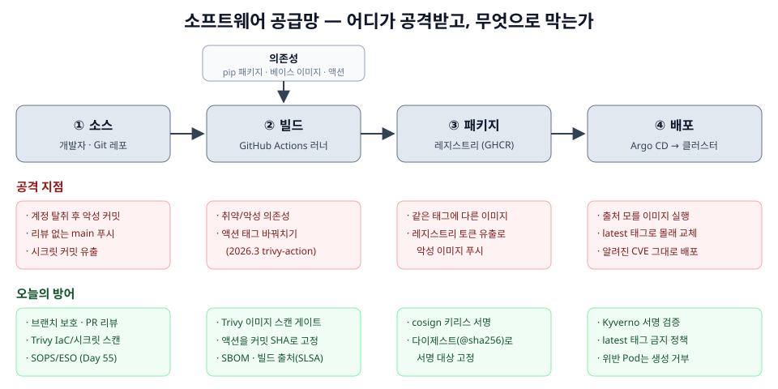
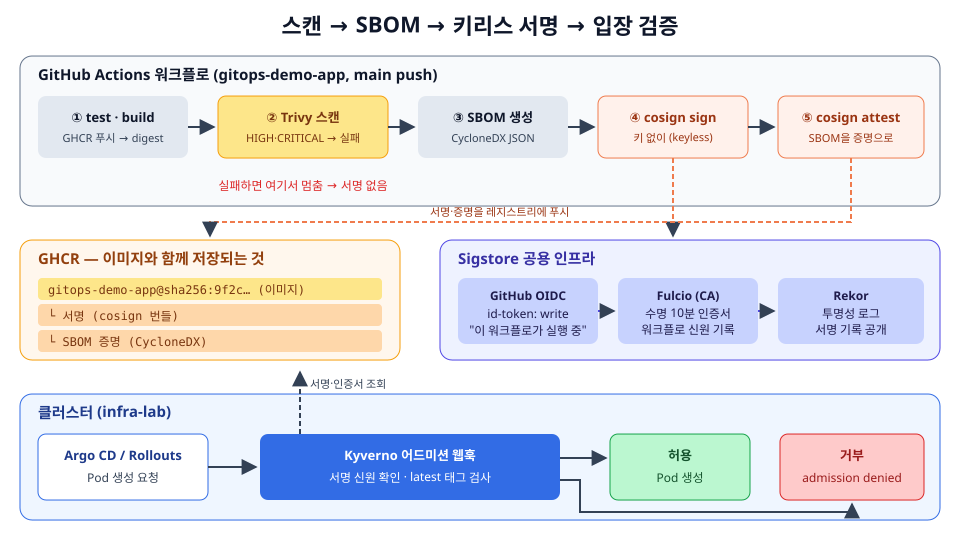
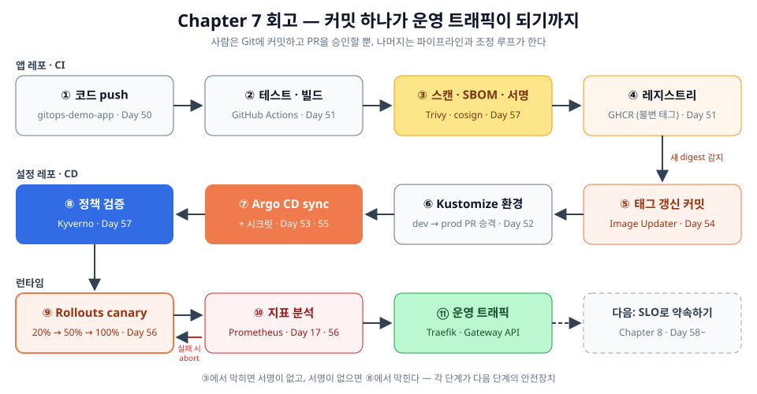

> **Chapter 7 · GitOps & CI/CD** | 난이도 ★★★★☆ | 예상 소요 2.5 ~ 3시간

## 🎯 오늘의 목표

- **소프트웨어 공급망 공격**이 어디서 일어나는지, **SLSA**가 무엇을 요구하는지 설명할 수 있다
- **Trivy**로 이미지와 IaC를 스캔하고, 심각도 기준으로 GitHub Actions 빌드를 **실패**시킬 수 있다
- **SBOM**(CycloneDX)을 만들고 이미지에 증명(attestation)으로 붙일 수 있다
- **cosign 키리스 서명**(GitHub OIDC, `id-token: write`)으로 이미지에 서명하고 검증할 수 있다
- **Kyverno**로 서명 안 된 이미지와 `latest` 태그를 클러스터 입구에서 **거부**할 수 있다

---

## 1. 공급망 공격 — 내 코드가 아니라 "내 코드가 만들어지는 길"을 노린다

Day 50~56에서 만든 파이프라인을 다시 봅시다. 코드는 GitHub에, 빌드는 GitHub Actions에, 이미지는 GHCR에, 배포는 Argo CD가 합니다. 이 중 **한 곳만** 뚫려도 공격자는 내 클러스터에 원하는 코드를 돌릴 수 있습니다. 내 코드를 아무리 잘 짜도 소용없습니다.



| 실제 사례 | 무엇이 뚫렸나 | 교훈 |
|---|---|---|
| SolarWinds (2020) | **빌드 서버**에서 정상 소스에 백도어 삽입 | 소스가 깨끗해도 빌드 결과물은 다를 수 있다 → 빌드 출처(provenance) |
| Log4Shell (2021) | 널리 쓰인 **의존성** 하나의 취약점 | "내 이미지에 무엇이 들었는지" 목록이 있어야 대응 가능 → SBOM, 스캔 |
| xz-utils (2024) | 오픈소스 메인테이너 권한을 오랜 기간 공들여 얻은 뒤 백도어 | 업스트림도 신뢰 대상이 아니다 |
| **trivy-action (2026.3)** | 보안 스캐너의 GitHub **액션 태그 대부분이** 악성 커밋으로 바꿔치기됨 | 액션은 **커밋 SHA로 고정**. 보안 도구도 공급망의 일부 |

> ⚠️ 마지막 사례는 오늘 쓸 도구 이야기입니다. 2026년 3월 19일, 탈취된 자격 증명으로 `aquasecurity/trivy-action` 의 버전 태그 대부분과 `setup-trivy` 의 태그가 악성 커밋으로 강제 변경되었고, 악성 Trivy 바이너리 v0.69.4도 배포되었습니다. 이 액션을 `@v0.xx` 태그로 쓰던 워크플로는 러너의 시크릿을 빼앗길 수 있었습니다(Aqua Security 공지). 사고 당시 영향받지 않은 태그는 v0.35.0 하나뿐이었습니다. 그래서 오늘 워크플로는 서드파티 액션을 **전체 커밋 SHA**로 고정합니다.

---

## 2. SLSA — 공급망 보안의 "등급표"

**SLSA**(Supply-chain Levels for Software Artifacts, "살사")는 OpenSSF가 관리하는 프레임워크로, "이 아티팩트가 **어디서, 무엇으로, 어떻게** 만들어졌는지 믿을 수 있는가"를 단계로 나눕니다. v1.x의 **Build 트랙**이 핵심입니다.

| 레벨 | 요구 사항 | 우리 파이프라인 |
|---|---|---|
| Build L0 | 아무 보장 없음 | 개발자 PC에서 `docker build && docker push` |
| Build L1 | 빌드 **출처 정보(provenance)** 가 존재 | 어떤 소스·커밋·워크플로로 빌드했는지 기록 |
| Build L2 | **호스팅된 빌드 플랫폼**이 출처를 생성하고 **서명** | GitHub Actions + 서명된 provenance (5-4 선택 실습) |
| Build L3 | 빌드 간 격리, 빌드 스크립트가 출처를 위조할 수 없음 | 재사용 워크플로 기반의 강화된 빌더 |

오늘 다룰 도구를 공급망 단계에 대응시키면 이렇습니다.

| 질문 | 도구 | 결과물 |
|---|---|---|
| 알려진 취약점·잘못된 설정이 있나? | **Trivy** | 스캔 결과 (CI 실패/통과) |
| 이미지 안에 무엇이 들었나? | **SBOM** (Trivy로 생성) | CycloneDX JSON |
| 누가 만들었나, 바뀌지 않았나? | **cosign** (Sigstore) | 서명 + 투명성 로그 기록 |
| 위 조건을 지키지 않은 이미지를 막을 수 있나? | **Kyverno** | 어드미션 단계 거부 |

---

## 3. 실습 환경

| 항목 | 값 |
|---|---|
| 클러스터 | Day 09의 kind `infra-lab` + Day 53 Argo CD + Day 56 Argo Rollouts |
| 앱 레포 | `https://github.com/<user>/gitops-demo-app` (Day 51 워크플로가 GHCR에 푸시) |
| 이미지 | `ghcr.io/<user>/gitops-demo-app` (**Public** 패키지 가정) |
| Trivy | **v0.76.2** (trivy-action **v0.36.0** 의 기본값) |
| cosign | **v3.1.x** (cosign-installer **v4.1.3**) |
| Kyverno | **v1.20.0** (Helm 차트 **3.10.0**) |

> ⚠️ `<user>` 는 본인 GitHub 계정을 **소문자로** 씁니다. GHCR 이미지 경로는 소문자만 허용합니다.

로컬에서도 Trivy와 cosign을 써 봅니다.

```bash
# Trivy — 버전 고정 컨테이너로 실행 (설치 없이)
docker run --rm aquasec/trivy:0.76.2 --version

# cosign — Linux amd64 (macOS: brew install cosign)
curl -LO https://github.com/sigstore/cosign/releases/download/v3.1.4/cosign-linux-amd64
sudo install -m 0755 cosign-linux-amd64 /usr/local/bin/cosign
cosign version
```

> 💡 Trivy 컨테이너도 `latest` 대신 **버전 태그**를 씁니다. 2026년 3월 사고 때 Docker Hub의 일부 Trivy 태그도 악성 이미지로 올라왔습니다. 무엇을 실행하는지 고정하는 습관이 오늘의 주제입니다.

---

## 4. 실습 ① Trivy — 로컬에서 먼저 스캔해 보기

### 4-1. 이미지 스캔

```bash
docker run --rm aquasec/trivy:0.76.2 image \
  --severity HIGH,CRITICAL --ignore-unfixed \
  ghcr.io/<user>/gitops-demo-app:sha-1a2b3c4
```

```
ghcr.io/<user>/gitops-demo-app:sha-1a2b3c4 (debian 13.x)
==================================================
Total: 0 (HIGH: 0, CRITICAL: 0)

Python (python-pkg)
===================
Total: 1 (HIGH: 1, CRITICAL: 0)
┌──────────────┬────────────────┬──────────┬────────┬───────────────────┬───────────────┐
│   Library    │ Vulnerability  │ Severity │ Status │ Installed Version │ Fixed Version │
├──────────────┼────────────────┼──────────┼────────┼───────────────────┼───────────────┤
│ <패키지>      │ CVE-XXXX-XXXXX │ HIGH     │ fixed  │ x.y.z             │ x.y.w         │
└──────────────┴────────────────┴──────────┴────────┴───────────────────┴───────────────┘
```

(결과는 스캔 시점의 취약점 DB에 따라 매일 달라집니다.)

| 옵션 | 의미 |
|---|---|
| `--severity HIGH,CRITICAL` | 이 심각도만 보고 |
| `--ignore-unfixed` | 아직 **패치가 없는** 취약점은 제외 (당장 조치할 수 없는 것으로 빌드를 막지 않기) |
| `--exit-code 1` | 발견되면 종료 코드 1 → CI 실패 |
| `--format cyclonedx` | 취약점 대신 **SBOM**을 출력 |

Trivy는 OS 패키지(Debian의 dpkg)와 언어 패키지(Python의 site-packages)를 **모두** 봅니다. Day 03에서 slim/distroless 베이스 이미지를 권한 이유가 여기서 숫자로 드러납니다. 패키지가 적을수록 취약점도 적습니다.

### 4-2. IaC(설정) 스캔

Trivy는 이미지뿐 아니라 Dockerfile, Kubernetes YAML, Helm 차트, Terraform(Day 35)의 **잘못된 설정**도 찾습니다.

```bash
cd ~/gitops-lab
docker run --rm -v "$PWD:/src" aquasec/trivy:0.76.2 config /src/gitops-demo-config
```

```
apps/demo-app/base/rollout.yaml (kubernetes)
==============================
Failures: 6 (UNKNOWN: 0, LOW: 3, MEDIUM: 3, HIGH: 0, CRITICAL: 0)

MEDIUM: Container 'demo-app' of Rollout 'demo-app' should set 'securityContext.allowPrivilegeEscalation' to false
...
```

Day 07에서 배운 보안 기초(root 금지, 권한 상승 금지, 읽기 전용 루트 파일 시스템)가 그대로 검사 항목입니다. 바로 고쳐 봅니다.

```yaml
# apps/demo-app/base/rollout.yaml — 컨테이너에 추가
        securityContext:
          runAsNonRoot: true
          allowPrivilegeEscalation: false
          readOnlyRootFilesystem: true
          capabilities:
            drop: ["ALL"]
```

> 💡 당장 고칠 수 없는 항목은 **`.trivyignore`** 에 ID와 이유를 적어 예외로 둡니다. 스캔 결과에 나온 검사 ID를 한 줄에 하나씩 적고, 그 위에 `#` 주석으로 이유를 남깁니다. 예외도 Git에 남으니 리뷰 대상이 됩니다.

---

## 5. 실습 ② CI에 스캔 · SBOM · 서명 넣기



### 5-1. cosign 키리스 서명이란?

전통적인 서명은 **개인 키**를 어딘가에 보관해야 합니다. 키가 유출되면 끝이고, 키 회전도 번거롭습니다. Sigstore의 **키리스(keyless)** 방식은 키를 보관하지 않습니다.

1. 워크플로가 GitHub에 **OIDC 토큰**을 요청 (`permissions: id-token: write` 필요). 토큰에는 "어느 레포의 어느 워크플로가, 어느 브랜치에서 실행 중인지"가 들어 있습니다.
2. cosign이 임시 키 쌍을 만들고, 토큰을 Sigstore의 CA인 **Fulcio**에 제시해 **수명 10분짜리 인증서**를 받습니다. 인증서에 워크플로 신원이 새겨집니다.
3. 그 키로 이미지 **다이제스트**에 서명하고, 서명 기록을 공개 투명성 로그 **Rekor**에 남깁니다. 임시 개인 키는 버립니다.
4. 검증하는 쪽은 "이 서명의 인증서가 **`https://github.com/<user>/gitops-demo-app/.github/workflows/...@refs/heads/main`** 신원으로 발급되었나?"를 확인합니다.

즉 신뢰의 근거가 "키를 가진 사람"에서 **"내 레포의 main 브랜치 워크플로"** 로 바뀝니다. 누군가 GHCR 토큰을 훔쳐 이미지를 푸시해도, 내 워크플로의 신원으로 서명할 수는 없습니다.

### 5-2. 워크플로

Day 51의 `.github/workflows/ci.yaml` 에 세 가지를 더합니다. ① IaC 스캔 잡 추가, ② `build` 잡에 `id-token: write` 권한과 `needs: iac-scan`, ③ "빌드 & 푸시" 다음에 스캔 · SBOM · 서명 단계. 나머지(트리거, test 매트릭스, QEMU·멀티 아키텍처, 태그 규칙, 캐시)는 Day 51 그대로입니다.

```yaml
# .github/workflows/ci.yaml (Day 51에서 바뀐 부분만, ★ 표시)
jobs:
  test:
    # ... Day 51 그대로

  iac-scan:                                        # ★ 새 잡: Dockerfile 등 설정 스캔
    runs-on: ubuntu-latest
    steps:
      - uses: actions/checkout@v7
      - name: Trivy IaC 스캔
        uses: aquasecurity/trivy-action@ed142fd0673e97e23eac54620cfb913e5ce36c25  # v0.36.0
        with:
          scan-type: config
          scan-ref: .
          severity: HIGH,CRITICAL
          exit-code: '1'
          hide-progress: true

  build:
    needs: [test, iac-scan]                        # ★ iac-scan 추가
    runs-on: ubuntu-latest
    permissions:
      contents: read
      packages: write
      id-token: write                              # ★ cosign 키리스 서명용 OIDC 토큰
    steps:
      # ... checkout, 이미지 이름(steps.image), QEMU, Buildx, GHCR 로그인,
      #     태그·라벨 계산(steps.meta), 빌드 & 푸시(steps.build) — Day 51 그대로

      - name: 서명 대상을 다이제스트로 고정        # ★ 이하 전부 추가
        if: github.event_name != 'pull_request'
        run: echo "IMAGE=${{ steps.image.outputs.name }}@${{ steps.build.outputs.digest }}" >> "$GITHUB_ENV"

      - name: Trivy 이미지 스캔 (HIGH·CRITICAL이면 실패)
        if: github.event_name != 'pull_request'
        uses: aquasecurity/trivy-action@ed142fd0673e97e23eac54620cfb913e5ce36c25  # v0.36.0
        with:
          image-ref: ${{ env.IMAGE }}
          severity: CRITICAL,HIGH
          ignore-unfixed: true
          exit-code: '1'

      - name: SBOM 생성 (CycloneDX)
        if: github.event_name != 'pull_request'
        uses: aquasecurity/trivy-action@ed142fd0673e97e23eac54620cfb913e5ce36c25  # v0.36.0
        with:
          scan-type: image
          image-ref: ${{ env.IMAGE }}
          format: cyclonedx
          output: sbom.cdx.json

      - uses: sigstore/cosign-installer@v4.1.3
        if: github.event_name != 'pull_request'

      - name: 키리스 서명
        if: github.event_name != 'pull_request'
        run: cosign sign --yes "$IMAGE"

      - name: SBOM을 증명(attestation)으로 첨부
        if: github.event_name != 'pull_request'
        run: cosign attest --yes --type cyclonedx --predicate sbom.cdx.json "$IMAGE"

      - uses: actions/upload-artifact@v7
        if: github.event_name != 'pull_request'
        with:
          name: sbom
          path: sbom.cdx.json
```

| 포인트 | 이유 |
|---|---|
| `permissions` 를 잡 단위로 | 워크플로 기본은 `contents: read`(Day 51). 서명하는 `build` 잡만 `id-token: write` |
| `@<40자리 SHA>  # v0.36.0` | 태그는 움직일 수 있음(1장 사고). SHA는 그 커밋 내용 자체를 가리킴. 주석으로 버전을 남겨 Day 51의 Dependabot이 갱신 PR을 만들 수 있게 |
| `IMAGE=...@sha256:...` | **태그가 아니라 다이제스트**를 스캔·서명. 태그는 나중에 다른 이미지로 옮겨질 수 있음. 멀티 아키텍처 이미지 인덱스의 다이제스트에 서명하면 그 안의 플랫폼 이미지 전체가 대상 |
| `steps.image.outputs.name` | Day 51에서 소문자로 만들어 둔 `ghcr.io/<user>/gitops-demo-app` |
| `if: ... != 'pull_request'` | PR에서는 푸시를 안 하므로(Day 51) 스캔·서명할 이미지도 없음. 포크 PR에는 OIDC 토큰도 주어지지 않음 |
| 스캔 → 서명 순서 | 스캔이 실패하면 잡이 멈춰 **서명이 생기지 않음** → 6장의 Kyverno가 그 이미지를 거부 |
| `ignore-unfixed: true` | 고칠 방법이 없는 취약점으로 배포 전체를 멈추지 않기 |

> 💡 GitHub·Docker 공식 액션(`actions/*`, `docker/*`)은 메이저 태그(`@v7`)로 두고, 서드파티 액션은 SHA로 고정하는 것이 흔한 절충입니다. 더 엄격하게는 Day 51 7장처럼 전부 SHA로 고정하고 Dependabot에 맡깁니다.

> ⚠️ 이미지를 **먼저 푸시한 뒤** 스캔하므로, 스캔에 실패한 이미지도 GHCR에는 남습니다. 서명이 없어 클러스터에 못 들어갈 뿐입니다. 아예 올리지 않으려면 `load: true` 로 러너에 빌드 → 스캔 → 푸시 순으로 바꾸면 되지만, 멀티 아키텍처 빌드(Day 51)와는 함께 쓰기 어렵습니다.

push하고 Actions 탭에서 결과를 봅니다. 서명 단계 로그에 인증서 발급과 Rekor(투명성 로그) 기록 내용이 찍힙니다. (출력 문구는 cosign 버전에 따라 다릅니다)

### 5-3. 로컬에서 서명 검증

먼저 태그가 가리키는 다이제스트를 확인합니다.

```bash
docker buildx imagetools inspect ghcr.io/<user>/gitops-demo-app:sha-1a2b3c4 | grep Digest
# Digest:    sha256:9f2c...
```

```bash
cosign verify "ghcr.io/<user>/gitops-demo-app@sha256:9f2c..." \
  --certificate-identity-regexp '^https://github\.com/<user>/gitops-demo-app/\.github/workflows/.+@refs/heads/main$' \
  --certificate-oidc-issuer https://token.actions.githubusercontent.com
```

```
Verification for ghcr.io/<user>/gitops-demo-app@sha256:9f2c... --
The following checks were performed on each of these signatures:
  - The cosign claims were validated
  - Existence of the claims in the transparency log was verified offline
  - The code-signing certificate was verified using trusted certificate authority certificates
...
```

신원을 일부러 틀려 봅니다(브랜치를 `dev` 로).

```bash
cosign verify "ghcr.io/<user>/gitops-demo-app@sha256:9f2c..." \
  --certificate-identity-regexp '^https://github\.com/<user>/gitops-demo-app/\.github/workflows/.+@refs/heads/dev$' \
  --certificate-oidc-issuer https://token.actions.githubusercontent.com
# Error: no matching signatures: ...
```

**서명이 있다는 것**만으로는 부족하고, **누가 서명했는지(identity)** 까지 확인해야 의미가 있습니다. 공격자도 자기 레포의 워크플로로는 얼마든지 서명할 수 있기 때문입니다.

SBOM 증명도 같은 방식으로 검증하고 내용을 꺼낼 수 있습니다.

```bash
cosign verify-attestation --type cyclonedx \
  --certificate-identity-regexp '^https://github\.com/<user>/gitops-demo-app/\.github/workflows/.+@refs/heads/main$' \
  --certificate-oidc-issuer https://token.actions.githubusercontent.com \
  "ghcr.io/<user>/gitops-demo-app@sha256:9f2c..." > att.json
```

> 💡 **SBOM을 왜 따로 남기나?** 다음 Log4Shell 같은 사건이 터졌을 때, 모든 이미지를 다시 스캔하는 대신 "SBOM에 `log4j-core 2.14` 가 있는 이미지"를 바로 찾을 수 있습니다. 스캔은 "지금 알려진 취약점"만 보지만, SBOM은 **"무엇이 들었는지"** 라는 사실을 남기므로 미래의 질문에도 답할 수 있습니다.

### 5-4. (선택) SLSA 빌드 출처 — GitHub Artifact Attestations

GitHub의 `actions/attest` 는 인자를 따로 주지 않으면 **SLSA 빌드 출처(provenance)** 를 만들어 서명합니다. 서명된 출처를 호스팅된 빌더가 만들어 주므로 SLSA Build L2에 해당합니다. 위 `build-sign` 잡에 덧붙입니다.

```yaml
    permissions:
      contents: read
      packages: write
      id-token: write
      attestations: write       # 추가
      artifact-metadata: write  # 추가
    steps:
    # ... build 이후
    - uses: actions/attest@v4
      with:
        subject-name: ghcr.io/${{ github.repository }}
        subject-digest: ${{ steps.build.outputs.digest }}
        push-to-registry: true
```

```bash
gh attestation verify oci://ghcr.io/<user>/gitops-demo-app@sha256:9f2c... --owner <user>
```

---

## 6. 실습 ③ Kyverno — 클러스터 입구에서 막기

스캔과 서명은 CI에서 일어납니다. 하지만 누군가 `kubectl run` 으로, 또는 설정 레포에 엉뚱한 이미지를 커밋해서 **CI를 우회**하면 소용없습니다. 마지막 관문은 **클러스터의 어드미션 단계**(API 서버의 요청 처리 흐름: 인증 → 인가 → **어드미션** → etcd 저장)입니다.

### 6-1. Kyverno 설치

```bash
helm repo add kyverno https://kyverno.github.io/kyverno/
helm repo update
helm install kyverno kyverno/kyverno --version 3.10.0 \
  -n kyverno --create-namespace

kubectl -n kyverno get pods
```

```
NAME                                             READY   STATUS    RESTARTS   AGE
kyverno-admission-controller-6d9f7c8b5d-x2k8q    1/1     Running   0          60s
kyverno-background-controller-7b6c9d5f8b-m4n7p   1/1     Running   0          60s
kyverno-cleanup-controller-5c9f8d7b6d-q8w2z      1/1     Running   0          60s
kyverno-reports-controller-8d7c6b5f9d-p9q4w      1/1     Running   0          60s
```

> ⚠️ **정책 문법이 바뀌었습니다.** 인터넷의 Kyverno 예제 대부분은 `kind: ClusterPolicy`(`kyverno.io/v1`)와 `verifyImages` 규칙을 씁니다. 이 API는 v1.17부터 폐기 예정(deprecated)이 되었고, 공식 마이그레이션 문서는 **v1.20에서 제거**한다고 안내합니다. 오늘은 새 CEL 기반 정책 `policies.kyverno.io/v1` 을 씁니다. 대응 관계는 `validate` 규칙 → **`ValidatingPolicy`**, `verifyImages` 규칙 → **`ImageValidatingPolicy`** 입니다.

### 6-2. 정책 ① `latest` 태그 금지 (ValidatingPolicy)

```yaml
# policy-disallow-latest.yaml
apiVersion: policies.kyverno.io/v1
kind: ValidatingPolicy
metadata:
  name: disallow-latest-tag
spec:
  validationActions: [Deny]          # 처음 도입할 땐 [Audit]으로 영향부터 확인
  matchConstraints:
    resourceRules:
    - apiGroups: [""]
      apiVersions: ["v1"]
      operations: [CREATE, UPDATE]
      resources: ["pods"]
    namespaceSelector:               # 실습 네임스페이스에만 적용 (시스템 Pod 보호)
      matchExpressions:
      - key: kubernetes.io/metadata.name
        operator: In
        values: [demo-dev, demo-stage, demo-prod, policy-test]
  validations:
  - expression: "object.spec.containers.all(c, !c.image.endsWith(':latest'))"
    message: "latest 태그는 금지입니다. 버전·SHA 태그나 다이제스트를 쓰세요."
  - expression: "object.spec.containers.all(c, c.image.contains('@') || c.image.matches(':[^/]+$'))"
    message: "이미지 태그를 생략하면 latest가 됩니다. 태그를 명시하세요."
```

`expression` 은 Kubernetes의 ValidatingAdmissionPolicy에도 쓰이는 **CEL**(Common Expression Language) 문법입니다. `object` 는 생성하려는 Pod, `all(c, 조건)` 은 "모든 컨테이너가 조건을 만족"입니다. 두 번째 규칙은 `nginx` 처럼 태그를 생략한 이미지(= 암묵적 `latest`)를 잡습니다. `registry:5000/app` 처럼 포트 번호의 `:` 에 속지 않도록 **마지막 `/` 뒤에** `:태그` 가 있는지 봅니다.

### 6-3. 정책 ② 서명 안 된 이미지 차단 (ImageValidatingPolicy)

```yaml
# policy-verify-signature.yaml
apiVersion: policies.kyverno.io/v1
kind: ImageValidatingPolicy
metadata:
  name: verify-gitops-demo-app
spec:
  validationActions: [Deny]
  matchConstraints:
    resourceRules:
    - apiGroups: [""]
      apiVersions: ["v1"]
      operations: [CREATE, UPDATE]
      resources: ["pods"]
  matchImageReferences:                         # 이 이미지들만 검사
  - glob: "ghcr.io/<user>/gitops-demo-app*"
  attestors:
  - name: ghactions
    cosign:
      keyless:
        identities:
        - issuer: "https://token.actions.githubusercontent.com"
          subjectRegExp: '^https://github\.com/<user>/gitops-demo-app/\.github/workflows/ci\.yaml@refs/(heads/main|tags/v.+)$'
      ctlog:
        url: "https://rekor.sigstore.dev"
  validations:
  - expression: >-
      images.containers.map(image, verifyImageSignatures(image, [attestors.ghactions])).all(e, e > 0)
    message: "main 브랜치·릴리스 태그의 ci.yaml이 서명하지 않은 gitops-demo-app 이미지입니다."
```

| 필드 | 의미 |
|---|---|
| `matchImageReferences` | 검사 대상 이미지. 우리 앱 이미지에만 걸어 시스템 이미지(kube-system, Traefik 등)는 건드리지 않음 |
| `attestors[].cosign.keyless.identities` | 5-3의 `cosign verify` 에 준 `--certificate-oidc-issuer` / `--certificate-identity-regexp` 와 같은 뜻 |
| `ci\.yaml@refs/(heads/main\|tags/v.+)` | Day 51 워크플로는 main push와 `v*.*.*` 태그 push 때 이미지를 만듦. 두 경우 인증서의 ref가 각각 `refs/heads/main`, `refs/tags/v0.1.0` 이므로 둘 다 허용하고, 다른 브랜치·다른 워크플로 파일의 서명은 거부 |
| `ctlog.url` | 서명 기록을 확인할 Rekor 주소 (공용 Sigstore) |
| `verifyImageSignatures(...)` | 검증된 서명 개수를 돌려줌. `> 0` 이면 통과 |

> 💡 GHCR 패키지가 **Private**이면 Kyverno도 서명을 읽으려면 인증이 필요합니다. `kyverno` 네임스페이스에 `kubernetes.io/dockerconfigjson` Secret을 만들고 정책의 `credentials.secrets` 에 이름을 적습니다.

```bash
kubectl apply -f policy-disallow-latest.yaml -f policy-verify-signature.yaml
kubectl get validatingpolicies,imagevalidatingpolicies
```

### 6-4. 거부 실험

연습용 네임스페이스에서 하나씩 시도합니다.

```bash
kubectl create namespace policy-test

# ① latest 태그 → 거부
kubectl -n policy-test run t1 --image=nginx:latest
# Error from server: admission webhook "..." denied the request: ... latest 태그는 금지입니다 ...

# ② 태그 생략 → 거부
kubectl -n policy-test run t2 --image=nginx
# ... 이미지 태그를 생략하면 latest가 됩니다 ...

# ③ 버전 태그 → 허용
kubectl -n policy-test run t3 --image=nginx:1.29
# pod/t3 created
```

이제 서명 정책입니다. Day 51~56에서 만든, **서명 단계를 넣기 전의** 태그 하나를 GHCR 패키지 페이지에서 골라 씁니다.

```bash
# ④ 서명 도입 전에 빌드된 이미지 → 거부
kubectl -n policy-test run t4 --image=ghcr.io/<user>/gitops-demo-app:sha-<서명 전 커밋>
# Error from server: admission webhook "..." denied the request: ...
#   main 브랜치·릴리스 태그의 ci.yaml이 서명하지 않은 gitops-demo-app 이미지입니다.

# ⑤ 오늘 워크플로가 서명한 이미지 → 허용
kubectl -n policy-test run t5 --image=ghcr.io/<user>/gitops-demo-app@sha256:9f2c...
# pod/t5 created
```

(거부 메시지의 앞부분 형식은 Kyverno 버전과 정책 종류에 따라 조금씩 다릅니다. 정책에 적은 `message` 가 함께 나오는지 보면 됩니다.)

**Rollout/Deployment 경유**로도 확인해 봅니다. 설정 레포의 dev 태그를 서명 전 sha로 바꿔 커밋하면, Argo CD sync는 성공하지만 **Pod는 생기지 않습니다.**

```bash
kubectl -n demo-dev get events --field-selector reason=FailedCreate
# ... replicaset/dev-demo-app-xxxx  Error creating: admission webhook "..." denied the request: ...
kubectl argo rollouts get rollout dev-demo-app -n demo-dev
# canary ReplicaSet의 Pod가 0개 → progressDeadlineSeconds 후 Degraded
```

검사는 Rollout이 아니라 **Pod를 만드는 순간** 일어나므로, ReplicaSet 컨트롤러가 거부당하고 이벤트에 기록됩니다. Day 56의 stable 버전은 그대로 트래픽을 받으니 서비스는 멀쩡합니다. 확인했으면 커밋을 revert합니다.

> 💡 Pod가 아니라 Deployment·Rollout을 **apply하는 순간** 바로 거절하고 싶다면 `ValidatingPolicy` 의 `spec.autogen.podControllers.controllers` 로 Deployment·StatefulSet 등에 대한 규칙을 자동 생성할 수 있습니다. Rollout 같은 CRD는 대상이 아니므로 Pod 기준 정책은 어쨌든 유지합니다.

```bash
kubectl delete namespace policy-test    # 정리
```

> 💡 **Chapter 6의 rag-api·vLLM 이미지에도** 같은 패턴을 적용할 수 있습니다. 다만 `vllm/vllm-openai` 같은 업스트림 이미지는 내 워크플로가 서명한 것이 아니므로, ① 업스트림이 cosign으로 서명해 배포한다면 그 신원을 attestor로 추가하거나, ② 내 레지스트리로 복사(미러링)하면서 스캔 후 내 워크플로로 재서명하는 방법을 씁니다. Hugging Face에서 받는 모델 가중치도 공급망의 일부이므로, 모델 ID와 함께 리비전(커밋 해시)을 고정하는 습관도 같은 맥락입니다.

---

## 7. Chapter 7 회고



8일 동안 만든 것을 한 줄로 이으면 이렇습니다.

| Day | 만든 것 | 그 결과 |
|---|---|---|
| 50 | 앱 레포 / 설정 레포 분리, Push vs Pull | "무엇이 배포되어야 하는가"의 단일 원천 = 설정 레포 |
| 51 | GitHub Actions → GHCR | 커밋마다 테스트된 불변 태그 이미지 |
| 52 | Kustomize base/overlays | dev·stage·prod의 차이만 관리 |
| 53 | Argo CD Auto-sync, Self-heal | Git = 클러스터, 손으로 바꾼 것은 되돌아감 |
| 54 | Image Updater, PR 승격 | 새 이미지 → dev 자동, prod는 승인 |
| 55 | SOPS / External Secrets | 시크릿도 Git으로, 평문 없이 |
| 56 | Argo Rollouts | 나쁜 버전은 일부 사용자만 겪고 자동 abort |
| 57 | Trivy, cosign, Kyverno | 검증·서명된 이미지만 클러스터에 입장 |

처음 Day 50에서 손으로 `kubectl set image` 하던 것과 비교해 보세요. 이제 사람이 하는 일은 **코드를 커밋하고, PR을 리뷰·승인하는 것**뿐입니다. 나머지는 파이프라인과 조정 루프가 하고, 각 단계는 다음 단계의 안전장치 역할을 합니다.

---

## 8. 트러블슈팅

| 증상 | 원인 | 해결 |
|---|---|---|
| `cosign sign` 이 `getting signer: ... no provider found` / OIDC 토큰 오류 | 잡에 `id-token: write` 권한 없음 | 서명하는 잡의 `permissions` 에 `id-token: write` 추가 |
| PR 빌드에서 서명 단계 실패 | 포크 PR에는 OIDC 토큰·쓰기 권한이 주어지지 않음 | 서명·푸시는 `if: github.event_name == 'push'` 로 main에서만 |
| `denied: permission_denied: write_package` | `packages: write` 없음, 또는 패키지가 다른 레포에 연결됨 | 권한 추가, GHCR 패키지 설정에서 레포에 Actions 접근 허용 |
| Trivy가 매번 빌드를 깨뜨림 (고칠 수 없는 CVE) | 업스트림 패치가 아직 없음 | `ignore-unfixed: true`, 근거를 적은 `.trivyignore`, 베이스 이미지 갱신(Day 03) |
| Trivy 단계가 DB 다운로드에서 실패 | 취약점 DB 레지스트리의 일시적 제한 | 재실행, 또는 `actions/cache` 로 Trivy 캐시 디렉터리 보존 |
| `cosign verify` 는 성공하는데 Kyverno가 거부 | 정책의 `subjectRegExp` 가 실제 신원과 다름 (브랜치, 워크플로 경로, 대소문자) | `cosign verify --output json` 의 인증서 subject를 보고 정규식 수정 |
| `cosign verify` 는 성공하는데 Kyverno가 서명을 못 찾음 | 서명 저장 형식 차이. cosign v3는 기본으로 새 번들 형식(OCI referrers)에 저장 | Kyverno를 최신으로 유지. 호환이 안 되는 검증기와 함께 써야 하면 `cosign sign --new-bundle-format=false --use-signing-config=false` 로 기존 형식 서명 |
| Kyverno 설치 후 아무 Pod도 안 뜸 | 정책이 시스템 네임스페이스까지 막음, 또는 Kyverno가 죽어 웹훅이 실패(Fail) | `namespaceSelector`·`matchImageReferences` 로 범위 제한, `kubectl -n kyverno get pods` 확인 |
| 인터넷 예제의 `ClusterPolicy` 가 `no matches for kind` | v1.20에서 레거시 API 제거 | `ValidatingPolicy` / `ImageValidatingPolicy` 로 변환 (공식 "Migrating to CEL Policies" 문서) |

---

## 9. 핵심 정리

- 공급망 공격은 소스·의존성·빌드·레지스트리·배포 **어느 한 곳**만 뚫어도 성공한다. 보안 도구 자체(2026년 trivy-action)도 예외가 아니다
- **SLSA** Build 트랙: L1 출처 존재 → L2 호스팅 빌더가 서명한 출처 → L3 위조 불가능한 격리 빌드
- **Trivy**: `image` 로 취약점, `config` 로 IaC 설정, `--format cyclonedx` 로 SBOM. CI에서는 `severity` + `exit-code: 1` 로 게이트
- **cosign 키리스**: `id-token: write` → GitHub OIDC → Fulcio 단기 인증서 → Rekor 기록. 검증은 **issuer + identity(워크플로·브랜치)** 까지
- 서명·스캔은 **태그가 아니라 다이제스트**에. 서드파티 액션은 **커밋 SHA**로 고정
- **Kyverno**(v1.20)는 `ValidatingPolicy` 와 `ImageValidatingPolicy`(CEL). 검사는 Pod 생성 시점의 어드미션 단계에서, 거부되면 ReplicaSet 이벤트에 남는다

---

## 10. 셀프 체크

<details>
<summary>Q1. 레지스트리 토큰을 탈취한 공격자가 같은 태그로 악성 이미지를 푸시했다. 오늘 구성에서는 어디서 막히나?</summary>

악성 이미지는 내 레포 main 브랜치 워크플로의 OIDC 신원으로 서명될 수 없습니다. 설정 레포가 그 태그를 가리켜도, Pod 생성 시 Kyverno `ImageValidatingPolicy` 가 서명 신원을 확인하고 거부합니다. 또 설정 레포에 다이제스트나 고유한 SHA 태그를 쓰면, 태그를 덮어써도 원래 다이제스트가 바뀌지 않습니다.
</details>

<details>
<summary>Q2. <code>cosign verify</code> 에서 <code>--certificate-identity-regexp</code> 를 <code>.*</code> 로 두면 무엇이 문제인가?</summary>

Fulcio는 GitHub Actions를 쓰는 **누구에게나** 인증서를 발급합니다. 신원을 확인하지 않으면 공격자가 자기 레포의 워크플로로 서명한 이미지도 "서명됨"으로 통과합니다. 서명의 의미는 "**누가** 서명했나"를 확인할 때 생깁니다.
</details>

<details>
<summary>Q3. 왜 이미지 스캔을 서명보다 먼저 하나?</summary>

스캔 단계가 `exit-code: 1` 로 실패하면 잡이 거기서 멈추므로 서명이 만들어지지 않습니다. 서명이 없는 이미지는 Kyverno가 거부하므로, "스캔을 통과했다"는 사실이 서명의 존재로 클러스터까지 전달됩니다.
</details>

<details>
<summary>Q4. Kyverno 정책이 있는데 Argo CD sync는 <code>Synced</code> 로 성공했다. 그런데 새 Pod가 없다. 왜 그런가?</summary>

정책은 **Pod**에 걸려 있고, Argo CD가 만드는 것은 Rollout/Deployment입니다. 상위 리소스는 정상 생성되지만 ReplicaSet 컨트롤러가 Pod를 만들 때 어드미션에서 거부됩니다. 원인은 `kubectl get events` 의 `FailedCreate` 에서 볼 수 있습니다. 상위 리소스 단계에서 바로 거절하려면 autogen 규칙을 씁니다.
</details>

<details>
<summary>Q5. 스캔이 있는데 SBOM이 따로 필요한 이유는?</summary>

스캔은 "**지금** 알려진 취약점"에 대한 판정이고, SBOM은 "이 이미지에 **무엇이** 들었나"라는 사실의 기록입니다. 새 취약점이 공개되면 SBOM만 검색해 영향받는 이미지를 바로 찾을 수 있고, 증명으로 서명해 두면 그 목록이 위조되지 않았다는 것도 보장됩니다.
</details>

---

## ⏭️ 다음 예고 — Day 58. SRE 개념 — SLI/SLO/에러 버짓, 모니터링 vs 관측성

배포는 자동화됐습니다. 커밋 하나가 검증·서명을 거쳐 카나리로 안전하게 나갑니다. 그런데 "안전하게"는 무엇을 기준으로 할까요? Day 56에서 정한 에러율 5%는 왜 5%였을까요? **Chapter 8. SRE & 관측성**에서는 서비스가 **잘 돌고 있는지를 숫자로 약속하고 지키는 법**을 배웁니다. 첫날에는 SLI(무엇을 잴지), SLO(얼마나 잘해야 하는지), **에러 버짓**(얼마나 실패해도 되는지)을 정의하고, 모니터링과 관측성(Observability)이 어떻게 다른지 정리합니다.

> 💡 이후 시즌에서는 Chapter 9의 보안 심화를 거쳐, 플랫폼 엔지니어링(Backstage)이나 멀티 클러스터 GitOps 같은 방향으로도 지금의 파이프라인을 키울 수 있습니다.
