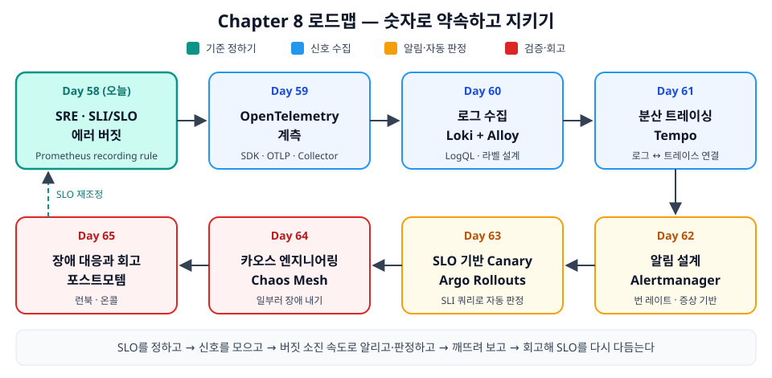
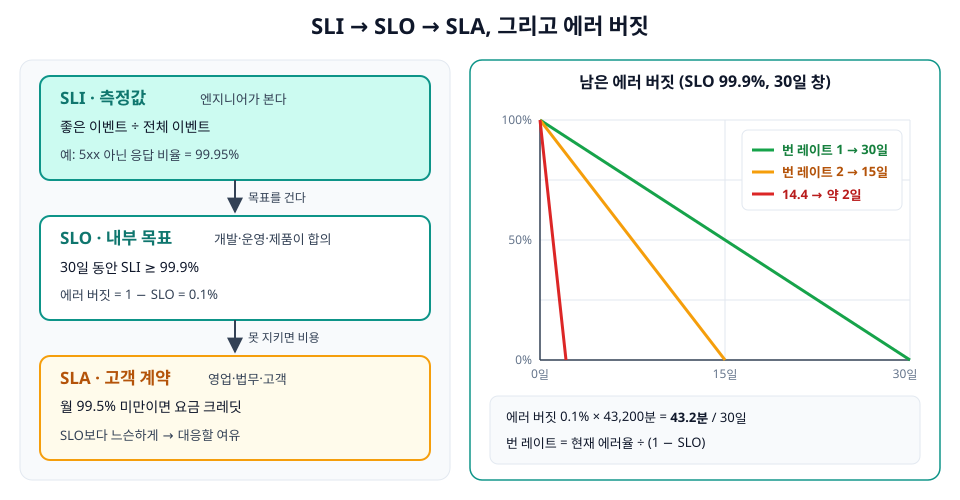
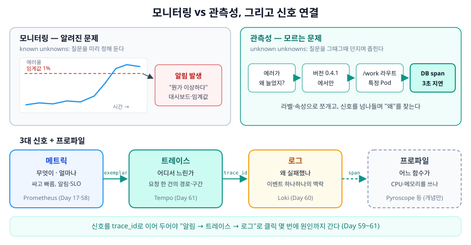

> **Chapter 8 · SRE & 관측성** | 난이도 ★★★☆☆ | 예상 소요 2 ~ 2.5시간

## 🎯 오늘의 목표

- SRE가 무엇이고, **SLI · SLO · SLA**가 각각 누구를 위한 숫자인지 설명할 수 있다
- **에러 버짓**과 **번 레이트(burn rate)** 를 계산하고, 그것으로 "배포를 계속할지 멈출지"를 정하는 원리를 안다
- **모니터링과 관측성**의 차이, 3대 신호(메트릭·로그·트레이스)와 프로파일링의 역할을 구분한다
- Day 17의 Prometheus로 데모 앱 `gitops-demo-app`의 **가용성 SLI·지연 SLI**를 PromQL로 정의하고 **recording rule**로 만든다

---

## 1. Chapter 8 로드맵 — "숫자로 약속하고 지키기"

Chapter 7에서 우리는 Git 커밋 하나로 dev → stage → prod까지 배포가 흘러가는 파이프라인을 만들었습니다. 배포는 쉬워졌습니다. 그런데 이런 질문에는 아직 답이 없습니다.

- 지금 서비스는 **충분히 잘** 돌고 있나? "충분히"는 몇 %인가?
- 방금 배포한 버전 때문에 에러가 늘었다면, **언제** 롤백해야 하나?
- 새벽 3시에 알림이 왔다. **어디서부터** 봐야 하나?

Chapter 8은 이 질문들에 답하는 도구와 습관을 다룹니다.



| Day | 주제 | 오늘과의 연결 |
|---|---|---|
| **58** | SRE 개념, SLI/SLO/에러 버짓 | 기준이 되는 숫자를 정한다 |
| 59 | OpenTelemetry 계측 | 앱이 트레이스·메트릭·로그를 표준 방식으로 내보내게 한다 |
| 60 | Loki + Grafana Alloy | 로그를 모아 라벨로 검색한다 |
| 61 | Tempo | 요청 한 건의 경로(트레이스)를 저장하고 본다 |
| 62 | 알림 설계 | 오늘 만든 **번 레이트**로 증상 기반 알림을 만든다 |
| 63 | SLO 기반 Canary | 오늘 만든 **SLI 쿼리**로 Argo Rollouts가 자동 판정한다 |
| 64 | Chaos Mesh | 일부러 장애를 내고 SLO가 버티는지 본다 |
| 65 | 장애 대응과 회고 | 에러 버짓을 다 쓴 뒤 무엇을 하는가 |

> 💡 Day 17에서 "관측성의 세 기둥"을 표로만 보고 메트릭만 다뤘습니다. Chapter 8은 나머지 두 기둥(로그·트레이스)을 채우고, 그 위에 **운영 원칙(SRE)** 을 얹는 챕터입니다.

---

## 2. SRE란 무엇인가

**SRE(Site Reliability Engineering)** 는 Google이 2000년대 초에 만든 운영 방식으로, 한 줄로 요약하면 이렇습니다.

> **운영을 소프트웨어 엔지니어링 문제로 다룬다.** 신뢰성은 감(感)이 아니라 측정값으로 관리하고, 반복 작업은 코드로 없앤다.

전통적인 조직에서는 개발팀은 "빨리 내보내자", 운영팀은 "건드리지 말자"로 이해관계가 정면으로 부딪힙니다. SRE는 이 싸움을 **숫자 하나(에러 버짓)** 로 중재합니다.

| 구분 | 전통적 운영 | SRE |
|---|---|---|
| 목표 | 장애 0 (100% 가용) | **합의된 목표치**(예: 99.9%)만 지키면 됨 |
| 배포 판단 | 운영팀 승인, 변경 동결 | 에러 버짓이 남아 있으면 배포, 바닥나면 안정화 |
| 반복 작업 | 사람이 처리 (사람을 더 뽑음) | **toil**로 분류하고 자동화 |
| 장애 후 | 책임자 찾기 | 비난 없는 포스트모템 (Day 65) |
| 측정 | 서버 CPU·메모리 | **사용자가 겪는 경험** (성공률, 지연) |

### 2-1. 100%가 목표가 아닌 이유

- 사용자는 99.99%와 100%를 구분하지 못합니다. 사용자의 Wi-Fi, 통신사, 기기가 이미 그보다 자주 실패합니다.
- 가용성 9를 하나 더 붙일 때마다 비용(이중화, 리전 분산, 변경 동결)은 **기하급수로** 늘어납니다.
- 100%를 목표로 하면 **아무것도 바꿀 수 없습니다.** 모든 배포는 위험이니까요.

### 2-2. Toil — 줄여야 할 일

Google SRE 책은 **toil**을 다음 특징을 가진 운영 작업으로 정의합니다.

| 특징 | 예 |
|---|---|
| 수동(manual) | 사람이 직접 명령을 입력 |
| 반복적(repetitive) | 매주 같은 디스크 정리 |
| 자동화 가능(automatable) | 스크립트로 대신할 수 있음 |
| 전술적(tactical) | 알림이 올 때마다 그때그때 대응 |
| 지속 가치 없음 | 해도 서비스가 나아지지 않음 |
| 서비스 규모에 비례해 증가 | Pod 수가 2배가 되면 일도 2배 |

Google은 SRE 업무 중 toil을 **50% 미만**으로 유지하고, 나머지 시간은 toil을 없애는 엔지니어링에 쓰라고 권합니다. 우리가 Chapter 7에서 `kubectl apply`를 손으로 치던 일을 Argo CD에 맡긴 것이 바로 toil 제거입니다.

---

## 3. SLI · SLO · SLA



| 용어 | 정의 | 누가 보나 | 예 |
|---|---|---|---|
| **SLI** (Indicator) | 서비스 수준을 나타내는 **측정값**. 보통 `좋은 이벤트 / 전체 이벤트` 비율 | 엔지니어 | 최근 5분간 5xx가 아닌 응답의 비율 = 99.95% |
| **SLO** (Objective) | SLI가 일정 기간 동안 지켜야 할 **목표** | 팀 내부 (개발+운영+제품) | 30일 동안 성공률 ≥ 99.9% |
| **SLA** (Agreement) | SLO를 못 지켰을 때의 **계약상 결과**(환불, 크레딧) | 고객, 영업·법무 | 월 99.5% 미만이면 요금 10% 환불 |

> 💡 **SLA는 SLO보다 느슨하게** 잡습니다. 내부 목표(SLO 99.9%)를 어겨도 계약(SLA 99.5%)까지는 여유가 있어야, 돈이 나가기 전에 대응할 시간이 생깁니다. 사내 서비스나 학습용 앱에는 SLA가 없어도 SLO는 필요합니다.

### 3-1. 좋은 SLI의 조건

SLI는 **사용자가 실제로 느끼는 것**에 가까워야 합니다. Day 17에서 본 CPU 사용률은 좋은 SLI가 아닙니다. CPU가 90%여도 사용자는 멀쩡할 수 있고, CPU가 10%여도 모든 요청이 500일 수 있습니다.

| 서비스 유형 | 대표 SLI | 측정식 (좋은 이벤트 / 전체) |
|---|---|---|
| 요청/응답 API | **가용성** | 5xx가 아닌 응답 수 / 전체 응답 수 |
| 요청/응답 API | **지연** | 300ms 안에 끝난 요청 수 / 전체 요청 수 |
| 배치·파이프라인 | 신선도(freshness) | 1시간 안에 갱신된 데이터 / 전체 |
| 스토리지 | 내구성 | 읽기에 성공한 객체 / 써 둔 객체 |

지연 SLI를 "p95 지연 < 300ms" 대신 **"300ms 안에 끝난 요청의 비율"** 로 쓰는 데 주목하세요. 비율로 바꾸면 가용성과 똑같이 `좋은/전체` 꼴이 되어 에러 버짓 계산을 그대로 적용할 수 있습니다.

### 3-2. 어디서 측정하나

| 측정 위치 | 장점 | 단점 |
|---|---|---|
| 앱 내부 (`/metrics`) | 라우트별로 세밀함, 오늘 실습 방식 | 앱이 죽으면 측정도 멈춤, 네트워크 구간 누락 |
| 로드밸런서·Ingress (Day 15 Traefik) | 앱 앞단 전체를 봄 | 앱 내부 맥락(라우트 템플릿)이 부족할 수 있음 |
| 합성 모니터링 (외부에서 주기적 호출) | 진짜 사용자 경로 | 실제 트래픽이 아니라 표본 |
| 클라이언트 (브라우저·앱 RUM) | 사용자 체감 그대로 | 수집 인프라가 따로 필요 |

학습에서는 앱 내부부터 시작하고, 운영에서는 **Ingress + 앱** 두 군데를 함께 보는 경우가 많습니다.

---

## 4. 에러 버짓과 번 레이트

### 4-1. 에러 버짓 = 1 − SLO

SLO가 99.9%라면 **0.1%는 실패해도 된다**는 뜻입니다. 이 허용치가 **에러 버짓(error budget)** 입니다. 30일(= 43,200분) 기준으로 계산해 봅시다.

| SLO (30일) | 에러 버짓 | 시간으로 환산 (완전 다운 기준) | 요청 100만 건 기준 허용 실패 |
|---|---|---|---|
| 99% | 1% | 432분 = **7시간 12분** | 10,000건 |
| 99.5% | 0.5% | 216분 = **3시간 36분** | 5,000건 |
| **99.9%** | **0.1%** | **43.2분** | **1,000건** |
| 99.95% | 0.05% | 21.6분 | 500건 |
| 99.99% | 0.01% | 4.32분 ≈ **4분 19초** | 100건 |

> 💡 "시간 환산"은 **완전히 다운**됐을 때 버틸 수 있는 시간입니다. 요청 기반 SLO에서는 "에러율 1%가 4시간 지속"도 "완전 다운 2.4분"과 같은 양의 버짓을 씁니다.

에러 버짓은 **정책**과 함께 써야 의미가 있습니다. 예를 들면 팀이 미리 이렇게 합의합니다.

| 남은 버짓 | 정책 |
|---|---|
| 50% 이상 | 평소대로 배포. 실험적 기능도 OK |
| 0 ~ 50% | 배포는 하되 Canary(Day 56, 63) 필수, 위험한 변경은 보류 |
| **소진** | 기능 배포 동결. 신뢰성 개선 작업만 진행, 포스트모템(Day 65) |

### 4-2. 번 레이트 — 버짓을 얼마나 빨리 태우는가

에러율 0.5%가 나오고 있다면 심각한 걸까요? SLO에 따라 다릅니다. 그래서 에러율을 **버짓 대비 배수**로 바꿉니다.

```
번 레이트 = 현재 에러율 / (1 − SLO)
```

| 번 레이트 | 의미 (SLO 99.9%, 30일 창) | 버짓 소진까지 |
|---|---|---|
| 1 | 에러율 0.1% — 딱 30일에 맞춰 버짓을 다 씀 | 30일 |
| 2 | 에러율 0.2% | 15일 |
| 6 | 에러율 0.6% — 6시간이면 버짓의 5%를 씀 | 5일 |
| 14.4 | 에러율 1.44% — 1시간이면 버짓의 2%를 씀 | 약 2일 (50시간) |
| 1000 | 에러율 100% (완전 다운) | 43.2분 |

번 레이트는 Day 62 알림 설계의 핵심 재료입니다. "에러율 > 1%"처럼 고정 임계값으로 알림을 걸면 SLO를 바꿀 때마다 숫자를 다시 정해야 하지만, 번 레이트로 걸면 **"이 속도면 이틀 안에 버짓이 바닥난다"** 는 사람이 이해하기 쉬운 의미가 됩니다. 여러 시간 창(1h/5m, 6h/30m)을 조합하는 **다중 창·다중 번 레이트 알림**은 Day 62에서 만듭니다.

---

## 5. 모니터링 vs 관측성



| 구분 | 모니터링 (Monitoring) | 관측성 (Observability) |
|---|---|---|
| 답하는 질문 | **알려진** 문제가 일어났나? ("known unknowns") | **예상 못 한** 문제가 왜 일어났나? ("unknown unknowns") |
| 방식 | 미리 정한 지표·임계값·대시보드 | 풍부한 컨텍스트로 **임의의 질문**을 던지고 좁혀 감 |
| 예 | "에러율이 1% 넘으면 알림" | "에러는 `region=ap-northeast-2`, 버전 `0.4.1`, 특정 고객 ID에서만 난다" |
| 데이터 | 집계된 메트릭 중심 | 메트릭 + 로그 + 트레이스(+ 프로파일), **서로 연결됨** |
| 한계 | 대시보드에 없는 질문엔 답 못 함 | 계측·저장 비용, 카디널리티 관리 필요 |

둘은 대립 관계가 아닙니다. **모니터링은 "뭔가 이상하다"를 알려 주고, 관측성은 "왜"를 찾게 해 줍니다.** SLO 기반 알림(모니터링)이 울리면, 트레이스와 로그(관측성)로 원인을 좁혀 가는 흐름이 Chapter 8 전체의 그림입니다.

### 5-1. 3대 신호와 프로파일링

| 신호 | 무엇 | 강점 | 약점 | Chapter 8 도구 |
|---|---|---|---|---|
| **메트릭** | 시간에 따른 숫자 (집계됨) | 싸고 빠름, 알림·SLO에 최적 | 개별 요청의 맥락이 사라짐 | Prometheus (Day 17, 오늘) |
| **로그** | 이벤트 하나하나의 기록 | 상세한 맥락, 에러 메시지 | 양이 많아 비쌈, 검색이 느릴 수 있음 | **Loki** (Day 60) |
| **트레이스** | 요청 한 건이 여러 서비스를 지나간 경로와 구간별 시간 | "어디서 느린가"를 바로 보여 줌 | 계측 필요, 샘플링 고민 | **Tempo** (Day 61) |
| **프로파일** | 코드 **함수 단위**의 CPU·메모리 사용 | "어느 함수가 CPU를 먹나" | 런타임별 지원 차이 | Pyroscope 등 (언급만) |

> 💡 **신호를 잇는 열쇠는 `trace_id`입니다.** 메트릭 그래프의 튀는 점(exemplar) → 해당 트레이스 → 그 트레이스의 로그로 클릭 몇 번에 이동할 수 있게 만드는 것이 Day 59~61의 목표입니다. Day 59에서 OpenTelemetry로 로그에 `trace_id`를 심고, Day 60에서 Loki에 모으고, Day 61에서 Tempo와 연결합니다.

> 💡 프로파일링은 "네 번째 신호"로 불리며, OpenTelemetry도 Profiles 신호의 표준화를 진행 중입니다. 이 시리즈에서는 개념만 소개합니다.

---

## 6. 실습 ① 데모 앱에 SLI용 메트릭 넣기

### 6-0. 실습 환경

| 항목 | 내용 |
|---|---|
| 클러스터 | Day 09의 kind `infra-lab` |
| 모니터링 | Day 17의 kube-prometheus-stack 릴리스 `monitoring` (네임스페이스 `monitoring`) |
| 앱 | Chapter 7의 `gitops-demo-app` (FastAPI) — 앱 레포 `gitops-demo-app`, 설정 레포 `gitops-demo-config` |
| 배포 경로 | 앱 레포 push → Day 51 CI → Day 54 Image Updater → Day 53 Argo CD가 `demo-dev`에 반영 |

```bash
kubectl config use-context kind-infra-lab
helm list -n monitoring            # monitoring  ... kube-prometheus-stack-...  deployed
kubectl -n demo-dev get deploy,svc # dev-demo-app 이 보여야 함
```

> ⚠️ Chapter 7 규약대로 설정 레포는 `apps/demo-app/base` + `overlays/{dev,stage,prod}` 구조이고, dev overlay가 `namePrefix: dev-`를 붙여 네임스페이스 `demo-dev`에 Deployment·Service `dev-demo-app`이 있다고 가정합니다(이미지 `ghcr.io/<user>/gitops-demo-app`). Day 56에서 Deployment를 Argo Rollouts의 `Rollout`으로 바꿨다면 워크로드 종류만 다를 뿐 오늘 실습은 같습니다.

### 6-1. 메트릭 설계

Day 17에서 본 대로 SLI에 필요한 것은 **Counter 하나와 Histogram 하나**입니다.

| 메트릭 | 타입 | 라벨 | 쓰임 |
|---|---|---|---|
| `http_requests_total` | Counter | `method`, `route`, `code` | 가용성 SLI (5xx 비율) |
| `http_request_duration_seconds` | Histogram | `method`, `route` | 지연 SLI (`le="0.3"` 버킷 비율) |

> 💡 Day 56의 AnalysisTemplate은 그때 앱에 붙어 있던 계측 라이브러리의 라벨(`handler`, `status="5xx"`)로 에러율을 셌습니다. 오늘부터는 위 표처럼 직접 정의한 `route`, `code` 라벨을 표준으로 쓰고, Day 63에서 Canary 분석 쿼리도 이 기준으로 다시 씁니다.

> ⚠️ `route` 라벨에는 **실제 URL이 아니라 라우트 템플릿**(`/items/{item_id}`)을 넣습니다. `/items/1`, `/items/2`, … 처럼 실제 경로를 넣으면 시계열이 끝없이 늘어나 Prometheus 메모리가 터집니다(카디널리티 폭발). 매칭되지 않은 경로(404)는 `unmatched` 하나로 묶습니다.

### 6-2. 앱 코드 수정

앱 레포 `gitops-demo-app`에서 의존성을 추가합니다.

```text
# requirements.txt
fastapi>=0.115,<1.0
uvicorn[standard]>=0.30
prometheus-client>=0.21
```

```python
# app/main.py
import os
import random
import socket
import time

from fastapi import FastAPI, HTTPException, Query, Request
from fastapi.responses import Response
from prometheus_client import CONTENT_TYPE_LATEST, Counter, Histogram, generate_latest

app = FastAPI(title="gitops-demo-app")

REQUESTS = Counter(
    "http_requests_total", "HTTP 요청 수", ["method", "route", "code"]
)
LATENCY = Histogram(
    "http_request_duration_seconds", "HTTP 요청 처리 시간(초)", ["method", "route"],
    # 0.3 버킷 = 지연 SLI 임계값(300ms). SLO 경계값은 반드시 버킷 경계에 두어야 정확함
    buckets=(0.025, 0.05, 0.1, 0.2, 0.3, 0.5, 1.0, 2.5, 5.0),
)


@app.middleware("http")
async def record_metrics(request: Request, call_next):
    if request.url.path == "/metrics":          # 스크레이프 자신은 세지 않음
        return await call_next(request)
    start = time.perf_counter()
    code = 500                                  # 예외로 끝나면 500으로 기록
    try:
        response = await call_next(request)
        code = response.status_code
        return response
    finally:
        route = request.scope.get("route")      # 라우팅 후 FastAPI가 채워 줌
        path = route.path if route else "unmatched"
        REQUESTS.labels(request.method, path, str(code)).inc()
        LATENCY.labels(request.method, path).observe(time.perf_counter() - start)


@app.get("/metrics")
def metrics():
    return Response(generate_latest(), media_type=CONTENT_TYPE_LATEST)


@app.get("/")
def root():
    return {
        "app": "gitops-demo-app",
        "version": os.getenv("APP_VERSION", "dev"),
        "env": os.getenv("APP_ENV", "local"),
        "message": os.getenv("APP_MESSAGE", "hello, gitops"),
        "debug": os.getenv("DEBUG", "false"),
        "pod": socket.gethostname(),
    }


@app.get("/work")
def work(
    error_rate: float = Query(0.0, ge=0, le=1),   # 실습용: 실패 확률
    slow_rate: float = Query(0.0, ge=0, le=1),    # 실습용: 느린 응답 확률
):
    time.sleep(0.8 if random.random() < slow_rate else random.uniform(0.01, 0.05))
    if random.random() < error_rate:
        raise HTTPException(status_code=500, detail="simulated failure")
    return {"status": "done"}


@app.get("/healthz")
def healthz():
    return {"status": "ok"}
```

| 코드 | 의미 |
|---|---|
| `@app.middleware("http")` | 모든 요청 앞뒤에서 실행 — 시간 재고, 상태 코드 기록 |
| `request.scope.get("route")` | `call_next` 이후에는 매칭된 라우트 객체가 들어 있음 → `route.path`가 템플릿 |
| `/work?error_rate=0.05` | 오늘 실습에서 **일부러 에러와 지연을 만드는** 엔드포인트 |

> 💡 `def work()`(동기 함수)는 FastAPI가 스레드 풀에서 실행하므로 `time.sleep`이 이벤트 루프를 막지 않습니다.

테스트를 하나 추가해 둡니다(Day 51 CI가 실행).

```python
# tests/test_main.py 에 추가
def test_metrics_exposed():
    client.get("/work")
    body = client.get("/metrics").text
    assert 'http_requests_total{method="GET",route="/work",code="200"}' in body
```

```bash
pip install -r requirements-dev.txt && pytest -q
# ...                                                         [100%]
# 3 passed

git add . && git commit -m "feat: SLI용 Prometheus 메트릭과 /work 엔드포인트" && git push
```

push하면 Chapter 7의 흐름(Day 51 빌드 → Day 54 Image Updater가 `apps/demo-app/overlays/dev`의 `newTag` 갱신 → Argo CD 동기화)대로 `demo-dev`에 새 이미지가 배포됩니다.

```bash
kubectl -n demo-dev rollout status deploy/dev-demo-app
kubectl -n demo-dev port-forward svc/dev-demo-app 8000:80 &
curl -s localhost:8000/work; curl -s localhost:8000/metrics | grep '^http_requests_total'
# http_requests_total{method="GET",route="/work",code="200"} 1.0
```

### 6-3. ServiceMonitor를 설정 레포에 추가

수집 설정도 GitOps로 관리합니다. 설정 레포 `gitops-demo-config`의 `apps/demo-app/base/`에 추가합니다. base에 두면 dev/stage/prod 모두에 같은 수집 설정이 깔리고, overlay의 `namePrefix`가 이름을 `dev-demo-app` 등으로 바꿔 줍니다.

```bash
kubectl -n demo-dev get svc dev-demo-app --show-labels
# NAME              ...   LABELS
# dev-demo-app   ...   app.kubernetes.io/name=demo-app
```

```yaml
# apps/demo-app/base/servicemonitor.yaml
apiVersion: monitoring.coreos.com/v1
kind: ServiceMonitor
metadata:
  name: demo-app                   # dev overlay에서 dev-demo-app이 됨
  labels:
    release: monitoring              # Day 17: 이 라벨이 있어야 Prometheus가 선택
spec:
  selector:
    matchLabels:
      app.kubernetes.io/name: demo-app          # ← 위에서 확인한 Service 라벨로
  endpoints:
    - port: http                     # Service 포트 '이름'
      path: /metrics
      interval: 15s
```

```yaml
# apps/demo-app/base/kustomization.yaml — resources에 추가
resources:
  - deployment.yaml
  - service.yaml
  - servicemonitor.yaml
  - prometheusrule.yaml              # 7장에서 작성
```

> ⚠️ Day 56에서 Canary용으로 stable/canary Service를 따로 만들었다면, 두 Service가 같은 라벨을 가지면 **같은 Pod를 두 번 수집**합니다. ServiceMonitor가 stable Service 하나만 고르도록 라벨을 구분하세요.

---

## 7. 실습 ② SLI를 PromQL로 정의하기

### 7-1. 트래픽 만들기

```bash
kubectl -n demo-dev run loadgen --image=curlimages/curl --restart=Never -- \
  sh -c 'while true; do curl -s -o /dev/null "http://dev-demo-app/work?error_rate=0.002&slow_rate=0.01"; sleep 0.1; done'
```

에러율 0.2%, 느린 응답 1%짜리 "약간 아픈" 서비스입니다. Prometheus UI(`kubectl port-forward -n monitoring svc/monitoring-kube-prometheus-prometheus 9090:9090`)의 **Targets**에서 `serviceMonitor/demo-dev/dev-demo-app/0`이 UP인지 확인한 뒤 질의합니다.

### 7-2. 가용성 SLI

```promql
# 좋은 이벤트 비율 = 1 - (5xx 비율). /healthz(프로브 트래픽)는 제외
1 - (
  sum(rate(http_requests_total{namespace="demo-dev", route!="/healthz", code=~"5.."}[5m]))
  /
  sum(rate(http_requests_total{namespace="demo-dev", route!="/healthz"}[5m]))
)
# → 0.998 근처
```

> 💡 kubelet의 readiness/liveness 프로브가 `/healthz`를 계속 호출합니다. 프로브는 사용자가 아니므로 SLI에서 빼야 합니다. 빼지 않으면 트래픽이 적을 때 "항상 성공하는 요청"이 SLI를 부풀립니다.

### 7-3. 지연 SLI

```promql
# 300ms 안에 끝난 요청 비율
sum(rate(http_request_duration_seconds_bucket{namespace="demo-dev", route!="/healthz", le="0.3"}[5m]))
/
sum(rate(http_request_duration_seconds_count{namespace="demo-dev", route!="/healthz"}[5m]))
# → 0.99 근처 (slow_rate=0.01)
```

Histogram의 `_bucket{le="0.3"}`은 "0.3초 **이하**로 끝난 요청의 누적 개수"이므로, 이것을 전체(`_count`)로 나누면 곧 지연 SLI입니다. 그래서 SLO 임계값(300ms)을 버킷 경계에 넣어 두었습니다.

### 7-4. 번 레이트와 남은 버짓

```promql
# 최근 1시간 번 레이트 (SLO 99.9%)
(
  sum(rate(http_requests_total{namespace="demo-dev", route!="/healthz", code=~"5.."}[1h]))
  /
  sum(rate(http_requests_total{namespace="demo-dev", route!="/healthz"}[1h]))
) / (1 - 0.999)
# → 약 2 (에러율 0.2% / 버짓 0.1%)

# 30일 창 기준 남은 에러 버짓 비율 (1 = 100% 남음, 음수 = 초과)
1 - (
  (
    sum(increase(http_requests_total{namespace="demo-dev", route!="/healthz", code=~"5.."}[30d]))
    /
    sum(increase(http_requests_total{namespace="demo-dev", route!="/healthz"}[30d]))
  ) / (1 - 0.999)
)
```

> ⚠️ kube-prometheus-stack의 기본 보존 기간(`prometheus.prometheusSpec.retention`)은 **10d**입니다. `[30d]` 질의는 실제로는 보존된 기간만 계산합니다. 30일 SLO를 제대로 보려면 보존 기간을 늘리거나, recording rule 결과를 장기 저장소(Thanos, Mimir 등)에 둡니다.

---

## 8. 실습 ③ Recording Rule로 만들기

위 질의는 길고, 대시보드·알림(Day 62)·Canary 분석(Day 63)에서 반복해 쓰게 됩니다. 매번 원본을 다시 계산하는 대신 **recording rule**로 미리 계산해 새 시계열로 저장합니다.

| 이름 규칙 `level:metric:operations` | 의미 |
|---|---|
| `namespace:` | 집계 수준 — namespace별로 `sum by` 했다 |
| `http_requests_errors:` | 무엇을 셌나 |
| `ratio_rate5m` | 어떤 연산 — 5분 rate의 비율 |

```yaml
# apps/demo-app/base/prometheusrule.yaml
apiVersion: monitoring.coreos.com/v1
kind: PrometheusRule
metadata:
  name: demo-app-slo
  labels:
    release: monitoring
spec:
  groups:
    - name: demo-app.sli
      interval: 30s
      rules:
        # 가용성: 에러 비율 (5m / 1h / 6h — 6h는 Day 62 다중 창 알림에서 사용)
        - record: namespace:http_requests_errors:ratio_rate5m
          expr: |
            sum by (namespace) (rate(http_requests_total{job=~".+-demo-app", route!="/healthz", code=~"5.."}[5m]))
            /
            sum by (namespace) (rate(http_requests_total{job=~".+-demo-app", route!="/healthz"}[5m]))
        - record: namespace:http_requests_errors:ratio_rate1h
          expr: |
            sum by (namespace) (rate(http_requests_total{job=~".+-demo-app", route!="/healthz", code=~"5.."}[1h]))
            /
            sum by (namespace) (rate(http_requests_total{job=~".+-demo-app", route!="/healthz"}[1h]))
        - record: namespace:http_requests_errors:ratio_rate6h
          expr: |
            sum by (namespace) (rate(http_requests_total{job=~".+-demo-app", route!="/healthz", code=~"5.."}[6h]))
            /
            sum by (namespace) (rate(http_requests_total{job=~".+-demo-app", route!="/healthz"}[6h]))

        # SLI (좋은 이벤트 비율)
        - record: namespace:sli_availability:ratio_rate5m
          expr: 1 - namespace:http_requests_errors:ratio_rate5m
        - record: namespace:sli_latency_300ms:ratio_rate5m
          expr: |
            sum by (namespace) (rate(http_request_duration_seconds_bucket{job=~".+-demo-app", route!="/healthz", le="0.3"}[5m]))
            /
            sum by (namespace) (rate(http_request_duration_seconds_count{job=~".+-demo-app", route!="/healthz"}[5m]))

        # 번 레이트 (SLO 99.9% → 버짓 0.001)
        - record: namespace:error_budget_burn_rate:1h
          expr: namespace:http_requests_errors:ratio_rate1h / 0.001
          labels:
            slo: availability-99.9
```

| 포인트 | 설명 |
|---|---|
| `job=~".+-demo-app"` | ServiceMonitor가 붙인 job 라벨(기본값: Service 이름 = `dev-demo-app`, `stage-demo-app`, …). 네임스페이스를 고정하지 않으므로 dev/stage/prod 어디에 배포돼도 같은 규칙이 동작 |
| `sum by (namespace)` | 환경(네임스페이스)별로 SLI가 따로 나옴 |
| 규칙이 규칙을 참조 | 같은 그룹 안에서는 **위에서부터 순서대로** 평가되므로, 앞에서 만든 `..._ratio_rate5m`을 아래에서 바로 사용 |
| `labels: slo:` | 결과 시계열에 라벨을 붙여 알림·대시보드에서 고르기 쉽게 |

설정 레포에 커밋하면 Argo CD가 동기화합니다.

```bash
cd gitops-demo-config
git add apps/demo-app/base/ && git commit -m "feat: demo-app ServiceMonitor와 SLO recording rule" && git push
argocd app get gitops-demo-dev --refresh | grep -E "Sync Status|Health"
kubectl -n demo-dev get servicemonitor,prometheusrule
```

1~2분 뒤 Prometheus UI의 **Status → Rule health**(버전에 따라 *Rules*)에서 그룹 `demo-app.sli`가 보이고, Query 화면에서 새 이름으로 바로 조회됩니다.

```promql
namespace:sli_availability:ratio_rate5m
# {namespace="demo-dev"}  0.9981

namespace:error_budget_burn_rate:1h
# {namespace="demo-dev", slo="availability-99.9"}  2.1
```

### 8-1. 장애를 내고 번 레이트 보기

```bash
kubectl -n demo-dev delete pod loadgen
kubectl -n demo-dev run loadgen --image=curlimages/curl --restart=Never -- \
  sh -c 'while true; do curl -s -o /dev/null "http://dev-demo-app/work?error_rate=0.05"; sleep 0.1; done'
```

에러율 5% → 번 레이트 **50**. 이 속도면 30일치 버짓을 약 14시간 만에 다 씁니다. Grafana(Day 17)에서 새 대시보드를 만들고 `namespace:sli_availability:ratio_rate5m`과 `namespace:error_budget_burn_rate:1h` 두 패널을 그려 두면, Day 62·63에서 그대로 재사용합니다.

> 💡 5m 비율은 몇 분 만에 반응하지만, 1h 비율은 천천히 올라갑니다. **짧은 창은 빨리 알아채고, 긴 창은 잡음을 거른다** — 이 성질이 Day 62 다중 창 알림의 근거입니다.

정리합니다.

```bash
kubectl -n demo-dev delete pod loadgen
kill %1   # port-forward 종료
```

> ServiceMonitor와 recording rule은 **Day 62·63에서 계속 씁니다.** 설정 레포에 그대로 두세요.

---

## 9. 트러블슈팅

| 증상 | 원인 | 해결 |
|---|---|---|
| Targets에 `serviceMonitor/demo-dev/dev-demo-app/0`이 없음 | ServiceMonitor에 `release: monitoring` 라벨 누락 | Day 17 규칙대로 라벨 추가 |
| Target은 있는데 엔드포인트 0개 | `selector`가 Service 라벨과 다르거나 포트 이름이 `http`가 아님 | `kubectl get svc --show-labels`, Service `ports[].name` 확인 |
| Target이 DOWN, `404 Not Found` | 새 이미지가 아직 배포 안 됨 (`/metrics` 없음) | `kubectl -n demo-dev get deploy -o wide`로 이미지 태그 확인, Image Updater 로그 확인 |
| SLI 결과가 비어 있음(No data) 또는 `NaN` | 트래픽이 0이라 0/0 | loadgen 실행 여부 확인. 트래픽이 거의 없는 서비스는 합성 트래픽으로 SLI 보강 |
| `route` 라벨 값이 수천 개 | 미들웨어에서 `request.url.path`를 라벨로 씀 | 라우트 템플릿(`route.path`) 사용, 미매칭은 `unmatched` |
| PrometheusRule이 Rules 화면에 안 보임 | `release: monitoring` 라벨 누락, 또는 PromQL 문법 오류로 Operator가 거부 | `kubectl -n monitoring logs deploy/monitoring-kube-prometheus-operator`에서 에러 확인 |
| `[30d]` 결과가 이상하게 짧은 기간만 반영 | 기본 보존 기간 10d | `retention` 상향 또는 장기 저장소 |

---

## 10. 핵심 정리

- SRE = 운영을 엔지니어링 문제로. 신뢰성은 **측정값**으로, 반복 작업(**toil**)은 자동화로
- **SLI**(측정값, `좋은/전체`) → **SLO**(내부 목표) → **SLA**(계약, SLO보다 느슨)
- **에러 버짓 = 1 − SLO**. 30일 99.9%면 43.2분. 버짓이 남으면 배포, 바닥나면 안정화
- **번 레이트 = 에러율 / (1 − SLO)**. 1이면 딱 기간에 맞춰 소진, 14.4면 약 2일 만에 소진
- 모니터링은 **알려진 문제**를 알리고, 관측성은 **모르는 문제**의 원인을 찾게 한다. 3대 신호(메트릭·로그·트레이스)는 `trace_id`로 연결할 때 힘을 발휘
- SLI는 앱의 Counter·Histogram으로, 반복 질의는 **recording rule**(`level:metric:operations`)로

---

## 11. 셀프 체크

<details>
<summary>Q1. SLO 99.95%(30일)인 서비스의 에러 버짓을 시간으로 환산하면?</summary>

에러 버짓 0.05% × 43,200분 = **21.6분**. 완전히 다운된다면 30일 동안 약 21분 36초까지 허용됩니다.
</details>

<details>
<summary>Q2. SLO가 99.9%이고 최근 1시간 에러율이 0.6%라면 번 레이트는? 이 속도가 계속되면 버짓은 언제 바닥나나?</summary>

번 레이트 = 0.006 / 0.001 = **6**. 30일 / 6 = **5일** 만에 30일치 버짓을 모두 씁니다.
</details>

<details>
<summary>Q3. CPU 사용률이 좋은 SLI가 아닌 이유는?</summary>

사용자 경험과 직접 연결되지 않기 때문입니다. CPU가 높아도 응답이 정상일 수 있고, CPU가 낮아도 모든 요청이 실패할 수 있습니다. SLI는 성공률·지연처럼 **사용자가 겪는 결과**를 `좋은 이벤트 / 전체 이벤트`로 측정해야 합니다. CPU는 원인 분석용 메트릭으로 씁니다.
</details>

<details>
<summary>Q4. 지연 SLO를 "p95 &lt; 300ms" 대신 "300ms 안에 끝난 요청 비율 ≥ 99%"로 쓰면 좋은 점은?</summary>

가용성과 같은 `좋은/전체` 비율이 되어 **에러 버짓과 번 레이트를 똑같이 계산**할 수 있습니다. 또한 Histogram의 `le="0.3"` 버킷을 `_count`로 나누기만 하면 되어 정확하고, 여러 Pod의 값을 합치기도 쉽습니다(백분위수는 평균을 내면 안 됨).
</details>

<details>
<summary>Q5. 미들웨어에서 <code>route</code> 라벨에 <code>request.url.path</code>를 그대로 넣으면 어떤 문제가 생기나?</summary>

`/items/1`, `/items/2`처럼 경로마다 새 시계열이 생겨 **카디널리티가 폭발**합니다. Prometheus 메모리 사용량이 급증하고 질의가 느려집니다. 라우트 템플릿(`/items/{item_id}`)을 써야 합니다.
</details>

---

## ⏭️ 다음 예고 — Day 59. OpenTelemetry 계측 — 트레이스·메트릭·로그

오늘 SLI가 "에러가 늘었다"는 사실은 알려 줬지만, **어느 요청이 왜** 실패했는지는 말해 주지 않습니다. 내일은 OpenTelemetry로 데모 앱을 계측해 요청 한 건의 트레이스를 만들고, 로그에 `trace_id`를 심고, OpenTelemetry Collector를 kind에 배포해 신호가 흘러가는 것을 직접 확인합니다.
