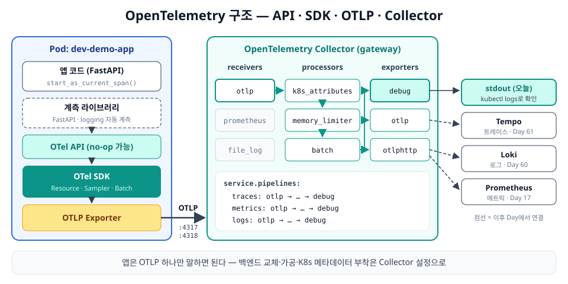
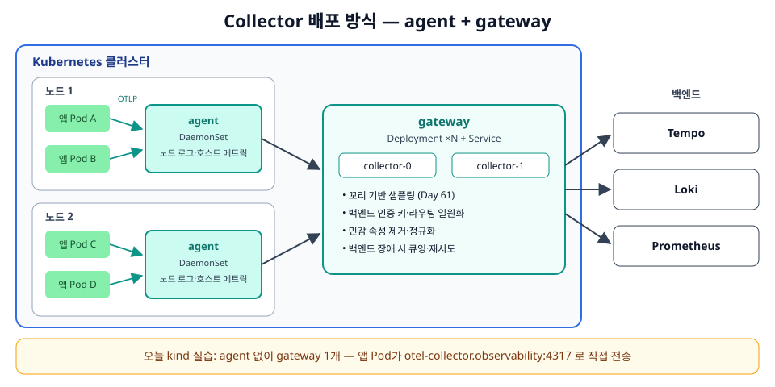

> **Chapter 8 · SRE & 관측성** | 난이도 ★★★★☆ | 예상 소요 2.5 ~ 3시간

## 🎯 오늘의 목표

- OpenTelemetry의 구성(**API / SDK / OTLP / Collector**)과 각 부분의 책임을 설명할 수 있다
- Collector의 **receivers → processors → exporters** 파이프라인과 **agent / gateway** 배포 방식을 구분한다
- FastAPI 데모 앱을 **자동 계측**하고, 비즈니스 로직에 **수동 span**과 **커스텀 메트릭**을 추가한다
- 로그에 `trace_id`를 심어 **로그–트레이스 상관**을 준비한다
- Helm으로 kind에 **OpenTelemetry Collector**를 배포하고 `debug` exporter로 신호가 도착하는 것을 확인한다

---

## 1. 왜 OpenTelemetry인가

Day 58에서 SLI가 "에러가 늘었다"는 사실을 알려 줬습니다. 이제 **어느 요청이, 어디서, 왜** 실패했는지 알아야 합니다. 그러려면 앱이 트레이스와 로그를 내보내야 하는데, 예전에는 이런 문제가 있었습니다.

| 예전 | 문제 |
|---|---|
| 벤더마다 다른 에이전트·SDK (Jaeger 클라이언트, Zipkin, 상용 APM …) | 백엔드를 바꾸면 **앱 코드를 다시 계측** |
| 신호마다 다른 라이브러리 (메트릭은 Prometheus, 트레이스는 Jaeger, 로그는 별도) | 신호끼리 **같은 맥락(trace_id, 서비스 이름)** 을 공유하지 못함 |
| 라이브러리 작성자가 특정 벤더에 의존 | 프레임워크 수준 계측이 생태계마다 파편화 |

**OpenTelemetry(OTel)** 는 OpenTracing과 OpenCensus가 합쳐져 만들어진 CNCF 프로젝트로, **계측 방식과 전송 형식을 표준화**합니다. 저장·조회(백엔드)는 하지 않습니다. "한 번 계측하고, 어디로든 보낸다"가 핵심입니다.

> 💡 Day 47에서 rag-api에 OTel SDK를 직접 설정해 Langfuse로 스팬을 보냈습니다. 오늘은 그 구조를 체계적으로 정리하고, **Collector**를 사이에 두어 백엔드와 앱을 분리합니다.

---

## 2. OpenTelemetry 구조



### 2-1. API와 SDK

| 구성 | 역할 | 누가 쓰나 |
|---|---|---|
| **API** | `tracer.start_as_current_span()`, `meter.create_counter()` 같은 **인터페이스**. SDK가 없으면 아무것도 안 하는(no-op) 구현 | 앱 코드, **라이브러리 작성자** |
| **SDK** | API의 실제 구현. 샘플링, 배치, 리소스, **exporter**로 내보내기 | 앱을 실행하는 쪽(설정) |
| **계측 라이브러리** (instrumentation) | FastAPI, requests, SQLAlchemy 등을 감싸 자동으로 span·메트릭 생성 | 자동 계측 |
| **Exporter** | SDK의 데이터를 OTLP, Prometheus, 콘솔 등으로 출력 | SDK 설정 |

API와 SDK를 나눈 이유는 **라이브러리는 API에만 의존**하게 하기 위해서입니다. 라이브러리는 계측 코드를 품고 있어도, 앱이 SDK를 설정하지 않으면 비용이 0에 가깝습니다. 오늘 실습에서 `pytest`가 계측 코드가 들어간 앱을 SDK 없이 그대로 테스트할 수 있는 것도 이 덕분입니다.

### 2-2. 신호와 공통 개념

| 개념 | 설명 |
|---|---|
| **Trace / Span** | 트레이스 = 요청 한 건의 전체 경로. span = 그 안의 작업 단위(시작·끝 시간, 속성, 상태, 부모 span) |
| **Metric** | Counter, UpDownCounter, Histogram, Gauge |
| **Log** | 기존 로깅 라이브러리(Python `logging`)의 레코드를 **브리지**해 trace 맥락을 붙여 내보냄 |
| **Resource** | "누가 보냈나" — `service.name`, `service.version`, `k8s.pod.name` 등. 모든 신호에 공통으로 붙음 |
| **Context Propagation** | 서비스 경계를 넘을 때 HTTP 헤더 `traceparent`(W3C Trace Context)로 trace_id를 전달 |

```
traceparent: 00-4bf92f3577b34da6a3ce929d0e0e4736-00f067aa0ba902b7-01
             버전 └──────── trace_id (16바이트) ──┘└ 부모 span_id ┘ └ sampled
```

### 2-3. OTLP — 표준 전송 프로토콜

**OTLP(OpenTelemetry Protocol)** 는 세 신호를 모두 실어 나르는 표준 프로토콜입니다.

| 전송 | 기본 포트 | 경로 |
|---|---|---|
| OTLP/gRPC | **4317** | (gRPC 서비스) |
| OTLP/HTTP (protobuf 또는 JSON) | **4318** | `/v1/traces`, `/v1/metrics`, `/v1/logs` |

Tempo, Loki, Prometheus(3.x의 OTLP 수신 기능), 대부분의 상용 백엔드가 OTLP를 직접 받습니다. 그래서 앱은 **OTLP 하나만 말할 줄 알면** 됩니다.

---

## 3. OpenTelemetry Collector

앱이 백엔드로 직접 보내도 되지만, 중간에 **Collector**를 두는 것이 일반적입니다.

| Collector를 두면 | 설명 |
|---|---|
| 앱 설정이 단순 | 앱은 "가까운 Collector"로만 보냄. 백엔드 주소·인증은 Collector가 앎 |
| 백엔드 교체가 쉬움 | Collector 설정만 바꾸면 Jaeger → Tempo 전환, 또는 둘 다로 복제 |
| 공통 가공 | 배치, 메모리 제한, 민감 속성 제거, **Kubernetes 메타데이터 부착**, 샘플링 |
| 앱 부담 감소 | 재시도·큐잉을 앱 프로세스 밖에서 처리 |

### 3-1. 파이프라인 구성 요소

| 구성 요소 | 하는 일 | 예 |
|---|---|---|
| **receivers** | 데이터를 받거나 긁어 옴 | `otlp`, `prometheus`(scrape), 파일 로그 |
| **processors** | 순서대로 가공 | `memory_limiter`, `batch`, Kubernetes 속성 부착, 필터, 샘플링 |
| **exporters** | 내보냄 | `otlp`(→Tempo 등), `otlphttp`, `debug`(표준 출력) |
| **connectors** | 한 파이프라인의 출력을 다른 파이프라인의 입력으로 (예: 트레이스 → 메트릭) | span metrics |
| **extensions** | 데이터 경로 밖의 기능 | `health_check`, 인증 |

```yaml
service:
  pipelines:
    traces:                      # 신호별로 파이프라인을 정의
      receivers: [otlp]
      processors: [memory_limiter, batch]   # 나열한 순서대로 실행
      exporters: [debug]
```

> ⚠️ 컴포넌트를 `receivers:`/`exporters:` 아래에 **정의만 하고** `service.pipelines`에 넣지 않으면 동작하지 않습니다. 가장 흔한 실수입니다.

### 3-2. 배포판(distribution)

Collector는 필요한 컴포넌트만 넣어 빌드한 여러 배포판이 있습니다.

| 배포판 | 이미지 | 용도 |
|---|---|---|
| core | `otel/opentelemetry-collector` | 최소 구성 |
| contrib | `otel/opentelemetry-collector-contrib` | 거의 모든 컴포넌트 (크고 무거움) |
| **k8s** | `ghcr.io/open-telemetry/opentelemetry-collector-releases/opentelemetry-collector-k8s` | Kubernetes에 필요한 것 위주 — **오늘 사용** |

### 3-3. agent vs gateway



| 방식 | 배포 형태 | 장점 | 단점 / 주의 |
|---|---|---|---|
| **agent** | 노드마다 DaemonSet (또는 사이드카) | 앱과 가까워 지연·유실 적음, 노드 로그·호스트 메트릭 수집 가능 | 노드마다 설정·리소스 |
| **gateway** | 클러스터에 Deployment 몇 개 (+ Service) | 중앙에서 샘플링·라우팅·인증 키 관리 | 단일 진입점 → 이중화·용량 계획 필요 |
| agent + gateway | 둘 다 | 운영 환경의 일반적 구성 | 구성 요소가 늘어남 |

> 💡 꼬리 기반 샘플링(tail sampling — 트레이스가 끝난 뒤 "에러가 난 것만 남기기")처럼 **한 트레이스의 모든 span을 한곳에 모아야** 하는 처리는 gateway에서 합니다. Day 61에서 다시 등장합니다.

오늘 kind 실습은 단순하게 **gateway(Deployment 1개)** 하나만 띄웁니다.

---

## 4. Semantic Conventions — 이름 규칙의 표준

같은 "HTTP 메서드"를 어떤 앱은 `method`, 어떤 앱은 `http_verb`라고 부르면 대시보드·쿼리를 공유할 수 없습니다. **Semantic Conventions(시맨틱 규약)** 은 속성 이름을 표준화합니다.

| 범주 | 속성 / 메트릭 이름 | 예 |
|---|---|---|
| 리소스 | `service.name`, `service.version` | `demo-app`, `0.4.0` |
| 리소스 | `deployment.environment.name` | `dev` |
| 리소스(K8s) | `k8s.namespace.name`, `k8s.pod.name`, `k8s.deployment.name` | `demo-dev` |
| HTTP span | `http.request.method`, `http.route`, `http.response.status_code` | `GET`, `/work`, `500` |
| URL | `url.path`, `url.scheme` | `/work`, `http` |
| HTTP 메트릭 | `http.server.request.duration` (Histogram, 초) | — |

HTTP 규약은 안정(stable) 버전으로 확정되면서 이름이 바뀌었습니다(`http.method` → `http.request.method`, `http.status_code` → `http.response.status_code`). Python 계측 라이브러리는 호환을 위해 **기본으로 옛 이름**을 내므로, 새로 시작하는 프로젝트는 환경 변수 `OTEL_SEMCONV_STABILITY_OPT_IN=http`로 안정 규약을 켭니다(`http/dup`은 둘 다 출력 — 이행 기간용).

> 💡 Day 47에서 본 `gen_ai.*` 속성도 시맨틱 규약의 일부(GenAI 규약)입니다. 규약은 영역마다 성숙도(Development / Stable)가 다르니 문서에서 상태를 확인하세요.

---

## 5. 실습 ① 데모 앱 계측

### 5-0. 실습 환경

| 항목 | 내용 |
|---|---|
| 클러스터 | Day 09의 kind `infra-lab` |
| 앱 | Day 58까지 수정한 `gitops-demo-app` (FastAPI, `/work`, `/metrics`) |
| 배포 | 앱 레포 `gitops-demo-app` push → Day 51 CI(`ghcr.io/<user>/gitops-demo-app`) → Day 54 Image Updater → Argo CD가 `demo-dev`의 `dev-demo-app`에 반영 |
| 버전 (2026-11 기준) | OpenTelemetry Python SDK **1.45.2** / 계측 라이브러리 **0.66b2**, Collector Helm 차트 **0.178.3** (Collector **0.163.2**) |

> 💡 Python 계측 패키지는 `0.xxbN`(베타) 번호를 쓰고, SDK `1.yy.z`와 **짝을 맞춰** 릴리스됩니다. 둘을 따로 올리면 의존성 충돌이 나므로 함께 고정합니다.

### 5-1. 계측 방식 선택

| 방식 | 방법 | 장점 | 단점 |
|---|---|---|---|
| **자동(zero-code)** | `opentelemetry-instrument` 래퍼로 실행 | 코드 수정 없이 FastAPI·HTTP 클라이언트 span 생성 | 비즈니스 의미(주문 ID 등)는 모름 |
| **수동** | 코드에서 `tracer.start_as_current_span()` | 원하는 구간·속성을 정확히 | 코드 수정 필요 |
| 혼합 (오늘) | 자동 + 핵심 구간만 수동 | 현실적인 기본값 | — |

### 5-2. 의존성

```text
# requirements.txt
fastapi>=0.115,<1.0
uvicorn[standard]>=0.30
prometheus-client>=0.21
opentelemetry-distro[otlp]==0.66b2              # SDK + opentelemetry-instrument + OTLP exporter 1.45.2
opentelemetry-instrumentation-fastapi==0.66b2
opentelemetry-instrumentation-logging==0.66b2
```

> 💡 `opentelemetry-bootstrap -a install`을 쓰면 설치된 라이브러리를 보고 계측 패키지를 자동으로 깔아 주지만, 빌드할 때마다 결과가 달라질 수 있어 이미지에는 **명시적으로 고정**하는 편이 재현성에 좋습니다.

### 5-3. 코드 — 수동 span, 커스텀 메트릭, 로그

Day 58의 `app/main.py`에서 위쪽 import와 `/work`만 바꿉니다. 나머지(미들웨어, `/metrics`, `/`, `/healthz`)는 그대로입니다.

```python
# app/main.py (변경 부분)
import logging
import os
import random
import socket
import time

from fastapi import FastAPI, HTTPException, Query, Request
from fastapi.responses import Response
from opentelemetry import metrics, trace
from prometheus_client import CONTENT_TYPE_LATEST, Counter, Histogram, generate_latest

app = FastAPI(title="gitops-demo-app")

# API만 사용 — SDK는 opentelemetry-instrument가 실행 시점에 설정
tracer = trace.get_tracer("gitops-demo-app")
meter = metrics.get_meter("gitops-demo-app")
WORK_ITEMS = meter.create_counter(
    "demo.work.items", unit="{item}", description="처리한 /work 작업 수"
)
logger = logging.getLogger("gitops_demo_app")

# ... (Day 58의 REQUESTS, LATENCY, record_metrics 미들웨어, /metrics, / 그대로)


@app.get("/work")
def work(
    error_rate: float = Query(0.0, ge=0, le=1),
    slow_rate: float = Query(0.0, ge=0, le=1),
):
    with tracer.start_as_current_span("simulate_work") as span:
        slow = random.random() < slow_rate
        span.set_attribute("demo.slow", slow)
        time.sleep(0.8 if slow else random.uniform(0.01, 0.05))
        if random.random() < error_rate:
            WORK_ITEMS.add(1, {"demo.result": "error"})
            logger.error("work failed (simulated)")
            raise HTTPException(status_code=500, detail="simulated failure")
        WORK_ITEMS.add(1, {"demo.result": "ok"})
        logger.info("work done slow=%s", slow)
    return {"status": "done"}
```

| 코드 | 의미 |
|---|---|
| `trace.get_tracer(...)` | 계측 범위(instrumentation scope) 이름. 어느 코드가 만든 span인지 표시 |
| `start_as_current_span("simulate_work")` | **현재 span**(FastAPI 자동 계측이 만든 `GET /work`)의 **자식**으로 생성 |
| 예외가 `with` 블록을 빠져나가면 | span에 예외 이벤트가 기록되고 상태가 `ERROR`가 됨 (기본 동작) |
| `span.set_attribute("demo.slow", ...)` | 직접 만든 속성은 표준과 겹치지 않게 **자기 네임스페이스**(`demo.`)를 붙임 |
| `meter.create_counter("demo.work.items")` | OTel 메트릭. Collector로 OTLP 전송 (Day 58의 Prometheus `/metrics`와 별개) |
| `logger.info(...)` | 표준 `logging` 그대로. 계측이 trace_id를 붙여 줌 |

> 💡 Day 58의 `prometheus_client` 메트릭은 SLI recording rule이 쓰고 있으니 그대로 둡니다. OTel 메트릭을 Prometheus로 보내는 방법(Collector의 Prometheus 계열 exporter, Prometheus의 OTLP 수신)은 여러 가지가 있지만, 오늘은 신호가 Collector까지 도착하는 것만 확인합니다.

### 5-4. Dockerfile — 실행 명령만 바꾸기

```dockerfile
# Dockerfile (마지막 줄만 변경)
CMD ["opentelemetry-instrument", "uvicorn", "app.main:app", "--host", "0.0.0.0", "--port", "8000"]
```

`opentelemetry-instrument`가 SDK를 초기화하고 설치된 계측 라이브러리(FastAPI, logging)를 켠 다음 uvicorn을 실행합니다. 설정은 모두 **`OTEL_*` 환경 변수**로 받습니다.

> ⚠️ 자동 계측은 uvicorn `--reload`와 함께 쓰면 계측이 빠질 수 있고, gunicorn처럼 워커를 fork하는 서버는 공식 문서의 fork 모델 안내대로 워커 시작 후 SDK를 초기화해야 합니다. 컨테이너에서는 워커 1개 + Pod 수평 확장이 가장 단순합니다.

### 5-5. 로컬에서 먼저 확인 (콘솔 exporter)

```bash
pip install -r requirements.txt
OTEL_SERVICE_NAME=demo-app \
OTEL_TRACES_EXPORTER=console OTEL_METRICS_EXPORTER=none OTEL_LOGS_EXPORTER=none \
OTEL_PYTHON_LOG_CORRELATION=true OTEL_SEMCONV_STABILITY_OPT_IN=http \
opentelemetry-instrument uvicorn app.main:app --port 8000
```

다른 터미널에서 `curl -s "localhost:8000/work?error_rate=1"`을 호출하면 서버 터미널에 두 가지가 찍힙니다.

```
2026-11-15 10:02:11,481 ERROR [gitops_demo_app] [main.py:62] [trace_id=5b8aa5a2d2c872e8321cf37308d69df2 span_id=051581bf3cb55c13 resource.service.name=demo-app trace_sampled=True] - work failed (simulated)
{
    "name": "simulate_work",
    "context": {
        "trace_id": "0x5b8aa5a2d2c872e8321cf37308d69df2",
        "span_id": "0x051581bf3cb55c13",
        ...
    },
    "parent_id": "0x3e1c0f7a9a2b4d10",
    "status": { "status_code": "ERROR", ... },
    "attributes": { "demo.slow": false },
    "events": [ { "name": "exception", ... } ],
```

- 로그 줄의 `trace_id`와 span의 `trace_id`가 **같습니다.** 이것이 로그–트레이스 상관의 전부입니다.
- `OTEL_PYTHON_LOG_CORRELATION=true`면 계측이 `logging.basicConfig()`를 호출해 위 형식(`otelTraceID`, `otelSpanID`, `otelServiceName`, `otelTraceSampled`를 넣은 포맷)을 적용합니다. 형식은 `OTEL_PYTHON_LOG_FORMAT`으로 바꿀 수 있습니다.
- 콘솔에는 `simulate_work` 외에 부모 span `GET /work`와 ASGI 내부 span(`http send` 등)도 보입니다.

> ⚠️ uvicorn의 접근 로그(`"GET /work HTTP/1.1" 500`)는 uvicorn이 자기 핸들러로 따로 찍기 때문에 trace_id가 붙지 않습니다. trace_id가 필요한 로그는 **앱 로거**로 남기세요.

테스트가 여전히 통과하는지 확인하고 push합니다.

```bash
pytest -q          # SDK 없이 실행 → OTel API는 no-op, 테스트 그대로 통과
git add . && git commit -m "feat: OpenTelemetry 자동 계측 + simulate_work span" && git push
```

---

## 6. 실습 ② kind에 OpenTelemetry Collector 배포

Collector를 띄우는 방법은 두 가지입니다.

| 방법 | 특징 |
|---|---|
| **Collector Helm 차트** (`open-telemetry/opentelemetry-collector`) | values 하나로 Collector만 설치 — **오늘 사용** |
| OpenTelemetry Operator | `OpenTelemetryCollector` CRD로 Collector를 선언, `Instrumentation` CRD + Pod 애너테이션으로 **자동 계측 주입**까지 가능 |

> 💡 Operator의 자동 주입은 Pod에 init 컨테이너로 계측 라이브러리를 넣어 주므로 Dockerfile을 고치지 않아도 됩니다. 대신 cert-manager가 필요하고(웹훅 인증서) 구성 요소가 늘어납니다. 여러 팀의 앱을 한꺼번에 계측해야 할 때 고려하세요.

### 6-1. values 작성

```yaml
# otel-collector-values.yaml
mode: deployment                 # gateway 방식. agent라면 daemonset
fullnameOverride: otel-collector # Service 이름을 짧게: otel-collector.observability

image:
  repository: ghcr.io/open-telemetry/opentelemetry-collector-releases/opentelemetry-collector-k8s
command:
  name: otelcol-k8s              # k8s 배포판의 실행 파일 이름

presets:
  kubernetesAttributes:
    enabled: true                # k8s.pod.name, k8s.namespace.name 등을 자동 부착 (+ 필요한 RBAC)

resources:
  limits:
    memory: 256Mi                # memory_limiter가 이 값의 80%를 한도로 사용

ports:                           # 오늘 쓰지 않는 수신 포트는 닫기
  jaeger-compact: { enabled: false }
  jaeger-thrift: { enabled: false }
  jaeger-grpc: { enabled: false }
  zipkin: { enabled: false }

config:
  receivers:
    jaeger: null                 # 차트 기본 config에서 제거
    zipkin: null
    prometheus: null
  exporters:
    debug:
      verbosity: detailed        # basic | normal | detailed
  service:
    pipelines:
      traces:
        receivers: [otlp]
      metrics:
        receivers: [otlp]
      logs:
        receivers: [otlp]
```

| 항목 | 설명 |
|---|---|
| `image.repository` | 차트는 기본 이미지를 정하지 않으므로 **반드시 지정**. k8s 배포판에는 Kubernetes 속성 프로세서가 들어 있음 |
| 차트 기본 `config` | `otlp` receiver, `memory_limiter`·`batch` processor, `debug` exporter, `health_check` extension이 이미 들어 있고 우리 값과 **병합**됨 |
| `null` | Helm에서 맵 항목을 지우는 방법. 파이프라인의 `receivers` 목록은 통째로 **교체**됨 |
| `presets.kubernetesAttributes` | 모든 파이프라인에 Kubernetes 속성 processor를 넣고 ClusterRole을 만듦. 최근 차트는 프로세서 이름을 새 표기(`k8s_attributes`, 예전 `k8sattributes`)로 생성 |

### 6-2. 설치

```bash
helm repo add open-telemetry https://open-telemetry.github.io/opentelemetry-helm-charts
helm repo update
helm search repo open-telemetry/opentelemetry-collector
# NAME                                    CHART VERSION  APP VERSION
# open-telemetry/opentelemetry-collector  0.178.3        0.163.2

helm install otel-collector open-telemetry/opentelemetry-collector \
  --version 0.178.3 \
  --namespace observability --create-namespace \
  -f otel-collector-values.yaml

kubectl -n observability get pods,svc
# pod/otel-collector-6c9d7b8f5-k2x4n   1/1   Running
# service/otel-collector   ClusterIP   10.96.xx.xx   <none>   4317/TCP,4318/TCP
```

렌더링된 최종 Collector 설정은 ConfigMap에서 확인합니다. 차트 기본값과 우리 값이 어떻게 합쳐졌는지 보는 가장 확실한 방법입니다.

```bash
kubectl -n observability get configmap otel-collector -o jsonpath='{.data.relay}'
```

```yaml
# (일부)
processors:
  batch: {}
  k8s_attributes:
    extract:
      metadata: [k8s.namespace.name, k8s.pod.name, k8s.deployment.name, k8s.node.name, ...]
  memory_limiter: { check_interval: 5s, limit_percentage: 80, spike_limit_percentage: 25 }
service:
  pipelines:
    traces:
      receivers: [otlp]
      processors: [k8s_attributes, memory_limiter, batch]
      exporters: [debug]
```

> ⚠️ Collector가 `CrashLoopBackOff`이면 `kubectl -n observability logs deploy/otel-collector`의 첫 에러를 보세요. 대부분 **설정 오류**(존재하지 않는 컴포넌트 이름, 파이프라인에 정의 안 된 컴포넌트)이며 Collector는 시작 시 설정을 검증하고 바로 종료합니다.

---

## 7. 실습 ③ 앱 → Collector 연결 (GitOps)

앱이 어디로 보낼지는 **환경 변수**이므로 설정 레포 `gitops-demo-config`의 `apps/demo-app/base/deployment.yaml`에 추가합니다.

```yaml
# apps/demo-app/base/deployment.yaml — containers[0].env 에 추가
        env:
        - name: OTEL_SERVICE_NAME
          value: demo-app
        - name: OTEL_EXPORTER_OTLP_ENDPOINT
          value: http://otel-collector.observability.svc.cluster.local:4317
        - name: OTEL_EXPORTER_OTLP_PROTOCOL
          value: grpc
        - name: OTEL_TRACES_EXPORTER
          value: otlp
        - name: OTEL_METRICS_EXPORTER
          value: otlp
        - name: OTEL_LOGS_EXPORTER
          value: otlp
        - name: OTEL_METRIC_EXPORT_INTERVAL
          value: "15000"                    # ms (기본 60초 → 실습용으로 단축)
        - name: OTEL_PYTHON_LOG_CORRELATION
          value: "true"                     # stdout 로그에 trace_id (Day 60에서 Loki가 수집)
        - name: OTEL_PYTHON_EXCLUDED_URLS
          value: "healthz,metrics"          # 프로브·스크레이프 요청은 span 생략
        - name: OTEL_SEMCONV_STABILITY_OPT_IN
          value: http
```

| 변수 | 의미 |
|---|---|
| `OTEL_SERVICE_NAME` | 리소스 속성 `service.name`. 환경 구분은 Collector가 붙이는 `k8s.namespace.name`(`demo-dev` 등)으로 |
| `OTEL_EXPORTER_OTLP_ENDPOINT` | `http://` 스킴이면 TLS 없이 연결. 다른 네임스페이스이므로 FQDN 사용 |
| `OTEL_*_EXPORTER=otlp` | 세 신호 모두 OTLP로. 로그는 OTLP로 Collector에 가면서, 동시에 stdout에도 trace_id가 붙어 찍힘 |
| `OTEL_PYTHON_EXCLUDED_URLS` | 쉼표로 구분한 정규식. 매칭되는 URL은 트레이스를 만들지 않음 |

> 💡 Python SDK 1.40 이전에는 로그를 OTLP로 내보내려면 `OTEL_PYTHON_LOGGING_AUTO_INSTRUMENTATION_ENABLED=true`도 필요했습니다. 지금 고정한 버전에서는 로그 핸들러 자동 설정이 기본으로 켜져 있습니다.

```bash
cd gitops-demo-config
git add apps/demo-app/base/deployment.yaml
git commit -m "feat: demo-app OTel exporter 설정 (→ observability/otel-collector)"
git push
argocd app get gitops-demo-dev --refresh | grep -E "Sync Status|Health"
kubectl -n demo-dev rollout status deploy/dev-demo-app
```

앱 레포 push(5장)로 만든 새 이미지와 설정 레포의 환경 변수가 둘 다 반영돼야 합니다. Pod의 이미지 태그와 환경 변수를 확인합니다.

```bash
kubectl -n demo-dev get deploy dev-demo-app -o jsonpath='{.spec.template.spec.containers[0].image}{"\n"}'
kubectl -n demo-dev exec deploy/dev-demo-app -- env | grep ^OTEL_
```

### 7-1. 신호 확인

```bash
kubectl -n demo-dev run loadgen --image=curlimages/curl --restart=Never -- \
  sh -c 'while true; do curl -s -o /dev/null "http://dev-demo-app/work?error_rate=0.1&slow_rate=0.05"; sleep 0.5; done'

kubectl -n observability logs deploy/otel-collector -f | grep -A30 "Name           : simulate_work"
```

```
Span #1
    Trace ID       : 9f1c3b0e7a5d4e2f8c6b1a0d9e8f7c6b
    Parent ID      : 2a4c6e8f0b1d3f57
    ID             : 7e9a1c3e5f7b9d11
    Name           : simulate_work
    Kind           : Internal
    Status code    : Error
Attributes:
     -> demo.slow: Bool(false)
```

같은 출력의 위쪽 **Resource attributes**에는 `service.name: demo-app`과 함께 Collector가 붙인 `k8s.namespace.name: demo-dev`, `k8s.pod.name: dev-demo-app-...`, `k8s.deployment.name: dev-demo-app`이 보입니다. 부모 span(`GET /work`, Kind `Server`)의 속성에는 안정 규약 이름인 `http.request.method`, `http.route`, `http.response.status_code`가 있습니다.

메트릭과 로그도 확인합니다.

```bash
kubectl -n observability logs deploy/otel-collector | grep -E "demo.work.items|http.server.request.duration" | head
kubectl -n observability logs deploy/otel-collector | grep -B2 -A12 "LogRecord #" | head -40
```

```
LogRecord #0
ObservedTimestamp: 2026-11-15 01:14:22.381 +0000 UTC
SeverityText: ERROR
Body: Str(work failed (simulated))
Trace ID: 9f1c3b0e7a5d4e2f8c6b1a0d9e8f7c6b
Span ID: 7e9a1c3e5f7b9d11
```

OTLP로 보낸 로그 레코드에는 **Trace ID·Span ID 필드**가 구조적으로 들어 있고, 같은 내용이 Pod stdout에는 텍스트로 찍혀 있습니다.

```bash
kubectl -n demo-dev logs deploy/dev-demo-app | grep "work failed" | tail -2
# ... ERROR [gitops_demo_app] [main.py:62] [trace_id=9f1c3b0e7a5d4e2f8c6b1a0d9e8f7c6b span_id=7e9a1c3e5f7b9d11 resource.service.name=demo-app trace_sampled=True] - work failed (simulated)
```

> 💡 로그를 백엔드로 보내는 길이 두 가지 생겼습니다. ① 앱 → OTLP → Collector → 로그 백엔드, ② 앱 stdout → 노드의 로그 파일/쿠버네티스 API → 수집기(Alloy) → Loki. 내일 Day 60은 모든 Pod에 공통으로 적용되는 ②를 다루고, stdout의 `trace_id`를 Loki에서 꺼내 씁니다.

정리합니다. Collector와 계측 설정은 Day 61(Tempo)에서 exporter만 바꿔 계속 씁니다.

```bash
kubectl -n demo-dev delete pod loadgen
```

---

## 8. 트러블슈팅

| 증상 | 원인 | 해결 |
|---|---|---|
| Collector 로그에 아무것도 안 나옴 | 앱이 아직 옛 이미지(`opentelemetry-instrument` 없음) | Pod 이미지 태그 확인, Image Updater·Argo CD 동기화 확인 |
| 앱 로그에 `Failed to export ... StatusCode.UNAVAILABLE` | 엔드포인트 오타, 다른 네임스페이스인데 짧은 이름 사용, 포트 혼동(4317=gRPC, 4318=HTTP) | FQDN `otel-collector.observability.svc.cluster.local:4317`, 프로토콜과 포트 짝 확인 |
| HTTP로 보냈더니 404 | `OTEL_EXPORTER_OTLP_PROTOCOL=http/protobuf`인데 포트를 4317로 | HTTP는 4318. 기본 엔드포인트에 `/v1/traces` 등은 SDK가 붙임 |
| Collector `CrashLoopBackOff`, `unknown type` 에러 | 배포판에 없는 컴포넌트, 이미지와 `command.name` 불일치 | k8s 배포판 + `otelcol-k8s`, 컴포넌트 이름 확인 |
| `helm install` 시 `[ERROR] 'image.repository' must be set.` | 차트에 기본 이미지가 없음 | values에 `image.repository` 지정 |
| 로그에 `trace_id=0` | span 밖에서 찍힌 로그 (예: 시작 로그) | 정상. 요청 처리 중의 로그에만 trace_id가 있음 |
| 로그 형식이 바뀌지 않음 | 다른 코드가 먼저 `logging.basicConfig()`를 호출 | 첫 호출만 적용됨. 직접 포맷을 관리하려면 `OTEL_PYTHON_LOG_FORMAT` 또는 `LoggingInstrumentor().instrument(set_logging_format=True)` |
| `k8s.*` 속성이 없음 | `kubernetesAttributes` preset 미사용 또는 RBAC 없음 | preset 켜기, `kubectl get clusterrole | grep otel` |
| span 속성이 `http.method`(옛 이름) | 안정 규약 미적용 | `OTEL_SEMCONV_STABILITY_OPT_IN=http` |

---

## 9. 핵심 정리

- OpenTelemetry = **계측과 전송의 표준**. 저장·조회는 백엔드(Prometheus, Loki, Tempo …)의 몫
- **API**(인터페이스, no-op 가능) / **SDK**(구현·내보내기) / **계측 라이브러리**(자동 span) / **OTLP**(4317 gRPC, 4318 HTTP)
- Collector = **receivers → processors → exporters**, `service.pipelines`에 넣어야 동작. agent(DaemonSet)와 gateway(Deployment)
- 자동 계측(`opentelemetry-instrument`) + 수동 span(`start_as_current_span`) + 커스텀 메트릭(`create_counter`)의 혼합이 현실적인 기본값
- `OTEL_PYTHON_LOG_CORRELATION=true`로 로그에 `trace_id`가 붙어 **로그–트레이스 상관**의 기반이 된다
- **Semantic Conventions**로 속성 이름을 표준화 — HTTP는 `OTEL_SEMCONV_STABILITY_OPT_IN=http`로 안정 규약 사용

---

## 10. 셀프 체크

<details>
<summary>Q1. 라이브러리 작성자가 OTel SDK가 아니라 API에만 의존해야 하는 이유는?</summary>

API는 SDK가 설정되지 않으면 no-op으로 동작하므로, 라이브러리를 쓰는 앱이 계측을 원하지 않아도 비용이 거의 없습니다. 어떤 SDK 설정·exporter를 쓸지는 **앱(실행하는 쪽)** 이 결정합니다. 라이브러리가 SDK에 의존하면 앱의 설정과 충돌합니다.
</details>

<details>
<summary>Q2. Collector 설정에 <code>exporters.otlp</code>를 정의했는데 데이터가 백엔드로 가지 않는다. 가장 먼저 볼 곳은?</summary>

`service.pipelines.<신호>.exporters` 목록에 `otlp`가 들어 있는지 확인합니다. 컴포넌트는 정의만으로는 동작하지 않고 파이프라인에 포함돼야 합니다.
</details>

<details>
<summary>Q3. 꼬리 기반 샘플링을 agent가 아니라 gateway에서 해야 하는 이유는?</summary>

한 트레이스의 span들은 여러 서비스·여러 노드에서 만들어집니다. "이 트레이스에 에러가 있었나"를 판단하려면 **모든 span이 한 곳에 모여야** 하는데, 노드별 agent는 자기 노드의 span만 봅니다. 그래서 trace_id 기준으로 모으는 gateway 계층에서 처리합니다.
</details>

<details>
<summary>Q4. FastAPI 자동 계측만 있는데 굳이 <code>simulate_work</code> 수동 span을 만든 이유는?</summary>

자동 계측은 HTTP 요청 단위(`GET /work`)까지만 압니다. 요청 안에서 **어느 구간이 느렸는지**, 비즈니스 맥락(`demo.slow` 같은 속성)은 코드만 알고 있으므로 수동 span으로 표시해야 트레이스에서 원인을 좁힐 수 있습니다.
</details>

<details>
<summary>Q5. 로그–트레이스 상관을 위해 로그에 무엇이 들어가야 하나? 그리고 그것을 Loki 라벨로 만들면 안 되는 이유는?</summary>

`trace_id`(가능하면 `span_id`도)가 로그 줄 또는 로그 레코드 필드에 들어가야 합니다. trace_id는 요청마다 다른 값이라 라벨로 만들면 **스트림이 요청 수만큼 생겨 카디널리티가 폭발**합니다. 로그 본문이나 구조화 메타데이터로 두고 쿼리 시점에 추출합니다(Day 60).
</details>

---

## ⏭️ 다음 예고 — Day 60. 로그 수집 — Loki + Grafana Alloy

오늘 `kubectl logs`로 본 `trace_id`가 찍힌 로그를, Pod가 사라져도 남고 여러 Pod를 한 번에 검색할 수 있게 모아 봅니다. 라벨만 인덱싱하는 Loki의 구조, Promtail을 대신하는 Grafana Alloy로 Pod 로그 수집, LogQL로 필터·파싱·메트릭 쿼리까지 실습합니다.
