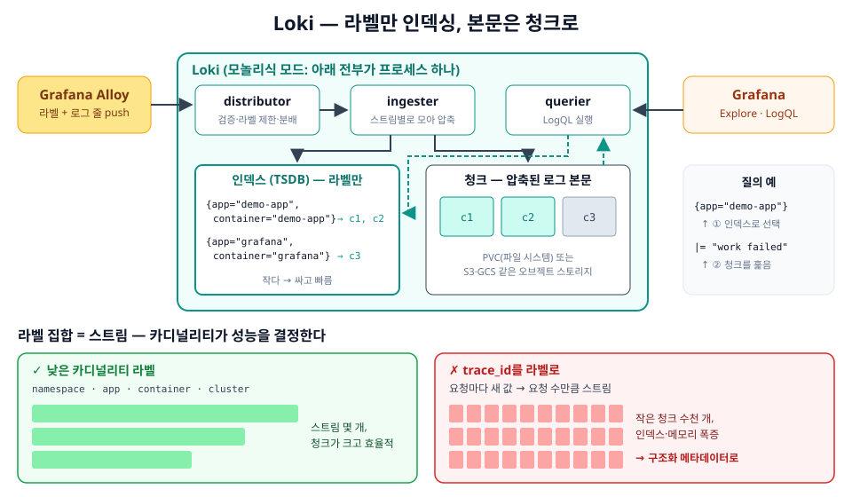
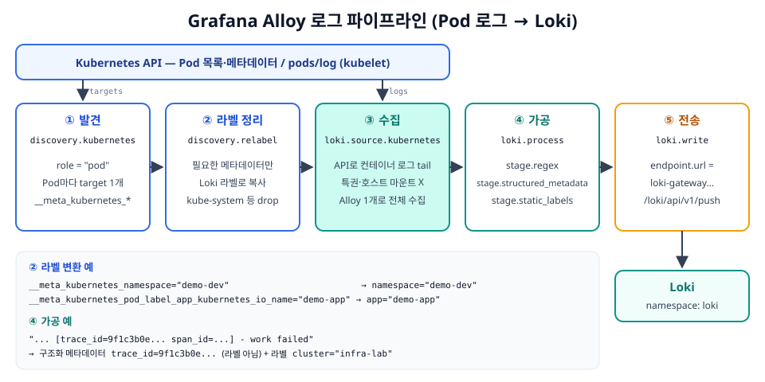
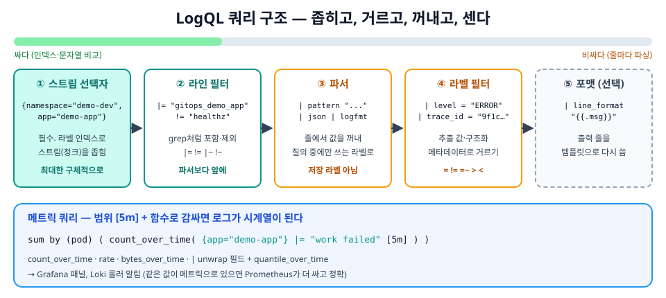

> **Chapter 8 · SRE & 관측성** | 난이도 ★★★☆☆ | 예상 소요 2 ~ 2.5시간

## 🎯 오늘의 목표

- Loki가 **라벨만 인덱싱하고 본문은 청크로 압축 저장**하는 구조와, 그 덕분에 싼 대신 지켜야 할 규칙을 설명할 수 있다
- Helm으로 Loki를 **모놀리식(단일 바이너리) 모드**로 kind에 설치한다
- **Grafana Alloy**로 모든 Pod 로그를 수집하는 파이프라인을 Alloy 문법으로 작성한다
- **LogQL**로 필터 → 파서 → 라벨 필터 → 메트릭 쿼리를 단계별로 쓴다
- **라벨 카디널리티**를 이해하고 `trace_id`는 라벨이 아니라 구조화 메타데이터로 다룬다

---

## 1. 왜 로그 수집 시스템이 필요한가

Day 59에서 `kubectl logs`로 `trace_id`가 찍힌 로그를 봤습니다. 하지만 `kubectl logs`에는 한계가 분명합니다.

| `kubectl logs`의 한계 | 결과 |
|---|---|
| Pod가 삭제되면 로그도 사라짐 | 장애로 재시작된 Pod의 **직전 로그**를 잃음 (`--previous`도 한 번뿐) |
| 노드의 로그 파일은 크기 제한으로 로테이션 | 몇 시간 전 로그가 없음 |
| Pod 하나씩 조회 | 레플리카 5개, 서비스 10개에 흩어진 로그를 **한 번에 검색** 불가 |
| 집계 불가 | "최근 1시간 에러 로그 수"를 그래프로 못 그림 |

그래서 노드의 로그를 **수집기(collector)** 가 읽어 **로그 저장소**로 보내고, Grafana에서 검색합니다. 오늘의 조합은 이렇습니다.

| 역할 | 도구 | 비유 |
|---|---|---|
| 수집·가공·전송 | **Grafana Alloy** | 택배 기사 |
| 저장·검색 | **Loki** | 물류 창고 |
| 조회·시각화 | **Grafana** (Day 17에 설치됨) | 조회 창구 |

> ⚠️ **Promtail은 지원 종료(EOL)됐습니다.** Loki 전용 수집기였던 Promtail은 2025년 2월부터 LTS(유지보수만) 단계였고 **2026년 3월 2일 EOL**이 되어 더 이상 업데이트가 없습니다. 기존 Promtail 설정은 `alloy convert --source-format=promtail` 명령으로 Alloy 설정으로 변환할 수 있습니다. 새로 시작한다면 처음부터 **Alloy**를 씁니다. (Grafana Agent도 같은 이유로 Alloy로 대체됐습니다.)

---

## 2. Loki 아키텍처

### 2-1. "라벨만 인덱싱한다"

Elasticsearch 같은 전문 검색 엔진은 로그 본문의 **모든 단어**를 역색인합니다. 검색은 빠르지만 인덱스가 원본보다 커지기도 하고, 저장·메모리 비용이 큽니다. Loki는 정반대로 접근합니다.



| 구분 | Elasticsearch 방식 | **Loki 방식** |
|---|---|---|
| 인덱스 대상 | 본문 전체(모든 단어) | **라벨만** (`{namespace="demo-dev", app="demo-app"}`) |
| 본문 저장 | 인덱스와 함께 | **청크(chunk)** 로 압축해 오브젝트 스토리지(또는 파일 시스템)에 |
| 검색 방식 | 인덱스에서 단어로 바로 찾기 | 라벨로 **스트림을 좁힌 뒤** 해당 청크를 내려받아 grep처럼 훑기 |
| 비용 | 인덱스·메모리 큼 | 인덱스 작음, 저장 비용 낮음 |
| 잘 맞는 질문 | "아무 로그에서 이 단어" | "**이 앱**의 최근 1시간 로그에서 이 단어" |

Prometheus를 아는 사람에게는 익숙한 모델입니다. **메트릭 이름 + 라벨 = 시계열**이었듯이, Loki에서는 **라벨 집합 하나 = 스트림(stream) 하나**입니다. 같은 스트림의 로그 줄은 시간순으로 모여 청크가 됩니다.

```
스트림 = {namespace="demo-dev", app="demo-app", container="demo-app", pod="dev-demo-app-7c9f..."}
  ├─ 10:00:01  INFO  ... work done slow=False
  ├─ 10:00:01  ERROR ... work failed (simulated)
  └─ ...                                  → 일정 크기/시간마다 압축해 청크로 저장
```

### 2-2. 구성 요소

| 구성 요소 | 역할 |
|---|---|
| **distributor** | 수집기가 보낸 로그를 받아 검증(라벨·크기 제한)하고 ingester로 분배 |
| **ingester** | 스트림별로 메모리에 모았다가 청크로 압축해 스토리지에 기록 |
| **querier** / query-frontend | LogQL 질의 실행. 인덱스로 청크를 찾고, 내려받아 필터링 |
| **compactor** | 인덱스 압축, 보존 기간(retention) 지난 데이터 삭제 |
| 인덱스 | **TSDB** 형식 (스키마 `v13`) — "어느 스트림이 어느 청크에 있나" |

### 2-3. 배포 모드

| 모드 (Helm `deploymentMode`) | 구성 | 규모 |
|---|---|---|
| **Monolithic** (예전 이름 `SingleBinary`) | 위 구성 요소가 **프로세스 하나**에 | 학습·소규모 (하루 수십 GB 이하) — **오늘 사용** |
| SimpleScalable | read / write / backend 3그룹 | 중간 규모. **Loki 4에서 제거 예정**이라 신규 구축에는 비권장 |
| Distributed | 구성 요소별 개별 배포(마이크로서비스) | 대규모 |

> 💡 Monolithic 모드에서 파일 시스템 스토리지를 쓰면 **레플리카는 1개**만 가능합니다. 여러 개로 늘리거나 다른 모드로 가려면 S3·GCS·MinIO 같은 **오브젝트 스토리지**가 필요합니다.

---

## 3. 실습 ① Loki 설치 (모놀리식 모드)

### 3-0. 실습 환경과 버전

| 항목 | 내용 |
|---|---|
| 클러스터 | Day 09 kind `infra-lab`, Day 17 kube-prometheus-stack(`monitoring`, Grafana 포함) |
| 앱 | Day 59까지 계측한 `dev-demo-app` (`demo-dev`, stdout 로그에 `trace_id`) |
| Loki Helm 차트 | `grafana-community/loki` **21.2.3** (Loki **3.7.10**) — 2026-11 기준 |
| Alloy Helm 차트 | `grafana/alloy` **1.16.0** (Alloy **v1.22.0**) |

> ⚠️ **Loki Helm 차트의 저장소가 바뀌었습니다.** 예전 문서의 `grafana/loki` 대신 이제 커뮤니티가 관리하는 `https://grafana-community.github.io/helm-charts`의 `grafana-community/loki`를 씁니다. 저장소를 옮기면서 차트 버전 번호 체계가 바뀌었고, `deploymentMode: SingleBinary`는 `Monolithic`으로 이름이 바뀌었으며(옛 값도 당분간 허용), 내장 MinIO 서브차트는 제거됐습니다. 블로그 글의 values를 복사할 때 주의하세요.

### 3-1. values 작성

```yaml
# loki-values.yaml
deploymentMode: Monolithic

loki:
  auth_enabled: false            # 멀티테넌시 끔 → X-Scope-OrgID 헤더 없이 사용 (학습용)
  commonConfig:
    replication_factor: 1
  storage:
    type: filesystem             # 오브젝트 스토리지 없이 PVC에 저장
  schemaConfig:
    configs:
      - from: "2024-04-01"
        store: tsdb
        object_store: filesystem
        schema: v13
        index:
          prefix: loki_index_
          period: 24h

singleBinary:
  replicas: 1                    # 차트 기본값은 0 → 반드시 1로
  persistence:
    size: 5Gi

# 모놀리식이므로 다른 모드의 컴포넌트는 0
read:
  replicas: 0
write:
  replicas: 0
backend:
  replicas: 0

# kind 노트북에서 메모리 절약 (chunks-cache 기본 할당이 8GB)
chunksCache:
  enabled: false
resultsCache:
  enabled: false
lokiCanary:
  enabled: false
test:
  enabled: false                 # helm test는 canary가 필요
```

| 항목 | 이유 |
|---|---|
| `schemaConfig` | 차트는 스키마 기본값을 주지 않음. 없으면 설치가 실패함. `from`은 과거 날짜로 고정하고 **절대 바꾸지 않음**(바꿀 땐 새 항목 추가) |
| `singleBinary.replicas: 1` | 기본값 0. 안 바꾸면 Loki 본체가 안 뜸 |
| `read/write/backend: 0` | 기본값이 3이라 남겨 두면 "파일 시스템 스토리지로는 scalable 타깃을 못 띄운다"는 검증 에러 |
| `chunksCache`/`resultsCache` | memcached 캐시. 운영에선 켜는 게 좋지만 kind에선 메모리 부족을 부름 |

### 3-2. 설치

```bash
helm repo add grafana-community https://grafana-community.github.io/helm-charts
helm repo update
helm search repo grafana-community/loki
# NAME                    CHART VERSION  APP VERSION
# grafana-community/loki  21.2.3         3.7.10

helm install loki grafana-community/loki \
  --version 21.2.3 \
  --namespace loki --create-namespace \
  -f loki-values.yaml
```

```bash
kubectl -n loki get pods,svc
# pod/loki-0                         2/2   Running      ← 모놀리식 본체 (StatefulSet)
# pod/loki-gateway-5f8d7c6b9-qx2lp   1/1   Running      ← nginx 게이트웨이
# service/loki            ClusterIP   ...   3100/TCP,9095/TCP
# service/loki-gateway    ClusterIP   ...   80/TCP
```

`loki-gateway`는 nginx로 읽기/쓰기 경로를 알맞은 컴포넌트로 보내는 진입점입니다. 모드를 바꿔도 클라이언트는 게이트웨이 주소만 알면 되므로 **수집기와 Grafana는 게이트웨이를 바라보게** 합니다.

```bash
kubectl -n loki port-forward svc/loki-gateway 3100:80 &
curl -s localhost:3100/loki/api/v1/labels
# {"status":"success","data":[]}         ← 아직 아무 로그도 없음
```

---

## 4. 실습 ② Grafana Alloy로 Pod 로그 수집

### 4-1. Alloy 문법 한눈에 보기

Alloy 설정은 **컴포넌트 블록**을 이어 붙인 파이프라인입니다. Prometheus·OpenTelemetry Collector의 장점을 섞은 도구라, 오늘 쓰는 로그 외에도 메트릭·트레이스(OTLP)를 함께 다룰 수 있습니다.

```alloy
컴포넌트이름 "라벨" {           // 예: loki.write "default"
  인자 = 값
  블록 { ... }
  forward_to = [다음컴포넌트.receiver]   // 다른 컴포넌트의 export를 참조해 연결
}
```

| 문법 | 의미 |
|---|---|
| `discovery.kubernetes "pods"` | 컴포넌트 종류 + 사용자 라벨. `discovery.kubernetes.pods.targets`처럼 **export**를 참조 |
| `"문자열"` / `` `raw 문자열` `` | 큰따옴표 문자열은 `\` 이스케이프 필요, 백틱은 그대로 (정규식에 편리) |
| `{ key = "v", ... }` | 객체(맵) |
| `//` | 주석 |

### 4-2. 파이프라인 설계



| 단계 | 컴포넌트 | 하는 일 |
|---|---|---|
| ① 발견 | `discovery.kubernetes` | 쿠버네티스 API에서 Pod 목록과 메타데이터(`__meta_kubernetes_*`)를 얻음 |
| ② 라벨 정리 | `discovery.relabel` | 메타데이터 중 필요한 것만 Loki 라벨로, 불필요한 네임스페이스는 제외 |
| ③ 수집 | `loki.source.kubernetes` | **쿠버네티스 API(pods/log)** 로 컨테이너 로그를 tail. 특권·호스트 마운트 불필요 |
| ④ 가공 | `loki.process` | `trace_id` 추출 → 구조화 메타데이터, 고정 라벨 추가 |
| ⑤ 전송 | `loki.write` | Loki 게이트웨이로 push |

> 💡 `loki.source.kubernetes`는 kubelet의 로그 API를 쓰므로 노드 파일 시스템을 마운트할 필요가 없고 Alloy 하나로 클러스터 전체를 수집할 수 있습니다. 대신 kubelet·API 서버 부하와 네트워크 트래픽이 늘어납니다. 대규모 운영에서는 **DaemonSet + 노드 로그 파일 읽기**(`loki.source.file`, `/var/log/pods` 마운트)나, DaemonSet + 같은 노드의 Pod만 발견하도록 `selectors`로 제한하는 방식을 씁니다.

### 4-3. values 작성

```yaml
# alloy-values.yaml
controller:
  type: deployment               # 학습용: Alloy 1개가 클러스터 전체 수집 (기본값은 daemonset)
  replicas: 1

alloy:
  configMap:
    content: |-
      // ① 모든 Pod 발견
      discovery.kubernetes "pods" {
        role = "pod"
      }

      // ② Loki 라벨로 쓸 것만 골라 이름 붙이기
      discovery.relabel "pod_logs" {
        targets = discovery.kubernetes.pods.targets

        rule {
          source_labels = ["__meta_kubernetes_namespace"]
          target_label  = "namespace"
        }
        rule {
          source_labels = ["__meta_kubernetes_pod_name"]
          target_label  = "pod"
        }
        rule {
          source_labels = ["__meta_kubernetes_pod_container_name"]
          target_label  = "container"
        }
        rule {
          source_labels = ["__meta_kubernetes_pod_label_app_kubernetes_io_name"]
          target_label  = "app"
        }
        // 시스템 네임스페이스는 수집하지 않음 (선택)
        rule {
          source_labels = ["namespace"]
          regex         = "kube-system|local-path-storage"
          action        = "drop"
        }
      }

      // ③ 쿠버네티스 API로 로그 tail
      loki.source.kubernetes "pods" {
        targets    = discovery.relabel.pod_logs.output
        forward_to = [loki.process.pods.receiver]
      }

      // ④ trace_id는 라벨이 아니라 구조화 메타데이터로
      loki.process "pods" {
        stage.regex {
          expression = `trace_id=(?P<trace_id>[0-9a-f]{32})`
        }
        stage.structured_metadata {
          values = {
            trace_id = "",
          }
        }
        stage.static_labels {
          values = {
            cluster = "infra-lab",
          }
        }
        forward_to = [loki.write.default.receiver]
      }

      // ⑤ Loki 게이트웨이로 전송
      loki.write "default" {
        endpoint {
          url = "http://loki-gateway.loki.svc.cluster.local/loki/api/v1/push"
        }
      }
```

| 포인트 | 설명 |
|---|---|
| `rule { ... }` | 기본 `action`은 `replace` — `source_labels` 값을 `target_label`에 복사. `__`로 시작하는 라벨은 Loki로 가지 않음 |
| `app` 라벨 | Pod 라벨 `app.kubernetes.io/name`(Chapter 7 데모 앱은 `demo-app`) |
| `stage.regex` | 로그 줄에서 이름 있는 캡처 그룹을 **추출 맵**에 넣음 (라벨이 되지 않음) |
| `stage.structured_metadata` | 추출 맵의 값을 **구조화 메타데이터**로 붙임. 값이 `""`이면 같은 이름의 추출 값을 사용 |
| `trace_id`가 없는 줄 | 정규식이 매칭되지 않으면 아무것도 붙지 않고 그대로 통과 |

> 💡 차트는 `alloy.configMap.content`를 Helm `tpl`로 한 번 처리합니다. 설정 안에 `{{ }}`가 들어가야 한다면 이스케이프가 필요합니다. 오늘 설정에는 없습니다.

### 4-4. 설치

```bash
helm repo add grafana https://grafana.github.io/helm-charts
helm repo update
helm search repo grafana/alloy
# NAME           CHART VERSION  APP VERSION
# grafana/alloy  1.16.0         v1.22.0

helm install alloy grafana/alloy \
  --version 1.16.0 \
  --namespace observability --create-namespace \
  -f alloy-values.yaml

kubectl -n observability get pods -l app.kubernetes.io/name=alloy
# alloy-6d5f8c9b7d-h4kzt   2/2   Running     ← alloy + config-reloader
```

차트가 만든 ClusterRole에는 `discovery.kubernetes`와 `loki.source.kubernetes`가 필요로 하는 권한(`pods`, `pods/log`, `namespaces`의 get/list/watch)이 이미 들어 있습니다.

Alloy에는 파이프라인을 그래프로 보여 주는 **UI**가 있습니다.

```bash
kubectl -n observability port-forward svc/alloy 12345:12345
# http://localhost:12345 → Graph 탭: discovery.kubernetes → ... → loki.write 연결과 각 컴포넌트 상태(Healthy)
```

> 💡 설정을 고칠 때는 values의 `content`를 바꾸고 `helm upgrade`만 하면 됩니다. config-reloader 사이드카가 ConfigMap 변경을 감지해 Alloy를 재시작 없이 다시 읽게 합니다. 문법 오류가 있으면 UI와 로그(`kubectl -n observability logs deploy/alloy -c alloy`)에 줄 번호와 함께 표시됩니다.

### 4-5. 로그가 들어왔는지 확인

```bash
# Day 59의 loadgen 다시 실행
kubectl -n demo-dev run loadgen --image=curlimages/curl --restart=Never -- \
  sh -c 'while true; do curl -s -o /dev/null "http://dev-demo-app/work?error_rate=0.1&slow_rate=0.05"; sleep 0.5; done'

curl -s localhost:3100/loki/api/v1/labels
# {"status":"success","data":["app","cluster","container","namespace","pod","service_name"]}

curl -s localhost:3100/loki/api/v1/label/namespace/values
# {"status":"success","data":["argocd","demo-dev","loki","monitoring","observability",...]}
```

> 💡 `service_name` 라벨은 우리가 만들지 않았습니다. Loki 3은 `service_name`이 없으면 `app` 같은 라벨에서 값을 찾아 **자동으로 채웁니다**(`discover_service_name`). 또한 로그 줄에서 `ERROR`, `INFO` 같은 레벨을 감지해 `detected_level` 구조화 메타데이터를 붙입니다.

---

## 5. 실습 ③ Grafana에 Loki 데이터 소스 추가

Day 17의 kube-prometheus-stack에 데이터 소스를 추가합니다.

```yaml
# grafana-loki-datasource.yaml
grafana:
  additionalDataSources:
    - name: Loki
      type: loki
      uid: loki
      access: proxy
      url: http://loki-gateway.loki.svc.cluster.local
```

```bash
helm upgrade monitoring prometheus-community/kube-prometheus-stack \
  -n monitoring --reuse-values -f grafana-loki-datasource.yaml

kubectl -n monitoring port-forward svc/monitoring-grafana 3000:80
```

Grafana → **Connections → Data sources**에 `Loki`가 생겼는지 확인하고 **Explore**에서 데이터 소스를 Loki로 바꿉니다. (안 보이면 `kubectl -n monitoring rollout restart deploy/monitoring-grafana`)

> 💡 `--reuse-values`는 지난번 설치 값(Day 17의 `monitoring-values.yaml`)을 유지한 채 새 값만 얹습니다. values 파일을 Git으로 관리한다면 두 파일을 함께 `-f`로 넘기는 편이 더 명확합니다.

---

## 6. LogQL 기초

LogQL은 **PromQL과 닮은** Loki의 질의 언어입니다. 기본 형태는 "스트림 선택 → 파이프라인"입니다.



### 6-1. 스트림 선택자 (필수)

```logql
{namespace="demo-dev", app="demo-app"}
```

| 연산자 | 의미 |
|---|---|
| `=` / `!=` | 같음 / 다름 |
| `=~` / `!~` | 정규식 매칭 / 불일치 |

> ⚠️ 선택자에는 **최소 하나의 비어 있지 않은 매처**가 있어야 합니다. `{namespace=~".*"}`처럼 모든 스트림을 고르면 거부되거나 매우 느립니다. 라벨로 최대한 좁히는 것이 Loki 성능의 핵심입니다.

### 6-2. 라인 필터 — grep

```logql
{app="demo-app"} |= "work failed"              # 포함
{app="demo-app"} != "healthz"                   # 제외
{app="demo-app"} |~ "ERROR|WARNING"             # 정규식 포함
{app="demo-app"} |= "work" != "slow=True"       # 이어 붙이기 = AND
```

라인 필터는 가장 싼 연산이므로 **파서보다 앞에** 둡니다.

### 6-3. 파서와 라벨 필터

로그 줄에서 값을 꺼내 **임시 라벨**로 만듭니다(저장되는 라벨이 아니라 질의 중에만 존재).

| 파서 | 대상 로그 형식 |
|---|---|
| `\| json` | JSON 로그 |
| `\| logfmt` | `key=value key2=value2` |
| `\| pattern "<...>"` | 고정된 모양의 텍스트 — 오늘 앱 로그에 적합 |
| `\| regexp "..."` | 그 밖의 모든 경우 (가장 느림) |

Day 59의 앱 로그 한 줄을 다시 보면:

```
2026-11-15 10:02:11,481 ERROR [gitops_demo_app] [main.py:62] [trace_id=9f1c... span_id=7e9a... resource.service.name=demo-app trace_sampled=True] - work failed (simulated)
```

```logql
{namespace="demo-dev", app="demo-app"}
  |= "gitops_demo_app"
  | pattern "<_> <_> <level> [<logger>] <_> [trace_id=<trace_id> span_id=<span_id> <_>] - <msg>"
  | level = "ERROR"
  | line_format "{{.trace_id}} {{.msg}}"
```

| 단계 | 결과 |
|---|---|
| `\|= "gitops_demo_app"` | 앱 로거 줄만 (uvicorn 접근 로그 제외) |
| `\| pattern` | `<이름>`은 추출, `<_>`는 버림. `level`, `logger`, `trace_id`, `span_id`, `msg`가 생김 |
| `\| level = "ERROR"` | **라벨 필터** — 추출한 값으로 거르기 (`!=`, `=~`, 숫자 비교 `>` 등도 가능) |
| `\| line_format` | 출력 줄을 Go 템플릿으로 다시 씀 |

Alloy가 붙인 **구조화 메타데이터**는 파싱 없이 라벨 필터로 바로 쓸 수 있습니다. 트레이스 ID 하나로 그 요청의 로그만 찾을 때 유용합니다.

```logql
{namespace="demo-dev"} | trace_id = "9f1c3b0e7a5d4e2f8c6b1a0d9e8f7c6b"
```

### 6-4. 메트릭 쿼리 — 로그를 숫자로

범위 `[5m]`를 붙이고 함수로 감싸면 로그가 **시계열**이 됩니다. Grafana 패널이나 Loki 룰러의 알림에 쓸 수 있습니다.

```logql
# 앱의 에러 로그 줄 수 / 5분 (Pod별)
sum by (pod) (count_over_time({namespace="demo-dev", app="demo-app"} |= "work failed" [5m]))

# 초당 로그 줄 수 — 네임스페이스별 "누가 로그를 제일 많이 쓰나"
sum by (namespace) (rate({cluster="infra-lab"} [1m]))

# 레벨별 비율 (pattern으로 뽑은 level 기준)
sum by (level) (
  count_over_time({app="demo-app"} |= "gitops_demo_app"
    | pattern "<_> <_> <level> <_>" [5m])
)

# 바이트 기준 — 로그 저장 비용 감시
sum by (app) (bytes_over_time({namespace="demo-dev"} [1h]))
```

| 함수 | 의미 |
|---|---|
| `count_over_time(...[5m])` | 구간 내 로그 줄 수 |
| `rate(...[1m])` | 초당 로그 줄 수 |
| `bytes_over_time(...[1h])` | 구간 내 바이트 |
| `sum by (라벨)` | PromQL과 동일한 집계 |
| `\| unwrap 필드` + `avg_over_time`, `quantile_over_time` | 로그 안의 **숫자 값**(예: `duration_ms=123`)으로 통계 |

> 💡 같은 "에러 수"라도 Day 58처럼 **메트릭(Prometheus)** 으로 세는 것이 훨씬 싸고 정확합니다. 로그 메트릭 쿼리는 메트릭이 없는 레거시 앱이나, 특정 메시지 패턴이 갑자기 늘어나는 것을 볼 때 씁니다.

---

## 7. 라벨 카디널리티 — Loki의 가장 중요한 규칙

라벨 값의 조합마다 **스트림이 하나씩** 생깁니다. 스트림이 많아지면 청크가 잘게 쪼개지고, 인덱스가 커지고, ingester 메모리가 늘어나 Loki의 장점이 사라집니다.

| 라벨 후보 | 값의 개수 | 판단 |
|---|---|---|
| `cluster`, `namespace`, `app`, `container` | 수~수십 | ✅ 좋은 라벨 — 질의를 좁히는 데 씀 |
| `pod` | 배포마다 바뀜 (수십~수백) | △ 흔히 쓰지만 스트림이 계속 새로 생김 |
| `level` | 몇 개 | △ 라벨 대신 `detected_level`(구조화 메타데이터)·파서로도 충분 |
| `trace_id`, `user_id`, `request_id` | **요청마다 다름** | ❌ 절대 라벨 금지 → 구조화 메타데이터나 본문 |
| URL 경로, IP 주소 | 무한 | ❌ 금지 → 파서로 질의 시 추출 |

| 정보를 둘 곳 | 인덱스됨? | 쓰는 법 |
|---|---|---|
| **라벨** | O (스트림 결정) | `{app="demo-app"}` |
| **구조화 메타데이터** | X (스트림을 늘리지 않음, 청크에 함께 저장) | `\| trace_id="..."` |
| **본문** | X | `\|= "..."`, 파서 |

> ⚠️ Loki는 스트림당 라벨 수 상한(`max_label_names_per_series`)과 테넌트당 활성 스트림 수 제한이 있어서, 카디널리티가 높은 라벨을 넣으면 수집기가 `429`나 `400 ... too many label names`를 받고 **로그가 버려집니다.**

> 💡 Prometheus(Day 58)의 "라우트 템플릿을 라벨로" 규칙과 똑같은 원리입니다. **라벨은 "어디서 온 로그인가"를, 내용은 본문과 메타데이터에.**

---

## 8. 예고 — Grafana에서 로그 → 트레이스로 한 번에

지금은 `trace_id`를 복사해 다른 화면에 붙여 넣어야 합니다. Grafana Loki 데이터 소스에는 **derived fields**(파생 필드) 설정이 있어서, 로그 줄에서 정규식으로 `trace_id`를 찾아 **트레이스 데이터 소스로 가는 링크**로 바꿔 줍니다. 구조화 메타데이터의 `trace_id`도 같은 방식으로 연결할 수 있습니다.

```
Explore(Loki)에서 에러 로그 한 줄 펼치기 → [trace_id: 9f1c… 🔗 Tempo] → 클릭 → 그 요청의 트레이스 화면
```

링크가 가리킬 트레이스 저장소(**Tempo**)는 내일 Day 61에서 설치하고, 그때 Loki 데이터 소스에 derived field를 추가해 **로그 ↔ 트레이스 양방향 이동**을 완성합니다.

정리합니다. Loki·Alloy·Grafana 데이터 소스는 이후 Day에서 계속 씁니다.

```bash
kubectl -n demo-dev delete pod loadgen
kill %1    # loki-gateway port-forward 종료
```

---

## 9. 트러블슈팅

| 증상 | 원인 | 해결 |
|---|---|---|
| `helm install` 시 `You must provide a schema_config for Loki` | `loki.schemaConfig` 누락 | 3-1의 `schemaConfig` 추가 (빠른 테스트만이면 `loki.useTestSchema=true`) |
| `Cannot run scalable targets (backend, read, write) ... without an object storage backend` | `read/write/backend` 기본 레플리카 3이 남아 있음 | 세 컴포넌트 `replicas: 0` |
| `loki-0` Pod가 없음 | `singleBinary.replicas` 기본값 0 | `singleBinary.replicas: 1` |
| `chunks-cache` Pod `Pending` / 노드 메모리 부족 | memcached가 기본 8GB 요청 | `chunksCache.enabled: false` (또는 `allocatedMemory` 축소) |
| Alloy 로그에 `401` / `no org id` | Loki `auth_enabled: true`(기본값)인데 테넌트 헤더 없음 | `loki.auth_enabled: false` 또는 `loki.write`의 `endpoint`에 `tenant_id` 지정 |
| Alloy 로그에 `pods "..." is forbidden: ... pods/log` | RBAC 부족 (차트의 `rbac.create: false` 등) | 기본 RBAC 사용 또는 `pods/log` 권한 추가 |
| Alloy UI에서 컴포넌트가 Unhealthy, `unknown escape sequence` | 큰따옴표 정규식 안의 `\d`, `\S` | 백틱 raw 문자열 사용 또는 `\\d` |
| `400 ... too many label names` / `429 ... stream limit` | 카디널리티 높은 라벨 | 7장 규칙대로 라벨 축소, 구조화 메타데이터로 이동 |
| `structured metadata ... disabled` 에러 | 스키마가 `v13`/`tsdb`가 아니거나 `allow_structured_metadata: false` | 스키마 `v13` + `tsdb` 사용 (Loki 3 기본은 허용) |
| Grafana Explore에 Loki 데이터 소스가 없음 | 사이드카가 아직 반영 전 | Grafana Deployment 재시작 |

---

## 10. 핵심 정리

- Loki는 **라벨만 인덱싱**하고 본문은 **청크**로 압축 저장 → 싸지만, 질의는 "라벨로 좁히고 → 훑기"
- **라벨 집합 = 스트림.** 라벨은 낮은 카디널리티(`cluster`, `namespace`, `app`, `container`)만, `trace_id` 같은 값은 **구조화 메타데이터**
- 학습·소규모는 **Monolithic** 모드 + 파일 시스템(레플리카 1). 차트는 이제 `grafana-community/loki`
- **Promtail은 2026-03-02 EOL** → 수집은 **Grafana Alloy** (`discovery.kubernetes` → `discovery.relabel` → `loki.source.kubernetes` → `loki.process` → `loki.write`)
- LogQL = **스트림 선택자 → 라인 필터 → 파서 → 라벨 필터 → (포맷)**, 범위와 함수를 붙이면 **메트릭 쿼리**
- 다음 단계: Grafana derived field로 **로그 → 트레이스** 링크 (Day 61)

---

## 11. 셀프 체크

<details>
<summary>Q1. Loki가 Elasticsearch보다 저장 비용이 낮은 이유와, 그 대가는?</summary>

본문 전체를 역색인하지 않고 **라벨만 인덱싱**하며 본문은 압축 청크로 오브젝트 스토리지(또는 파일 시스템)에 두기 때문입니다. 대가로, 라벨로 범위를 좁히지 못하면 많은 청크를 내려받아 훑어야 하므로 "모든 로그에서 아무 단어" 같은 질의는 느립니다.
</details>

<details>
<summary>Q2. <code>trace_id</code>를 Loki 라벨로 만들면 어떤 일이 생기나? 대신 어떻게 해야 하나?</summary>

요청마다 값이 달라 **요청 수만큼 스트림이 생깁니다**(카디널리티 폭발). 인덱스와 ingester 메모리가 급증하고, 스트림·라벨 제한에 걸려 로그가 거부될 수 있습니다. Alloy의 `stage.structured_metadata`로 **구조화 메타데이터**에 넣거나 본문에 두고 파서로 추출합니다.
</details>

<details>
<summary>Q3. 다음 LogQL에서 각 부분의 역할은? <code>{app="demo-app"} |= "gitops_demo_app" | pattern "&lt;_&gt; &lt;_&gt; &lt;level&gt; &lt;_&gt;" | level="ERROR"</code></summary>

`{app="demo-app"}`는 스트림 선택자(인덱스 사용), `|= "gitops_demo_app"`은 라인 필터(문자열 포함), `| pattern ...`은 파서(세 번째 단어를 `level`로 추출), `| level="ERROR"`는 추출한 값으로 거르는 라벨 필터입니다. 싼 연산(선택자 → 라인 필터)을 앞에 두는 것이 좋습니다.
</details>

<details>
<summary>Q4. <code>loki.source.kubernetes</code>와 <code>loki.source.file</code>(노드 로그 파일)의 차이는?</summary>

`loki.source.kubernetes`는 쿠버네티스 API(kubelet 로그 API)로 로그를 가져와 특권 컨테이너·호스트 마운트가 필요 없고 Alloy 1개로 클러스터 전체를 수집할 수 있지만, API 서버·kubelet 부하와 네트워크 사용량이 늘어납니다. `loki.source.file`은 DaemonSet으로 각 노드의 `/var/log/pods`를 직접 읽어 효율적이지만 호스트 경로 마운트가 필요합니다.
</details>

<details>
<summary>Q5. Promtail로 수집하던 클러스터를 지금 어떻게 해야 하나?</summary>

Promtail은 2026년 3월 2일 EOL이라 보안 패치도 없습니다. `alloy convert --source-format=promtail`로 기존 설정을 Alloy 설정으로 변환해 검토한 뒤 Grafana Alloy로 교체합니다.
</details>

---

## ⏭️ 다음 예고 — Day 61. 분산 트레이싱 — Tempo

Day 59의 Collector는 아직 트레이스를 `debug`로 화면에 찍기만 합니다. 내일은 트레이스 저장소 **Grafana Tempo**를 설치하고 Collector의 exporter를 Tempo로 바꿔, Grafana에서 요청 한 건의 span 폭포(waterfall)를 보고, 오늘 만든 Loki 로그와 **trace_id로 양방향 연결**합니다.
