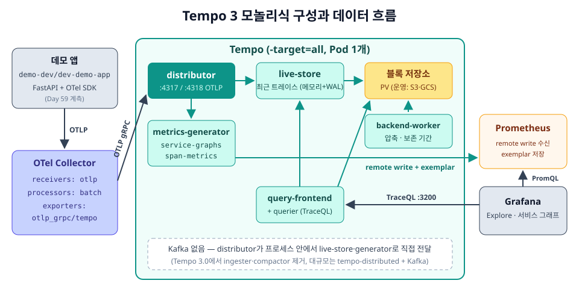
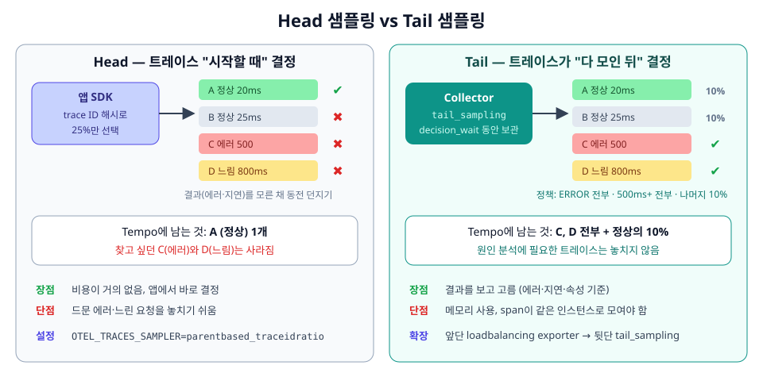
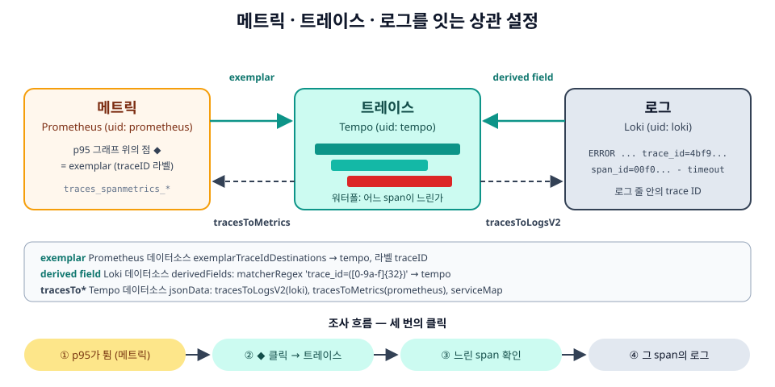

> **Chapter 8 · SRE & 관측성** | 난이도 ★★★★☆ | 예상 소요 2.5 ~ 3시간

## 🎯 오늘의 목표

- Tempo 3.x의 구성 요소와 **모놀리식 모드**가 어떻게 동작하는지 설명할 수 있다
- Helm으로 Tempo를 설치하고, Day 59의 OpenTelemetry Collector가 **OTLP로 Tempo에 트레이스를 보내도록** 연결한다
- Grafana에 Tempo 데이터소스를 붙이고 **TraceQL**로 원하는 트레이스를 찾는다
- metrics-generator로 **서비스 그래프와 span metrics**를 만들고, **exemplar · derived field**로 메트릭 ↔ 트레이스 ↔ 로그를 오간다
- **head 샘플링과 tail 샘플링**의 차이와 트레이드오프를 안다

---

## 1. 왜 트레이스 저장소가 따로 필요한가?

Day 59에서 FastAPI 앱에 OpenTelemetry를 붙여 span을 만들고 Collector까지 보냈습니다. 하지만 지금은 트레이스가 Collector의 `debug` 출력에 잠깐 찍히고 사라질 뿐, **나중에 찾아볼 곳이 없습니다.**

Day 58의 SLO 대시보드에서 "p95 지연이 튀었다"는 것을 보고, Day 60의 Loki에서 에러 로그를 찾았다고 합시다. 그 다음 질문은 이것입니다.

> "그 느린 요청 **하나**는 정확히 어느 구간에서 시간을 썼나?"

| 신호 | 답할 수 있는 질문 | 오늘 저장소 |
|---|---|---|
| 메트릭 (Day 17·58) | **얼마나** 나쁜가? (비율, 분포) | Prometheus |
| 로그 (Day 60) | **무슨 일**이 있었나? (이벤트 텍스트) | Loki |
| **트레이스 (오늘)** | **어디서** 느렸나? (요청 한 건의 경로와 구간별 시간) | **Tempo** |

**Grafana Tempo**는 트레이스 전용 백엔드입니다. 특징은 **인덱스를 거의 만들지 않고 오브젝트 스토리지에 Parquet 블록으로 싸게 쌓는다**는 것입니다. Loki가 "라벨만 인덱싱하고 본문은 압축 저장"한 것(Day 60)과 같은 철학입니다.

| 비교 | Jaeger (전통적 구성) | Grafana Tempo |
|---|---|---|
| 저장소 | Elasticsearch/Cassandra 등 별도 DB | 오브젝트 스토리지(S3/GCS/Azure, 개발용 로컬 디스크) |
| 검색 | 인덱스 기반 | Parquet 열 스캔 + **TraceQL** |
| Grafana 연동 | 데이터소스 지원 | Prometheus·Loki와 **상관(correlation)** 기능이 가장 촘촘함 |
| 트레이스로 메트릭 생성 | 별도 구성 | **metrics-generator** 내장 |

> 💡 Jaeger도 v2부터 OpenTelemetry Collector 기반으로 다시 만들어졌고 훌륭한 선택지입니다. 이 시리즈는 Day 17부터 Grafana를 중심에 두었기 때문에 Loki(Day 60)와 짝이 맞는 Tempo를 씁니다.

---

## 2. Tempo 아키텍처



2026년 11월 기준 최신 Tempo는 **3.1.x**입니다. 3.0에서 쓰기 경로가 크게 바뀌었습니다. 예전 자료에 나오는 **ingester와 compactor는 사라졌습니다.**

| 구성 요소 | 역할 |
|---|---|
| **distributor** | OTLP·Jaeger·Zipkin으로 span을 받는 입구. 테넌트별 한도를 검사하고 trace ID로 샤딩 |
| Kafka 호환 큐 | (마이크로서비스 모드) 내구성 있는 WAL 역할. distributor는 Kafka가 받으면 응답 |
| **live-store** | 최근 트레이스를 메모리 + 로컬 WAL에 보관 → 수 초 안에 조회 가능 |
| block-builder | (마이크로서비스 모드) Kafka에서 읽어 Parquet 블록을 만들어 오브젝트 스토리지에 저장 |
| **query-frontend / querier** | TraceQL·trace ID 조회를 쪼개 병렬 실행. 최근 것은 live-store, 오래된 것은 스토리지에서 |
| backend-scheduler / worker | 압축(compaction)·보존 기간(retention) 관리. 예전 compactor를 대체 |
| **metrics-generator** (선택) | 트레이스에서 **RED 메트릭과 서비스 그래프**를 만들어 Prometheus로 remote write |

### 배포 모드 두 가지

| 모드 | Helm 차트 | 특징 | 언제 |
|---|---|---|---|
| **모놀리식** (`-target=all`) | `tempo` | 모든 컴포넌트가 **한 프로세스**. **Kafka 불필요** — distributor가 프로세스 안에서 live-store·metrics-generator로 직접 넘김 | 학습, 홈랩, 소규모 |
| 마이크로서비스 | `tempo-distributed` | 컴포넌트별 Deployment/StatefulSet + Kafka | 대규모 운영 |

오늘은 kind `infra-lab`에 **모놀리식**으로 올립니다.

> ⚠️ Grafana의 Tempo Helm 차트는 이제 **커뮤니티 저장소**(`grafana-community/helm-charts`)에서 관리됩니다. 인터넷의 예전 글에 나오는 `helm repo add grafana https://grafana.github.io/helm-charts` + `grafana/tempo` 조합은 더 이상 기준이 아닙니다.

---

## 3. 샘플링 — 다 저장할 것인가, 골라 저장할 것인가

트래픽이 많으면 모든 요청의 트레이스를 저장하는 것은 비쌉니다. 그래서 **일부만 남기는 샘플링**을 합니다. 핵심은 "**언제** 남길지 결정하느냐"입니다.



| 구분 | Head 샘플링 | Tail 샘플링 |
|---|---|---|
| 결정 시점 | 트레이스 **시작할 때** (루트 span 생성 시) | 트레이스가 **다 모인 뒤** |
| 결정 위치 | 앱의 SDK | Collector (`tail_sampling` processor) |
| 판단 근거 | trace ID 해시(확률)뿐 — 결과를 모름 | 에러 여부, 지연 시간, 속성 등 **결과를 보고** |
| 비용 | 거의 없음 | Collector가 `decision_wait` 동안 span을 **메모리에 보관** |
| 약점 | 드문 에러·느린 요청을 놓칠 수 있음 | 한 트레이스의 모든 span이 **같은 Collector 인스턴스**로 모여야 함 |

### Head 샘플링 (SDK 환경 변수)

```yaml
# Deployment의 컨테이너 env (Day 59 계측 앱)
- name: OTEL_TRACES_SAMPLER
  value: parentbased_traceidratio
- name: OTEL_TRACES_SAMPLER_ARG
  value: "0.25"          # 루트 트레이스의 25%만 기록
```

`parentbased_`가 붙으면 **부모가 샘플링됐으면 자식도 따라갑니다.** 서비스마다 제각각 결정하면 트레이스가 중간에 끊기기 때문입니다.

### Tail 샘플링 (Collector)

```yaml
# Day 59 Collector 설정에 추가
processors:
  tail_sampling:
    decision_wait: 10s        # 트레이스의 span이 다 모이길 기다리는 시간 (기본 30s)
    num_traces: 50000         # 메모리에 들고 있을 트레이스 수 (기본 50000)
    policies:                 # 하나라도 "남겨라"면 남김
      - name: keep-errors
        type: status_code
        status_code: {status_codes: [ERROR]}
      - name: keep-slow
        type: latency
        latency: {threshold_ms: 500}
      - name: baseline
        type: probabilistic
        probabilistic: {sampling_percentage: 10}
```

> ⚠️ **Collector를 2개 이상 띄우면** 한 트레이스의 span이 여러 인스턴스로 흩어져 판단이 틀어집니다. 공식 문서가 권하는 구조는 **앞단 Collector(`loadbalancing` exporter, trace ID 기준) → 뒷단 Collector(`tail_sampling`)** 2계층입니다. 오늘 실습처럼 Collector 1개면 그대로 동작합니다.

> ⚠️ **샘플링 뒤에 만든 메트릭은 왜곡됩니다.** 에러 트레이스만 골라 남기면 Tempo의 span metrics에서는 에러율이 실제보다 훨씬 높아 보입니다. 그래서 **SLO(Day 58)는 샘플링과 무관한 앱 메트릭으로** 계산하고, 트레이스는 "원인을 찾아 들어가는 도구"로 씁니다. 실습에서는 샘플링을 켜지 않습니다.

---

## 4. 실습 ① — Tempo 설치 (모놀리식)

### 4-0. 실습 환경

- Day 09의 kind **`infra-lab`** + Day 17의 kube-prometheus-stack 릴리스 **`monitoring`** (네임스페이스 `monitoring`)
- Day 59의 **OpenTelemetry Collector**와 계측된 데모 앱 — 네임스페이스 **`demo-dev`**, 리소스 이름 **`dev-demo-app`** (Chapter 7 규약)
- Day 60의 **Loki + Alloy**
- Docker Desktop 메모리 **8GB 이상** 권장 (Prometheus + Loki + Tempo + Grafana가 함께 뜹니다)

| 이어 쓰는 이름 | 값 |
|---|---|
| Collector (Day 59) | Helm 릴리스 `otel-collector`, 네임스페이스 `observability`, values `otel-collector-values.yaml` |
| 앱 리소스 속성 (Day 59) | `service.name = demo-app`, Collector가 붙인 `k8s.namespace.name = demo-dev` |
| Loki (Day 60) | `http://loki-gateway.loki.svc.cluster.local`, Grafana 데이터소스 uid `loki`, `trace_id`는 구조화 메타데이터 |
| Tempo (오늘) | Helm 릴리스 `tempo`, 네임스페이스 `monitoring` (Prometheus·Grafana와 같은 곳) |

### 4-1. 차트 버전 확인

```bash
helm repo add grafana-community https://grafana-community.github.io/helm-charts
helm repo update
helm search repo grafana-community/tempo
```

```
NAME                               CHART VERSION  APP VERSION  DESCRIPTION
grafana-community/tempo            3.2.1          3.1.1        Grafana Tempo Single Binary Mode
grafana-community/tempo-distributed ...
```

`tempo`(단일 바이너리) 차트의 **CHART VERSION과 APP VERSION(Tempo 버전)을 따로** 봐야 합니다. 이 글은 차트 `3.2.1` / Tempo `3.1.1` 기준입니다. 같은 결과를 얻으려면 설치할 때 `--version`으로 고정하세요.

### 4-2. values 작성

```yaml
# tempo-values.yaml
tempo:
  retention: 72h                 # 학습용: 3일 보관 (기본 24h)

  metricsGenerator:
    enabled: true
    storage:
      remote_write:              # 지정하면 remoteWriteUrl 대신 이 목록을 그대로 씀
        - url: http://monitoring-kube-prometheus-prometheus.monitoring:9090/api/v1/write
          send_exemplars: true   # exemplar(trace ID)도 함께 전송

  overrides:
    defaults:
      metrics_generator:
        processors:              # 기본값은 "아무것도 안 켬"
          - service-graphs
          - span-metrics

persistence:
  enabled: true                  # 기본 false → Pod 재시작 시 트레이스 소실
  size: 10Gi
```

| 키 | 의미 |
|---|---|
| `tempo.retention` | 블록 보존 기간. Tempo 3에서는 backend-worker의 compaction 설정으로 렌더링됨 |
| `metricsGenerator.enabled` | metrics-generator 켜기. **processor는 overrides에서 따로 켜야** 실제로 메트릭이 생김 |
| `storage.remote_write` | 생성한 메트릭을 보낼 Prometheus remote write 엔드포인트 |
| `overrides.defaults.metrics_generator.processors` | 모든 테넌트에 적용할 processor 목록 |

> ⚠️ Tempo 3.0은 `local-blocks` processor를 **제거**했습니다. 예전 글을 보고 processors에 `local-blocks`를 넣으면 업그레이드/기동이 실패합니다. 최근 데이터에 대한 TraceQL metrics 질의는 이제 live-store가 처리합니다.

### 4-3. Prometheus가 remote write와 exemplar를 받게 하기

Tempo가 메트릭을 **밀어 넣으려면** Prometheus의 remote write 수신기를 켜야 합니다. exemplar 저장도 기본은 꺼져 있습니다. Day 17에서 만든 `monitoring-values.yaml` 옆에 파일을 하나 더 만듭니다.

```yaml
# tracing-values.yaml (kube-prometheus-stack 추가 values)
prometheus:
  prometheusSpec:
    enableRemoteWriteReceiver: true    # /api/v1/write 수신
    enableFeatures:
      - exemplar-storage               # exemplar 저장 (기본 비활성)
```

Grafana 쪽 설정은 6장에서 같은 파일에 더합니다. 일단 Tempo부터 설치합니다.

```bash
helm upgrade monitoring prometheus-community/kube-prometheus-stack -n monitoring \
  --reuse-values -f tracing-values.yaml       # Day 60과 같은 방식: 기존 값 유지 + 새 값 얹기

helm install tempo grafana-community/tempo --version 3.2.1 \
  -n monitoring -f tempo-values.yaml
```

### 4-4. 설치 확인과 버전 확인

```bash
kubectl get pods -n monitoring -l app.kubernetes.io/name=tempo
kubectl get svc -n monitoring tempo
```

```
NAME      READY   STATUS    RESTARTS   AGE
tempo-0   1/1     Running   0          60s
```

Service에 **3200**(HTTP API/쿼리), **4317**(OTLP gRPC), **4318**(OTLP HTTP) 포트가 있는지 확인합니다. 그리고 실제로 돌고 있는 Tempo 버전을 API로 확인합니다.

```bash
kubectl port-forward -n monitoring svc/tempo 3200:3200 &
curl -s http://localhost:3200/ready
curl -s http://localhost:3200/api/status/buildinfo
```

```
ready
{"version":"3.1.1","revision":"...","branch":"...","buildDate":"...","buildUser":"...","goVersion":"..."}
```

---

## 5. 실습 ② — Collector가 Tempo로 보내게 하기

Day 59의 Collector에는 `otlp` receiver와 `traces` 파이프라인이 이미 있고, exporter는 `debug`뿐입니다. **exporter 하나를 추가하고 traces 파이프라인에 연결**하면 끝입니다. Day 59의 `otel-collector-values.yaml`의 `config:` 부분을 이렇게 고칩니다.

```yaml
# otel-collector-values.yaml (Day 59) — config: 부분
config:
  receivers:
    jaeger: null
    zipkin: null
    prometheus: null
  exporters:
    debug:
      verbosity: basic           # detailed는 너무 시끄러우니 낮춤
    otlp_grpc/tempo:             # ← 추가
      endpoint: tempo.monitoring.svc.cluster.local:4317
      tls:
        insecure: true           # 클러스터 내부 평문 gRPC (학습용)
  service:
    pipelines:
      traces:
        receivers: [otlp]
        exporters: [otlp_grpc/tempo, debug]   # ← Tempo 추가 (debug는 확인 후 빼도 됨)
      metrics:
        receivers: [otlp]
      logs:
        receivers: [otlp]
```

> 💡 `processors`는 적지 않습니다. 차트 기본값(`memory_limiter`, `batch`)과 `presets.kubernetesAttributes`가 넣는 `k8s_attributes`가 그대로 유지됩니다. 직접 적으면 리스트가 통째로 교체되어 `k8s_attributes`가 빠질 수 있습니다.

> 💡 Collector v0.145부터 gRPC용 OTLP exporter의 이름이 `otlp` → **`otlp_grpc`**, HTTP용은 `otlphttp` → **`otlp_http`** 로 바뀌었습니다. 옛 이름은 **deprecated 별칭**으로 아직 동작하므로, Day 59에서 `otlp/...`로 썼다면 그대로 둬도 됩니다. `/tempo` 부분은 같은 타입을 여러 개 쓸 때 구분하는 이름입니다.

```bash
helm upgrade otel-collector open-telemetry/opentelemetry-collector \
  --version 0.178.3 -n observability -f otel-collector-values.yaml

kubectl -n observability get configmap otel-collector -o jsonpath='{.data.relay}' | grep -A3 "traces:"
kubectl -n observability logs deploy/otel-collector | grep -i -E "error|tempo"
```

### 5-1. 트래픽 만들고 Tempo에서 직접 조회

```bash
kubectl run -n demo-dev loadgen --image=curlimages/curl --restart=Never -- \
  sh -c 'while true; do curl -s -o /dev/null "http://dev-demo-app/work?error_rate=0.02&slow_rate=0.05"; sleep 0.3; done'
```

Tempo HTTP API는 TraceQL을 그대로 받습니다.

```bash
curl -G -s http://localhost:3200/api/search \
  --data-urlencode 'q={ resource.service.name = "demo-app" }' \
  --data-urlencode 'limit=3'
```

```json
{"traces":[{"traceID":"4bf92f3577b34da6a3ce929d0e0e4736","rootServiceName":"demo-app",
  "rootTraceName":"GET /work","startTimeUnixNano":"...","durationMs":3, ...}], ...}
```

`traceID`가 보이면 **앱 → Collector → Tempo** 경로가 열린 것입니다. loadgen은 Day 58의 `/work` 엔드포인트로 에러 2%, 느린 응답 5%를 섞어 보내므로, 7장에서 찾아볼 "나쁜 트레이스"도 함께 쌓입니다.

---

## 6. 실습 ③ — Grafana 데이터소스와 상관 설정



세 신호를 서로 **클릭 한 번으로 오가게** 만드는 것이 오늘의 핵심입니다.

| 출발 → 도착 | 어떻게 | 설정 위치 |
|---|---|---|
| 메트릭 → 트레이스 | 그래프 점(**exemplar**)에 붙은 trace ID | Prometheus 데이터소스 `exemplarTraceIdDestinations` |
| 로그 → 트레이스 | 로그 줄의 `trace_id=...`를 추출하는 **derived field** | Loki 데이터소스 `derivedFields` |
| 트레이스 → 로그 | span 시간대 + trace ID로 Loki 질의 | Tempo 데이터소스 `tracesToLogsV2` |
| 트레이스 → 메트릭 | span의 서비스명으로 span metrics 질의 | Tempo 데이터소스 `tracesToMetrics` |
| 서비스 그래프 | metrics-generator가 만든 `traces_service_graph_*` | Tempo 데이터소스 `serviceMap` |

4-3의 `tracing-values.yaml`에 Grafana 부분을 더합니다.

```yaml
# tracing-values.yaml (이어서)
grafana:
  sidecar:
    datasources:
      exemplarTraceIdDestinations:     # 차트가 만드는 기본 Prometheus 데이터소스(uid: prometheus)에 적용
        datasourceUid: tempo
        traceIdLabelName: traceID      # Tempo metrics-generator가 붙이는 exemplar 라벨 이름

  additionalDataSources:               # ⚠️ 리스트는 병합되지 않고 "통째로 교체"됨
    - name: Loki                       # Day 60의 항목을 그대로 옮기고 jsonData만 추가
      uid: loki
      type: loki
      access: proxy
      url: http://loki-gateway.loki.svc.cluster.local
      jsonData:
        derivedFields:
          - name: TraceID
            matcherRegex: 'trace_id=([0-9a-f]{32})'   # Day 59 로그 형식 [trace_id=... span_id=...]
            datasourceUid: tempo
            url: '$${__value.raw}'     # $$ 는 프로비저닝 파일의 $ 이스케이프
            urlDisplayLabel: 'Tempo에서 보기'

    - name: Tempo
      uid: tempo
      type: tempo
      access: proxy
      url: http://tempo.monitoring:3200
      jsonData:
        tracesToLogsV2:
          datasourceUid: loki
          spanStartTimeShift: '-5m'
          spanEndTimeShift: '5m'
          filterByTraceID: true
          tags:                        # span 리소스 속성 → Loki 라벨 이름
            - key: k8s.namespace.name
              value: namespace         # Day 60 Alloy가 붙인 라벨
            - key: service.name
              value: service_name      # Loki 3가 app 라벨(demo-app)에서 자동으로 채운 라벨
        tracesToMetrics:
          datasourceUid: prometheus
          tags:
            - key: service.name
              value: service
          queries:
            - name: 요청률
              query: 'sum(rate(traces_spanmetrics_calls_total{$$__tags}[5m]))'
            - name: p95 지연
              query: 'histogram_quantile(0.95, sum by (le) (rate(traces_spanmetrics_latency_bucket{$$__tags}[5m])))'
        serviceMap:
          datasourceUid: prometheus
        nodeGraph:
          enabled: true
```

```bash
helm upgrade monitoring prometheus-community/kube-prometheus-stack -n monitoring \
  --reuse-values -f tracing-values.yaml
kubectl -n monitoring rollout restart deploy/monitoring-grafana   # 데이터소스가 안 보이면
```

> 💡 Day 59에서 `OTEL_PYTHON_LOG_CORRELATION=true`로 로그 줄에 `trace_id=...`가 찍히고, Day 60의 Alloy가 같은 값을 **구조화 메타데이터** `trace_id`로도 붙였습니다. 위 설정은 로그 **본문**에서 정규식으로 찾는 방식입니다. 구조화 메타데이터를 쓰려면 derived field에 `matcherType: label`, `matcherRegex: trace_id`를 줍니다(Grafana 버전에 따라 UI의 "Label" 타입으로 확인).

> ⚠️ 데이터소스를 UI에서 손으로 만들면 Grafana Pod가 재생성될 때 사라질 수 있습니다. Day 17의 대시보드와 마찬가지로 **values(=Git)로 관리**하세요.

---

## 7. TraceQL 기초

Grafana → **Explore** → 데이터소스 **Tempo** → 쿼리 타입 **TraceQL**. (또는 **Drilldown → Traces** 메뉴에서 클릭만으로 탐색)

TraceQL은 `{ 조건 }`으로 **span을 고르고**, 파이프(`|`)로 **트레이스 단위 집계**를 이어 붙입니다.

```traceql
# 1) 이 서비스의 모든 트레이스
{ resource.service.name = "demo-app" }

# 2) 5xx를 낸 서버 span
{ resource.service.name = "demo-app" && span.http.response.status_code >= 500 }

# 3) 300ms보다 오래 걸린 span
{ resource.service.name = "demo-app" && duration > 300ms }

# 4) 상태가 에러인 span
{ status = error }

# 5) 특정 경로의 트레이스 중 span이 3개 넘는 것
{ span.http.route = "/" } | count() > 3

# 6) 결과 표에 속성 열 추가
{ status = error } | select(span.http.route, resource.k8s.pod.name)
```

| 문법 | 의미 |
|---|---|
| `resource.` / `span.` | 속성의 범위. 리소스(서비스 단위) 속성인지 span 속성인지 명시 (`.attr`처럼 생략하면 둘 다 탐색, 대신 느림) |
| `duration`, `status`, `name`, `kind` | span 고유(intrinsic) 필드. `status`는 `ok`/`error`/`unset` |
| `&&`, `\|\|` | 같은 span에 대한 조건 결합 |
| `{A} >> {B}` | A의 **자손** 중 B가 있는 트레이스 (구조 질의) |
| `\| count()`, `\| avg(duration)` | 트레이스 단위 집계 후 비교 |
| `\| select(...)` | 결과에 보여줄 속성 추가 |

> 💡 HTTP 속성 이름(`http.response.status_code`, `http.route`)은 OTel **안정화된 HTTP 시맨틱 컨벤션** 기준입니다. Day 59에서 옛 컨벤션(`http.status_code`)으로 나온다면 `OTEL_SEMCONV_STABILITY_OPT_IN=http`를 주거나 쿼리의 이름을 맞추세요. Explore의 자동 완성에 실제 속성 이름이 뜹니다.

트레이스를 열면 **워터폴(waterfall)** 화면이 나옵니다. span 막대를 펼쳐 속성을 보고, 상단의 **Logs for this span** / **Related metrics** 링크가 6장에서 설정한 상관 기능입니다.

---

## 8. 서비스 그래프와 span metrics

metrics-generator가 Prometheus로 밀어 넣은 메트릭을 확인합니다. (Prometheus UI 또는 Grafana Explore → Prometheus)

```promql
# span metrics: 서비스·span별 초당 호출 수
sum by (service, span_name) (rate(traces_spanmetrics_calls_total[5m]))

# span metrics: 에러 span 비율
sum by (service) (rate(traces_spanmetrics_calls_total{status_code="STATUS_CODE_ERROR"}[5m]))
  / sum by (service) (rate(traces_spanmetrics_calls_total[5m]))

# span metrics: p95 지연(초)
histogram_quantile(0.95, sum by (le, service) (rate(traces_spanmetrics_latency_bucket[5m])))

# 서비스 그래프: 누가 누구를 얼마나 호출하나
sum by (client, server) (rate(traces_service_graph_request_total[5m]))
```

| 메트릭 | 만드는 processor | 기본 라벨 |
|---|---|---|
| `traces_spanmetrics_calls_total` | span-metrics | `service`, `span_name`, `span_kind`, `status_code` |
| `traces_spanmetrics_latency_bucket/_sum/_count` | span-metrics | 위와 같음 |
| `traces_service_graph_request_total` | service-graphs | `client`, `server`, `connection_type` |
| `traces_service_graph_request_failed_total` | service-graphs | 위와 같음 |
| `traces_service_graph_request_server_seconds_*` | service-graphs | 위와 같음 |

Explore → Tempo → 쿼리 타입 **Service Graph**를 고르면 노드 그래프가 그려집니다. 오늘 앱은 다른 서비스를 호출하지 않으므로 **`user` → `demo-app`** 한 줄이 보입니다. 계측되지 않은 호출자(curl loadgen)는 `user`라는 **가상 노드**로 표시되기 때문입니다. Chapter 6의 rag-api → vLLM처럼 계측된 서비스가 서로 부르면 화살표가 늘어납니다.

> 💡 **span metrics vs 앱 메트릭.** span metrics는 계측만 있으면 공짜로 RED 메트릭을 주지만, 3장에서 말했듯 **샘플링의 영향**을 받고 라벨 설계가 앱 메트릭만큼 자유롭지 않습니다. SLO 계산(Day 58·62)은 앱 메트릭으로, span metrics는 "서비스 지도와 빠른 탐색"용으로 쓰는 것을 권합니다.

### 8-1. exemplar로 메트릭 → 트레이스

1. Grafana → Explore → **Prometheus**
2. 쿼리: `histogram_quantile(0.95, sum by (le) (rate(traces_spanmetrics_latency_bucket{service="demo-app"}[5m])))`
3. 쿼리 옵션에서 **Exemplars** 토글을 켭니다
4. 그래프 위에 찍힌 **점(◆)** 에 마우스를 올리면 `traceID`와 **Query with Tempo** 버튼이 나옵니다 → 클릭하면 그 시점의 실제 요청 트레이스가 열림

"p95가 튀었다 → 튄 순간의 그 요청 → 그 요청의 로그"까지 **세 번의 클릭**이면 됩니다.

정리합니다.

```bash
kubectl delete pod loadgen -n demo-dev
```

> Tempo는 **Day 62~65에서도 계속 씁니다.** 지우려면 `helm uninstall tempo -n monitoring` 후 PVC(`kubectl get pvc -n monitoring`)도 정리합니다.

---

## 9. 트러블슈팅

| 증상 | 원인 | 해결 |
|---|---|---|
| `/api/search` 결과가 항상 비어 있음 | Collector 파이프라인에 Tempo exporter가 연결 안 됨, 또는 엔드포인트 오타 | Collector 로그에서 `exporter` 에러 확인, `service.pipelines.traces.exporters`에 포함됐는지 확인 |
| Collector 로그에 `connection refused` / `Unavailable` | Tempo Service 포트 4317이 없거나 Tempo Pod가 아직 Ready 아님 | `kubectl get svc tempo -n monitoring`, `curl /ready` |
| Collector 로그에 TLS handshake 에러 | 평문 gRPC 서버에 TLS로 접속 | exporter에 `tls.insecure: true` |
| `traces_spanmetrics_*`가 Prometheus에 없음 | ① processor를 overrides에서 안 켬 ② Prometheus remote write 수신기 꺼짐 | ① `overrides.defaults.metrics_generator.processors` ② `enableRemoteWriteReceiver: true` |
| Tempo 로그에 remote write `404` | Prometheus `/api/v1/write`가 비활성 | 위와 같음 + `helm upgrade` 후 Prometheus Pod 재시작 확인 |
| Exemplars 토글을 켜도 점이 안 보임 | exemplar 저장 기능 꺼짐 또는 `send_exemplars` 누락 | `enableFeatures: [exemplar-storage]`, Tempo remote_write에 `send_exemplars: true` |
| exemplar를 눌렀는데 "trace not found" | 트레이스가 보존 기간 지나 삭제 또는 샘플링으로 버려짐 | retention 확인, tail 샘플링 정책 확인 |
| 로그에 TraceID 링크가 안 생김 | 로그 줄에 `trace_id=`가 없음, 또는 regex 불일치 | `OTEL_PYTHON_LOG_CORRELATION=true`, Explore에서 로그 원문을 보고 regex 수정 |
| `additionalDataSources`를 넣었더니 Loki가 사라짐 | Helm은 리스트를 병합하지 않고 교체 | Loki·Tempo 항목을 한 values 파일 리스트에 함께 둠 |
| Tempo 기동 실패 `local-blocks` 관련 에러 | Tempo 3에서 제거된 processor 사용 | processors 목록에서 `local-blocks` 삭제 |

---

## 10. 핵심 정리

- 트레이스는 "**어디서** 느렸나"에 답한다. Tempo는 인덱스를 최소화하고 Parquet 블록으로 싸게 저장한다
- Tempo 3: **ingester·compactor 제거**, distributor → (Kafka) → **live-store / block-builder**, 압축은 backend-scheduler/worker. **모놀리식은 Kafka 없이** 한 프로세스
- 차트는 커뮤니티 저장소 **`grafana-community/tempo`** (2026-11 기준 차트 3.2.1 / Tempo 3.1.1). 버전은 `helm search repo`와 `/api/status/buildinfo`로 확인
- Collector에 **`otlp_grpc/tempo` exporter** 하나 추가하면 연결 끝
- **metrics-generator**: `service-graphs`, `span-metrics` processor를 overrides로 켜고 Prometheus로 remote write(+exemplar)
- 상관: 메트릭 → 트레이스는 **exemplar**, 로그 → 트레이스는 **derived field**, 트레이스 → 로그/메트릭은 **tracesToLogsV2 / tracesToMetrics**
- 샘플링: **head**는 싸지만 결과를 모르고, **tail**은 결과를 보고 고르지만 메모리와 "같은 인스턴스" 제약이 있다. SLO는 샘플링과 무관한 앱 메트릭으로

---

## 11. 셀프 체크

<details>
<summary>Q1. Tempo 3의 모놀리식 모드에서 Kafka가 필요 없는 이유는?</summary>

모든 컴포넌트가 한 프로세스 안에 있어서 distributor가 span을 **프로세스 내부에서** live-store와 metrics-generator로 바로 넘기기 때문입니다. block-builder도 없고, live-store가 블록을 직접 스토리지에 씁니다. Kafka는 마이크로서비스 모드에서 컴포넌트 사이의 내구성 있는 WAL 역할입니다.
</details>

<details>
<summary>Q2. metricsGenerator.enabled: true만 주고 span metrics가 안 생긴다. 무엇이 빠졌나?</summary>

**processor 활성화**입니다. metrics-generator는 켜져도 기본적으로 아무 processor도 실행하지 않습니다. `overrides.defaults.metrics_generator.processors`에 `service-graphs`, `span-metrics`를 넣어야 하고, Prometheus 쪽에는 remote write 수신기(`enableRemoteWriteReceiver`)가 켜져 있어야 합니다.
</details>

<details>
<summary>Q3. "에러가 난 트레이스는 100% 남기고 나머지는 10%만" 남기려면 head와 tail 중 무엇을 써야 하나?</summary>

**tail 샘플링**입니다. head 샘플링은 트레이스가 시작할 때 결정하므로 그 요청이 에러로 끝날지 알 수 없습니다. Collector의 `tail_sampling` processor에 `status_code`(ERROR) 정책과 `probabilistic`(10%) 정책을 함께 두면 됩니다. Collector가 여러 개라면 앞단에 `loadbalancing` exporter를 둬서 같은 trace ID가 같은 인스턴스로 가게 해야 합니다.
</details>

<details>
<summary>Q4. Grafana 그래프의 exemplar 점을 눌러 Tempo 트레이스로 넘어가려면 어떤 설정들이 맞물려야 하나?</summary>

① Tempo metrics-generator remote_write에 `send_exemplars: true` ② Prometheus의 `exemplar-storage` 기능 활성화 ③ Grafana Prometheus 데이터소스의 `exemplarTraceIdDestinations`가 Tempo 데이터소스 uid와 exemplar 라벨 이름(`traceID`)을 가리킴. 셋 중 하나라도 빠지면 점이 안 보이거나 링크가 안 생깁니다.
</details>

<details>
<summary>Q5. tail 샘플링을 켠 뒤 Tempo span metrics의 에러율로 SLO를 계산하면 왜 안 되나?</summary>

span metrics는 Tempo가 **받은(=샘플링 후)** span으로 계산됩니다. 에러 트레이스는 100%, 정상 트레이스는 10%만 남기면 분모가 줄어 에러율이 실제보다 크게 부풀려집니다. SLO는 샘플링과 무관하게 모든 요청을 세는 앱 메트릭으로 계산해야 합니다.
</details>

---

## ⏭️ 다음 예고 — Day 62. 알림 설계 — Alertmanager, 증상 기반 알림, 알림 피로

이제 메트릭·로그·트레이스로 "무슨 일이 있었는지" 파고들 수 있습니다. 그런데 **언제 사람을 깨울지**는 아직 정하지 않았습니다. Day 17에서 만든 "Pod 다운" 알림을 넘어, Day 58의 SLO와 에러 버짓에서 출발하는 **멀티 윈도우·멀티 번 레이트 알림**을 PrometheusRule로 만들고, Alertmanager의 라우팅 트리·grouping·inhibition·silence로 **알림 피로**를 줄이는 법을 실습합니다.
