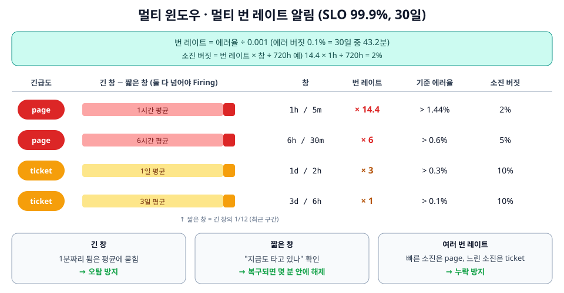
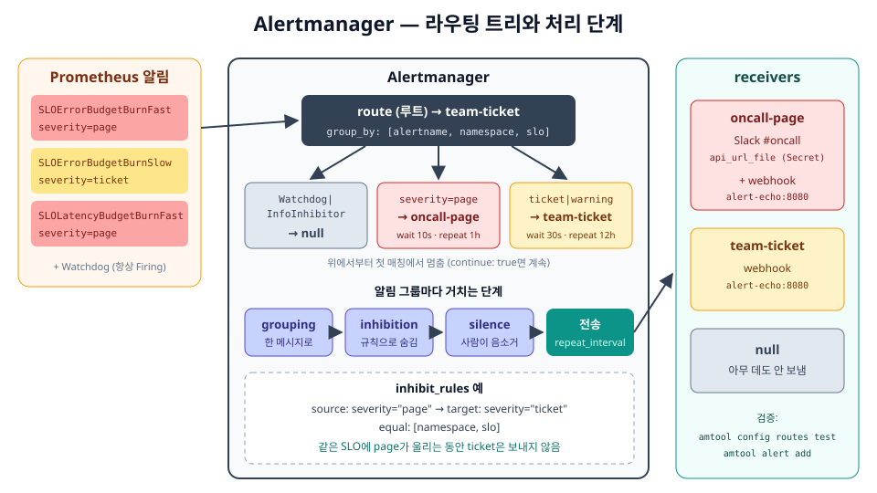

> **Chapter 8 · SRE & 관측성** | 난이도 ★★★★☆ | 예상 소요 2.5 ~ 3시간

## 🎯 오늘의 목표

- 좋은 알림의 원칙(**증상 기반, 행동 가능, 긴급도에 맞는 채널**)을 설명하고 나쁜 알림을 골라낼 수 있다
- Day 58의 번 레이트로 **멀티 윈도우·멀티 번 레이트** 알림을 PrometheusRule로 작성한다
- Alertmanager의 **라우팅 트리, grouping, inhibition, silence, receiver**를 직접 설정하고 `amtool`로 검증한다
- 알림 피로를 줄이는 운영 습관과 **Sloth · Pyrra** 같은 SLO 규칙 생성 도구의 위치를 안다

---

## 1. 좋은 알림이란?

Day 17에서 "podinfo가 1분 이상 응답하지 않으면" 울리는 `PodinfoDown`을 만들었습니다. **임계값 하나 + `for`** 로 된, 가장 기본적인 알림입니다. 서비스가 커지면 이런 알림이 수십 개로 늘어나고, 그중 대부분은 이런 결말을 맞습니다.

> 새벽 3시에 "CPU 85%" 알림 → 일어나 보니 사용자는 아무 문제 없음 → 다시 잠 → 다음 주에도 같은 알림 → **결국 아무도 안 봄**

이것이 **알림 피로(alert fatigue)** 입니다. 진짜 장애 알림이 소음에 묻히는 것이 가장 위험합니다.

### 1-1. 증상 기반 vs 원인 기반

| 구분 | 원인 기반 (cause-based) | 증상 기반 (symptom-based) |
|---|---|---|
| 예시 | CPU 85%, 메모리 90%, Pod 재시작 1회, 디스크 I/O 높음 | **에러율 증가, 지연 증가, 에러 버짓 소진 속도** |
| 질문 | "시스템 내부에 이상한 게 있나?" | "**사용자가 아파하고 있나?**" |
| 오탐 | 많음 — CPU가 높아도 사용자는 멀쩡할 수 있음 | 적음 — 사용자 경험 자체를 측정 |
| 누락 | 많음 — 미리 상상한 원인만 잡힘 | 적음 — 원인이 무엇이든 증상은 드러남 |
| 쓰임 | **대시보드·티켓**, 원인 분석 단서 | **페이지(즉시 호출)** |

> 💡 원인 기반 메트릭이 쓸모없다는 뜻이 아닙니다. **사람을 깨우는 기준**은 증상(SLO)으로, 원인 메트릭은 "왜?"를 찾을 때 대시보드에서 봅니다. "디스크가 4시간 뒤 가득 참"처럼 **곧 증상이 될 것이 확실한 원인**은 예외적으로 알림으로 둡니다.

### 1-2. 모든 알림이 통과해야 할 질문

| 질문 | "아니오"라면 |
|---|---|
| 지금 **사람이 무언가 해야** 하나? (actionable) | 알림이 아니라 대시보드나 로그 |
| **지금 당장** 해야 하나? | 페이지 대신 **티켓**(업무 시간에 처리) |
| 받는 사람이 **무엇을 할지** 아는가? | `runbook_url` 어노테이션 추가 (Day 65에서 런북 작성) |
| 같은 원인으로 **다른 알림도** 동시에 울리나? | grouping·inhibition으로 묶거나 억제 |
| 지난달 이 알림이 울렸을 때 **실제로 조치했나**? | 임계값 조정 또는 삭제 |

| 긴급도 | 채널 | 기대 응답 |
|---|---|---|
| **page** | 온콜 호출(Slack 멘션, PagerDuty 등) | 수 분 안에 대응 |
| **ticket** | 팀 채널, 이슈 트래커 | 다음 업무일 |
| (알림 아님) | 대시보드 | 필요할 때 봄 |

---

## 2. 번 레이트를 알림으로 — 멀티 윈도우 · 멀티 번 레이트

Day 58에서 가용성 SLO **99.9%(30일)**, 에러 버짓 **0.1%**(= 30일 중 **43.2분**어치 실패), 지연 SLO **"300ms 안에 끝난 요청 ≥ 99%"**, 그리고 **번 레이트 = 에러율 ÷ (1 − SLO)** 를 정했습니다. 오늘은 이것을 "언제 사람을 부를지"로 바꿉니다. 하나만 더 기억하면 됩니다.

```
창(window) 동안 소진한 버짓 비율 = 번 레이트 × 창 길이 ÷ SLO 기간
예) 14.4 × 1시간 ÷ 720시간 = 0.02  → 1시간 만에 한 달 버짓의 2%를 태움
```

### 2-1. 단순 임계값 알림의 문제

"에러율 > 0.1% for 5m" 같은 알림은 세 방향으로 실패합니다.

| 상황 | 단순 알림 | 문제 |
|---|---|---|
| 1분짜리 짧은 튐 (에러율 3%) | 울림 | 한 달 버짓의 약 0.07%를 쓴 일로 사람을 깨움 → **오탐** |
| 하루 종일 0.08% ↔ 0.15%를 오락가락 | 울렸다 꺼졌다 반복(또는 `for`에 걸려 안 울림) | 한 달이면 버짓 초과인데 신호가 들쭉날쭉 → **누락·소음** |
| 장애 복구 직후 | 긴 창으로 바꾸면 한참 계속 울림 | 평균이 내려올 때까지 Firing → **리셋 지연** |

### 2-2. 표준 조합



Google SRE Workbook이 권하는 조합입니다. SLO 99.9%면 기준 에러율은 `번 레이트 × 0.001`입니다.

| 긴급도 | 긴 창 | 짧은 창 | 번 레이트 | 기준 에러율 | 소진 버짓 | 의미 |
|---|---|---|---|---|---|---|
| **page** | 1h | 5m | **14.4** | 1.44% | 2% | 이대로면 약 2일 안에 버짓 0 — 지금 깨워라 |
| **page** | 6h | 30m | **6** | 0.6% | 5% | 이대로면 5일 안에 버짓 0 |
| **ticket** | 1d | 2h | **3** | 0.3% | 10% | 업무 시간에 원인 분석 |
| **ticket** | 3d | 6h | **1** | 0.1% | 10% | 이 속도면 기간 말에 딱 소진 — 추세 점검 |

- **여러 번 레이트**: 빠른 소진은 빨리 페이지로, 느린 소진은 티켓으로 → **누락 해결**
- **긴 창**: 짧은 튐에 반응하지 않게 → **오탐 해결**
- **짧은 창(긴 창의 1/12)**: "지금도 여전히 타고 있는가" 확인 → 복구되면 몇 분 안에 꺼짐 → **리셋 지연 해결**

---

## 3. 실습 ① — 전제 확인

### 3-0. 실습 환경

| 항목 | 내용 |
|---|---|
| 클러스터 | Day 09의 kind `infra-lab` |
| 모니터링 | Day 17의 kube-prometheus-stack 릴리스 `monitoring` |
| 앱 | `demo-dev` 네임스페이스의 `dev-demo-app` (Chapter 7 규약, Day 56 이후 Rollout) |
| SLI | Day 58의 `http_requests_total{route, code}`, `http_request_duration_seconds` + ServiceMonitor(job=`dev-demo-app`, `namespace="demo-dev"`). Day 59에서 OTel 트레이스를 붙인 뒤에도 앱은 이 Prometheus 클라이언트 메트릭을 `/metrics`로 계속 노출 |
| 규칙 위치 | 설정 레포 `gitops-demo-config/apps/demo-app/base/` (Day 58 recording rule과 같은 곳) |

Day 58에서 만든 recording rule이 살아 있는지 확인합니다.

```bash
kubectl -n demo-dev get prometheusrule
# NAME               AGE
# dev-demo-app-slo   2d
kubectl port-forward -n monitoring svc/monitoring-kube-prometheus-prometheus 9090:9090 &
```

```promql
namespace:http_requests_errors:ratio_rate5m
# {namespace="demo-dev"}  0.002
```

Day 58은 **5m, 1h, 6h** 창을 만들었습니다. 표준 조합에는 **30m, 2h, 1d, 3d**가 더 필요하므로 오늘 추가합니다.

트래픽은 Day 58의 `/work` 엔드포인트로 흘립니다. 평소에는 에러율 0.05%짜리 "건강한" 상태로 둡니다.

```bash
kubectl -n demo-dev run loadgen --image=curlimages/curl --restart=Never -- \
  sh -c 'while true; do curl -s -o /dev/null "http://dev-demo-app/work?error_rate=0.0005"; sleep 0.1; done'
```

---

## 4. 실습 ② — 번 레이트 알림 (PrometheusRule)

긴 창(최대 3일)의 `rate()`를 알림 평가 때마다 계산하면 Prometheus가 힘들어합니다. Day 58처럼 **창별 에러율을 recording rule로 미리 계산**해 두고 알림은 그것만 읽습니다.

```yaml
# apps/demo-app/base/slo-alerts.yaml
apiVersion: monitoring.coreos.com/v1
kind: PrometheusRule
metadata:
  name: demo-app-slo-alerts          # dev overlay에서 dev-demo-app-slo-alerts
  labels:
    release: monitoring              # Day 17: 이 라벨이 있어야 Prometheus가 읽음
spec:
  groups:
    - name: demo-app.sli-extra       # Day 58에 없는 창만 추가 (같은 이름 규칙)
      interval: 30s
      rules:
        - record: namespace:http_requests_errors:ratio_rate30m
          expr: |
            sum by (namespace) (rate(http_requests_total{job=~".+-demo-app", route!="/healthz", code=~"5.."}[30m]))
            /
            sum by (namespace) (rate(http_requests_total{job=~".+-demo-app", route!="/healthz"}[30m]))
        - record: namespace:http_requests_errors:ratio_rate2h
          expr: |
            sum by (namespace) (rate(http_requests_total{job=~".+-demo-app", route!="/healthz", code=~"5.."}[2h]))
            /
            sum by (namespace) (rate(http_requests_total{job=~".+-demo-app", route!="/healthz"}[2h]))
        - record: namespace:http_requests_errors:ratio_rate1d
          expr: |
            sum by (namespace) (rate(http_requests_total{job=~".+-demo-app", route!="/healthz", code=~"5.."}[1d]))
            /
            sum by (namespace) (rate(http_requests_total{job=~".+-demo-app", route!="/healthz"}[1d]))
        - record: namespace:http_requests_errors:ratio_rate3d
          expr: |
            sum by (namespace) (rate(http_requests_total{job=~".+-demo-app", route!="/healthz", code=~"5.."}[3d]))
            /
            sum by (namespace) (rate(http_requests_total{job=~".+-demo-app", route!="/healthz"}[3d]))
        # 지연 SLI(300ms 안에 끝난 비율) — Day 58의 5m 규칙에 창 추가
        - record: namespace:sli_latency_300ms:ratio_rate30m
          expr: |
            sum by (namespace) (rate(http_request_duration_seconds_bucket{job=~".+-demo-app", route!="/healthz", le="0.3"}[30m]))
            /
            sum by (namespace) (rate(http_request_duration_seconds_count{job=~".+-demo-app", route!="/healthz"}[30m]))
        - record: namespace:sli_latency_300ms:ratio_rate1h
          expr: |
            sum by (namespace) (rate(http_request_duration_seconds_bucket{job=~".+-demo-app", route!="/healthz", le="0.3"}[1h]))
            /
            sum by (namespace) (rate(http_request_duration_seconds_count{job=~".+-demo-app", route!="/healthz"}[1h]))
        - record: namespace:sli_latency_300ms:ratio_rate6h
          expr: |
            sum by (namespace) (rate(http_request_duration_seconds_bucket{job=~".+-demo-app", route!="/healthz", le="0.3"}[6h]))
            /
            sum by (namespace) (rate(http_request_duration_seconds_count{job=~".+-demo-app", route!="/healthz"}[6h]))

    - name: demo-app.slo-alerts
      rules:
        - alert: SLOErrorBudgetBurnFast
          expr: |
            (
              namespace:http_requests_errors:ratio_rate1h > (14.4 * 0.001)
              and
              namespace:http_requests_errors:ratio_rate5m > (14.4 * 0.001)
            )
            or
            (
              namespace:http_requests_errors:ratio_rate6h > (6 * 0.001)
              and
              namespace:http_requests_errors:ratio_rate30m > (6 * 0.001)
            )
          for: 2m
          labels:
            severity: page
            slo: availability-99.9
          annotations:
            summary: "{{ $labels.namespace }} demo-app 에러 버짓이 빠르게 소진 중 (에러율 {{ $value | humanizePercentage }})"
            description: "이 속도면 수일 안에 30일 에러 버짓(0.1%)을 모두 씁니다. 최근 배포와 Tempo 에러 트레이스(Day 61)를 확인하세요."
            runbook_url: "https://github.com/<user>/runbooks/blob/main/demo-app/slo-burn.md"

        - alert: SLOErrorBudgetBurnSlow
          expr: |
            (
              namespace:http_requests_errors:ratio_rate1d > (3 * 0.001)
              and
              namespace:http_requests_errors:ratio_rate2h > (3 * 0.001)
            )
            or
            (
              namespace:http_requests_errors:ratio_rate3d > (1 * 0.001)
              and
              namespace:http_requests_errors:ratio_rate6h > (1 * 0.001)
            )
          for: 15m
          labels:
            severity: ticket
            slo: availability-99.9
          annotations:
            summary: "{{ $labels.namespace }} demo-app 에러 버짓이 기준보다 빠르게 소진 중"
            runbook_url: "https://github.com/<user>/runbooks/blob/main/demo-app/slo-burn.md"

        - alert: SLOLatencyBudgetBurnFast     # 지연 SLO 99% → 버짓 0.01 (느린 요청 1%)
          expr: |
            (
              (1 - namespace:sli_latency_300ms:ratio_rate1h) > (14.4 * 0.01)
              and
              (1 - namespace:sli_latency_300ms:ratio_rate5m) > (14.4 * 0.01)
            )
            or
            (
              (1 - namespace:sli_latency_300ms:ratio_rate6h) > (6 * 0.01)
              and
              (1 - namespace:sli_latency_300ms:ratio_rate30m) > (6 * 0.01)
            )
          for: 2m
          labels:
            severity: page
            slo: latency-300ms-99
          annotations:
            summary: "{{ $labels.namespace }} demo-app 지연 버짓이 빠르게 소진 중 (300ms 초과 비율 {{ $value | humanizePercentage }})"
            description: "Tempo(Day 61)에서 duration > 300ms 트레이스를 찾아 느린 구간을 확인하세요."
            runbook_url: "https://github.com/<user>/runbooks/blob/main/demo-app/slo-latency.md"

        - alert: SLOMetricsAbsent
          expr: absent(http_requests_total{job=~".+-demo-app"})
          for: 10m
          labels:
            severity: ticket
            slo: availability-99.9
          annotations:
            summary: "SLO 계산용 메트릭이 사라짐 — 번 레이트 알림이 눈을 감은 상태"
```

```yaml
# apps/demo-app/base/kustomization.yaml — resources에 한 줄 추가
  - slo-alerts.yaml
```

```bash
cd ~/gitops-lab/gitops-demo-config
git add apps/demo-app/base/ && git commit -m "feat: demo-app 멀티 윈도우 번 레이트 알림" && git push
kubectl -n demo-dev get prometheusrule     # dev-demo-app-slo-alerts 추가 확인
```

| 포인트 | 이유 |
|---|---|
| `and` | 긴 창 **그리고** 짧은 창이 둘 다 넘어야 Firing. 두 시계열의 라벨(`namespace`)이 같아야 짝지어짐 |
| `or` | 두 단계(14.4/6, 3/1)를 한 알림으로 묶음 → 같은 긴급도 알림이 두 개씩 울리지 않음 |
| `labels.slo` | Alertmanager에서 묶기(group_by)와 억제(inhibition)의 기준이 됨 |
| `SLOLatencyBudgetBurnFast` | 지연 SLO(300ms 안에 99%)도 같은 패턴. "나쁜 이벤트" 비율 = `1 − 지연 SLI`, 버짓 = 1% → 기준 14.4% / 6% |
| 결과 라벨 `namespace="demo-dev"` | `sum by (namespace)` 덕분에 환경별로 따로 판정 — dev 장애가 prod 알림을 울리지 않음 |
| `SLOMetricsAbsent` | 메트릭이 끊기면 에러율이 계산되지 않아 번 레이트 알림은 **조용히** 침묵함. "감시가 꺼졌다"도 알려야 함 |
| `runbook_url` | 받는 사람이 다음 행동을 알게 (Day 65) |

> 💡 Day 17의 `PodinfoDown`은 "대상이 죽었다"는 **한 가지 원인**을 봤습니다. 오늘 알림은 원인이 배포든, DB든, 노드든 상관없이 **사용자가 받은 5xx**만 봅니다. 두 알림의 역할이 다릅니다.

> ⚠️ kube-prometheus-stack의 기본 보존 기간은 **10일**(Day 58)이라 `[3d]`까지는 계산되지만, 30일 전체 버짓 잔량은 보존 기간을 늘리거나 장기 저장소가 있어야 정확합니다.

### 4-1. 일부러 버짓 태우기

loadgen을 에러율 5%로 바꿉니다(번 레이트 50).

```bash
kubectl -n demo-dev delete pod loadgen
kubectl -n demo-dev run loadgen --image=curlimages/curl --restart=Never -- \
  sh -c 'while true; do curl -s -o /dev/null "http://dev-demo-app/work?error_rate=0.05"; sleep 0.1; done'
```

Prometheus UI → **Alerts**에서 지켜봅니다.

```promql
namespace:http_requests_errors:ratio_rate5m{namespace="demo-dev"}   # 몇 분 만에 0.05 근처
namespace:http_requests_errors:ratio_rate1h{namespace="demo-dev"}   # 천천히 상승 → 0.0144 돌파
```

5분 창은 곧바로 기준(1.44%)을 넘지만, 1시간 창이 넘으려면 십수 분이 걸립니다. 그 뒤 `for: 2m`를 채우면 `SLOErrorBudgetBurnFast`가 **Firing**이 됩니다. 이제 다시 건강한 트래픽으로 돌려 **짧은 창 덕분에 빨리 꺼지는지** 봅니다.

```bash
kubectl -n demo-dev delete pod loadgen
kubectl -n demo-dev run loadgen --image=curlimages/curl --restart=Never -- \
  sh -c 'while true; do curl -s -o /dev/null "http://dev-demo-app/work?error_rate=0.0005"; sleep 0.1; done'
```

1시간 창은 아직 기준 위에 있지만 5분 창이 몇 분 안에 내려가므로 `and` 조건이 깨져 알림이 **Resolved** 됩니다.

> 💡 지연 알림도 같은 방법으로 확인할 수 있습니다. `"http://dev-demo-app/work?slow_rate=0.3"`(요청의 30%를 0.8초로)으로 바꾸면 300ms 초과 비율이 14.4%를 넘어 `SLOLatencyBudgetBurnFast`가 울립니다.

---

## 5. Alertmanager 깊이 보기

Day 17에서는 Alertmanager UI에 알림이 "도착"하는 것까지만 봤습니다. 실제로 사람에게 전달하려면 알림이 다음 단계를 거칩니다.



| 단계 | 하는 일 | 설정 |
|---|---|---|
| **라우팅** | 라벨로 트리를 따라 내려가며 receiver 결정 (첫 매칭에서 멈춤, `continue: true`면 계속) | `route`, `routes`, `matchers` |
| **grouping** | 같은 그룹 키의 알림을 **한 메시지로 묶음** | `group_by`, `group_wait`, `group_interval` |
| **inhibition** | "더 큰 알림이 울리면 작은 알림은 숨김" | `inhibit_rules` |
| **silence** | 사람이 일정 기간 특정 알림을 **음소거** (배포·점검 중) | UI / `amtool silence` |
| **전송·반복** | receiver로 보내고, 계속 Firing이면 `repeat_interval`마다 재전송 | `receivers`, `repeat_interval` |

| 타이머 | 기본값 | 의미 |
|---|---|---|
| `group_wait` | 30s | 새 그룹의 첫 알림을 보내기 전 **같은 그룹 알림이 더 오길 기다리는** 시간 |
| `group_interval` | 5m | 이미 보낸 그룹에 **새 알림이 추가됐을 때** 다시 보내기까지 간격 |
| `repeat_interval` | 4h | 변화 없이 계속 Firing일 때 **재알림** 간격 |

> 💡 2026년 11월 기준 Alertmanager 최신은 **0.35.x**입니다. kube-prometheus-stack이 함께 설치한 버전은 `kubectl -n monitoring get alertmanager -o jsonpath='{.items[0].spec.version}'`(비어 있으면 Operator 기본값) 또는 UI 하단의 Status 화면에서 확인합니다.

### 5-1. 실습 ③ — 웹훅 수신기 (Slack 없이 확인용)

Slack 워크스페이스가 없어도 전달 결과를 볼 수 있게, 받은 알림을 로그로 찍는 작은 웹훅 서버를 띄웁니다. 모니터링 인프라 쪽 리소스이므로 `monitoring` 네임스페이스에 둡니다.

```yaml
# alert-echo.yaml
apiVersion: v1
kind: ConfigMap
metadata:
  name: alert-echo
  namespace: monitoring
data:
  echo.py: |
    import json
    from http.server import BaseHTTPRequestHandler, HTTPServer

    class Handler(BaseHTTPRequestHandler):
        def do_POST(self):
            body = json.loads(self.rfile.read(int(self.headers["Content-Length"])))
            print(f"--- {body['status']} receiver={body['receiver']} alerts={len(body['alerts'])}", flush=True)
            for a in body["alerts"]:
                print("   ", a["labels"].get("alertname"), a["labels"].get("severity"),
                      a["annotations"].get("summary", ""), flush=True)
            self.send_response(200)
            self.end_headers()

    HTTPServer(("", 8080), Handler).serve_forever()
---
apiVersion: apps/v1
kind: Deployment
metadata:
  name: alert-echo
  namespace: monitoring
spec:
  selector:
    matchLabels: {app: alert-echo}
  template:
    metadata:
      labels: {app: alert-echo}
    spec:
      containers:
        - name: echo
          image: python:3.12-slim
          command: ["python", "/app/echo.py"]
          ports: [{containerPort: 8080}]
          volumeMounts: [{name: code, mountPath: /app}]
      volumes:
        - name: code
          configMap: {name: alert-echo}
---
apiVersion: v1
kind: Service
metadata:
  name: alert-echo
  namespace: monitoring
spec:
  selector: {app: alert-echo}
  ports: [{port: 8080, targetPort: 8080}]
```

```bash
kubectl apply -f alert-echo.yaml
```

### 5-2. 실습 ④ — 라우팅 트리 · inhibition · receiver 설정

Slack Incoming Webhook URL은 **비밀값**입니다. values에 직접 쓰지 않고 Secret으로 만들어 Alertmanager Pod에 파일로 마운트한 뒤 `api_url_file`로 읽게 합니다. (아래 URL은 자리표시자입니다.)

```bash
kubectl create secret generic alertmanager-slack -n monitoring \
  --from-literal=webhook-url='https://hooks.slack.com/services/REPLACE/WITH/YOUR-WEBHOOK'
```

> 💡 GitOps 환경에서는 이 Secret도 Day 55의 SOPS나 External Secrets로 관리합니다.

```yaml
# alerting-values.yaml (kube-prometheus-stack 추가 values)
alertmanager:
  alertmanagerSpec:
    secrets:
      - alertmanager-slack          # → /etc/alertmanager/secrets/alertmanager-slack/ 에 마운트

  config:
    global:
      resolve_timeout: 5m

    route:
      receiver: team-ticket          # 어디에도 안 걸리면 여기로 (루트 = 기본값)
      group_by: [alertname, namespace, slo]
      group_wait: 30s
      group_interval: 5m
      repeat_interval: 12h
      routes:
        - receiver: 'null'           # 차트 기본 "살아 있음" 신호 알림은 버림
          matchers: ['alertname =~ "Watchdog|InfoInhibitor"']
        - receiver: oncall-page
          matchers: ['severity = "page"']
          group_wait: 10s            # 페이지는 빨리
          repeat_interval: 1h        # 해결 안 되면 1시간마다 다시
        - receiver: team-ticket
          matchers: ['severity =~ "ticket|warning"']

    inhibit_rules:
      - source_matchers: ['severity = "page"']        # 같은 SLO에 page가 울리면
        target_matchers: ['severity = "ticket"']      # ticket은 숨김
        equal: [namespace, slo]
      - source_matchers: ['severity = "critical"']    # 차트 기본 규칙(critical > warning/info) 유지
        target_matchers: ['severity =~ "warning|info"']
        equal: [namespace, alertname]

    receivers:
      - name: 'null'
      - name: oncall-page
        webhook_configs:
          - url: http://alert-echo.monitoring:8080/
            send_resolved: true
        slack_configs:               # Slack이 없으면 이 블록을 지우세요 (자리표시자 URL은 전송 실패 로그를 남김)
          - api_url_file: /etc/alertmanager/secrets/alertmanager-slack/webhook-url
            channel: '#oncall'
            send_resolved: true
            title: '[{{ .Status | toUpper }}] {{ .CommonLabels.alertname }} ({{ .CommonLabels.namespace }})'
            text: |-
              {{ range .Alerts }}• {{ .Annotations.summary }}
              런북: {{ .Annotations.runbook_url }}
              {{ end }}
      - name: team-ticket
        webhook_configs:
          - url: http://alert-echo.monitoring:8080/
            send_resolved: true
```

```bash
helm upgrade monitoring prometheus-community/kube-prometheus-stack -n monitoring \
  --reuse-values -f alerting-values.yaml      # Day 60·61과 같은 방식
```

| 설정 | 포인트 |
|---|---|
| `group_by: [alertname, namespace, slo]` | Pod 50개에서 같은 알림이 나도 **메시지 1개** |
| 페이지 경로의 `group_wait: 10s` | 긴급한 것은 짧게, 티켓은 기본 30s로 더 묶어서 |
| `matchers` 문자열 | `'라벨 = "값"'`, `=~`(정규식), `!=`, `!~` — 예전 `match`/`match_re`는 deprecated |
| `api_url_file` | 비밀값을 설정 파일에 남기지 않음 (webhook은 `url_file`) |
| `'null'` receiver | 아무 곳에도 보내지 않는 "버림" receiver |

> 💡 values 속 `{{ .Status }}` 같은 Alertmanager 템플릿은 그대로 둬도 됩니다. 차트의 `alertmanager.tplConfig`가 기본 `false`라 Helm이 이 중괄호를 해석하지 않습니다.

> 💡 팀별로 알림 설정을 나눠 갖고 싶다면 Prometheus Operator의 **`AlertmanagerConfig` CRD**(네임스페이스 단위 route/receiver)를 쓸 수 있습니다. 이때 Operator가 그 네임스페이스의 알림만 받도록 `namespace` matcher를 자동으로 붙인다는 점을 기억하세요. 오늘은 전체 흐름이 한눈에 보이는 단일 설정으로 진행합니다.

4-1의 번 레이트 실험을 다시 하면 이제 `alert-echo` 로그에 `SLOErrorBudgetBurnFast`가 찍힙니다.

```bash
kubectl logs -n monitoring deploy/alert-echo -f
```

```
--- firing receiver=oncall-page alerts=1
    SLOErrorBudgetBurnFast page demo-dev demo-app 에러 버짓이 빠르게 소진 중 (에러율 4.98%)
--- resolved receiver=oncall-page alerts=1
    ...
```

### 5-3. amtool로 검증하기

`amtool`은 Alertmanager 이미지에 함께 들어 있습니다.

```bash
AM=alertmanager-monitoring-kube-prometheus-alertmanager-0

# 1) 이 라벨의 알림은 어느 receiver로 가나? (라우팅 테스트)
kubectl exec -n monitoring $AM -c alertmanager -- amtool config routes test \
  --config.file=/etc/alertmanager/config_out/alertmanager.env.yaml \
  severity=page slo=availability-99.9 namespace=demo-dev
# oncall-page

kubectl exec -n monitoring $AM -c alertmanager -- amtool config routes test \
  --config.file=/etc/alertmanager/config_out/alertmanager.env.yaml alertname=Watchdog
# null

# 2) 가짜 알림 두 개 보내기 → inhibition 확인
kubectl exec -n monitoring $AM -c alertmanager -- amtool --alertmanager.url=http://localhost:9093 \
  alert add alertname=DrillPage severity=page namespace=demo-dev slo=drill --annotation=summary="훈련용 page"
kubectl exec -n monitoring $AM -c alertmanager -- amtool --alertmanager.url=http://localhost:9093 \
  alert add alertname=DrillTicket severity=ticket namespace=demo-dev slo=drill --annotation=summary="훈련용 ticket"
```

```
--- firing receiver=oncall-page alerts=1
    DrillPage page 훈련용 page
```

`DrillTicket`은 **보내지지 않습니다.** 같은 `namespace`·`slo`의 page가 Firing이므로 inhibition에 막힌 것입니다. Alertmanager UI(`kubectl port-forward -n monitoring svc/monitoring-kube-prometheus-alertmanager 9093:9093`)에서 `DrillTicket`이 **inhibited** 상태로 보입니다.

> 💡 `amtool alert add`로 만든 알림은 `resolve_timeout`(5분) 뒤 저절로 해소됩니다. 실제 Prometheus 알림은 Prometheus가 주기적으로 다시 보내므로 조건이 유지되는 동안 계속 Firing입니다.

### 5-4. silence — 계획된 작업 중 음소거

```bash
kubectl exec -n monitoring $AM -c alertmanager -- amtool --alertmanager.url=http://localhost:9093 \
  silence add namespace=demo-dev slo=availability-99.9 --duration=30m --author=me --comment="demo-dev 장애 주입 실습"
# 출력: 사일런스 ID

kubectl exec -n monitoring $AM -c alertmanager -- amtool --alertmanager.url=http://localhost:9093 silence query
kubectl exec -n monitoring $AM -c alertmanager -- amtool --alertmanager.url=http://localhost:9093 silence expire <ID>
```

| 비교 | inhibition | silence |
|---|---|---|
| 누가 | 설정(규칙)이 자동으로 | 사람이 수동으로 |
| 언제까지 | source 알림이 Firing인 동안 | 지정한 기간(`--duration`) |
| 용도 | 중복·파생 알림 제거 | 계획된 점검·배포, 이미 아는 문제 |

> ⚠️ silence는 반드시 **기간과 사유(comment)** 를 남기세요. "임시로" 걸어 둔 무기한 silence가 다음 장애를 삼키는 일이 흔합니다.

실습을 마치면 loadgen을 지웁니다(`kubectl -n demo-dev delete pod loadgen`). `alert-echo`와 알림 규칙은 Day 63~65에서도 씁니다.

---

## 6. 알림 피로 줄이기 — 운영 습관

| 습관 | 구체적으로 |
|---|---|
| **페이지는 SLO 증상으로만** | 페이지 알림 목록을 보고 "사용자 영향과 무관한" 것은 ticket이나 대시보드로 강등 |
| **모든 알림에 런북** | `runbook_url` 없는 알림은 리뷰에서 반려 (Day 65) |
| **주간 알림 리뷰** | 지난주 울린 알림마다 "조치했나? 실제 문제였나?" 기록 → 조치 없음이 반복되면 삭제 후보 |
| **묶어서 보내기** | `group_by`를 원인 단위(서비스·SLO)로. `pod`처럼 자주 바뀌는 라벨로 쪼개지 않기 |
| **파생 알림 억제** | 노드 다운 시 그 위 Pod 알림 등은 inhibition으로 |
| **티켓은 업무 시간에** | 라우트에 `active_time_intervals`(최상위 `time_intervals`에 평일 낮 정의)로 그 시간에만 전송 |
| **차트 기본 규칙 정리** | kube-prometheus-stack의 수많은 기본 규칙 중 안 쓰는 그룹은 `defaultRules.rules.<그룹>: false` |
| **감시의 감시** | 항상 Firing인 `Watchdog`을 외부 "dead man's switch" 서비스로 보내 Alertmanager 자체 장애 감지 |

### 💡 SLO 규칙을 손으로 쓰지 않는 방법 — Sloth vs Pyrra

Day 58과 오늘의 YAML을 합치면 SLO **하나**에 규칙이 15개 가까이 됩니다. SLO가 10개면 손으로 관리하기 어렵습니다. 그래서 **SLO 정의 몇 줄 → recording rule + 멀티 번 레이트 알림**을 생성해 주는 도구를 씁니다.

| 비교 | Sloth (v0.16, 2026-04) | Pyrra (v0.10, 2026-09) |
|---|---|---|
| 입력 | `PrometheusServiceLevel` CRD 또는 YAML 파일 | `ServiceLevelObjective` CRD |
| 동작 | CLI로 생성(CI에서 `sloth generate`) 또는 K8s 컨트롤러 | K8s 오퍼레이터 + **웹 UI**(SLO 목록·버짓 그래프) |
| 출력 | PrometheusRule (SLI recording + 메타 규칙 + 멀티 윈도우 알림) | PrometheusRule (같은 개념) |
| 강점 | 생성 결과가 순수 YAML이라 GitOps에서 리뷰하기 쉬움, 플러그인으로 SLI 재사용 | 바로 볼 수 있는 UI, 설정이 간결 |
| 고를 때 | "생성물을 Git에 커밋해 리뷰"하는 문화라면 | "SLO 현황판까지 한 번에" 원한다면 |

둘 다 오늘 손으로 쓴 것과 **같은 SRE Workbook 공식**을 씁니다. 원리를 이해했으니 실무에서는 도구로 생성하고, 생성된 규칙을 읽고 검토할 줄 아는 것이 목표입니다.

---

## 7. 트러블슈팅

| 증상 | 원인 | 해결 |
|---|---|---|
| 규칙이 Prometheus **Rules** 화면에 없음 | PrometheusRule에 `release: monitoring` 라벨 없음, 또는 kustomization `resources`에 누락 | 라벨·`resources` 확인, `kubectl -n demo-dev get prometheusrule` |
| `ratio_rate30m` 등이 비어 있음 | 분모 메트릭이 없음(job·라벨 불일치) | Day 58의 `namespace:http_requests_errors:ratio_rate5m`부터 조회해 원본이 있는지 확인 |
| 에러율 5%인데 20분이 지나도 page가 안 울림 | 1h 창이 아직 1.44% 미만, 또는 loadgen이 죽음 | `namespace:http_requests_errors:ratio_rate1h` 직접 조회, `kubectl -n demo-dev get pod loadgen` |
| 평소에도 `SLOErrorBudgetBurnSlow` 티켓이 옴 | 기본 에러율이 0.1%(번 레이트 1)를 넘음 | 정상 동작 — 이 속도면 실제로 SLO를 못 지킴. Day 58 loadgen의 `error_rate=0.002`는 번 레이트 2 |
| Alertmanager 설정이 반영 안 됨 | 설정 문법 오류로 Operator가 거부 | `kubectl logs -n monitoring deploy/monitoring-kube-prometheus-operator`에서 alertmanager 관련 에러 확인 |
| Slack으로 안 감, 로그에 `notify retry` | 자리표시자 URL 또는 Secret 키 이름 불일치 | Secret 키(`webhook-url`)와 `api_url_file` 경로 일치 확인, 실제 웹훅 URL로 교체 |
| ticket 알림이 전혀 안 옴 | 같은 SLO의 page가 Firing이라 inhibition | 정상 동작. Alertmanager UI에서 inhibited 여부 확인 |
| helm upgrade 후 Loki·Tempo 데이터소스가 사라짐 | `--reuse-values` 없이 일부 values 파일만 넘김 | `--reuse-values`를 쓰거나 이전 Day의 values 파일을 모두 `-f`로 함께 넘김 |

---

## 8. 핵심 정리

- 사람을 깨우는 알림은 **증상(SLO) 기반**, **행동 가능**, **런북 포함**. 원인 메트릭은 대시보드와 티켓으로
- 소진 버짓 = **번 레이트 × 창 ÷ SLO 기간**
- **멀티 윈도우 · 멀티 번 레이트**: page(1h/5m ×14.4, 6h/30m ×6), ticket(1d/2h ×3, 3d/6h ×1). 긴 창은 오탐을, 짧은 창은 리셋 지연을, 여러 번 레이트는 누락을 막는다
- 알림 3종: `SLOErrorBudgetBurnFast`(page), `SLOErrorBudgetBurnSlow`(ticket), `SLOLatencyBudgetBurnFast`(page, 300ms·99% 지연 SLO)
- 창별 에러율은 Day 58 이름 규칙 그대로 **recording rule**로, 메트릭 소실은 `absent()`로 따로 감시
- Alertmanager: **라우팅 트리 → grouping → inhibition/silence → receiver**. 비밀값은 Secret + `api_url_file`
- `amtool config routes test`로 라우팅을, `amtool alert add`로 전달 경로를 미리 검증
- SLO 규칙은 실무에서 **Sloth / Pyrra**로 생성 — 오늘 손으로 쓴 공식과 같다

---

## 9. 셀프 체크

<details>
<summary>Q1. "CPU 사용률 90% for 5m" 알림을 페이지로 두면 안 되는 이유와, 대신 무엇을 페이지로 둬야 하나?</summary>

CPU가 높아도 사용자는 멀쩡할 수 있어(오탐), 사용자가 아픈데 CPU는 정상일 수도 있습니다(누락). 사람이 할 일이 분명하지도 않습니다. 페이지는 **사용자 증상**, 즉 SLO 에러 버짓 번 레이트 알림으로 두고, CPU는 대시보드나 용량 계획 티켓으로 돌립니다.
</details>

<details>
<summary>Q2. SLO 99.9%에서 최근 1시간 에러율 1.5%, 최근 5분 에러율 0.2%라면 SLOErrorBudgetBurnFast는 울리나?</summary>

**안 울립니다.** 1시간 창은 1.5% > 1.44%로 기준을 넘지만, 5분 창이 0.2% < 1.44%라 `and` 조건이 깨집니다. "한 시간 동안 많이 탔지만 지금은 진정됐다"는 뜻이고, 이것이 짧은 창이 막아 주는 **리셋 지연**입니다. (6h/30m 조합도 따로 확인해야 합니다.)
</details>

<details>
<summary>Q3. 멀티 윈도우 알림에서 긴 창(예: 1h)이 하는 역할은?</summary>

짧은 튐을 거릅니다. 1분짜리 에러 폭주는 5분 창을 넘길 수 있어도 1시간 평균은 거의 움직이지 않으므로, **버짓에 실제로 의미 있는 양을 태운 경우에만** 울립니다. 오탐을 줄이는 장치입니다.
</details>

<details>
<summary>Q4. inhibition과 silence의 차이는?</summary>

inhibition은 **설정된 규칙에 따라 자동으로**, source 알림이 Firing인 동안 target 알림을 숨깁니다(중복·파생 알림 제거). silence는 **사람이 기간을 정해** 특정 라벨의 알림을 음소거합니다(계획된 점검, 이미 아는 문제).
</details>

<details>
<summary>Q5. 앱이 완전히 죽어 메트릭이 하나도 안 들어오면 번 레이트 알림은 어떻게 되나? 어떻게 보완하나?</summary>

분모 시계열이 사라져 에러율 recording rule 결과가 비게 되고, 비교할 값이 없으니 번 레이트 알림은 **Firing하지 않습니다.** 그래서 `absent(...)` 알림으로 "SLO 메트릭이 끊겼다"를 따로 감시하고, Day 17처럼 대상 생존(`up`) 알림을 함께 둡니다.
</details>

---

## ⏭️ 다음 예고 — Day 63. SLO 기반 Canary 분석 — Argo Rollouts + Prometheus

오늘은 "버짓이 타면 사람을 부른다"까지 했습니다. 더 좋은 건 **버짓을 태울 배포를 애초에 멈추는 것**입니다. Day 56의 Argo Rollouts AnalysisTemplate을 SLO 관점으로 다시 짜서, 성공률과 p95 지연으로 canary를 판정하고 `failureLimit`·`consecutiveErrorLimit`·`inconclusiveLimit`를 실험합니다. 에러를 주입한 이미지를 배포해 **자동 롤백**을 직접 보고, 에러 버짓이 바닥나면 배포를 동결하는 정책까지 설계합니다.
