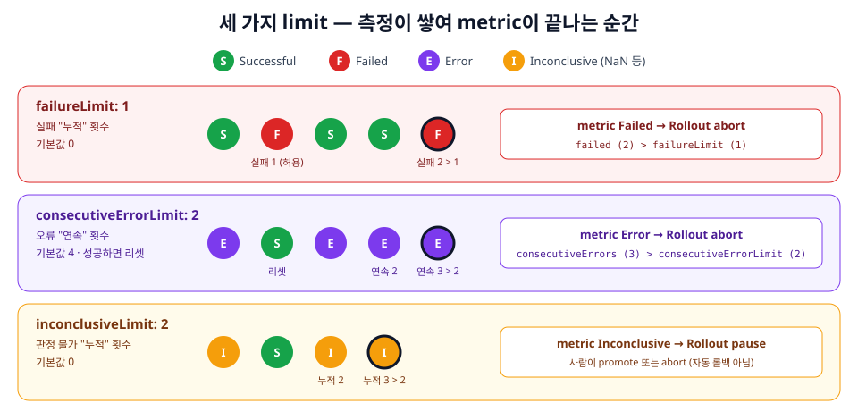
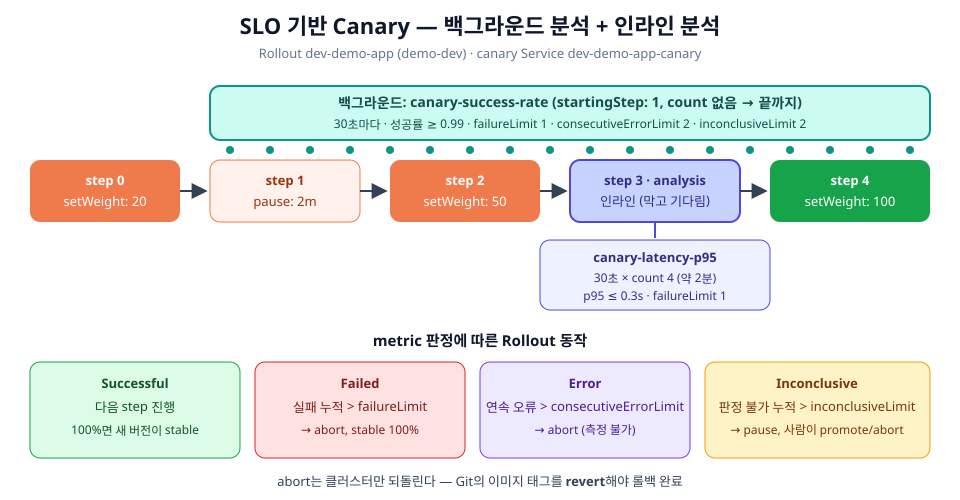
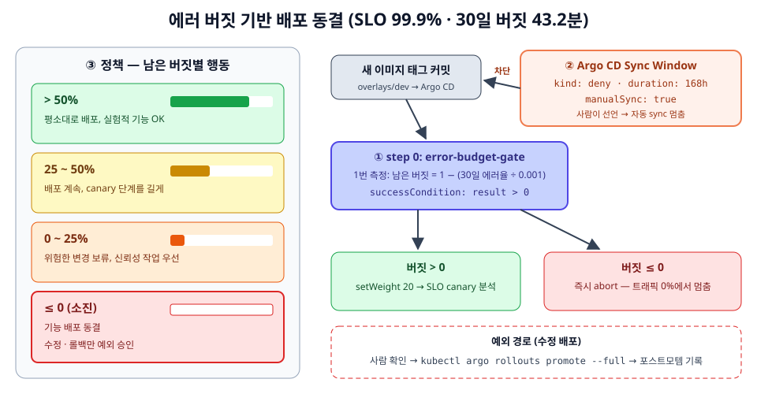

> **Chapter 8 · SRE & 관측성** | 난이도 ★★★★☆ | 예상 소요 2.5 ~ 3시간

## 🎯 오늘의 목표

- Day 56의 "에러율 5% 이하" 분석을 **SLO에서 출발한 판정 기준**(성공률 + p95 지연)으로 다시 설계할 수 있다
- `failureLimit`, `consecutiveErrorLimit`, `inconclusiveLimit`가 각각 **언제** 분석을 끝내는지 설명하고 직접 재현한다
- **백그라운드 분석**과 **인라인(step) 분석**의 차이를 알고 한 Rollout에 함께 쓴다
- 에러·지연을 주입한 이미지를 배포해 **자동 롤백**을 확인하고, GitOps에서 그 뒷정리를 한다
- **에러 버짓이 바닥나면 배포를 멈추는** 정책을 Rollout과 Argo CD로 구현하는 방법을 안다

---

## 1. Day 56의 분석을 다시 보자

Day 56에서 canary Service의 에러율이 5%를 넘으면 롤아웃을 abort했습니다. 동작은 하지만, SRE 관점에서 다시 보면 질문이 생깁니다.

| Day 56의 선택 | 질문 |
|---|---|
| 기준 "에러율 ≤ 5%" | 왜 5%인가? Day 58의 SLO는 **99.9%** 인데, 5% 에러는 번 레이트 **50** — 버짓을 14시간 만에 태우는 속도 |
| 에러율만 봄 | 응답은 200인데 **3초씩 걸리는** 릴리스는 통과 |
| 트래픽이 없을 때 | 측정이 `Error`가 되거나 의미 없는 값으로 판정 |
| 버짓이 이미 바닥일 때 | 그래도 새 배포가 계속 나감 |

오늘은 이것을 **SLO의 언어**로 바꿉니다.

> **Canary 분석 = "이 새 버전이 우리 에러 버짓을 기준보다 빨리 태우는가?"를 작은 트래픽으로 먼저 재 보는 것**

### 1-1. SLO에서 판정 기준 끌어내기

| SLO (Day 58) | 버짓 | Canary 기준 | 근거 |
|---|---|---|---|
| 가용성 99.9% (30일) | 0.1% | canary **성공률 ≥ 99%** | 에러율 1% = 번 레이트 10. Day 62의 page 기준(14.4)보다 엄격하게, 하지만 작은 표본의 흔들림은 허용 |
| 지연: 300ms 안에 99% | 1% | canary **p95 ≤ 300ms** | p95가 300ms를 넘으면 느린 요청이 5% 이상 → 지연 버짓을 5배 이상 속도로 소진 |

> 💡 canary는 트래픽의 20~50%만 받으므로 표본이 작습니다. 그래서 SLO 숫자(99.9%)를 그대로 쓰면 요청 몇 건의 우연한 실패로 abort가 납니다. **"SLO를 어기는 속도(번 레이트)가 허용 범위인가"** 로 기준을 정하고, 아래의 limit들로 흔들림을 흡수합니다.

> 💡 p95 대신 Day 58의 지연 SLI 그대로 "300ms 안에 끝난 비율 ≥ 99%"를 써도 됩니다(`le="0.3"` 버킷 ÷ 전체). 오늘은 두 가지 모양의 쿼리를 다 보이기 위해 p95를 씁니다.

---

## 2. 분석 결과의 네 가지 상태와 세 가지 limit



측정(measurement) 하나는 다음 중 하나로 끝납니다.

| 측정 결과 | 언제 |
|---|---|
| **Successful** | `successCondition`이 참 |
| **Failed** | `failureCondition`이 참 (또는 failureCondition 없이 successCondition이 거짓) |
| **Inconclusive** | 두 조건을 **모두** 적었는데 **어느 쪽도 아님** (예: 결과가 NaN) |
| **Error** | 측정 자체가 실패 — Prometheus 연결 실패, 쿼리 오류, 빈 결과를 `result[0]`으로 꺼냄 등 |

이 결과가 쌓여 **metric 전체의 판정**이 정해집니다. (Argo Rollouts v1.10 API 기준 기본값)

| 필드 | 기본값 | 의미 | 넘으면 |
|---|---|---|---|
| `failureLimit` | 0 | Failed 측정을 **총** 몇 번까지 허용 | metric **Failed** → Rollout **abort** |
| `consecutiveErrorLimit` | 4 | Error 측정을 **연속** 몇 번까지 허용 (성공하면 카운트 리셋) | metric **Error** → Rollout **abort** |
| `inconclusiveLimit` | 0 | Inconclusive 측정을 **총** 몇 번까지 허용 | metric **Inconclusive** → Rollout **pause** (사람이 promote/abort) |
| `consecutiveSuccessLimit` | 0 (비활성) | 연속 성공 N번이면 조기 성공 (v1.8+) | metric Successful |

> ⚠️ 판정은 "**초과**"입니다. `failureLimit: 1`이면 실패 1번은 봐주고 **2번째 실패**에서 끝납니다. Day 56의 메시지 `failed (3) > failureLimit (2)`가 그 뜻입니다.

| 측정 타이밍 필드 | 의미 |
|---|---|
| `interval` | 측정 간격. 없으면 1번만 측정 |
| `count` | 측정 횟수. **interval만 있고 count가 없으면 Rollout이 끝날 때까지 계속** (백그라운드용) |
| `initialDelay` | 분석 시작 후 이 metric의 첫 측정까지 대기 (rate 창이 채워지길 기다림) |

---

## 3. 백그라운드 분석 vs 인라인 분석



| 구분 | 백그라운드 분석 | 인라인(step) 분석 |
|---|---|---|
| 위치 | `spec.strategy.canary.analysis` | `steps:` 안의 `- analysis:` |
| 실행 | `startingStep`부터 **Rollout이 끝날 때까지 병행** | 그 step에서 **완료될 때까지 진행을 막음** |
| 성공 시 | 계속 감시 (끝나면 정리) | 다음 step으로 |
| 실패 시 | 어느 step에 있든 즉시 abort | abort |
| `count` | 보통 생략 (끝없이) | **반드시 지정** (안 끝나면 영원히 멈춤) |
| 어울리는 것 | "언제든 터지면 멈춰야 하는" 에러율 | "이 비율에서 충분히 지켜본 뒤 넘어가자"는 지연 검증 |

오늘 Rollout은 둘을 함께 씁니다.

- **백그라운드**: canary 성공률을 30초마다 끝까지 감시
- **인라인**: 50% 단계에서 p95를 2분간 4번 재고, 통과해야 100%로

---

## 4. 실습 ① — 준비

### 4-0. 실습 환경과 전제

| 항목 | 값 (Chapter 7·8 규약) |
|---|---|
| 클러스터 | kind `infra-lab`, kube-prometheus-stack `monitoring` (Day 17) |
| Argo Rollouts | v1.10.2 + Gateway API 플러그인 (Day 56) |
| 워크로드 | `demo-dev` 네임스페이스의 Rollout **`dev-demo-app`** (설정 레포 `apps/demo-app/overlays/dev`) |
| Pod 라벨 | `app.kubernetes.io/name: demo-app`, `environment: dev` |
| Service | stable **`dev-demo-app`**, canary **`dev-demo-app-canary`** (base 이름 `demo-app`, `demo-app-canary`) |
| 외부 경로 | HTTPRoute `dev-demo-app`, 호스트 `dev.demo.example.test` (Traefik NodePort 30080) |
| SLI 메트릭 | Day 58의 `http_requests_total{route, code}`, `http_request_duration_seconds` (ServiceMonitor, `release: monitoring`) |

```bash
kubectl argo rollouts version
kubectl argo rollouts get rollout dev-demo-app -n demo-dev    # Status: ✔ Healthy
kubectl -n demo-dev get svc -l app.kubernetes.io/name=demo-app
```

Day 58의 ServiceMonitor는 `app.kubernetes.io/name: demo-app` 라벨의 Service를 고르므로 **stable·canary Service가 둘 다** 수집됩니다. 카나리 진행 중 canary Service는 canary Pod만 가리키므로, `service="dev-demo-app-canary"` 라벨로 **새 버전만의 지표**를 골라낼 수 있습니다.

```promql
sum by (service) (rate(http_requests_total{namespace="demo-dev", route!="/healthz"}[2m]))
# {service="dev-demo-app"}         9.7
# {service="dev-demo-app-canary"}  9.7   ← 카나리가 없을 땐 stable Pod를 똑같이 가리켜 같은 값
```

> 💡 Day 58의 SLI recording rule은 `job=~".+-demo-app"`이라 `dev-demo-app-canary` job은 빠집니다. 평소에는 같은 Pod를 두 번 세지 않게 해 주지만, **카나리 중에는 canary가 받은 사용자 트래픽이 SLI에서 빠진다**는 뜻이기도 합니다. 운영에서는 ServiceMonitor의 `podTargetLabels`로 Pod 라벨을 붙여 Service와 무관하게 세는 방식을 검토하세요.

### 4-1. 장애 주입 스위치를 이미지에 넣기

Day 58의 `/work`는 쿼리 파라미터로 에러·지연을 만들었습니다. 이번에는 **이미지 자체가 나쁜** 릴리스를 흉내 내기 위해, 빌드할 때 기본 에러율·지연율을 박아 넣을 수 있게 합니다.

```python
# app/main.py — /work 수정 (나머지는 Day 58 그대로)
FAULT_ERROR_RATE = float(os.getenv("FAULT_ERROR_RATE", "0"))   # 이미지에 박힌 기본 에러율
FAULT_SLOW_RATE = float(os.getenv("FAULT_SLOW_RATE", "0"))     # 이미지에 박힌 기본 지연율


@app.get("/work")
def work(
    error_rate: float = Query(0.0, ge=0, le=1),
    slow_rate: float = Query(0.0, ge=0, le=1),
):
    error_rate = max(error_rate, FAULT_ERROR_RATE)
    slow_rate = max(slow_rate, FAULT_SLOW_RATE)
    time.sleep(0.8 if random.random() < slow_rate else random.uniform(0.01, 0.05))
    if random.random() < error_rate:
        raise HTTPException(status_code=500, detail="simulated failure")
    return {"status": "done", "version": os.getenv("APP_VERSION", "dev")}
```

```dockerfile
# Dockerfile — APP_VERSION 줄 아래에 추가 (기본값 0 = 정상 이미지)
ARG FAULT_ERROR_RATE=0
ARG FAULT_SLOW_RATE=0
ENV FAULT_ERROR_RATE=${FAULT_ERROR_RATE} \
    FAULT_SLOW_RATE=${FAULT_SLOW_RATE}
```

```bash
cd ~/gitops-lab/gitops-demo-app
git add . && git commit -m "feat: 빌드 인자로 장애 주입 (실습용)" && git push
# → Day 51 CI가 정상 이미지(기본값 0)를 빌드, Day 54 흐름으로 dev에 반영됨 (이것도 카나리로 배포됨)
```

나쁜 이미지 두 개는 로컬에서 만들어 kind에 직접 넣습니다. **태그는 CI 이미지와 같은 저장소 이름**으로 붙여야 Kustomize `images:` 변환과 맞습니다.

```bash
docker build -t ghcr.io/<user>/gitops-demo-app:fault-err10 \
  --build-arg APP_VERSION=fault-err10 --build-arg FAULT_ERROR_RATE=0.10 .
docker build -t ghcr.io/<user>/gitops-demo-app:fault-slow30 \
  --build-arg APP_VERSION=fault-slow30 --build-arg FAULT_SLOW_RATE=0.30 .

kind load docker-image ghcr.io/<user>/gitops-demo-app:fault-err10  --name infra-lab
kind load docker-image ghcr.io/<user>/gitops-demo-app:fault-slow30 --name infra-lab
```

> ⚠️ **Day 54 Image Updater**가 dev 태그를 자동 갱신하고 있다면 실습 중에 태그를 되돌릴 수 있습니다. 실습 동안 해당 Application의 Image Updater 대상에서 잠시 빼 두세요. **Day 57 Kyverno** 서명 검증이 Enforce 모드라면 서명 없는 로컬 이미지는 거부됩니다. Day 57의 키로 cosign 서명해 push하거나, 실습 동안 정책을 Audit로 바꾸세요.

### 4-2. 트래픽 흘리기

가중치가 적용되려면 요청이 **HTTPRoute(Traefik)를 거쳐야** 합니다(Day 56). 다른 터미널에서 계속 돌려 둡니다.

```bash
while true; do
  curl -s -o /dev/null --connect-to dev.demo.example.test:80:127.0.0.1:30080 \
    "http://dev.demo.example.test/work"
  sleep 0.05
done
```

---

## 5. 실습 ② — SLO 기반 AnalysisTemplate 두 개

```yaml
# apps/demo-app/base/analysis-slo.yaml
apiVersion: argoproj.io/v1alpha1
kind: AnalysisTemplate
metadata:
  name: canary-success-rate
spec:
  args:
    - name: namespace
    - name: canary-service
  metrics:
    - name: success-rate
      initialDelay: 60s              # rate[2m] 창에 canary 데이터가 쌓이길 기다림
      interval: 30s                  # count 없음 → 백그라운드로 끝까지
      successCondition: result >= 0.99
      failureCondition: result < 0.99
      failureLimit: 1                # 2번째 실패에서 abort
      consecutiveErrorLimit: 2       # 연속 3번 측정 오류면 abort
      inconclusiveLimit: 2           # 판정 불가(NaN) 3번째에 pause
      provider:
        prometheus:
          address: http://monitoring-kube-prometheus-prometheus.monitoring.svc:9090
          timeout: 20
          query: |
            scalar(
              1 - (
                (sum(rate(http_requests_total{namespace="{{args.namespace}}", service="{{args.canary-service}}", route!="/healthz", code=~"5.."}[2m])) or vector(0))
                /
                sum(rate(http_requests_total{namespace="{{args.namespace}}", service="{{args.canary-service}}", route!="/healthz"}[2m]))
              )
            )
---
apiVersion: argoproj.io/v1alpha1
kind: AnalysisTemplate
metadata:
  name: canary-latency-p95
spec:
  args:
    - name: namespace
    - name: canary-service
  metrics:
    - name: latency-p95
      interval: 30s
      count: 4                       # 인라인용: 4번(약 2분) 재고 끝
      successCondition: result <= 0.3
      failureCondition: result > 0.3
      failureLimit: 1
      inconclusiveLimit: 1
      provider:
        prometheus:
          address: http://monitoring-kube-prometheus-prometheus.monitoring.svc:9090
          timeout: 20
          query: |
            scalar(
              histogram_quantile(0.95,
                sum by (le) (rate(http_request_duration_seconds_bucket{namespace="{{args.namespace}}", service="{{args.canary-service}}", route!="/healthz"}[2m]))
              )
            )
```

| 설계 포인트 | 이유 |
|---|---|
| `scalar(...)` | 결과가 벡터가 아닌 **숫자 하나** → 조건식에 `result`를 바로 씀. 데이터가 없으면 `NaN`이 됨 |
| success·failure **둘 다** 적음 | NaN(트래픽 없음)이 Failed가 아니라 **Inconclusive**로 분류됨 → "모르겠으면 멈추고 사람에게" |
| 분자만 `or vector(0)` | 5xx가 0건이면 분자가 비어 결과가 사라지는 것을 막음. 분모가 비면(트래픽 0) 그대로 NaN |
| `[2m]` 창 + 30초 간격 | 측정이 너무 짧은 창이면 요청 몇 건에 흔들림. canary 판단은 "작은 SLO 창" |
| 성공률은 `failureLimit: 1` | 한 번의 우연은 봐주고, 두 번이면 진짜 문제 |

> 💡 Day 56의 `result[0] <= 0.05`처럼 벡터를 꺼내는 방식은 결과가 비면 **Error**가 됩니다. `scalar()` + 두 조건 패턴이면 같은 상황이 **Inconclusive**로 바뀌어, "데이터 없음"과 "Prometheus 장애"를 구분할 수 있습니다.

```yaml
# apps/demo-app/base/kustomization.yaml — Day 56의 analysis-error-rate.yaml 대신
resources:
  # ...
  - analysis-slo.yaml
```

---

## 6. 실습 ③ — Rollout에 백그라운드 + 인라인 분석 걸기

Day 56의 Rollout에서 `strategy.canary` 부분만 바꿉니다(`template`·`selector`는 그대로).

```yaml
# apps/demo-app/base/rollout.yaml (strategy 부분)
  strategy:
    canary:
      stableService: demo-app                 # overlay namePrefix → dev-demo-app
      canaryService: demo-app-canary          # → dev-demo-app-canary
      trafficRouting:
        plugins:
          argoproj-labs/gatewayAPI:
            httpRoute: demo-app               # → dev-demo-app
      analysis:                               # ── 백그라운드 분석
        templates:
          - templateName: canary-success-rate
        startingStep: 1                       # 20% 단계에 들어선 뒤부터
        args:
          - name: namespace
            valueFrom:
              fieldRef:
                fieldPath: metadata.namespace
          - name: canary-service
            value: dev-demo-app-canary        # ⚠️ namePrefix는 문자열 값까지 바꾸지 않음 → dev overlay 패치로
      steps:
        - setWeight: 20
        - pause: {duration: 2m}               # Day 56의 수동 pause {} → 시간 기반 자동 진행
        - setWeight: 50
        - analysis:                           # ── 인라인 분석: 끝나야 다음 step
            templates:
              - templateName: canary-latency-p95
            args:
              - name: namespace
                valueFrom:
                  fieldRef:
                    fieldPath: metadata.namespace
              - name: canary-service
                value: dev-demo-app-canary
        - setWeight: 100
```

> ⚠️ Kustomize `namePrefix`는 `stableService`·`canaryService` 같은 **알려진 이름 참조 필드가 아니면** 바꾸지 않습니다. Day 56에서 Rollout 이름 참조를 어떻게 처리했는지(오버레이 패치, `nameReference` 설정 등)에 맞추세요. args의 `value: dev-demo-app-canary` 같은 **문자열 값은 절대 자동으로 바뀌지 않으므로** stage/prod overlay에서는 패치로 `stage-demo-app-canary` 등으로 바꿔야 합니다.

```bash
cd ~/gitops-lab/gitops-demo-config
git add apps/demo-app/base/ && git commit -m "feat: SLO 기반 canary 분석 (성공률 백그라운드 + p95 인라인)" && git push
kubectl -n demo-dev get analysistemplate
# canary-latency-p95 / canary-success-rate (+ 지우기 전이면 error-rate)
```

AnalysisTemplate만 바꾸는 커밋은 Pod 템플릿이 그대로라 카나리를 일으키지 않습니다. 4-1에서 push한 정상 이미지가 dev에 반영되면 첫 카나리가 시작됩니다. 정상 이미지는 끝까지 통과해야 합니다.

```bash
kubectl argo rollouts get rollout dev-demo-app -n demo-dev --watch
```

```
Status:          ॥ Paused
Message:         CanaryPauseStep
  Step:          1/5
  SetWeight:     20
...
│  ├──α dev-demo-app-7c8d9f6b5-3        AnalysisRun  ◌ Running     ✔ 2
```

`✔ 2`는 성공한 측정 수입니다. 50% 단계에서는 인라인 AnalysisRun이 하나 더 생기고(`✔ 4`로 끝남), 100%가 되면 백그라운드 분석도 Successful로 정리됩니다.

---

## 7. 실습 ④ — 나쁜 릴리스로 자동 롤백 실험

### 7-1. 에러 10% 이미지 → 백그라운드 분석이 abort

```bash
cd ~/gitops-lab/gitops-demo-config/apps/demo-app/overlays/dev
kustomize edit set image gitops-demo-app=ghcr.io/<user>/gitops-demo-app:fault-err10
git commit -am "dev: 실험 — 에러 10% 이미지" && git push
kubectl argo rollouts get rollout dev-demo-app -n demo-dev --watch
```

20% 단계 pause 중에 백그라운드 분석이 canary 성공률 ~0.90을 두 번 재면 끝납니다. **아무도 개입하지 않았는데** stable로 돌아갑니다.

```
Status:          ✖ Degraded
Message:         RolloutAborted: Rollout aborted update to revision 4: Metric "success-rate" assessed Failed due to failed (2) > failureLimit (1)
```

```bash
kubectl -n demo-dev get analysisrun
kubectl -n demo-dev get analysisrun <이름> -o jsonpath='{range .status.metricResults[0].measurements[*]}{.phase}{"\t"}{.value}{"\n"}{end}'
# Failed      0.9012
# Failed      0.8987
```

이 순간 Grafana의 Day 58 SLI 패널은 거의 흔들리지 않습니다. 나쁜 버전이 받은 트래픽은 20% × 약 2분뿐이었고, 그마저 SLO 계산에서는 작게 반영됩니다. **버짓을 태우기 전에 막은 것**이 핵심입니다.

### 7-2. GitOps 뒷정리 — 롤백은 Git에도 해야 한다

클러스터는 stable로 돌아갔지만 **Git에는 아직 `fault-err10`이 적혀 있습니다.** Argo CD에서는 앱이 `Degraded`로 보이고, Rollout은 이 상태를 계속 유지합니다.

```bash
git revert --no-edit HEAD && git push        # 태그를 이전(stable) 값으로
kubectl argo rollouts get rollout dev-demo-app -n demo-dev
# Status: ✔ Healthy  — 원하는 상태가 stable과 같아지므로 카나리 없이 바로 정상
```

> 💡 "클러스터의 자동 롤백"과 "Git의 원하는 상태"가 어긋나는 것은 GitOps + 점진 배포의 본질적인 특징입니다. abort 알림을 받으면 **revert 커밋까지가 롤백**이라고 런북(Day 65)에 적어 두세요.

### 7-3. 지연 30% 이미지 → 인라인 분석이 abort

```bash
cd ~/gitops-lab/gitops-demo-config/apps/demo-app/overlays/dev
kustomize edit set image gitops-demo-app=ghcr.io/<user>/gitops-demo-app:fault-slow30
git commit -am "dev: 실험 — 지연 30% 이미지" && git push
```

에러가 없으니 백그라운드 성공률 분석은 계속 통과합니다. 20% → 2분 → 50%까지 **진행**하다가, 인라인 p95 분석에서 0.8초 근처 값이 나와 멈춥니다.

```
Message:         RolloutAborted: Rollout aborted update to revision 5: Metric "latency-p95" assessed Failed due to failed (2) > failureLimit (1)
```

에러율만 보던 Day 56의 분석이었다면 이 릴리스는 **100%까지 나갔을 것**입니다. 실험이 끝나면 다시 `git revert`합니다.

### 7-4. consecutiveErrorLimit — "측정이 안 되는" 상황

Prometheus 주소가 틀렸거나 Prometheus가 죽은 상황을 흉내 냅니다. 클러스터에서 직접 템플릿 주소를 바꿉니다(실험 후 Argo CD self-heal이 되돌리게 둠).

```bash
kubectl -n demo-dev patch analysistemplate canary-success-rate --type=json \
  -p='[{"op":"replace","path":"/spec/metrics/0/provider/prometheus/address","value":"http://no-such-prometheus.monitoring.svc:9090"}]'
```

> ⚠️ Argo CD self-heal(Day 53)이 켜져 있으면 몇 초 만에 원래대로 돌아갑니다. 이 실험 동안만 Application의 self-heal을 끄거나(`argocd app set <앱> --self-heal=false`) 실험 끝에 다시 켜세요.

이 상태로 정상 이미지를 새로 배포(예: 4-1의 앱 레포에 작은 커밋)하면, 측정이 매번 **Error**가 됩니다.

```
Message:         RolloutAborted: ... Metric "success-rate" assessed Error due to consecutiveErrors (3) > consecutiveErrorLimit (2)
```

| 비교 | Failed | Error |
|---|---|---|
| 뜻 | "재 보니 나쁘다" | "**재지 못했다**" |
| 카운트 | 누적 (`failureLimit`) | 연속 (`consecutiveErrorLimit`), 한 번 성공하면 리셋 |
| 기본 관용도 | 0번 | 4번 — 일시적 네트워크 오류는 넘어감 |

> 💡 정상 버전도 "측정 불가"면 멈추는 것이 맞습니다. 눈을 감은 채 배포하지 않는다는 원칙입니다(Day 62의 `SLOMetricsAbsent`와 같은 생각).

### 7-5. inconclusiveLimit — "판단할 근거가 없는" 상황

트래픽 루프(4-2)를 **멈춘 채로** 새 배포를 일으킵니다. canary가 요청을 받지 못하니 분모가 비고 → `scalar()`가 NaN → 두 조건 모두 거짓 → **Inconclusive**.

```
Status:          ॥ Paused
Message:         ... Metric "success-rate" assessed Inconclusive due to inconclusive (3) > inconclusiveLimit (2)
```

Inconclusive는 abort가 아니라 **pause**입니다. 사람이 상황을 보고 고릅니다.

```bash
kubectl argo rollouts promote dev-demo-app -n demo-dev   # 문제없다고 판단 → 진행
kubectl argo rollouts abort dev-demo-app -n demo-dev     # 확신 없음 → 되돌림
```

> 💡 트래픽이 적은 서비스(야간, 내부 API)는 Inconclusive가 자주 납니다. 해결책은 limit을 키우는 것보다 **canary 단계에서 합성 트래픽(smoke 요청)을 넣거나** 분석 창을 늘리는 것입니다.

---

## 8. 에러 버짓이 바닥나면 배포를 동결한다



Day 58의 에러 버짓 정책은 "버짓 소진 → 기능 배포 동결"이었습니다. 문서로만 두면 바쁜 날 지켜지지 않습니다. **배포 파이프라인이 스스로 멈추게** 만드는 방법 세 가지를 봅니다.

### 8-1. 아이디어 ① 첫 step에 "버짓 게이트" 분석

카나리를 시작하기 전에 **남은 버짓**을 한 번 재서, 0 이하면 바로 실패시킵니다.

```yaml
# apps/demo-app/base/analysis-budget-gate.yaml
apiVersion: argoproj.io/v1alpha1
kind: AnalysisTemplate
metadata:
  name: error-budget-gate
spec:
  args:
    - name: namespace
  metrics:
    - name: budget-remaining
      # interval·count 없음 → 딱 1번 측정
      successCondition: result > 0
      failureCondition: result <= 0
      provider:
        prometheus:
          address: http://monitoring-kube-prometheus-prometheus.monitoring.svc:9090
          query: |
            scalar(
              1 - (
                (
                  (sum(increase(http_requests_total{namespace="{{args.namespace}}", job=~".+-demo-app", route!="/healthz", code=~"5.."}[30d])) or vector(0))
                  /
                  sum(increase(http_requests_total{namespace="{{args.namespace}}", job=~".+-demo-app", route!="/healthz"}[30d]))
                ) / 0.001
              )
            )
```

```yaml
# rollout.yaml steps 맨 앞에 추가
      steps:
        - analysis:
            templates:
              - templateName: error-budget-gate
            args:
              - name: namespace
                valueFrom:
                  fieldRef:
                    fieldPath: metadata.namespace
        - setWeight: 20
        # ... (이하 동일, 백그라운드 분석의 startingStep은 1 → 2로)
```

남은 버짓(Day 58 7-4의 식, SLO 99.9% → 버짓 0.001)이 **0 이하**면 첫 step에서 abort되어 새 버전은 사용자 트래픽을 한 번도 받지 않습니다.

> ⚠️ 이 게이트는 **장애를 고치는 배포까지** 막습니다. 버짓이 바닥난 순간 가장 필요한 것이 수정 배포이므로, 예외 경로가 반드시 있어야 합니다. 예: 수정 릴리스는 사람이 확인 후 `kubectl argo rollouts promote dev-demo-app -n demo-dev --full`로 게이트를 건너뛰고, 그 사실을 포스트모템(Day 65)에 남김.

> ⚠️ Prometheus 보존 기간이 10일이면 `[30d]`는 실제로 10일치만 봅니다(Day 58). 게이트가 의미 있으려면 보존 기간이나 장기 저장소를 먼저 맞추세요.

### 8-2. 아이디어 ② Argo CD Sync Window로 동결

동결을 **사람이 선언**하는 방식입니다. AppProject에 deny 창을 넣으면 그 시간 동안 자동 sync가 멈춥니다.

```yaml
# AppProject (Day 53) 에 추가
spec:
  syncWindows:
    - kind: deny
      schedule: '* * * * *'      # 지금부터
      duration: 168h             # 1주 동결
      applications: ['gitops-demo-*']   # Day 53의 Application 이름 패턴 (예: gitops-demo-dev)
      manualSync: true           # 사람이 하는 수동 sync(핫픽스)는 허용
```

Day 62의 `SLOErrorBudgetBurnSlow`나 "버짓 0" 알림이 울리면 이 커밋을 올리는 것을 런북에 넣습니다.

### 8-3. 아이디어 ③ 정책 문서 — 숫자에 행동을 붙이기

| 남은 버짓 (30일) | 배포 | 누가 |
|---|---|---|
| > 50% | 평소대로. 실험적 기능도 OK | 팀 |
| 25 ~ 50% | 배포는 계속, 카나리 단계를 길게 | 팀 |
| 0 ~ 25% | 위험한 변경 보류, 신뢰성 작업 우선 | 팀 리드 |
| **≤ 0** | **기능 배포 동결**(게이트 + Sync Window). 수정·롤백만 예외 승인 | 팀 리드 + 온콜 |

| 방법 | 장점 | 한계 |
|---|---|---|
| ① 버짓 게이트 분석 | 완전 자동, 앱마다 따로 | 수정 배포 예외 처리 필요, 긴 보존 기간 필요 |
| ② Sync Window | Argo CD 표준 기능, 여러 앱 한 번에 | 사람이 켜고 꺼야 함 |
| ③ 정책 문서 | 조직의 합의 — 나머지의 근거 | 자동 강제력 없음 |

실무에서는 **③으로 합의하고, ②로 쉽게 실행하고, ①로 실수를 막는** 조합을 씁니다.

---

## 9. 트러블슈팅

| 증상 | 원인 | 해결 |
|---|---|---|
| AnalysisRun이 바로 `Error`, `no such host` | Prometheus 주소 오타 | `monitoring-kube-prometheus-prometheus.monitoring.svc:9090` 확인 |
| 측정값이 항상 `NaN` → Inconclusive | canary Service로 수집이 안 됨 또는 트래픽이 HTTPRoute를 안 거침 | Prometheus에서 `sum by (service) (rate(http_requests_total{namespace="demo-dev"}[2m]))`로 `dev-demo-app-canary` 확인, 트래픽은 30080 경유 |
| `args.canary-service`가 stage에서 dev 값으로 들어감 | `value:` 문자열은 namePrefix 대상이 아님 | 환경별 overlay에서 args 패치 |
| 인라인 분석에서 영원히 멈춤 | 인라인 템플릿에 `count`가 없음 | 인라인용 metric에는 `count` 지정 |
| 정상 이미지인데 성공률 분석이 실패 | 기준이 작은 표본에 비해 너무 엄격(예: 0.999), 창이 너무 짧음 | 기준을 번 레이트로 다시 계산, `[2m]` 이상 창, `failureLimit` 1~2 |
| abort됐는데 Argo CD가 계속 `Degraded` | Git에 나쁜 태그가 그대로 | `git revert`로 원하는 상태를 되돌림 |
| `fault-*` 이미지 Pod가 `ErrImagePull` | kind에 이미지를 안 넣었거나 태그 오타 | `kind load docker-image ... --name infra-lab`, `docker exec infra-lab-control-plane crictl images \| grep fault` |
| 실험 태그가 곧 다른 태그로 바뀜 | Day 54 Image Updater가 갱신 | 실습 동안 Image Updater 대상에서 제외 |

---

## 10. 핵심 정리

- canary 분석 기준은 **SLO에서 끌어낸다**: 성공률 ≥ 99%(번 레이트 ≤ 10), p95 ≤ 300ms(지연 SLO 경계)
- 측정 결과는 **Successful / Failed / Inconclusive / Error**. `scalar()` + success·failure 두 조건이면 "데이터 없음"이 Inconclusive로 분리된다
- `failureLimit`(누적 실패, 기본 0) → abort, `consecutiveErrorLimit`(연속 오류, 기본 4) → abort, `inconclusiveLimit`(누적 판정 불가, 기본 0) → **pause**. 모두 "초과"일 때
- **백그라운드 분석**은 끝까지 감시(count 생략), **인라인 분석**은 그 step을 막고 반드시 count 지정
- 자동 롤백 뒤에는 **Git revert까지**가 롤백
- 버짓 소진 시 배포 동결: **정책 문서 + Argo CD Sync Window + 버짓 게이트 분석**, 수정 배포 예외 경로 필수

---

## 11. 셀프 체크

<details>
<summary>Q1. failureLimit: 1, interval: 30s인 metric이 Successful, Failed, Successful, Failed 순으로 측정됐다. 언제 어떻게 끝나나?</summary>

4번째 측정에서 Failed가 **누적 2번**이 되어 `failed (2) > failureLimit (1)`로 metric이 Failed, Rollout은 abort됩니다. failureLimit은 연속이 아니라 **누적** 횟수입니다.
</details>

<details>
<summary>Q2. Prometheus Pod가 재시작되는 30초 동안 측정 1번이 Error였다. consecutiveErrorLimit: 2라면 롤아웃은 어떻게 되나?</summary>

계속 진행됩니다. Error는 **연속** 횟수로 세고, 다음 측정이 성공하면 카운트가 리셋됩니다. 연속 3번 Error가 나야 metric이 Error로 끝나고 abort됩니다.
</details>

<details>
<summary>Q3. successCondition만 적고 failureCondition을 안 적으면, 트래픽이 없어 NaN이 나올 때 결과는?</summary>

**Failed**입니다. failureCondition이 없으면 successCondition이 거짓인 모든 경우가 실패로 분류됩니다. 그래서 "데이터 없음"을 실패와 구분하려면 두 조건을 다 적어 NaN을 Inconclusive로 보내야 합니다.
</details>

<details>
<summary>Q4. 지연만 나빠진 릴리스를 막으려면 왜 인라인 분석이 백그라운드 분석보다 나을 수 있나?</summary>

인라인 분석은 그 step에서 **충분히 측정이 끝날 때까지 진행을 막습니다.** 50%처럼 표본이 큰 단계에서 p95를 정해진 횟수만큼 재고 통과해야 100%로 가므로, 시간 기반 pause만 있을 때 "측정이 몇 번 안 된 채로 다음 단계로 넘어가는" 일을 막습니다. 백그라운드 분석은 늘 감시하지만 진행을 붙잡지는 않습니다.
</details>

<details>
<summary>Q5. 에러 버짓 게이트를 Rollout 첫 step에 두었을 때 생기는 가장 큰 운영 위험과 대책은?</summary>

버짓이 바닥난 상황에서 **장애를 고치는 수정 배포까지 막힌다**는 것입니다. 수정·롤백 배포는 사람이 확인 후 `promote --full`로 게이트를 건너뛰거나 Sync Window의 `manualSync: true` 같은 예외 경로를 정책으로 정해 두고, 예외를 쓴 사실을 포스트모템에 기록합니다.
</details>

---

## ⏭️ 다음 예고 — Day 64. 카오스 엔지니어링 — Chaos Mesh

지금까지는 "나쁜 릴리스"라는 **우리가 만든** 장애를 막았습니다. 하지만 장애는 Pod가 죽고, 네트워크가 느려지고, 노드가 사라지는 식으로도 옵니다. Chaos Mesh로 그런 장애를 **일부러, 작게, 통제된 방식으로** 일으키고, 오늘까지 만든 SLO 알림과 canary 분석이 기대대로 반응하는지 실험으로 확인합니다.
