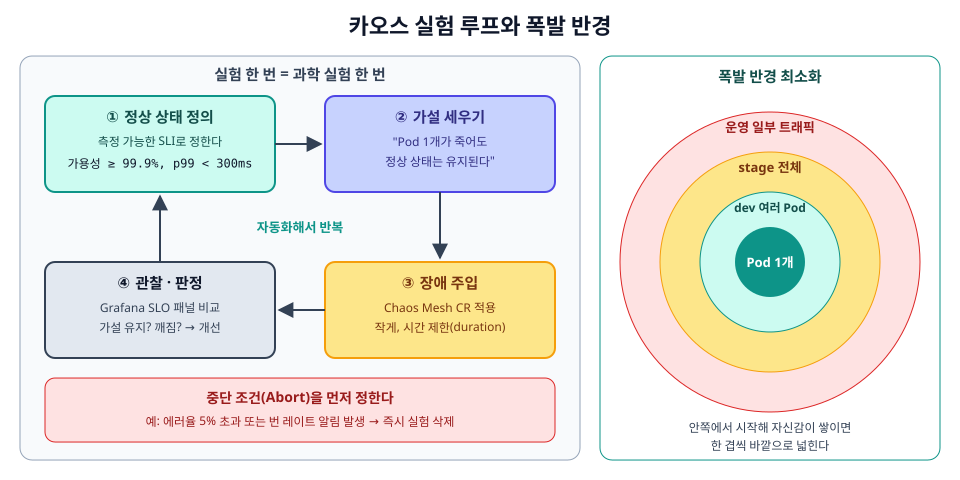
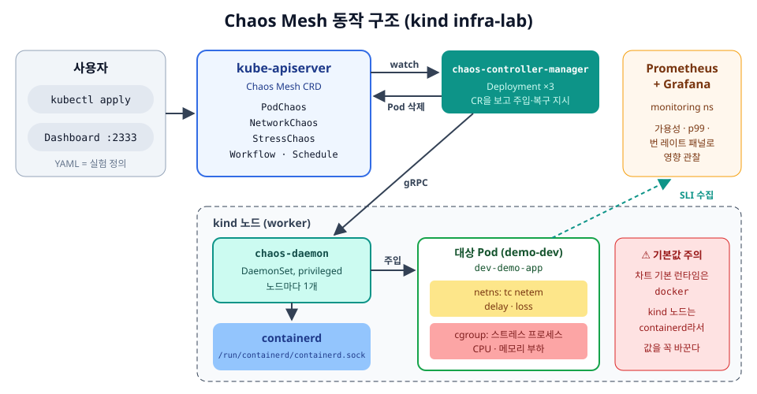
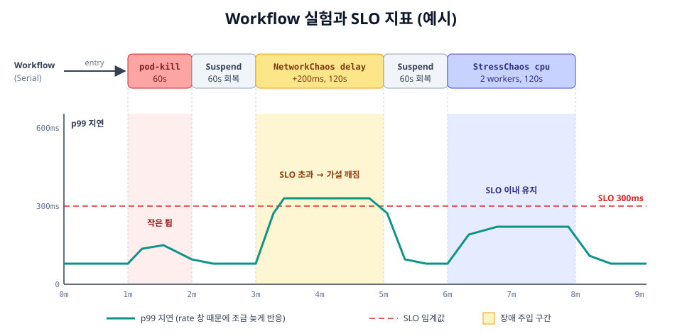

> **Chapter 8 · SRE & 관측성** | 난이도 ★★★★☆ | 예상 소요 2 ~ 2.5시간

## 🎯 오늘의 목표

- 카오스 엔지니어링이 **"일부러 망가뜨리기"가 아니라 "가설을 검증하는 실험"** 인 이유를 설명할 수 있다
- 정상 상태 가설, 폭발 반경 최소화, 운영 환경 실험 등 핵심 원칙을 안다
- kind `infra-lab`에 **Chaos Mesh**를 Helm으로 설치하고 containerd 런타임 설정을 정확히 넣을 수 있다
- PodChaos(pod-kill), NetworkChaos(delay, loss), StressChaos를 데모 앱에 걸고 **Grafana에서 SLO 영향**을 관찰한다
- Workflow·Schedule로 실험을 자동화하고, **Game Day** 를 계획하고 진행할 수 있다

---

## 1. 왜 일부러 장애를 내는가?

Day 58부터 지금까지 우리는 **보는 능력**을 키웠습니다.

| Day | 만든 것 | 질문 |
|---|---|---|
| 58 | SLI/SLO, 에러 버짓 | "얼마나 안정적이어야 하나?" |
| 59~61 | OTel 계측, Loki, Tempo | "무슨 일이 일어났나?" |
| 62 | 번 레이트 알림 | "사람이 언제 깨어나야 하나?" |
| 63 | SLO 기반 Canary 자동 롤백 | "나쁜 배포를 자동으로 막을 수 있나?" |

그런데 이 장치들이 **실제 장애에서 제대로 작동하는지** 는 아직 아무도 모릅니다. Pod가 죽으면 정말 트래픽이 다른 Pod로 넘어갈까? 네트워크가 200ms 느려지면 알림이 울릴까? 알림이 울리면 대응자는 무엇을 볼까? 진짜 장애가 새벽 3시에 이걸 알려 주기 전에, **낮에, 통제된 상태에서, 작게** 먼저 확인하자는 것이 카오스 엔지니어링입니다.

> **카오스 엔지니어링 = 시스템이 거친 상황을 견딜 수 있다는 자신감을 쌓기 위해, 시스템에 실험을 하는 분야.**
> (Principles of Chaos Engineering의 정의를 옮긴 것)

| 방식 | 언제 알게 되나 | 누가 비용을 치르나 |
|---|---|---|
| 아무것도 안 함 | 실제 장애가 났을 때 | 사용자 + 새벽의 온콜 |
| 장애 대응 문서만 작성 | 실제 장애가 났을 때 (문서가 틀렸다는 것도 그때 앎) | 사용자 + 온콜 |
| **카오스 실험** | 실험 시간에, 팀이 모두 깨어 있을 때 | **에러 버짓 일부** (계획된 지출) |

> 💡 Day 58의 에러 버짓이 여기서 다시 등장합니다. 버짓이 남아 있다면 그 일부를 **"모르는 것을 줄이는 데"** 쓰는 것이 카오스 실험입니다. 반대로 버짓이 거의 바닥이면 실험을 미루는 것이 원칙입니다.

---

## 2. 카오스 엔지니어링의 원칙



[Principles of Chaos Engineering](https://principlesofchaos.org/)이 정리한 다섯 가지 고급 원칙입니다.

| 원칙 | 뜻 | 오늘 실습에서는 |
|---|---|---|
| **정상 상태에 대한 가설** | 내부 구현이 아니라 **측정 가능한 출력**(처리량, 에러율, 지연)으로 "정상"을 정의하고, 실험 중에도 유지된다고 가정 | Day 58의 SLI: 가용성, p99 지연 |
| **현실의 사건을 반영** | 서버 다운, 네트워크 지연, 트래픽 폭증처럼 실제로 일어나는 일을 주입 | Pod 죽음, 지연, 패킷 손실, CPU 부하 |
| **운영 환경에서 실험** | 시스템은 환경과 트래픽 패턴에 따라 다르게 동작하므로 결국 실제 트래픽에서 확인해야 함 | 오늘은 dev. 성숙하면 stage → prod 일부 |
| **자동화해 지속 실행** | 한 번 통과했다고 끝이 아님. 시스템은 매일 바뀜 | Workflow, Schedule |
| **폭발 반경 최소화** | 실험이 고객 피해로 번지지 않게 범위를 좁히고 바로 멈출 수 있게 함 | `mode: one`, `duration`, 중단 조건 |

### 2-1. "가설"이 없으면 그냥 장애다

좋은 실험과 나쁜 실험의 차이는 **시작 전에 무엇을 써 두었느냐** 입니다.

| 나쁜 예 | 좋은 예 |
|---|---|
| "Pod 하나 죽여 보자. 뭐가 되나 보게." | "replicas 2 상태에서 Pod 1개가 죽어도, 1분 창 가용성은 99.9% 이상, p99는 300ms 미만을 유지한다." |
| 끝나고 "음… 괜찮았던 것 같은데?" | 끝나고 "가용성 99.8%, p99 최대 180ms → **가설 유지**" 또는 "p99 420ms → **가설 깨짐**, 원인은 …" |

가설이 깨지는 것은 실패가 아닙니다. **고객보다 먼저 약점을 찾은 것** 이니 오히려 가장 값진 결과입니다.

### 2-2. 중단 조건(Abort condition)

실험 전에 **"이 숫자를 넘으면 즉시 멈춘다"** 를 정합니다. 예를 들면 다음과 같습니다.

- 에러율 5% 초과가 1분 이상 지속
- Day 62의 SLO 번 레이트 알림(page 등급)이 발생
- 실험 대상이 아닌 서비스의 SLI가 흔들림 (폭발 반경을 잘못 계산했다는 신호)

> ⚠️ 중단 방법도 미리 손에 쥐고 시작합니다. Chaos Mesh에서는 **실험 CR을 삭제하면 주입이 복구** 됩니다(`kubectl delete -f ...`). 이 명령을 실험 시작 전에 터미널에 미리 써 두세요.

---

## 3. 도구 고르기 — Chaos Mesh vs LitmusChaos

Kubernetes용 오픈소스 카오스 도구는 두 개가 대표적이고, 둘 다 CNCF 프로젝트입니다.

| 구분 | **Chaos Mesh** | **LitmusChaos** |
|---|---|---|
| 실험 정의 | 장애 종류별 CRD (`PodChaos`, `NetworkChaos`, `StressChaos`, `IOChaos`, `TimeChaos`, `HTTPChaos` …) | `ChaosEngine` + `ChaosExperiment` + 결과 `ChaosResult` |
| 실험 조합 | `Workflow`(Serial/Parallel/Suspend), `Schedule` | ChaosCenter의 Chaos Experiment(Argo Workflows 기반) |
| 정상 상태 검증 | Workflow의 상태 체크(HTTP) 정도. 주로 외부 관측으로 판단 | **Probe** 내장(httpProbe, promProbe, cmdProbe, k8sProbe)으로 실험 결과를 Pass/Fail 판정 |
| 실험 카탈로그 | 문서의 예제 YAML | **ChaosHub**에 공유된 실험 모음 |
| 구성 요소 | controller-manager, chaos-daemon(DaemonSet), dashboard | ChaosCenter(웹 UI + DB), 실행 인프라 에이전트 |
| 무게 | 가벼움. Helm 차트 하나 | 상대적으로 무거움(포털, DB 포함) |
| 잘 맞는 상황 | 개발자가 YAML로 빠르게 실험, GitOps로 실험 관리 | 팀 단위 포털, 실험 결과를 Probe로 자동 판정하는 파이프라인 |

이 시리즈는 **Chaos Mesh** 를 씁니다. 이유는 세 가지입니다. (1) Day 16 Helm 하나로 설치가 끝나고, (2) 실험이 평범한 Kubernetes CR이라 Chapter 7의 GitOps 흐름에 그대로 올릴 수 있고, (3) 정상 상태 판정은 이미 우리가 만든 Prometheus/Grafana/알림(Day 58~62)으로 하면 되기 때문입니다.

> 💡 LitmusChaos의 promProbe 개념(실험 중 PromQL 결과가 기준을 넘으면 실패로 판정)은 Day 63에서 본 Argo Rollouts의 AnalysisTemplate과 같은 발상입니다. "실험·배포의 합격 기준을 SLO 쿼리로 자동 판정한다"는 패턴을 기억해 두세요.

---

## 4. Chaos Mesh는 어떻게 장애를 주입하나



| 구성 요소 | 역할 |
|---|---|
| **CRD** (`PodChaos` 등) | "무엇을, 어디에, 얼마나" 를 담은 실험 정의. `kubectl apply`로 시작, `kubectl delete`로 복구 |
| **chaos-controller-manager** | 실험 CR을 watch하고 대상 Pod를 고른 뒤 주입·복구를 지시. `pod-kill`처럼 API로 끝나는 것은 직접 처리 |
| **chaos-daemon** | 노드마다 하나씩 뜨는 **특권(privileged) DaemonSet**. 컨테이너 런타임에 물어 대상 컨테이너의 PID를 찾고, 그 namespace에 들어가(Day 07에서 본 `nsenter`와 같은 원리) `tc netem`으로 네트워크를 망가뜨리거나 cgroup 안에 스트레스 프로세스를 띄움 |
| **chaos-dashboard** | 웹 UI(포트 2333). 실험 생성·조회·중단 |

여기서 중요한 사실이 하나 나옵니다. **chaos-daemon은 컨테이너 런타임 소켓에 붙어서 PID를 찾습니다.** 차트 기본값은 Docker(`/var/run/docker.sock`)인데, kind 노드는 Day 09에서 본 것처럼 **containerd** 로 컨테이너를 돌립니다. 그래서 설치할 때 런타임과 소켓 경로를 반드시 바꿔야 합니다.

| 환경 | `chaosDaemon.runtime` | `chaosDaemon.socketPath` |
|---|---|---|
| 차트 기본값 | `docker` | `/var/run/docker.sock` |
| **kind, kubeadm(Day 20), 일반 containerd** | `containerd` | `/run/containerd/containerd.sock` |
| K3s | `containerd` | `/run/k3s/containerd/containerd.sock` |
| MicroK8s | `containerd` | `/var/snap/microk8s/common/run/containerd.sock` |
| CRI-O | `crio` | `/var/run/crio/crio.sock` |

---

## 5. 실습 준비

### 5-1. 실습 환경

| 항목 | 값 |
|---|---|
| 클러스터 | Day 09의 kind `infra-lab` (Kubernetes v1.34) |
| 모니터링 | Day 17의 kube-prometheus-stack 릴리스 `monitoring` (Grafana 포함) |
| 대상 앱 | Chapter 7의 데모 앱(FastAPI, 이미지 `gitops-demo-app`). 네임스페이스 `demo-dev`, 워크로드·Service 이름 `dev-demo-app`(Day 52 `namePrefix: dev-`), Service 포트 80 → 컨테이너 8000 |
| SLI | Day 58에서 정한 가용성 SLI(SLO 99.9%)와 지연 SLI(300ms 이내 비율), 기록 규칙 `demo-app-slo` |
| Chaos Mesh | **v2.8.8** (작성 시점 최신 안정 버전, Helm 차트 버전도 2.8.8) |

> ⚠️ Day 53에서 replicas를 2로 늘려 두었다면 그대로 두세요. 1개라면 pod-kill 순간에 서비스가 완전히 끊깁니다. 이것 자체도 의미 있는 실험이지만, 오늘은 **replicas 2 이상** 을 정상 상태로 가정합니다. Argo CD가 관리하므로 `apps/demo-app/overlays/dev`에서 바꾸고 커밋하세요(Day 53). Day 56에서 Deployment를 Rollout으로 바꿨다면 Rollout의 `spec.replicas`를 봅니다.

먼저 대상 Pod의 라벨을 확인합니다. 아래 실험 YAML의 `labelSelectors`를 이 값에 맞춥니다.

```bash
kubectl -n demo-dev get pods --show-labels
```

```
NAME                               READY   STATUS    RESTARTS   AGE   LABELS
dev-demo-app-7c9d8b6f5d-2xkqp   1/1     Running   0          3h    app.kubernetes.io/name=demo-app,app.kubernetes.io/part-of=gitops-demo,environment=dev,pod-template-hash=7c9d8b6f5d
dev-demo-app-7c9d8b6f5d-q8m4t   1/1     Running   0          3h    app.kubernetes.io/name=demo-app,app.kubernetes.io/part-of=gitops-demo,environment=dev,pod-template-hash=7c9d8b6f5d
```

> Pod 이름은 `namePrefix` 때문에 `dev-demo-app-…`이지만, **라벨은 base에서 온 `app.kubernetes.io/name: demo-app`** 그대로입니다(Day 52: `namePrefix`는 이름만 바꾸고 라벨은 건드리지 않음). 그래서 실험 selector에는 이 라벨과 dev 오버레이가 붙인 `environment: dev`를 **함께** 적어 대상을 dev Pod로만 좁힙니다. 네임스페이스로 한 번, 라벨 두 개로 한 번 더 폭발 반경을 줄이는 셈입니다.

### 5-2. Chaos Mesh 설치

```bash
helm repo add chaos-mesh https://charts.chaos-mesh.org
helm repo update
kubectl create ns chaos-mesh

helm install chaos-mesh chaos-mesh/chaos-mesh \
  -n=chaos-mesh --version 2.8.8 \
  --set chaosDaemon.runtime=containerd \
  --set chaosDaemon.socketPath=/run/containerd/containerd.sock \
  --set dashboard.securityMode=false
```

| 옵션 | 의미 |
|---|---|
| `chaosDaemon.runtime=containerd` | kind 노드의 런타임. **빠뜨리면 실험이 대상 컨테이너를 못 찾음** |
| `chaosDaemon.socketPath=...` | kind 노드 컨테이너 안의 containerd 소켓 경로 |
| `dashboard.securityMode=false` | 대시보드 로그인(토큰) 생략. **학습용** — 공식 문서도 운영에서는 끄지 말라고 안내 |

```bash
kubectl get pods -n chaos-mesh
```

```
NAME                                        READY   STATUS    RESTARTS   AGE
chaos-controller-manager-7b8f6c9d5d-4kq2z   1/1     Running   0          60s
chaos-controller-manager-7b8f6c9d5d-9xw7m   1/1     Running   0          60s
chaos-controller-manager-7b8f6c9d5d-tp5lr   1/1     Running   0          60s
chaos-daemon-5vnqk                          1/1     Running   0          60s
chaos-daemon-g7h2x                          1/1     Running   0          60s
chaos-daemon-xk8wd                          1/1     Running   0          60s
chaos-dashboard-6d7c9f8b74-lrz6p            1/1     Running   0          60s
chaos-dns-server-5f9c7b8d6c-m2qtn           1/1     Running   0          60s
```

controller-manager는 기본 3개(리더 선출), chaos-daemon은 **노드 수만큼**(infra-lab은 3개) 뜹니다. CRD도 확인해 봅니다.

```bash
kubectl get crd | grep chaos-mesh.org | head
```

대시보드는 port-forward로 엽니다. 오늘은 주로 YAML로 하지만, 실험 상태를 눈으로 보기에 편합니다.

```bash
kubectl -n chaos-mesh port-forward svc/chaos-dashboard 2333:2333
# 브라우저: http://localhost:2333
```

### 5-3. 안전장치 — 실험 가능한 네임스페이스 제한

기본값(`controllerManager.enableFilterNamespace=false`)에서는 **모든 네임스페이스** 의 Pod를 실험 대상으로 삼을 수 있습니다. 실수로 `monitoring`이나 `kube-system`을 고르면 관측 도구까지 같이 망가집니다. 폭발 반경을 설치 단계에서부터 좁혀 둡시다.

```bash
helm upgrade chaos-mesh chaos-mesh/chaos-mesh -n chaos-mesh --version 2.8.8 \
  --reuse-values --set controllerManager.enableFilterNamespace=true

# 실험을 허용할 네임스페이스에만 어노테이션
kubectl annotate ns demo-dev chaos-mesh.org/inject=enabled
```

이제 `demo-dev`가 아닌 Pod는 selector에 걸려도 주입되지 않습니다. 운영이라면 여기에 Day 19 RBAC로 "누가 Chaos CR을 만들 수 있나"까지 제한합니다.

### 5-4. 부하 생성기와 정상 상태 측정

트래픽이 없으면 SLI도 없습니다. 클러스터 안에서 꾸준히 요청을 보내는 Pod를 띄웁니다. 응답 코드와 소요 시간을 함께 찍어 **클라이언트 쪽 시선** 도 확보합니다.

```bash
kubectl -n demo-dev run loadgen --image=curlimages/curl:8.23.0 --restart=Never -- \
  sh -c 'while true; do curl -s -o /dev/null -m 2 -w "%{http_code} %{time_total}\n" http://dev-demo-app/; sleep 0.2; done'

kubectl -n demo-dev logs -f loadgen
```

```
200 0.004812
200 0.003977
200 0.005104
```

`-m 2`는 2초 타임아웃입니다. 연결 자체가 실패하면 `000`이 찍힙니다.

이제 Grafana(Day 17: `kubectl port-forward -n monitoring svc/monitoring-grafana 3000:80`)에 **"Chaos 실험" 대시보드** 를 새로 만들고 패널 네 개를 둡니다. 쿼리는 Day 58에서 정한 SLI(`http_requests_total`, `http_request_duration_seconds`)를 그대로 쓰되 창만 1분으로 줄입니다.

```promql
# 패널 1: 가용성 SLI (5xx가 아닌 응답 비율, 1분 창)
1 - (
  sum(rate(http_requests_total{namespace="demo-dev", route!="/healthz", code=~"5.."}[1m]))
  /
  sum(rate(http_requests_total{namespace="demo-dev", route!="/healthz"}[1m]))
)

# 패널 2: 지연 SLI (300ms 안에 끝난 요청 비율)
sum(rate(http_request_duration_seconds_bucket{namespace="demo-dev", route!="/healthz", le="0.3"}[1m]))
/
sum(rate(http_request_duration_seconds_count{namespace="demo-dev", route!="/healthz"}[1m]))

# 패널 3: p99 지연 (초) — 실험 중 변화를 눈으로 보기 위한 보조 지표
histogram_quantile(0.99,
  sum by (le) (rate(http_request_duration_seconds_bucket{namespace="demo-dev", route!="/healthz"}[1m])))

# 패널 4: 사용 가능한 Pod 수 (kube-state-metrics)
kube_deployment_status_replicas_available{namespace="demo-dev", deployment="dev-demo-app"}
# Day 56에서 Rollout으로 바꿨다면 Deployment 메트릭이 없으므로 Ready Pod 수로 대신:
# sum(kube_pod_status_ready{namespace="demo-dev", pod=~"dev-demo-app-.*", condition="true"})
```

> 💡 실험용 대시보드는 SLO 판정용(Day 58의 30일 창)보다 **짧은 창(1m)** 을 씁니다. 실험은 몇 분짜리라 긴 창에서는 영향이 묻혀 보이지 않습니다. 대신 Day 62의 번 레이트 패널(5m/1h)도 같이 띄워 "이 실험이 알림을 울릴 정도인가"를 함께 봅니다.

부하를 5분쯤 흘린 뒤 **정상 상태 기준값** 을 기록해 둡니다. 예: 가용성 100%, p99 약 0.03s, Pod 2개. 이 숫자가 오늘 모든 가설의 기준입니다.

---

## 6. 실험 1 — PodChaos: Pod를 죽여도 괜찮은가?

**가설:** "replicas 2 상태에서 Pod 1개가 강제로 죽어도 가용성 99.9% 이상, p99 300ms 미만을 유지한다."

```yaml
# exp1-pod-kill.yaml
apiVersion: chaos-mesh.org/v1alpha1
kind: PodChaos
metadata:
  name: pod-kill-demo
  namespace: demo-dev
spec:
  action: pod-kill
  mode: one                  # 대상 중 무작위 1개 → 폭발 반경 최소
  selector:
    namespaces:
      - demo-dev
    labelSelectors:
      app.kubernetes.io/name: demo-app
      environment: dev
  gracePeriod: 0             # 즉시 삭제 (SIGTERM 유예 없음)
```

```bash
kubectl apply -f exp1-pod-kill.yaml
kubectl -n demo-dev get pods -w
```

```
dev-demo-app-7c9d8b6f5d-2xkqp   1/1     Terminating         0     3h
dev-demo-app-7c9d8b6f5d-z7r9n   0/1     Pending             0     0s
dev-demo-app-7c9d8b6f5d-z7r9n   0/1     ContainerCreating   0     0s
dev-demo-app-7c9d8b6f5d-z7r9n   1/1     Running             0     6s
```

Day 11의 ReplicaSet이 곧바로 새 Pod를 만듭니다. `mode` 값은 다음 중에서 고릅니다.

| mode | 고르는 방식 | `value` 예 |
|---|---|---|
| `one` | 무작위 1개 | — |
| `all` | 조건에 맞는 전부 | — |
| `fixed` | 정해진 개수 | `"2"` |
| `fixed-percent` | 정해진 비율 | `"50"` |
| `random-max-percent` | 최대 비율 안에서 무작위 | `"30"` |

**관찰 포인트**

- loadgen 로그에 `000`이 한두 줄 섞였나? 이는 죽은 Pod로 가던 연결이 끊긴 것입니다.
- 그런데 Grafana의 **서버 쪽 가용성 패널에는 아무것도 안 보일 수 있습니다.** 죽은 Pod는 실패한 요청을 기록할 수조차 없기 때문입니다.

> 💡 이것이 오늘의 첫 번째 교훈입니다. **서버에서 측정한 SLI는 "서버까지 오지 못한 요청"을 보지 못합니다.** Day 58에서 SLI를 어디서 측정할지(로드밸런서/게이트웨이 vs 앱) 고민했던 이유가 여기 있습니다. 실험 결과 이 차이가 크다면 Gateway(Day 15) 메트릭이나 외부 프로브(blackbox)로 SLI를 보강하는 것이 **액션 아이템** 이 됩니다.

PodChaos는 한 번 실행하고 끝나는 실험이라 정리는 CR 삭제로 충분합니다.

```bash
kubectl delete -f exp1-pod-kill.yaml
```

> ⚠️ `pod-kill` 말고 `pod-failure`(일정 시간 동안 컨테이너 이미지를 동작하지 않는 이미지로 바꿔 Pod를 실패 상태로 둠, `duration` 필요), `container-kill`(`containerNames`로 특정 컨테이너만 종료)도 있습니다. 사이드카가 있는 Pod라면 `container-kill`이 더 현실적인 실험이 됩니다.

---

## 7. 실험 2 — NetworkChaos: 느려지면 어떻게 되나?

**가설:** "앱 Pod 1개의 응답이 200ms 느려져도 p99는 300ms 미만을 유지한다." 일부러 깨질 만한 가설을 세워 봅니다.

```yaml
# exp2-network-delay.yaml
apiVersion: chaos-mesh.org/v1alpha1
kind: NetworkChaos
metadata:
  name: delay-demo
  namespace: demo-dev
spec:
  action: delay
  mode: one
  selector:
    namespaces:
      - demo-dev
    labelSelectors:
      app.kubernetes.io/name: demo-app
      environment: dev
  delay:
    latency: '200ms'
    correlation: '0'
    jitter: '20ms'
  duration: '2m'             # 2분 후 자동 복구
```

```bash
kubectl apply -f exp2-network-delay.yaml
kubectl -n demo-dev describe networkchaos delay-demo | tail -20
```

`Status`의 `Records`에 대상 Pod와 `Injected` 이벤트가 보이면 주입된 것입니다. loadgen 로그를 보면 일부 응답이 `0.20…`초대로 늘어납니다. Pod 2개 중 1개만 느리므로 **요청의 약 절반이 느려지고, 그래서 p99는 200ms 이상으로 뛰어오릅니다.** 그림의 가운데 구간처럼 SLO를 넘기면 가설이 깨진 것입니다.

| 필드 | 의미 |
|---|---|
| `latency` | 추가 지연 |
| `jitter` | 지연의 흔들림 폭 |
| `correlation` | 직전 패킷 지연과의 상관도(0~100) |
| `direction` | `to`(기본) / `from` / `both`. `target`과 함께 써서 특정 상대와의 트래픽만 지연 |
| `duration` | 실험 지속 시간. 끝나면 자동 복구 |

**패킷 손실** 은 action만 바꿉니다.

```yaml
# exp3-network-loss.yaml
apiVersion: chaos-mesh.org/v1alpha1
kind: NetworkChaos
metadata:
  name: loss-demo
  namespace: demo-dev
spec:
  action: loss
  mode: one
  selector:
    namespaces:
      - demo-dev
    labelSelectors:
      app.kubernetes.io/name: demo-app
      environment: dev
  loss:
    loss: '30'               # 30% 확률로 패킷 버림
    correlation: '0'
  duration: '2m'
```

손실은 TCP 재전송 때문에 **에러보다 지연으로 먼저 나타납니다.** loadgen에서 1초 넘는 응답이나 `000`(2초 타임아웃)이 보이고, kubelet의 readinessProbe도 실패해 Pod가 잠시 `0/1`이 될 수 있습니다. 그러면 Service 엔드포인트에서 빠지고, 남은 1개 Pod에 부하가 몰립니다. 이런 **연쇄 반응** 을 보는 것이 실험의 목적입니다.

> 💡 지연과 손실을 동시에 주고 싶으면 별도의 두 실험을 겹치지 말고, `action: netem` 하나에 `delay`와 `loss`를 함께 적습니다. 같은 Pod 인터페이스에 NetworkChaos 두 개가 겹치면 한쪽만 적용될 수 있습니다.

실험이 끝나면(또는 중단 조건에 걸리면) 삭제합니다.

```bash
kubectl delete -f exp2-network-delay.yaml --ignore-not-found
kubectl delete -f exp3-network-loss.yaml --ignore-not-found
```

---

## 8. 실험 3 — StressChaos: 시끄러운 이웃

**가설:** "앱 컨테이너에 CPU 부하가 걸려도 p99는 300ms 미만을 유지한다."

```yaml
# exp4-cpu-stress.yaml
apiVersion: chaos-mesh.org/v1alpha1
kind: StressChaos
metadata:
  name: cpu-stress-demo
  namespace: demo-dev
spec:
  mode: one
  selector:
    namespaces:
      - demo-dev
    labelSelectors:
      app.kubernetes.io/name: demo-app
      environment: dev
  stressors:
    cpu:
      workers: 2             # 부하 스레드 수
      load: 80               # 스레드당 CPU 점유율(%) → 총 workers × load
  duration: '2m'
```

```bash
kubectl apply -f exp4-cpu-stress.yaml
kubectl top pod -n demo-dev        # Day 18의 metrics-server
```

```
NAME                               CPU(cores)   MEMORY(bytes)
dev-demo-app-7c9d8b6f5d-q8m4t   1612m        58Mi
dev-demo-app-7c9d8b6f5d-z7r9n   3m           41Mi
```

스트레스 프로세스는 **대상 컨테이너의 cgroup 안에서** 돌기 때문에 앱의 CPU 사용량으로 잡힙니다. 결과는 리소스 설정(Day 18)에 따라 달라집니다.

| 리소스 설정 | 예상 결과 |
|---|---|
| CPU `limits` 없음 (Chapter 7 기본 매니페스트) | 노드의 남는 CPU를 써서 앱은 크게 느려지지 않음. 대신 **같은 노드의 다른 Pod** 가 영향을 받을 수 있음 |
| CPU `limits: 500m` | CFS 스로틀링으로 앱 자체가 느려짐 → p99 상승 |
| HPA(Day 18) 설정됨 | CPU 사용률이 올라 Pod가 늘어남 → **오토스케일링이 실제로 동작하는지** 검증 가능 |

메모리 스트레스는 `stressors.memory`에 `workers`, `size`(예: `'256MB'` 또는 `'25%'`)를 줍니다. Chapter 7 매니페스트처럼 `limits.memory: 128Mi`인 컨테이너에 256MB를 걸면 **OOMKilled** 를 재현하게 되니, 이것도 의도한 가설이 있을 때만 거세요.

```bash
kubectl delete -f exp4-cpu-stress.yaml
```

---

## 9. 실험 자동화 — Workflow와 Schedule

### 9-1. Workflow: 실험을 순서대로 묶기



손으로 하나씩 `apply`/`delete`하던 것을 하나의 시나리오로 묶습니다. 실험 사이에 `Suspend`로 **회복 시간** 을 두어, 앞 실험의 여파가 다음 실험 결과를 오염시키지 않게 합니다.

```yaml
# workflow-gameday.yaml
apiVersion: chaos-mesh.org/v1alpha1
kind: Workflow
metadata:
  name: gameday-demo
  namespace: demo-dev
spec:
  entry: entry
  templates:
    - name: entry
      templateType: Serial
      deadline: 10m          # 전체 시나리오 상한
      children:
        - kill-one-pod
        - recover-1
        - delay-200ms
        - recover-2
        - cpu-stress
    - name: kill-one-pod
      templateType: PodChaos
      deadline: 60s
      podChaos:
        action: pod-kill
        mode: one
        selector:
          namespaces: [demo-dev]
          labelSelectors:
            app.kubernetes.io/name: demo-app
            environment: dev
    - name: recover-1
      templateType: Suspend
      deadline: 60s
    - name: delay-200ms
      templateType: NetworkChaos
      deadline: 2m           # Workflow 안에서는 duration 대신 deadline으로 지속 시간 지정
      networkChaos:
        action: delay
        mode: one
        selector:
          namespaces: [demo-dev]
          labelSelectors:
            app.kubernetes.io/name: demo-app
            environment: dev
        delay:
          latency: '200ms'
    - name: recover-2
      templateType: Suspend
      deadline: 60s
    - name: cpu-stress
      templateType: StressChaos
      deadline: 2m
      stressChaos:
        mode: one
        selector:
          namespaces: [demo-dev]
          labelSelectors:
            app.kubernetes.io/name: demo-app
            environment: dev
        stressors:
          cpu:
            workers: 2
            load: 80
```

| templateType | 역할 |
|---|---|
| `Serial` | `children`을 순서대로 실행 |
| `Parallel` | `children`을 동시에 실행 |
| `Suspend` | `deadline` 동안 대기 |
| `PodChaos`, `NetworkChaos`, `StressChaos` … | 실제 장애 주입. 필드 이름은 lowerCamelCase(`podChaos:`, `networkChaos:`) |

> ⚠️ Workflow 안의 장애 템플릿에서는 지속 시간을 Chaos 자체의 `duration`이 아니라 **바깥쪽 `deadline`** 에 적습니다. 공식 문서의 권장 방식입니다.

```bash
kubectl apply -f workflow-gameday.yaml
kubectl -n demo-dev get workflow
kubectl -n demo-dev get workflownode --selector="chaos-mesh.org/workflow=gameday-demo"
```

```
NAME                       TEMPLATE       DEADLINE               AGE
entry-8xk2p                entry          2026-11-15T05:20:00Z   2m
kill-one-pod-r7q4w         kill-one-pod   2026-11-15T05:11:00Z   2m
recover-1-m2n8v            recover-1      2026-11-15T05:12:00Z   1m
delay-200ms-t9z3c          delay-200ms    2026-11-15T05:14:00Z   20s
```

특정 단계의 상세 상태는 `kubectl -n demo-dev describe workflownode <노드 이름>`으로 봅니다. 대시보드(2333)의 **Workflows** 메뉴에서도 진행 상황이 그래프로 보입니다. 끝나면 정리합니다.

```bash
kubectl -n demo-dev delete workflow gameday-demo
```

### 9-2. Schedule: 주기적으로 반복하기

"한 번 통과"는 의미가 약합니다. 앱은 매일 배포되니까요(Chapter 7). Schedule은 CronJob처럼 실험을 주기적으로 만들어 냅니다.

```yaml
# schedule-pod-kill.yaml
apiVersion: chaos-mesh.org/v1alpha1
kind: Schedule
metadata:
  name: weekday-pod-kill
  namespace: demo-dev
spec:
  schedule: '0 2 * * 1-5'          # UTC 02:00 = 한국 시간 평일 11:00 (근무 시간에!)
  historyLimit: 5
  concurrencyPolicy: Forbid        # 이전 실험이 안 끝났으면 건너뜀 (기본값)
  type: PodChaos
  podChaos:
    action: pod-kill
    mode: one
    selector:
      namespaces: [demo-dev]
      labelSelectors:
        app.kubernetes.io/name: demo-app
        environment: dev
```

> 💡 자동 실험은 **사람이 깨어 있고 대응할 수 있는 시간** 에 돌립니다. 새벽 실험은 진짜 장애와 구분이 안 되어 온콜만 괴롭힙니다(Day 65에서 다룰 "건강한 온콜"과 직결).

일시 정지와 재개는 어노테이션으로 합니다. CronJob과 달리 **이미 진행 중인 실험까지 멈춥니다.**

```bash
kubectl -n demo-dev annotate schedule weekday-pod-kill experiment.chaos-mesh.org/pause=true
kubectl -n demo-dev annotate schedule weekday-pod-kill experiment.chaos-mesh.org/pause-   # 재개
```

> 💡 실험 YAML도 결국 Kubernetes 매니페스트입니다. `gitops-demo-config`에 `chaos/` 디렉터리를 만들어 Argo CD(Day 53)로 관리하면 "누가, 언제, 어떤 실험을 켰는지"가 Git 이력으로 남습니다. 다만 Schedule을 Git에 올리면 **자동으로 계속 돌기 시작** 하므로, dev 오버레이에만 두고 pause 어노테이션을 기본값으로 시작하는 편이 안전합니다.

---

## 10. Game Day — 사람까지 포함한 실험

도구로 장애를 주입하는 것은 절반입니다. Game Day는 **알림 → 탐지 → 대응 → 복구** 라는 사람의 과정까지 함께 연습하는 정해진 시간의 행사입니다. Day 62의 알림이 울리는지, 런북(Day 65)이 맞는지, 대시보드에서 원인을 찾을 수 있는지를 모두 확인합니다.

| 역할 | 하는 일 |
|---|---|
| **진행자(Facilitator)** | 시나리오 주입, 시간 관리, 중단 결정권 |
| **대응 팀** | 시나리오 내용을 모른 채 평소 온콜처럼 탐지·대응 |
| **관찰자/기록자** | 타임라인 기록, "막혔던 지점" 메모 |
| **안전 담당** | 중단 조건 감시, 필요 시 즉시 `kubectl delete` |

다음 템플릿을 Day 62·65에서 쓰는 `runbooks` 레포의 `gamedays/YYYY-MM-DD.md`로 복사해 씁니다.

```markdown
# Game Day: <제목> (YYYY-MM-DD)

## 1. 개요
- 일시: YYYY-MM-DD HH:MM ~ HH:MM (KST), 장소/채널: #gameday-YYYYMMDD
- 진행자: / 대응 팀: / 기록자: / 안전 담당:
- 대상 서비스·환경: dev-demo-app / demo-dev (클러스터 infra-lab)
- 관련 SLO: 가용성 99.9% (30일), 지연 SLI(300ms 이내 비율) — Day 58

## 2. 목적
- 이번 Game Day로 확인하려는 것 (예: 번 레이트 알림이 5분 안에 울리는가, 런북만 보고 완화할 수 있는가)

## 3. 정상 상태 (실험 전 측정값)
| 지표 | 측정값 | 측정 시각 |
|---|---|---|
| 가용성 (1m) | | |
| p99 지연 (1m) | | |
| 사용 가능 Pod 수 | | |

## 4. 시나리오와 가설
| # | 주입 (Chaos Mesh 리소스) | 가설 | 기대 알림 |
|---|---|---|---|
| 1 | PodChaos pod-kill, mode one | 가용성 ≥ 99.9%, p99 < 300ms 유지 | 없음 |
| 2 | NetworkChaos delay 200ms, 2m | p99 SLO 초과, 알림 발생 | 지연 SLO 번 레이트 |

## 5. 안전장치
- 중단 조건: 에러율 5% 초과 1분 지속 / 대상 외 서비스 SLI 변화 / 진행자 판단
- 중단 명령: `kubectl -n demo-dev delete workflow gameday-demo` (미리 터미널에 입력해 둘 것)
- 사전 공지 대상: (채널, 관련 팀)
- 에러 버짓 잔량 확인: __% (기준 미만이면 연기)

## 6. 타임라인 (기록자 작성)
| 시각 | 사건 | 누가 |
|---|---|---|
| HH:MM | 주입 시작 | 진행자 |
| HH:MM | 알림 수신 | |
| HH:MM | 원인 파악 | |
| HH:MM | 완화 조치 | |
| HH:MM | 정상 상태 복귀 확인 | |

## 7. 결과
| # | 가설 유지/깨짐 | 실제 관측값 | 탐지까지 걸린 시간 |
|---|---|---|---|
| 1 | | | |
| 2 | | | |

## 8. 발견한 것
- 잘 된 것:
- 막혔던 것 (대시보드, 런북, 권한, 알림 문구 …):
- 운이 좋았던 것:

## 9. 액션 아이템
| 항목 | 담당 | 기한 | 이슈 링크 |
|---|---|---|---|
| | | | |
```

> 💡 Game Day의 결과물은 Day 65의 **포스트모템과 같은 형식** 입니다. 진짜 장애가 나기 전에 회고를 연습해 두는 셈이고, 실제로 Day 65에서는 오늘의 NetworkChaos 실험을 가상의 장애로 삼아 포스트모템을 써 봅니다.

---

## 11. 정리

```bash
kubectl -n demo-dev delete pod loadgen
kubectl -n demo-dev delete schedule weekday-pod-kill --ignore-not-found
kubectl get podchaos,networkchaos,stresschaos,workflow -A     # 남은 실험이 없는지 확인
```

Chaos Mesh는 Day 65에서도 참고하므로 남겨 둡니다. 완전히 지우려면 **남은 실험을 모두 삭제한 뒤** 다음을 실행합니다.

```bash
helm uninstall chaos-mesh -n chaos-mesh
kubectl get crd -o name | grep chaos-mesh.org | xargs kubectl delete
kubectl delete ns chaos-mesh
```

> ⚠️ 실험이 남은 상태에서 Chaos Mesh부터 지우면 finalizer 때문에 CR 삭제가 멈추거나, 주입된 `tc` 규칙이 복구되지 못할 수 있습니다. 반드시 실험 → Chaos Mesh 순서로 지우세요.

---

## 12. 트러블슈팅

| 증상 | 원인 | 해결 |
|---|---|---|
| NetworkChaos/StressChaos 이벤트에 `failed to get pid` 또는 `connect ... docker.sock` 류 에러 | 차트 기본 런타임(docker)으로 설치됨 | `--set chaosDaemon.runtime=containerd --set chaosDaemon.socketPath=/run/containerd/containerd.sock`로 `helm upgrade` 후 chaos-daemon 재시작 확인 |
| 실험을 만들었는데 아무 Pod도 선택되지 않음 | `labelSelectors` 오타, 또는 FilterNamespace를 켰는데 어노테이션 없음 | `kubectl get pods --show-labels`로 라벨 확인, `kubectl annotate ns demo-dev chaos-mesh.org/inject=enabled` |
| NetworkChaos 주입 실패, netem 관련 에러 | 노드 커널에 `sch_netem` 모듈이 없음 (일부 배포판/VM 커널) | 호스트에서 `sudo modprobe sch_netem`, CentOS 계열은 `kernel-modules-extra` 설치. Docker Desktop이면 최신 버전으로 업데이트 |
| 실험 CR을 지워도 `Terminating`에서 멈춤 | controller-manager와 chaos-daemon 사이 통신이 끊겨 복구를 못 함 | chaos-daemon Pod 상태 확인 후 재시작. 공식 문서도 주입 중 둘 사이 연결이 유지돼야 복구된다고 명시 |
| pod-kill 했는데 Grafana 가용성이 100% 그대로 | 서버 쪽 SLI는 죽은 Pod로 간 실패를 기록 못 함 | 클라이언트(loadgen) 로그, Gateway 메트릭, blackbox 프로브로 함께 판단 |
| 실험 중 Prometheus 그래프가 비어 보임 | `rate()` 창이 실험보다 길거나, 지연 때문에 스크레이프가 실패 | 실험 대시보드는 `[1m]` 창, `up{job=...}`도 함께 확인 |
| 대시보드 접속 시 토큰을 요구 | `dashboard.securityMode` 기본값 true | 학습용은 `false`로 설치, 운영은 RBAC 토큰 사용 |

---

## 13. 핵심 정리

- 카오스 엔지니어링은 **가설 검증 실험** 이다: 정상 상태(SLI) 정의 → 가설 → 작게 주입 → 관찰·판정 → 개선, 그리고 자동화해 반복
- **폭발 반경 최소화** 와 **중단 조건** 은 실험 전에 정한다. 에러 버짓이 남아 있을 때만 실험한다
- Chaos Mesh = CRD + controller-manager + 노드마다 특권 chaos-daemon. **kind에서는 `chaosDaemon.runtime=containerd`, `socketPath=/run/containerd/containerd.sock`** 필수
- `PodChaos`(pod-kill/pod-failure/container-kill), `NetworkChaos`(delay/loss/netem/partition/bandwidth), `StressChaos`(cpu/memory)
- `Workflow`(Serial/Parallel/Suspend, 지속 시간은 `deadline`)로 시나리오를, `Schedule`(cron, pause 어노테이션)로 반복을
- 서버 쪽 SLI는 서버에 도달하지 못한 실패를 못 본다. 실험은 **측정 체계의 빈틈** 도 드러낸다
- Game Day는 도구 + 사람(알림, 런북, 지휘 체계)을 함께 시험하는 행사. 결과는 포스트모템 형식으로 남긴다

---

## 14. 셀프 체크

<details>
<summary>Q1. "Pod를 죽여 보자"와 카오스 실험의 차이는 무엇인가?</summary>

카오스 실험은 시작 전에 **측정 가능한 정상 상태(SLI)와 가설, 중단 조건** 을 정해 두고, 결과를 그 가설과 비교해 "유지/깨짐"으로 판정합니다. 가설 없이 망가뜨리기만 하면 그냥 장애를 만드는 것입니다.
</details>

<details>
<summary>Q2. kind에 Chaos Mesh를 기본값으로 설치하면 어떤 문제가 생기고, 어떻게 고치는가?</summary>

차트 기본 런타임이 `docker`(`/var/run/docker.sock`)라서 chaos-daemon이 kind 노드의 containerd 컨테이너 PID를 찾지 못해 NetworkChaos/StressChaos 같은 주입이 실패합니다. `chaosDaemon.runtime=containerd`, `chaosDaemon.socketPath=/run/containerd/containerd.sock`으로 설치(또는 업그레이드)합니다.
</details>

<details>
<summary>Q3. pod-kill 실험 중 loadgen에는 실패가 찍혔는데 Grafana의 가용성은 100%였다. 왜인가?</summary>

가용성 SLI를 앱 서버의 메트릭으로 측정했기 때문입니다. 죽은 Pod로 향하던 요청은 서버에 도달하지 못해 아무 메트릭도 남기지 않습니다. Gateway·로드밸런서 메트릭이나 외부 프로브로 SLI를 보강해야 합니다.
</details>

<details>
<summary>Q4. Workflow 안에서 NetworkChaos를 2분 동안 걸고 싶다. 어디에 2분을 적는가?</summary>

해당 템플릿의 **`deadline: 2m`** 에 적습니다. Workflow 안의 Chaos는 자체 `duration` 대신 바깥 `deadline`으로 지속 시간을 지정하는 것이 공식 권장 방식입니다.
</details>

<details>
<summary>Q5. 폭발 반경을 줄이는 Chaos Mesh 설정을 세 가지 이상 들어 보라.</summary>

`mode: one`(또는 작은 `fixed-percent`), 좁은 `selector`(네임스페이스+라벨), `duration`/`deadline`으로 시간 제한, `controllerManager.enableFilterNamespace=true` + `chaos-mesh.org/inject=enabled` 어노테이션으로 허용 네임스페이스 제한, RBAC으로 Chaos CR 생성 권한 제한.
</details>

---

## ⏭️ 다음 예고 — Day 65. 장애 대응과 회고 — 런북, 온콜, 비난 없는 포스트모템

오늘은 장애를 **일부러** 냈습니다. 내일은 장애가 **진짜로** 났을 때 사람이 어떻게 움직여야 하는지를 다룹니다. 탐지부터 심각도 분류, IC·Comms·Ops 지휘 체계, 완화와 복구, 그리고 런북·온콜 로테이션·비난 없는 포스트모템까지. 오늘의 NetworkChaos 실험을 가상의 장애로 삼아 포스트모템을 직접 써 보며 Chapter 8을 마무리합니다.
