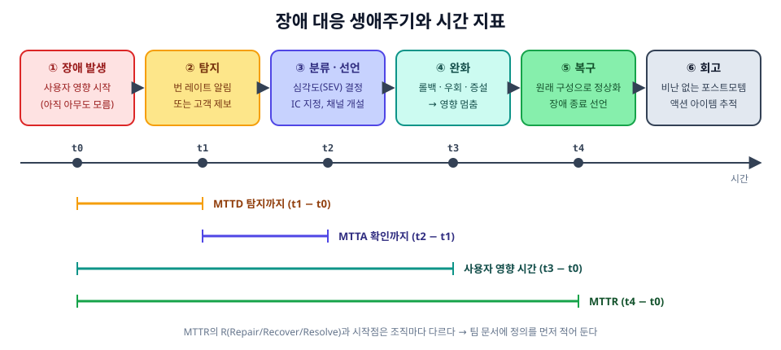
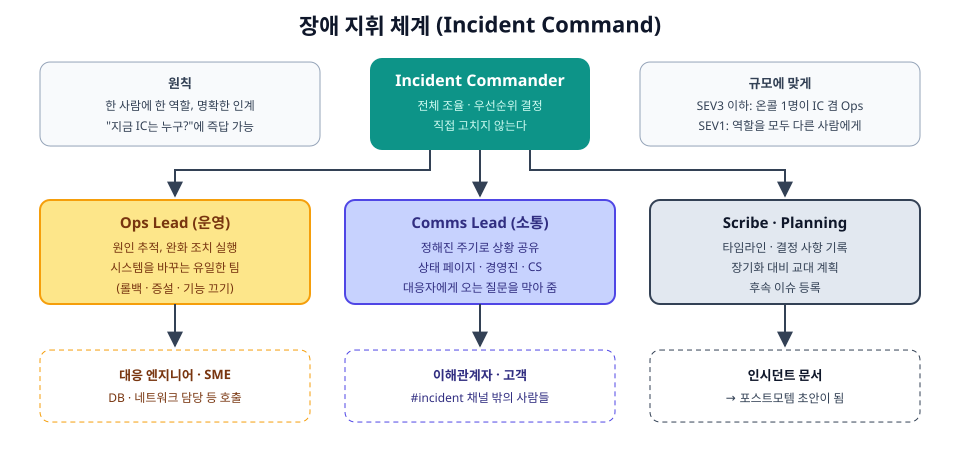
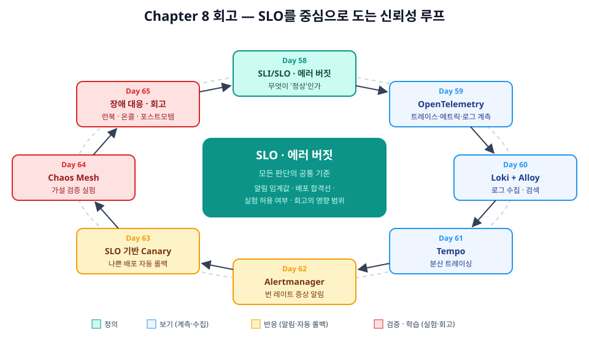

> **Chapter 8 · SRE & 관측성** | 난이도 ★★★☆☆ | 예상 소요 1.5 ~ 2시간

## 🎯 오늘의 목표

- 장애 대응의 흐름(**탐지 → 분류/심각도 → 지휘 체계 → 완화 → 복구 → 회고**)을 설명할 수 있다
- IC · Comms · Ops 역할을 나누는 이유를 알고, 심각도(SEV) 기준표를 만들 수 있다
- 알림에서 바로 열리는 **런북** 을 쓰고 Day 62의 알림 규칙에 연결할 수 있다
- 건강한 **온콜 로테이션** 의 조건을 안다
- **비난 없는 포스트모템** 을 쓰고, 액션 아이템을 끝까지 추적하며, MTTD/MTTR을 계산할 수 있다

---

## 1. 도구가 다 있어도 장애는 사람이 끝낸다

Chapter 8에서 만든 것들을 장애 하나에 겹쳐 보면 이렇습니다.

| 순간 | 쓰는 도구 | 사람이 해야 하는 일 |
|---|---|---|
| 무언가 나빠짐 | SLO 번 레이트 알림 (Day 62) | 알림을 받고 **"진짜 장애인가?"** 판단 |
| 어디가 문제인가 | 대시보드, Loki 로그(Day 60), Tempo 트레이스(Day 61) | 가설을 세우고 좁혀 가기 |
| 무엇을 할까 | Argo CD 롤백(Day 53), Rollouts abort(Day 56/63) | **누가 결정하고 누가 실행하나?** |
| 바깥에 뭐라고 말하나 | 상태 페이지, 메신저 | 누가, 얼마나 자주? |
| 다시 안 나게 하려면 | 이슈 트래커 | 원인 분석, 개선 항목, 끝까지 추적 |

도구는 신호를 줄 뿐이고, 판단·조율·소통·학습은 **정해진 절차와 역할** 이 있어야 빨라집니다. 장애 중에는 누구나 머리가 잘 안 돌아가기 때문에 "그때 가서 생각하자"는 통하지 않습니다. 오늘은 그 절차를 미리 만들어 둡니다.

---

## 2. 장애 대응 생애주기



| 단계 | 핵심 질문 | 끝나는 시점 |
|---|---|---|
| **① 장애 발생** | — | 사용자 영향이 시작된 순간(t0). 보통 나중에 그래프를 보고 역산 |
| **② 탐지** | 누가/무엇이 처음 알았나? | 알림 발생 또는 제보 접수(t1) |
| **③ 분류 · 선언** | 얼마나 심각한가? 누가 지휘하나? | 온콜이 확인하고 SEV를 정해 장애를 **선언**(t2) |
| **④ 완화** | 사용자 고통을 지금 당장 멈추려면? | 사용자 영향이 멈춤(t3) |
| **⑤ 복구** | 원래 상태로 돌리려면? | 임시 조치를 걷고 정상 구성으로 돌아와 장애 종료 선언(t4) |
| **⑥ 회고** | 왜 일어났고, 무엇을 바꿀까? | 포스트모템 공유 + 액션 아이템 완료 |

### 2-1. 완화가 먼저, 원인은 나중

가장 중요한 원칙입니다. **장애 중의 목표는 원인 규명이 아니라 사용자 영향을 멈추는 것** 입니다.

| 상황 | 원인부터 찾는 대응 | 완화부터 하는 대응 |
|---|---|---|
| 배포 10분 뒤 에러율 급등 | 코드 diff를 읽기 시작 | **일단 롤백**(Argo CD 이전 리비전, Rollouts abort) 후 diff 분석 |
| 노드 하나가 이상하게 느림 | 노드에 들어가 `tcpdump` | **cordon 후 Pod 재배치**, 노드는 나중에 분석 |
| 트래픽 폭증 | 어디서 오는 트래픽인지 조사 | **증설**(Day 18 HPA 상한 올리기) 또는 rate limit |

> 💡 그래서 Chapter 7에서 만든 "Git 리버트 = 롤백" 경로와 Day 63의 자동 롤백이 중요합니다. **완화 수단이 미리 준비되어 있고 연습되어 있어야** 완화가 빠릅니다.

### 2-2. 심각도(SEV) 기준표

심각도는 **"얼마나 많은 사람을 얼마나 빨리 불러야 하나"** 를 정하는 장치입니다. 기준은 조직마다 다르지만, 반드시 **장애 전에** 문서로 정해 둡니다. 아래는 예시입니다.

| 등급 | 기준 (예시) | 대응 | 상황 공유 주기 |
|---|---|---|---|
| **SEV1** | 핵심 기능 전체 중단, 데이터 손실·보안 사고, 에러 버짓을 몇 시간 안에 소진하는 속도 | 즉시 호출, IC·Comms·Ops 분리, 경영진 공유 | 30분 |
| **SEV2** | 주요 기능 일부 중단 또는 큰 성능 저하, Day 62의 빠른 번 레이트(page) 알림 | 즉시 호출, IC 지정 | 1시간 |
| **SEV3** | 일부 사용자 불편, 우회 가능, 느린 번 레이트(ticket) 알림 | 근무 시간 내 대응 | 필요 시 |
| **SEV4** | 사용자 영향 없음 (내부 도구, 경고성) | 이슈로 등록 | — |

> ⚠️ 애매하면 **높은 등급으로 선언하고 나중에 낮춥니다.** 낮게 잡았다가 올리면 그사이 사람을 못 부른 시간이 생기지만, 높게 잡았다 낮추는 비용은 몇 사람의 몇 분뿐입니다.

---

## 3. 지휘 체계 — IC, Comms, Ops



Google SRE 책의 "Managing Incidents" 장은 소방 현장의 지휘 체계(Incident Command System)를 본떠 역할을 **지휘(Incident Command), 운영(Operational Work), 소통(Communication), 계획(Planning)** 으로 나눕니다. 실무에서는 보통 다음처럼 부릅니다.

| 역할 | 하는 일 | 하지 않는 일 |
|---|---|---|
| **IC (Incident Commander)** | 상황 파악, 우선순위 결정, 역할 배정, 에스컬레이션, 종료 선언 | 직접 키보드를 잡고 고치기 |
| **Ops Lead** | 원인 추적과 완화 조치 실행. **시스템을 바꾸는 사람은 Ops 팀뿐** | 바깥 문의에 답하기 |
| **Comms Lead** | 정해진 주기로 상황 공유(내부 채널, 상태 페이지, CS·경영진) | 기술 조치 |
| **Scribe / Planning** | 타임라인·결정 기록, 장기화 시 교대 계획, 후속 이슈 등록 | — |
| **SME** | DB·네트워크 등 특정 분야 전문가. Ops Lead가 호출 | — |

왜 이렇게 나눌까요? 장애 중 가장 흔한 실패는 **모두가 동시에 고치려 들거나**(서로의 조치가 충돌), **아무도 바깥에 말하지 않거나**(경영진과 CS가 대응자에게 직접 질문해 흐름을 끊음), **누가 결정권자인지 모르는 것** 입니다. 역할을 나누면 이 세 가지가 사라집니다.

### 3-1. 장애 선언과 소통 템플릿

장애를 선언할 때 전용 채널(예: `#inc-20261112-latency`)을 열고 첫 메시지를 고정합니다.

```text
🚨 [SEV2] demo-app(prod) 응답 지연 — 장애 선언 (14:14 KST)
- 영향: 사용자 요청 약 절반이 느림 (p99 약 400ms, SLO 300ms)
- IC: @kim  / Ops: @lee  / Comms: @park  / Scribe: @choi
- 다음 업데이트: 15:14 KST
- 인시던트 문서: <링크>
```

Comms Lead의 정기 업데이트는 **현재 상태 / 지금 하는 일 / 다음 업데이트 시각** 세 가지만 담습니다. "원인을 아직 모른다"도 훌륭한 업데이트입니다. 침묵이 가장 나쁜 업데이트입니다.

> 💡 작은 팀이라면 SEV3 이하는 온콜 1명이 IC와 Ops를 겸해도 됩니다. 중요한 것은 **"지금 IC가 누구인가?"에 누구든 즉답할 수 있는 것**, 그리고 IC를 넘길 때 "IC를 @lee에게 넘깁니다"라고 **명시적으로 인계** 하는 것입니다.

---

## 4. 런북 — 새벽 3시의 나를 위한 문서

런북(runbook, playbook)은 **특정 알림을 받았을 때 무엇을 볼지, 무엇을 할지** 를 적은 문서입니다. 좋은 런북의 조건은 다음과 같습니다.

| 좋은 런북 | 나쁜 런북 |
|---|---|
| **알림 하나에 런북 하나**, 알림에서 바로 링크 | 위키 어딘가에 "장애 대응 가이드" 한 덩어리 |
| 복사해서 바로 실행할 수 있는 명령과 쿼리 | "로그를 확인한다" |
| **완화 조치가 맨 앞** | 시스템 설명이 세 페이지 |
| 에스컬레이션 대상이 이름·채널로 적힘 | "담당자에게 연락" |
| 마지막 검증 날짜가 있음(Game Day에서 검증) | 2년 전 작성, 이후 아무도 안 봄 |

### 4-1. 런북 템플릿 (전문)

Day 62는 알림의 `runbook_url`을 `https://github.com/<your-org>/runbooks/blob/main/gitops-demo-app/slo-burn.md`로 가리켰습니다. 그 `runbooks` 레포에 **알림 하나당 파일 하나** 를 둡니다. Day 62에서 만든 가용성 번 레이트 알림(`SLOErrorBudgetBurnFast`)용 `slo-burn.md`도 같은 템플릿으로 쓰면 되고, 아래는 Day 58의 지연 SLI(`namespace:sli_latency_300ms:ratio_rate5m`)에 같은 방식으로 지연 번 레이트 알림 `SLOLatencyBudgetBurnFast`를 추가했다고 가정한 `gitops-demo-app/latency-slo-burn.md` 예시입니다.

```markdown
# 런북: SLOLatencyBudgetBurnFast

| 항목 | 내용 |
|---|---|
| 서비스 | 데모 앱 (prod: 네임스페이스 demo-prod, 워크로드·Service prod-demo-app / dev: demo-dev, dev-demo-app) |
| 알림 | SLOLatencyBudgetBurnFast (severity: page, Day 62 방식의 PrometheusRule) |
| SLO | 요청의 99%가 300ms 이내 (30일) |
| 담당 팀 / 채널 | platform 팀 / #team-platform |
| 에스컬레이션 | 30분 내 완화 실패 시 → 2차 온콜, SEV1 판단 시 → 팀 리드 |
| 마지막 검증 | 2026-11-12 Game Day (Day 64 NetworkChaos delay) |

## 1. 이 알림의 의미
지연 SLO 에러 버짓을 평소보다 빠르게 소진 중. page 등급이면 이 속도로 몇 시간~며칠 안에 월 버짓을 다 쓴다.
사용자 일부가 느린 응답을 경험하고 있다.

## 2. 먼저 확인 (5분 안에)
1. 영향 범위: Grafana "demo-app SLO" 대시보드 → 지연 SLI, 가용성, 요청 수 패널
2. 최근 변경이 있었나?
   - `argocd app history gitops-demo-prod`
   - `kubectl argo rollouts get rollout prod-demo-app -n demo-prod` (Rollouts 사용 시)
3. 특정 Pod/노드에 몰려 있나?
   - `kubectl -n demo-prod get pods -o wide`
   - Grafana Explore(Prometheus):
     `histogram_quantile(0.99, sum by (le, pod) (rate(http_request_duration_seconds_bucket{namespace="demo-prod", route!="/healthz"}[5m])))`
4. 느린 요청의 트레이스: Grafana Explore(Tempo) → `{ resource.service.name = "gitops-demo-app" && duration > 300ms }`
5. 실험 중인가? `kubectl get networkchaos,stresschaos,podchaos,workflow -A`
   - 카오스 실험이 원인이면 해당 리소스를 삭제하고 Game Day 진행자에게 알린다

## 3. 완화 (원인을 몰라도 먼저 실행)
| 상황 | 조치 |
|---|---|
| 최근 30분 내 배포가 있음 | 롤백: 설정 레포에서 이미지 태그 커밋을 `git revert` 후 push, 또는 `kubectl argo rollouts abort prod-demo-app -n demo-prod` |
| 특정 노드의 Pod만 느림 | `kubectl cordon <노드>` → `kubectl -n demo-prod delete pod <느린 Pod>` (다른 노드로 재스케줄) |
| 전체가 느리고 CPU 사용률 높음 | `kubectl -n demo-prod scale deploy prod-demo-app --replicas=<현재+2>` (Rollout이면 `kubectl argo rollouts scale prod-demo-app 4 -n demo-prod`) (Argo CD self-heal이 되돌리지 않게 설정 레포에도 반영) |
| 위 어느 것도 아님 | 에스컬레이션, SEV 재판단 |

## 4. 복구 확인
- p99가 15분 이상 SLO 아래 유지
- 번 레이트 알림 resolved
- cordon한 노드가 있다면 원인 확인 후 `kubectl uncordon <노드>`

## 5. 사후 작업
- SEV2 이상이면 포스트모템 작성 (템플릿: postmortems/TEMPLATE.md)
- 이 런북에서 틀렸거나 빠진 내용을 바로 수정 (PR)
```

### 4-2. 알림에 런북 연결하기

Day 62에서 본 것처럼 PrometheusRule의 `runbook_url` 어노테이션이 Alertmanager 알림(Slack 메시지 등)에 링크로 따라갑니다. kube-prometheus-stack의 기본 규칙들도 같은 이름의 어노테이션을 씁니다. 새로 추가한 지연 알림에도 빠뜨리지 않습니다.

```yaml
# Day 62 PrometheusRule의 alerts 그룹에 추가하는 지연 알림
- alert: SLOLatencyBudgetBurnFast
  # expr: 지연 SLI의 "느린 요청 비율"로 Day 62 page 조건(1h·5m ×14.4, 6h·30m ×6)과 같은 구조를 만든다
  for: 2m
  labels:
    severity: page
  annotations:
    summary: "demo-app 지연 SLO 에러 버짓이 빠르게 소진 중"
    runbook_url: "https://github.com/<your-org>/runbooks/blob/main/gitops-demo-app/latency-slo-burn.md"
```

Day 62의 Slack 템플릿은 이미 `{{ .Annotations.runbook_url }}`를 본문에 넣고 있으므로, 어노테이션만 채우면 알림 메시지에 런북 링크가 함께 나갑니다.

> 💡 **런북의 최종 진화형은 자동화** 입니다. 런북의 "완화" 표에서 매번 똑같이 실행하는 줄이 있다면, 그건 Day 63처럼 자동 롤백으로 만들거나 스크립트로 만들 후보입니다. 반대로 사람이 판단해야 하는 부분은 런북에 남깁니다.

---

## 5. 건강한 온콜

온콜은 "알림을 받는 당번"입니다. 지속 가능하지 않은 온콜은 사람을 지치게 하고, 지친 사람은 장애를 더 오래 끌고, 결국 팀을 떠납니다.

### 5-1. 로테이션 설계

| 항목 | 권장 | 이유 |
|---|---|---|
| 주기 | 1주 단위, 정해진 요일·시각에 인계 | 예측 가능해야 개인 일정을 잡을 수 있음 |
| 인원 | 1차 + 2차(백업) | 1차가 응답 못 할 때(이동 중, 아픔) 자동 에스컬레이션 |
| 팀 규모 | 한 로테이션에 충분한 인원 (Google SRE 책은 단일 사이트 기준 최소 8명 정도를 제시) | 너무 자주 돌아오면 번아웃 |
| 시간대 | 가능하면 Follow-the-sun(시간대가 다른 팀끼리 교대) | 야간 호출 자체를 없앰 |
| 인계 | 인계 미팅 또는 문서: 진행 중 이슈, 미해결 알림, 예정된 배포·실험 | 맥락 단절 방지 |
| 보상 | 온콜 수당 또는 대체 휴무 | 온콜은 업무다 |

Alertmanager 자체는 "누가 이번 주 당번인지"를 모릅니다. 실제 호출 순서·에스컬레이션·당번 일정은 PagerDuty 같은 온콜 관리 도구에 두고, Alertmanager(Day 62)의 receiver를 그 도구로 연결하는 것이 일반적입니다. 작은 팀이라면 팀 캘린더 + Slack 그룹 멘션으로 시작해도 됩니다.

### 5-2. 온콜 건강 지표

| 지표 | 건강 기준 (예시) | 나쁘면 |
|---|---|---|
| 온콜 1교대(12시간)당 장애 수 | **2건 이하** (Google SRE 책: 장애 하나를 제대로 처리하고 사후 작업까지 하려면 시간이 든다는 근거) | 시스템 개선에 시간을 써야 한다는 신호 |
| 야간 호출 수 | 주 1회 미만 | page 기준을 낮추고 ticket으로 돌릴 것(Day 62) |
| **행동할 필요가 없었던 알림 비율** | 0에 가깝게 | 알림 삭제 또는 임계값 조정 |
| 온콜 시간 중 운영 업무 비율 | 팀 시간의 일부로 상한을 둠 | 수작업(toil)을 자동화하는 데 시간을 배정 |

> ⚠️ "알림이 많이 오는 것"을 성실함의 증거로 보면 안 됩니다. Day 62에서 다룬 알림 피로의 끝은 **진짜 알림을 놓치는 것** 입니다. 온콜이 끝날 때마다 "이번 주 알림 중 행동이 필요 없었던 것"을 골라 지우거나 고치는 것을 인계 절차에 넣으세요.

---

## 6. 비난 없는(Blameless) 포스트모템

### 6-1. 왜 "비난 없는"인가

장애 뒤에 "누가 잘못했나"를 찾으면, 다음부터 사람들은 **실수를 숨깁니다.** 숨겨진 실수는 고칠 수 없고, 같은 장애가 다시 납니다. 비난 없는 포스트모템은 다음을 전제로 합니다.

- 그 순간 그 사람은 **가진 정보와 도구 안에서 합리적인 판단** 을 했다
- 사람이 실수할 수 있는 구조라면 **구조가 문제** 다 (예: 운영 DB를 지우는 명령이 확인 없이 실행되는 구조)
- 목적은 처벌이 아니라 **학습과 재발 방지** 다

| 비난하는 문장 | 비난 없는 문장 |
|---|---|
| "이씨가 잘못된 설정을 배포했다." | "잘못된 설정이 리뷰와 CI를 통과해 배포되었다. 해당 설정을 검증하는 단계가 없었다." |
| "온콜이 알림을 늦게 봤다." | "알림이 다른 알림 12건과 같은 채널에 섞여 우선순위를 구분하기 어려웠다." |
| "왜 확인 안 했어요?" | "그 시점에 무엇이 보였나요? 무엇이 있었다면 다르게 판단했을까요?" |

### 6-2. 언제 쓰나

- SEV1, SEV2는 **항상**
- 에러 버짓을 한 번에 일정 비율 이상(예: 월 버짓의 20%) 쓴 경우
- 데이터 손실, 보안 관련, 수동 롤백이 필요했던 경우
- 사용자 영향은 없었지만 **아슬아슬했던 경우(near miss)**, Game Day에서 가설이 깨진 경우

작성 기한(예: 5영업일)과 **리뷰 미팅** 을 정해 둡니다. 쓰고 아무도 안 읽는 포스트모템은 쓰지 않은 것과 같습니다.

### 6-3. 포스트모템 템플릿 (전문)

런북과 같은 `runbooks` 레포의 `postmortems/TEMPLATE.md`로 저장하고, 장애마다 `postmortems/2026-11-12-latency.md`처럼 복사해 씁니다.

```markdown
# 포스트모템: <한 줄 제목>

| 항목 | 내용 |
|---|---|
| 장애 ID | INC-YYYYMMDD-NN |
| 심각도 | SEV? |
| 상태 | 초안 / 리뷰 중 / 확정 |
| 작성자 | |
| 리뷰어 | |
| 장애 기간 | YYYY-MM-DD HH:MM ~ HH:MM KST (총 N분) |
| 관련 SLO | |
| 소모한 에러 버짓 | 월 버짓의 N% |

> 이 문서는 비난 없는(blameless) 원칙으로 작성한다. 개인의 실수가 아니라 시스템과 절차의 개선점을 찾는다.

## 1. 요약
무슨 일이 있었고, 사용자에게 어떤 영향이 있었고, 어떻게 해결했는지 3~5문장.

## 2. 영향
- 영향받은 사용자/요청: 
- 영향받은 기능: 
- 데이터 손실: 있음/없음
- 외부 공지: 상태 페이지 게시 여부

## 3. 시간 지표
| 지표 | 시각 | 값 |
|---|---|---|
| 장애 시작 (t0) | | |
| 탐지 (t1) | | MTTD = t1 − t0 |
| 확인·선언 (t2) | | MTTA = t2 − t1 |
| 완화 (t3) | | 사용자 영향 시간 = t3 − t0 |
| 복구·종료 (t4) | | TTR = t4 − t0 |

## 4. 타임라인 (KST)
| 시각 | 사건 | 출처 |
|---|---|---|
| | | 알림 / 채팅 / 배포 이력 / 그래프 |

## 5. 원인 분석
### 5-1. 직접 원인 (Trigger)
### 5-2. 근본 원인과 기여 요인
- "왜?"를 여러 번 물어 구조적 원인까지 내려간다. 원인은 보통 하나가 아니다.
### 5-3. 탐지는 왜 그 시점이었나

## 6. 대응 평가
### 잘 된 것
### 잘 안 된 것
### 운이 좋았던 것

## 7. 액션 아이템
| # | 항목 | 유형 | 우선순위 | 담당 | 기한 | 이슈 |
|---|---|---|---|---|---|---|
| 1 | | 예방/탐지/완화/프로세스 | P0~P2 | | | |

## 8. 배운 것
다른 팀도 알아야 할 교훈.

## 부록
대시보드 스크린숏, 관련 PR, 채팅 로그 링크.
```

---

## 7. 포스트모템 작성 예시 — Day 64의 실험을 가상 장애로

Day 64에서 NetworkChaos `delay` 실험을 하며 "Pod 1개가 200ms 느려지면 p99 SLO가 깨진다"는 것을 확인했습니다. 이것이 운영에서 **진짜로** 일어났다고 가정하고 포스트모템을 써 봅니다. (아래 시각·숫자는 학습용 가상 값입니다.)

> 💡 직접 재현하고 싶다면 Day 64의 `exp2-network-delay.yaml`에서 `duration`을 `'30m'`으로 바꿔 걸고, 한 사람은 진행자, 한 사람은 4장의 런북만 보고 대응해 보세요. 알림·완화 시각을 기록하면 그대로 아래 문서의 3·4장이 됩니다.

```markdown
# 포스트모템: 워커 노드 네트워크 지연으로 prod-demo-app 지연 SLO 위반

| 항목 | 내용 |
|---|---|
| 장애 ID | INC-20261112-01 |
| 심각도 | SEV2 |
| 상태 | 확정 |
| 작성자 | 이OO (Ops Lead) |
| 리뷰어 | 김OO (IC), platform 팀 |
| 장애 기간 | 2026-11-12 14:02 ~ 14:51 KST (총 49분) |
| 관련 SLO | 지연: 요청의 99%가 300ms 이내 (30일) |
| 소모한 에러 버짓 | 지연 SLO 월 버짓의 약 31% |

> 이 문서는 비난 없는(blameless) 원칙으로 작성한다.

## 1. 요약
worker 노드 1대의 네트워크에 약 200ms의 지연이 생겨, 그 노드에 있던 prod-demo-app Pod 1개(전체 2개 중)의
모든 응답이 느려졌다. 요청의 약 절반이 300ms를 넘겼다. readinessProbe는 계속 성공했기 때문에 느린 Pod가
Service에서 빠지지 않았다. 빠른 번 레이트 알림으로 9분 뒤 탐지했고, 노드 cordon과 Pod 재배치로 23분 뒤 완화했다.

## 2. 영향
- 영향받은 요청: 장애 구간 요청의 약 48%가 300ms 초과 (p99 약 430ms)
- 영향받은 기능: 전체 API (에러는 없었고 지연만 발생)
- 데이터 손실: 없음
- 외부 공지: 상태 페이지에 "일부 응답 지연" 게시 (14:20)

## 3. 시간 지표
| 지표 | 시각 | 값 |
|---|---|---|
| 장애 시작 (t0) | 14:02 | 그래프에서 p99 상승 시작 시점 |
| 탐지 (t1) | 14:11 | MTTD = 9분 |
| 확인·선언 (t2) | 14:14 | MTTA = 3분 |
| 완화 (t3) | 14:25 | 사용자 영향 시간 = 23분 |
| 복구·종료 (t4) | 14:51 | TTR = 49분 |

## 4. 타임라인 (KST)
| 시각 | 사건 | 출처 |
|---|---|---|
| 14:02 | worker 노드 1대에서 네트워크 지연 시작. p99 상승 | Grafana |
| 14:11 | SLOLatencyBudgetBurnFast (page) 발생 → 1차 온콜 호출 | Alertmanager |
| 14:14 | 온콜이 영향 확인, SEV2 선언, #inc-20261112-latency 개설. IC 김OO, Ops 이OO | Slack |
| 14:16 | 최근 배포 없음 확인 (argocd app history) → 롤백 후보 제외 | 런북 2단계 |
| 14:19 | Pod별 p99 쿼리로 Pod 1개만 느린 것 확인. Tempo 트레이스에서 앱 내부 구간은 정상, 네트워크 구간만 지연 | Grafana |
| 14:20 | Comms: 상태 페이지 게시 | 상태 페이지 |
| 14:23 | 느린 Pod가 있는 노드 cordon, Pod 삭제 | 런북 3단계 |
| 14:25 | 새 Pod가 다른 노드에서 Ready. p99 정상화 시작 → 완화 | Grafana |
| 14:40 | 해당 노드의 네트워크 지연 원인 확인 (노드 측 문제, 부록 참고) | |
| 14:51 | p99가 15분간 SLO 이하 유지, 알림 resolved. 장애 종료 선언 | Slack |

## 5. 원인 분석
### 5-1. 직접 원인
worker 노드 1대의 네트워크 지연(+약 200ms).

### 5-2. 근본 원인과 기여 요인
1. 노드 하나의 이상이 사용자 요청의 절반에 영향을 줬다.
   - 왜? replicas가 2개뿐이라 Pod 1개 = 트래픽의 50%.
2. 느린 Pod가 트래픽에서 빠지지 않았다.
   - 왜? readinessProbe는 /healthz 성공 여부만 보며, 기본 타임아웃(1초) 안에서는 200ms 지연을 실패로 보지 않는다.
   - 왜? 지금의 Service 부하 분산에는 "느린 엔드포인트를 빼는" 기능(이상치 감지)이 없다.
3. Pod 2개가 같은 장애 영역(노드)에 몰릴 수 있는 구조였다.
   - 왜? topologySpreadConstraints / anti-affinity가 설정되지 않았다. (이번에는 우연히 다른 노드였다.)

### 5-3. 탐지는 왜 9분이 걸렸나
빠른 번 레이트 알림은 짧은 창과 긴 창을 함께 만족해야 발생한다(Day 62). 요청의 절반만 느렸기 때문에
버짓 소진 속도가 임계값을 넘기까지 시간이 걸렸다. 설계대로 동작한 것이며, 더 줄이려면 알림 정밀도와의 균형을 봐야 한다.

## 6. 대응 평가
### 잘 된 것
- 런북의 "최근 배포 확인 → Pod별 p99" 순서 덕분에 5분 만에 범위를 좁혔다.
- 원인을 다 알기 전에 cordon + 재배치로 먼저 완화했다.
- 이 시나리오는 11월 초 Game Day(Day 64)에서 이미 연습한 것이었다.

### 잘 안 된 것
- Pod별 p99 쿼리가 대시보드에 없어 Explore에서 직접 입력해야 했다.
- 서버 측 메트릭만 있어서 실제 사용자 체감 지연을 정확히 알기 어려웠다.

### 운이 좋았던 것
- 두 Pod가 우연히 다른 노드에 있었다. 같은 노드였다면 전체 요청이 느려졌다.
- 장애가 근무 시간에 일어났다.

## 7. 액션 아이템
| # | 항목 | 유형 | 우선순위 | 담당 | 기한 | 이슈 |
|---|---|---|---|---|---|---|
| 1 | topologySpreadConstraints로 Pod를 노드별로 분산 | 예방 | P0 | 이OO | 11-19 | #41 |
| 2 | prod replicas 2 → 3 | 예방 | P1 | 이OO | 11-19 | #42 |
| 3 | SLO 대시보드에 "Pod별 p99" 패널 추가 | 탐지 | P1 | 박OO | 11-21 | #43 |
| 4 | Gateway 메트릭 또는 blackbox 프로브로 클라이언트 측 SLI 추가 | 탐지 | P1 | 최OO | 12-05 | #44 |
| 5 | 느린 엔드포인트 자동 제외(서비스 메시 이상치 감지) 검토 → Chapter 9 Day 70과 연계 | 완화 | P2 | 김OO | 12-19 | #45 |
| 6 | 런북에 "노드 cordon 후 원인 확인 절차" 보강 | 프로세스 | P2 | 이OO | 11-19 | #46 |

## 8. 배운 것
- readiness 성공은 "빠르다"를 뜻하지 않는다. 느린 것도 장애다.
- replicas 수는 "장애 영역 하나를 잃었을 때 남는 비율"로 정해야 한다.
- Game Day에서 연습한 시나리오는 실제 대응 시간을 확실히 줄였다.
```

### 7-1. 좋은 포스트모템인지 점검하기

| 점검 항목 | 위 예시에서 |
|---|---|
| 사람 이름이 원인 자리에 없는가 | 원인은 노드·설정·구조로 서술됨 |
| 타임라인에 **출처** 가 있는가 | Alertmanager, Slack, Grafana |
| 원인이 하나로 끝나지 않는가 | 직접 원인 + 기여 요인 3개 |
| "운이 좋았던 것"이 있는가 | 다음 장애에서는 운이 없을 수 있음을 기록 |
| 액션 아이템이 **구체적이고 담당·기한·이슈가 있는가** | 6개 모두 있음. "모니터링 강화" 같은 모호한 항목 없음 |

---

## 8. 액션 아이템 추적 — 포스트모템의 진짜 결과물

포스트모템 문서는 잘 썼는데 액션 아이템이 백로그에서 잊히면, 같은 장애가 다시 납니다. 액션 아이템은 **팀이 평소 쓰는 이슈 트래커** 에 넣고 라벨로 묶습니다. GitHub CLI(`gh`) 예시입니다.

```bash
# 라벨은 한 번만 만든다
gh label create postmortem --color B60205 --description "포스트모템 액션 아이템"
gh label create "INC-20261112-01" --color FBCA04

# 액션 아이템을 이슈로 등록
gh issue create \
  --title "[INC-20261112-01] topologySpreadConstraints로 Pod 노드 분산" \
  --body "포스트모템: postmortems/2026-11-12-latency.md 액션 아이템 #1" \
  --label postmortem --label "INC-20261112-01" \
  --assignee "@me"

# 열려 있는 포스트모템 액션 아이템 조회 (주간 회의에서)
gh issue list --label postmortem --state open
```

추적 원칙은 다음과 같습니다.

| 원칙 | 방법 |
|---|---|
| 담당자는 사람 한 명 | 팀 이름이 담당이면 아무도 안 함 |
| 기한과 우선순위 | P0는 다음 스프린트 안 |
| 정기 점검 | 주간 운영 회의에서 `postmortem` 라벨 열린 이슈 검토 |
| 완료 = 검증 | 예: 토폴로지 분산을 적용한 뒤 Day 64 pod-kill·delay 실험으로 **다시 검증** 하고 닫기 |

> 💡 마지막 줄이 Chapter 8의 루프를 닫습니다. **실험(Day 64) → 가설 깨짐 → 포스트모템 → 액션 아이템 → 수정 → 같은 실험으로 재검증.** 이 반복이 신뢰성을 실제로 끌어올립니다.

---

## 9. MTTD / MTTR — 숫자를 제대로 쓰기

| 지표 | 정의 | 줄이는 방법 |
|---|---|---|
| **MTTD** (Mean Time To Detect) | 장애 시작 → 탐지의 평균 | 증상 기반 알림, 번 레이트 창 조정(Day 62), 클라이언트 측 SLI |
| **MTTA** (Mean Time To Acknowledge) | 알림 → 사람이 확인의 평균 | 온콜 도구 에스컬레이션, 알림 피로 줄이기 |
| **MTTM** / 사용자 영향 시간 | 장애 시작 → 완화 | 미리 준비된 완화 수단(롤백, cordon, 증설), 런북 |
| **MTTR** | 장애 시작 → 복구의 평균. R은 Repair·Recover·Restore·Resolve 등 조직마다 다름 | 위 전부 + 연습(Game Day) |

여러 장애의 숫자는 포스트모템의 "3. 시간 지표" 표만 모아도 계산됩니다.

| 장애 | t1 − t0 | t4 − t0 |
|---|---|---|
| INC-20261112-01 | 9분 | 49분 |
| INC-20261103-02 | 4분 | 21분 |
| INC-20261021-01 | 27분 | 95분 |
| **평균** | **MTTD ≈ 13분** | **MTTR ≈ 55분** |

> ⚠️ 평균은 쉽게 오해를 부릅니다. 장애 수가 적으면 한 건이 평균을 크게 흔들고, 장애마다 규모도 다릅니다. **추세를 보는 용도** 로만 쓰고, 개인이나 팀 평가 지표로 쓰지 마세요. 숫자를 평가에 쓰는 순간 사람들은 장애를 늦게 "선언"하기 시작합니다(그러면 MTTR이 좋아 보이니까요). 또 MTTR보다 더 중요한 것은 **같은 원인의 장애가 다시 나지 않는 것** 입니다.

---

## 10. 트러블슈팅 — 장애 대응에서 흔한 실패

| 증상 | 원인 | 해결 |
|---|---|---|
| 장애 채널에 20명이 들어와 각자 다른 조치를 함 | IC가 없거나 역할이 선언되지 않음 | 선언 메시지에 IC/Ops/Comms를 명시. "시스템 변경은 Ops Lead 승인 후" 규칙 |
| 경영진이 대응 엔지니어에게 직접 DM으로 상황을 물음 | 정기 업데이트 부재 | Comms Lead 지정, 다음 업데이트 시각을 매번 약속 |
| 원인 찾느라 1시간, 롤백은 1분 | "원인부터" 습관 | 런북 맨 앞에 완화 표. 최근 배포가 있으면 일단 롤백 |
| 런북 명령이 동작하지 않음 | 런북이 오래됨, 검증 안 됨 | 런북에 "마지막 검증" 날짜, Game Day(Day 64)에서 런북만으로 대응해 보기 |
| 포스트모템 회의가 책임 추궁으로 흐름 | 비난 없는 원칙이 공유되지 않음 | 문서 상단에 원칙 명시, 진행자가 "누가" 질문을 "무엇이/어떻게"로 바꿈 |
| 같은 장애가 석 달 뒤 재발 | 액션 아이템이 백로그에 묻힘 | 이슈 트래커 + 라벨 + 주간 점검, 완료 조건에 재검증 포함 |
| 온콜이 매주 지쳐 있음 | 행동 불필요한 알림, 너무 작은 로테이션 | 알림 정리(Day 62), 로테이션 인원 확대, 교대당 장애 수 측정 |

---

## 11. Chapter 8 회고



| Day | 주제 | 한 줄 요약 |
|---|---|---|
| 58 | SLI/SLO와 에러 버짓 | "정상"을 숫자로 정의하고, 허용 실패량을 예산처럼 쓴다 |
| 59 | OpenTelemetry | 벤더 중립 계측으로 트레이스·메트릭·로그를 한 번에 |
| 60 | Loki와 Alloy | 라벨 기반 로그 저장과 수집 에이전트 (Promtail은 지원 종료) |
| 61 | Tempo | 요청 하나의 여정을 서비스 경계 너머까지 따라간다 |
| 62 | Alertmanager와 번 레이트 알림 | 원인이 아니라 증상(SLO 소진 속도)으로 사람을 부른다 |
| 63 | SLO 기반 Canary | 배포의 합격 기준을 SLO 쿼리로 자동 판정·롤백 |
| 64 | Chaos Mesh | 가설을 세우고 작게 망가뜨려 약점을 먼저 찾는다 |
| 65 | 장애 대응과 회고 | 역할·런북·온콜·비난 없는 포스트모템으로 사람의 과정을 다듬는다 |

Chapter 8의 핵심은 그림 가운데에 있습니다. **SLO가 모든 판단의 공통 기준** 이 됩니다. 알림 임계값(Day 62), 배포 합격선(Day 63), 실험 허용 여부(Day 64), 장애의 영향 범위와 포스트모템 작성 기준(Day 65)이 모두 같은 숫자에서 나옵니다. 그리고 회고에서 나온 교훈은 다시 SLO와 계측을 고치는 데 쓰여 루프가 돕니다.

이제 우리의 `infra-lab`은 **배포하고(Chapter 7), 보고, 반응하고, 검증하고, 배울 수 있는** 플랫폼이 되었습니다. 남은 큰 질문은 하나입니다. **이 시스템을 누군가 일부러 공격한다면?** 장애는 우연히 오지만 공격은 의도를 가지고 약한 곳을 찾아옵니다.

---

## 12. 핵심 정리

- 장애 대응 흐름: **탐지 → 분류/선언 → 지휘 체계 → 완화 → 복구 → 회고.** 장애 중 목표는 원인 규명이 아니라 **완화**
- 심각도 기준표와 역할(IC / Ops / Comms / Scribe)은 **장애 전에** 정한다. IC는 고치지 않고 조율한다
- 런북은 알림 하나에 하나, 완화 조치를 맨 앞에, `runbook_url` 어노테이션으로 알림에 연결, Game Day로 검증
- 건강한 온콜: 예측 가능한 로테이션, 1차·2차, 교대당 장애 수 관리, 행동 불필요한 알림 제거
- 비난 없는 포스트모템: 사람이 아니라 구조를 고친다. 타임라인·시간 지표·근본 원인·운 좋았던 것·**구체적인 액션 아이템**
- 액션 아이템은 이슈 트래커에서 라벨로 추적하고, 완료는 **같은 실험으로 재검증** 해서 확인
- MTTD/MTTR은 추세용. 정의를 문서화하고, 개인 평가에 쓰지 않는다

---

## 13. 셀프 체크

<details>
<summary>Q1. 배포 직후 에러율이 치솟았다. 원인 코드를 찾기 전에 먼저 해야 할 일은?</summary>

**완화** — 롤백입니다. 장애 중 목표는 사용자 영향을 멈추는 것이므로, 설정 레포의 이미지 태그 커밋을 revert하거나(Argo CD), Rollouts를 abort해 이전 버전으로 돌린 뒤 원인은 여유 있게 분석합니다.
</details>

<details>
<summary>Q2. IC가 직접 kubectl로 조치하면 안 되는 이유는?</summary>

IC의 일은 전체 상황 파악, 우선순위 결정, 역할 배정, 소통 조율입니다. 직접 조치에 몰두하면 전체를 보는 사람이 사라지고, 다른 대응자의 조치와 충돌해도 아무도 조정하지 못합니다. 작은 장애에서 겸임할 수는 있지만 SEV가 높을수록 분리해야 합니다.
</details>

<details>
<summary>Q3. 포스트모템에서 "운영자가 잘못된 명령을 실행했다"를 비난 없는 방식으로 다시 쓰면?</summary>

예: "운영 환경에 영향을 주는 명령이 확인 절차나 dry-run 없이 실행될 수 있었고, 개발/운영 컨텍스트가 터미널에서 구분되지 않았다." 사람이 아니라 실수를 가능하게 한 구조(권한, 확인 단계, 화면 표시)를 원인으로 서술하고 그 구조를 고치는 액션 아이템을 만듭니다.
</details>

<details>
<summary>Q4. 액션 아이템 "모니터링 강화"는 왜 나쁜 액션 아이템인가?</summary>

무엇을 언제 누가 하면 끝나는지 알 수 없어 완료 판정이 불가능하기 때문입니다. "SLO 대시보드에 Pod별 p99 패널 추가(담당 박OO, 11-21, #43)"처럼 구체적이고 검증 가능해야 합니다.
</details>

<details>
<summary>Q5. MTTR을 팀 성과 지표(KPI)로 삼으면 어떤 부작용이 생길 수 있나?</summary>

장애 선언을 늦추거나, 작은 장애를 장애로 기록하지 않거나, 완화만 하고 서둘러 종료를 선언하는 등 숫자를 좋게 보이게 하는 행동이 생깁니다. 결과적으로 학습 기회와 포스트모템이 줄어듭니다. MTTD/MTTR은 추세를 보는 용도로만 씁니다.
</details>

---

## ⏭️ 다음 예고 — Day 66. 위협 모델링과 클라우드 네이티브 보안 4C

**Chapter 9. 보안** 을 시작합니다. Chapter 8에서는 "우연히 고장 나는 시스템"을 다뤘다면, 이제는 **"누군가 의도적으로 노리는 시스템"** 을 다룹니다. 첫날은 도구보다 사고방식부터 — STRIDE로 우리 `infra-lab`과 `gitops-demo-app`의 위협을 찾아보고, Cloud · Cluster · Container · Code의 **4C 모델** 로 Chapter 9 전체(호스트 하드닝, 컨테이너·워크로드 보안, NetworkPolicy와 제로 트러스트, 시크릿·인증서, 런타임 탐지, SSO와 감사 로그)의 지도를 그립니다.
