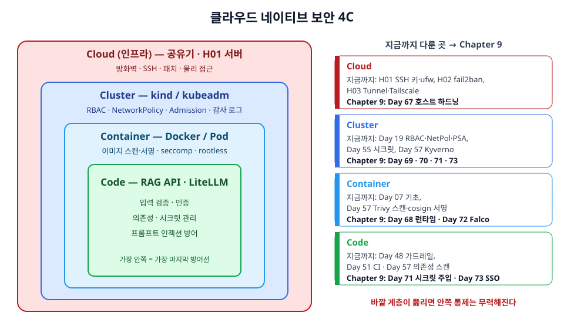
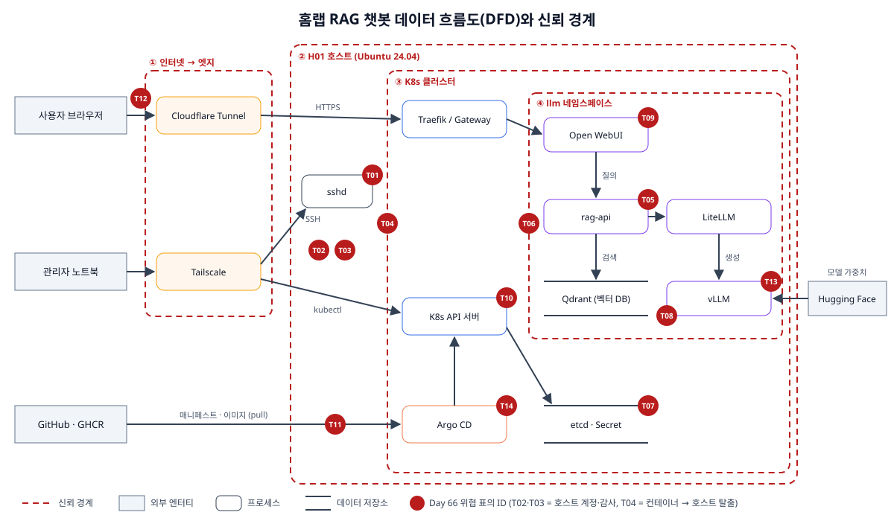
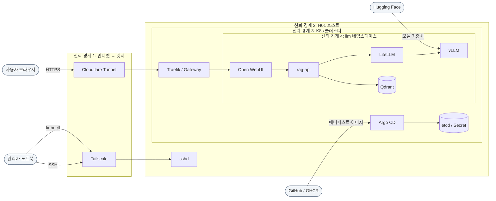
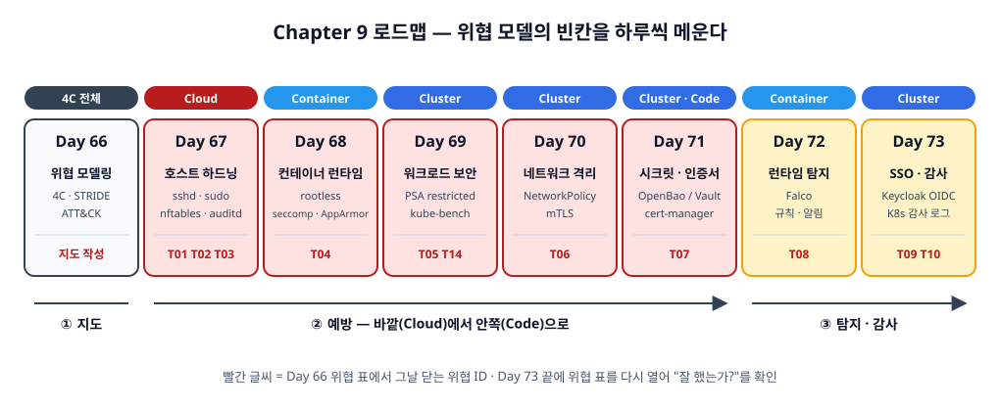

> **Chapter 9 · 보안** | 난이도 ★★★☆☆ | 예상 소요 2 ~ 2.5시간

## 🎯 오늘의 목표

- 클라우드 네이티브 보안의 **4C(Cloud · Cluster · Container · Code)** 계층을 설명하고, 지금까지 배운 보안 장치를 4C에 배치할 수 있다
- **위협 모델링**의 네 가지 질문과 **데이터 흐름도(DFD) · 신뢰 경계 · STRIDE**를 이해한다
- 이 시리즈의 **홈랩 + K8s + RAG 챗봇** 구성에 대해 공격 표면을 직접 조사하고 위협 모델을 그린다
- **MITRE ATT&CK for Containers**로 공격자의 행동을 단계별로 읽을 수 있다
- Chapter 9(Day 66~73)의 학습 경로를 위협 모델에서 끌어낸다

---

## 1. 왜 지금 보안 챕터인가?

Chapter 8까지 오면서 우리는 많은 것을 쌓았습니다. 홈랩 서버(H01~H03), Docker와 Kubernetes, GPU 위의 LLM 서빙과 RAG 챗봇(Chapter 6), GitOps 배포(Chapter 7), SLO와 관측성(Chapter 8)까지 갖췄죠. 보안 장치도 곳곳에 이미 넣었습니다.

| 이미 한 것 | 어디서 |
|---|---|
| SSH 키 인증, ufw, 자동 보안 업데이트 | Homelab 01 |
| fail2ban, 포트포워딩 최소화 | Homelab 02 |
| 포트를 열지 않는 공개(Cloudflare Tunnel, Tailscale) | Homelab 03 |
| capabilities · seccomp · AppArmor 기초, non-root | Day 07 |
| RBAC · NetworkPolicy · PSA 맛보기 | Day 19 |
| 프롬프트 인젝션 방어, 가드레일 | Day 48 |
| SOPS, External Secrets | Day 55 |
| Trivy, cosign, Kyverno | Day 57 |

문제는 이것들이 **그때그때 필요해서 붙인 조각**이라는 점입니다. "그래서 우리 시스템은 안전한가?"라는 질문에 답하려면 두 가지가 필요합니다.

1. **지도** — 보안 장치를 계층별로 정리하는 틀 → **4C 모델**
2. **질문 목록** — 무엇이 잘못될 수 있는지 빠짐없이 찾는 방법 → **위협 모델링(STRIDE)**

> 💡 Chapter 9는 "새 도구를 하나 더 설치"하는 챕터가 아니라, **오늘 그린 위협 모델의 빈칸을 하루씩 메우는** 챕터입니다. 그래서 오늘이 가장 중요합니다.

---

## 2. 클라우드 네이티브 보안 4C



4C는 Kubernetes 문서에서 널리 알려진 모델로, 보안을 **양파 껍질처럼 네 겹**으로 봅니다. 핵심은 한 문장입니다.

> **안쪽 계층은 바깥 계층이 뚫리면 지켜 주지 못한다.** Code를 아무리 잘 짜도 Cluster의 API 서버가 인터넷에 열려 있으면 소용이 없다.

| 계층 | 무엇을 지키나 | 이 시리즈의 홈랩에서는 | 대표 통제 수단 |
|---|---|---|---|
| **Cloud** (인프라) | 데이터센터, 네트워크, 호스트 OS | 공유기, 집 네트워크, **H01 Ubuntu 서버** | 방화벽, SSH 하드닝, 패치, 물리 접근 |
| **Cluster** | K8s 컨트롤 플레인과 그 위 리소스 | kind `infra-lab` / Day 20 kubeadm 클러스터 | RBAC, 감사 로그, NetworkPolicy, Admission, etcd 암호화 |
| **Container** | 이미지와 런타임 | Docker 컨테이너, Pod | 이미지 스캔·서명, non-root, seccomp, rootless |
| **Code** | 애플리케이션 자체 | FastAPI RAG API, LiteLLM 설정 | 입력 검증, 인증, 의존성 관리, 시크릿 하드코딩 금지, 프롬프트 인젝션 방어 |

> 💡 홈랩에서 "Cloud"는 AWS가 아니라 **내 공유기와 노트북 서버**입니다. 클라우드라면 공급자가 책임지는 부분(공동 책임 모델)을 홈랩에서는 전부 내가 책임집니다. 그래서 Day 67에서 호스트 하드닝을 따로 다룹니다.

> ⚠️ 최신 Kubernetes 영문 문서는 4C를 설명하던 "Overview of Cloud Native Security" 대신 **Cloud Native Security and Kubernetes** 페이지에서 **Develop → Distribute → Deploy → Runtime**이라는 수명 주기 단계로 설명합니다. 두 관점은 서로 보완합니다. 4C는 **어디(계층)**, 수명 주기는 **언제(단계)** 를 묻습니다. 이 챕터는 4C로 지도를 그리고, 각 Day에서 수명 주기 관점을 덧붙입니다.

### 지금까지 배운 보안 요소를 4C에 매핑하기

| 4C | 수명 주기 | 지금까지(Day) | 이번 챕터에서 채울 것 |
|---|---|---|---|
| **Cloud** | Runtime | H01 SSH 키·ufw·unattended-upgrades, H02 fail2ban, H03 Tunnel·Tailscale | **Day 67** sshd 심화, sudo 정책, nftables, auditd, Lynis/CIS |
| **Cluster** | Deploy / Runtime | **Day 19** RBAC·NetworkPolicy 기초·PSA 맛보기, **Day 55** SOPS·External Secrets, **Day 57** Kyverno(Admission) | **Day 69** PSA·kube-bench, **Day 70** NetworkPolicy 심화·mTLS, **Day 71** OpenBao/Vault·cert-manager, **Day 73** 감사 로그·SSO |
| **Container** | Distribute / Runtime | **Day 07** capabilities·seccomp·AppArmor 기초, **Day 57** Trivy 스캔·cosign 서명 | **Day 68** rootless·커스텀 seccomp·AppArmor, **Day 72** Falco 런타임 탐지 |
| **Code** | Develop | **Day 48** 프롬프트 인젝션·가드레일, **Day 57** 의존성 스캔(Trivy fs), Day 51 CI | 각 Day의 앱 설정(시크릿 주입, 인증 연동 — Day 71·73) |

> 💡 이 표를 보면 빈칸이 어디인지 보입니다. **호스트(Cloud)** 는 H01~H03 이후 손대지 않았고, **런타임 탐지**는 아예 없습니다. 위협 모델링은 이런 빈칸을 "느낌"이 아니라 **근거**로 찾는 방법입니다.

---

## 3. 위협 모델링이란?

위협 모델링은 **설계 단계에서 "무엇이 잘못될 수 있는가"를 체계적으로 찾는 활동**입니다. 해킹 기술이 아니라 **질문하는 방법**입니다. 업계에서 가장 많이 쓰는 틀은 네 가지 질문입니다.

| # | 질문 | 오늘 실습에서 하는 일 |
|---|---|---|
| 1 | **우리는 무엇을 만들고 있나?** | 공격 표면 조사 + 데이터 흐름도(DFD) 그리기 |
| 2 | **무엇이 잘못될 수 있나?** | 요소별로 STRIDE 적용 |
| 3 | **그것에 대해 무엇을 할 것인가?** | 완화책을 정하고 Day 67~73에 배정 |
| 4 | **잘 했는가?** | Day 73 끝에 위협 모델을 다시 열어 상태 갱신 |

### 3-1. 데이터 흐름도(DFD)의 다섯 가지 기호

| 요소 | 의미 | 그리는 법 | 예 |
|---|---|---|---|
| **외부 엔터티** | 내가 통제하지 못하는 사람·시스템 | 사각형 | 사용자 브라우저, GitHub, Hugging Face |
| **프로세스** | 데이터를 처리하는 코드 | 둥근 사각형/원 | rag-api, LiteLLM, vLLM, Argo CD |
| **데이터 저장소** | 데이터가 머무는 곳 | 위아래 두 줄 | Qdrant, PVC, etcd, Git 저장소 |
| **데이터 흐름** | 데이터가 이동하는 경로 | 화살표 | HTTPS 요청, gRPC, kubectl API 호출 |
| **신뢰 경계** | 신뢰 수준이 바뀌는 선 | 점선 | 인터넷↔집, 호스트↔컨테이너, 네임스페이스↔네임스페이스 |

> 💡 **위협은 대부분 신뢰 경계를 넘는 화살표에서 생깁니다.** DFD를 그린 뒤 가장 먼저 할 일은 "점선을 가로지르는 화살표"에 형광펜을 칠하는 것입니다.

### 3-2. STRIDE — 여섯 가지 위협 범주

STRIDE는 Microsoft가 만든 분류법으로, 각 글자가 **깨지는 보안 속성** 하나에 대응합니다.

| 위협 | 깨지는 속성 | 질문 | 홈랩 예 | 대표 완화책 |
|---|---|---|---|---|
| **S**poofing (위장) | 인증 | 누군가 다른 존재인 척할 수 있나? | 유출된 kubeconfig로 관리자 행세 | 강한 인증, mTLS, SSO(Day 73) |
| **T**ampering (변조) | 무결성 | 데이터/코드를 몰래 바꿀 수 있나? | 레지스트리 이미지 바꿔치기 | 서명 검증(Day 57), read-only FS(Day 68) |
| **R**epudiation (부인) | 부인 방지 | "내가 안 했다"고 잡아뗄 수 있나? | 누가 Secret을 지웠는지 기록 없음 | 감사 로그(Day 67 auditd, Day 73 K8s audit) |
| **I**nformation Disclosure (정보 노출) | 기밀성 | 볼 수 없어야 할 것을 볼 수 있나? | RAG가 권한 없는 문서를 답변에 인용 | 암호화, 최소 권한, 출력 필터(Day 48) |
| **D**enial of Service (서비스 거부) | 가용성 | 서비스를 멈추게 할 수 있나? | 긴 프롬프트 폭탄으로 GPU 독점 | 리소스 제한, 레이트 리밋(Day 18·40) |
| **E**levation of Privilege (권한 상승) | 인가 | 허용된 것보다 더 많은 권한을 얻을 수 있나? | privileged Pod에서 노드 탈출 | PSA(Day 69), seccomp/AppArmor(Day 68) |

STRIDE를 쓰는 가장 쉬운 방법은 **STRIDE-per-element**입니다. DFD의 요소 종류마다 해당될 수 있는 위협이 정해져 있습니다.

| 요소 | S | T | R | I | D | E |
|---|---|---|---|---|---|---|
| 외부 엔터티 | ✅ | | ✅ | | | |
| 프로세스 | ✅ | ✅ | ✅ | ✅ | ✅ | ✅ |
| 데이터 저장소 | | ✅ | △(로그일 때) | ✅ | ✅ | |
| 데이터 흐름 | | ✅ | | ✅ | ✅ | |

---

## 4. 실습 — 홈랩 RAG 챗봇의 위협 모델 그리기

> **실습 환경**: 홈랩 H01(Ubuntu 24.04) + Day 09의 kind 클러스터 `infra-lab`(또는 Day 20 kubeadm 클러스터). Chapter 6~8에서 배포한 RAG 챗봇·GitOps·모니터링 구성이 일부만 있어도 됩니다. `jq`가 필요합니다(`sudo apt install -y jq`).

### 4-1. 질문 1: 우리는 무엇을 만들고 있나? — 공격 표면 조사

그림부터 그리면 상상 속 시스템을 그리게 됩니다. **실제로 떠 있는 것**을 먼저 조사합니다.

**① 호스트에서 열려 있는 포트**

```bash
sudo ss -tlnp | awk 'NR==1 || $4 !~ /^127\.|^\[::1\]/'
```

```
State  Recv-Q Send-Q Local Address:Port  Peer Address:Port Process
LISTEN 0      4096         0.0.0.0:22         0.0.0.0:*     users:(("sshd",pid=1021,fd=3),("systemd",pid=1,fd=50))
LISTEN 0      4096         0.0.0.0:443        0.0.0.0:*     users:(("docker-proxy",pid=2311,fd=7))
LISTEN 0      4096         0.0.0.0:30080      0.0.0.0:*     users:(("docker-proxy",pid=1880,fd=7))
```

루프백(127.0.0.1)이 아닌 주소에서 듣는 프로세스가 **외부에서 닿을 수 있는 입구**입니다. `docker-proxy`가 보이면 Homelab 01에서 본 "Docker가 ufw를 우회하는 포트"일 수 있으니 표시해 둡니다.

**② Docker 컨테이너의 위험한 설정**

```bash
docker ps -q | xargs -r docker inspect --format \
  '{{.Name}} privileged={{.HostConfig.Privileged}} {{range .Mounts}}{{if eq .Source "/var/run/docker.sock"}}[docker.sock 마운트]{{end}}{{end}}'
```

```
/infra-lab-control-plane privileged=true
/caddy privileged=false
```

> ⚠️ **kind 노드 컨테이너는 원래 `--privileged`로 실행됩니다.** kind는 "컨테이너 안에 노드를 흉내 내는" 학습 도구라 노드 컨테이너와 호스트 사이에 강한 경계가 없습니다. 위협 모델에 **"kind 노드 ↔ H01 호스트는 신뢰 경계가 아니다"** 라고 적어 두고, 운영에 가까운 실험은 Day 20 kubeadm 클러스터에서 하세요.

**③ 클러스터 밖으로 열린 Service와 라우트**

```bash
kubectl get svc -A --no-headers | awk '$3=="NodePort" || $3=="LoadBalancer"'
kubectl get ingress,httproute -A 2>/dev/null
```

**④ 가장 강한 권한(cluster-admin)을 가진 주체**

```bash
kubectl get clusterrolebindings -o json | jq -r '
  .items[] | select(.roleRef.name=="cluster-admin")
  | .metadata.name + " -> " + ([.subjects[]? | .kind + ":" + .name] | join(", "))'
```

```
cluster-admin -> Group:system:masters
kubeadm:cluster-admins -> Group:kubeadm:cluster-admins
argocd-application-controller -> ServiceAccount:argocd-application-controller
```

Argo CD 컨트롤러처럼 **사람이 아닌 ServiceAccount가 cluster-admin**인 경우가 흔합니다. 이 SA의 토큰이 유출되면 클러스터 전체가 넘어가므로 위협 목록에 올립니다. (Argo CD Helm 차트의 기본 권한은 버전·설정에 따라 다를 수 있습니다.)

**⑤ 호스트 격리를 약하게 만드는 Pod**

```bash
kubectl get pods -A -o json | jq -r '
  .items[]
  | select( any(.spec.containers[]; .securityContext.privileged == true)
            or .spec.hostNetwork == true or .spec.hostPID == true
            or any(.spec.volumes[]?; .hostPath != null) )
  | .metadata.namespace + "/" + .metadata.name'
```

`kube-system`의 kube-proxy, CNI, 그리고 GPU Operator(Day 44)·모니터링 에이전트 같은 **시스템 컴포넌트는 원래 호스트 권한이 필요**합니다. 목표는 0개가 아니라 **"이유가 있는 예외 목록"** 을 만드는 것입니다. 앱 네임스페이스(`llm`, `gitops-demo` 등)에 있는 항목이 진짜 문제입니다.

**⑥ 외부 의존성** — 클러스터가 밖에서 무엇을 끌어오는지도 적습니다.

| 외부 엔터티 | 무엇을 가져오나 | 어디서 배웠나 |
|---|---|---|
| GitHub (gitops-demo-config) | 매니페스트 | Day 53 Argo CD |
| GHCR | 컨테이너 이미지 | Day 51 |
| Hugging Face | 모델 가중치 | Day 39·45 |
| Cloudflare / Tailscale | 외부 접속 경로 | Homelab 03 |

### 4-2. DFD 그리기

조사 결과를 데이터 흐름도로 옮깁니다. 아래는 이 시리즈 구성의 대표 DFD입니다. 독자의 구성에 없는 요소는 지우고, 있는 것은 더하세요.



그림을 저장소에 **코드로** 남겨 두면 구성이 바뀔 때 함께 고칠 수 있습니다. GitHub는 Mermaid를 바로 렌더링하므로 설정 레포에 `docs/threat-model.md`를 만들어 다음처럼 적어 두면 좋습니다.

````markdown

````

### 4-3. 질문 2: 무엇이 잘못될 수 있나? — STRIDE 표

이제 **신뢰 경계를 넘는 흐름**과 **중요한 프로세스·저장소**에 STRIDE를 적용합니다. 위험도는 간단히 **가능성(L) × 영향(I)** 를 상/중/하로 매깁니다.

| ID | 대상 요소 | STRIDE | 시나리오 | 가능성 | 영향 | 현재 통제 | 갭 → 담당 Day |
|---|---|---|---|---|---|---|---|
| T01 | sshd (H01) | S | 유출된 개인키·약한 계정으로 SSH 로그인 | 중 | 상 | 키 인증(H01), fail2ban(H02) | 그룹 제한·알고리즘·감사 → **67** |
| T02 | H01 호스트 | E | sudo 권한이 넓은 계정 탈취 후 root | 중 | 상 | 없음(기본 sudo 그룹) | sudoers 최소 권한 → **67** |
| T03 | H01 호스트 | R | 누가 언제 방화벽·sshd 설정을 바꿨는지 모름 | 중 | 중 | journal뿐 | auditd → **67** |
| T04 | 컨테이너 런타임 | E | privileged/docker.sock 마운트 컨테이너에서 호스트 탈출 | 중 | 상 | Day 07 기초 옵션 | rootless·seccomp·AppArmor → **68** |
| T05 | rag-api Pod | E | root로 실행, 쓰기 가능한 FS → 침투 후 도구 설치 | 중 | 중 | 없음 | securityContext·PSA restricted → **69** |
| T06 | llm 네임스페이스 | I | 침투한 Pod가 Qdrant·vLLM에 직접 접근 | 중 | 상 | NetworkPolicy 기초(Day 19) | 기본 거부 + 허용 목록, mTLS → **70** |
| T07 | etcd / Secret | I | LiteLLM 마스터 키, HF 토큰이 평문 Secret | 중 | 상 | SOPS·ESO(Day 55) | 동적 시크릿·인증서 자동화 → **71** |
| T08 | vLLM / rag-api | T | 컨테이너 안에서 리버스 셸·크립토 마이너 실행 | 하 | 상 | 없음 | 런타임 탐지 Falco → **72** |
| T09 | Open WebUI, Grafana, Argo CD UI | S | 서비스마다 다른 로컬 계정·공유 비밀번호 | 중 | 중 | 각자 로컬 계정 | Keycloak OIDC SSO → **73** |
| T10 | K8s API | R | 누가 Secret을 읽었는지 기록 없음 | 중 | 중 | 없음 | K8s 감사 로그 → **73** |
| T11 | GHCR → 클러스터 | T | 변조된 이미지 배포 | 하 | 상 | cosign·Kyverno(Day 57) | 유지(완화됨) |
| T12 | 사용자 → rag-api | I/E | 프롬프트 인젝션으로 시스템 프롬프트·문서 유출 | 상 | 중 | 가드레일(Day 48) | 유지 + 평가 주기화 |
| T13 | vLLM | D | 긴 컨텍스트 요청 폭주로 GPU 독점 | 중 | 중 | LiteLLM 레이트 리밋(Day 40), KEDA(Day 46) | 유지 |
| T14 | Argo CD SA | E | cluster-admin SA 토큰 탈취 | 하 | 상 | 없음 | 권한 축소 검토(Day 69), 감사(Day 73) |

> 💡 **"현재 통제" 칸을 채우는 것만으로도 큰 수확**입니다. 이미 해 둔 것(T11~T13)은 "완화됨"으로 표시하고 다음 점검 때 정말 동작하는지만 확인하면 됩니다. 나머지가 이번 챕터의 일감입니다.

> ⚠️ 위협 모델은 **완벽할 필요가 없고, 갱신되어야** 합니다. 새 컴포넌트를 추가하거나(예: Day 71의 OpenBao), 외부 노출 방식을 바꿀 때마다 DFD와 이 표를 고치세요. PR 템플릿에 "위협 모델 영향?" 체크박스를 넣는 팀도 많습니다.

### 4-4. 질문 3: 무엇을 할 것인가? — 우선순위

| 위험도 | 기준 | 대응 |
|---|---|---|
| 🔴 높음 | 가능성 중 이상 × 영향 상 | 이번 챕터에서 반드시 완화 (T01, T02, T04, T06, T07) |
| 🟡 중간 | 그 밖의 중·중 조합 | 완화하거나 탐지(로그·알림)로 보완 (T03, T05, T09, T10, T13) |
| 🟢 낮음 | 가능성 하 × 영향 중 이하 | 수용(accept)하고 기록 |

대응 방식은 네 가지뿐입니다. **완화(mitigate), 제거(eliminate — 기능 자체를 없앰), 전가(transfer — 관리형 서비스 등), 수용(accept)**. 홈랩에서는 "이 관리 UI를 인터넷에 꼭 열어야 하나?"처럼 **제거**가 가장 싸고 강력한 경우가 많습니다(Homelab 03의 Tailscale이 그 예).

---

## 5. MITRE ATT&CK for Containers

STRIDE가 **"무엇이 깨지는가"** 라면, MITRE ATT&CK는 **"공격자가 실제로 무엇을 하는가"** 를 정리한 지식 베이스입니다. 실제 침해 사례에서 관찰된 행동을 **전술(Tactic, 목표)** 과 **기법(Technique, 방법)** 으로 분류합니다. Enterprise 매트릭스 안에 **Containers** 플랫폼 전용 보기가 있습니다.

> 💡 2026년 11월 현재 ATT&CK 사이트(v20 기준)의 Containers 매트릭스에서는 예전의 Defense Evasion 전술이 **Stealth**와 **Defense Impairment** 두 전술로 나뉘어 있습니다. 오래된 자료에서 "Defense Evasion"이라고 적힌 기법은 이 둘 중 하나에 들어 있습니다. 전술·기법 ID는 버전마다 바뀔 수 있으니 attack.mitre.org에서 현재 버전을 확인하세요.

| 전술 | 대표 기법 (ID) | 우리 구성에서의 예 | 방어 Day |
|---|---|---|---|
| Initial Access | Exploit Public-Facing Application (T1190), Valid Accounts (T1078) | 공개된 Open WebUI 취약점, 유출된 kubeconfig | 57, 67, 73 |
| Execution | Container Administration Command (T1609), Deploy Container (T1610) | `kubectl exec`, 악성 Pod 생성 | 19, 69, 72 |
| Persistence | Implant Internal Image (T1525), Container Orchestration Job (T1053.007) | 내부 레지스트리 이미지 오염, CronJob 심기 | 57, 72 |
| Privilege Escalation | **Escape to Host (T1611)**, Exploitation for Privilege Escalation (T1068) | privileged Pod·docker.sock으로 노드 장악 | **68**, 69 |
| Stealth | Build Image on Host (T1612), Masquerading (T1036) | 노드에서 직접 이미지 빌드, 정상 이름 흉내 | 57, 72 |
| Defense Impairment | Disable or Modify Tools (T1685) | 로그 수집기·Falco 중지 | 72, 73 |
| Credential Access | Unsecured Credentials: Container API (T1552.007), Steal Application Access Token (T1528) | SA 토큰·Secret 탈취 | 55, 71 |
| Discovery | Container and Resource Discovery (T1613) | `kubectl get pods -A`로 정찰 | 19, 73 |
| Lateral Movement | Use Alternate Authentication Material (T1550) | 훔친 토큰으로 다른 네임스페이스 접근 | 70, 71 |
| Impact | Resource Hijacking (T1496) | GPU 노드에 크립토 마이너 | 18, 47, 72 |

ATT&CK를 쓰는 실용적인 방법은 **탐지 커버리지 점검**입니다. "T1611(Escape to Host)이 일어나면 우리는 알 수 있나?"라고 물어보고, 답이 "아니요"라면 Day 72(Falco) 규칙 후보가 됩니다.

> 💡 Kubernetes에 더 특화된 정리로 Microsoft의 **Threat Matrix for Kubernetes**도 있습니다. 구조는 ATT&CK와 같고, kubeconfig 유출·사이드카 인젝션 같은 K8s 고유 기법이 더 세분화되어 있습니다.

---

## 6. Chapter 9 로드맵

위협 표의 "갭 → 담당 Day" 칸을 모으면 이번 챕터의 순서가 그대로 나옵니다. **바깥 계층(Cloud)부터 안쪽(Code)으로, 그다음 탐지·감사로** 진행합니다.



| Day | 주제 | 4C | 닫는 위협 |
|---|---|---|---|
| 66 | 위협 모델링과 4C (오늘) | 전체 | — (지도 작성) |
| 67 | 리눅스 호스트 하드닝 | Cloud | T01, T02, T03 |
| 68 | 컨테이너 런타임 보안 | Container | T04 |
| 69 | K8s 워크로드 보안 (PSA, securityContext, kube-bench) | Cluster/Container | T05, T14 |
| 70 | NetworkPolicy와 제로 트러스트, mTLS | Cluster | T06 |
| 71 | 시크릿·인증서 (OpenBao/Vault, cert-manager) | Cluster/Code | T07 |
| 72 | 런타임 위협 탐지 (Falco) | Container | T08 + 탐지 커버리지 |
| 73 | 인증 통합과 감사 (Keycloak SSO, K8s 감사 로그) | Cluster | T09, T10 |

---

## 7. 트러블슈팅

| 증상 | 원인 | 해결 |
|---|---|---|
| `ss -tlnp`에 프로세스 이름이 안 나옴 | 다른 사용자 소유 소켓은 root만 볼 수 있음 | `sudo ss -tlnp` |
| `jq: error: any/2 is not defined` | 아주 오래된 jq(1.5 이하) | Ubuntu 24.04의 jq 1.7 사용, 또는 `select(.spec.containers[].securityContext.privileged == true)`로 단순화 |
| `kubectl get httproute` 에러 | Gateway API CRD 미설치 | `2>/dev/null`로 무시하거나 Day 15의 Gateway API 설치 확인 |
| 위험 Pod 목록에 kube-system이 잔뜩 나옴 | CNI·kube-proxy 등은 원래 호스트 권한 필요 | 시스템 컴포넌트는 "예외 목록"으로 문서화하고 앱 네임스페이스에 집중 |
| 위협이 끝도 없이 나옴 | 범위를 정하지 않고 시작 | DFD의 **신뢰 경계를 넘는 흐름**만 먼저 분석, 위험도 상위 10개부터 |
| 팀원마다 위험도 판단이 다름 | 기준 없이 감으로 평가 | 가능성·영향 기준을 표로 먼저 합의 (예: "영향 상 = 클러스터 전체 또는 개인정보") |

---

## 8. 핵심 정리

- **4C** = Cloud → Cluster → Container → Code. 바깥 계층이 뚫리면 안쪽 통제는 무력하다. 홈랩에서 Cloud는 **공유기와 H01 서버**
- 최신 K8s 문서는 **Develop/Distribute/Deploy/Runtime** 수명 주기 관점으로도 설명한다 — 4C(어디)와 수명 주기(언제)를 함께 본다
- 위협 모델링의 네 질문: **무엇을 만드나 → 무엇이 잘못될 수 있나 → 무엇을 할 것인가 → 잘 했는가**
- DFD의 핵심은 **신뢰 경계**. 경계를 넘는 화살표에서 위협을 찾는다
- **STRIDE** = 위장·변조·부인·정보 노출·서비스 거부·권한 상승. STRIDE-per-element로 빠짐없이 적용
- **MITRE ATT&CK for Containers**는 공격자 행동 카탈로그 — 탐지 커버리지 점검에 쓴다(T1611 Escape to Host 등)
- kind 노드는 privileged 컨테이너다 — 학습용 경계는 **보안 경계가 아니다**
- 위협 표의 "갭" 칸이 곧 Chapter 9의 순서다

---

## 9. 셀프 체크

<details>
<summary>Q1. 4C 모델에서 "안쪽 계층은 바깥 계층을 대신할 수 없다"는 말을 예로 설명하면?</summary>

예를 들어 rag-api 코드(Code)에서 입력 검증과 인증을 완벽히 해도, 클러스터(Cluster)의 API 서버가 인터넷에 인증 없이 열려 있으면 공격자는 코드를 거치지 않고 Pod를 지우거나 Secret을 읽습니다. 마찬가지로 H01 호스트(Cloud)의 SSH가 비밀번호로 뚫리면 그 위의 모든 컨테이너·클러스터 통제가 무력해집니다.
</details>

<details>
<summary>Q2. DFD에서 위협 분석을 가장 먼저 집중해야 하는 곳은 어디이며 왜인가?</summary>

**신뢰 경계를 가로지르는 데이터 흐름**입니다. 신뢰 수준이 낮은 쪽(인터넷, 다른 네임스페이스, 컨테이너 내부)에서 높은 쪽(호스트, 컨트롤 플레인)으로 데이터·명령이 넘어가는 지점에서 위장·변조·권한 상승이 주로 일어나기 때문입니다.
</details>

<details>
<summary>Q3. "누가 Secret을 삭제했는지 아무도 모른다"는 STRIDE의 어떤 범주이며, 이번 챕터의 어떤 Day가 다루나?</summary>

**Repudiation(부인)** 입니다. 행위 기록이 없으면 행위자가 부인할 수 있습니다. 호스트 수준은 Day 67의 **auditd**, Kubernetes API 수준은 Day 73의 **K8s 감사 로그**가 완화책입니다.
</details>

<details>
<summary>Q4. STRIDE와 MITRE ATT&CK는 어떻게 다르게 쓰나?</summary>

STRIDE는 **설계 관점**에서 "어떤 보안 속성이 깨질 수 있는가"를 빠짐없이 묻는 분류법이고, ATT&CK는 **실제 공격자 행동**을 전술(목표)·기법(방법)으로 정리한 지식 베이스입니다. STRIDE로 위협 목록을 만들고, ATT&CK로 "그 공격이 일어나면 탐지할 수 있나"를 점검하는 식으로 함께 씁니다.
</details>

<details>
<summary>Q5. 공격 표면 조사에서 kind 노드 컨테이너가 privileged=true로 나왔다. 무엇을 의미하고 어떻게 기록해야 하나?</summary>

kind는 노드를 privileged Docker 컨테이너로 실행하므로, 노드 안에서 root를 얻으면 사실상 H01 호스트 root와 가깝습니다. 위협 모델에 "kind 노드 ↔ 호스트는 신뢰 경계가 아님(학습 환경 한정)"이라고 명시하고, 격리가 중요한 실험은 Day 20 kubeadm 클러스터(별도 VM/노드)에서 수행합니다.
</details>

---

## ⏭️ 다음 예고 — Day 67. 리눅스 호스트 하드닝

위협 모델의 가장 바깥, **Cloud 계층**부터 닫습니다. Homelab 01에서 설정한 SSH·ufw는 출발점일 뿐입니다. sshd 옵션을 한 줄씩 강화하고, sudo를 최소 권한으로 쪼개고, ufw 대신 **nftables 기본 차단 룰셋**을 직접 쓰고, fail2ban을 nftables와 연동하고, **auditd**로 "누가 무엇을 바꿨는지" 기록합니다. 마지막으로 **Lynis**와 **CIS Benchmark(USG)** 로 하드닝 전후를 숫자로 비교합니다.
