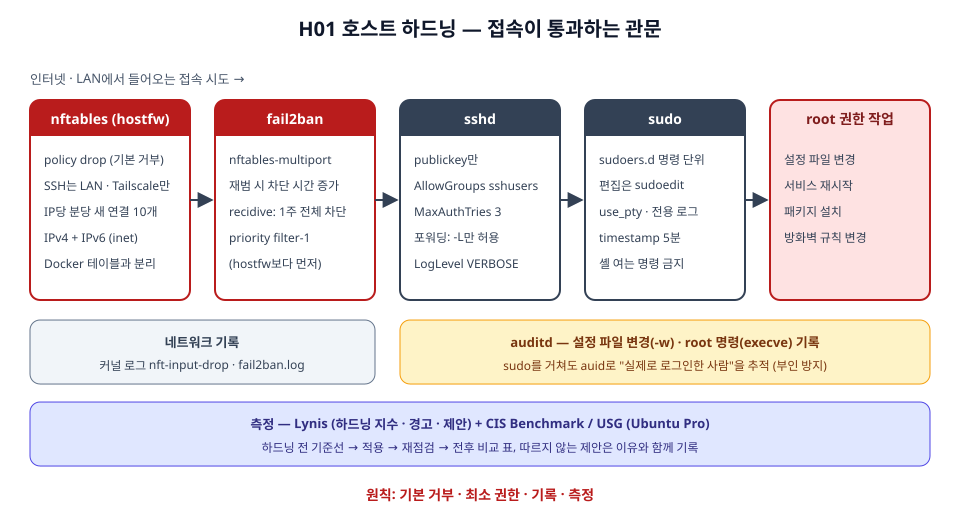
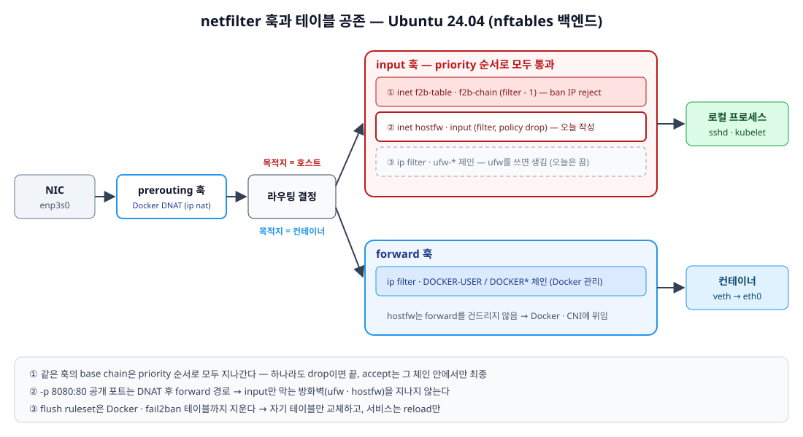

> **Chapter 9 · 보안** | 난이도 ★★★★☆ | 예상 소요 3 ~ 3.5시간

## 🎯 오늘의 목표

- 하드닝 **전에 측정**하고 **후에 다시 측정**하는 습관을 Lynis로 익힌다
- sshd를 그룹 제한·포워딩 최소화·암호 알고리즘 수준까지 강화하고 `sshd -T`로 검증한다
- sudo를 `sudoers.d`와 명령 단위 허용으로 **최소 권한**에 맞게 쪼갠다
- ufw와 nftables의 관계를 이해하고, **기본 정책 drop** nftables 룰셋을 안전하게 적용한다
- fail2ban을 nftables와 연동하고(누적 차단, recidive), **auditd**로 "누가 무엇을 바꿨는지" 기록한다
- CIS Benchmark의 개념과 **Ubuntu Security Guide(USG)** 사용 조건(Ubuntu Pro)을 안다

---

## 1. Homelab 01·02 이후 무엇이 남았나?

Day 66 위협 모델의 T01(SSH 로그인 탈취), T02(sudo로 root 획득), T03(설정 변경 부인)이 오늘의 대상입니다. 출발점은 Homelab 01·02에서 해 둔 기본기입니다.

| 영역 | Homelab 01·02에서 한 것 | 남은 빈칸 (오늘) |
|---|---|---|
| SSH | 키 인증만, root 로그인 금지 (`00-hardening.conf`) | 누가 접속 가능한가, 포워딩, 세션 제한, 알고리즘, 로그 수준 |
| 권한 | 설치 계정 `devops`가 `sudo` 그룹 | 다른 계정·자동화에 줄 **좁은 sudo**, sudo 로그 |
| 방화벽 | ufw `default deny incoming` + `limit OpenSSH` | 규칙을 코드로 관리, 출발지 제한, IPv6, Docker와의 공존 |
| 무차별 대입 | fail2ban `[sshd]` 기본 jail | nftables 연동, 반복 공격자 누적 차단 |
| 기록 | journal | **감사 로그(auditd)** — 설정 변경 추적 |
| 측정 | 없음 | **Lynis**, **CIS Benchmark / USG** |



> 💡 하드닝의 네 가지 원칙: **기본 거부**(명시적으로 허용한 것만), **최소 권한**(필요한 만큼만), **기록**(나중에 증명할 수 있게), **측정**(감이 아니라 숫자로). 오늘의 모든 실습이 이 넷 중 하나입니다.

> ⚠️ **실습 내내 지켜야 할 안전 수칙**: SSH·방화벽을 바꿀 때는 **기존 SSH 세션 하나를 열어 둔 채로**, 확인은 **새 터미널**에서 합니다. 홈랩 노트북은 화면·키보드가 붙어 있으니 최악의 경우 **콘솔**로 복구할 수 있다는 것도 기억하세요(Homelab 01).

---

## 2. 실습 0 — 하드닝 전 기준선 측정 (Lynis)

> **실습 환경**: 홈랩 H01 (Ubuntu Server 24.04 LTS, OpenSSH 9.6p1), Homelab 01·02 설정 완료 상태. Docker Engine과 kind 클러스터가 같은 호스트에 있어도 됩니다.

**Lynis**는 CISOfy가 만드는 오픈소스 보안 점검 도구로, 셸 스크립트 수백 개의 테스트로 시스템을 훑고 **경고(warning)·제안(suggestion)·하드닝 지수(Hardening index)** 를 냅니다. 시스템을 바꾸지 않고 **읽기만** 합니다.

Ubuntu 24.04 저장소의 lynis 패키지는 3.0.9로 오래됐으므로, 최신 릴리스(2026년 11월 기준 **3.1.7**)를 GitHub에서 받아 씁니다.

```bash
sudo apt install -y git
sudo git clone --depth 1 --branch 3.1.7 https://github.com/CISOfy/lynis.git /opt/lynis
cd /opt/lynis
sudo ./lynis audit system --quick      # --quick: 중간에 키 입력을 기다리지 않음
```

> 💡 `sudo git clone`으로 받아 **파일 소유자를 root로** 두는 이유: Lynis는 root로 실행될 때 자기 파일이 다른 사용자 소유이면 변조 가능성을 경고하고 멈춥니다.

출력 끝부분 예 (수치는 시스템마다 다릅니다):

```
  Lynis security scan details:

  Hardening index : 62 [############        ]
  Tests performed : 268
  Plugins enabled : 1

  Files:
  - Test and debug information      : /var/log/lynis.log
  - Report data                     : /var/log/lynis-report.dat
```

나중에 비교하려고 보고서를 보관합니다.

```bash
sudo cp /var/log/lynis-report.dat ~/lynis-before.dat
sudo chown $USER: ~/lynis-before.dat
grep -E '^hardening_index=' ~/lynis-before.dat
grep -cE '^warning\[\]=' ~/lynis-before.dat
grep -cE '^suggestion\[\]=' ~/lynis-before.dat
```

결과 읽는 법은 9장에서 하드닝 후 결과와 함께 봅니다.

---

## 3. sshd 강화 — 한 줄씩 이유를 알고

### 3-1. 옵션 설계

Homelab 01에서 본 대로 Ubuntu 24.04의 `sshd_config`는 맨 위에서 `sshd_config.d/*.conf`를 먼저 읽고 **먼저 읽은 값이 이깁니다.** 기존 `00-hardening.conf`(비밀번호·root 로그인 금지)는 그대로 두고, 그다음 순서인 `01-`로 심화 옵션을 추가합니다.

| 옵션 | 값 | 기본값 | 막는 것 |
|---|---|---|---|
| `AuthenticationMethods` | `publickey` | `any` | 다른 인증 방식이 실수로 켜져도 공개키만 허용 |
| `AllowGroups` | `sshusers` | (제한 없음) | 서비스 계정·새로 만든 계정이 SSH로 들어오는 것 |
| `MaxAuthTries` | `3` | `6` | 한 연결에서 키를 여러 개 시도하는 무차별 대입 |
| `LoginGraceTime` | `30` | `120` | 인증 안 하고 연결만 잡아 두는 자원 고갈 |
| `MaxStartups` | `10:30:60` | `10:30:100` | 인증 전 연결 폭주 |
| `ClientAliveInterval` / `CountMax` | `300` / `2` | `0` / `3` | 끊긴 세션이 계속 남는 것 (약 10분 후 정리) |
| `AllowTcpForwarding` | `local` | `yes` | `-R` 역방향 터널로 집 안을 외부에 여는 것. `-L`(Grafana 접속 등)은 유지 |
| `AllowAgentForwarding` | `no` | `yes` | 서버가 털렸을 때 내 ssh-agent를 악용하는 것 |
| `X11Forwarding` | `no` | Ubuntu 기본 파일에서 `yes` | 불필요한 X11 채널 |
| `PermitTunnel`, `AllowStreamLocalForwarding` | `no` | `no` / `yes` | tun 장치·유닉스 소켓 포워딩 (예: 원격 docker.sock 포워딩) |
| `LogLevel` | `VERBOSE` | `INFO` | 어떤 **키(지문)** 로 로그인했는지 기록 → 부인 방지 |

> 💡 `AllowTcpForwarding local`은 "로컬 포워딩(`ssh -L`)만 허용"이라는 뜻입니다. kubectl·Grafana를 `ssh -L`로 보던 습관은 그대로 쓸 수 있습니다.

**암호 알고리즘**은 Ubuntu 24.04의 OpenSSH 9.6 기본값도 충분히 안전합니다(기본 키 교환이 양자 내성 하이브리드 `sntrup761x25519-sha512@openssh.com`). 다만 오래된 알고리즘이 협상 목록에 남지 않게 명시적으로 줄일 수 있습니다. 아래는 ssh-audit 프로젝트의 Ubuntu 24.04 하드닝 가이드를 참고해 줄인 목록입니다.

### 3-2. 적용

먼저 SSH 허용 그룹을 만들고 **내 계정을 넣습니다.** 이 순서를 바꾸면 스스로를 잠급니다.

```bash
sudo groupadd --system sshusers
sudo usermod -aG sshusers devops
id devops        # groups=...,sshusers 확인
```

```bash
sudo tee /etc/ssh/sshd_config.d/01-hardening-advanced.conf > /dev/null <<'EOF'
# --- 인증 ---
AuthenticationMethods publickey
AllowGroups sshusers
MaxAuthTries 3
LoginGraceTime 30
MaxStartups 10:30:60

# --- 세션 ---
ClientAliveInterval 300
ClientAliveCountMax 2

# --- 포워딩 최소화 (-L 로컬 포워딩만 허용) ---
AllowTcpForwarding local
AllowAgentForwarding no
AllowStreamLocalForwarding no
X11Forwarding no
PermitTunnel no

# --- 기록 ---
LogLevel VERBOSE

# --- 암호 알고리즘 (OpenSSH 9.6 / Ubuntu 24.04) ---
KexAlgorithms sntrup761x25519-sha512@openssh.com,curve25519-sha256,curve25519-sha256@libssh.org,diffie-hellman-group16-sha512,diffie-hellman-group18-sha512,diffie-hellman-group-exchange-sha256
Ciphers chacha20-poly1305@openssh.com,aes256-gcm@openssh.com,aes256-ctr,aes192-ctr,aes128-gcm@openssh.com,aes128-ctr
MACs hmac-sha2-512-etm@openssh.com,hmac-sha2-256-etm@openssh.com,umac-128-etm@openssh.com
HostKeyAlgorithms ssh-ed25519,ssh-ed25519-cert-v01@openssh.com,rsa-sha2-512,rsa-sha2-256
EOF

sudo sshd -t && sudo systemctl reload ssh
```

**새 터미널**에서 접속되는지 확인한 뒤, 최종값을 검증합니다.

```bash
sudo sshd -T | grep -E '^(authenticationmethods|allowgroups|maxauthtries|logingracetime|allowtcpforwarding|allowagentforwarding|x11forwarding|loglevel)'
```

```
logingracetime 30
x11forwarding no
maxauthtries 3
allowagentforwarding no
allowtcpforwarding local
loglevel VERBOSE
allowgroups sshusers
authenticationmethods publickey
```

외부 시각으로도 점검합니다. **ssh-audit**은 서버가 협상하는 알고리즘을 평가해 줍니다.

```bash
sudo apt install -y ssh-audit
ssh-audit localhost | tail -n 15
```

`(rec)`로 표시되는 "제거 권장" 항목이 남아 있지 않으면 됩니다. `LogLevel VERBOSE` 효과도 확인해 봅니다.

```bash
journalctl -u ssh --since "10 min ago" | grep "Accepted publickey"
# ... Accepted publickey for devops from 192.168.0.23 port 51544 ssh2: ED25519 SHA256:6Nq...
```

> ⚠️ `AllowGroups`를 쓰면 **나중에 만든 계정은 그룹에 넣기 전까지 SSH가 거부**됩니다. 의도된 동작이지만, "새 계정이 Permission denied (publickey)"일 때 가장 먼저 의심할 곳입니다.

---

## 4. sudo 정책 — 최소 권한으로 쪼개기

### 4-1. 현재 상태 점검

```bash
sudo grep -vE '^\s*(#|$)' /etc/sudoers       # 주석 제외 본문
sudo ls -l /etc/sudoers.d/
sudo grep -rn NOPASSWD /etc/sudoers /etc/sudoers.d/ 2>/dev/null
sudo passwd -S root                           # root L ...  → root 비밀번호 잠김(Ubuntu 기본)
```

Ubuntu 기본값은 `%sudo ALL=(ALL:ALL) ALL` — **sudo 그룹은 비밀번호만 알면 무엇이든** 할 수 있습니다. 관리자 한 명(`devops`)에게는 이게 맞습니다. 문제는 **두 번째 계정**부터입니다. 백업 스크립트, 모니터링 담당 친구, CI 러너에게 sudo 그룹을 주면 모두 root가 됩니다.

### 4-2. 공통 기본값 강화

`/etc/sudoers`는 직접 고치지 말고 `sudoers.d`에 파일을 추가합니다. 반드시 **`visudo`로 편집**해야 문법 오류로 sudo 자체가 망가지는 것을 막을 수 있습니다.

```bash
sudo visudo -f /etc/sudoers.d/00-defaults
```

```
Defaults    use_pty
Defaults    logfile="/var/log/sudo.log"
Defaults    timestamp_timeout=5
Defaults    passwd_tries=3
```

| 설정 | 의미 |
|---|---|
| `use_pty` | sudo로 실행한 명령을 별도 가상 터미널에서 실행 → 백그라운드로 남은 프로세스가 사용자 터미널에 입력을 주입하는 공격 차단 (Ubuntu 기본 `/etc/sudoers`에도 이미 있을 수 있음) |
| `logfile` | journal과 별도로 sudo 전용 로그 파일 |
| `timestamp_timeout=5` | 비밀번호 재입력 없이 sudo를 쓰는 시간 5분 (기본 15분) |
| `passwd_tries=3` | 비밀번호 시도 횟수 |

> ⚠️ **`sudoers.d`의 파일 이름에 `.`이 들어가거나 `~`로 끝나면 sudo가 그 파일을 무시합니다.** `20-fwadmin.conf`라고 만들면 아무 효과가 없습니다. `20-fwadmin`처럼 점 없이 만드세요.

### 4-3. 명령 단위 허용 — 방화벽 운영 그룹 예

"방화벽 상태를 보고 다시 읽기만 할 수 있는" 그룹을 만들어 봅니다.

```bash
sudo groupadd fwadmin
sudo useradd -m -s /bin/bash -G fwadmin alice     # 실습용 계정
sudo passwd alice
sudo visudo -f /etc/sudoers.d/20-fwadmin
```

```
Cmnd_Alias FW_VIEW   = /usr/sbin/nft list ruleset, \
                       /usr/bin/fail2ban-client status, \
                       /usr/bin/fail2ban-client status sshd
Cmnd_Alias FW_RELOAD = /usr/bin/systemctl reload nftables
Cmnd_Alias FW_EDIT   = sudoedit /etc/nftables.conf

%fwadmin ALL=(root) FW_VIEW, FW_RELOAD, FW_EDIT
```

```bash
sudo visudo -c                 # 전체 문법 검사: ... parsed OK
sudo -l -U alice
```

```
User alice may run the following commands on homelab:
    (root) /usr/sbin/nft list ruleset, /usr/bin/fail2ban-client status, /usr/bin/fail2ban-client status sshd,
        /usr/bin/systemctl reload nftables, sudoedit /etc/nftables.conf
```

규칙에 **인자까지 적으면 정확히 그 인자만** 허용됩니다. alice가 `sudo nft flush ruleset`을 시도하면 거부되고 로그에 남습니다.

> 💡 파일 편집 권한은 `vim`이 아니라 **`sudoedit`** 로 주세요. `sudoedit`는 파일을 임시 사본으로 복사해 **사용자 권한의 편집기**로 열고, 저장할 때만 root로 되돌려 씁니다. 편집기 안에서 `:!sh`로 root 셸을 여는 길이 막힙니다.

### 4-4. sudo로 허용하면 사실상 root가 되는 명령

| 명령 | 이유 |
|---|---|
| `vi`, `vim`, `less`, `more`, `man` | 내부에서 셸 실행(`:!sh`, `!sh`) |
| `find`, `awk`, `tar`, `zip`, `rsync`, `git` | 옵션으로 임의 명령 실행 (`find -exec` 등) |
| `python3`, `perl`, `bash`, `env` | 그 자체가 인터프리터 |
| `cp`, `tee`, `dd`, `chmod`, `chown` (인자 무제한) | `/etc/sudoers`·`/etc/shadow` 덮어쓰기 |
| `docker`, `kubectl`(클러스터 관리자 kubeconfig) | 호스트 루트를 마운트한 컨테이너 실행 (Day 07) |
| `systemctl` (인자 무제한) | `systemctl edit`로 임의 유닛 작성 |

이런 우회 방법은 **GTFOBins** 프로젝트에 정리되어 있습니다. 새 sudo 규칙을 만들 때 거기서 해당 명령을 검색해 보는 습관을 들이세요.

---

## 5. 방화벽 — ufw에서 nftables로

### 5-1. ufw · iptables · nftables · Docker의 관계



Ubuntu 24.04의 커널 패킷 필터는 **netfilter**이고, 규칙을 넣는 도구가 여러 개 있습니다.

| 도구 | 실체 | Ubuntu 24.04에서 |
|---|---|---|
| **nftables** (`nft`) | netfilter의 현대 인터페이스 | 기본 백엔드 |
| **iptables** | 예전 인터페이스 | `iptables -V` → `iptables v1.8.10 (nf_tables)` — 명령은 iptables지만 **규칙은 nftables에 저장** |
| **ufw** | iptables 명령을 생성하는 프론트엔드 | 결국 `ip filter`, `ip6 filter` 테이블의 `ufw-*` 체인 |
| **Docker** (기본) | iptables로 NAT·FORWARD 규칙 생성 | `ip nat`, `ip filter`의 `DOCKER*` 체인. Docker 29부터 실험적 nftables 백엔드(`firewall-backend`)도 있음 |

```bash
sudo nft list tables
# table ip filter      ← ufw + Docker (iptables-nft)
# table ip nat         ← Docker 포트 공개(DNAT)
# table ip6 filter
# ...
```

핵심 규칙 두 가지만 기억하면 공존 문제가 풀립니다.

1. 같은 훅(예: `input`)에 **여러 테이블의 base chain**이 걸려 있으면 패킷은 **우선순위(priority) 순서로 전부** 지나갑니다. 어느 체인이든 **drop하면 끝**이고, accept는 그 체인에서만 끝납니다. 그래서 ufw와 직접 만든 nftables 룰셋을 **동시에** 쓰면 둘 다 허용해야만 통과합니다 → 디버깅 지옥. **하나만 고르세요.**
2. 호스트 자신을 향한 패킷은 **input** 훅, 컨테이너로 가는 패킷(포트 공개)은 DNAT 후 **forward** 훅을 지납니다. 그래서 input만 막는 ufw를 Docker 공개 포트가 "우회"했던 것입니다(Homelab 01).

> 💡 오늘의 설계: **호스트 방화벽은 input만 책임**지고, forward(컨테이너·K8s 트래픽)는 Docker·CNI에 맡깁니다. 컨테이너 포트는 Homelab 01처럼 `127.0.0.1`에 바인딩하고 리버스 프록시·Tunnel로만 공개하는 원칙을 유지합니다.

### 5-2. 기본 정책 drop 룰셋 전문

ufw를 계속 쓰는 것도 충분히 좋은 선택입니다. 여기서는 **규칙을 한 파일의 코드로 관리**하고 IPv4·IPv6를 한 번에 다루기 위해 nftables로 옮깁니다.

```bash
sudo apt install -y nftables
sudo cp /etc/nftables.conf ~/nftables.conf.orig
sudoedit /etc/nftables.conf
```

```
#!/usr/sbin/nft -f
# H01 호스트 방화벽 — input만 관리. Docker/K8s 테이블은 건드리지 않는다.
# (flush ruleset 을 쓰지 않는 이유: Docker·fail2ban 규칙까지 지워 버리기 때문)

table inet hostfw
delete table inet hostfw

table inet hostfw {
    set ssh_meter4 {
        type ipv4_addr
        flags dynamic
        timeout 1m
    }

    set lan4 {
        type ipv4_addr
        flags interval
        elements = { 192.168.0.0/24 }
    }

    chain input {
        type filter hook input priority filter; policy drop;

        # 1) 상태 기반: 이미 허용된 연결의 응답은 통과, 잘못된 패킷은 버림
        ct state invalid drop
        ct state { established, related } accept

        # 2) 루프백
        iif "lo" accept

        # 3) ICMP — 진단에 필요한 것만, IPv6는 NDP 때문에 필수
        icmp type { echo-request, destination-unreachable, time-exceeded } limit rate 10/second accept
        meta l4proto ipv6-icmp accept

        # 4) SSH — 출발지 IP당 분당 새 연결 10개 초과 시 drop, LAN과 Tailscale에서만 허용
        tcp dport 22 ct state new add @ssh_meter4 { ip saddr limit rate over 10/minute } drop
        ip saddr @lan4 tcp dport 22 accept
        iifname "tailscale0" tcp dport 22 accept

        # 5) 서비스 — 필요할 때만 주석 해제
        # tcp dport { 80, 443 } accept                          # Homelab 03 Caddy
        # ip saddr @lan4 tcp dport 6443 accept                  # Day 20 kubeadm API 서버
        # ip saddr @lan4 tcp dport { 10250, 30000-32767 } accept  # kubelet, NodePort

        # 6) 나머지는 기록 후 정책(drop)으로
        limit rate 5/minute log prefix "nft-input-drop: " level info
    }

    chain output {
        type filter hook output priority filter; policy accept;
    }
}
```

| 블록 | 설명 |
|---|---|
| `table inet hostfw` + `delete table` | 파일을 다시 읽을 때 **내 테이블만** 지우고 새로 만드는 관용구. 테이블이 없을 때 delete 오류가 나지 않도록 먼저 선언 |
| `inet` 패밀리 | IPv4와 IPv6를 한 테이블에서 처리 |
| `policy drop` | 아래 규칙에서 accept되지 않은 모든 입력 패킷은 버림 = **기본 거부** |
| `ct state established,related` | 서버가 먼저 나간 연결(apt, DNS)의 응답을 받기 위해 필수 |
| `add @ssh_meter4 { ... limit rate over ... } drop` | 동적 set으로 **IP별** 레이트 리밋 — ufw `limit`(30초 6회)의 nftables 버전 |
| `log prefix` + `limit` | 차단 로그를 남기되 로그 폭주 방지 |

> ⚠️ Kubernetes 노드(Day 20)로 쓰는 호스트라면 CNI가 쓰는 포트(Calico BGP 179, VXLAN 4789, Cilium 8472/4240 등)도 노드끼리 허용해야 합니다. 쓰는 CNI 문서의 포트 표를 보고 `ip saddr @lan4`로 열어 주세요.

### 5-3. 안전하게 적용하기 — 자동 원복 타이머

`netplan try`(Homelab 01)처럼 "5분 안에 확인하지 않으면 원복"하는 안전장치를 systemd 타이머로 만듭니다.

```bash
sudo nft -c -f /etc/nftables.conf           # -c: 문법만 검사 (출력 없으면 정상)

# 5분 뒤 내 테이블을 지우는 일회성 타이머 예약
sudo systemd-run --unit=nft-rollback --on-active=5min /usr/sbin/nft delete table inet hostfw

sudo ufw disable                             # ufw와 동시 사용 금지 (5-1)
sudo nft -f /etc/nftables.conf
sudo nft list table inet hostfw | head -n 20
```

**새 터미널**에서 `ssh homelab`이 되면 타이머를 취소하고 부팅 시 적용되게 합니다.

```bash
sudo systemctl stop nft-rollback.timer
sudo systemctl disable ufw
sudo systemctl enable nftables
```

동작 확인:

```bash
# 같은 LAN의 다른 PC에서 — 열지 않은 포트는 "거부"가 아니라 응답 없음(drop)
nc -vz -w 3 192.168.0.10 8080      # ... timed out

# 서버에서 — 차단 로그와 카운터
sudo journalctl -k -g 'nft-input-drop' --since "10 min ago" | tail -n 3
```

> ⚠️ **Docker가 있는 호스트에서 `systemctl restart nftables` / `stop nftables` 금지.** Ubuntu의 `nftables.service`는 stop할 때 `nft flush ruleset`을 실행해 **Docker·fail2ban 규칙까지 전부 지웁니다.** 규칙을 바꾼 뒤에는 항상 `sudo systemctl reload nftables`(파일만 다시 적용)를 쓰세요. 실수로 지웠다면 `sudo systemctl restart docker fail2ban`으로 복구합니다.

---

## 6. fail2ban 심화 — nftables 연동과 누적 차단

Homelab 02의 `[sshd]` jail은 iptables 액션으로 동작했습니다. 이제 방화벽이 nftables이므로 **ban 액션도 nftables로** 맞추고, 반복 공격자를 더 오래 막도록 바꿉니다.

```bash
sudo tee /etc/fail2ban/jail.local > /dev/null <<'EOF'
[DEFAULT]
# nftables 액션: inet f2b-table 테이블에 IP set을 만들고 input 훅(priority filter-1)에서 reject
banaction          = nftables-multiport
banaction_allports = nftables-allports

# 내 네트워크는 차단하지 않음 (LAN, Tailscale)
ignoreip = 127.0.0.1/8 ::1 192.168.0.0/24 100.64.0.0/10

bantime  = 1h
findtime = 10m
maxretry = 5

# 재범일수록 차단 시간 증가 (1h → 2h → 4h ... 최대 1주)
bantime.increment = true
bantime.factor    = 2
bantime.maxtime   = 1w

[sshd]
enabled = true
port    = ssh
mode    = aggressive

# fail2ban 자신의 로그를 보고, 여러 번 ban된 IP를 모든 포트에서 1주 차단
[recidive]
enabled = true
EOF

sudo fail2ban-client -t            # 설정 검사: OK: configuration test is successful
sudo systemctl restart fail2ban
sudo fail2ban-client status
```

| 설정 | 의미 |
|---|---|
| `nftables-multiport` | ban된 IP를 nftables set에 넣고 해당 포트만 reject. 우리 `hostfw`(priority filter)보다 **먼저(filter-1)** 평가됨 |
| `mode = aggressive` | sshd 필터의 normal + ddos + extra 패턴을 모두 사용 (인증 전 끊기, 잘못된 프로토콜 등도 실패로 셈) |
| `bantime.increment` | 같은 IP가 다시 걸릴 때마다 차단 시간을 늘림 (fail2ban DB에 이력 저장) |
| `[recidive]` | `/var/log/fail2ban.log`에서 하루(1d) 동안 5번 ban된 IP를 **allports**로 1주 차단 |

> ⚠️ `ignoreip`에 LAN 전체를 넣으면 **집 안에서 오는 공격은 막지 못합니다.** 집에 공유 기기가 많다면 관리용 PC 한 대의 IP만 넣는 것이 더 안전합니다. 대신 스스로 잠기면 `sudo fail2ban-client set sshd unbanip <IP>`로 풀어야 합니다.

시험 삼아 문서용 예약 대역(TEST-NET-3) IP를 수동으로 차단해 nftables에 어떻게 들어가는지 봅니다.

```bash
sudo fail2ban-client set sshd banip 203.0.113.50
sudo nft list table inet f2b-table
```

출력 예 (fail2ban 버전에 따라 형식이 조금 다를 수 있음):

```
table inet f2b-table {
	set addr-set-sshd {
		type ipv4_addr
		elements = { 203.0.113.50 }
	}

	chain f2b-chain {
		type filter hook input priority filter - 1; policy accept;
		tcp dport 22 ip saddr @addr-set-sshd reject with icmp port-unreachable
	}
}
```

```bash
sudo fail2ban-client banned                       # jail별 차단 목록 (fail2ban 1.0+)
sudo fail2ban-client set sshd unbanip 203.0.113.50
```

> 💡 이제 `sudo nft list tables`에 `inet hostfw`(내 방화벽), `inet f2b-table`(fail2ban), `ip filter`/`ip nat`(Docker)이 **각자의 테이블로 공존**합니다. 서로의 규칙을 덮어쓰지 않는 것이 nftables 시대의 운영 방식입니다.

---

## 7. auditd — "누가, 언제, 무엇을" 기록하기

journal은 "서비스가 무슨 말을 했는지"를 남기지만, **"누가 `/etc/sudoers`를 고쳤는지"** 는 남기지 않습니다. 리눅스 **감사 시스템(audit)** 은 커널 수준에서 파일 접근과 시스템 콜을 기록합니다. Day 66의 T03(Repudiation)에 대한 답입니다.

```bash
sudo apt install -y auditd audispd-plugins
sudo systemctl enable --now auditd
```

규칙은 `/etc/audit/rules.d/*.rules`에 두고 `augenrules`로 합쳐 적재합니다.

```bash
sudo tee /etc/audit/rules.d/50-homelab.rules > /dev/null <<'EOF'
## 권한 설정 변경
-w /etc/sudoers -p wa -k sudoers
-w /etc/sudoers.d/ -p wa -k sudoers

## SSH 설정 변경
-w /etc/ssh/sshd_config -p wa -k sshd
-w /etc/ssh/sshd_config.d/ -p wa -k sshd

## 방화벽 설정 변경
-w /etc/nftables.conf -p wa -k firewall

## 계정 파일
-w /etc/passwd -p wa -k identity
-w /etc/group -p wa -k identity
-w /etc/shadow -p wa -k identity

## Docker 데몬 설정 (Day 68에서 바꿀 곳)
-w /etc/docker/ -p wa -k docker

## 로그인한 사람(auid>=1000)이 root 권한으로 실행한 모든 명령
-a always,exit -F arch=b64 -S execve -F euid=0 -F auid>=1000 -F auid!=unset -k root-cmd
EOF

sudo augenrules --load
sudo auditctl -l | head
```

| 규칙 문법 | 의미 |
|---|---|
| `-w 경로 -p wa` | 해당 파일·디렉터리의 **w**rite, **a**ttribute 변경 감시 |
| `-k 이름` | 검색용 키(태그) |
| `-a always,exit -S execve` | execve 시스템 콜이 끝날 때마다 기록 |
| `auid` | **로그인 UID** — sudo·su를 거쳐도 바뀌지 않는 "원래 사람"의 UID. 부인 방지의 핵심 |

확인해 봅니다. sshd 설정 파일을 하나 건드리고 검색합니다.

```bash
sudo touch /etc/ssh/sshd_config.d/01-hardening-advanced.conf
sudo ausearch -k sshd -i --start recent | tail -n 4
```

```
type=PROCTITLE msg=audit(11/15/2026 14:02:11.381:812) : proctitle=touch /etc/ssh/sshd_config.d/01-hardening-advanced.conf
type=SYSCALL msg=audit(11/15/2026 14:02:11.381:812) : arch=x86_64 syscall=openat success=yes exit=3 ... auid=devops uid=root ... comm=touch exe=/usr/bin/touch key=sshd
```

`uid=root`로 실행됐지만 **`auid=devops`** — sudo를 썼어도 실제로 누가 했는지 남습니다. 요약 보고서도 볼 수 있습니다.

```bash
sudo aureport --summary
sudo aureport -au --start today | tail -n 5     # 인증 시도 보고서
sudo ausearch -m USER_CMD -i --start today | tail -n 3   # sudo로 실행된 명령
```

> 💡 운영 환경에서는 규칙 파일 맨 끝에 `-e 2`를 넣어 **규칙을 불변(immutable)** 으로 만들기도 합니다. 공격자가 root를 얻어도 재부팅 없이는 감사 규칙을 끌 수 없습니다(대신 규칙을 바꾸려면 재부팅 필요). auditd 로그는 Day 72(Falco)·Chapter 8의 Loki로 보내면 다른 로그와 함께 검색할 수 있습니다.

> ⚠️ `execve` 전체 기록은 로그가 많습니다. `auid>=1000`(사람)과 `euid=0`(root 권한)으로 범위를 좁힌 이유입니다. 디스크는 `/etc/audit/auditd.conf`의 `max_log_file`, `num_logs`로 관리합니다.

---

## 8. CIS Benchmark와 Ubuntu Security Guide(USG)

### 8-1. CIS Benchmark란?

**CIS Benchmark**는 Center for Internet Security가 업계 합의로 만드는 **OS·소프트웨어별 보안 설정 가이드**입니다. Ubuntu 24.04용은 *CIS Ubuntu Linux 24.04 LTS Benchmark*(v1.0.0부터)이며, 항목마다 "왜·어떻게 점검·어떻게 고치는지"가 적혀 있습니다.

| 프로파일 | 성격 |
|---|---|
| **Level 1** (Server / Workstation) | 기능에 거의 영향 없이 적용 가능한 기본 항목 |
| **Level 2** (Server / Workstation) | 보안이 최우선인 환경용. 일부 기능·성능에 영향 (예: 별도 파티션, 더 엄격한 감사) |

오늘 손으로 한 작업 상당수(SSH 옵션, sudo `use_pty`·로그, auditd, 방화벽 기본 거부)가 CIS 항목에 그대로 있습니다.

### 8-2. USG — Ubuntu Pro가 필요하다

Canonical의 **USG**(Ubuntu Security Guide)는 CIS·DISA-STIG 프로파일을 **자동 점검(audit)·자동 적용(fix)** 하는 도구입니다. 24.04용 CIS Level 1/2, DISA-STIG 프로파일이 있습니다.

> ⚠️ **USG는 Ubuntu Pro 구독이 있어야 쓸 수 있습니다.** 다행히 Ubuntu Pro는 **개인 용도로 최대 5대의 물리 머신까지 무료**입니다. ubuntu.com/pro에서 Ubuntu One 계정으로 토큰을 받습니다.

```bash
pro status                         # 붙어 있지 않으면 "This machine is not attached..." 
sudo pro attach <내-토큰>
pro status | grep -i usg           # usg 서비스가 보이면 사용 가능
sudo pro enable usg
sudo apt install -y usg
```

```bash
sudo usg audit cis_level1_server   # 점검만 (시스템 변경 없음)
ls /var/lib/usg/                   # HTML·XML 보고서
```

HTML 보고서를 내 PC로 가져와(`scp`) 브라우저로 열면 규칙별 pass/fail과 설명이 나옵니다.

| 명령 | 하는 일 | 주의 |
|---|---|---|
| `usg audit <프로파일>` | 점검, 보고서 생성 | 안전 |
| `usg fix <프로파일>` | 실패 항목을 **자동으로 고침** | ⚠️ SSH·방화벽·마운트 옵션까지 바꿉니다. **스냅샷/백업 후, 먼저 테스트 VM에서** |
| `usg generate-tailoring <프로파일> tailor.xml` | 규칙을 켜고 끌 수 있는 맞춤 파일 생성 | 홈랩에 안 맞는 규칙(예: Docker 때문에 IP 포워딩 필요)을 끔 |

> 💡 Ubuntu Pro를 붙이지 않을 거라면 **Lynis + 오늘의 수동 하드닝**으로도 CIS Level 1의 핵심 대부분을 다룹니다. 어느 쪽이든 **"점검 → 고침 → 재점검"** 순환이 본질입니다.

---

## 9. 재점검 — Lynis 결과 읽기와 전후 비교

```bash
cd /opt/lynis && sudo ./lynis audit system --quick > /dev/null
sudo cp /var/log/lynis-report.dat ~/lynis-after.dat && sudo chown $USER: ~/lynis-after.dat
grep -E '^hardening_index=' ~/lynis-before.dat ~/lynis-after.dat
```

### 9-1. 결과 읽는 법

보고서의 제안 한 줄은 `테스트ID|설명|세부|해결책|` 형식입니다.

```bash
grep -E '^suggestion\[\]=' ~/lynis-after.dat | cut -d'|' -f1-3 | head
```

```
suggestion[]=AUTH-9230|Configure password hashing rounds in /etc/login.defs|-
suggestion[]=AUTH-9286|Configure minimum password age in /etc/login.defs|-
suggestion[]=BOOT-5122|Set a password on GRUB boot loader to prevent altering boot configuration ...|-
suggestion[]=FILE-6310|To decrease the impact of a full /home file system, place /home on a separate partition|-
suggestion[]=HRDN-7230|Harden the system by installing at least one malware scanner, to perform periodic file system scans|-
suggestion[]=KRNL-5820|If not required, consider explicit disabling of core dump in /etc/security/limits.conf file|-
```

특정 테스트가 무엇을 봤는지는 `show details`로 확인합니다.

```bash
sudo ./lynis show details SSH-7408
```

하드닝 전후에 **사라진 항목**을 비교합니다.

```bash
diff <(grep -oE '^(warning|suggestion)\[\]=[A-Z]+-[0-9]+' ~/lynis-before.dat | sort -u) \
     <(grep -oE '^(warning|suggestion)\[\]=[A-Z]+-[0-9]+' ~/lynis-after.dat  | sort -u)
```

```
< suggestion[]=ACCT-9628        ← auditd 활성화로 해결
< suggestion[]=SSH-7408         ← SSH 하드닝으로 해결 (Lynis 기대값과 다른 옵션이 남으면 그대로 남을 수 있음)
```

> 💡 Lynis의 SSH 기대값 중에는 `AllowTcpForwarding no`처럼 오늘 일부러 다르게 정한 것도 있습니다. 남은 SSH-7408 항목은 `show details`로 어떤 옵션인지 보고, 의도한 차이라면 그대로 둡니다.

### 9-2. 모든 제안을 따를 필요는 없다

Lynis 제안은 **체크리스트가 아니라 질문**입니다. 판단하고, 결정을 기록합니다.

| 제안 | 판단 | 이유 |
|---|---|---|
| FILE-6310 `/home`, `/var` 별도 파티션 | 보류 | 재설치 필요. 홈랩 이득 대비 비용이 큼 |
| BOOT-5122 GRUB 비밀번호 | 선택 | 물리 접근 위협이 집 안에서는 낮음. 노트북을 밖에 둔다면 적용 |
| HRDN-7230 악성코드 스캐너 | 대체 | Day 72의 Falco 런타임 탐지로 대신 |
| KRNL-6000 커널 파라미터(sysctl) | 선별 적용 | 제안 목록에 포워딩 관련 값이 있더라도 **Docker/K8s 호스트는 IP 포워딩을 끄면 안 됨** |

결정한 예외는 Lynis 디렉터리의 `custom.prf`에 `skip-test=FILE-6310`처럼 적어 두면 다음 점검부터 제외되고, 이유는 Day 66의 위협 모델 문서에 남깁니다.

### 9-3. 점검 전후 비교 표

아래는 **예시**입니다. 독자의 수치로 채워 보세요.

| 항목 | 하드닝 전 (H01·H02 상태) | 하드닝 후 (Day 67) | 확인 명령 |
|---|---|---|---|
| Lynis Hardening index | 62 | 74 | `grep hardening_index ~/lynis-*.dat` |
| Lynis 경고 / 제안 수 | 2 / 41 | 0 / 29 | `grep -c '^warning\[\]'` |
| 외부에서 열린 포트 | 22 + Docker 공개 포트 | 22(LAN·Tailscale만) | 다른 PC에서 `nmap -Pn 192.168.0.10` |
| SSH 허용 대상 | 모든 계정 | `sshusers` 그룹만 | `sshd -T \| grep allowgroups` |
| SSH 포워딩 | 전부 허용 | `-L`만 | `sshd -T \| grep forwarding` |
| ssh-audit 권장 제거 항목 | 몇 개 | 0 | `ssh-audit localhost` |
| sudo 규칙 | `%sudo ALL` 하나 | + 명령 단위 `%fwadmin`, sudo 전용 로그 | `sudo -l -U alice` |
| 방화벽 | ufw (iptables-nft) | nftables `inet hostfw` 기본 drop, IPv6 포함 | `nft list table inet hostfw` |
| fail2ban | sshd jail, 고정 1h | nftables 연동 + 누적 차단 + recidive | `fail2ban-client status` |
| 감사 로그 | 없음 | auditd 규칙 10개 | `auditctl -l \| wc -l` |
| CIS L1 (USG) | (Pro 연결 시) 통과율 측정 | 재측정 | `usg audit cis_level1_server` |

---

## 10. 트러블슈팅

| 증상 | 원인 | 해결 |
|---|---|---|
| 새 계정이 `Permission denied (publickey)` | `AllowGroups sshusers`에 없음 | `sudo usermod -aG sshusers <계정>` |
| `sshd -t`가 `Bad SSH2 cipher spec` | 이 OpenSSH 버전에 없는 알고리즘 이름(오타 포함) | `ssh -Q cipher`, `ssh -Q kex`, `ssh -Q mac`으로 지원 목록 확인 |
| `ssh -L`이 `channel 3: open failed: administratively prohibited` | `AllowTcpForwarding no`로 설정 | `local`로 변경 |
| sudoers.d 파일을 만들었는데 효과 없음 | 파일명에 `.` 포함 또는 `~`로 끝남, 권한 오류 | 점 없는 이름, `chmod 0440`, `sudo visudo -c` |
| nftables 적용 후 SSH 끊김 | 출발지가 `lan4`/`tailscale0`가 아님 | 5분 뒤 원복 타이머가 테이블 삭제 → 출발지 대역 수정 후 재시도. 급하면 콘솔에서 `sudo nft delete table inet hostfw` |
| 재부팅 후 Docker 컨테이너 포트가 안 열림 / 컨테이너 외부 통신 불가 | `nftables` stop/restart로 `flush ruleset` 발생 | `sudo systemctl restart docker`. 앞으로는 `reload`만 사용 |
| fail2ban `nftables-multiport` 오류 | nftables 패키지 없음, 다른 액션과 혼용 | `sudo apt install nftables`, `fail2ban-client -t`로 설정 검사 |
| `ausearch`에 아무것도 안 나옴 | 규칙 미적재, 키 오타 | `sudo auditctl -l`로 규칙 확인, `augenrules --load` 재실행 |
| Lynis가 실행 직후 소유권 경고로 멈춤 | 일반 사용자로 clone 후 sudo 실행 | `sudo chown -R root:root /opt/lynis` |
| `pro enable usg` 실패 | Ubuntu Pro 미연결 | `sudo pro attach <토큰>` 후 재시도 (개인 5대 무료) |

---

## 11. 핵심 정리

- 하드닝 = **기본 거부 · 최소 권한 · 기록 · 측정**. Lynis로 **전후를 숫자로** 비교한다
- sshd: `00-`/`01-` drop-in으로 `AllowGroups`, `MaxAuthTries`, `AllowTcpForwarding local`, `AllowAgentForwarding no`, `LogLevel VERBOSE`, 알고리즘 축소 → `sshd -T`와 `ssh-audit`으로 검증
- sudo: `visudo -f /etc/sudoers.d/<점 없는 이름>`, 명령·인자 단위 허용, 편집은 `sudoedit`, 셸을 여는 명령(GTFOBins) 주의
- Ubuntu 24.04의 ufw·iptables·Docker 규칙은 모두 **nftables 위**에 있다. 같은 훅의 체인은 **모두 통과해야** 하므로 ufw와 자체 룰셋은 하나만
- nftables 룰셋은 **`flush ruleset` 대신 자기 테이블만** 교체, 적용은 **원복 타이머**와 함께, 운영 중 변경은 **`reload`만**
- fail2ban: `nftables-multiport` + `bantime.increment` + `recidive`로 반복 공격자 누적 차단
- auditd: `-w`(파일 감시)와 `execve` 규칙, **auid**로 sudo 뒤의 실제 사람을 추적
- CIS Benchmark는 업계 합의 설정 가이드. **USG는 Ubuntu Pro 필요**(개인 5대 무료), `usg fix`는 테스트 후에

---

## 12. 셀프 체크

<details>
<summary>Q1. <code>/etc/ssh/sshd_config.d/99-my.conf</code>에 <code>X11Forwarding no</code>를 넣었는데 <code>sshd -T</code>에서 여전히 yes라면?</summary>

sshd는 같은 옵션에 대해 **먼저 읽은 값**을 씁니다. `sshd_config.d/*.conf`는 이름순으로 읽히므로 `50-cloud-init.conf` 등 앞선 파일에 `X11Forwarding yes`가 있으면 그 값이 이깁니다. `00-`, `01-`처럼 앞서는 이름으로 옮기고 `sshd -T`로 최종값을 확인합니다.
</details>

<details>
<summary>Q2. 운영 계정에 <code>alice ALL=(root) /usr/bin/less /var/log/*</code>를 허용하면 어떤 문제가 있나?</summary>

`less` 안에서 `!sh`로 셸을 실행할 수 있어 **root 셸**을 얻게 됩니다. 와일드카드 인자로 다른 파일도 지정할 수 있습니다. 로그 열람이 목적이라면 `adm` 그룹(로그 읽기 권한)에 넣거나, 정확한 인자를 가진 비대화형 명령만 허용하고, 편집은 `sudoedit`를 씁니다.
</details>

<details>
<summary>Q3. ufw로 SSH를 허용했고 직접 만든 nftables 테이블(policy drop)에서는 SSH를 허용하지 않았다. SSH 접속은 되나?</summary>

**안 됩니다.** 같은 input 훅에 걸린 base chain들은 우선순위 순서로 모두 평가되고, 어느 하나라도 drop하면 패킷은 버려집니다. accept는 그 체인 안에서만 최종입니다. 그래서 ufw와 자체 nftables 룰셋은 동시에 쓰지 않고 하나만 선택합니다.
</details>

<details>
<summary>Q4. Docker가 동작 중인 호스트에서 <code>sudo systemctl restart nftables</code>를 하면 어떻게 되나?</summary>

Ubuntu의 nftables.service는 stop 단계에서 `nft flush ruleset`을 실행하므로 Docker의 NAT·필터 규칙과 fail2ban 테이블까지 모두 지워집니다. 컨테이너 포트 공개·외부 통신이 깨지며 `systemctl restart docker fail2ban`으로 복구해야 합니다. 규칙 변경은 `reload`로 적용합니다.
</details>

<details>
<summary>Q5. auditd 기록에서 <code>uid=root</code>인데 <code>auid=devops</code>로 나온다. 무엇을 뜻하나?</summary>

명령은 root 권한(sudo)으로 실행됐지만, 그 세션에 **처음 로그인한 사람은 devops**라는 뜻입니다. auid(login UID)는 sudo·su를 거쳐도 바뀌지 않으므로 "root가 했다"가 아니라 "devops가 root 권한으로 했다"를 증명할 수 있습니다(부인 방지).
</details>

---

## ⏭️ 다음 예고 — Day 68. 컨테이너 런타임 보안

호스트를 단단하게 만들었으니 이제 그 위에서 도는 **컨테이너**입니다. Day 07에서 맛본 capabilities·seccomp·AppArmor를 넘어, **rootless Docker**와 **userns-remap**으로 "컨테이너 root = 호스트 root" 문제를 근본적으로 줄이고, **커스텀 seccomp·AppArmor 프로파일**을 직접 작성해 적용합니다. privileged 컨테이너와 docker.sock 마운트가 왜 탈출 경로가 되는지도 방어 관점에서 정리합니다.
