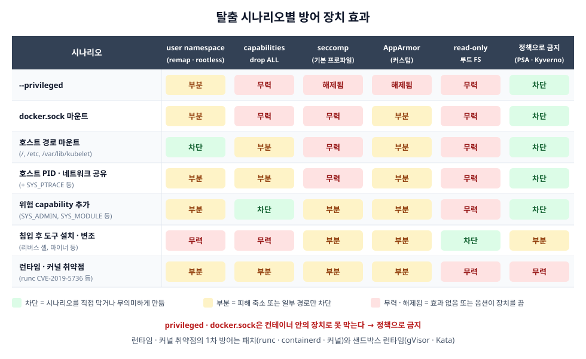
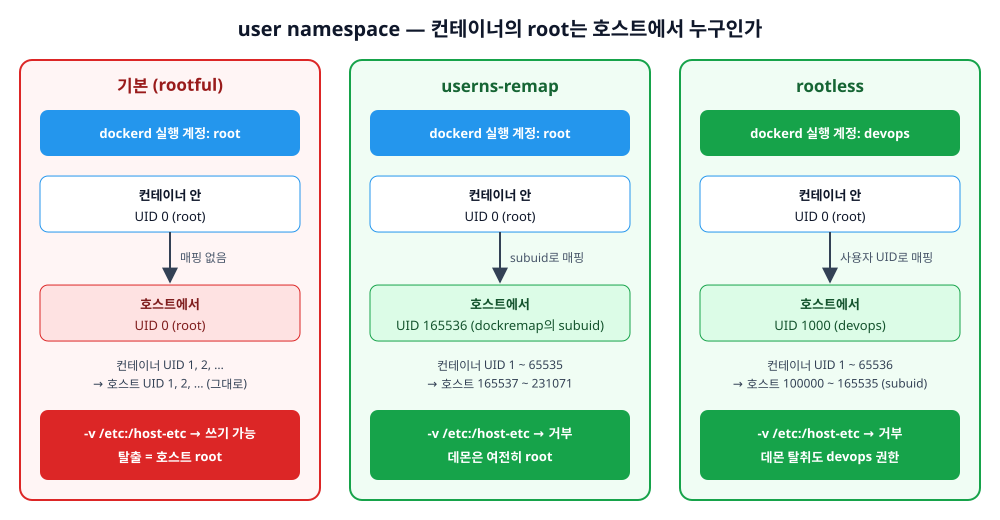
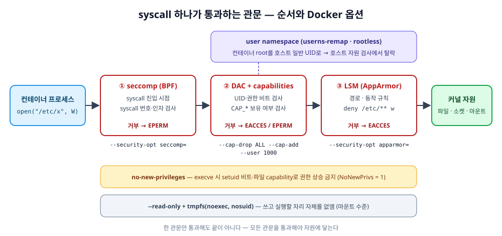

> **Chapter 9 · 보안** | 난이도 ★★★★☆ | 예상 소요 3 ~ 3.5시간

## 🎯 오늘의 목표

- 컨테이너 탈출 경로(privileged, docker.sock, 호스트 경로·namespace, 런타임 취약점)의 **위험과 차단 지점**을 설명할 수 있다
- **userns-remap**과 **rootless Docker**로 "컨테이너 root = 호스트 root" 문제를 줄이고, 각각의 제약을 안다
- capabilities를 **drop ALL 후 로그를 보며 하나씩 추가**하는 방법으로 최소화한다
- Docker 기본 seccomp 프로파일을 바탕으로 **커스텀 seccomp 프로파일**을 만들고, 감사 로그로 필요한 syscall을 수집한다
- **커스텀 AppArmor 프로파일**을 작성·적재하고, `--read-only` + tmpfs, `no-new-privileges`, 리소스 제한을 묶어 단단한 실행 구성을 만든다

---

## 1. Day 07에서 어디까지 왔나

Day 07에서 컨테이너 보안의 **기본 장치**를 모두 한 번씩 켜 봤습니다. 오늘은 같은 장치를 **직접 설계하고 측정**하는 단계입니다.

| 장치 | Day 07 (기초) | Day 68 (오늘) |
|---|---|---|
| user namespace | "Docker는 기본으로 안 쓴다" | **userns-remap, rootless**를 실제로 켜고 UID 매핑 확인 |
| capabilities | 기본 집합 확인, `--cap-drop ALL` 체험 | 실제 이미지(nginx)에 필요한 **최소 집합을 찾는 절차** |
| seccomp | 기본 프로파일이 켜져 있음을 확인 | **프로파일 JSON을 직접 편집**, LOG 모드로 syscall 수집 |
| AppArmor | `docker-default` 적용 확인 | **커스텀 프로파일** 작성·적재·거부 로그 확인 |
| read-only | `--read-only --tmpfs /tmp` | **`docker diff`로 쓰기 경로를 찾아** 필요한 곳만 tmpfs |
| no-new-privileges | 옵션 사용 | 커널 플래그 확인, **데몬 기본값**으로 강제 |
| 리소스 제한 | memory·cpus·pids | ulimit, 로그 크기, 재시작 폭주, 데몬 기본값 |

Day 66 위협 모델의 **T04(컨테이너에서 호스트 탈출)** 가 오늘의 대상입니다.

---

## 2. 위협 — 컨테이너 탈출은 어디서 일어나나

> ⚠️ 이 절은 **방어를 설계하기 위한 위험 설명**입니다. 공격 절차나 코드는 다루지 않습니다.

컨테이너는 호스트 커널을 공유하는 프로세스입니다(Day 01·07). 그래서 "탈출"은 대부분 **격리를 스스로 풀어 준 설정** 아니면 **커널·런타임의 버그**에서 시작합니다.

| 시나리오 | 왜 위험한가 | ATT&CK |
|---|---|---|
| **`--privileged`** | 모든 capability + 모든 디바이스 + seccomp·AppArmor 해제. 호스트 디스크 장치에 접근하거나 커널 기능을 조작할 수 있어 **사실상 호스트 root** | T1611 |
| **docker.sock 마운트** | 컨테이너가 dockerd API를 호출 → 호스트 `/`를 마운트한 새 privileged 컨테이너를 만들 수 있음. Traefik·Portainer·모니터링 도구가 흔히 요구 | T1610, T1611 |
| **호스트 경로 마운트** (`/`, `/etc`, `/var/lib/kubelet` 등) | 컨테이너 root가 호스트 UID 0이면 호스트 파일을 그대로 수정 | T1611 |
| **호스트 namespace 공유** (`--pid=host`, `--network=host`) + 강한 capability | 호스트 프로세스 관찰·조작, 호스트 루프백에만 열린 관리 포트 접근 | T1611, T1613 |
| **위험한 capability 추가** (`SYS_ADMIN`, `SYS_MODULE`, `SYS_PTRACE`, `DAC_READ_SEARCH`) | mount, 커널 모듈, 다른 프로세스 메모리, 호스트 파일 핸들 접근 등 격리를 넘는 기능 | T1611, T1068 |
| **런타임·커널 취약점** | 설정이 완벽해도 runc·커널 버그로 격리가 깨짐. 예: runc CVE-2019-5736(호스트 runc 바이너리 덮어쓰기), CVE-2024-21626 "Leaky Vessels"(파일 디스크립터 누출) | T1068 |



그림에서 보듯 **만능 장치는 없습니다.** privileged와 docker.sock은 컨테이너 내부 장치(seccomp·capability)로는 막을 수 없고 **애초에 허용하지 않는 정책**(Day 69 PSA, Day 57 Kyverno)이 답입니다. 반대로 호스트 경로 마운트의 피해는 **user namespace**가 크게 줄입니다. 그래서 여러 겹을 겹칩니다.

> 💡 커널 취약점은 namespace 기반 격리 전체를 무력화할 수 있습니다. 가장 중요한 방어는 **패치**(Day 67의 unattended-upgrades, Docker·containerd·runc 업데이트)이고, 신뢰할 수 없는 코드를 돌려야 한다면 gVisor·Kata Containers 같은 **샌드박스 런타임**으로 커널 경계를 하나 더 두는 방법이 있습니다.

---

## 3. 실습 환경과 기준선

> **실습 환경**: 홈랩 H01 (Ubuntu 24.04 LTS, 커널 6.8, cgroup v2), Docker Engine 29.x (Day 01의 공식 apt 저장소 설치, `docker-ce-rootless-extras` 포함), Day 67의 auditd 설치 상태. `jq`, `libcap2-bin`(capsh) 필요.

```bash
sudo apt install -y jq libcap2-bin uidmap dbus-user-session
docker version --format '{{.Server.Version}}'          # 29.x
docker info --format '{{json .SecurityOptions}}'
# ["name=apparmor","name=seccomp,profile=builtin","name=cgroupns"]
```

Day 07에서 본 기준선을 다시 확인합니다. 컨테이너 root가 호스트 `/etc`에 파일을 만듭니다.

```bash
docker run --rm -v /etc:/host-etc alpine touch /host-etc/created-by-container
ls -l /etc/created-by-container      # root root — 호스트 root 소유!
sudo rm /etc/created-by-container
```

---

## 4. user namespace — 컨테이너 root를 호스트의 일반 UID로



| 방식 | dockerd 실행 계정 | 컨테이너 root(0)는 호스트에서 | 핵심 장점 | 대표 제약 |
|---|---|---|---|---|
| 기본 (rootful) | root | **UID 0** | 호환성 최고 | 탈출 = 호스트 root |
| **userns-remap** | root | `dockremap`의 subuid (예: 165536) | 기존 데몬·옵션 대부분 유지 | `--privileged`, `--pid=host`, `--network=host`는 `--userns=host` 필요, 볼륨 소유권 맞춰야 함 |
| **rootless** | **일반 사용자** | 그 사용자 UID (예: 1000), 나머지는 subuid | 데몬까지 탈취돼도 일반 사용자 권한 | AppArmor·overlay 네트워크·SCTP 미지원, 1024 미만 포트·ping·리소스 제한에 추가 설정 |

### 4-1. userns-remap 켜 보기

```bash
sudo cp /etc/docker/daemon.json ~/daemon.json.bak 2>/dev/null   # 기존 파일이 있으면 백업
```

`/etc/docker/daemon.json`에 다음 키를 추가합니다(기존 키가 있다면 같은 객체 안에 합칩니다).

```json
{
  "userns-remap": "default"
}
```

```bash
sudo systemctl restart docker
grep dockremap /etc/subuid /etc/subgid
# /etc/subuid:dockremap:165536:65536      ← 시작 UID는 시스템마다 다름
docker info --format '{{json .SecurityOptions}}'
# [..., "name=userns", ...]
sudo ls /var/lib/docker/ | grep -E '^[0-9]+\.[0-9]+$'
# 165536.165536                            ← remap 전용 데이터 디렉터리
```

> 💡 `docker images`가 비어 보이는 것은 정상입니다. remap 모드는 **별도의 데이터 디렉터리**를 쓰므로 기존 이미지·컨테이너가 안 보입니다. 원복하면 다시 나타납니다.

같은 공격을 다시 시도합니다.

```bash
docker run --rm -v /etc:/host-etc alpine touch /host-etc/created-by-container
# touch: /host-etc/created-by-container: Permission denied

docker run --rm alpine id
# uid=0(root) gid=0(root) ...              ← 컨테이너 안에서는 여전히 root

docker run -d --name remap-demo alpine sleep 300
ps -o user:12,pid,cmd -C sleep | tail -n 1
# 165536       24811 sleep 300             ← 호스트에서는 일반 UID
docker rm -f remap-demo
```

컨테이너 안에서는 root지만 호스트에서는 아무 권한 없는 UID 165536이라, 호스트 `/etc`(root 소유, 755)에 쓸 수 없습니다.

> ⚠️ **kind 클러스터는 privileged 노드 컨테이너를 쓰므로 userns-remap과 함께 쓰기 어렵습니다**(컨테이너마다 `--userns=host` 필요). H01에서 kind를 계속 쓸 것이라면 확인 후 원복하세요.

```bash
# 원복: daemon.json 에서 "userns-remap" 키 제거 후
sudo systemctl restart docker
docker info --format '{{json .SecurityOptions}}'   # name=userns 사라짐
```

### 4-2. rootless Docker

rootless는 **dockerd 자체**를 일반 사용자로 실행합니다. 내부적으로 `rootlesskit`이 user namespace를 만들고 그 안에서 dockerd를 띄웁니다.

**Ubuntu 24.04 주의점** — 24.04부터 일반 사용자의 user namespace 생성이 AppArmor로 제한됩니다(`kernel.apparmor_restrict_unprivileged_userns=1`). **apt 패키지(`docker-ce-rootless-extras`)로 설치한 경우 rootlesskit용 AppArmor 프로파일이 Ubuntu의 `apparmor` 패키지에 이미 포함**되어 있어 추가 작업이 필요 없습니다. 정적 바이너리 스크립트로 설치했다면 Docker 문서의 절차대로 `~/bin/rootlesskit`용 프로파일을 직접 만들어야 합니다.

```bash
sysctl kernel.apparmor_restrict_unprivileged_userns   # = 1
grep "^$(whoami):" /etc/subuid /etc/subgid             # 65,536개 이상 있어야 함
# /etc/subuid:devops:100000:65536
```

설치는 **sudo 없이**, SSH로 로그인한 일반 사용자(`devops`)로 실행합니다. 시스템 dockerd(Caddy, kind 등)를 계속 쓸 것이므로 `--force`로 공존 설치합니다. (rootless만 쓸 거라면 Docker 문서처럼 `sudo systemctl disable --now docker.service docker.socket`으로 시스템 데몬을 끄고 `--force` 없이 설치합니다.)

```bash
dockerd-rootless-setuptool.sh install --force
```

출력 일부 (버전에 따라 다를 수 있음):

```
[INFO] Creating /home/devops/.config/systemd/user/docker.service
...
[INFO] Installed docker.service successfully.
...
[INFO] Creating CLI context "rootless"
[INFO] Use CLI context "rootless"
```

```bash
systemctl --user enable --now docker
sudo loginctl enable-linger devops        # 로그아웃해도 사용자 데몬 유지
docker context ls
# NAME         DESCRIPTION                               DOCKER ENDPOINT
# default      Current DOCKER_HOST based configuration   unix:///var/run/docker.sock
# rootless *   Rootless mode                             unix:///run/user/1000/docker.sock

docker info --format '{{json .SecurityOptions}}'
# ["name=seccomp,profile=builtin","name=rootless","name=cgroupns"]   ← apparmor 없음
```

확인:

```bash
docker run --rm -v /etc:/host-etc alpine touch /host-etc/created-by-container
# touch: /host-etc/created-by-container: Permission denied

docker run -d --name rl-demo alpine sleep 300
ps -o user:12,pid,cmd -C sleep | tail -n 1
# devops       25102 sleep 300           ← 컨테이너 root = 호스트의 devops
ps -o user:12,cmd -C dockerd
# root         /usr/bin/dockerd -H fd:// ...   ← 시스템(rootful) 데몬
# devops       dockerd                         ← rootless 데몬은 일반 사용자
docker rm -f rl-demo
```

### 4-3. rootless의 제약과 해결

| 제약 | 증상 | 해결 |
|---|---|---|
| 1024 미만 포트 | `-p 80:80` 실패 | 8080 같은 상위 포트 사용(권장), 또는 `sudo setcap cap_net_bind_service=ep $(which rootlesskit)` 후 `systemctl --user restart docker`, 또는 sysctl `net.ipv4.ip_unprivileged_port_start=0` (호스트 전체에 영향) |
| ping | `ping: permission denied` | `/etc/sysctl.d/`에 `net.ipv4.ping_group_range = 0 2147483647` 후 `sudo sysctl --system` |
| 리소스 제한 | `--cpus`, `--memory`가 무시되거나 오류 | cgroup v2 + systemd 필요(24.04 충족). cpuset·io까지 쓰려면 위임 설정 ↓ |
| AppArmor | `--security-opt apparmor=...` 사용 불가 | 미지원. seccomp·capabilities·read-only로 보완 |
| overlay 네트워크, SCTP 포트, checkpoint | 동작 안 함 | 미지원 |
| 스토리지 | 성능·호환성 | overlay2는 커널 5.11+ 필요(24.04의 6.8은 충족) |
| 네트워크 성능 | rootful보다 느릴 수 있음 | 사용자 모드 네트워크 스택을 거치기 때문. 고성능이 필요한 서비스는 rootful + userns-remap 고려 |

cgroup 컨트롤러 위임(공식 문서 절차):

```bash
sudo mkdir -p /etc/systemd/system/user@.service.d
sudo tee /etc/systemd/system/user@.service.d/delegate.conf > /dev/null <<'EOF'
[Service]
Delegate=cpu cpuset io memory pids
EOF
sudo systemctl daemon-reload
# 다시 로그인한 뒤
cat /sys/fs/cgroup/user.slice/user-$(id -u).slice/user@$(id -u).service/cgroup.controllers
# cpuset cpu io memory pids
```

실습을 마치면 기본 컨텍스트로 돌아갑니다. 이후 실습은 **rootful(default) 데몬** 기준입니다.

```bash
docker context use default
```

> 💡 **어떤 걸 고를까?** 새로 구성하는 단일 목적 서버(예: 외부 공개 웹 서비스 전용)라면 rootless가 가장 강력합니다. 이미 여러 컨테이너·kind가 도는 홈랩 호스트라면 rootful을 유지하되 **개별 컨테이너를 오늘의 나머지 장치로 단단하게** 하는 것이 현실적입니다. Kubernetes에서는 Pod 단위 user namespace(`hostUsers: false`)로 같은 효과를 노릴 수 있습니다(Day 69).

---

## 5. capabilities 최소화 — drop ALL 후 하나씩



Day 07에서 `--cap-drop ALL`을 해 봤지만, 실제 이미지에 **무엇을 다시 줘야 하는지**는 어떻게 알까요? 답은 "**전부 빼고 실행해서 로그를 읽는다**"입니다. 공식 `nginx:alpine` 이미지로 해 봅니다(마스터는 root, 워커는 `nginx` 사용자로 실행).

**1단계 — 전부 뺀다**

```bash
docker run -d --name cap-test --cap-drop ALL -p 127.0.0.1:8081:80 nginx:alpine
docker logs cap-test 2>&1 | grep -E 'emerg|alert' | head -n 3
```

```
nginx: [emerg] chown("/var/cache/nginx/client_temp", 101) failed (1: Operation not permitted)
```

캐시 디렉터리 소유자를 워커 사용자(101)로 바꾸려다 실패 → **`CHOWN`** 필요.

**2단계 — 하나 추가하고 다시**

```bash
docker rm -f cap-test
docker run -d --name cap-test --cap-drop ALL --cap-add CHOWN -p 127.0.0.1:8081:80 nginx:alpine
docker logs cap-test 2>&1 | grep -E 'emerg|alert' | head -n 3
```

```
nginx: [emerg] setgid(101) failed (1: Operation not permitted)
nginx: [alert] worker process ... exited with fatal code 2 and cannot be respawned
```

워커가 root에서 101로 내려가지 못함 → **`SETGID`, `SETUID`** 필요.

**3단계 — 최종**

```bash
docker rm -f cap-test
docker run -d --name cap-test --cap-drop ALL \
  --cap-add CHOWN --cap-add SETGID --cap-add SETUID \
  -p 127.0.0.1:8081:80 nginx:alpine
curl -sI http://127.0.0.1:8081 | head -n 1      # HTTP/1.1 200 OK
```

> 💡 로그 메시지와 단계는 이미지 버전에 따라 조금 다를 수 있습니다. 중요한 것은 **방법**입니다: drop ALL → 로그의 `Operation not permitted` → 해당 동작에 필요한 capability(`man 7 capabilities`) 추가 → 반복.

**왜 80번 포트를 여는 데 `NET_BIND_SERVICE`가 필요 없었을까?** Docker는 컨테이너마다 독립된 network namespace에서 sysctl `net.ipv4.ip_unprivileged_port_start`를 0으로 설정합니다.

```bash
docker run --rm alpine sysctl net.ipv4.ip_unprivileged_port_start
# net.ipv4.ip_unprivileged_port_start = 0
```

단, `--network host`에서는 호스트 값(기본 1024)을 따르므로 `NET_BIND_SERVICE`가 필요합니다.

**결과 검증** — 프로세스별 effective capability를 봅니다.

```bash
docker exec cap-test sh -c 'for p in $(pgrep nginx); do echo "$p $(grep CapEff /proc/$p/status)"; done'
```

```
1 CapEff:	00000000000000c1      ← 마스터(root): CHOWN(0)+SETGID(6)+SETUID(7)
30 CapEff:	0000000000000000      ← 워커(nginx): 아무 권한 없음
```

```bash
capsh --decode=00000000000000c1
# 0x00000000000000c1=cap_chown,cap_setgid,cap_setuid
docker rm -f cap-test
```

Docker 기본 14개 → 3개. 더 좋은 것은 **capability가 하나도 필요 없는 non-root 이미지**(Day 07의 `nginxinc/nginx-unprivileged`)를 고르는 것입니다.

---

## 6. 커스텀 seccomp 프로파일

### 6-1. 프로파일 구조

Docker 기본 프로파일은 moby/profiles 저장소의 `seccomp/default.json`입니다. **허용 목록(allowlist)** 방식으로, 목록에 없는 syscall은 `EPERM`을 돌려줍니다.

```bash
mkdir -p ~/sec && cd ~/sec
curl -fsSLo default.json https://raw.githubusercontent.com/moby/profiles/main/seccomp/default.json
jq '{defaultAction, defaultErrnoRet, rules: (.syscalls | length), first_rule_names: (.syscalls[0].names | length)}' default.json
```

```json
{
  "defaultAction": "SCMP_ACT_ERRNO",
  "defaultErrnoRet": 1,
  "rules": 62,
  "first_rule_names": 359
}
```

(규칙 수는 버전에 따라 다릅니다.)

| 필드 | 의미 |
|---|---|
| `defaultAction` | 규칙에 걸리지 않은 syscall 처리. `SCMP_ACT_ERRNO`(거부), `SCMP_ACT_ALLOW`, `SCMP_ACT_LOG`(허용하되 기록) 등 |
| `defaultErrnoRet` | 거부 시 돌려줄 errno (1 = EPERM, "Operation not permitted") |
| `syscalls[].names` / `action` | 이 이름들에 적용할 동작 |
| `syscalls[].includes` / `excludes` | 특정 capability·아키텍처일 때만 적용 (예: `CAP_SYS_ADMIN`이 있으면 `mount` 허용) |

> ⚠️ `--security-opt seccomp=파일`은 기본 프로파일에 **덧붙는 것이 아니라 통째로 대체**합니다. 인터넷에서 흔히 보는 `"defaultAction": "SCMP_ACT_ALLOW"` + 몇 개 차단 방식은 **기본 프로파일보다 훨씬 약합니다.** 커스텀 프로파일은 항상 기본 프로파일에서 **빼는 방향**으로 만드세요.

### 6-2. 기본 프로파일에서 syscall 빼기

예제로 파일 권한 변경(chmod 계열)을 막는 프로파일을 만듭니다. 웹 서버가 런타임에 권한을 바꿀 일은 없고, 침입자가 내려받은 파일에 실행 권한을 주는 단계를 막을 수 있습니다.

```bash
jq '(.syscalls[].names) |= map(select(IN("chmod","fchmod","fchmodat","fchmodat2") | not))' \
  default.json > no-chmod.json

diff <(jq -r '.syscalls[].names[]' default.json | sort) \
     <(jq -r '.syscalls[].names[]' no-chmod.json | sort)
# < chmod
# < fchmod
# < fchmodat
# < fchmodat2
```

```bash
docker run --rm alpine sh -c 'touch /tmp/a && chmod 700 /tmp/a && echo chmod-ok'
# chmod-ok

docker run --rm --security-opt seccomp=./no-chmod.json \
  alpine sh -c 'touch /tmp/a && chmod 700 /tmp/a && echo chmod-ok'
# chmod: /tmp/a: Operation not permitted
```

### 6-3. LOG 모드로 "실제로 쓰는 syscall" 수집하기

더 좁은 허용 목록을 만들려면 앱이 **실제로 호출하는 syscall**을 알아야 합니다. `SCMP_ACT_LOG`는 차단하지 않고 커널 감사 로그에 기록만 합니다. Day 67에서 설치한 auditd가 이 기록을 받습니다.

```bash
cat > log-all.json <<'EOF'
{
  "defaultAction": "SCMP_ACT_LOG",
  "architectures": ["SCMP_ARCH_X86_64"],
  "syscalls": []
}
EOF

docker run -d --name sc-probe --security-opt seccomp=./log-all.json -p 127.0.0.1:8082:80 nginx:alpine
for i in $(seq 1 20); do curl -s -o /dev/null http://127.0.0.1:8082; done
docker exec sc-probe nginx -s reload       # 재로드 경로도 수집
sleep 2; docker rm -f sc-probe

sudo ausearch -m SECCOMP -i --start recent | grep -oP 'syscall=\K\w+' | sort | uniq -c | sort -rn | head
```

```
   1520 read
    980 epoll_wait
    612 write
    ...
```

수집한 이름으로 허용 목록 프로파일을 만들 수 있습니다.

```bash
sudo ausearch -m SECCOMP -i --start recent | grep -oP 'syscall=\K\w+' | sort -u \
  | jq -R . | jq -s '{defaultAction: "SCMP_ACT_ERRNO", defaultErrnoRet: 1,
                      architectures: ["SCMP_ARCH_X86_64"],
                      syscalls: [{names: ., action: "SCMP_ACT_ALLOW"}]}' > nginx-allowlist.json
jq '.syscalls[0].names | length' nginx-allowlist.json     # 보통 기본 프로파일(300+)보다 훨씬 적음
```

> ⚠️ LOG 모드는 syscall마다 감사 레코드를 남기므로 양이 매우 많습니다. 수집은 짧게 하고, `sudo auditctl -s`의 `lost` 값이 늘었다면 일부 레코드가 버려진 것이니 `backlog_limit`을 키우거나 더 짧게 나눠 수집하세요.

> ⚠️ 한 번의 실행으로 만든 허용 목록은 **에러 처리·시그널·로그 회전 같은 드문 경로를 놓치기 쉽습니다.** 운영에 쓰려면 충분한 시나리오로 수집하고, 처음에는 `defaultAction`을 `SCMP_ACT_LOG`로 둔 채 운영하며 누락을 확인한 뒤 `SCMP_ACT_ERRNO`로 바꾸세요. 대부분의 팀에게는 **기본 프로파일 유지 + 위험한 것 몇 개 빼기(6-2)** 가 비용 대비 효과가 가장 좋습니다. Kubernetes에서는 Day 69의 `seccompProfile: RuntimeDefault`가 출발점입니다.

> ⚠️ `--security-opt seccomp=unconfined`는 디버깅 외에는 쓰지 마세요. 기본 프로파일이 막던 약 40여 개 syscall(커널 모듈, 키링, 일부 namespace 조작 등)이 모두 열립니다.

---

## 7. 커스텀 AppArmor 프로파일

seccomp가 **"어떤 syscall"** 을 거른다면, AppArmor는 **"어떤 경로·자원에 어떤 동작"** 을 거릅니다. `chmod` 자체는 허용하되 "`/etc` 아래에는 쓰지 마라" 같은 규칙은 AppArmor의 몫입니다.

`docker-default`는 디스크에 파일로 있지 않고, **dockerd가 템플릿으로 생성해 tmpfs에서 커널에 적재**합니다. 그래서 커스텀 프로파일은 그 템플릿의 핵심(`/proc`·`/sys` 보호)을 가져와 규칙을 더하는 방식으로 만듭니다.

```bash
sudo tee /etc/apparmor.d/docker-lab-hardened > /dev/null <<'EOF'
#include <tunables/global>

profile docker-lab-hardened flags=(attach_disconnected,mediate_deleted) {
  #include <abstractions/base>

  # --- 네트워크: TCP/UDP만, raw/packet 소켓 금지 ---
  network inet stream,
  network inet6 stream,
  network inet dgram,
  network inet6 dgram,
  deny network raw,
  deny network packet,

  # --- capability: 나열한 것만 사용 가능 (Docker가 더 줘도 AppArmor가 거부) ---
  capability chown,
  capability dac_override,
  capability fowner,
  capability setuid,
  capability setgid,
  capability kill,
  capability net_bind_service,

  # --- 파일: 기본 허용 후 위험 경로 거부 ---
  file,
  umount,
  deny /etc/** wl,
  deny /usr/** wl,
  deny /bin/** wl,
  deny /sbin/** wl,
  deny /lib/** wl,
  deny /etc/shadow r,
  deny mount,

  # --- docker-default 템플릿의 /proc, /sys 보호 ---
  deny @{PROC}/* w,
  deny @{PROC}/{[^1-9],[^1-9][^0-9],[^1-9s][^0-9y][^0-9s],[^1-9][^0-9][^0-9][^0-9/]*}/** w,
  deny @{PROC}/sys/[^k]** w,
  deny @{PROC}/sys/kernel/{?,??,[^s][^h][^m]**} w,
  deny @{PROC}/sysrq-trigger rwklx,
  deny @{PROC}/kcore rwklx,
  deny /sys/[^f]*/** wklx,
  deny /sys/f[^s]*/** wklx,
  deny /sys/fs/[^c]*/** wklx,
  deny /sys/fs/c[^g]*/** wklx,
  deny /sys/fs/cg[^r]*/** wklx,
  deny /sys/firmware/** rwklx,
  deny /sys/kernel/security/** rwklx,

  # --- 시그널·ptrace: 같은 프로파일 안에서만 ---
  signal (receive) peer=unconfined,
  signal (send,receive) peer=docker-lab-hardened,
  ptrace (trace,read,tracedby,readby) peer=docker-lab-hardened,
}
EOF

sudo apparmor_parser -r -W /etc/apparmor.d/docker-lab-hardened
sudo aa-status | grep -E 'docker-(default|lab)'
#    docker-default
#    docker-lab-hardened
```

| 요소 | 의미 |
|---|---|
| `attach_disconnected` | 컨테이너의 mount namespace처럼 호스트 경로와 분리된 경로도 프로파일이 적용되게 함 |
| `file,` 후 `deny ...` | 기본은 허용하고 위험 경로만 거부. **`deny`는 허용 규칙보다 항상 우선** |
| `capability ...` | AppArmor 쪽 capability 허용 목록. Docker의 `--cap-add`와 **둘 다** 허용해야 사용 가능 |
| `deny mount` | 컨테이너 안에서 mount 시도 차단 (privileged가 아니면 seccomp·capability로도 막히지만 한 겹 더) |

적용과 비교:

```bash
# 기본 docker-default: /etc 쓰기 가능 (컨테이너 자기 파일시스템이므로)
docker run --rm alpine sh -c 'touch /etc/evil && echo etc-write-ok'
# etc-write-ok

# 커스텀 프로파일
docker run --rm --security-opt apparmor=docker-lab-hardened alpine \
  sh -c 'touch /tmp/ok && echo tmp-ok; touch /etc/evil; cat /etc/shadow'
# tmp-ok
# touch: /etc/evil: Permission denied
# cat: can't open '/etc/shadow': Permission denied
```

거부 기록은 auditd(Day 67)가 받습니다. auditd가 없으면 커널 로그(`journalctl -k`)에 남습니다.

```bash
sudo ausearch -m AVC --start recent | grep DENIED | tail -n 2
# type=AVC msg=audit(...): apparmor="DENIED" operation="open" class="file" profile="docker-lab-hardened" name="/etc/shadow" ...
```

> 💡 새 프로파일을 운영에 넣을 때는 `flags=(attach_disconnected,mediate_deleted,complain)`처럼 **complain 모드**로 먼저 적재하면 막지 않고 기록만 합니다. 로그로 누락된 허용 규칙을 찾은 뒤 complain을 빼세요. Kubernetes에서는 Pod의 `securityContext.appArmorProfile`(K8s 1.30 GA)로 같은 프로파일을 지정합니다(Day 69). 프로파일은 각 노드에 적재되어 있어야 합니다.

> ⚠️ rootless Docker에서는 AppArmor를 쓸 수 없습니다(4-3). rootless로 운영한다면 seccomp·capabilities·read-only를 더 엄격하게 잡으세요.

---

## 8. read-only 루트 파일시스템 — 쓰는 곳을 찾아서 막기

Day 07에서는 `--read-only --tmpfs /tmp`로 맛만 봤습니다. 실제 이미지는 `/tmp` 말고도 여기저기 씁니다. **`docker diff`** 가 컨테이너 쓰기 계층(Day 02)의 변경을 보여 주므로, 이걸로 쓰기 경로를 찾습니다.

```bash
docker run -d --name rw-probe nginx:alpine
sleep 2
docker diff rw-probe
```

```
C /etc
C /etc/nginx
C /etc/nginx/conf.d
C /etc/nginx/conf.d/default.conf      ← 엔트리포인트 스크립트가 IPv6 listen 추가
C /run
A /run/nginx.pid                      ← PID 파일
C /var
C /var/cache
C /var/cache/nginx
A /var/cache/nginx/client_temp        ← 임시 버퍼 디렉터리들
A /var/cache/nginx/proxy_temp
...
```

(`A`=추가, `C`=변경, `D`=삭제. 출력은 이미지 버전에 따라 다를 수 있습니다.) `default.conf` 수정은 기능상 필수가 아니므로 버리고, **`/run`과 `/var/cache/nginx`만 tmpfs**로 줍니다.

```bash
docker rm -f rw-probe
docker run -d --name ro-nginx --read-only \
  --tmpfs /var/cache/nginx:rw,noexec,nosuid,size=32m \
  --tmpfs /run:rw,noexec,nosuid,size=1m \
  --cap-drop ALL --cap-add CHOWN --cap-add SETGID --cap-add SETUID \
  -p 127.0.0.1:8081:80 nginx:alpine

docker logs ro-nginx 2>&1 | grep -i 'read-only'
# ... can not modify /etc/nginx/conf.d/default.conf (read-only file system?)   ← 건너뛰고 계속 진행
curl -sI http://127.0.0.1:8081 | head -n 1     # HTTP/1.1 200 OK
```

침입자 입장에서 시도해 봅니다.

```bash
docker exec ro-nginx sh -c 'echo defaced > /usr/share/nginx/html/index.html'
# sh: can't create /usr/share/nginx/html/index.html: Read-only file system

docker exec ro-nginx sh -c 'cp /bin/busybox /run/bb && /run/bb echo hi'
# sh: /run/bb: Permission denied            ← 쓸 수 있는 tmpfs도 noexec라 실행 불가
```

| tmpfs 옵션 | 효과 |
|---|---|
| `noexec` | 내려받은 바이너리 실행 차단 |
| `nosuid` | setuid 비트 무시 |
| `size=` | 디스크 대신 메모리를 쓰므로 크기 제한 필수. tmpfs 사용량은 컨테이너 **메모리 cgroup에 합산** |

> 💡 `--read-only` + 크기 제한 tmpfs는 **디스크 고갈 공격**도 함께 막습니다. 쓰기 계층이 없으니 컨테이너가 호스트 디스크(`/var/lib/docker`)를 채울 수 없습니다. 영구 데이터는 볼륨(Day 04)으로만 씁니다.

---

## 9. no-new-privileges — 커널 플래그로 확인하기

`no-new-privileges`는 프로세스와 그 자식이 **execve로 권한을 더 얻는 것**(setuid·setgid 비트, 파일 capability)을 커널 수준에서 금지합니다. 프로세스의 `NoNewPrivs` 플래그로 확인할 수 있습니다.

```bash
docker run --rm --user 1000 alpine grep NoNewPrivs /proc/self/status
# NoNewPrivs:	0
docker run --rm --user 1000 --security-opt no-new-privileges alpine grep NoNewPrivs /proc/self/status
# NoNewPrivs:	1
```

컨테이너마다 붙이는 대신 **데몬 기본값**으로 강제할 수 있습니다(10장의 `daemon.json`). 이 경우 개별 컨테이너에서 `--security-opt no-new-privileges=false`로 예외를 줄 수 있습니다.

> ⚠️ 컨테이너 안에서 `sudo`나 setuid 바이너리에 의존하는 이미지는 no-new-privileges에서 동작하지 않습니다. 이런 이미지는 애초에 non-root USER + 필요한 권한을 시작 시점에 주는 구조로 고치는 것이 맞습니다.

---

## 10. 리소스 제한 심화와 데몬 기본값

Day 07의 `--memory`, `--cpus`, `--pids-limit`에 더해, 서비스 거부(STRIDE의 D)를 막는 나머지 구멍들입니다.

| 자원 | 옵션 | 막는 것 |
|---|---|---|
| 파일 디스크립터 | `--ulimit nofile=1024:2048` | 소켓·파일 핸들 고갈 |
| 로그 디스크 | `--log-opt max-size=10m --log-opt max-file=3` | stdout 폭주로 `/var/lib/docker` 가득 참 (json-file 기본은 **무제한**) |
| 재시작 폭주 | `--restart on-failure:5` | 크래시 루프가 호스트 자원을 계속 소모 |
| CPU 코어 | `--cpuset-cpus 2-3` | 특정 코어(예: GPU 서빙용)를 다른 컨테이너가 침범 |
| 쓰기 계층 | `--read-only` + tmpfs `size=` (8장) | 디스크 고갈 |

```bash
docker run --rm --ulimit nofile=256:256 alpine sh -c 'ulimit -n'      # 256
docker run -d --name logcap --log-opt max-size=1m --log-opt max-file=2 alpine \
  sh -c 'while :; do echo spam; done'
sleep 5; sudo du -sh /var/lib/docker/containers/$(docker inspect -f '{{.Id}}' logcap)/   # 2MB 안팎에서 멈춤
docker rm -f logcap
```

이미 떠 있는 컨테이너는 `docker update --memory 256m --memory-swap 256m --cpus 0.5 --pids-limit 100 <이름>`으로 재시작 없이 제한을 바꿀 수 있습니다.

**데몬 기본값** — 모든 컨테이너에 적용될 안전한 기본값을 `/etc/docker/daemon.json`에 둡니다(4-1에서 userns-remap을 원복한 상태에 추가).

```json
{
  "no-new-privileges": true,
  "icc": false,
  "live-restore": true,
  "userland-proxy": false,
  "log-driver": "json-file",
  "log-opts": { "max-size": "10m", "max-file": "3" },
  "default-ulimits": {
    "nofile": { "Name": "nofile", "Soft": 32768, "Hard": 65536 }
  }
}
```

| 키 | 의미 |
|---|---|
| `no-new-privileges` | 새 컨테이너 기본 NoNewPrivs=1 |
| `icc: false` | **기본 bridge**의 컨테이너 간 통신 차단 (사용자 정의 네트워크는 영향 없음, Day 05) |
| `live-restore` | dockerd 재시작·업그레이드 중에도 컨테이너 유지 → 보안 패치 적용 부담 감소 |
| `userland-proxy: false` | 포트 공개를 docker-proxy 프로세스 대신 커널 NAT 규칙으로 |
| `log-opts` | 모든 컨테이너 로그 크기 제한 |

```bash
sudo systemctl restart docker
docker run --rm --user 1000 alpine grep NoNewPrivs /proc/self/status    # NoNewPrivs: 1
```

> ⚠️ `no-new-privileges: true`를 기본으로 켠 뒤 kind 클러스터나 기존 컨테이너가 정상 동작하는지 꼭 확인하세요. 문제가 있는 컨테이너만 `--security-opt no-new-privileges=false`로 예외 처리하고, 그 이유를 Day 66 위협 모델의 예외 목록에 적습니다. `daemon.json` 변경은 Day 67의 auditd 규칙(`-k docker`)에 기록됩니다.

---

## 11. 종합 — 단단한 Compose 서비스와 점검

지금까지의 장치를 Compose 파일 하나로 묶습니다(Day 06 문법).

```yaml
# compose.hardened.yaml
services:
  web:
    image: nginx:alpine
    ports:
      - "127.0.0.1:8081:80"
    read_only: true
    tmpfs:
      - /var/cache/nginx:size=32m,noexec,nosuid
      - /run:size=1m,noexec,nosuid
    cap_drop: [ALL]
    cap_add: [CHOWN, SETGID, SETUID]
    security_opt:
      - no-new-privileges:true
      - apparmor=docker-lab-hardened
    mem_limit: 128m
    cpus: 0.5
    pids_limit: 100
    ulimits:
      nofile: { soft: 1024, hard: 2048 }
    logging:
      driver: json-file
      options: { max-size: "10m", max-file: "3" }
    restart: on-failure:5
```

```bash
docker compose -f compose.hardened.yaml up -d
curl -sI http://127.0.0.1:8081 | head -n 1
docker compose -f compose.hardened.yaml down
```

호스트의 모든 컨테이너를 한 번에 점검하는 한 줄입니다. Day 66의 공격 표면 조사에 붙여 두면 좋습니다.

```bash
docker ps -q | xargs -r docker inspect --format \
  '{{.Name}} priv={{.HostConfig.Privileged}} user={{if .Config.User}}{{.Config.User}}{{else}}root{{end}} ro={{.HostConfig.ReadonlyRootfs}} capadd={{.HostConfig.CapAdd}} capdrop={{.HostConfig.CapDrop}} secopt={{.HostConfig.SecurityOpt}} pid={{.HostConfig.PidMode}} net={{.HostConfig.NetworkMode}}'
```

```
/web priv=false user=root ro=true capadd=[CHOWN SETGID SETUID] capdrop=[ALL] secopt=[no-new-privileges:true apparmor=docker-lab-hardened] pid= net=...
/infra-lab-control-plane priv=true user=root ro=false capadd=[] capdrop=[] secopt=[seccomp=unconfined apparmor=unconfined label=disable] pid= net=kind
```

> 💡 CIS Docker Benchmark를 자동 점검하는 **docker-bench-security**(docker/docker-bench-security 저장소)도 있습니다. 데몬 설정·파일 권한·컨테이너 옵션을 한 번에 훑으므로, Day 67의 Lynis처럼 **전후 비교용**으로 쓰기 좋습니다.

---

## 12. 트러블슈팅

| 증상 | 원인 | 해결 |
|---|---|---|
| userns-remap 후 이미지·컨테이너가 사라짐 | remap 전용 데이터 디렉터리(`/var/lib/docker/<uid>.<gid>`) 사용 | 정상. 원복하면 다시 보임. 필요한 이미지는 다시 pull |
| userns-remap 후 볼륨에 `Permission denied` | 호스트 디렉터리 소유자가 remap UID가 아님 | `sudo chown -R 165536:165536 <경로>`처럼 subuid 기준으로 소유권 조정 |
| `--privileged` 컨테이너가 remap에서 실패 | user namespace와 privileged 비호환 | 정말 필요하면 `--userns=host` (그 컨테이너는 격리 이득 없음) |
| rootless 설치 시 `newuidmap` 관련 오류 | `uidmap` 미설치, subuid 범위 없음 | `sudo apt install uidmap`, `/etc/subuid`에 65536개 이상 |
| rootless에서 `OCI runtime create failed ... cgroup` | 사용자 D-Bus 세션 없음 | `sudo apt install dbus-user-session` 후 재로그인, `systemctl --user is-active dbus` |
| `systemctl --user`가 `Failed to connect to bus` | `sudo -iu`로 사용자 전환 | SSH로 해당 사용자로 직접 로그인 (pam_systemd 필요) |
| rootless에서 `-p 80:80` 실패 | 1024 미만 포트 | 8080 사용, 또는 rootlesskit에 `cap_net_bind_service` 부여 |
| 커스텀 seccomp 적용 후 컨테이너가 바로 종료 | 필요한 syscall이 허용 목록에 없음 | `SCMP_ACT_LOG`로 바꿔 `ausearch -m SECCOMP`로 누락 syscall 확인 |
| `apparmor ... profile not found` | 프로파일 미적재(재부팅 후 등) | `sudo apparmor_parser -r -W /etc/apparmor.d/<파일>`, `/etc/apparmor.d/` 바로 아래에 두면 부팅 시 자동 적재 |
| `--read-only` 후 앱이 시작 실패 | 쓰기 경로 누락 | `docker diff`로 경로 확인 후 그 경로만 tmpfs/볼륨 |
| `--cap-drop ALL` 후 `setgid ... failed` | 워커 사용자 전환에 SETUID/SETGID 필요 | 해당 cap 추가, 또는 non-root 이미지로 교체 |

---

## 13. 핵심 정리

- 탈출 경로: **privileged · docker.sock · 호스트 경로/namespace · 위험 capability · 런타임/커널 취약점**. 앞의 둘은 컨테이너 내부 장치로 못 막는다 → **정책으로 금지**(Day 69·57)
- **userns-remap**: 데몬은 root, 컨테이너 root → subuid. **rootless**: 데몬까지 일반 사용자. 둘 다 호스트 경로 마운트 피해를 크게 줄인다. rootless는 AppArmor·저포트·ping 등에 제약
- Ubuntu 24.04의 user namespace 제한은 **apt 패키지 설치 시 rootlesskit 프로파일이 이미 포함**되어 해결된다
- capabilities: **drop ALL → 로그 → 하나씩 추가**. Docker는 컨테이너 netns에서 `ip_unprivileged_port_start=0`이라 80번에 `NET_BIND_SERVICE`가 필요 없다
- 커스텀 seccomp는 기본 프로파일을 **대체**한다 → 기본에서 **빼는 방향**으로. `SCMP_ACT_LOG` + `ausearch -m SECCOMP`로 실제 syscall 수집
- AppArmor는 **경로·동작** 단위 통제. `docker-default` 템플릿을 바탕으로 `deny` 규칙 추가, complain 모드로 먼저 검증
- `docker diff`로 쓰기 경로를 찾아 **`--read-only` + noexec/nosuid/size tmpfs**
- `no-new-privileges`·로그 크기·ulimit은 **daemon.json 기본값**으로 전 컨테이너에 강제

---

## 14. 셀프 체크

<details>
<summary>Q1. userns-remap과 rootless Docker의 가장 큰 차이는? 각각 어떤 상황에 적합한가?</summary>

userns-remap은 **dockerd는 root로 실행**하고 컨테이너의 UID만 subuid로 매핑합니다. 기존 운영 방식과 옵션(AppArmor 등)을 대부분 유지할 수 있어 기존 호스트에 적용하기 좋습니다. rootless는 **dockerd까지 일반 사용자로 실행**하므로 데몬이 탈취돼도 피해가 그 사용자 권한에 머뭅니다. 대신 AppArmor·저포트·overlay 네트워크 등에 제약이 있어, 새로 구성하는 단일 목적 서버에 적합합니다.
</details>

<details>
<summary>Q2. <code>"defaultAction": "SCMP_ACT_ALLOW"</code>에 <code>mount</code>, <code>reboot</code>만 차단하는 커스텀 seccomp 프로파일을 쓰면 왜 위험한가?</summary>

`--security-opt seccomp=`은 기본 프로파일을 **대체**하므로, 기본 프로파일이 막던 수십 개의 위험 syscall(커널 모듈 로드, kexec, 키링 조작 등)이 모두 허용됩니다. 결과적으로 기본보다 약해집니다. 커스텀 프로파일은 기본 프로파일(허용 목록)에서 syscall을 **빼는** 방식으로 만들어야 합니다.
</details>

<details>
<summary>Q3. docker.sock을 마운트한 컨테이너에 <code>--cap-drop ALL</code>과 기본 seccomp를 적용하면 안전한가?</summary>

아닙니다. docker.sock을 통한 공격은 커널 권한이 아니라 **dockerd API 호출**이므로, 소켓에 쓸 수만 있으면 capability·seccomp와 무관하게 privileged 컨테이너를 새로 만들 수 있습니다. 소켓 마운트 자체를 금지하거나, 꼭 필요하면 읽기 전용 API만 허용하는 소켓 프록시를 두거나, rootless 데몬을 써서 피해 범위를 줄여야 합니다.
</details>

<details>
<summary>Q4. 공식 nginx 이미지를 <code>--cap-drop ALL</code>로 실행했는데 80번 포트 바인딩은 문제가 없었다. 이유는? <code>--network host</code>라면?</summary>

Docker가 컨테이너의 network namespace에서 `net.ipv4.ip_unprivileged_port_start`를 0으로 설정하므로 1024 미만 포트도 특권 없이 바인딩할 수 있습니다. `--network host`에서는 호스트 namespace의 값(기본 1024)을 따르므로 `NET_BIND_SERVICE`가 필요합니다.
</details>

<details>
<summary>Q5. <code>--read-only</code> 컨테이너에서 <code>--tmpfs /run</code>에 <code>noexec</code>를 붙이는 이유와 <code>size</code>를 꼭 지정해야 하는 이유는?</summary>

read-only 루트에서도 tmpfs는 쓸 수 있으므로, 침입자가 거기에 도구를 내려받아 실행할 수 있습니다. `noexec`는 그 실행을 막습니다. tmpfs는 메모리를 쓰고 사용량이 컨테이너 메모리 cgroup에 합산되므로, `size`를 정하지 않으면 tmpfs를 채워 메모리 한도(OOM)나 호스트 메모리를 압박할 수 있습니다.
</details>

---

## ⏭️ 다음 예고 — Day 69. K8s 워크로드 보안

오늘 `docker run` 옵션으로 한 일을 Kubernetes에서는 Pod의 **securityContext**(`runAsNonRoot`, `readOnlyRootFilesystem`, `capabilities.drop`, `seccompProfile`, `appArmorProfile`)로 선언합니다. Day 19에서 맛만 본 **Pod Security Admission**을 restricted 수준까지 올리고, **kube-bench**로 클러스터 설정을 CIS Kubernetes Benchmark에 비춰 점검합니다. Day 66 위협 모델의 T05(root로 도는 rag-api)와 T14(과도한 SA 권한)를 닫습니다.
