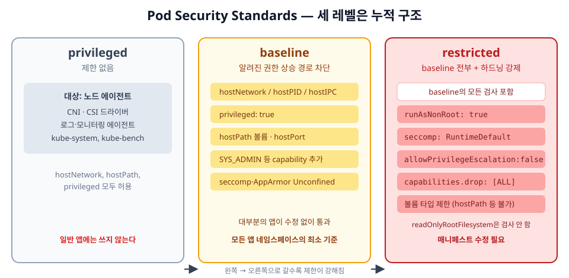
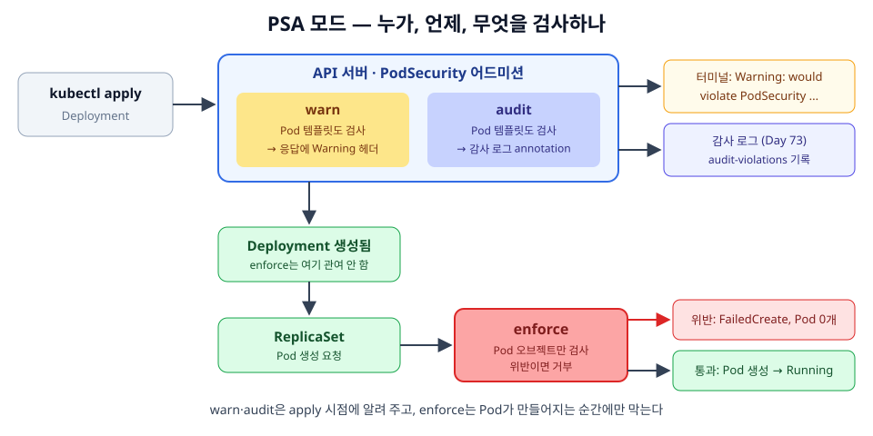
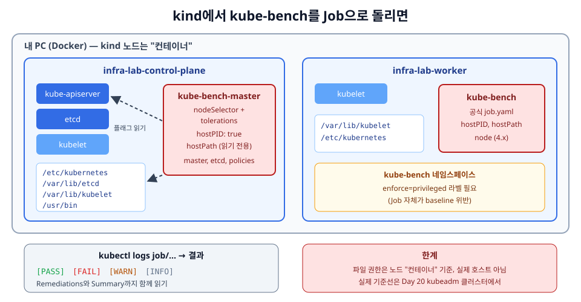

> **Chapter 9 · 보안** | 난이도 ★★★★☆ | 예상 소요 2 ~ 2.5시간

## 🎯 오늘의 목표

- Pod Security Standards의 세 레벨(**privileged / baseline / restricted**)이 각각 무엇을 막는지 설명할 수 있다
- PSA 네임스페이스 라벨의 세 모드(**enforce / audit / warn**)와 **버전 고정**을 조합해 무중단으로 보안 수준을 올릴 수 있다
- `restricted`를 통과하는 **securityContext 전체 세트**를 외우지 않고도 이유와 함께 작성할 수 있다
- 기존 데모 앱(`gitops-demo-app`)을 restricted 네임스페이스에 맞게 고치고, **ServiceAccount 토큰 자동 마운트**를 끌 수 있다
- **kube-bench**를 kind에서 Job으로 돌려 CIS 결과를 읽고, kind 결과의 한계를 설명할 수 있다

---

## 1. 왜 "워크로드" 보안인가

Day 66의 4C(Cloud → Cluster → Container → Code)에서 오늘은 **Cluster와 Container가 맞닿는 지점**, 즉 "API 서버가 어떤 Pod를 받아 줄 것인가"를 다룹니다.

Day 68에서 컨테이너 하나를 rootless·capabilities·seccomp·read-only FS로 단단하게 만드는 법을 봤습니다. 문제는 그걸 **모든 팀이, 모든 매니페스트에서, 매번** 지키게 만드는 일입니다.

> "보안팀이 가이드 문서를 돌렸는데, 3개월 뒤 보니 Helm 차트의 절반이 여전히 root로 돌고 있었습니다."

사람에게 맡기면 빠집니다. 그래서 쿠버네티스는 **어드미션 단계(Day 19의 세 번째 관문)** 에서 Pod 스펙을 검사하는 기본 장치를 제공합니다.

| 층 | 무엇을 | 오늘의 도구 |
|---|---|---|
| 규칙(표준) | "안전한 Pod란 무엇인가"의 정의 | **Pod Security Standards (PSS)** |
| 강제 장치 | 네임스페이스 단위로 규칙을 검사·거부 | **Pod Security Admission (PSA)** — API 서버 내장 |
| 작성 | 규칙을 통과하는 Pod 스펙 | **securityContext**, `automountServiceAccountToken` |
| 점검 | 클러스터 구성 자체가 안전한가 | **kube-bench** (CIS Kubernetes Benchmark) |

> 💡 Day 19의 6-8에서 `enforce=baseline` 라벨 하나로 privileged Pod를 막아 봤습니다. 오늘은 그 "맛보기"를 넘어 **restricted를 운영에 실제로 적용하는 과정**을 처음부터 끝까지 해 봅니다. RBAC·NetworkPolicy 기초는 Day 19를, capabilities·seccomp의 원리는 Day 07과 Day 68을 참고하세요.

---

## 2. Pod Security Standards — 세 개의 레벨



PSS는 오브젝트가 아니라 **문서로 정의된 표준**입니다. 레벨은 누적 구조라서 restricted는 baseline의 모든 검사를 포함합니다.

| 레벨 | 철학 | 대상 |
|---|---|---|
| **privileged** | 아무 제한 없음 | CNI, CSI 드라이버, 로그 수집기 같은 **노드 에이전트** (kube-system 등) |
| **baseline** | "알려진 권한 상승 경로"만 막는다. 대부분의 앱이 수정 없이 통과 | 일반 앱의 **최소 기준** |
| **restricted** | 하드닝 모범 사례를 강제. 매니페스트 수정이 필요 | 보안이 중요한 앱, 멀티테넌트 네임스페이스 |

### baseline이 막는 것

| 항목 | 허용되지 않는 것 |
|---|---|
| 호스트 네임스페이스 | `hostNetwork`, `hostPID`, `hostIPC` = true |
| 특권 컨테이너 | `privileged: true` |
| capabilities 추가 | 기본 목록(`CHOWN`, `NET_BIND_SERVICE`, `SETUID` 등) 밖의 `add` — 예: `SYS_ADMIN`, `NET_ADMIN` |
| 볼륨 | `hostPath` |
| 호스트 포트 | `hostPort` (0 제외) |
| 기타 | AppArmor `Unconfined`, SELinux 타입 임의 지정, `procMount: Unmasked`, 안전하지 않은 sysctl, seccomp `Unconfined` |

### restricted가 추가로 요구하는 것

| 항목 | 요구 사항 | 왜 |
|---|---|---|
| 볼륨 타입 | configMap, csi, downwardAPI, emptyDir, ephemeral, persistentVolumeClaim, projected, secret **만** | 노드 자원에 직접 닿는 볼륨 차단 |
| 권한 상승 | `allowPrivilegeEscalation: false` | setuid 바이너리로 root가 되는 경로 차단 (`no_new_privs`) |
| root 금지 | `runAsNonRoot: true`, `runAsUser`는 0이 아님 | 컨테이너 탈출 시 피해 최소화 |
| seccomp | `RuntimeDefault` 또는 `Localhost` (**미지정도 위반**) | 위험한 syscall 차단 |
| capabilities | `drop: ["ALL"]` 필수, `add`는 `NET_BIND_SERVICE`만 | 최소 권한 |

> ⚠️ **`readOnlyRootFilesystem`은 restricted 요구 사항이 아닙니다.** PSA는 이 필드를 검사하지 않습니다. 그래도 Day 68에서 본 것처럼 효과가 크므로 오늘의 "전체 세트"에는 넣습니다. PSA가 못 잡는 항목(읽기 전용 FS, 이미지 출처, 리소스 제한 등)은 Day 57의 Kyverno 같은 정책 엔진으로 보완합니다.

---

## 3. Pod Security Admission — 모드와 버전



PSA는 Kubernetes v1.25부터 GA인 **내장 어드미션 컨트롤러**입니다. 설치할 것이 없고, 네임스페이스에 라벨만 붙이면 됩니다.

```yaml
metadata:
  labels:
    pod-security.kubernetes.io/<MODE>: <LEVEL>            # privileged | baseline | restricted
    pod-security.kubernetes.io/<MODE>-version: <VERSION>  # v1.37 같은 버전 또는 latest
```

| 모드 | 위반 시 동작 | 어디서 보이나 |
|---|---|---|
| **enforce** | Pod 생성 **거부** | `kubectl` 에러 / ReplicaSet 이벤트 `FailedCreate` |
| **audit** | 허용하되 **감사 로그에 기록** | API 서버 감사 로그의 annotation (Day 73) |
| **warn** | 허용하되 **사용자에게 경고** | `kubectl apply` 출력의 `Warning:` 줄 |

### 함정: enforce는 "Pod"만 본다

enforce는 **Pod 오브젝트**에만 적용됩니다. Deployment·Job 같은 워크로드 리소스는 위반해도 **생성됩니다.** 그 뒤 ReplicaSet이 Pod를 만들려다 거부당하고, 사용자는 "Deployment는 있는데 Pod가 0개"인 상황을 보게 됩니다. 반면 **warn과 audit은 워크로드 리소스의 Pod 템플릿도 검사**합니다. 그래서 warn을 함께 켜 두면 `kubectl apply` 시점에 바로 알 수 있습니다.

### 버전 고정 — 업그레이드가 정책을 바꾸지 않게

PSS의 세부 검사는 쿠버네티스 버전에 따라 조금씩 늘어납니다(예: v1.34에서 probe·lifecycle hook의 `host` 필드 검사 추가). `latest`로 두면 **클러스터를 업그레이드하는 순간 어제 통과하던 Pod가 거부**될 수 있습니다.

| 전략 | 라벨 예 | 의미 |
|---|---|---|
| enforce는 고정 | `enforce-version: v1.37` | 오늘 검증한 기준으로 계속 강제 |
| warn·audit은 최신 | `warn-version: latest` | 다음 버전 기준 위반을 **미리 경고**로 확인 |

업그레이드 후 경고가 0이 되면 그때 `enforce-version`을 올립니다.

### 단계적 도입 순서

| 단계 | 라벨 | 효과 |
|---|---|---|
| ① 관찰 | `warn=restricted`, `audit=restricted` | 아무것도 막지 않고 위반 목록 수집 |
| ② 최소 강제 | `enforce=baseline` + ① 유지 | 명백히 위험한 Pod만 차단 |
| ③ 수정 | 매니페스트에 securityContext 추가 | 경고가 0이 될 때까지 |
| ④ 완전 강제 | `enforce=restricted`, `enforce-version` 고정 | 목표 상태 |

> 💡 네임스페이스 라벨이 없을 때의 **클러스터 기본값**은 API 서버의 `--admission-control-config-file`로 넘기는 `PodSecurityConfiguration`(defaults·exemptions)으로 정합니다. kind에서는 `kubeadmConfigPatches`의 apiServer `extraArgs`와 `extraMounts`로 파일을 넣어야 해서 번거롭습니다. 클러스터 전역 기본값 실습은 Day 20의 kubeadm 클러스터에서 하는 것을 권합니다. 오늘은 네임스페이스 라벨만 씁니다.

---

## 4. restricted를 통과하는 securityContext 전체 세트

securityContext는 **Pod 레벨**(`spec.securityContext`)과 **컨테이너 레벨**(`spec.containers[].securityContext`) 두 곳에 있습니다. 둘 다 있는 필드는 컨테이너 레벨이 우선합니다.

```yaml
spec:
  automountServiceAccountToken: false     # (6장) API를 안 부르는 앱이면 토큰을 넣지 않음
  securityContext:                        # ── Pod 레벨: 모든 컨테이너 공통
    runAsNonRoot: true                    # root(UID 0)면 kubelet이 시작을 거부
    runAsUser: 10001                      # 이미지 USER와 같은 숫자 UID
    runAsGroup: 10001
    fsGroup: 10001                        # 볼륨 파일의 그룹 소유자
    seccompProfile:
      type: RuntimeDefault                # 컨테이너 런타임 기본 seccomp 프로파일
  containers:
  - name: app
    securityContext:                      # ── 컨테이너 레벨
      allowPrivilegeEscalation: false     # no_new_privs: setuid로 권한 상승 불가
      capabilities:
        drop: ["ALL"]                     # 모든 capability 제거
      readOnlyRootFilesystem: true        # (PSA 검사 대상 아님, 권장)
      privileged: false
```

| 필드 | PSA 레벨 | 빠지면 |
|---|---|---|
| `runAsNonRoot: true` | restricted | `runAsNonRoot != true` 위반 |
| `seccompProfile.type: RuntimeDefault` | restricted | `seccompProfile` 위반 (미지정도 위반) |
| `allowPrivilegeEscalation: false` | restricted | `allowPrivilegeEscalation != false` 위반 |
| `capabilities.drop: ["ALL"]` | restricted | `unrestricted capabilities` 위반 |
| `privileged: false` | baseline | 미지정이면 기본값 false라 통과 |
| `readOnlyRootFilesystem: true` | (없음) | 통과하지만 쓰기 가능한 루트 FS |

> ⚠️ `runAsNonRoot: true`는 이미지의 `USER`가 **숫자**여야 kubelet이 검증할 수 있습니다. `USER appuser`처럼 이름만 있으면 `container has runAsNonRoot and image has non-numeric user (appuser), cannot verify user is non-root` 로 시작이 실패합니다. 이때는 `runAsUser`를 숫자로 명시하거나 Dockerfile을 `USER 10001`로 바꿉니다. Day 50의 `gitops-demo-app` Dockerfile은 이미 `USER 10001`입니다.

---

## 5. 실습 준비

**실습 환경**: Day 09의 kind `infra-lab` 클러스터, kubectl v1.31 이상. 예시 출력은 kind v0.33(노드 이미지 Kubernetes **v1.37**) 기준입니다. 버전 고정 라벨은 본인 클러스터 버전에 맞추세요.

```bash
kubectl config use-context kind-infra-lab
kubectl version | grep Server
# Server Version: v1.37.0
```

데모 앱 이미지는 Day 50에서 만든 `gitops-demo-app:0.1.0`을 씁니다. 로컬에 없다면 Day 50의 8장대로 다시 빌드한 뒤 kind 노드에 넣습니다.

```bash
cd ~/gitops-lab/gitops-demo-app
docker build -t gitops-demo-app:0.1.0 --build-arg APP_VERSION=0.1.0 .
kind load docker-image gitops-demo-app:0.1.0 --name infra-lab
```

> 💡 Argo CD가 관리하는 `demo-dev` 네임스페이스(Day 53)를 직접 고치면 Self-heal이 되돌립니다. 오늘은 **별도 네임스페이스 `secure-demo`** 에서 실험하고, 결과 매니페스트를 마지막에 설정 레포로 옮기는 방식으로 진행합니다.

---

## 6. 실습 ① 관찰 모드 — warn/audit으로 위반 목록 보기

### 6-1. 기존 네임스페이스부터 점검 (dry-run)

라벨을 실제로 붙이기 전에 **서버 측 dry-run**으로 "지금 붙이면 누가 걸리나"를 볼 수 있습니다.

```bash
kubectl label --dry-run=server --overwrite ns --all \
  pod-security.kubernetes.io/enforce=baseline
```

```
Warning: existing pods in namespace "kube-system" violate the new PodSecurity enforce level "baseline:latest"
Warning: etcd-infra-lab-control-plane (and 6 other pods): host namespaces, hostPath volumes
Warning: kindnet-4xk2p (and 2 other pods): host namespaces, hostPath volumes, non-default capabilities
namespace/default labeled (server dry run)
namespace/kube-system labeled (server dry run)
...
```

(Pod 이름과 개수는 환경마다 다릅니다.) kube-system의 컴포넌트는 원래 호스트 자원이 필요한 **노드 에이전트**라서 privileged가 맞습니다. 이렇게 "어느 네임스페이스에 어떤 레벨이 맞는지"를 먼저 분류합니다.

### 6-2. 네임스페이스 생성 — 관찰 모드

```yaml
# ns-secure-demo.yaml
apiVersion: v1
kind: Namespace
metadata:
  name: secure-demo
  labels:
    pod-security.kubernetes.io/enforce: baseline
    pod-security.kubernetes.io/enforce-version: v1.37
    pod-security.kubernetes.io/warn: restricted
    pod-security.kubernetes.io/warn-version: latest
    pod-security.kubernetes.io/audit: restricted
    pod-security.kubernetes.io/audit-version: latest
```

```bash
kubectl apply -f ns-secure-demo.yaml
```

### 6-3. 수정 전 매니페스트 배포

Day 50의 Deployment를 거의 그대로 가져옵니다. securityContext가 하나도 없습니다.

```yaml
# demo-before.yaml
apiVersion: apps/v1
kind: Deployment
metadata:
  name: demo-app
  namespace: secure-demo
spec:
  replicas: 1
  selector:
    matchLabels:
      app.kubernetes.io/name: demo-app
  template:
    metadata:
      labels:
        app.kubernetes.io/name: demo-app
    spec:
      containers:
      - name: demo-app
        image: gitops-demo-app:0.1.0
        imagePullPolicy: IfNotPresent
        ports:
        - name: http
          containerPort: 8000
        readinessProbe:
          httpGet:
            path: /healthz
            port: http
        resources:
          requests:
            cpu: 50m
            memory: 64Mi
          limits:
            memory: 128Mi
```

```bash
kubectl apply -f demo-before.yaml
```

```
Warning: would violate PodSecurity "restricted:latest": allowPrivilegeEscalation != false (container "demo-app" must set securityContext.allowPrivilegeEscalation=false), unrestricted capabilities (container "demo-app" must set securityContext.capabilities.drop=["ALL"]), runAsNonRoot != true (pod or container "demo-app" must set securityContext.runAsNonRoot=true), seccompProfile (pod or container "demo-app" must set securityContext.seccompProfile.type to "RuntimeDefault" or "Localhost")
deployment.apps/demo-app created
```

baseline enforce는 통과했으므로 Pod는 정상으로 뜹니다. 경고 한 줄에 **고쳐야 할 목록이 전부** 들어 있습니다. 이것이 warn 모드의 가치입니다.

### 6-4. enforce를 restricted로 올리면?

수정 없이 enforce만 올려 봅니다.

```bash
kubectl label ns secure-demo --overwrite \
  pod-security.kubernetes.io/enforce=restricted
# Warning: existing pods in namespace "secure-demo" violate the new PodSecurity enforce level "restricted:v1.37"
# Warning: demo-app-6d9f7c8b5-x2k4q: allowPrivilegeEscalation != false, unrestricted capabilities, runAsNonRoot != true, seccompProfile

kubectl get pods -n secure-demo     # 기존 Pod는 그대로 Running
```

> 💡 PSA는 **이미 떠 있는 Pod를 죽이지 않습니다.** 라벨 변경 시 경고만 합니다. 하지만 Pod가 재시작·재스케줄되는 순간 새 Pod는 거부됩니다. "라벨을 바꿨는데 멀쩡하네?"가 아니라 **시한폭탄**입니다.

실제로 롤아웃을 일으켜 봅니다.

```bash
kubectl rollout restart deployment/demo-app -n secure-demo
kubectl get deploy,rs -n secure-demo
```

```
NAME                       READY   UP-TO-DATE   AVAILABLE   AGE
deployment.apps/demo-app   1/1     0            1           3m

NAME                                  DESIRED   CURRENT   READY   AGE
replicaset.apps/demo-app-6d9f7c8b5    1         1         1       3m
replicaset.apps/demo-app-7b8c5d4f9    1         0         0       10s
```

```bash
kubectl describe rs -n secure-demo | grep -A2 FailedCreate | head -3
# Warning  FailedCreate  ...  Error creating: pods "demo-app-7b8c5d4f9-..." is forbidden:
# violates PodSecurity "restricted:v1.37": allowPrivilegeEscalation != false (...)
```

새 ReplicaSet이 Pod를 못 만드는 상태입니다. 롤링 업데이트라 기존 Pod가 살아 있어서 서비스는 유지되지만, 노드 장애가 나면 복구가 안 됩니다.

---

## 7. 실습 ② 데모 앱을 restricted에 맞게 고치기

### 7-1. 수정된 매니페스트

```yaml
# demo-restricted.yaml
apiVersion: v1
kind: ServiceAccount
metadata:
  name: demo-app
  namespace: secure-demo
automountServiceAccountToken: false     # 이 SA를 쓰는 Pod에 기본적으로 토큰 미주입
---
apiVersion: apps/v1
kind: Deployment
metadata:
  name: demo-app
  namespace: secure-demo
spec:
  replicas: 1
  selector:
    matchLabels:
      app.kubernetes.io/name: demo-app
  template:
    metadata:
      labels:
        app.kubernetes.io/name: demo-app
    spec:
      serviceAccountName: demo-app
      automountServiceAccountToken: false
      securityContext:
        runAsNonRoot: true
        runAsUser: 10001
        runAsGroup: 10001
        fsGroup: 10001
        seccompProfile:
          type: RuntimeDefault
      containers:
      - name: demo-app
        image: gitops-demo-app:0.1.0
        imagePullPolicy: IfNotPresent
        ports:
        - name: http
          containerPort: 8000            # 1024 이상이라 NET_BIND_SERVICE 불필요
        readinessProbe:
          httpGet:
            path: /healthz
            port: http
        securityContext:
          allowPrivilegeEscalation: false
          capabilities:
            drop: ["ALL"]
          readOnlyRootFilesystem: true
        volumeMounts:
        - name: tmp
          mountPath: /tmp                # 쓰기가 필요한 곳만 emptyDir로
        resources:
          requests:
            cpu: 50m
            memory: 64Mi
          limits:
            memory: 128Mi
      volumes:
      - name: tmp
        emptyDir:
          sizeLimit: 64Mi
```

| 바꾼 것 | 이유 |
|---|---|
| Pod `securityContext` 추가 | runAsNonRoot·seccomp는 Pod 레벨에 한 번만 쓰면 모든 컨테이너(사이드카 포함)에 적용 |
| 컨테이너 `securityContext` 추가 | allowPrivilegeEscalation·capabilities는 **컨테이너 레벨에만** 있는 필드 |
| `readOnlyRootFilesystem` + `/tmp` emptyDir | Python은 임시 파일을 `/tmp`에 쓸 수 있음. 이미지가 `PYTHONDONTWRITEBYTECODE=1`이라 `.pyc` 쓰기는 없음 |
| 전용 ServiceAccount + 토큰 미마운트 | 이 앱은 쿠버네티스 API를 부르지 않음 (6장) |

```bash
kubectl apply -f demo-restricted.yaml        # Warning 줄이 더 이상 없음
kubectl rollout status deployment/demo-app -n secure-demo
kubectl get pods -n secure-demo
```

```
NAME                        READY   STATUS    RESTARTS   AGE
demo-app-5c7d9b6f4-r8m2n    1/1     Running   0          15s
```

### 7-2. 실제로 막혔는지 확인

```bash
POD=$(kubectl get pod -n secure-demo -l app.kubernetes.io/name=demo-app -o name)

kubectl exec -n secure-demo $POD -- id -u
# 10001

kubectl exec -n secure-demo $POD -- touch /app/hacked
# touch: cannot touch '/app/hacked': Read-only file system

kubectl exec -n secure-demo $POD -- touch /tmp/ok && echo "/tmp 쓰기 OK"

kubectl exec -n secure-demo $POD -- grep -E "CapEff|NoNewPrivs|Seccomp:" /proc/1/status
```

```
CapEff:	0000000000000000        ← 유효 capability 없음
NoNewPrivs:	1                   ← allowPrivilegeEscalation: false
Seccomp:	2                   ← 2 = filter 모드 (RuntimeDefault 적용)
```

Day 68에서 `docker run` 옵션으로 확인했던 값들이 이번엔 **매니페스트 선언만으로** 나왔습니다.

### 7-3. 정책을 깨는 Pod는 즉시 거부

```bash
kubectl run root-test -n secure-demo --image=busybox:1.37 --restart=Never -- sleep 3600
```

```
Error from server (Forbidden): pods "root-test" is forbidden: violates PodSecurity "restricted:v1.37": allowPrivilegeEscalation != false (...), unrestricted capabilities (...), runAsNonRoot != true (...), seccompProfile (...)
```

단독 Pod는 Deployment와 달리 **생성 시점에 바로** 거부됩니다.

> 💡 이 매니페스트를 Day 52의 설정 레포 `base/deployment.yaml`에 반영하고, `overlays/*`의 Namespace에도 같은 PSA 라벨을 넣으면 Argo CD가 모든 환경을 restricted로 맞춰 줍니다. 서드파티 Helm 차트는 values에 `podSecurityContext` / `securityContext` 항목이 있는지 먼저 확인하세요. 대부분의 성숙한 차트는 restricted 호환 값을 제공합니다.

---

## 8. 실습 ③ ServiceAccount 토큰 자동 마운트 끄기

### 8-1. 왜 꺼야 하나

모든 Pod에는 기본적으로 네임스페이스의 `default` ServiceAccount 토큰이 `/var/run/secrets/kubernetes.io/serviceaccount/token`에 **projected 볼륨**으로 들어갑니다(v1.22+ 기본으로 만료·자동 갱신되는 토큰). 앱이 쿠버네티스 API를 쓰지 않는데도 토큰이 있으면, 앱이 뚫렸을 때 공격자는 그 토큰으로 API 서버에 말을 걸 수 있습니다. 누군가 실수로 `default` SA에 권한을 줬다면 그대로 **권한 상승 경로**가 됩니다.

| 설정 위치 | 효과 | 우선순위 |
|---|---|---|
| `ServiceAccount.automountServiceAccountToken: false` | 이 SA를 쓰는 Pod의 기본값을 "안 넣음"으로 | 낮음 |
| `Pod.spec.automountServiceAccountToken` | 이 Pod만 명시적으로 결정 | **높음 (Pod가 이김)** |

### 8-2. 비교

```bash
# 토큰 없음 (7장 Pod)
kubectl exec -n secure-demo $POD -- ls /var/run/secrets/kubernetes.io/serviceaccount
# ls: cannot access '/var/run/secrets/kubernetes.io/serviceaccount': No such file or directory

# 비교: 기본 설정 Pod는 토큰이 있음 (default 네임스페이스, PSA 없음)
kubectl run sa-test --image=busybox:1.37 --restart=Never -- sleep 300
kubectl exec sa-test -- ls /var/run/secrets/kubernetes.io/serviceaccount
# ca.crt  namespace  token
kubectl delete pod sa-test
```

API가 **필요한** 앱(예: Day 17의 Prometheus, 오퍼레이터)은 전용 SA를 만들고, Day 19처럼 필요한 권한만 Role로 묶은 뒤 토큰 마운트를 켜 둡니다. 원칙은 "**기본은 끄고, 필요한 곳만 켠다**"입니다.

> 💡 네임스페이스마다 `default` SA의 자동 마운트를 끄는 것도 흔한 하드닝입니다: `kubectl patch sa default -n secure-demo -p '{"automountServiceAccountToken": false}'`

---

## 9. 실습 ④ kube-bench — 클러스터 구성 점검



### 9-1. kube-bench와 CIS Benchmark

PSA가 **Pod**를 검사한다면, kube-bench는 **클러스터 구성 자체**를 검사합니다. CIS(Center for Internet Security)가 발행하는 *Kubernetes Benchmark*의 항목을 자동으로 확인하는 Aqua Security의 오픈소스 도구입니다. Day 67에서 Lynis로 호스트를 점검한 것의 쿠버네티스판입니다.

| 섹션(target) | 번호 | 검사 내용 예 |
|---|---|---|
| `master` | 1.x | 매니페스트 파일 권한, API 서버 플래그(`--anonymous-auth`, `--audit-log-path`, `--profiling`) |
| `etcd` | 2.x | etcd TLS, 클라이언트 인증서 |
| `controlplane` | 3.x | 인증 방식, 감사 정책 |
| `node` | 4.x | kubelet 설정 파일 권한, `--anonymous-auth`, `--read-only-port` |
| `policies` | 5.x | RBAC 최소 권한, PSA, NetworkPolicy, Secret 사용 방식 (대부분 Manual) |

kube-bench **v0.16.0**의 버전 매핑표(`cfg/config.yaml`)는 쿠버네티스 v1.32~v1.34를 **`cis-1.12`** 벤치마크에 매핑하고, v1.35 이상은 표에 없습니다. 표에 없는 더 높은 버전(v1.35~v1.37)은 마이너 버전을 하나씩 내려가며 찾아 가장 가까운 `cis-1.12`를 씁니다. 명시하고 싶으면 `--benchmark cis-1.12`를 붙입니다. 새 CIS 벤치마크가 매핑된 kube-bench 릴리스가 나오면 그 값을 쓰세요.

### 9-2. kind에서 Job으로 실행

kube-bench는 **노드의 파일과 프로세스**를 봐야 하므로 `hostPID: true`와 여러 `hostPath` 마운트를 씁니다. 공식 `job.yaml`은 스케줄러가 고른 아무 노드(보통 워커)에서 돕니다. 컨트롤 플레인을 검사하려면 `nodeSelector`와 `tolerations`를 추가해야 합니다.

> ⚠️ kube-bench Pod 자체가 baseline 위반(hostPID, hostPath)입니다. **restricted 라벨이 붙은 네임스페이스에서는 뜨지 않습니다.** 전용 네임스페이스에 `privileged`를 명시해서 돌립니다.

```bash
kubectl create namespace kube-bench
kubectl label ns kube-bench pod-security.kubernetes.io/enforce=privileged
```

```yaml
# kube-bench-master.yaml — 공식 job.yaml(v0.16.0)을 control-plane용으로 수정
apiVersion: batch/v1
kind: Job
metadata:
  name: kube-bench-master
  namespace: kube-bench
spec:
  template:
    spec:
      hostPID: true                       # 노드의 kube-apiserver 등 프로세스 플래그를 읽기 위해
      restartPolicy: Never
      nodeSelector:
        node-role.kubernetes.io/control-plane: ""
      tolerations:
      - key: node-role.kubernetes.io/control-plane
        operator: Exists
        effect: NoSchedule
      containers:
      - name: kube-bench
        image: docker.io/aquasec/kube-bench:v0.16.0
        command: ["kube-bench", "run", "--targets", "master,etcd,controlplane,policies"]
        volumeMounts:
        - { name: var-lib-etcd,    mountPath: /var/lib/etcd,     readOnly: true }
        - { name: var-lib-kubelet, mountPath: /var/lib/kubelet,  readOnly: true }
        - { name: etc-systemd,     mountPath: /etc/systemd,      readOnly: true }
        - { name: lib-systemd,     mountPath: /lib/systemd/,     readOnly: true }
        - { name: etc-kubernetes,  mountPath: /etc/kubernetes,   readOnly: true }
        - { name: usr-bin,         mountPath: /usr/local/mount-from-host/bin, readOnly: true }
        - { name: etc-cni-netd,    mountPath: /etc/cni/net.d/,   readOnly: true }
        - { name: opt-cni-bin,     mountPath: /opt/cni/bin/,     readOnly: true }
      volumes:
      - { name: var-lib-etcd,    hostPath: { path: /var/lib/etcd } }
      - { name: var-lib-kubelet, hostPath: { path: /var/lib/kubelet } }
      - { name: etc-systemd,     hostPath: { path: /etc/systemd } }
      - { name: lib-systemd,     hostPath: { path: /lib/systemd } }
      - { name: etc-kubernetes,  hostPath: { path: /etc/kubernetes } }
      - { name: usr-bin,         hostPath: { path: /usr/bin } }
      - { name: etc-cni-netd,    hostPath: { path: /etc/cni/net.d/ } }
      - { name: opt-cni-bin,     hostPath: { path: /opt/cni/bin/ } }
```

워커 노드(kubelet) 점검은 공식 `job.yaml`을 그대로 쓰되 대상만 `node`로 지정하면 됩니다.

```bash
kubectl apply -f kube-bench-master.yaml

# 워커 노드용: 공식 job.yaml을 받아 네임스페이스만 지정해 적용
curl -fsSLO https://raw.githubusercontent.com/aquasecurity/kube-bench/v0.16.0/job.yaml
kubectl apply -n kube-bench -f job.yaml

kubectl get pods -n kube-bench -o wide     # STATUS Completed 까지 수 초~수십 초
kubectl logs -n kube-bench job/kube-bench-master > bench-master.txt
kubectl logs -n kube-bench job/kube-bench        > bench-node.txt
```

### 9-3. 결과 읽기

출력은 `[PASS]` / `[FAIL]` / `[WARN]` / `[INFO]`로 시작하는 줄, 그리고 `== Remediations ==`(조치 방법), `== Summary ==`로 구성됩니다. (아래는 kind 기본 클러스터의 발췌 예시이며 숫자는 환경마다 다릅니다.)

```
[INFO] 1 Control Plane Security Configuration
[INFO] 1.1 Control Plane Node Configuration Files
[PASS] 1.1.1 Ensure that the API server pod specification file permissions are set to 600 or more restrictive (Automated)
...
[INFO] 1.2 API Server
[WARN] 1.2.1 Ensure that the --anonymous-auth argument is set to false (Manual)
[PASS] 1.2.6 Ensure that the --authorization-mode argument is not set to AlwaysAllow (Automated)
[PASS] 1.2.8 Ensure that the --authorization-mode argument includes RBAC (Automated)
[FAIL] 1.2.15 Ensure that the --profiling argument is set to false (Automated)
[FAIL] 1.2.16 Ensure that the --audit-log-path argument is set (Automated)
[FAIL] 1.2.17 Ensure that the --audit-log-maxage argument is set to 30 or as appropriate (Automated)
...
== Remediations master ==
1.2.16 Edit the API server pod specification file /etc/kubernetes/manifests/kube-apiserver.yaml
on the control plane node and set the --audit-log-path parameter to a suitable path and
file where you would like audit logs to be written, for example,
--audit-log-path=/var/log/apiserver/audit.log
...
== Summary master ==
38 checks PASS
11 checks FAIL
12 checks WARN
0 checks INFO
```

| 상태 | 의미 | 대응 |
|---|---|---|
| `PASS` | 자동 검사 통과 | — |
| `FAIL` | **Automated** 항목이 기준 미달 | Remediations대로 수정하거나, 의도된 예외면 문서화 |
| `WARN` | **Manual** 항목 — 도구가 판정할 수 없어 사람이 확인해야 함 | 체크리스트처럼 하나씩 검토 |
| `INFO` | 섹션 제목·참고 | — |

읽는 순서는 이렇게 권합니다.

1. **Summary**로 전체 규모를 본다
2. `grep FAIL`로 Automated 실패만 뽑는다 → 대부분 API 서버·kubelet **플래그**
3. 각 FAIL의 번호로 Remediations를 찾아 "고칠 것 / 예외로 둘 것"을 분류
4. `5.x policies`의 WARN은 오늘·어제 배운 것(RBAC, PSA, NetworkPolicy)과 연결해서 검토

```bash
grep -E "^\[FAIL\]" bench-master.txt bench-node.txt
# JSON으로 받아 CI에서 집계하려면 command에 --json 을 추가
```

### 9-4. kind 결과의 한계

| 한계 | 이유 |
|---|---|
| **노드 = Docker 컨테이너** | 파일 권한·소유자 검사는 kind 노드 컨테이너 안의 파일을 본 것이지, 실제 호스트 OS가 아님 |
| 감사 로그 FAIL은 "정상" | kind는 기본적으로 감사 로그를 켜지 않음. 켜는 방법은 Day 73에서 다룸 |
| 수정해도 재현성이 낮음 | `/etc/kubernetes/manifests`를 `docker exec`로 고칠 수는 있지만 클러스터를 다시 만들면 사라짐. 영구 반영은 kind 설정의 `kubeadmConfigPatches`로 해야 함 |
| 관리형 서비스와 다름 | EKS/GKE/AKS는 컨트롤 플레인에 접근할 수 없어 전용 벤치마크(`eks-*`, `gke-*`)와 전용 Job 파일을 씀 |

> ⚠️ kind의 kube-bench 결과는 **"도구를 읽는 연습"** 용입니다. 실제 기준선을 잡으려면 Day 20의 **kubeadm 멀티노드 클러스터**(또는 홈랩 H01 서버)에서 같은 Job을 돌리고, 그 결과로 API 서버·kubelet 설정을 고친 뒤 다시 돌려 FAIL이 줄어드는지 확인하세요.

### 9-5. 정리

```bash
kubectl delete ns kube-bench
rm -f job.yaml bench-master.txt bench-node.txt
# secure-demo 네임스페이스는 Day 70에서 다시 쓰지 않으므로 지워도 됩니다
kubectl delete ns secure-demo
```

---

## 10. 트러블슈팅

| 증상 | 원인 | 해결 |
|---|---|---|
| Deployment는 있는데 Pod가 0개, `READY 0/1` | enforce 위반. Deployment 자체는 거부되지 않음 | `kubectl describe rs`의 `FailedCreate` 이벤트에서 위반 항목 확인 |
| `container has runAsNonRoot and image has non-numeric user` | 이미지 `USER`가 이름 | `runAsUser: <숫자>` 명시 또는 Dockerfile을 숫자 UID로 |
| `CreateContainerConfigError` + `runAsNonRoot ... will run as root` | 이미지가 root(USER 미지정) | 이미지 수정 또는 `runAsUser` 지정. 공식 nginx 대신 `nginxinc/nginx-unprivileged`(8080 포트) 같은 비root 이미지 |
| `Read-only file system` 로그 후 CrashLoopBackOff | readOnlyRootFilesystem인데 앱이 캐시·PID·임시 파일을 씀 | 쓰는 경로만 `emptyDir`로 마운트 (`/tmp`, `/var/cache/nginx`, `/var/run` 등) |
| 80/443에 bind 실패 `permission denied` | capabilities drop ALL로 1024 미만 포트 불가 | 앱 포트를 1024 이상으로 바꾸고 Service `port: 80 → targetPort: 8080` |
| 라벨 변경 후 Helm 차트의 Pod만 거부 | 차트의 init 컨테이너·사이드카에 securityContext 없음 | 차트 values의 `podSecurityContext`·`securityContext`·`initContainers` 항목 설정 |
| kube-bench Pod가 `Pending` | control-plane taint 미허용 / nodeSelector 오타 | tolerations·nodeSelector 확인, `kubectl describe pod` |
| kube-bench Pod가 `Forbidden: violates PodSecurity` | 실행 네임스페이스에 baseline 이상 enforce | 전용 네임스페이스를 `enforce=privileged`로 |
| kube-bench 로그에 `unable to find a matching Benchmark Version match for kubernetes version` | 버전 탐지·매핑 실패 | `--benchmark cis-1.12` 명시 (v0.16.0 기준 최신 매핑) |

---

## 11. 핵심 정리

- **PSS**는 표준(privileged < baseline < restricted), **PSA**는 이를 네임스페이스 라벨로 강제하는 내장 어드미션 컨트롤러
- 모드: **enforce**(거부) / **audit**(감사 로그) / **warn**(경고). enforce는 Pod만, warn·audit은 워크로드의 Pod 템플릿까지 본다
- **enforce-version은 고정, warn-version은 latest** — 업그레이드가 정책을 바꾸지 않게 하면서 다음 기준을 미리 본다
- restricted 필수 세트: `runAsNonRoot`, `seccompProfile: RuntimeDefault`, `allowPrivilegeEscalation: false`, `capabilities.drop: [ALL]` (+ 권장 `readOnlyRootFilesystem` + `/tmp` emptyDir)
- 도입은 **warn/audit로 관찰 → baseline enforce → 수정 → restricted enforce** 순서로
- API를 안 쓰는 앱은 `automountServiceAccountToken: false`. Pod 설정이 SA 설정보다 우선
- **kube-bench**는 CIS 기준으로 클러스터 구성을 점검. FAIL은 고치거나 예외로 문서화, WARN은 수동 검토. kind 결과는 연습용

---

## 12. 셀프 체크

<details>
<summary>Q1. restricted로 enforce한 네임스페이스에 위반 Deployment를 apply했다. 무슨 일이 일어나나?</summary>

Deployment와 ReplicaSet은 **생성됩니다**(enforce는 Pod만 검사). ReplicaSet이 Pod를 만들 때 거부되어 `FailedCreate` 이벤트가 쌓이고 Pod는 0개가 됩니다. warn 모드를 함께 켜 두면 apply 시점에 경고로 미리 알 수 있습니다.
</details>

<details>
<summary>Q2. <code>enforce-version</code>을 <code>latest</code> 대신 특정 버전으로 고정하는 이유는?</summary>

PSS 세부 검사는 쿠버네티스 버전에 따라 추가될 수 있어서, latest면 클러스터 업그레이드만으로 기존에 통과하던 Pod가 거부될 수 있습니다. enforce는 검증된 버전에 고정하고, warn/audit을 latest로 두어 새 기준의 위반을 미리 확인한 뒤 고정 버전을 올립니다.
</details>

<details>
<summary>Q3. 다음 중 restricted가 <b>요구하지 않는</b> 것은? (a) runAsNonRoot (b) readOnlyRootFilesystem (c) seccompProfile (d) capabilities drop ALL</summary>

**(b) readOnlyRootFilesystem.** PSA는 이 필드를 검사하지 않습니다. 권장되는 하드닝이지만 강제하려면 Kyverno 같은 정책 엔진(Day 57)이 필요합니다.
</details>

<details>
<summary>Q4. ServiceAccount에 <code>automountServiceAccountToken: false</code>를 줬는데 어떤 Pod에는 토큰이 들어 있다. 왜인가?</summary>

그 Pod의 `spec.automountServiceAccountToken: true`가 명시되어 있기 때문입니다. **Pod 레벨 설정이 ServiceAccount 설정보다 우선**합니다.
</details>

<details>
<summary>Q5. kind에서 kube-bench가 <code>1.2.16 --audit-log-path</code>를 FAIL로 보고했다. 어떻게 해석해야 하나?</summary>

kind는 기본적으로 감사 로그를 켜지 않으므로 예상된 결과입니다. 운영 클러스터라면 API 서버에 감사 정책과 로그 경로를 설정해 고쳐야 하는 항목이고(Day 73), kind에서는 노드가 컨테이너라는 점 때문에 파일 권한 등 다른 결과도 실제 호스트를 대표하지 않습니다. 실제 기준선은 kubeadm 클러스터에서 잡습니다.
</details>

---

## ⏭️ 다음 예고 — Day 70. NetworkPolicy와 제로 트러스트, mTLS

오늘은 "**어떤 Pod가 뜰 수 있는가**"를 막았습니다. 하지만 뜬 Pod끼리는 여전히 클러스터 안에서 **누구와도 통신**할 수 있습니다. 내일은 "내부망이니 안전하다"는 가정을 버리는 **제로 트러스트** 원칙에서 출발해, 모든 트래픽을 기본 거부한 뒤 필요한 것만 여는 NetworkPolicy를 설계하고, Cilium의 L7 정책을 맛본 다음, **Istio ambient**로 Pod 간 통신을 mTLS로 암호화하고 STRICT 모드로 평문을 차단해 봅니다.
