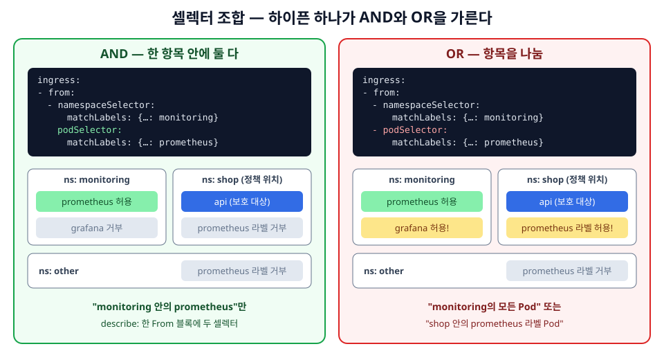
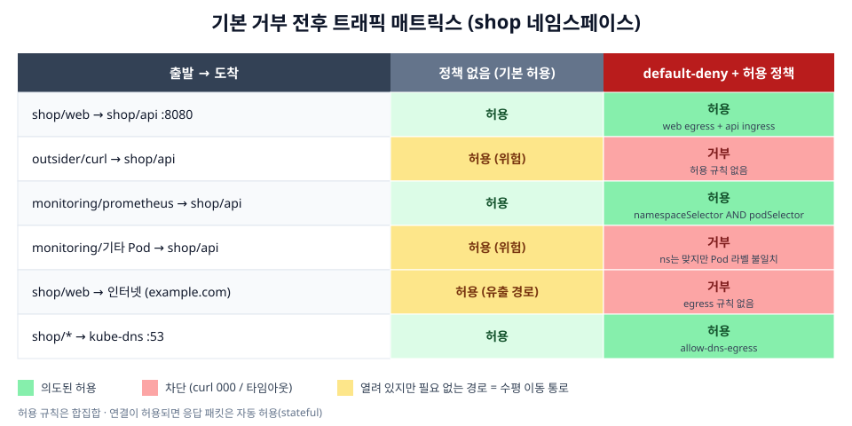
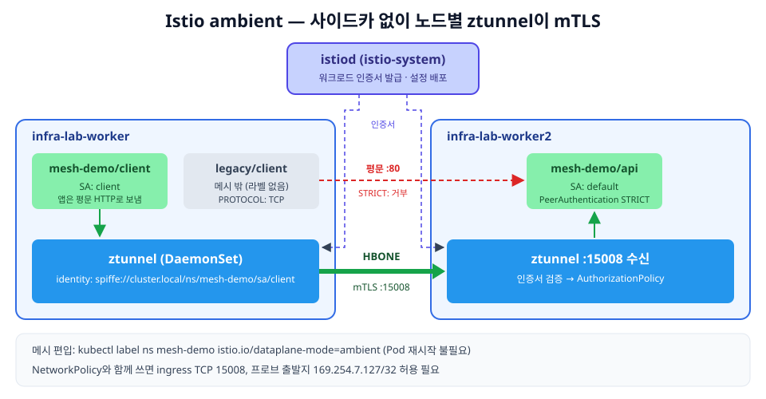

> **Chapter 9 · 보안** | 난이도 ★★★★☆ | 예상 소요 2.5 ~ 3시간

## 🎯 오늘의 목표

- **제로 트러스트**의 핵심 원칙을 "경계 기반 보안"과 비교해 설명할 수 있다
- **기본 거부(default-deny) ingress/egress** 위에 DNS·필요한 통신만 여는 NetworkPolicy 세트를 설계할 수 있다
- `namespaceSelector`와 `podSelector`의 **AND / OR 조합** 차이를 정확히 구분할 수 있다
- Cilium의 **L7 정책(CiliumNetworkPolicy)** 이 표준 NetworkPolicy와 무엇이 다른지 안다
- **Istio ambient**로 Pod 간 통신을 mTLS로 암호화하고, **STRICT** 모드로 평문을 차단한 뒤 확인할 수 있다

---

## 1. 제로 트러스트 — "내부망이니까 괜찮다"를 버리기

### 1-1. 성(城)과 해자 모델의 한계

전통적인 보안은 **경계(perimeter)** 에 집중했습니다. 방화벽 바깥은 위험, 안쪽은 신뢰. Day 67에서 nftables로 호스트 입구를 막은 것도 이 사고방식입니다.

쿠버네티스 클러스터 안은 Day 19에서 봤듯이 **기본적으로 모든 Pod가 모든 Pod와 통신**할 수 있는 평평한 네트워크입니다. 웹 서버 하나가 뚫리면 공격자는 그 Pod에서 DB, 내부 API, 다른 팀의 서비스까지 자유롭게 접근합니다. 이것을 **수평 이동(lateral movement)** 이라고 합니다.

### 1-2. 제로 트러스트 원칙

NIST SP 800-207이 정리한 제로 트러스트의 요지는 "**네트워크 위치만으로 신뢰를 주지 않는다**"입니다.

| 원칙 | 경계 기반 | 제로 트러스트 | 오늘의 도구 |
|---|---|---|---|
| 신뢰의 근거 | 내부 IP 대역에 있음 | **검증된 아이덴티티** | Istio의 SPIFFE ID (ServiceAccount 기반) |
| 기본 정책 | 내부는 허용 | **기본 거부, 명시적 허용** | default-deny NetworkPolicy |
| 범위 | 큰 구역 단위 | **마이크로 세그멘테이션** (워크로드 단위) | podSelector, AuthorizationPolicy |
| 전송 구간 | 내부는 평문 | **항상 암호화 + 상호 인증** | mTLS (ztunnel) |
| 가정 | 침입은 막을 수 있다 | **이미 침입당했다고 가정**(assume breach) | 피해 반경 최소화 |
| 검증 | 접속 시 한 번 | **요청마다 지속적으로** | 연결마다 인증서 확인 |

> 💡 제로 트러스트는 제품 이름이 아니라 **설계 원칙**입니다. Day 19의 RBAC(누가 API를 쓰나), Day 69의 PSA(어떤 Pod가 뜨나)도 같은 원칙의 다른 층입니다. 오늘은 **네트워크 층**을 채웁니다.

### 1-3. L3/L4 정책과 아이덴티티 기반 정책

| 층 | 기준 | 도구 | 약점 |
|---|---|---|---|
| **L3/L4** | IP, 포트, 라벨 → IP로 변환 | NetworkPolicy (CNI가 구현) | IP는 위조·재사용될 수 있고, **암호화는 안 됨** |
| **L7** | HTTP 메서드·경로, gRPC 메서드 | CiliumNetworkPolicy, Istio waypoint | 프록시 비용 |
| **아이덴티티** | 인증서 속 워크로드 ID | Istio mTLS + AuthorizationPolicy | 메시 운영 부담 |

둘은 대체 관계가 아니라 **겹쳐 쓰는(defense in depth)** 관계입니다. 오늘은 L3/L4 → L7 → mTLS 순서로 쌓습니다.

---

## 2. NetworkPolicy 심화 — 기본 거부 설계

Day 19에서 "같은 네임스페이스만 허용"하는 ingress 정책 하나를 걸어 봤습니다. 이번에는 **ingress와 egress를 모두 기본 거부**하고 필요한 것만 엽니다.

### 2-1. 다시 정리하는 규칙 네 가지

| 규칙 | 내용 |
|---|---|
| 정책이 없으면 전부 허용 | 어떤 Pod를 선택하는 정책이 **하나도 없으면** 그 Pod는 모든 트래픽 허용 |
| 선택되면 격리 | 정책의 `podSelector`가 Pod를 고르고 `policyTypes`에 `Egress`가 있으면, 그 Pod의 egress는 **허용 규칙에 적힌 것만** 가능 (Ingress도 동일) |
| 허용만 있다 | 거부 규칙이 없고, 여러 정책의 허용은 **합집합** (Day 19의 RBAC과 같은 구조) |
| 응답은 자동 | 허용된 연결의 **응답 패킷은 자동 허용** (stateful) |

### 2-2. 기본 거부 + DNS 허용

```yaml
# 00-default-deny.yaml — 네임스페이스의 모든 Pod, 들어오고 나가는 것 전부 거부
apiVersion: networking.k8s.io/v1
kind: NetworkPolicy
metadata:
  name: default-deny-all
spec:
  podSelector: {}
  policyTypes: ["Ingress", "Egress"]
```

egress를 막는 순간 **DNS 조회까지 막힙니다.** `http://api:8080` 같은 서비스 이름을 못 풀어서 "모든 게 안 되는" 상황이 됩니다. 그래서 default-deny와 **DNS 허용은 항상 짝**입니다.

```yaml
# 01-allow-dns.yaml
apiVersion: networking.k8s.io/v1
kind: NetworkPolicy
metadata:
  name: allow-dns-egress
spec:
  podSelector: {}
  policyTypes: ["Egress"]
  egress:
  - to:
    - namespaceSelector:
        matchLabels:
          kubernetes.io/metadata.name: kube-system   # 모든 네임스페이스에 자동으로 붙는 라벨
      podSelector:
        matchLabels:
          k8s-app: kube-dns                          # CoreDNS Pod 라벨
    ports:
    - { protocol: UDP, port: 53 }
    - { protocol: TCP, port: 53 }                    # 응답이 크면 TCP로 재시도
```

### 2-3. AND와 OR — 하이픈 하나의 차이



`from`/`to` 아래 **리스트 항목 하나 안에** 두 셀렉터를 쓰면 AND, **항목을 나누면** OR입니다.

```yaml
# AND: monitoring 네임스페이스의 prometheus Pod만
ingress:
- from:
  - namespaceSelector:
      matchLabels: { kubernetes.io/metadata.name: monitoring }
    podSelector:                       # ← 하이픈 없음: 같은 항목
      matchLabels: { app.kubernetes.io/name: prometheus }
```

```yaml
# OR: monitoring 네임스페이스의 "모든" Pod  또는  "내 네임스페이스"의 prometheus Pod
ingress:
- from:
  - namespaceSelector:
      matchLabels: { kubernetes.io/metadata.name: monitoring }
  - podSelector:                       # ← 하이픈 있음: 별도 항목
      matchLabels: { app.kubernetes.io/name: prometheus }
```

| 쓰는 방식 | 의미 |
|---|---|
| `podSelector`만 | **정책과 같은 네임스페이스**의 해당 Pod |
| `namespaceSelector`만 | 해당 네임스페이스의 **모든** Pod |
| 같은 항목에 둘 다 (AND) | 해당 네임스페이스 **안의** 해당 Pod |
| `namespaceSelector: {}` | **모든** 네임스페이스의 모든 Pod |
| `ipBlock` | 클러스터 밖 CIDR (Pod IP에는 쓰지 않음) |

> ⚠️ OR로 잘못 쓰면 문법 오류 없이 **의도보다 훨씬 넓게 열립니다.** 리뷰할 때 `kubectl describe networkpolicy`로 사람이 읽을 수 있는 해석을 꼭 확인하세요.

---

## 3. kind의 NetworkPolicy 지원 확인

NetworkPolicy는 오브젝트일 뿐이고 **CNI가 구현**합니다(Day 19).

| CNI | NetworkPolicy | 비고 |
|---|---|---|
| **kindnet** (kind 기본) | **kind v0.24.0부터 지원** | 릴리스 노트: "Out-of-the-box support for network policy via sigs.k8s.io/kube-network-policies". 표준 NetworkPolicy(ingress/egress)를 구현 |
| Calico | 지원 | 자체 확장 정책 `GlobalNetworkPolicy` |
| **Cilium** | 지원 + **L7·DNS 기반 정책** | eBPF 기반. 오늘 4장에서 사용 |
| Flannel 단독 | **미지원** | 정책이 조용히 무시됨 |

```bash
kind version
# kind v0.33.0 go1.25.x linux/amd64   ← v0.24.0 이상이면 OK

kubectl get ds -n kube-system kindnet
```

> ⚠️ `infra-lab`을 **v0.24 이전 kind로 만들었다면** kind를 올려도 기존 클러스터의 kindnet은 그대로입니다. 이 경우 2장의 정책이 아무 효과가 없으니(에러도 안 남) 클러스터를 다시 만들거나 4장의 Cilium 클러스터에서 실습하세요.

---

## 4. 실습 ① 기본 거부 전후 트래픽 매트릭스

**실습 환경**: Day 09의 kind `infra-lab`(kind v0.24+), Day 17의 kube-prometheus-stack 릴리스 `monitoring`. 이미지는 `traefik/whoami:v1.12.0`(요청 정보를 돌려주는 작은 HTTP 서버), `curlimages/curl:8.23.0`.

### 4-1. 시나리오



| 출발 → 도착 | 기본 거부 전 | 목표 |
|---|---|---|
| shop/web → shop/api :8080 | 허용 | **허용** |
| outsider/curl → shop/api | 허용 | **거부** |
| monitoring/prometheus → shop/api | 허용 | **허용** (메트릭 수집) |
| monitoring의 다른 Pod → shop/api | 허용 | **거부** (AND 조합 확인) |
| shop/web → 인터넷 | 허용 | **거부** |
| shop/* → kube-dns :53 | 허용 | **허용** |

### 4-2. 워크로드 배포

```yaml
# shop-apps.yaml
apiVersion: v1
kind: Namespace
metadata:
  name: shop
---
apiVersion: apps/v1
kind: Deployment
metadata:
  name: api
  namespace: shop
spec:
  replicas: 1
  selector:
    matchLabels: { app: api }
  template:
    metadata:
      labels: { app: api }
    spec:
      containers:
      - name: whoami
        image: traefik/whoami:v1.12.0
        args: ["--port", "8080"]
        ports:
        - containerPort: 8080
---
apiVersion: v1
kind: Service
metadata:
  name: api
  namespace: shop
spec:
  selector: { app: api }
  ports:
  - port: 8080
    targetPort: 8080
---
apiVersion: apps/v1
kind: Deployment
metadata:
  name: web
  namespace: shop
spec:
  replicas: 1
  selector:
    matchLabels: { app: web }
  template:
    metadata:
      labels: { app: web }
    spec:
      containers:
      - name: curl
        image: curlimages/curl:8.23.0
        command: ["sleep", "86400"]
```

```bash
kubectl apply -f shop-apps.yaml
kubectl create namespace outsider
kubectl run curl -n outsider --image=curlimages/curl:8.23.0 --command -- sleep 86400
kubectl wait -n shop --for=condition=Available deploy/api deploy/web --timeout=90s
```

테스트를 반복하기 쉽게 함수로 만들어 둡니다. HTTP 코드가 `200`이면 허용, `000`이면 차단(타임아웃)입니다.

```bash
probe() {  # probe <네임스페이스> <exec 대상> <URL>
  kubectl exec -n "$1" "$2" -- curl -s -m 3 -o /dev/null -w "%{http_code}\n" "$3"
}

probe shop deploy/web     http://api:8080/          # 200
probe outsider curl       http://api.shop:8080/     # 200  ← 다른 네임스페이스도 통함
probe shop deploy/web     https://example.com/      # 200  ← 인터넷도 나감
```

Prometheus Pod에서도 확인합니다. Prometheus 이미지에는 curl 대신 busybox `wget`이 있습니다.

```bash
PROM=$(kubectl get pod -n monitoring -l app.kubernetes.io/name=prometheus -o name | head -1)
kubectl exec -n monitoring $PROM -c prometheus -- wget -q -T 3 -O /dev/null http://api.shop:8080/ && echo OK
# OK
```

### 4-3. 기본 거부 적용

```bash
kubectl apply -n shop -f 00-default-deny.yaml

probe shop deploy/web http://api:8080/
# 000   (curl: (28) Resolving timed out ... 또는 Connection timed out)
```

DNS부터 막혔습니다. 2-2의 DNS 허용을 추가합니다.

```bash
kubectl apply -n shop -f 01-allow-dns.yaml
kubectl exec -n shop deploy/web -- nslookup api     # 이름 풀이는 성공
probe shop deploy/web http://api:8080/              # 000 — 이제 DNS는 되지만 통신 규칙이 없음
```

### 4-4. 필요한 통신만 허용

```yaml
# 02-allow-app.yaml
apiVersion: networking.k8s.io/v1
kind: NetworkPolicy
metadata:
  name: web-egress-to-api           # web → api 나가는 쪽
  namespace: shop
spec:
  podSelector:
    matchLabels: { app: web }
  policyTypes: ["Egress"]
  egress:
  - to:
    - podSelector:
        matchLabels: { app: api }
    ports:
    - { protocol: TCP, port: 8080 }
---
apiVersion: networking.k8s.io/v1
kind: NetworkPolicy
metadata:
  name: api-ingress                 # api가 받는 쪽
  namespace: shop
spec:
  podSelector:
    matchLabels: { app: api }
  policyTypes: ["Ingress"]
  ingress:
  - from:                           # ① 같은 네임스페이스의 web
    - podSelector:
        matchLabels: { app: web }
    ports:
    - { protocol: TCP, port: 8080 }
  - from:                           # ② monitoring 네임스페이스의 prometheus (AND)
    - namespaceSelector:
        matchLabels: { kubernetes.io/metadata.name: monitoring }
      podSelector:
        matchLabels: { app.kubernetes.io/name: prometheus }
    ports:
    - { protocol: TCP, port: 8080 }
```

> 💡 web → api 통신이 되려면 **web의 egress와 api의 ingress가 둘 다** 허용해야 합니다. default-deny가 양방향이기 때문입니다. "한쪽만 열고 왜 안 되지?"가 가장 흔한 실수입니다.

```bash
kubectl apply -f 02-allow-app.yaml

probe shop deploy/web   http://api:8080/          # 200   허용
probe outsider curl     http://api.shop:8080/     # 000   거부
probe shop deploy/web   https://example.com/      # 000   거부 (egress)
kubectl exec -n monitoring $PROM -c prometheus -- wget -q -T 3 -O /dev/null http://api.shop:8080/ && echo OK
# OK    허용

# monitoring 네임스페이스지만 prometheus가 아닌 Pod → AND 조건 불충족
kubectl run tmp -n monitoring --image=curlimages/curl:8.23.0 --rm -it --restart=Never -- \
  curl -s -m 3 -o /dev/null -w "%{http_code}\n" http://api.shop:8080/
# 000   거부
```

`kubectl describe`로 해석을 확인합니다.

```bash
kubectl describe networkpolicy api-ingress -n shop
```

```
  Allowing ingress traffic:
    To Port: 8080/TCP
    From:
      PodSelector: app=web
    ----------
    To Port: 8080/TCP
    From:
      NamespaceSelector: kubernetes.io/metadata.name=monitoring
      PodSelector: app.kubernetes.io/name=prometheus
```

`NamespaceSelector`와 `PodSelector`가 **한 From 블록 안에** 있으면 AND입니다.

> 💡 Traefik(Day 15)을 통해 외부에서 들어오게 하려면 api-ingress에 `namespaceSelector: kubernetes.io/metadata.name: traefik` 항목을 추가합니다. 새 경로가 생길 때마다 "누가, 어디로, 몇 번 포트"를 정책으로 적는 것, 이것이 마이크로 세그멘테이션입니다.

---

## 5. 실습 ② (선택) Cilium과 L7 정책

표준 NetworkPolicy는 "web이 api의 8080에 접속할 수 있다"까지만 말할 수 있습니다. "**GET /api만** 허용하고 `/admin`은 막아라"는 표현할 수 없습니다. Cilium은 eBPF로 L3/L4를 처리하고, L7 규칙이 있는 연결만 노드의 Envoy 프록시로 보내 HTTP 단위로 검사합니다.

### 5-1. Cilium으로 kind 클러스터 만들기

`infra-lab`은 그대로 두고, CNI 없이 별도 클러스터를 만듭니다. (Cilium 공식 kind 가이드 기준, Cilium **v1.20.4**)

```yaml
# kind-cilium.yaml
kind: Cluster
apiVersion: kind.x-k8s.io/v1alpha4
name: cilium-lab
nodes:
- role: control-plane
- role: worker
networking:
  disableDefaultCNI: true       # kindnet 설치 안 함
```

```bash
kind create cluster --config kind-cilium.yaml
kubectl get nodes        # STATUS NotReady — CNI가 없으니 정상

# Cilium CLI 설치 (Linux amd64)
CILIUM_CLI_VERSION=$(curl -s https://raw.githubusercontent.com/cilium/cilium-cli/main/stable.txt)
curl -L --fail --remote-name-all \
  https://github.com/cilium/cilium-cli/releases/download/${CILIUM_CLI_VERSION}/cilium-linux-amd64.tar.gz{,.sha256sum}
sha256sum --check cilium-linux-amd64.tar.gz.sha256sum
sudo tar xzvfC cilium-linux-amd64.tar.gz /usr/local/bin

# 이미지를 미리 받아 노드에 넣고 Helm으로 설치
docker pull quay.io/cilium/cilium:v1.20.4
kind load docker-image quay.io/cilium/cilium:v1.20.4 --name cilium-lab

helm repo add cilium https://helm.cilium.io/
helm install cilium cilium/cilium --version 1.20.4 \
  --namespace kube-system \
  --set image.pullPolicy=IfNotPresent \
  --set ipam.mode=kubernetes

cilium status --wait
```

```
    /¯¯\
 /¯¯\__/¯¯\    Cilium:             OK
 \__/¯¯\__/    Operator:           OK
 /¯¯\__/¯¯\    Envoy DaemonSet:    OK
 \__/¯¯\__/    Hubble Relay:       disabled
    \__/       ClusterMesh:        disabled
```

### 5-2. CiliumNetworkPolicy — HTTP 메서드·경로 제한

4-2의 `shop-apps.yaml`을 이 클러스터에 그대로 배포한 뒤, api에 L7 정책을 겁니다.

```yaml
# cnp-api-l7.yaml
apiVersion: cilium.io/v2
kind: CiliumNetworkPolicy
metadata:
  name: api-l7
  namespace: shop
spec:
  endpointSelector:
    matchLabels: { app: api }
  ingress:
  - fromEndpoints:
    - matchLabels: { app: web }
    toPorts:
    - ports:
      - { port: "8080", protocol: TCP }
      rules:
        http:
        - method: "GET"
          path: "/api"           # 정규식. GET /api 만 허용
```

```bash
kubectl apply -f shop-apps.yaml
kubectl wait -n shop --for=condition=Available deploy/api deploy/web --timeout=120s
kubectl apply -f cnp-api-l7.yaml

kubectl exec -n shop deploy/web -- curl -s -o /dev/null -w "%{http_code}\n" http://api:8080/api   # 200
kubectl exec -n shop deploy/web -- curl -s http://api:8080/
# Access denied            ← 연결은 되지만 Envoy가 HTTP 403으로 거절
kubectl exec -n shop deploy/web -- curl -s -X POST -o /dev/null -w "%{http_code}\n" http://api:8080/api   # 403
```

| 비교 | L3/L4에서 차단 | L7에서 차단 |
|---|---|---|
| 클라이언트가 보는 것 | 타임아웃(`000`) | 즉시 **HTTP 403** `Access denied` |
| 판단 근거 | 출발지·포트 | 메서드·경로·헤더 |

> 💡 Cilium은 이 밖에 `toFQDNs`(예: `api.github.com`으로만 egress 허용) 같은 **DNS 이름 기반 egress** 정책도 지원합니다. 4장에서 "인터넷 전체 거부"를 했다면, 실무에서는 이걸로 꼭 필요한 외부 도메인만 엽니다.

```bash
kind delete cluster --name cilium-lab     # 실습이 끝나면 정리
kubectl config use-context kind-infra-lab
```

---

## 6. 실습 ③ 서비스 메시로 mTLS — Istio ambient

### 6-1. 왜 mTLS인가, 왜 ambient인가

NetworkPolicy는 "누가 연결할 수 있나"를 **IP**로 판단하고, 내용은 **평문** 그대로 지나갑니다. 노드나 CNI 수준에서 패킷을 볼 수 있는 공격자는 내용을 읽을 수 있습니다. mTLS(mutual TLS)는 양쪽이 **서로 인증서를 확인**하고 통신을 **암호화**합니다. Day 71에서 다룰 인증서 발급·갱신을 메시가 워크로드마다 자동으로 해 줍니다.

| 선택지 | 2026-11 현재 상태 | 오늘의 선택 |
|---|---|---|
| **Istio ambient** | v1.24부터 GA, 현재 **1.32**. 사이드카 없이 노드별 **ztunnel**이 L4 mTLS 처리 | ✅ |
| Istio sidecar | 가장 오래된 방식. Pod마다 Envoy 사이드카 → 리소스·재시작 부담 | |
| Linkerd | 가볍고 단순. 단 2024년부터 오픈소스 프로젝트는 **edge 릴리스만** 제공하고 stable 빌드는 Buoyant가 배포 | |



| 구성 요소 | 역할 |
|---|---|
| **istiod** | 컨트롤 플레인. 워크로드 인증서(SPIFFE ID `spiffe://cluster.local/ns/<ns>/sa/<sa>`) 발급, 설정 배포 |
| **ztunnel** | 노드마다 DaemonSet. 메시에 속한 Pod의 트래픽을 가로채 **HBONE**(HTTP CONNECT over mTLS, 포트 15008)으로 터널링 |
| **istio-cni** | Pod 네트워크 네임스페이스에 트래픽 리다이렉트 규칙을 설치 |
| waypoint (선택) | L7 정책·라우팅이 필요할 때만 네임스페이스/서비스 단위로 띄우는 Envoy |

> 💡 ambient의 장점은 **앱 Pod를 재시작하지 않고** 네임스페이스 라벨 하나로 메시에 넣고 뺄 수 있다는 점입니다. 아이덴티티는 Day 19의 **ServiceAccount**에서 나옵니다. IP가 아니라 "어떤 SA로 돈 워크로드인가"가 신뢰의 근거가 됩니다.

### 6-2. 설치

**실습 환경**: kind `infra-lab`(Kubernetes 1.33~1.37 지원 범위), Istio **1.32.0**.

```bash
curl -L https://istio.io/downloadIstio | ISTIO_VERSION=1.32.0 sh -
cd istio-1.32.0
export PATH=$PWD/bin:$PATH
istioctl version          # client version: 1.32.0, 클러스터에는 아직 없음

istioctl install --set profile=ambient --skip-confirmation
```

```
✔ Istio core installed
✔ Istiod installed
✔ CNI installed
✔ Ztunnel installed
✔ Installation complete
```

```bash
kubectl get pods -n istio-system
# istio-cni-node-xxxxx (노드 수만큼), istiod-..., ztunnel-xxxxx (노드 수만큼)
```

> 💡 Gateway API CRD는 Day 15에서 이미 설치했으므로 추가 설치가 필요 없습니다. waypoint 등 일부 기능이 실험 채널 CRD를 요구하면 Istio 문서의 `experimental-install.yaml` 안내를 따르세요.

### 6-3. 메시 네임스페이스와 레거시 네임스페이스

```bash
kubectl create namespace mesh-demo
kubectl create namespace legacy

# api(whoami)와 클라이언트를 mesh-demo에, 메시 밖 클라이언트를 legacy에
kubectl create deployment api -n mesh-demo --image=traefik/whoami:v1.12.0 --port=80
kubectl expose deployment api -n mesh-demo --port=80
kubectl create serviceaccount client -n mesh-demo
kubectl run client -n mesh-demo --image=curlimages/curl:8.23.0 \
  --overrides='{"spec":{"serviceAccountName":"client"}}' --command -- sleep 86400
kubectl run client -n legacy --image=curlimages/curl:8.23.0 --command -- sleep 86400

# mesh-demo만 ambient 메시에 편입 — Pod 재시작 없음
kubectl label namespace mesh-demo istio.io/dataplane-mode=ambient
```

메시에 들어갔는지 ztunnel 관점에서 확인합니다.

```bash
istioctl ztunnel-config workloads | grep -E "NAMESPACE|mesh-demo|legacy"
```

```
NAMESPACE   POD NAME                ADDRESS      NODE               WAYPOINT PROTOCOL
legacy      client                  10.244.1.12  infra-lab-worker   None     TCP
mesh-demo   api-7d4b9c6f5d-k2m8x    10.244.2.9   infra-lab-worker2  None     HBONE
mesh-demo   client                  10.244.1.13  infra-lab-worker   None     HBONE
```

`PROTOCOL HBONE`이면 mTLS 터널로 주고받는 워크로드입니다.

### 6-4. PERMISSIVE (기본값) → STRICT

ambient의 기본 모드는 **PERMISSIVE**입니다. 메시 안끼리는 mTLS를 쓰지만, 메시 밖에서 오는 **평문도 받아 줍니다**(점진적 도입용).

```bash
kubectl exec -n mesh-demo client -- curl -s -o /dev/null -w "%{http_code}\n" http://api.mesh-demo   # 200 (mTLS)
kubectl exec -n legacy    client -- curl -s -o /dev/null -w "%{http_code}\n" http://api.mesh-demo   # 200 (평문!)
```

이제 STRICT를 겁니다.

```yaml
# peer-auth-strict.yaml
apiVersion: security.istio.io/v1
kind: PeerAuthentication
metadata:
  name: default
  namespace: mesh-demo          # istio-system에 두면 메시 전체에 적용
spec:
  mtls:
    mode: STRICT
```

```bash
kubectl apply -f peer-auth-strict.yaml

kubectl exec -n mesh-demo client -- curl -s -o /dev/null -w "%{http_code}\n" http://api.mesh-demo   # 200
kubectl exec -n legacy    client -- curl -s -m 3 http://api.mesh-demo
# curl: (56) Recv failure: Connection reset by peer      ← 평문 연결을 ztunnel이 거부
```

> ⚠️ ambient에서 `DISABLE` 모드는 쓸 수 없고 무시됩니다. ztunnel·HBONE 자체가 mTLS이기 때문입니다.

### 6-5. 정말 암호화됐나 — 아이덴티티 확인

ztunnel 로그에는 연결마다 **양쪽의 SPIFFE ID**가 남습니다.

```bash
kubectl logs -n istio-system -l app=ztunnel --since=5m --tail=-1 | grep "access connection complete" | grep mesh-demo | tail -2
```

```text
... access connection complete src.addr=10.244.1.13:45678 src.workload="client" src.namespace="mesh-demo"
src.identity="spiffe://cluster.local/ns/mesh-demo/sa/client" dst.addr=10.244.2.9:15008 dst.hbone_addr=10.244.2.9:80 dst.service="api.mesh-demo.svc.cluster.local"
dst.workload="api-7d4b9c6f5d-k2m8x" dst.namespace="mesh-demo" dst.identity="spiffe://cluster.local/ns/mesh-demo/sa/default" direction="inbound" ...
```

(발췌 예시이며 실제로는 한 줄로 출력됩니다.) `dst.addr`가 앱 포트가 아니라 **15008(HBONE)** 이고 원래 목적지 80은 `dst.hbone_addr`에 담겨 있다는 점, 그리고 양쪽 `identity`가 ServiceAccount 기반이라는 점을 확인하세요. 더 확실히 보고 싶다면 Istio 문서처럼 `kubectl debug`로 `nicolaka/netshoot`을 붙여 `tcpdump -nAi eth0 port 80 or port 15008`을 해 보면 HBONE 구간은 암호문만 보입니다.

### 6-6. 아이덴티티 기반 인가 (L4 AuthorizationPolicy)

mTLS로 "누구인지"를 알았으니, **IP가 아니라 ServiceAccount로** 허용 대상을 정할 수 있습니다.

```yaml
# authz-api.yaml
apiVersion: security.istio.io/v1
kind: AuthorizationPolicy
metadata:
  name: api-allow-client
  namespace: mesh-demo
spec:
  selector:
    matchLabels: { app: api }
  action: ALLOW
  rules:
  - from:
    - source:
        principals: ["cluster.local/ns/mesh-demo/sa/client"]
```

```bash
kubectl apply -f authz-api.yaml
kubectl exec -n mesh-demo client -- curl -s -o /dev/null -w "%{http_code}\n" http://api.mesh-demo   # 200

# 같은 네임스페이스·메시 안이지만 SA가 default인 Pod → 거부
kubectl run other -n mesh-demo --image=curlimages/curl:8.23.0 --rm -it --restart=Never -- \
  curl -s -m 3 http://api.mesh-demo
# curl: (56) Recv failure: Connection reset by peer
```

> 💡 ztunnel은 L4만 처리합니다. HTTP 경로·메서드 조건이 들어간 AuthorizationPolicy는 **waypoint**가 있어야 적용됩니다(ztunnel만 있으면 L7 조건이 든 ALLOW는 전부 거부로 동작). L7이 필요할 때만 `istioctl waypoint apply -n mesh-demo`로 waypoint를 추가하세요.

### 6-7. NetworkPolicy와 함께 쓸 때 주의

4장의 `shop`처럼 기본 거부가 걸린 네임스페이스를 ambient에 넣으면 두 가지를 추가로 허용해야 합니다.

| 허용할 것 | 이유 |
|---|---|
| ingress **TCP 15008** | 메시 트래픽은 앱 포트가 아니라 HBONE 포트로 도착 |
| ingress from `169.254.7.127/32` | ambient는 kubelet 헬스 프로브의 출발지를 이 링크 로컬 주소로 바꿈. 막으면 readiness 실패 |

```yaml
  ingress:
  - ports:
    - { protocol: TCP, port: 8080 }
    - { protocol: TCP, port: 15008 }
  - from:
    - ipBlock: { cidr: 169.254.7.127/32 }
```

### 6-8. 정리

```bash
kubectl delete namespace shop outsider mesh-demo legacy
istioctl uninstall --purge -y
kubectl delete namespace istio-system
```

---

## 7. 트러블슈팅

| 증상 | 원인 | 해결 |
|---|---|---|
| default-deny 후 **모든** 통신이 안 됨, `Resolving timed out` | DNS egress까지 막힘 | 2-2의 `allow-dns-egress` 추가. CoreDNS 라벨이 `k8s-app: kube-dns`인지 확인 |
| 한쪽만 열었는데 통신 안 됨 | 양방향 default-deny인데 egress 또는 ingress 한쪽만 허용 | 출발 Pod의 egress **와** 도착 Pod의 ingress 둘 다 허용 |
| 정책이 너무 넓게 열림 | namespaceSelector와 podSelector를 **별도 항목(OR)** 으로 씀 | 한 항목 안에 같이 쓰기(AND). `kubectl describe networkpolicy`로 확인 |
| 정책을 걸었는데 아무 효과 없음 | CNI가 미지원 / v0.24 이전 kind | `kind version`, CNI 확인. Cilium 클러스터 사용 |
| default-deny 후 Pod가 `NotReady` | CNI 구현에 따라 kubelet 프로브가 막힘 / ambient의 `169.254.7.127` 미허용 | 프로브 출발지 허용 규칙 추가 |
| Cilium 설치 후 노드가 계속 `NotReady` | 이미지 pull 실패 | `kind load docker-image`로 미리 적재, `cilium status`로 오류 확인 |
| L7 정책 후 `Access denied` | 의도된 동작 (허용 목록에 없는 메서드·경로) | `path`는 정규식임에 유의 (`/api.*` 등) |
| `ztunnel-config workloads`에서 `TCP`로 표시 | 네임스페이스 라벨 누락 또는 오타 | `istio.io/dataplane-mode=ambient` 확인 |
| STRICT 후 메시 밖 서비스(예: Prometheus)의 스크레이프 실패 | 평문 요청이 거부됨 | 클라이언트 쪽도 메시에 넣거나, 해당 워크로드만 PERMISSIVE로 PeerAuthentication 범위 조정 |

---

## 8. 핵심 정리

- 제로 트러스트 = **위치가 아니라 아이덴티티**로 신뢰, **기본 거부**, **항상 암호화**, **침입을 가정**하고 피해 반경을 줄인다
- NetworkPolicy는 선택된 Pod만 격리하고, 허용 규칙의 **합집합**. default-deny와 **DNS 허용은 짝**
- 한 항목 안 `namespaceSelector + podSelector` = **AND**, 항목을 나누면 **OR**
- kind는 **v0.24부터** kindnet(kube-network-policies)이 NetworkPolicy를 구현. L7·FQDN 정책이 필요하면 **Cilium**
- **Istio ambient**: 노드별 ztunnel이 HBONE(15008)으로 mTLS. 라벨 `istio.io/dataplane-mode=ambient`로 재시작 없이 편입
- 기본은 PERMISSIVE. **PeerAuthentication STRICT**로 평문을 거부하고, AuthorizationPolicy로 **ServiceAccount 기반** 인가
- NetworkPolicy와 ambient를 같이 쓰면 **15008**과 **169.254.7.127**을 허용

---

## 9. 셀프 체크

<details>
<summary>Q1. default-deny(Ingress+Egress)를 건 뒤 DNS만 허용했다. web에서 api로 아직 접속이 안 되는 이유는?</summary>

web의 **egress**(api:8080으로 나가는 것)와 api의 **ingress**(web에서 오는 것)가 둘 다 허용돼야 합니다. DNS 정책은 kube-dns로 가는 egress만 열었을 뿐입니다.
</details>

<details>
<summary>Q2. 아래 두 정책의 차이는? (A) 한 항목에 namespaceSelector와 podSelector (B) 두 항목으로 나눠 씀</summary>

(A)는 **AND** — "그 네임스페이스 안의 그 라벨 Pod"만. (B)는 **OR** — "그 네임스페이스의 모든 Pod" 또는 "정책과 같은 네임스페이스의 그 라벨 Pod". (B)가 훨씬 넓습니다.
</details>

<details>
<summary>Q3. NetworkPolicy만으로 충분하지 않고 mTLS가 필요한 이유는?</summary>

NetworkPolicy는 IP·포트 기반으로 연결 여부만 정하고 **내용을 암호화하지 않으며**, 상대가 누구인지 **암호학적으로 증명하지 않습니다**. mTLS는 양쪽 인증서(워크로드 아이덴티티)를 검증하고 전송 구간을 암호화합니다. 둘을 겹쳐 쓰는 것이 심층 방어입니다.
</details>

<details>
<summary>Q4. ambient 메시에서 PERMISSIVE와 STRICT의 차이를 legacy 클라이언트 관점에서 설명하라.</summary>

PERMISSIVE에서는 메시 밖 legacy 클라이언트의 **평문 요청도 수락**됩니다(메시 안끼리는 mTLS). STRICT에서는 mTLS(HBONE)가 아닌 연결을 거부해 legacy 클라이언트는 `Connection reset`을 받습니다.
</details>

<details>
<summary>Q5. 표준 NetworkPolicy로 "GET /api만 허용"을 구현할 수 없는 이유와 대안은?</summary>

표준 NetworkPolicy는 L3/L4(IP·포트)만 다룹니다. HTTP 메서드·경로는 L7 정보라 프록시가 필요합니다. 대안은 Cilium의 **CiliumNetworkPolicy**(`rules.http`)나 Istio **waypoint** + L7 AuthorizationPolicy입니다.
</details>

---

## ⏭️ 다음 예고 — Day 71. 시크릿·인증서 — OpenBao/Vault, cert-manager

오늘 Istio가 워크로드 인증서를 자동으로 발급해 줬습니다. 그럼 **Ingress/Gateway의 TLS 인증서**는 누가 발급하고 갱신할까요? 내일은 **cert-manager**로 자체 CA와 Let's Encrypt(ACME) 인증서를 자동화해 Day 15의 Traefik Gateway에 연결하고, **OpenBao**(Vault의 오픈소스 포크)로 KV 시크릿·쿠버네티스 인증·**동적 DB 자격 증명**을 다룬 뒤 Day 55의 External Secrets와 연결합니다.
