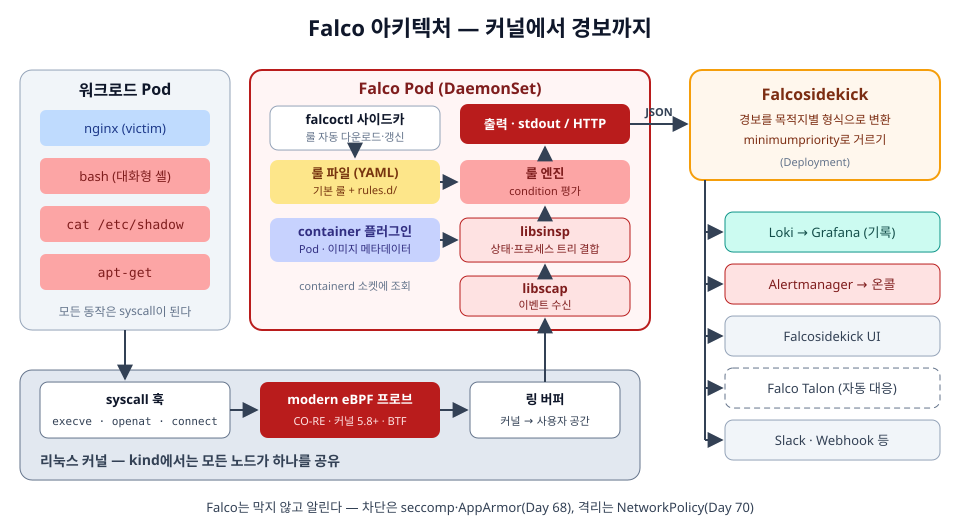
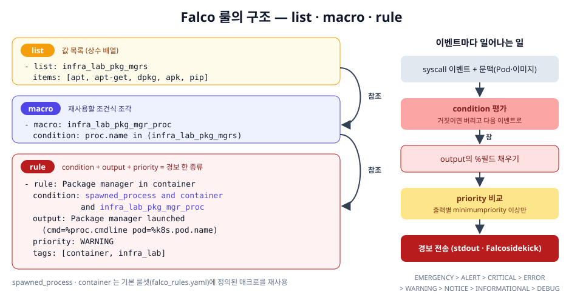
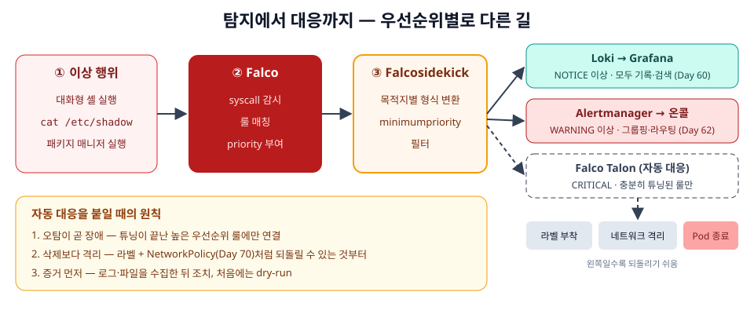

> **Chapter 9 · 보안** | 난이도 ★★★★☆ | 예상 소요 2 ~ 2.5시간

## 🎯 오늘의 목표

- 예방(하드닝·정책)과 **탐지(런타임 감시)** 가 왜 둘 다 필요한지 설명할 수 있다
- Falco의 구조(**modern eBPF 드라이버 → 룰 엔진 → 출력**)를 그림으로 설명할 수 있다
- kind `infra-lab`에 Falco를 Helm으로 설치하고, 기본 룰이 잡아내는 행위를 **무해하게 재현**할 수 있다
- **list · macro · rule** 로 커스텀 룰을 작성하고, 오탐을 줄이는 튜닝을 할 수 있다
- **Falcosidekick**으로 경보를 Loki(Day 60)와 Alertmanager(Day 62)로 보내고, 탐지 후 대응 자동화의 개념을 안다

---

## 1. 왜 런타임 탐지인가?

Chapter 9에서 지금까지 쌓은 것은 대부분 **예방**입니다. Day 67에서 호스트를 잠갔고, Day 68에서 컨테이너의 capability와 syscall을 줄였고, Day 69에서 위험한 Pod를 어드미션에서 거부했고, Day 70에서 통신 경로를 막았습니다. Day 57의 Trivy·cosign·Kyverno는 배포 **전에** 이미지를 걸렀죠.

그런데 이런 질문이 남습니다.

> "정상 이미지로 정상 배포된 앱에 RCE 취약점이 있었다. 공격자가 그 안에서 셸을 열었다. 우리는 그걸 **언제** 알게 되나?"

예방은 "문을 잠그는 일"이고, 탐지는 "누가 들어왔을 때 알람이 울리게 하는 일"입니다. 둘은 대체 관계가 아니라 **겹겹이 쌓는 관계**(Day 66의 심층 방어)입니다.

| 단계 | 도구 (배운 Day) | 보는 대상 | 한계 |
|---|---|---|---|
| 빌드·배포 전 | Trivy, cosign (Day 57) | 이미지 안의 알려진 CVE, 서명 | 아직 알려지지 않은 취약점, 실행 중 행위는 모름 |
| 어드미션 | Kyverno, PSA (Day 57, 69) | 매니페스트(spec) | 일단 뜬 Pod 안에서 무슨 일이 벌어지는지는 모름 |
| 실행 제한 | seccomp, AppArmor, capabilities (Day 68) | 허용된 syscall·권한 | 허용 범위 **안에서의** 이상 행위는 통과 |
| API 기록 | K8s 감사 로그 (Day 73) | API 서버로 들어온 요청 | 컨테이너 **안**의 `cat /etc/shadow`는 API를 안 거침 |
| **런타임 탐지** | **Falco (오늘)** | 커널 syscall + 컨테이너/K8s 메타데이터 | 차단이 아니라 **탐지**. 대응은 별도 |

> 💡 Falco는 기본적으로 **막지 않고 알려 줍니다**. 그래서 오탐이 있어도 서비스가 멈추지 않고, 대신 "알람을 얼마나 믿을 수 있게 만드느냐(튜닝)"가 핵심 작업이 됩니다. Day 62에서 본 **알림 피로** 문제가 그대로 적용됩니다.

---

## 2. Falco 구조



Falco는 CNCF 졸업(Graduated) 프로젝트로, 커널에서 일어나는 시스템 콜을 실시간으로 받아 **룰과 비교**하고, 맞으면 경보를 내보냅니다.

| 구성 요소 | 위치 | 하는 일 |
|---|---|---|
| **드라이버 (modern eBPF)** | 커널 | `execve`, `openat`, `connect` 같은 syscall 이벤트를 잡아 **링 버퍼**에 넣음 |
| **libscap** | 사용자 공간 | 링 버퍼에서 이벤트를 꺼냄 (capture) |
| **libsinsp** | 사용자 공간 | 이벤트에 **상태와 문맥**을 붙임 — 프로세스 트리, 열린 파일, 사용자 |
| **container 플러그인** | 사용자 공간 | containerd 소켓에 물어 컨테이너 이름·이미지·**Pod 이름·네임스페이스**를 붙임 |
| **룰 엔진** | 사용자 공간 | 룰 파일(YAML)의 condition을 이벤트마다 평가 |
| **출력 채널** | 사용자 공간 | stdout, 파일, HTTP, gRPC 등으로 경보 전송 |
| **Falcosidekick** | 별도 Deployment | Falco의 HTTP 출력을 받아 Loki, Alertmanager, Slack 등 수십 가지 대상으로 **팬아웃** |

### 드라이버 선택

| 드라이버 (`driver.kind`) | 방식 | 요구 사항 | 비고 |
|---|---|---|---|
| **`modern_ebpf`** | CO-RE eBPF 프로그램이 **Falco 바이너리에 내장** | 커널 5.8 이상 + **BTF** (`/sys/kernel/btf/vmlinux`) | 별도 빌드·다운로드 없음. 현재 기본 선호 드라이버 |
| `kmod` | 커널 모듈 | 커널 버전에 맞는 모듈 빌드/다운로드 | 오래된 커널용 |
| `auto` (차트 기본값) | modern eBPF를 먼저 시도하고 안 되면 kmod로 | — | 무엇이 선택됐는지 로그로 확인 필요 |

> 💡 옛 문서에 나오는 `ebpf`(legacy eBPF probe)는 현재 Helm 차트의 `driver.kind` 옵션에 없습니다. 오늘은 `modern_ebpf`를 명시해서 씁니다. 커널 모듈을 올릴 필요가 없어 kind 같은 환경에서 가장 다루기 쉽습니다.

### 이벤트 소스는 syscall만이 아니다

Falco는 **플러그인**으로 다른 이벤트 소스도 받습니다. K8s 감사 로그(`k8saudit`), AWS CloudTrail, GitHub 웹훅 등이 있고, 같은 룰 문법으로 탐지합니다. 오늘은 syscall만 다루고, 감사 로그는 내일(Day 73) API 서버 쪽에서 직접 켭니다.

---

## 3. 룰 문법 — list, macro, rule



Falco 룰 파일은 세 가지 블록으로 이루어집니다.

| 블록 | 역할 | 비유 |
|---|---|---|
| **list** | 값 목록 (프로세스 이름, 파일 경로 등) | 상수 배열 |
| **macro** | 재사용할 **조건식 조각** | 함수 |
| **rule** | condition + output + priority. 실제 경보 단위 | if 문 |

```yaml
- list: shell_binaries
  items: [bash, sh, zsh, dash, ash]

- macro: spawned_process            # 기본 룰셋에 이미 정의된 매크로
  condition: (evt.type in (execve, execveat))

- rule: Shell in demo namespace
  desc: demo 네임스페이스 컨테이너에서 셸이 실행됨
  condition: spawned_process and container and proc.name in (shell_binaries)
             and k8s.ns.name = "demo"
  output: Shell spawned (user=%user.name cmd=%proc.cmdline pod=%k8s.pod.name ns=%k8s.ns.name)
  priority: WARNING
  tags: [container, shell]
```

### 자주 쓰는 필드

| 필드 | 의미 | 예 |
|---|---|---|
| `evt.type` | syscall 종류 | `execve`, `openat`, `connect` |
| `proc.name` / `proc.cmdline` | 프로세스 이름 / 전체 명령줄 | `bash` / `bash -c id` |
| `proc.pname` | 부모 프로세스 이름 | `nginx` |
| `fd.name` | 파일 디스크립터 이름(경로·주소) | `/etc/shadow` |
| `user.name` | 실행 사용자 | `root` |
| `container.id` / `container.image.repository` | 컨테이너 ID / 이미지 | `nginx` |
| `k8s.ns.name` / `k8s.pod.name` | 네임스페이스 / Pod | `falco-lab` / `victim` |

`priority`는 `EMERGENCY` > `ALERT` > `CRITICAL` > `ERROR` > `WARNING` > `NOTICE` > `INFORMATIONAL` > `DEBUG` 8단계입니다. Falcosidekick의 `minimumpriority`가 이 값을 기준으로 거릅니다.

### 기본 룰셋은 세 등급

| 룰셋 (OCI 아티팩트) | 기본 설치 | 성격 |
|---|---|---|
| `falco-rules` (stable, 현재 5.x) | ✅ | 오탐이 적고 검증된 25개 남짓의 룰. 예: *Terminal shell in container*, *Read sensitive file untrusted* |
| `falco-incubating-rules` (6.x) | ❌ | 유용하지만 환경에 따라 시끄러울 수 있음. 예: *Launch Package Management Process in Container* |
| `falco-sandbox-rules` (6.x) | ❌ | 실험적 |

Helm 차트는 **falcoctl**이라는 사이드카로 `falco-rules:5`를 받아 `/etc/falco/falco_rules.yaml`에 두고, 새 버전이 나오면 따라 받습니다(`follow`). 우리가 쓰는 커스텀 룰은 `/etc/falco/rules.d/`에 들어가며, **기본 룰보다 나중에 로드**되므로 기본 룰의 매크로를 그대로 쓰거나 덮어쓸 수 있습니다.

---

## 4. 실습 ① Falco 설치

**실습 환경**: Day 09의 kind `infra-lab` (control-plane 1 + worker 2), Helm 3, Day 17의 kube-prometheus-stack(릴리스 `monitoring`), Day 60의 Loki. 버전은 **Falco 0.45.2 / Helm 차트 `falcosecurity/falco` 9.2.2 / Falcosidekick 2.35.1** 기준입니다.

### 4-1. 커널이 modern eBPF를 지원하는지 확인

kind 노드는 컨테이너일 뿐이고 **커널은 호스트(Linux 서버 또는 Docker Desktop의 WSL2 VM) 것**입니다. 그래서 노드 안에서 확인하면 곧 호스트 커널을 확인하는 셈입니다.

```bash
docker exec infra-lab-worker uname -r
docker exec infra-lab-worker ls -l /sys/kernel/btf/vmlinux
```

```
6.6.87.2-microsoft-standard-WSL2
-r--r--r-- 1 root root 5938183 Nov 15 09:12 /sys/kernel/btf/vmlinux
```

커널이 5.8 이상이고 `vmlinux` 파일이 있으면 OK입니다. Ubuntu 24.04 서버, 최근 WSL2 커널 모두 해당합니다.

> ⚠️ **kind에서는 모든 노드가 커널 하나를 공유합니다.** Falco DaemonSet을 노드 3개에 다 띄우면 Falco 3개가 **같은 syscall을 각자 다 봐서** 경보가 중복되고, 다른 노드 소속 컨테이너는 메타데이터(Pod 이름)를 못 붙입니다. 실습에서는 Falco를 `infra-lab-worker` 한 노드에만 띄우고, 테스트 Pod도 같은 노드에 둡니다. 실제 서버(노드마다 커널이 따로 있음)에서는 이 제약이 없습니다.

### 4-2. values 작성과 설치

```yaml
# falco-values.yaml
tty: true                         # 로그를 즉시 flush (kubectl logs에서 바로 보이게)

driver:
  kind: modern_ebpf

nodeSelector:                     # kind 전용: 한 노드에만 (4-1 참고)
  kubernetes.io/hostname: infra-lab-worker

falcosidekick:
  enabled: true                   # 켜면 차트가 http_output·json_output을 자동 설정
  webui:
    enabled: true
```

```bash
helm repo add falcosecurity https://falcosecurity.github.io/charts
helm repo update

helm install falco falcosecurity/falco --version 9.2.2 \
  --namespace falco --create-namespace \
  -f falco-values.yaml

kubectl -n falco rollout status ds/falco
kubectl -n falco get pods -o wide
```

```
NAME                                      READY   STATUS    RESTARTS   AGE   NODE
falco-k7x2p                               2/2     Running   0          70s   infra-lab-worker
falco-falcosidekick-6c8d9f7b5d-4mnq2      1/1     Running   0          70s   infra-lab-worker2
falco-falcosidekick-6c8d9f7b5d-w8r5t      1/1     Running   0          70s   infra-lab-worker
falco-falcosidekick-ui-7d9b8c6f4c-2x9kq   1/1     Running   0          70s   infra-lab-worker2
falco-falcosidekick-ui-7d9b8c6f4c-p5l7z   1/1     Running   0          70s   infra-lab-worker
falco-falcosidekick-ui-redis-0            1/1     Running   0          70s   infra-lab-worker2
```

Falco Pod가 `2/2`인 것은 `falco` 컨테이너 + 룰을 받아 오는 `falcoctl-artifact-follow` 사이드카 때문입니다. 시작 로그에서 드라이버와 룰 로드를 확인합니다.

```bash
kubectl -n falco logs ds/falco -c falco | head -20
```

```
Falco version: 0.45.2 (x86_64)
...
Loading rules from:
   /etc/falco/falco_rules.yaml | schema validation: ok
Opening 'syscall' source with modern BPF probe.
...
```

> 💡 `Opening 'syscall' source with modern BPF probe` 한 줄이 보이면 드라이버가 정상입니다. `kmod`로 떨어졌다면 커널 BTF가 없는 것입니다.

---

## 5. 실습 ② 기본 룰로 탐지 재현하기

공격 흉내를 내지만 **아무것도 망가뜨리지 않는 명령만** 씁니다. 테스트용 네임스페이스에 nginx 하나를 Falco와 같은 노드에 띄웁니다.

```bash
kubectl create namespace falco-lab
kubectl -n falco-lab run victim --image=nginx:1.29 \
  --overrides='{"spec":{"nodeSelector":{"kubernetes.io/hostname":"infra-lab-worker"}}}'
kubectl -n falco-lab wait pod/victim --for=condition=Ready

# 다른 터미널에서 Falco 로그를 계속 봅니다
kubectl -n falco logs ds/falco -c falco -f | grep --line-buffered '"rule"'
```

### 5-1. 컨테이너 안에서 대화형 셸 — *Terminal shell in container* (NOTICE)

```bash
kubectl -n falco-lab exec -it victim -- bash
# 프롬프트가 뜨면 그냥 exit
exit
```

```json
{"hostname":"infra-lab-worker","priority":"Notice","rule":"Terminal shell in container",
 "output":"... A shell was spawned in a container with an attached terminal | evt_type=execve user=root
  process=bash ... container_name=victim k8s_ns=falco-lab k8s_pod_name=victim ...",
 "source":"syscall","tags":["T1059","container","maturity_stable","mitre_execution","shell"], ...}
```

조건의 핵심은 `proc.tty != 0`(터미널이 붙음)입니다. `-it` 없이 `kubectl exec victim -- ls` 처럼 실행하면 이 룰은 **울리지 않습니다**. 사람이 들어와서 손으로 뭔가 하는 상황을 노리는 룰이기 때문입니다.

### 5-2. 민감 파일 읽기 — *Read sensitive file untrusted* (WARNING)

```bash
kubectl -n falco-lab exec victim -- cat /etc/shadow > /dev/null
```

```json
{"priority":"Warning","rule":"Read sensitive file untrusted",
 "output":"... Sensitive file opened for reading by non-trusted program | file=/etc/shadow
  ... process=cat ... k8s_pod_name=victim ...", ...}
```

`/etc/shadow`, `/etc/sudoers` 같은 파일은 `sensitive_file_names` 리스트에 있고, `passwd`·`sshd` 같은 **신뢰된 프로그램**이 아닌 프로세스가 열면 울립니다. 웹 서버 컨테이너에서 `cat`이 shadow를 읽을 정상적인 이유는 없죠.

### 5-3. 패키지 매니저 실행 — stable에는 없다

```bash
kubectl -n falco-lab exec victim -- apt-get --version
```

아무 경보도 없습니다. *Launch Package Management Process in Container* 룰은 **incubating** 룰셋(우선순위 ERROR)에 있어서 기본 설치에는 빠져 있기 때문입니다. 두 가지 선택지가 있습니다.

| 방법 | 설정 | 장단점 |
|---|---|---|
| incubating 룰셋 전체 추가 | `falcoctl.config.artifact.install.refs`와 `follow.refs`에 `falco-incubating-rules:6`을 넣고, `falco.rules_files`에 `/etc/falco/falco-incubating_rules.yaml` 추가 | 룰이 많이 늘어 **오탐도 같이 늘어남** |
| **필요한 것만 커스텀 룰로** | 6장에서 직접 작성 | 우리 환경에 맞게 조절 가능 ✅ |

오늘은 두 번째 방법으로, 이 룰을 직접 만들어 봅니다.

> 💡 컨테이너는 **불변(immutable)** 이 원칙입니다(Day 03). 실행 중인 컨테이너에서 `apt-get install`이 돈다는 것은 누군가 도구를 내려받고 있다는 뜻일 가능성이 큽니다.

---

## 6. 실습 ③ 커스텀 룰 작성과 튜닝

### 6-1. 룰 작성

`falco-values.yaml`에 `customRules`를 추가합니다. 키(파일 이름)는 `/etc/falco/rules.d/` 아래 파일이 됩니다.

```yaml
# falco-values.yaml (이어서)
customRules:
  infra-lab-rules.yaml: |-
    # 1) list — 우리가 감시할 패키지 매니저
    - list: infra_lab_pkg_mgrs
      items: [apt, apt-get, dpkg, apk, yum, dnf, microdnf, pip, pip3]

    # 2) macro — 조건 조각
    - macro: infra_lab_pkg_mgr_proc
      condition: (proc.name in (infra_lab_pkg_mgrs))

    # 3) rule — spawned_process, container 는 기본 룰셋의 매크로를 재사용
    - rule: Package manager in container (infra-lab)
      desc: 실행 중인 컨테이너에서 패키지 매니저가 실행됨 (불변 컨테이너 원칙 위반)
      condition: spawned_process and container and infra_lab_pkg_mgr_proc
      output: >-
        Package manager launched in container
        (user=%user.name cmd=%proc.cmdline parent=%proc.pname
        image=%container.image.repository pod=%k8s.pod.name ns=%k8s.ns.name)
      priority: WARNING
      tags: [container, infra_lab, mitre_persistence]
```

```bash
helm upgrade falco falcosecurity/falco --version 9.2.2 -n falco -f falco-values.yaml
kubectl -n falco rollout status ds/falco
kubectl -n falco logs ds/falco -c falco | grep -A1 "rules.d"
```

```
   /etc/falco/rules.d/infra-lab-rules.yaml | schema validation: ok
```

다시 재현합니다.

```bash
kubectl -n falco-lab exec victim -- apt-get --version > /dev/null
```

```json
{"priority":"Warning","rule":"Package manager in container (infra-lab)",
 "output":"... Package manager launched in container (user=root cmd=apt-get --version parent=containerd-shim
  image=docker.io/library/nginx pod=victim ns=falco-lab)", ...}
```

> ⚠️ 룰에 문법 오류가 있으면 Falco가 **시작하지 못하고** CrashLoopBackOff에 빠집니다. 로그의 `LOAD_ERR_...` 메시지에 줄 번호가 나옵니다. 운영에서는 `falco --validate <파일>`로 CI에서 먼저 검사합니다(Day 51 GitHub Actions에 단계 하나 추가).

### 6-2. 튜닝 — 정상 행위는 예외로

디버그 전용 네임스페이스 `debug-tools`에서는 운영자가 셸을 여는 게 정상이라고 합시다. 기본 룰 *Terminal shell in container*는 예외용 빈 매크로 `user_expected_terminal_shell_in_container_conditions`(기본값 `never_true`)를 조건에 걸어 두었습니다. 이 매크로를 **replace** 하면 룰을 건드리지 않고 예외만 넣을 수 있습니다.

```yaml
    # infra-lab-rules.yaml 에 이어서
    - macro: user_expected_terminal_shell_in_container_conditions
      condition: (k8s.ns.name = "debug-tools")
      override:
        condition: replace

    # 기존 list에 값 추가는 append
    - list: infra_lab_pkg_mgrs
      items: [npm]
      override:
        items: append
```

| 튜닝 방법 | 쓰는 곳 |
|---|---|
| `override: condition: replace` | 기본 룰이 마련해 둔 `user_known_*` / `user_expected_*` 매크로 채우기 |
| `override: items: append` | list에 값 추가 |
| `override: enabled: replace` + `enabled: false` | 룰 자체를 끄기 (최후의 수단) |
| `exceptions` 블록 | 필드 조합(예: 이미지 + 명령)으로 예외 표 만들기 |

> 💡 예전 문서의 `append: true` 문법은 deprecated이며 Falco 1.0에서 제거될 예정입니다. 오늘처럼 `override`를 쓰세요.

튜닝의 원칙은 Day 62와 같습니다. **"이 경보가 울리면 누군가 일어나서 무언가를 해야 하는가?"** 아니라면 예외 처리하거나 우선순위를 낮춥니다.

---

## 7. 실습 ④ Falcosidekick으로 알림 보내기



Falco는 경보를 HTTP로 Falcosidekick에 넘기고, Falcosidekick이 목적지별 형식으로 바꿔 보냅니다.

### 7-1. Loki와 Alertmanager 연결

먼저 목적지 서비스 이름을 확인합니다. Loki 서비스 이름은 Day 60에서 설치한 방식에 따라 다르므로 꼭 확인하세요.

```bash
kubectl get svc -A | grep -E "loki|alertmanager"
```

```yaml
# falco-values.yaml 의 falcosidekick 블록을 아래처럼 확장
falcosidekick:
  enabled: true
  webui:
    enabled: true
  config:
    loki:
      # Day 60에서 loki 네임스페이스에 설치한 Loki gateway
      hostport: http://loki-gateway.loki.svc.cluster.local
      minimumpriority: notice
    alertmanager:
      hostport: http://monitoring-kube-prometheus-alertmanager.monitoring.svc.cluster.local:9093
      endpoint: /api/v2/alerts      # 차트 기본값 /api/v1/alerts 는 최신 Alertmanager에서 제거됨
      minimumpriority: warning      # 사람을 부를 경보는 WARNING 이상만
```

```bash
helm upgrade falco falcosecurity/falco --version 9.2.2 -n falco -f falco-values.yaml
kubectl -n falco logs deploy/falco-falcosidekick | grep -iE "enabled|loki|alertmanager"
```

```
[INFO]  : Enabled Outputs: [Loki AlertManager WebUI]
```

| 목적지 | 우선순위 기준 | 용도 |
|---|---|---|
| **Loki** | NOTICE 이상 | 모든 탐지를 **기록**하고 Grafana에서 검색·대시보드 |
| **Alertmanager** | WARNING 이상 | 사람에게 **알림** (Day 62의 라우팅·억제·그룹핑 재사용) |
| WebUI | 전부 | 실습용 실시간 화면 |

### 7-2. 경보 확인

재현 명령을 다시 실행한 뒤 세 곳을 봅니다.

```bash
kubectl -n falco-lab exec victim -- cat /etc/shadow > /dev/null

# (1) Falcosidekick UI — 로그인 admin / admin (차트 기본값, 실습 전용)
kubectl -n falco port-forward svc/falco-falcosidekick-ui 2802:2802
# http://localhost:2802
```

**(2) Grafana Explore → Loki** 에서 Falcosidekick이 붙인 라벨(`rule`, `priority`, `source`, `tags`)로 검색합니다.

```logql
{rule="Read sensitive file untrusted"}
sum by (rule) (count_over_time({source="syscall"}[1h]))
```

**(3) Alertmanager** — `http://localhost:9093`(Day 17의 port-forward)에 `alertname="Read sensitive file untrusted"`, `source="falco"`, `severity="warning"` 라벨이 붙은 알림이 보입니다. Falcosidekick은 룰 이름을 `alertname`으로, Falco 우선순위를 `severity`로 매핑합니다.

Day 62에서 만든 Alertmanager 라우팅 트리에 보안 경보 전용 하위 라우트를 추가하면, 보안 경보만 별도 채널로 보낼 수 있습니다.

```yaml
# kube-prometheus-stack values (Day 62의 alertmanager.config.route.routes 목록에 추가)
alertmanager:
  config:
    route:
      routes:
      - receiver: security-team
        matchers:
        - source = "falco"
        group_by: [alertname]
        repeat_interval: 1h
```

> 💡 같은 Pod에서 같은 룰이 1초에 100번 울려도 Alertmanager가 **그룹핑**해서 알림 하나로 묶어 줍니다. Falco에서 알림 피로를 줄이는 가장 쉬운 방법이 Alertmanager를 거치는 것입니다.

---

## 8. 탐지 이후 — 대응 자동화 (개념)

경보가 울린 뒤 사람이 하는 일은 대개 정해져 있습니다. Pod 격리, 증거 수집, Pod 삭제. 이것을 자동화하는 것이 **대응 자동화(Response Engine)** 입니다.

| 방식 | 예 | 하는 일 |
|---|---|---|
| **Falco Talon** | Falco 프로젝트의 대응 엔진. Falco 차트의 `responseActions.enabled`로 함께 설치 가능 | 룰 이름·우선순위에 매칭되면 액션 실행: Pod 라벨 추가, **NetworkPolicy로 격리**, Pod 종료, 로그·파일 수집 |
| 서버리스 함수 | Falcosidekick → Knative/OpenFaaS 함수 | 자유로운 코드로 대응 |
| 사람 + 런북 | Alertmanager → 온콜 → Day 65 런북 | 판단이 필요한 경우 |

> ⚠️ 자동 대응은 **오탐이 곧 장애**가 됩니다. 정상 배치 작업이 패키지 매니저를 돌렸는데 Pod가 자동으로 죽는다면? 실무에서는 ① 충분히 튜닝된 룰(CRITICAL 이상)에만, ② "삭제"보다 "격리(라벨 + NetworkPolicy)"처럼 **되돌릴 수 있는 액션**부터, ③ 처음엔 dry-run으로 시작합니다. Day 70의 NetworkPolicy가 여기서 격리 수단으로 다시 쓰입니다.

---

## 9. 정리

```bash
kubectl delete namespace falco-lab
# 다음 Day에서도 Falco를 계속 쓰려면 아래는 생략
helm uninstall falco -n falco
kubectl delete namespace falco
```

---

## 10. 트러블슈팅

| 증상 | 원인 | 해결 |
|---|---|---|
| Falco Pod `CrashLoopBackOff`, 로그에 `modern BPF probe` 관련 에러 | 커널 BTF 없음 / 커널 5.8 미만 | `ls /sys/kernel/btf/vmlinux` 확인. 없으면 `driver.kind: kmod` 또는 최신 커널 |
| Falco Pod `CrashLoopBackOff`, 로그에 `LOAD_ERR_YAML_PARSE` / `LOAD_ERR_COMPILE_CONDITION` | 커스텀 룰 문법 오류, 없는 매크로·필드 참조 | 에러에 표시된 파일·줄 수정. 매크로 이름 오타 확인 |
| 같은 경보가 2~3번씩 찍힘 | kind에서 Falco가 여러 노드에 떠서 같은 커널을 중복 감시 | `nodeSelector`로 한 노드에만 배포 (4-1) |
| 경보에 `k8s_pod_name=<NA>` | 다른 노드의 컨테이너 이벤트이거나 container 플러그인이 런타임 소켓을 못 찾음 | 테스트 Pod를 Falco와 같은 노드에. 실제 클러스터에선 정상 |
| `kubectl exec ... -- bash -c id` 했는데 *Terminal shell* 경보가 없음 | 터미널(`-it`)이 없어서 `proc.tty = 0` | 정상 동작. 대화형 셸만 대상인 룰 |
| Loki/Alertmanager에 아무것도 안 옴 | `hostport` 오타, `minimumpriority`가 너무 높음, Alertmanager v1 API | Falcosidekick 로그의 `Enabled Outputs`와 에러 확인, `endpoint: /api/v2/alerts` |
| 로그에 `Falco internal: syscall event drop` | 이벤트가 너무 많아 링 버퍼가 넘침 | `driver.modernEbpf.bufSizePreset` 상향, 불필요한 룰 정리, CPU 리소스 확보 |

---

## 11. 핵심 정리

- 예방(하드닝·어드미션·seccomp)은 "알려진 위험"을 막고, **런타임 탐지**는 허용 범위 안에서 벌어지는 **이상 행위**를 잡는다. 둘 다 필요하다
- Falco = **드라이버(modern eBPF, 커널 5.8+ & BTF)** → libscap/libsinsp(문맥) → container 플러그인(Pod 메타데이터) → **룰 엔진** → 출력
- 룰은 **list(값) · macro(조건 조각) · rule(condition + output + priority)**. 커스텀 룰은 `rules.d`에 나중에 로드되어 기본 매크로를 재사용한다
- 기본 stable 룰셋은 보수적이다. incubating 전체를 켜기보다 **필요한 룰만 커스텀으로** 가져오는 편이 오탐 관리에 유리
- 튜닝은 `override`(`replace`/`append`)로. `append: true`는 deprecated
- **Falcosidekick** 으로 기록은 Loki(NOTICE+), 사람 호출은 Alertmanager(WARNING+)로 나눈다
- 자동 대응(Falco Talon 등)은 되돌릴 수 있는 격리부터, 충분히 튜닝된 룰에만

---

## 12. 셀프 체크

<details>
<summary>Q1. Kyverno로 privileged Pod를 막고 있는데도 Falco가 필요한 이유는?</summary>

Kyverno(어드미션)는 Pod **명세**만 봅니다. 정상 명세로 뜬 Pod 안에서 앱 취약점을 통해 셸이 열리거나 민감 파일을 읽는 **실행 중 행위**는 어드미션을 다시 거치지 않으므로 알 수 없습니다. Falco는 커널 syscall을 보고 그 행위를 탐지합니다.
</details>

<details>
<summary>Q2. kind에서 Falco DaemonSet을 모든 노드에 띄우면 어떤 문제가 생기나?</summary>

kind 노드는 같은 호스트 커널을 공유하는 컨테이너라서, Falco 인스턴스마다 **전체 syscall**을 봅니다. 같은 이벤트가 노드 수만큼 중복 경보되고, 자기 노드의 containerd가 모르는 컨테이너는 Pod 메타데이터가 비어 있게 됩니다. 실습에서는 한 노드에만 띄웁니다.
</details>

<details>
<summary>Q3. <code>kubectl exec victim -- cat /etc/shadow</code> 는 감사 로그에도 남는데, Falco 경보와 무엇이 다른가?</summary>

감사 로그(Day 73)에는 "누가 victim Pod에 `exec` 요청을 했다"까지만 남습니다(요청 본문 수준). 컨테이너 **안에서** 실제로 어떤 파일을 열었는지는 API를 거치지 않으므로 모릅니다. 또 RCE로 들어온 공격자는 `kubectl exec`를 쓰지 않으니 감사 로그에 아예 흔적이 없고, Falco만 잡을 수 있습니다. 둘은 보완 관계입니다.
</details>

<details>
<summary>Q4. 기본 룰을 직접 수정하지 않고 예외를 넣는 방법은?</summary>

기본 룰이 조건에 걸어 둔 `user_known_*` / `user_expected_*` 매크로를 커스텀 룰 파일에서 `override: condition: replace`로 다시 정의합니다. 기본 룰 파일(`falco_rules.yaml`)은 falcoctl이 새 버전으로 덮어쓰므로 직접 고치면 사라집니다.
</details>

<details>
<summary>Q5. 탐지 즉시 Pod를 삭제하는 자동 대응이 위험한 이유와, 더 나은 첫 단계는?</summary>

오탐이면 정상 서비스가 죽어 **보안 도구가 장애를 만드는** 상황이 됩니다. 또 Pod가 사라지면 조사할 증거도 같이 사라집니다. 먼저 라벨을 붙이고 NetworkPolicy로 **격리**하는 것처럼 되돌릴 수 있는 액션부터, 충분히 튜닝된 높은 우선순위 룰에만 적용합니다.
</details>

---

## ⏭️ 다음 예고 — Day 73. 인증 통합과 감사 — Keycloak OIDC SSO, K8s 감사 로그

지금 우리 클러스터에는 `kind-infra-lab`의 관리자 인증서 하나로 모든 사람이 접속합니다. 누가 무엇을 했는지 알 수도 없죠. 내일은 **Keycloak**을 띄워 kubectl·Grafana·Argo CD를 **한 계정으로 로그인(SSO)** 하게 만들고, Keycloak 그룹을 Day 19의 RBAC에 연결합니다. 그리고 API 서버의 **감사 로그**를 켜서 "누가, 언제, 무엇을" 했는지 Loki에서 찾아봅니다. Chapter 9와 시리즈 지금까지를 돌아보는 마지막 날입니다.
