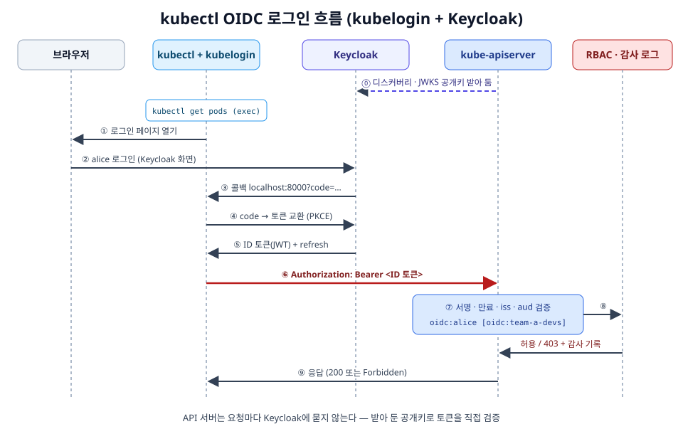
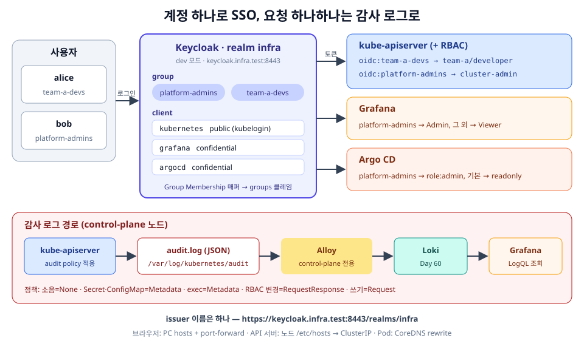
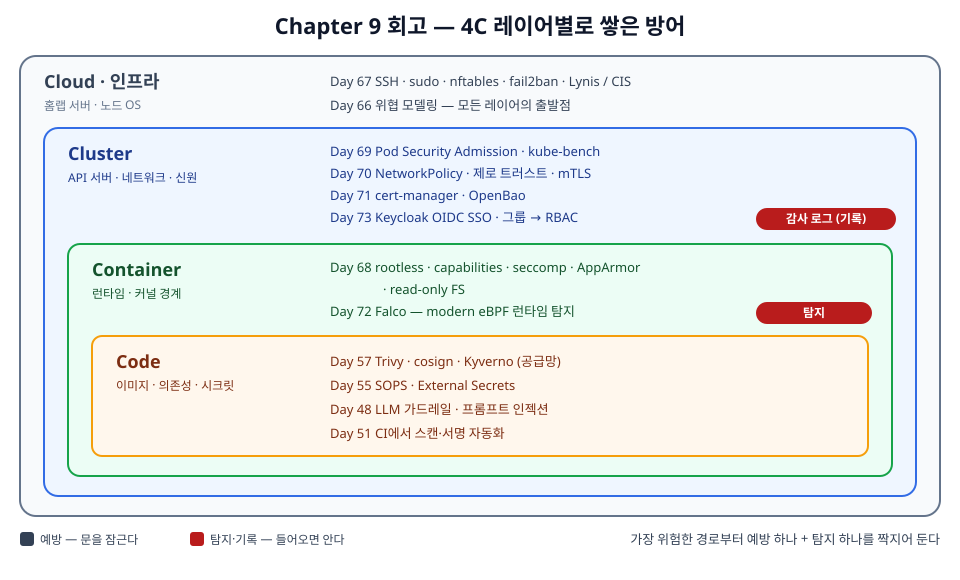

> **Chapter 9 · 보안** | 난이도 ★★★★★ | 예상 소요 3 ~ 4시간

## 🎯 오늘의 목표

- Keycloak을 kind에 띄우고 **realm · client · group** 을 설정할 수 있다 (운영 모드와 dev 모드의 차이를 안다)
- 최신 방식인 **Structured Authentication Configuration**(`AuthenticationConfiguration`)으로 kube-apiserver에 OIDC를 붙이고, **kubelogin**으로 kubectl에 로그인할 수 있다
- Keycloak 그룹을 **Day 19의 RBAC**에 매핑하고, 같은 계정으로 **Grafana · Argo CD SSO** 를 설정할 수 있다
- **감사 정책(audit policy)** 을 작성해 kind에서 감사 로그를 켜고, 읽고, **Loki**로 보낼 수 있다
- Chapter 9와 시리즈 전체(Chapter 0~9)를 하나의 그림으로 회고한다

---

## 1. 왜 인증 통합과 감사인가?

Day 19에서 이렇게 끝맺었습니다.

> "쿠버네티스는 인증서를 폐기할 방법이 없습니다. … 실무에선 OIDC(Keycloak, Google, Azure AD 등)를 씁니다."

지금 우리 홈랩의 로그인 상황을 정리해 보면 이렇습니다.

| 시스템 | 지금 로그인 방법 | 문제 |
|---|---|---|
| kubectl | kind가 만든 `kubernetes-admin` 인증서 하나 | 모두가 같은 신원 → **누가 했는지 모름**, 폐기 불가 |
| Grafana (Day 17) | `admin` 비밀번호 (Secret) | 계정 공유, 퇴사자 처리 수동 |
| Argo CD (Day 53) | `admin` 초기 비밀번호 | 위와 같음 |

**SSO(Single Sign-On)** 는 계정을 한 곳(IdP, Identity Provider)에 모으고, 각 시스템은 IdP가 발급한 **토큰을 믿는** 구조입니다. 퇴사자는 IdP에서 한 번만 비활성화하면 끝나고, 토큰에는 만료 시간이 있습니다.

그리고 신원이 사람마다 나뉘어야 비로소 **감사(audit)** 가 의미를 가집니다. "`kubernetes-admin`이 Secret을 지웠다"는 아무것도 알려 주지 않지만, "`oidc:alice`가 14:02에 team-a의 Secret 목록을 조회하려다 403을 받았다"는 조사의 출발점이 됩니다.

| 질문 | 답하는 장치 | 오늘 쓰는 것 |
|---|---|---|
| 너 **누구**야? (인증) | IdP + 토큰 검증 | Keycloak + OIDC |
| 그거 **해도 돼**? (인가) | RBAC (Day 19) | 그룹 → RoleBinding |
| **누가 무엇을 했나?** (책임 추적) | 감사 로그 | kube-apiserver audit + Loki |
| 컨테이너 **안에서** 무슨 일이? | 런타임 탐지 | Falco (Day 72) |

---

## 2. OIDC 한 장 정리



**OIDC(OpenID Connect)** 는 OAuth 2.0 위에 "로그인한 사람이 누구인지"를 담은 **ID 토큰(JWT)** 을 얹은 표준입니다.

| 용어 | 뜻 | 오늘의 예 |
|---|---|---|
| **Issuer** | 토큰 발급자 URL. 토큰의 `iss` 클레임 | `https://keycloak.infra.test:8443/realms/infra` |
| **Client** | IdP에 로그인을 맡기는 앱. 토큰의 `aud` 클레임 | `kubernetes`, `grafana`, `argocd` |
| **ID 토큰** | 서명된 JWT. 사용자 정보(클레임)가 들어 있음 | `preferred_username: alice`, `groups: [team-a-devs]` |
| **Discovery** | `{issuer}/.well-known/openid-configuration`. 엔드포인트·공개키 위치 안내 | API 서버가 시작할 때 읽음 |
| **JWKS** | IdP의 **공개키** 목록 | API 서버가 토큰 서명 검증에 사용 |

핵심은 **API 서버가 Keycloak에 매 요청마다 묻지 않는다**는 점입니다. 공개키(JWKS)만 받아 두고, kubectl이 보낸 토큰의 **서명·만료·issuer·audience**를 스스로 검증합니다. 그래서 kubectl과 API 서버 사이에 Keycloak이 끼지 않고, Keycloak이 잠깐 죽어도 이미 받은 토큰은 만료 전까지 유효합니다.

### kube-apiserver의 두 가지 OIDC 설정 방식

| | 예전: `--oidc-*` 플래그 | **최신: `--authentication-config` 파일** |
|---|---|---|
| 상태 | 계속 지원 | v1.29 alpha → **v1.34 GA(stable)** |
| Issuer 개수 | 1개 | 여러 개 (최대 64) |
| 클레임 매핑 | 클레임 이름 + prefix | + **CEL 표현식** (`claims.email.split('@')[0]` 등) |
| 검증 규칙 | `--oidc-required-claim` | `claimValidationRules`, `userValidationRules` (CEL) |
| 설정 변경 | API 서버 재시작 | **파일만 바꾸면 자동 재로드** |
| 같이 쓰기 | — | `--oidc-*`와 **동시에 쓰면 API 서버가 에러 후 종료** |

오늘은 최신 방식만 씁니다. (kind v0.33의 기본 노드 이미지는 Kubernetes v1.37입니다. v1.34 이상이면 됩니다.)

---

## 3. Keycloak 기초 — realm, client, group

Keycloak은 CNCF 인큐베이팅 프로젝트인 오픈소스 IdP입니다. 오늘 버전은 **26.8.2** 입니다.

| 개념 | 뜻 | 오늘 만드는 것 |
|---|---|---|
| **realm** | 사용자·클라이언트·설정을 묶은 **독립 공간**(테넌트). `master` realm은 Keycloak 관리 전용으로 남겨 둠 | `infra` |
| **client** | Keycloak에 로그인을 맡기는 앱. **public**(비밀 없음, CLI·SPA) / **confidential**(client secret 있음, 서버 앱) | `kubernetes`(public), `grafana`·`argocd`(confidential) |
| **user** | 사람 계정 | `alice`, `bob` |
| **group** | 사용자 묶음. 권한 매핑의 단위 | `team-a-devs`, `platform-admins` |
| **protocol mapper** | 토큰에 어떤 클레임을 넣을지 정의 | **Group Membership** 매퍼 → `groups` 클레임 |

> 💡 Keycloak은 **그룹을 토큰에 기본으로 넣지 않습니다.** Group Membership 매퍼를 추가하고 "Full group path"를 끄면 `groups: ["team-a-devs"]` 처럼 들어갑니다(켜면 `/team-a-devs`).

### 운영 모드 vs 개발 모드

| | `kc.sh start-dev` (오늘) | `kc.sh start` (운영) |
|---|---|---|
| DB | 내장 H2 파일(`dev-file`) — Pod 재시작 시 사라짐 | **외부 PostgreSQL 등** 필수 |
| HTTP | 허용 | 기본 비활성, **HTTPS 필수** |
| hostname | 엄격하지 않음 (`hostname-strict=false`) | `hostname` 지정 필수 (strict) |
| 캐시 | 로컬 | 클러스터 분산 캐시(여러 replica) |
| 테마·설정 캐시 | 꺼짐 (개발 편의) | 켜짐 |
| 빌드 최적화 | 없음 | `kc.sh build` 후 `start --optimized` |
| 배포 방법 | 단일 Deployment | **Keycloak Operator** 또는 공식 StatefulSet 예제 + PostgreSQL |

> ⚠️ dev 모드는 **운영에 절대 쓰지 마세요.** 오늘은 realm 설정을 JSON 파일로 import하기 때문에 Pod가 재시작돼도 같은 상태로 다시 만들어집니다. 운영에서는 이 JSON 대신 Keycloak Operator의 `KeycloakRealmImport` CR이나 Terraform provider로 realm을 코드화합니다(Day 35의 IaC 원칙).

---

## 4. 실습 설계 — 이름 하나로 세 곳에서 접근하기



OIDC에서 가장 많이 막히는 지점은 **Issuer URL이 모든 곳에서 똑같아야 한다**는 것입니다. 토큰의 `iss`와 설정의 issuer가 한 글자만 달라도 거부됩니다. 그런데 kind에서는 같은 Keycloak에 접근하는 위치가 세 곳입니다.

| 누가 접근하나 | 어디서 | `keycloak.infra.test:8443`을 어떻게 찾나 |
|---|---|---|
| 브라우저 · kubelogin | 내 PC | hosts 파일 `127.0.0.1` + `kubectl port-forward` |
| **kube-apiserver** | control-plane 노드의 **호스트 네트워크** (CoreDNS를 안 씀) | 노드의 `/etc/hosts` → Service ClusterIP |
| Grafana · Argo CD Pod | 클러스터 안 | CoreDNS `rewrite` → `keycloak.keycloak.svc` |

그리고 API 서버는 **HTTPS issuer만** 받으므로 TLS 인증서가 필요합니다. 오늘은 openssl로 실습용 CA를 만들고, 그 CA를 API 서버·kubelogin·Argo CD에 알려 줍니다. (운영이라면 Day 71의 cert-manager로 발급합니다.)

**실습 환경**: Day 09의 kind `infra-lab`, kubectl v1.34+, Helm 3, Day 17 kube-prometheus-stack(`monitoring`), Day 53 Argo CD(`argocd`, `http://argocd.localhost:30080`), Day 60 Loki. 셸은 Linux / macOS / **WSL** bash 기준입니다.

> ⚠️ Windows **Git Bash**에서는 `openssl ... -subj "/CN=..."` 의 `/CN`이 경로로 변환됩니다. WSL을 쓰거나 명령 앞에 `MSYS_NO_PATHCONV=1`을 붙이세요.

---

## 5. 실습 ① 준비 — 인증서와 hosts

```bash
mkdir -p ~/k8s-lab/day73/{authn,audit} && cd ~/k8s-lab/day73

# 1) 실습용 CA
openssl req -x509 -newkey rsa:4096 -sha256 -days 365 -nodes \
  -keyout ca.key -out ca.crt -subj "/CN=infra-lab-ca"

# 2) Keycloak 서버 인증서 (SAN 필수 — Go와 브라우저는 CN을 보지 않음)
openssl req -newkey rsa:2048 -nodes \
  -keyout keycloak.key -out keycloak.csr -subj "/CN=keycloak.infra.test"
printf "subjectAltName=DNS:keycloak.infra.test\nextendedKeyUsage=serverAuth\n" > san.ext
openssl x509 -req -in keycloak.csr -CA ca.crt -CAkey ca.key -CAcreateserial \
  -out keycloak.crt -days 365 -sha256 -extfile san.ext

openssl x509 -in keycloak.crt -noout -ext subjectAltName
# X509v3 Subject Alternative Name:
#     DNS:keycloak.infra.test
```

내 PC의 hosts 파일에 한 줄 추가합니다. (Linux/macOS `/etc/hosts`, Windows `C:\Windows\System32\drivers\etc\hosts` — 관리자 권한, WSL에서 브라우저는 Windows 쪽이므로 Windows hosts에)

```
127.0.0.1  keycloak.infra.test
```

---

## 6. 실습 ② Keycloak 배포 (dev 모드)

### 6-1. realm 설정을 JSON으로

`~/k8s-lab/day73/infra-realm.json` 으로 저장합니다. Keycloak은 시작할 때 `/opt/keycloak/data/import/`의 JSON을 읽어 realm이 없으면 만들어 줍니다(`--import-realm`).

```json
{
  "realm": "infra",
  "enabled": true,
  "groups": [ { "name": "platform-admins" }, { "name": "team-a-devs" } ],
  "users": [
    { "username": "alice", "enabled": true, "email": "alice@infra.test", "emailVerified": true,
      "firstName": "Alice", "lastName": "Kim",
      "credentials": [ { "type": "password", "value": "alice-pass", "temporary": false } ],
      "groups": [ "/team-a-devs" ] },
    { "username": "bob", "enabled": true, "email": "bob@infra.test", "emailVerified": true,
      "firstName": "Bob", "lastName": "Lee",
      "credentials": [ { "type": "password", "value": "bob-pass", "temporary": false } ],
      "groups": [ "/platform-admins" ] }
  ],
  "clients": [
    { "clientId": "kubernetes", "publicClient": true,
      "standardFlowEnabled": true, "directAccessGrantsEnabled": false,
      "redirectUris": [ "http://localhost:8000", "http://localhost:18000" ],
      "protocolMappers": [ { "name": "groups", "protocol": "openid-connect",
        "protocolMapper": "oidc-group-membership-mapper",
        "config": { "claim.name": "groups", "full.path": "false", "id.token.claim": "true",
                    "access.token.claim": "true", "userinfo.token.claim": "true" } } ] },
    { "clientId": "grafana", "publicClient": false, "secret": "grafana-lab-secret",
      "standardFlowEnabled": true,
      "redirectUris": [ "http://localhost:3000/login/generic_oauth" ],
      "protocolMappers": [ { "name": "groups", "protocol": "openid-connect",
        "protocolMapper": "oidc-group-membership-mapper",
        "config": { "claim.name": "groups", "full.path": "false", "id.token.claim": "true",
                    "access.token.claim": "true", "userinfo.token.claim": "true" } } ] },
    { "clientId": "argocd", "publicClient": false, "secret": "argocd-lab-secret",
      "standardFlowEnabled": true,
      "redirectUris": [ "http://argocd.localhost:30080/auth/callback" ],
      "protocolMappers": [ { "name": "groups", "protocol": "openid-connect",
        "protocolMapper": "oidc-group-membership-mapper",
        "config": { "claim.name": "groups", "full.path": "false", "id.token.claim": "true",
                    "access.token.claim": "true", "userinfo.token.claim": "true" } } ] }
  ]
}
```

| 설정 | 이유 |
|---|---|
| `kubernetes`가 public client | kubectl은 사용자 PC에서 도는 CLI라 비밀을 안전하게 보관할 수 없음 |
| redirect `http://localhost:8000`, `18000` | kubelogin이 띄우는 로컬 콜백 서버의 기본 포트 |
| `grafana`·`argocd`는 confidential | 서버에서 도는 앱이라 client secret을 Secret으로 보관 가능 |
| `full.path: false` | 그룹을 `/team-a-devs`가 아니라 `team-a-devs`로 |
| 사용자의 email·이름 채움 | Keycloak 26의 사용자 프로필이 요구하는 필드. 비어 있으면 첫 로그인 때 입력 화면이 뜸 |

> ⚠️ 비밀번호와 client secret을 평문으로 둔 것은 **실습 전용**입니다. Git에 올릴 때는 Day 55의 SOPS/External Secrets로 다루세요.

> 💡 같은 설정을 관리 콘솔에서 하려면: **Manage realms → Create realm** → **Groups → Create group** → **Users → Add user**(Credentials 탭에서 비밀번호, Groups 탭에서 가입) → **Clients → Create client**(Client authentication ON/OFF가 confidential/public) → 클라이언트의 **Client scopes → `<client>-dedicated` → Add mapper → By configuration → Group Membership**.

### 6-2. 배포 매니페스트

```bash
kubectl create namespace keycloak
kubectl -n keycloak create secret tls keycloak-tls --cert=keycloak.crt --key=keycloak.key
kubectl -n keycloak create secret generic keycloak-admin \
  --from-literal=username=admin --from-literal=password='change-me-admin'
kubectl -n keycloak create configmap keycloak-realm --from-file=infra-realm.json
```

```yaml
# keycloak.yaml
apiVersion: apps/v1
kind: Deployment
metadata:
  name: keycloak
  namespace: keycloak
spec:
  replicas: 1
  selector:
    matchLabels: { app: keycloak }
  template:
    metadata:
      labels: { app: keycloak }
    spec:
      containers:
      - name: keycloak
        image: quay.io/keycloak/keycloak:26.8.2
        args: ["start-dev", "--import-realm"]
        env:
        - name: KC_BOOTSTRAP_ADMIN_USERNAME
          valueFrom: { secretKeyRef: { name: keycloak-admin, key: username } }
        - name: KC_BOOTSTRAP_ADMIN_PASSWORD
          valueFrom: { secretKeyRef: { name: keycloak-admin, key: password } }
        - name: KC_HOSTNAME                      # issuer 에 들어갈 공개 URL
          value: https://keycloak.infra.test:8443
        - name: KC_HTTPS_CERTIFICATE_FILE
          value: /etc/keycloak/tls/tls.crt
        - name: KC_HTTPS_CERTIFICATE_KEY_FILE
          value: /etc/keycloak/tls/tls.key
        - name: KC_HEALTH_ENABLED
          value: "true"
        ports:
        - { name: https, containerPort: 8443 }
        - { name: management, containerPort: 9000 }
        readinessProbe:                          # 관리 포트도 TLS를 상속(HTTPS)
          httpGet: { path: /health/ready, port: 9000, scheme: HTTPS }
          initialDelaySeconds: 20
          periodSeconds: 10
        resources:
          requests: { cpu: 250m, memory: 768Mi }
          limits: { memory: 1536Mi }
        volumeMounts:
        - { name: tls, mountPath: /etc/keycloak/tls, readOnly: true }
        - { name: realm, mountPath: /opt/keycloak/data/import, readOnly: true }
      volumes:
      - name: tls
        secret: { secretName: keycloak-tls }
      - name: realm
        configMap: { name: keycloak-realm }
---
apiVersion: v1
kind: Service
metadata:
  name: keycloak
  namespace: keycloak
spec:
  selector: { app: keycloak }
  clusterIP: 10.96.200.10        # 고정 IP — API 서버 노드의 /etc/hosts에 적을 값
  ports:
  - { name: https, port: 8443, targetPort: 8443 }
```

```bash
kubectl apply -f keycloak.yaml
kubectl -n keycloak rollout status deploy/keycloak --timeout=180s
kubectl -n keycloak logs deploy/keycloak | grep -E "Imported|Realm|started"
```

```
... Realm 'infra' imported
... Keycloak 26.8.2 on JVM (powered by Quarkus ...) started in 18.311s. Listening on: http://0.0.0.0:8080 and https://0.0.0.0:8443. Management interface listening on https://0.0.0.0:9000.
... Running the server in development mode. DO NOT use this configuration in production.
```

`clusterIP: 10.96.200.10`은 kind 기본 Service 대역(`10.96.0.0/16`) 안의 값입니다. 고정해 두면 Service를 다시 만들어도 IP가 바뀌지 않습니다.

### 6-3. 접속 확인

```bash
# 터미널 하나를 이것 전용으로 띄워 둡니다 (오늘 실습 내내 필요)
kubectl -n keycloak port-forward svc/keycloak 8443:8443

curl -s --cacert ca.crt \
  https://keycloak.infra.test:8443/realms/infra/.well-known/openid-configuration \
  | jq '{issuer, jwks_uri}'
```

```json
{
  "issuer": "https://keycloak.infra.test:8443/realms/infra",
  "jwks_uri": "https://keycloak.infra.test:8443/realms/infra/protocol/openid-connect/certs"
}
```

브라우저에서 `https://keycloak.infra.test:8443/admin` → `admin` / `change-me-admin`으로 관리 콘솔에 들어가 realm `infra`의 그룹·사용자·클라이언트가 만들어졌는지 확인하세요. (인증서 경고가 뜨면 `ca.crt`를 OS/브라우저에 신뢰 루트로 등록하거나 실습 동안만 예외 처리)

---

## 7. 실습 ③ kube-apiserver에 OIDC와 감사 로그 켜기

### 7-1. 인증 설정 파일

```bash
cat > authn/authentication-config.yaml <<EOF
apiVersion: apiserver.config.k8s.io/v1
kind: AuthenticationConfiguration
jwt:
- issuer:
    url: https://keycloak.infra.test:8443/realms/infra
    audiences:
    - kubernetes                       # 토큰의 aud = client ID
    certificateAuthority: |
$(sed 's/^/      /' ca.crt)
  claimValidationRules:
  - expression: 'claims.email_verified == true'
    message: "email must be verified"
  claimMappings:
    username:
      claim: preferred_username
      prefix: "oidc:"                  # claim을 쓰면 prefix는 필수 (없으려면 "")
    groups:
      claim: groups
      prefix: "oidc:"
  userValidationRules:
  - expression: "user.username.startsWith('system:') == false"
    message: "username cannot use reserved system: prefix"
EOF

cat authn/authentication-config.yaml | head -12     # CA가 6칸 들여쓰기로 들어갔는지 확인
```

| 필드 | 의미 |
|---|---|
| `issuer.url` | 토큰의 `iss`와 **정확히** 일치해야 함. 디스커버리는 `{url}/.well-known/openid-configuration` |
| `certificateAuthority` | Keycloak HTTPS를 검증할 CA (PEM 내용 그대로) |
| `audiences` | 토큰의 `aud`에 이 값이 있어야 통과 |
| `claimMappings.username` | 쿠버네티스 사용자 이름 = `oidc:` + `preferred_username` → `oidc:alice` |
| `claimMappings.groups` | 그룹 = `oidc:` + `groups` → `oidc:team-a-devs` |
| `userValidationRules` | 매핑 결과 검증. `system:` 접두사를 사칭하는 토큰 차단 |

> 💡 **prefix를 붙이는 이유**: 접두사가 없으면 Keycloak에서 누군가 `cluster-admins` 같은 그룹을 만들었을 때 클러스터 내부 그룹과 이름이 겹칠 수 있습니다. `oidc:`를 붙이면 "이 신원은 Keycloak에서 왔다"가 이름에 드러납니다.

### 7-2. 감사 정책

감사 로그는 API 서버로 들어온 **모든 요청**을 기록할 수 있습니다. 전부 `RequestResponse`로 남기면 디스크가 금방 찹니다. **레벨**과 **규칙 순서**로 조절합니다.

| 레벨 | 기록하는 것 |
|---|---|
| `None` | 기록 안 함 |
| `Metadata` | 누가·언제·무엇을(verb, resource, namespace)·결과 코드. **본문 없음** |
| `Request` | Metadata + 요청 본문 |
| `RequestResponse` | Metadata + 요청 본문 + 응답 본문 |

```yaml
# audit/audit-policy.yaml
apiVersion: audit.k8s.io/v1
kind: Policy
omitStages:
  - RequestReceived                    # 같은 요청이 두 번 찍히지 않게
rules:
  # 1) 소음 제거 — 헬스 체크, 이벤트, 리더 선출 하트비트
  - level: None
    nonResourceURLs: ["/healthz*", "/livez*", "/readyz*", "/version"]
  - level: None
    resources:
    - group: ""
      resources: ["events"]
    - group: "coordination.k8s.io"
      resources: ["leases"]
  - level: None
    users: ["system:kube-proxy"]
    verbs: ["watch"]
  # 2) 비밀 값은 절대 본문을 남기지 않는다 (규칙은 위에서부터 첫 일치가 적용)
  - level: Metadata
    resources:
    - group: ""
      resources: ["secrets", "configmaps", "serviceaccounts/token"]
    - group: "authentication.k8s.io"
      resources: ["tokenreviews"]
  # 3) 컨테이너 안으로 들어가는 행위는 누가·어디로를 반드시
  - level: Metadata
    resources:
    - group: ""
      resources: ["pods/exec", "pods/attach", "pods/portforward"]
  # 4) 권한 변경은 전부
  - level: RequestResponse
    resources:
    - group: "rbac.authorization.k8s.io"
  # 5) 나머지 쓰기 요청은 요청 본문까지
  - level: Request
    verbs: ["create", "update", "patch", "delete", "deletecollection"]
  # 6) 나머지 읽기는 메타데이터만
  - level: Metadata
```

> ⚠️ 2번 규칙이 5번보다 **위**에 있어야 합니다. 순서가 바뀌면 `kubectl create secret` 요청이 5번(`Request`)에 먼저 걸려 **Secret 값이 감사 로그에 평문으로** 남습니다.

### 7-3. kind에 반영하기 — 두 가지 방법

API 서버는 control-plane 노드 컨테이너 안의 **static Pod**(`/etc/kubernetes/manifests/kube-apiserver.yaml`)입니다. 파일 두 개를 노드에 넣고, 플래그와 볼륨을 추가해야 합니다.

| | 방법 A: kind 설정 (`extraMounts` + `kubeadmConfigPatches`) | 방법 B: 실행 중인 노드에 직접 반영 |
|---|---|---|
| 언제 | 클러스터를 **새로 만들 때** (정석, 재현 가능) | `infra-lab`을 **유지하면서** |
| 원리 | kind가 kubeadm 설정을 패치해 처음부터 플래그·볼륨 포함 | Day 20처럼 static Pod 매니페스트를 직접 수정 |
| 단점 | 기존 클러스터는 지우고 다시 만들어야 함 | 노드 컨테이너를 다시 만들면 사라짐 |

#### 방법 A — kind 설정 파일

Day 09의 `kind-infra-lab.yaml`에 control-plane 설정을 추가합니다. `extraMounts`는 **내 PC → 노드 컨테이너**, kubeadm의 `extraVolumes`는 **노드 → API 서버 Pod** 마운트입니다. 두 단계를 거친다는 점이 핵심입니다.

```yaml
# kind-infra-lab-sec.yaml  (~/k8s-lab/day73 에서 kind 실행 — hostPath 상대 경로 기준)
kind: Cluster
apiVersion: kind.x-k8s.io/v1alpha4
name: infra-lab
nodes:
- role: control-plane
  extraPortMappings:
  - containerPort: 30080
    hostPort: 30080
    protocol: TCP
  extraMounts:                                  # 내 PC → 노드 컨테이너
  - hostPath: ./authn                           # 디렉터리째 마운트 → 파일 수정이 그대로 반영
    containerPath: /etc/kubernetes/authn
    readOnly: true
  - hostPath: ./audit/audit-policy.yaml
    containerPath: /etc/kubernetes/policies/audit-policy.yaml
    readOnly: true
  kubeadmConfigPatches:                         # 노드 → kube-apiserver Pod
  - |
    kind: ClusterConfiguration
    apiServer:
      extraArgs:
        authentication-config: /etc/kubernetes/authn/authentication-config.yaml
        audit-policy-file: /etc/kubernetes/policies/audit-policy.yaml
        audit-log-path: /var/log/kubernetes/audit/audit.log
        audit-log-maxage: "7"
        audit-log-maxbackup: "3"
        audit-log-maxsize: "100"
      extraVolumes:
      - name: authn
        hostPath: /etc/kubernetes/authn
        mountPath: /etc/kubernetes/authn
        readOnly: true
        pathType: DirectoryOrCreate
      - name: audit-policies
        hostPath: /etc/kubernetes/policies
        mountPath: /etc/kubernetes/policies
        readOnly: true
        pathType: DirectoryOrCreate
      - name: audit-logs
        hostPath: /var/log/kubernetes/audit
        mountPath: /var/log/kubernetes/audit
        readOnly: false
        pathType: DirectoryOrCreate
- role: worker
- role: worker
```

```bash
cd ~/k8s-lab/day73
kind delete cluster --name infra-lab        # ⚠️ 기존 클러스터와 그 안의 모든 것이 지워짐
kind create cluster --config kind-infra-lab-sec.yaml
```

> 💡 위 패치는 버전 표기 없는 map 형식입니다. Kubernetes v1.36 이상에서 kind는 kubeadm `v1beta4`(extraArgs가 `name`/`value` 리스트)를 쓰는데, kind v0.32부터 **버전 없는 map 형식 패치를 자동 변환**해 줍니다. 또 패치는 기존 `extraArgs`를 **덮어쓰지 않고 추가**합니다.

새로 만들었다면 Day 15(Traefik), Day 17(monitoring), Day 53(Argo CD), Day 60(Loki)을 다시 설치하고, 6장의 Keycloak을 배포한 뒤 7-4로 갑니다. Argo CD가 Git에서 앱을 되살려 주는 것이 GitOps의 장점입니다.

#### 방법 B — 실행 중인 `infra-lab`에 직접

```bash
CP=infra-lab-control-plane
cd ~/k8s-lab/day73

# 1) 파일 복사
docker exec $CP mkdir -p /etc/kubernetes/authn /etc/kubernetes/policies /var/log/kubernetes/audit
docker cp authn/authentication-config.yaml $CP:/etc/kubernetes/authn/
docker cp audit/audit-policy.yaml          $CP:/etc/kubernetes/policies/

# 2) 매니페스트를 꺼내서 백업 (백업은 manifests 디렉터리 밖에 둘 것!)
docker cp $CP:/etc/kubernetes/manifests/kube-apiserver.yaml ./kube-apiserver.yaml
cp kube-apiserver.yaml kube-apiserver.yaml.bak
```

`kube-apiserver.yaml`을 편집기로 열어 세 군데에 추가합니다.

```yaml
spec:
  containers:
  - command:
    - kube-apiserver
    # ... 기존 플래그 뒤에 추가
    - --authentication-config=/etc/kubernetes/authn/authentication-config.yaml
    - --audit-policy-file=/etc/kubernetes/policies/audit-policy.yaml
    - --audit-log-path=/var/log/kubernetes/audit/audit.log
    - --audit-log-maxage=7
    - --audit-log-maxbackup=3
    - --audit-log-maxsize=100
    volumeMounts:
    # ... 기존 항목 뒤에 추가
    - { mountPath: /etc/kubernetes/authn, name: authn, readOnly: true }
    - { mountPath: /etc/kubernetes/policies, name: audit-policies, readOnly: true }
    - { mountPath: /var/log/kubernetes/audit, name: audit-logs }
  volumes:
  # ... 기존 항목 뒤에 추가
  - { name: authn, hostPath: { path: /etc/kubernetes/authn, type: DirectoryOrCreate } }
  - { name: audit-policies, hostPath: { path: /etc/kubernetes/policies, type: DirectoryOrCreate } }
  - { name: audit-logs, hostPath: { path: /var/log/kubernetes/audit, type: DirectoryOrCreate } }
```

복사해 넣는 것은 7-4의 hosts 설정 **다음에** 합니다.

### 7-4. API 서버가 Keycloak을 찾게 하기

API 서버는 호스트 네트워크를 쓰므로 CoreDNS가 아니라 **노드의 `/etc/hosts`** 를 봅니다. kubelet은 호스트 네트워크 Pod의 컨테이너를 시작할 때마다 노드의 `/etc/hosts`를 복사해 넣으므로, **hosts를 먼저 고치고 API 서버 컨테이너를 다시 띄워야** 합니다.

```bash
docker exec $CP sh -c 'echo "10.96.200.10 keycloak.infra.test" >> /etc/hosts'
```

```bash
# 방법 B: 수정한 매니페스트를 넣으면 kubelet이 API 서버를 다시 만듦 (30~60초 끊김)
docker cp kube-apiserver.yaml $CP:/etc/kubernetes/manifests/kube-apiserver.yaml

# 방법 A: 이미 플래그가 들어 있으므로 API 서버 컨테이너만 재시작
docker exec $CP sh -c 'crictl stop $(crictl ps -q --name kube-apiserver)'
```

```bash
kubectl get --raw /readyz        # ok 가 나올 때까지 잠시 기다림
kubectl -n kube-system logs kube-apiserver-infra-lab-control-plane | grep -iE "jwt|oidc|authentication" | tail -5
docker exec $CP ls -l /var/log/kubernetes/audit/
```

```
-rw------- 1 root root 1843270 Nov 15 14:02 audit.log
```

> ⚠️ 노드의 `/etc/hosts` 수정은 Docker가 관리하는 파일이라 노드 컨테이너가 **재시작되면 사라집니다**(PC 재부팅 포함). 그때는 위 `echo`와 재시작 명령을 다시 실행하세요. 실제 클러스터라면 DNS에 정식 레코드를 두면 끝나는 문제입니다.

> 💡 인증 설정 파일은 **자동 재로드**됩니다. 방법 A에서는 내 PC의 `authn/authentication-config.yaml`만 고치면 API 서버가 다시 읽습니다(메트릭 `apiserver_authentication_config_controller_automatic_reload_last_timestamp_seconds`로 확인). 편집기가 임시 파일 → 이름 바꾸기 방식으로 저장하는 게 안전합니다. 감사 정책은 재로드되지 않아 재시작이 필요합니다.

---

## 8. 실습 ④ kubelogin으로 kubectl 로그인

### 8-1. 설치와 토큰 확인

```bash
kubectl krew install oidc-login          # 또는 brew install kubelogin / choco install kubelogin

kubectl oidc-login setup \
  --oidc-issuer-url=https://keycloak.infra.test:8443/realms/infra \
  --oidc-client-id=kubernetes \
  --certificate-authority=$HOME/k8s-lab/day73/ca.crt
```

브라우저가 열리면 `alice` / `alice-pass`로 로그인합니다. 터미널에 ID 토큰의 클레임이 찍힙니다.

```json
{
  "iss": "https://keycloak.infra.test:8443/realms/infra",
  "aud": "kubernetes",
  "preferred_username": "alice",
  "email_verified": true,
  "groups": ["team-a-devs"],
  ...
}
```

`iss`·`aud`·`preferred_username`·`groups` 네 개가 7-1 설정과 맞물리는지 눈으로 확인하는 단계입니다.

### 8-2. kubeconfig에 OIDC 사용자 추가

```bash
kubectl config set-credentials oidc \
  --exec-api-version=client.authentication.k8s.io/v1 \
  --exec-command=kubectl \
  --exec-arg=oidc-login --exec-arg=get-token \
  --exec-arg=--oidc-issuer-url=https://keycloak.infra.test:8443/realms/infra \
  --exec-arg=--oidc-client-id=kubernetes \
  --exec-arg=--certificate-authority=$HOME/k8s-lab/day73/ca.crt

kubectl config set-context oidc@infra-lab --cluster=kind-infra-lab --user=oidc
kubectl --context oidc@infra-lab auth whoami
```

```
ATTRIBUTE                                           VALUE
Username                                            oidc:alice
Groups                                              [oidc:team-a-devs system:authenticated]
```

`exec` 플러그인 방식이라 kubectl이 필요할 때마다 `kubectl oidc-login get-token`을 실행하고, kubelogin은 캐시된 토큰이 만료되면 refresh 토큰으로 갱신하거나 브라우저를 다시 엽니다.

### 8-3. Keycloak 그룹 → Day 19 RBAC

Day 19와 같은 구조를 그룹 단위로 만듭니다. 사람(User)이 아니라 **그룹(Group)** 에 바인딩하는 것이 핵심입니다.

```bash
kubectl create namespace team-a
kubectl -n team-a create role developer \
  --verb=get,list,watch,create,update,patch,delete \
  --resource=pods,pods/log,services,configmaps,deployments.apps,replicasets.apps

# Keycloak 그룹 team-a-devs → team-a 네임스페이스의 developer
kubectl -n team-a create rolebinding team-a-devs-developer \
  --role=developer --group=oidc:team-a-devs

# Keycloak 그룹 platform-admins → 클러스터 전체 관리자
kubectl create clusterrolebinding platform-admins \
  --clusterrole=cluster-admin --group=oidc:platform-admins
```

```bash
kubectl --context oidc@infra-lab -n team-a get pods          # No resources found (성공)
kubectl --context oidc@infra-lab -n team-a get secrets       # Forbidden
kubectl --context oidc@infra-lab get nodes                   # Forbidden
```

```
Error from server (Forbidden): secrets is forbidden: User "oidc:alice" cannot list resource "secrets"
in API group "" in the namespace "team-a"
```

이제 bob으로 바꿔 봅니다. 토큰 캐시와 Keycloak 브라우저 세션을 둘 다 지워야 다른 사용자로 로그인할 수 있습니다.

```bash
kubectl oidc-login clean
# 브라우저에서 https://keycloak.infra.test:8443/realms/infra/account 로그아웃 (또는 시크릿 창)
kubectl --context oidc@infra-lab auth whoami      # bob 으로 로그인
kubectl --context oidc@infra-lab get nodes        # 성공 (cluster-admin)
```

> 💡 **퇴사자 처리**: Keycloak에서 사용자를 Disable하면 refresh가 실패해 새 토큰을 못 받습니다. 이미 발급된 ID 토큰은 수명(Keycloak realm 기본 Access Token Lifespan 5분) 동안만 유효하므로, Day 19의 인증서(최대 수일~수년)보다 훨씬 빨리 차단됩니다.

---

## 9. 실습 ⑤ Grafana · Argo CD SSO

### 9-1. 클러스터 안에서 Keycloak 이름 풀기 — CoreDNS rewrite

Grafana와 Argo CD는 Pod 안에서 Keycloak의 토큰 엔드포인트를 호출합니다. 브라우저와 **같은 issuer 이름**을 써야 하므로, CoreDNS가 `keycloak.infra.test`를 Service로 돌려주게 합니다.

```bash
kubectl -n kube-system edit configmap coredns
```

```
.:53 {
    errors
    health { ... }
    rewrite name keycloak.infra.test keycloak.keycloak.svc.cluster.local   # ← 이 줄 추가
    ready
    kubernetes cluster.local in-addr.arpa ip6.arpa { ... }
    ...
}
```

```bash
# Corefile에 reload 플러그인이 있어 30초쯤 뒤 자동 반영
kubectl run dnstest --rm -it --restart=Never --image=curlimages/curl -- \
  curl -sk https://keycloak.infra.test:8443/realms/infra/.well-known/openid-configuration -o /dev/null -w "%{http_code}\n"
# 200
```

### 9-2. Grafana (kube-prometheus-stack)

```bash
kubectl -n monitoring create secret generic grafana-oauth \
  --from-literal=GF_AUTH_GENERIC_OAUTH_CLIENT_SECRET=grafana-lab-secret
```

```yaml
# grafana-sso-values.yaml — Day 17 values에 겹쳐서 사용
grafana:
  envFromSecret: grafana-oauth           # client secret은 환경 변수로
  grafana.ini:
    server:
      root_url: http://localhost:3000    # port-forward 주소 = 콜백 URL의 기준
    auth.generic_oauth:
      enabled: true
      name: Keycloak
      allow_sign_up: true
      client_id: grafana
      scopes: openid email profile
      auth_url: https://keycloak.infra.test:8443/realms/infra/protocol/openid-connect/auth
      token_url: https://keycloak.infra.test:8443/realms/infra/protocol/openid-connect/token
      api_url: https://keycloak.infra.test:8443/realms/infra/protocol/openid-connect/userinfo
      login_attribute_path: preferred_username
      email_attribute_path: email
      name_attribute_path: name
      groups_attribute_path: groups
      role_attribute_path: contains(groups[*], 'platform-admins') && 'Admin' || 'Viewer'
      tls_skip_verify_insecure: true     # ⚠️ 실습 전용. 운영은 tls_client_ca 로 CA 지정
```

```bash
helm upgrade monitoring prometheus-community/kube-prometheus-stack -n monitoring \
  -f monitoring-values.yaml -f grafana-sso-values.yaml
kubectl port-forward -n monitoring svc/monitoring-grafana 3000:80
```

`http://localhost:3000` 로그인 화면에 **Sign in with Keycloak** 버튼이 생깁니다. bob으로 들어가면 Admin, alice로 들어가면 Viewer입니다.

| 요청 | 누가 보내나 | 이름 해석 |
|---|---|---|
| `auth_url` (로그인 화면) | **브라우저** | 내 PC hosts → port-forward |
| `token_url`, `api_url` | **Grafana Pod** | CoreDNS rewrite → Service |

### 9-3. Argo CD

```bash
kubectl -n argocd patch secret argocd-secret --type merge \
  -p '{"stringData": {"oidc.keycloak.clientSecret": "argocd-lab-secret"}}'
```

`rootCA`에 CA 인증서를 넣어야 하므로 7-1처럼 셸로 파일을 만듭니다. (`\$oidc...`의 `\`는 셸이 변수로 해석하지 않게 하는 것으로, 파일에는 `$oidc.keycloak.clientSecret`으로 들어갑니다 — Argo CD가 `argocd-secret`에서 값을 찾아 넣는 참조 문법)

```bash
cat > argocd-cm-oidc.yaml <<EOF
data:
  url: http://argocd.localhost:30080
  oidc.config: |
    name: Keycloak
    issuer: https://keycloak.infra.test:8443/realms/infra
    clientID: argocd
    clientSecret: \$oidc.keycloak.clientSecret
    requestedScopes: ["openid", "profile", "email"]
    rootCA: |
$(sed 's/^/      /' ca.crt)
EOF
```

```yaml
# argocd-rbac-cm-oidc.yaml
data:
  policy.default: role:readonly
  policy.csv: |
    g, platform-admins, role:admin
```

```bash
kubectl -n argocd patch configmap argocd-cm --type merge --patch-file argocd-cm-oidc.yaml
kubectl -n argocd patch configmap argocd-rbac-cm --type merge --patch-file argocd-rbac-cm-oidc.yaml
kubectl -n argocd rollout restart deploy/argocd-server
```

`http://argocd.localhost:30080`에 **LOG IN VIA KEYCLOAK** 버튼이 생깁니다. bob은 admin, alice는 읽기 전용입니다.

> 💡 Argo CD의 `policy.csv`는 Keycloak `groups` 클레임 값을 **그대로**(`platform-admins`) 씁니다. 쿠버네티스 쪽의 `oidc:` 접두사는 API 서버 설정에서 붙인 것이라 Argo CD와는 무관합니다. Keycloak의 Argo CD 가이드처럼 별도 `groups` client scope를 만들어 쓰는 방법도 있는데, 그 경우 `requestedScopes`에 `groups`를 추가합니다.

> ⚠️ 이제 Grafana·Argo CD의 로컬 `admin` 계정은 **비상용(break-glass)** 입니다. 운영에서는 비밀번호를 금고(Day 71 OpenBao)에 넣고, 로컬 로그인 자체를 끄는 설정(`admin.enabled: "false"`, Grafana `disable_login_form`)도 검토합니다.

---

## 10. 실습 ⑥ 감사 로그 읽기와 Loki로 보내기

### 10-1. 직접 읽기

alice로 몇 가지 요청을 보낸 뒤(8-3), 로그를 확인합니다.

```bash
docker exec infra-lab-control-plane cat /var/log/kubernetes/audit/audit.log \
  | jq -c 'select(.user.username=="oidc:alice")
           | {time: .requestReceivedTimestamp, verb, uri: .requestURI, code: .responseStatus.code}' \
  | tail -5
```

```json
{"time":"2026-11-15T05:02:11.412Z","verb":"list","uri":"/api/v1/namespaces/team-a/pods?limit=500","code":200}
{"time":"2026-11-15T05:02:14.907Z","verb":"list","uri":"/api/v1/namespaces/team-a/secrets?limit=500","code":403}
{"time":"2026-11-15T05:02:17.233Z","verb":"list","uri":"/api/v1/nodes?limit=500","code":403}
```

이벤트 하나를 통째로 보면 구조가 보입니다.

```json
{
  "kind": "Event", "apiVersion": "audit.k8s.io/v1",
  "level": "Metadata", "stage": "ResponseComplete",
  "verb": "list", "requestURI": "/api/v1/namespaces/team-a/secrets?limit=500",
  "user": { "username": "oidc:alice", "groups": ["oidc:team-a-devs", "system:authenticated"] },
  "sourceIPs": ["172.18.0.1"], "userAgent": "kubectl/v1.34.2 (linux/amd64) ...",
  "objectRef": { "resource": "secrets", "namespace": "team-a", "apiVersion": "v1" },
  "responseStatus": { "status": "Failure", "reason": "Forbidden", "code": 403 },
  "annotations": { "authorization.k8s.io/decision": "forbid", "authorization.k8s.io/reason": "" }
}
```

| 필드 | 조사할 때 쓰는 법 |
|---|---|
| `user.username`, `user.groups` | **누가** — OIDC 덕분에 사람 단위로 보임 |
| `verb`, `objectRef` | **무엇을** — 어떤 리소스에 무슨 동작 |
| `responseStatus.code` | 성공/실패. 403이 몰리면 권한 탐색(정찰) 의심 |
| `sourceIPs`, `userAgent` | **어디서·무엇으로** |
| `annotations."authorization.k8s.io/decision"` | RBAC이 허용/거부한 이유 |

### 10-2. Loki로 보내기 — Alloy

감사 로그 파일은 control-plane 노드의 `/var/log/kubernetes/audit/`에만 있습니다. Day 60의 Alloy가 control-plane에 뜨지 않는 구성이라면, 감사 로그 전용 Alloy를 control-plane에만 하나 띄웁니다.

```yaml
# alloy-audit-values.yaml
controller:
  type: daemonset
  nodeSelector:
    node-role.kubernetes.io/control-plane: ""
  tolerations:
  - key: node-role.kubernetes.io/control-plane
    operator: Exists
    effect: NoSchedule
alloy:
  mounts:
    varlog: true                       # 노드의 /var/log 를 읽기 전용으로 마운트
  configMap:
    content: |
      local.file_match "audit" {
        path_targets = [{
          "__path__" = "/var/log/kubernetes/audit/audit.log",
          "job"      = "kubernetes-audit",
          "cluster"  = "infra-lab",
        }]
      }

      loki.source.file "audit" {
        targets    = local.file_match.audit.targets
        forward_to = [loki.process.audit.receiver]
      }

      loki.process "audit" {
        stage.json {
          expressions = { verb = "verb" }
        }
        stage.labels {
          values = { verb = "" }       # 라벨은 카디널리티가 낮은 verb 하나만
        }
        forward_to = [loki.write.default.receiver]
      }

      loki.write "default" {
        endpoint {
          // Day 60에서 loki 네임스페이스에 설치한 Loki gateway의 push 주소
          url = "http://loki-gateway.loki.svc.cluster.local/loki/api/v1/push"
        }
      }
```

```bash
helm upgrade --install alloy-audit grafana/alloy -n monitoring -f alloy-audit-values.yaml
kubectl -n monitoring get pods -l app.kubernetes.io/instance=alloy-audit -o wide
```

Grafana Explore → Loki에서 조회합니다. `| json`은 중첩 필드를 `user_username`, `responseStatus_code`처럼 밑줄로 펼칩니다.

```logql
# alice가 한 모든 요청
{job="kubernetes-audit"} | json | user_username="oidc:alice"

# 최근 1시간 403을 가장 많이 받은 사용자
topk(5, sum by (user_username) (count_over_time({job="kubernetes-audit"} | json | responseStatus_code="403" [1h])))

# 누가 어느 Pod에 exec 했나
{job="kubernetes-audit"} | json | objectRef_subresource="exec" | line_format "{{.user_username}} -> {{.objectRef_namespace}}/{{.objectRef_name}}"
```

> 💡 사용자 이름을 Loki **라벨**로 만들지 않은 이유: 라벨 값 종류가 많아지면 Loki 인덱스가 커집니다(Day 60). 조회 시 `| json`으로 거르는 편이 낫습니다. 이 쿼리를 Day 62처럼 Loki 알림 규칙(ruler)으로 만들면 "5분에 403이 20번 이상" 같은 **정찰 탐지 알림**이 됩니다.

---

## 11. 정리

```bash
kubectl delete -f keycloak.yaml && kubectl delete namespace keycloak team-a
kubectl delete clusterrolebinding platform-admins
helm uninstall alloy-audit -n monitoring
kubectl config delete-context oidc@infra-lab && kubectl config delete-user oidc
kubectl oidc-login clean
# API 서버 설정을 되돌리려면(방법 B): 백업 매니페스트를 다시 복사
docker cp kube-apiserver.yaml.bak infra-lab-control-plane:/etc/kubernetes/manifests/kube-apiserver.yaml
# CoreDNS rewrite 줄, Grafana values, Argo CD ConfigMap 변경, 내 PC hosts 줄도 되돌리기
```

---

## 12. Chapter 9 회고 — 4C 레이어별로 배운 것



Day 66에서 그린 4C(Cloud · Cluster · Container · Code)에 지난 8일을 겹쳐 보면 이렇습니다.

| 레이어 | 위협 예 | 예방 | 탐지·기록 |
|---|---|---|---|
| **Cloud / 인프라** | SSH 무차별 대입, 열린 포트 | Day 67 SSH·sudo·nftables·fail2ban, Lynis/CIS | fail2ban 로그, Lynis 점수 |
| **Cluster** | 과한 권한, 평문 통신, 공유 계정 | Day 69 PSA·kube-bench, Day 70 NetworkPolicy·mTLS, Day 71 cert-manager·OpenBao, **Day 73 OIDC + RBAC** | **Day 73 감사 로그 → Loki** |
| **Container** | 컨테이너 탈출, 권한 상승 | Day 68 rootless·capabilities·seccomp·AppArmor·read-only FS | **Day 72 Falco** |
| **Code** | 취약한 의존성, 변조된 이미지, 시크릿 유출 | Day 57 Trivy·cosign·Kyverno, Day 55 SOPS/ESO, Day 48 LLM 가드레일 | Trivy 정기 스캔 |

그리고 이 모든 것의 출발점은 Day 66의 **위협 모델링**입니다. "무엇을 지키는가, 누가 공격하는가, 어디가 약한가"를 먼저 그려야 도구를 고를 수 있습니다. 도구를 다 까는 것이 목표가 아니라, **가장 위험한 경로부터 예방 하나 + 탐지 하나**를 짝지어 두는 것이 목표입니다.

---

## 13. 시리즈 회고 — Chapter 0 ~ 9

| Chapter | 기간 | 핵심 질문 | 대표 도구 | 손에 남은 것 |
|---|---|---|---|---|
| **0. 홈랩** | H01~H03 | 집에 서버를 어떻게 두고 안전하게 열까? | Ubuntu Server, DDNS, Cloudflare Tunnel, Tailscale | 24시간 도는 Ubuntu 24.04 서버 |
| **1. Docker** | Day 01~07 | 앱을 어디서나 똑같이 실행하려면? | Docker, Dockerfile, Compose | 이미지 = 앱 + 의존성, 컨테이너 = 격리된 프로세스 |
| **2. Kubernetes** | Day 08~20 | 컨테이너 수백 개를 누가 관리하나? | kind, kubeadm, Helm, Prometheus | `infra-lab` 클러스터와 선언형 운영 습관 |
| **3. 가상화·네트워크** | Day 21~24 | VM과 가상 네트워크는 어떻게 동작하나? | KVM, libvirt, bridge·veth, VXLAN, OVS | 패킷이 지나가는 길을 그릴 수 있는 눈 |
| **4. OpenStack** | Day 25~33 | 그것을 API로 나눠 주는 클라우드는? | Keystone, Nova, Neutron, Cinder, Kolla-Ansible | 프라이빗 클라우드 |
| **5. 종합** | Day 34~35 | 다 합치고 코드로 재현하려면? | Terraform/OpenTofu | OpenStack 위 K8s를 코드 한 벌로 |
| **6. AI 인프라** | Day 36~49 | LLM을 직접 서빙·운영하려면? | vLLM, Ollama, LiteLLM, Qdrant, KServe, KEDA | 사내 문서 RAG 챗봇 |
| **7. GitOps & CI/CD** | Day 50~57 | Git 하나로 배포까지 자동화하려면? | GitHub Actions, Kustomize, Argo CD, Rollouts | 커밋 → 이미지 → 배포 파이프라인 |
| **8. SRE & 관측성** | Day 58~65 | 잘 돌고 있는지 어떻게 알고, 깨지면 어떻게 하나? | OpenTelemetry, Loki, Tempo, Alertmanager, Chaos Mesh | SLO와 알림, 런북, 포스트모템 |
| **9. 보안** | Day 66~73 | 누가 들어오면 막고, 들어왔으면 알 수 있나? | nftables, seccomp, PSA, NetworkPolicy, OpenBao, Falco, Keycloak | 4C 레이어별 예방 + 탐지 + 감사 |

`docker run nginx` 한 줄에서 시작해, 그 컨테이너가 도는 **클러스터**, 클러스터 아래의 **VM과 네트워크**, 그것을 나눠 주는 **클라우드**, 전부를 만드는 **코드**, 그 위에 올린 **LLM 워크로드**, 그것을 배포하는 **GitOps**, 지켜보는 **관측성**, 그리고 오늘의 **보안**까지 왔습니다. 이제 "서비스가 돈다"는 말 아래에 있는 층들이, 그리고 각 층에서 무엇이 잘못될 수 있는지가 보일 겁니다.

---

## 14. 트러블슈팅

| 증상 | 원인 | 해결 |
|---|---|---|
| `kubectl` 이 계속 `Unauthorized` (401) | issuer 불일치(`iss` ≠ `issuer.url`, 포트·슬래시 하나까지), `aud` 불일치, API 서버가 JWKS를 못 받음 | 8-1의 클레임과 7-1 설정 비교. API 서버 로그의 `jwt` 에러 확인 |
| API 서버 로그 `x509: certificate signed by unknown authority` | `certificateAuthority`에 CA를 안 넣었거나 들여쓰기가 깨짐 | `authentication-config.yaml`의 PEM 블록 들여쓰기 확인 |
| API 서버 로그 `no such host` / `connection refused` (keycloak.infra.test) | 노드 `/etc/hosts` 누락, 또는 hosts 수정 후 API 서버를 재시작 안 함 | 7-4 다시 실행. Keycloak Service IP가 `10.96.200.10`인지 확인 |
| API 서버가 아예 안 뜸 (`kubectl` 연결 거부) | 매니페스트 YAML 오류, `--authentication-config`와 `--oidc-*` 동시 사용, 감사 정책 문법 오류 | `docker exec $CP crictl ps -a`, `crictl logs <id>`로 원인 확인 후 백업 매니페스트 복원 |
| `whoami`는 되는데 Groups에 `oidc:team-a-devs`가 없음 | Group Membership 매퍼 누락 / `id.token.claim` false | Keycloak 클라이언트의 매퍼 확인, `kubectl oidc-login clean` 후 재로그인 |
| 다른 사용자로 로그인이 안 되고 계속 alice | kubelogin 토큰 캐시 + Keycloak 브라우저 세션 | `kubectl oidc-login clean` + Keycloak 로그아웃(또는 시크릿 창) |
| Grafana 로그인 후 `Login failed` / 토큰 교환 실패 | Pod에서 `keycloak.infra.test`를 못 찾음, redirect URI 불일치 | 9-1 CoreDNS rewrite 확인, Keycloak 클라이언트 redirect URI와 `root_url` 일치 확인 |
| Argo CD `failed to verify certificate` | `rootCA` 누락·들여쓰기 오류 | `oidc.config`의 `rootCA` 블록 확인 |
| 감사 로그 파일이 안 생김 | 정책 파일 경로 오타, 볼륨 마운트 누락 | `docker exec $CP ls /etc/kubernetes/policies`, 매니페스트에서 `audit` 검색 |
| Alloy에서 `permission denied` | 감사 로그 파일 권한이 `0600 root` | Alloy가 root로 실행되는지(`alloy.securityContext`) 확인 |
| 노드 재시작 후 OIDC가 다시 안 됨 | Docker가 노드의 `/etc/hosts`를 다시 생성 | 7-4의 hosts 추가와 API 서버 재시작 반복 |

---

## 15. 핵심 정리

- SSO = 계정을 **IdP 한 곳**에 모으고 각 시스템은 **서명된 토큰**을 검증. 퇴사자 차단이 한 번에, 토큰은 짧게 만료
- API 서버는 Keycloak에 매번 묻지 않는다. **JWKS 공개키로 서명·만료·issuer·audience를 직접 검증**
- 최신 방식은 **`--authentication-config`(AuthenticationConfiguration, v1.34 GA)**: 여러 issuer, CEL 매핑·검증, **자동 재로드**. `--oidc-*`와 동시 사용 불가
- `claimMappings`에 **`oidc:` prefix**를 붙여 내부 이름과 충돌을 막고, RBAC은 사람이 아니라 **그룹**(`oidc:team-a-devs`)에 바인딩
- Keycloak: realm(공간) · client(public/confidential) · group · **Group Membership 매퍼**. dev 모드는 실습용, 운영은 Operator + 외부 DB + HTTPS
- kind에서 API 서버 설정: **`extraMounts`(PC → 노드) + `kubeadmConfigPatches`의 `extraArgs`/`extraVolumes`(노드 → Pod)** 두 단계
- 감사 정책은 **첫 일치 규칙**. Secret은 반드시 `Metadata`, 소음은 `None`, 권한 변경은 `RequestResponse`
- 감사 로그(API 수준) + Falco(커널 수준)가 함께 있어야 "누가 무엇을"의 전체 그림이 나온다

---

## 16. 셀프 체크

<details>
<summary>Q1. Day 19의 X.509 사용자 인증서와 비교해 OIDC가 퇴사자 처리에 유리한 이유는?</summary>

쿠버네티스는 인증서를 폐기할 수 없어 만료 전까지 유효하지만, OIDC 토큰은 수명이 짧고(분 단위) 갱신하려면 IdP를 거쳐야 합니다. Keycloak에서 사용자를 비활성화하면 새 토큰을 받을 수 없으므로 짧은 시간 안에 접근이 끊깁니다. 계정이 한 곳에 있어 Grafana·Argo CD도 동시에 차단됩니다.
</details>

<details>
<summary>Q2. Keycloak이 잠시 죽으면 이미 로그인한 kubectl 사용자는 어떻게 되나?</summary>

API 서버는 이미 받아 둔 공개키(JWKS)로 토큰을 스스로 검증하므로, **이미 발급된 토큰은 만료 전까지 계속 동작**합니다. 토큰이 만료돼 갱신이 필요한 시점부터 실패합니다. 그래서 IdP는 가용성이 중요한 핵심 인프라이고, 운영에서는 여러 replica + 외부 DB로 운영합니다.
</details>

<details>
<summary>Q3. kind에서 감사 로그를 켤 때 <code>extraMounts</code>와 kubeadm <code>extraVolumes</code>가 둘 다 필요한 이유는?</summary>

kind 노드 자체가 컨테이너이기 때문입니다. `extraMounts`는 **내 PC의 파일을 노드 컨테이너 안으로**, `extraVolumes`는 **노드의 경로를 kube-apiserver static Pod 안으로** 마운트합니다. 둘 중 하나만 있으면 API 서버 프로세스가 정책 파일을 보지 못합니다.
</details>

<details>
<summary>Q4. 감사 정책에서 "쓰기 요청은 Request 레벨" 규칙을 Secret 규칙보다 위에 두면 어떤 일이 생기나?</summary>

규칙은 위에서부터 **첫 번째로 일치하는 것**이 적용됩니다. `kubectl create secret` 요청이 "쓰기 = Request" 규칙에 먼저 걸려 **요청 본문(= Secret 값)이 감사 로그에 기록**됩니다. 감사 로그가 Loki로 가면 Secret이 로그 시스템 전체로 퍼집니다. Secret 규칙(`Metadata`)을 반드시 위에 둡니다.
</details>

<details>
<summary>Q5. API 서버는 왜 CoreDNS로 Keycloak Service 이름을 찾지 못하고, 노드의 <code>/etc/hosts</code>가 필요했나?</summary>

kube-apiserver는 `hostNetwork: true`인 static Pod라 노드의 네트워크·DNS 설정(Docker의 내장 DNS)을 씁니다. 또 CoreDNS는 API 서버가 떠 있어야 동작하는 클러스터 애드온이라, API 서버가 CoreDNS에 의존하면 순환 의존이 생깁니다. 실제 환경에서는 IdP를 클러스터 밖의 정식 DNS 이름으로 둡니다.
</details>

---

## ⏭️ 다음 예고 — Day 74. 화이트해커 입문 — 법적 경계, 허가와 범위, 진로 (Chapter 10 시작)

Chapter 9에서는 방어자 입장에서 4C 레이어를 하나씩 막았습니다. Chapter 10에서는 반대편에 서 봅니다. **내 격리 실습장 안에서만** 공격자가 어떤 길로 들어오는지 직접 재현하고, 그 흔적이 Day 72 Falco와 Day 73 감사 로그에 어떻게 찍히는지, 어떻게 고치는지까지 짝지어 익힙니다. 첫날은 도구보다 먼저 **법적 경계와 허가**부터 짚습니다.

> 💡 이 시리즈를 끝낸 뒤의 장기 방향으로는 아래 주제도 추천합니다.

Chapter 0~9로 "서버 한 대 → 컨테이너 → 클러스터 → 클라우드 → 코드 → AI 워크로드 → 배포 자동화 → 관측성 → 보안"까지, **클러스터 하나를 제대로 만들고 지키는 법**을 익혔습니다. 그다음은 시야를 넓혀 **여러 팀, 여러 클러스터, 그리고 비용**을 다룰 차례입니다.

- **플랫폼 엔지니어링** — 개발자가 티켓 없이 스스로 환경을 만드는 내부 개발자 플랫폼(IDP). **Backstage**의 소프트웨어 카탈로그와 템플릿, Crossplane으로 인프라를 K8s API처럼 제공하기, "골든 패스" 설계
- **멀티 클러스터** — Cluster API로 클러스터를 선언형으로 찍어 내고, Argo CD ApplicationSet으로 여러 클러스터에 배포, 클러스터 간 서비스 연결과 장애 조치
- **FinOps** — OpenCost로 네임스페이스·팀별 비용 보기, requests/limits 적정화(rightsizing), GPU(Chapter 6)처럼 비싼 자원의 비용 배분
- 그리고 오늘 만든 Keycloak SSO와 감사 로그가 그 플랫폼의 **공통 기반**으로 다시 쓰입니다
