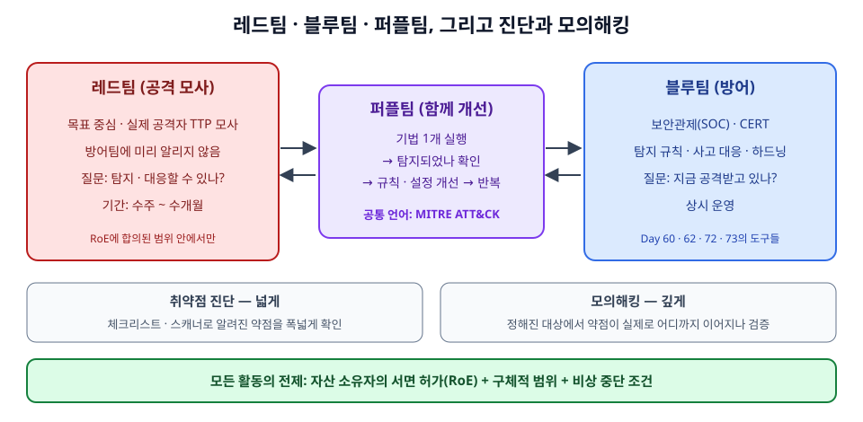
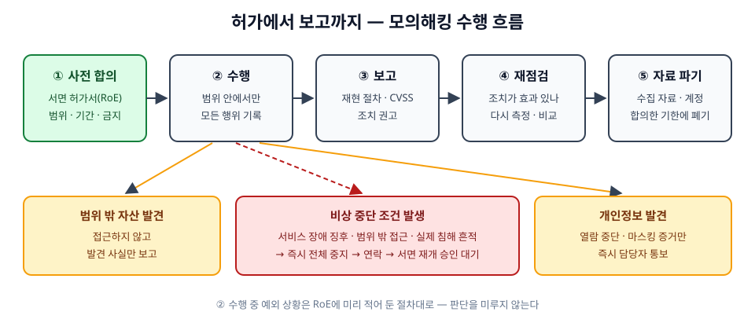
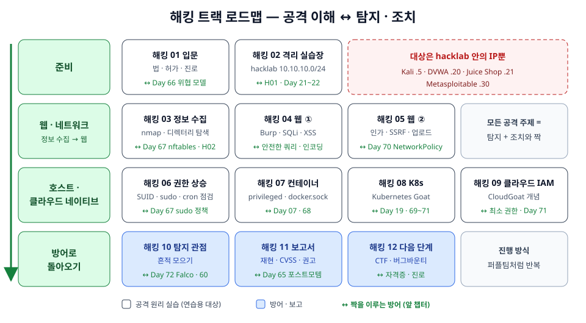

> **해킹 트랙 · 화이트해커 입문** | 난이도 ★★☆☆☆ | 예상 소요 1.5 ~ 2시간

> ⚠️ **실습 전 반드시 읽으세요.** 이 챕터의 모든 실습은 **본인 소유의 격리된 실습장**(해킹 02에서 만드는 `hacklab` 네트워크) 또는 **의도적으로 취약하게 만든 연습용 대상**(DVWA, OWASP Juice Shop, Metasploitable, Kubernetes Goat, CloudGoat 등)에만 합니다. 허가 없이 타인의 시스템을 스캔하거나 공격하면 **정보통신망법 등으로 형사 처벌**될 수 있습니다. "공부 목적", "취약점을 알려 주려고"는 면책 사유가 아닙니다.

## 🎯 오늘의 목표

- 화이트해커와 블랙해커를 가르는 기준이 **기술이 아니라 허가**라는 것을 설명할 수 있다
- 모의해킹 · 취약점 진단 · **레드팀 · 블루팀 · 퍼플팀**의 목적과 차이를 구분한다
- 정보통신망법의 **무단 침입 · 장애 유발 · 정보 훼손·비밀 침해** 금지 조항과 처벌 수준을 안다
- **허가서(Rules of Engagement)와 범위 합의서**에 들어가야 할 항목을 템플릿으로 작성할 수 있다
- 보안 진로(모의해킹 컨설턴트, 보안관제, 침해사고 대응, 버그바운티)와 해킹 트랙 로드맵을 그린다

---

## 1. 왜 방어 다음에 "공격자의 눈"인가?

Chapter 9에서 우리는 방어자였습니다. Day 66에서 위협 모델(STRIDE)을 그리고, Day 67~73에서 호스트 하드닝, 컨테이너 런타임 보안, PSA, NetworkPolicy, Vault, Falco, 감사 로그로 빈칸을 메웠죠. 그런데 한 가지 질문이 남습니다.

> **"그 방어가 실제로 막히는가? 막히지 않으면 적어도 보이는가?"**

설정 파일을 읽는 것만으로는 이 질문에 답할 수 없습니다. 공격자가 쓰는 방법을 **내 실습장에서 직접 재현**해 보고, 그 흔적이 Falco·로그·알림에 남는지 확인해야 합니다. 이것이 해킹 트랙의 목적입니다.

| Chapter 9 (방어 설계) | 해킹 트랙 (검증) |
|---|---|
| "SSH 비밀번호 로그인을 껐다" | 실습장 스캔에서 정말 publickey만 보이는가? |
| "nftables 기본 drop" (Day 67) | 스캔 결과에 `filtered`로 보이는가? 로그가 남는가? |
| "privileged 컨테이너 금지" (Day 68·69) | 금지하지 않으면 무엇이 위험한지 체감 (해킹 07) |
| "Falco 규칙" (Day 72) | 실습 공격이 알림으로 떨어지는가? (해킹 10) |

> 💡 이 챕터의 모든 공격 주제에는 **"탐지"와 "조치(안전한 코드·설정)"가 짝으로** 붙습니다. 공격 기술을 늘리는 게 아니라, **공격을 이해해서 방어를 증명**하는 것이 목표입니다.

---

## 2. 화이트햇, 블랙햇, 그리고 그레이햇



| 구분 | 허가 | 목적 | 결과물 | 법적 지위 |
|---|---|---|---|---|
| **화이트햇** (화이트해커) | ✅ 소유자의 **서면 허가** | 취약점을 찾아 고치게 함 | 보고서, 조치 권고 | 계약 범위 안에서 합법 |
| **블랙햇** | ❌ 없음 | 금전, 정보 탈취, 파괴 | 피해 | 범죄 |
| **그레이햇** | ❌ 없음 (의도는 "선의"라고 주장) | 찾은 뒤 알려 주거나 공개 | 제보, 때로는 공개 압박 | **여전히 무단 접근** — 처벌될 수 있음 |

같은 `nmap` 명령, 같은 SQL Injection 원리라도 **허가 여부**에 따라 컨설팅이 되기도 하고 범죄가 되기도 합니다. 그래서 화이트해커의 첫 번째 기술은 도구가 아니라 **허가서를 받는 법**입니다.

> ⚠️ "그레이햇"이라는 말에 낭만을 갖지 마세요. 의도가 선했다는 사실은 양형에서 참작될 수는 있어도, **무단 침입이라는 구성요건 자체를 없애 주지 않습니다.** 취약점을 발견했다면 버그바운티 프로그램이나 공식 신고 창구(5장)를 통하세요.

---

## 3. 모의해킹 · 레드팀 · 블루팀 · 퍼플팀

| 활동 | 질문 | 범위·방식 | 기간 | 주로 하는 사람 |
|---|---|---|---|---|
| **취약점 진단** | 알려진 약점이 있나? | 체크리스트·스캐너로 넓게 (예: 주요정보통신기반시설 취약점 분석·평가 항목) | 수일 ~ 수주 | 진단 컨설턴트 |
| **모의해킹** (Penetration Test) | 이 약점으로 실제로 어디까지 가나? | 정해진 대상을 깊게, 사람이 수동으로 검증 | 1 ~ 4주 | 모의해킹 컨설턴트 |
| **레드팀** | 조직이 실제 공격을 **탐지·대응**할 수 있나? | 목표(예: "고객 DB 접근") 중심, 실제 공격자 행동(TTP) 모사, 방어팀에 알리지 않음 | 수주 ~ 수개월 | 레드팀 |
| **블루팀** | 지금 공격받고 있나? 어떻게 막나? | 관제, 탐지 규칙, 사고 대응, 하드닝 | 상시 | 보안관제(SOC), CERT |
| **퍼플팀** | 이 공격 기법을 우리가 **보는가?** | 레드와 블루가 **한 자리에서** 기법 하나씩 실행 → 탐지 확인 → 규칙 개선 | 수일 단위 반복 | 레드 + 블루 공동 |

> 💡 이 챕터의 진행 방식은 **퍼플팀**에 가장 가깝습니다. 내가 실습장에서 기법 하나를 재현하고(레드), 바로 Falco·로그에서 그 흔적을 찾고(블루), 설정을 고친 뒤 다시 확인합니다. Day 66에서 본 **MITRE ATT&CK**가 레드와 블루가 같은 언어로 말하게 해 주는 공통 사전입니다.

### 모의해킹의 표준 흐름

널리 쓰이는 방법론(PTES, NIST SP 800-115, OWASP Web Security Testing Guide)은 표현은 달라도 대략 같은 단계를 거칩니다.

| 단계 | 하는 일 | 해킹 트랙에서 |
|---|---|---|
| 1. 사전 합의 | 허가, 범위, 규칙(RoE) | **오늘** |
| 2. 정보 수집 | 호스트·포트·서비스·웹 구조 파악 | 해킹 03 |
| 3. 취약점 분석·검증 | 약점이 실제로 성립하는지 확인 | 해킹 04~09 |
| 4. 영향 평가 | 권한 상승, 횡적 이동 가능성 | 해킹 06~08 |
| 5. 보고 | 재현 절차, 위험도(CVSS), 조치 권고 | 해킹 11 |
| 6. 재점검 | 조치가 실제로 효과가 있는지 | 각 Day의 "조치" 실습 |

---

## 4. 법적 경계 — 정보통신망법이 금지하는 것

> ⚠️ 이 절은 학습을 위한 개요이며 **법률 자문이 아닙니다.** 아래 조항 번호는 2026-11-15 기준 현행법(2026. 10. 시행본)을 확인해 적었습니다. 법은 자주 개정되고 특히 **벌칙 조항의 호 번호가 개정 때마다 바뀌어 왔으므로**, 실제 판단이 필요하면 [국가법령정보센터](https://www.law.go.kr)에서 「정보통신망 이용촉진 및 정보보호 등에 관한 법률」 현행 원문을 확인하세요.

### 4-1. 핵심 금지 조항

| 조항 | 금지 행위 (취지 요약) | 처벌 조항 | 법정형 |
|---|---|---|---|
| **제48조 제1항** | 정당한 접근권한 없이, 또는 **허용된 접근권한을 넘어** 정보통신망에 침입 | 제71조 제1항 제11호 | 5년 이하 징역 또는 5천만원 이하 벌금 |
| **제48조 제3항** | 대량의 신호·데이터 전송, 부정한 명령 처리 등으로 정보통신망의 안정적 운영을 방해해 **장애를 일으키는 행위** | 제71조 제1항 제12호 | 5년 이하 징역 또는 5천만원 이하 벌금 |
| **제49조** | 정보통신망에서 처리·보관·전송되는 **타인의 정보를 훼손**하거나 **타인의 비밀을 침해·도용·누설** | 제71조 제1항 제14호 | 5년 이하 징역 또는 5천만원 이하 벌금 |
| **제48조 제2항** | 정당한 사유 없이 **악성프로그램을 전달·유포** | 제70조의2 | 7년 이하 징역 또는 7천만원 이하 벌금 |
| **제48조 제4항** (2024년 신설) | 정당한 사유 없이 정상적인 보호·인증 절차를 **우회해 접근하게 하는 프로그램·장치**를 설치·전달·유포 | 현행 원문 확인 | — |

여기에 상황에 따라 다른 법이 겹칩니다. 서비스에 장애를 일으켜 업무를 방해하면 **형법 제314조 제2항**(컴퓨터 등 장애 업무방해), 전자기록의 비밀을 기술적 수단으로 알아내면 **형법 제316조 제2항**, 개인정보에 닿으면 **개인정보 보호법**이 문제 됩니다. 국가 기반시설이라면 정보통신기반 보호법도 있습니다.

### 4-2. 이 챕터의 실습에 비추어 보면

| 상황 | 판단 포인트 |
|---|---|
| 내 실습장(`hacklab`)의 DVWA를 스캔 | 내 소유, 격리된 망 → 문제 없음 |
| 회사 서버를 "어차피 내가 관리하니까" 스캔 | **업무 권한 ≠ 테스트 권한**. 소유 조직의 승인 절차를 밟지 않았다면 "허용된 접근권한을 넘어" 문제가 될 수 있음 |
| 모의해킹 계약 범위가 `app.example.com`인데 `admin.example.com`이 보여서 확인 | **범위 밖**. 발견 사실만 보고하고 손대지 않음 |
| 공개 웹사이트에 "조금만" 스캐너를 돌림 | 허가가 없으면 침입 시도로 볼 수 있고, 트래픽이 많으면 제48조 제3항(장애) 문제까지 생김 |
| 버그바운티 프로그램의 대상 | 프로그램이 공개한 **범위·규칙 안에서만** 허가된 것 |
| 클라우드(AWS 등)에 올린 내 VM | 내 VM은 괜찮지만 **클라우드 사업자의 침투 테스트 정책**을 따라야 함 (해킹 09) |

> 💡 판례들은 접근권한의 유무를 **서비스 제공자(소유자)가 정한 기준**으로 판단하는 경향이 있습니다. 즉 "기술적으로 들어갈 수 있었다"는 허가가 아닙니다. 비밀번호가 `admin/admin`이었어도, 문이 열려 있었어도, **들어가도 된다고 허락받지 않았다면** 무단 침입입니다.

---

## 5. 허가서(Rules of Engagement)와 범위 합의서



실무 모의해킹은 보통 두 문서로 시작합니다.

| 문서 | 성격 | 핵심 질문 |
|---|---|---|
| **범위 합의서** (Scope / SOW) | 무엇을, 언제까지, 무엇을 결과로 | "어디까지 테스트하나?" |
| **수행 규칙 / 허가서** (Rules of Engagement, Authorization Letter) | 어떻게, 무엇은 하면 안 되는지, 누가 승인했는지 | "어떻게 테스트하고, 문제 생기면 누구에게 연락하나?" |

### 5-1. 템플릿

아래 템플릿은 개인 실습장과 실무 양쪽에 쓸 수 있게 만든 학습용 예시입니다. 실무에서는 반드시 고객사 법무 검토를 거친 양식을 쓰세요.

```markdown
# 모의해킹 수행 허가서 및 범위 합의서 (Rules of Engagement)

## 1. 당사자와 승인
- 의뢰 조직(자산 소유자): ________  승인권자(성명/직책): ________  서명/일자: ________
- 수행 조직/수행자: ________  책임자: ________  서명/일자: ________
- ※ 승인권자는 대상 자산에 대한 실제 권한이 있어야 함 (호스팅·클라우드 사업자 자산은 별도 정책 확인)

## 2. 목적
- 예: 웹 서비스 출시 전 OWASP Top 10 기준 취약점 확인 및 조치 권고

## 3. 범위 (In-Scope)
| 유형 | 대상 | 비고 |
|---|---|---|
| IP/대역 | 10.10.10.20, 10.10.10.21 | |
| 도메인/URL | https://app.example.test/ | 하위 경로 전체 |
| 애플리케이션/API | 모바일 API v2 | API 문서 제공 |
| 테스트 계정 | user-a(일반), user-b(일반), admin-t(관리자) | 고객이 발급, 종료 후 폐기 |

## 4. 범위 제외 (Out-of-Scope)
- 운영 DB 직접 접근, 결제 대행사·외부 SaaS, 직원 개인 기기, 물리 보안, 사회공학(별도 합의 시만)

## 5. 기간과 시간대
- 기간: 2026-12-01 ~ 2026-12-12 / 시간대: 평일 10:00~18:00 (KST)
- 운영 영향이 큰 테스트는 사전 통보 후 지정 시간에만

## 6. 허용 / 금지 기법
- 허용: 포트·서비스 스캔, 웹 취약점 수동 검증, 인증·인가 검증, 설정 점검
- 금지: 서비스 거부(DoS) 및 대량 트래픽, 데이터 삭제·변조, 악성코드 설치,
        백도어·영구 접근 수단 설치, 범위 밖 자산으로의 확장, 실제 사용자 계정 사용

## 7. 출발지 정보
- 테스트 출발지 IP: ________ (고객 관제팀이 오탐/정탐을 구분할 수 있도록)

## 8. 데이터 처리
- 개인정보·민감정보를 발견하면 **즉시 열람 중단 → 담당자 통보**, 증거는 최소한(마스킹)으로만
- 수집 자료의 보관 위치·암호화, 종료 후 파기 기한(예: 보고서 승인 후 30일)

## 9. 연락 체계와 비상 중단
- 고객 기술 담당 / 관제팀 / 수행 책임자 연락처 (24시간)
- 비상 중단 조건: 서비스 장애 징후, 범위 밖 접근 발생, 실제 침해 흔적 발견
- 비상 중단 시 절차: 즉시 모든 테스트 중지 → 연락 → 서면 재개 승인 전까지 대기

## 10. 결과물
- 보고서 형식(요약/상세/재현 절차/CVSS/조치 권고), 제출 기한, 재점검 일정

## 11. 기밀 유지와 책임
- 기밀유지 의무, 결과 공개 금지, 정상 수행 중 발생 영향에 대한 책임 범위
```

### 5-2. 꼭 기억할 세 가지

1. **서면이 아니면 허가가 아니다.** 메신저로 "해 보세요"는 근거가 약합니다. 승인권자의 서명이 있는 문서를 받으세요.
2. **범위는 IP·도메인 단위로 구체적으로.** "회사 전체"는 범위가 아닙니다. 클라우드처럼 IP가 바뀌는 자산은 리소스 ID나 계정으로 명시합니다.
3. **비상 중단 조건을 먼저 정한다.** 테스트 중 서비스가 느려지면 "조금만 더"가 아니라 즉시 멈춥니다.

> 💡 해킹 트랙 실습도 이 템플릿을 그대로 씁니다. 6장 실습에서 **내 실습장용 RoE**를 직접 작성합니다. 범위는 해킹 02에서 만들 `hacklab` 대역 `10.10.10.0/24` 하나뿐입니다.

### 5-3. 취약점을 발견했다면 — 책임 있는 공개

허가 없이 우연히 다른 서비스의 취약점을 발견했다면 **더 확인하지 말고** 공식 창구로 알립니다.

| 창구 | 설명 |
|---|---|
| 해당 회사의 버그바운티 / `security.txt` | 웹사이트의 `/.well-known/security.txt`에 보안 연락처가 있는 경우가 많음 |
| KISA 보호나라 취약점 신고 | 국내 소프트웨어 취약점 신고·포상 제도 |
| 버그바운티 플랫폼 | 공개 프로그램의 **범위(scope)와 규칙**을 먼저 읽을 것 |

---

## 6. 실습 — 내 실습장의 RoE와 "범위 가드" 만들기

오늘 실습은 공격이 아니라 **준비**입니다. 이후 모든 Day가 이 두 가지를 전제로 합니다.

### 6-1. 실습장용 RoE 작성

```bash
mkdir -p ~/hacklab/notes
nano ~/hacklab/ROE.md
```

5-1 템플릿을 복사해 다음 값으로 채웁니다.

| 항목 | 내 실습장 값 |
|---|---|
| 자산 소유자 / 승인권자 / 수행자 | 나 |
| 범위 | `10.10.10.0/24` (`hacklab` 네트워크) — Kali `10.10.10.5`, DVWA `10.10.10.20`, Juice Shop `10.10.10.21`, Metasploitable `10.10.10.30` |
| 범위 제외 | 집 LAN(`192.168.0.0/24`), 공유기, H01 관리 인터페이스, **인터넷 전체** |
| 금지 기법 | 실습장 밖으로 나가는 모든 트래픽, 탐지 회피 기법, 악성코드 제작 |
| 비상 중단 조건 | 실습장 VM이 인터넷에 닿는 것이 확인되면 즉시 중단(해킹 02 체크리스트) |

### 6-2. 범위 가드 — 실수로 범위 밖을 치지 않게

사람은 오타를 냅니다. `10.10.10.30`을 치려다 `10.10.1.30`을 치면 그건 다른 누군가의 장비일 수 있습니다. 명령 앞에 범위를 검사하는 작은 함수를 둡니다. 해킹 02에서 만들 Kali VM의 `~/.bashrc`에 넣을 코드입니다(지금은 아무 리눅스 셸에서 동작만 확인해도 됩니다).

```bash
cat >> ~/.bashrc <<'EOF'

# --- hacklab 범위 가드: 인자로 받은 대상이 모두 10.10.10.0/24 안일 때만 실행 ---
HACKLAB_SCOPE="10.10.10.0/24"
in_scope() {
  python3 - "$HACKLAB_SCOPE" "$@" <<'PY'
import ipaddress, sys
scope = ipaddress.ip_network(sys.argv[1])
bad = []
for t in sys.argv[2:]:
    try:
        net = ipaddress.ip_network(t, strict=False)
    except ValueError:
        bad.append(t + " (IP/CIDR 아님)")
        continue
    if not net.subnet_of(scope):
        bad.append(t)
if bad:
    print("[범위 밖] " + ", ".join(bad) + "  → 실행하지 않습니다")
    sys.exit(1)
PY
}
EOF
source ~/.bashrc
```

```bash
in_scope 10.10.10.30 && echo "OK: 범위 안"
# OK: 범위 안

in_scope 10.10.1.30 && echo "OK"
# [범위 밖] 10.10.1.30  → 실행하지 않습니다

in_scope scanme.example.com && echo "OK"
# [범위 밖] scanme.example.com (IP/CIDR 아님)  → 실행하지 않습니다
```

해킹 03부터는 스캔을 `in_scope <대상> && nmap ... <대상>` 형태로 실행합니다. 도메인 이름을 거부하는 이유는 이름이 언제든 범위 밖 IP로 풀릴 수 있기 때문입니다.

> 💡 실무 도구들도 같은 장치를 둡니다. 예를 들어 Burp Suite는 **Target → Scope**에 등록한 대상만 테스트 대상으로 다루도록 설정할 수 있습니다(해킹 04).

### 6-3. 실습 기록 습관

모든 실습은 `~/hacklab/notes/hackNN.md`에 **시각, 명령, 결과, 관찰한 탐지 흔적**을 남깁니다. 해킹 11에서 이 기록이 그대로 보고서의 재현 절차가 됩니다.

```bash
script -q -a ~/hacklab/notes/hack03-terminal.log   # 이 셸의 입출력을 파일로 기록 (exit로 종료)
```

---

## 7. 윤리 강령 — 이 챕터의 약속

(ISC)², EC-Council, OWASP 등 여러 단체의 윤리 강령은 공통으로 다음을 요구합니다. 이 챕터를 공부하는 동안의 약속으로 삼으세요.

1. **허가 없이 하지 않는다.** 서면 허가와 명확한 범위가 없는 대상은 건드리지 않는다.
2. **범위를 넘지 않는다.** 범위 밖 자산을 발견하면 보고만 한다.
3. **해를 최소화한다.** 서비스 장애, 데이터 변조·삭제를 일으키지 않는다. 징후가 보이면 즉시 멈춘다.
4. **알게 된 것을 지킨다.** 테스트 중 본 정보·개인정보는 목적 외로 쓰거나 공개하지 않는다.
5. **정직하게 보고한다.** 발견한 것과 하지 못한 것을 그대로 쓴다. 과장도 은폐도 하지 않는다.
6. **배운 것을 방어에 쓴다.** 공격을 이해하는 목적은 탐지와 조치다. 탐지 회피나 무기화는 이 챕터의 목적이 아니다.

---

## 8. 진로 — 보안 직무 지도

| 직무 | 하는 일 | 필요한 역량 | 이 시리즈와의 연결 |
|---|---|---|---|
| **모의해킹 컨설턴트** | 계약된 대상의 취약점을 찾고 보고서 작성 | 웹·네트워크·OS 이해, 수동 검증, **보고서 작성** | 해킹 03~09, **해킹 11 보고서** |
| **보안관제 (SOC 분석가)** | SIEM·IDS 알림을 분류·분석, 정탐/오탐 판단 | 로그·네트워크 패킷 읽기, 탐지 규칙 | Day 60 Loki, Day 72 Falco, **해킹 10 탐지 관점** |
| **침해사고 대응 (DFIR)** | 사고 발생 시 범위 파악, 증거 보존, 원인 분석, 복구 | 포렌식, 타임라인 분석, 침착한 커뮤니케이션 | Day 65 장애 대응·포스트모템, Day 73 감사 로그 |
| **버그바운티 헌터** | 공개 프로그램 범위 안에서 취약점을 찾아 제보, 포상 | 웹 취약점 깊이, 꼼꼼함, **규칙 준수** | 해킹 04·05, 해킹 12 |
| **클라우드·DevSecOps 보안** | 파이프라인·K8s·클라우드 설정 보안 | 인프라 + 보안 둘 다 | **Chapter 7·9 전체**, 해킹 07~09 |

> 💡 인프라를 처음부터 쌓아 온 이 시리즈의 독자에게 가장 자연스러운 길은 **클라우드·DevSecOps 보안**과 **보안관제·침해사고 대응**입니다. "어떻게 만들어졌는지 아는 사람"이 "어떻게 뚫리는지"도 가장 잘 설명할 수 있습니다.

---

## 9. 해킹 트랙 로드맵



| Day | 주제 | 짝을 이루는 방어 (앞 챕터) |
|---|---|---|
| 74 | 입문 — 법, 허가, 진로 | Day 66 위협 모델 |
| 75 | 격리 실습장 (`hacklab`) | H01 홈랩, Day 05·21~22 네트워크 |
| 76 | 정보 수집 — nmap, 디렉터리 탐색 | Day 67 nftables, H02 노출 최소화 |
| 77 | 웹 ① — Burp, SQLi, XSS | 안전한 쿼리·출력 인코딩, Day 48 |
| 78 | 웹 ② — 인증 우회, IDOR, SSRF, 업로드, 명령 주입 | 인가 설계, NetworkPolicy(Day 70) |
| 79 | 리눅스 권한 상승 점검 | Day 67 sudo·하드닝 |
| 80 | 컨테이너 탈출 위험 | Day 07·68 |
| 81 | K8s 공격 시나리오 (Kubernetes Goat) | Day 19·69~71 |
| 82 | 클라우드 IAM 설정 실수 | 최소 권한, Day 71 |
| 83 | 탐지 관점 — 흔적 찾기 | Day 72 Falco, Day 60·62 |
| 84 | 모의해킹 보고서 | Day 65 포스트모템 |
| 85 | 다음 단계 — CTF, 버그바운티, 자격증 | — |

---

## 10. 트러블슈팅 — 실무에서 마주치는 "곤란한 순간"

| 증상 | 원인 | 해결 |
|---|---|---|
| 테스트 중 대상 서비스 응답이 느려짐 | 스캔·요청량 과다, 대상 자원 부족 | **즉시 중단** → 담당자 연락 → 원인 공유 후 서면 재개 승인 |
| 범위 밖 자산(다른 서브도메인·IP)이 보임 | 연결된 시스템, 잘못된 DNS | 접근하지 않고 "발견 사실"만 기록·보고, 필요하면 범위 추가 합의 |
| 테스트 중 개인정보가 화면에 나옴 | 취약점으로 데이터 노출 | 열람 중단, 마스킹된 최소 증거만 남기고 즉시 통보 |
| 이미 누군가 침입한 흔적 발견 | 실제 침해 사고 | 테스트 중단, 증거 보존, 고객 침해사고 대응 절차로 전환 |
| 관제팀이 테스트 트래픽을 실제 공격으로 차단 | 출발지 IP·일정 미공유 | RoE의 출발지 IP·시간대를 관제팀과 사전 공유 |
| 승인자가 "구두로 OK" | 서면 절차 누락 | 서명된 허가서를 받기 전에는 시작하지 않음 |

---

## 11. 핵심 정리

- 화이트해커와 블랙해커를 가르는 것은 **기술이 아니라 허가**다. "선의의 무단 접근"(그레이햇)도 처벌될 수 있다
- 취약점 진단은 넓게, 모의해킹은 깊게, 레드팀은 **탐지·대응 능력**을 시험하고, 퍼플팀은 레드·블루가 **함께** 탐지를 개선한다
- 정보통신망법: **제48조 제1항** 무단 침입·권한 초과, **제48조 제3항** 장애 유발, **제49조** 타인 정보 훼손·비밀 침해 → 제71조로 5년 이하 징역 또는 5천만원 이하 벌금. 악성프로그램 유포(제48조 제2항)는 제70조의2로 더 무겁다
- 테스트는 **서면 허가서(RoE) + 구체적 범위 + 비상 중단 조건**으로 시작한다
- 이 챕터의 범위는 `hacklab` `10.10.10.0/24` 하나뿐이며, 모든 공격 주제는 **탐지·조치**와 짝을 이룬다

---

## 12. 셀프 체크

<details>
<summary>Q1. 회사 서버의 관리자 계정을 가진 운영자가 승인 없이 그 서버에 취약점 스캐너를 돌렸다. 문제가 될 수 있는 이유는?</summary>

운영 권한과 보안 테스트 권한은 다릅니다. 접근권한의 범위는 자산 소유자(회사)가 정하는데, 운영 목적으로 받은 권한을 넘어 테스트를 하면 "허용된 접근권한을 넘어" 침입한 것으로 볼 여지가 있고, 스캔이 장애를 일으키면 장애 유발 조항까지 문제가 될 수 있습니다. 내부 승인 절차(허가서·범위)를 밟아야 합니다.
</details>

<details>
<summary>Q2. 레드팀과 퍼플팀의 가장 큰 차이는?</summary>

레드팀은 방어팀에 알리지 않고 실제 공격자처럼 목표를 향해 움직이며 **조직 전체의 탐지·대응 능력**을 시험합니다. 퍼플팀은 레드와 블루가 **같이 앉아** 기법을 하나씩 실행하고 그 자리에서 탐지 여부를 확인해 규칙을 개선합니다. 목적이 "시험"이냐 "함께 개선"이냐의 차이입니다.
</details>

<details>
<summary>Q3. RoE에 "비상 중단 조건"과 "테스트 출발지 IP"를 넣는 이유는?</summary>

비상 중단 조건은 서비스 장애나 범위 밖 접근, 실제 침해 흔적 같은 상황에서 **누구의 판단도 기다리지 않고 즉시 멈추기** 위해서입니다. 출발지 IP는 관제팀이 테스트 트래픽과 실제 공격을 구분하게 해 주어, 오인 대응과 진짜 공격의 묻힘을 둘 다 막습니다.
</details>

<details>
<summary>Q4. 범위 가드 함수가 도메인 이름을 거부하도록 만든 이유는?</summary>

도메인 이름은 DNS에 따라 언제든 다른 IP로 풀릴 수 있어, 이름만 보고는 범위 안인지 보장할 수 없기 때문입니다. 실습장은 IP 대역(`10.10.10.0/24`)으로 범위를 정했으므로 IP로만 대상을 지정하는 습관을 들입니다.
</details>

<details>
<summary>Q5. 공개 웹사이트를 이용하다 우연히 취약점처럼 보이는 동작을 발견했다. 올바른 행동은?</summary>

더 확인하거나 재현하지 않습니다(추가 시도 자체가 무단 접근이 될 수 있음). 해당 회사의 버그바운티 프로그램이나 `security.txt`의 보안 연락처, 또는 KISA 보호나라 취약점 신고 창구로 관찰한 내용만 알립니다.
</details>

---

## ⏭️ 다음 예고 — 해킹 02. 격리 실습장 구축

허가와 범위를 정했으니 이제 **마음껏 두드려도 되는 장소**를 만듭니다. VirtualBox 내부 네트워크와 Docker로 인터넷과 분리된 `hacklab`(10.10.10.0/24)을 만들고, Kali Linux, DVWA, OWASP Juice Shop, Metasploitable 2를 올립니다. 그리고 가장 중요한 단계, **이 실습장이 정말 밖으로 새지 않는지 검증하는 체크리스트**와 언제든 처음으로 되돌리는 스냅샷 전략을 다룹니다.
