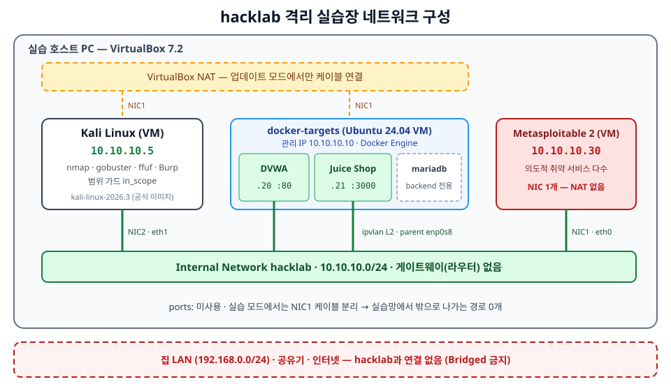
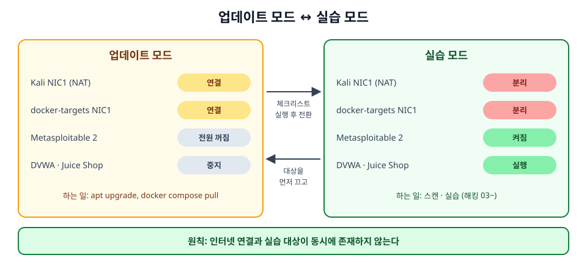
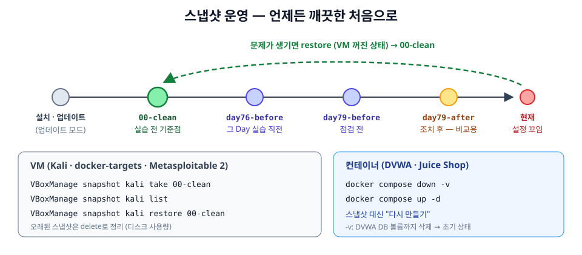

> **해킹 트랙 · 화이트해커 입문** | 난이도 ★★★☆☆ | 예상 소요 2.5 ~ 3.5시간 (이미지 다운로드 시간 포함)

> ⚠️ **실습 전 반드시 읽으세요.** 이 챕터의 모든 실습은 **본인 소유의 격리된 실습장**(오늘 만드는 `hacklab` 네트워크) 또는 **의도적으로 취약하게 만든 연습용 대상**(DVWA, OWASP Juice Shop, Metasploitable, Kubernetes Goat, CloudGoat 등)에만 합니다. 허가 없이 타인의 시스템을 스캔하거나 공격하면 **정보통신망법 등으로 형사 처벌**될 수 있습니다. 특히 오늘 올리는 취약 VM·컨테이너는 **절대 집 LAN이나 인터넷에 연결하지 마세요.**

## 🎯 오늘의 목표

- VirtualBox의 네트워크 모드(NAT, Bridged, Host-only, **Internal**)와 Docker 네트워크 드라이버를 **격리 수준** 관점에서 비교할 수 있다
- 인터넷과 집 LAN에서 분리된 실습망 **`hacklab` (10.10.10.0/24)** 을 만든다
- **Kali Linux**(공격·점검 VM), **DVWA · OWASP Juice Shop**(Docker), **Metasploitable 2**(VM)를 고정 주소로 올린다
- **업데이트 모드 / 실습 모드**를 나누고, 실습장이 밖으로 새지 않는지 **체크리스트로 검증**한다
- 스냅샷으로 언제든 "깨끗한 상태"로 되돌릴 수 있다

---

## 1. 왜 "격리"가 실습장의 전부인가?

오늘 올릴 대상들은 **일부러 구멍을 낸** 시스템입니다. Metasploitable 2는 2012년 무렵의 오래된 Ubuntu에 취약한 서비스를 잔뜩 켜 둔 VM이고, DVWA와 Juice Shop은 취약한 코드를 교재로 쓰는 웹 앱입니다. 이것들이 집 LAN에 붙으면 이렇게 됩니다.

| 사고 시나리오 | 결과 |
|---|---|
| Metasploitable을 **Bridged**로 연결 | 집 LAN의 모든 기기(그리고 같은 Wi-Fi의 누군가)가 취약 서버에 접근 가능 |
| DVWA를 `-p 80:80`으로 H01에 공개 + Homelab 02 포트포워딩 | **인터넷 전체**에 취약 웹 앱 공개 — 수 시간 안에 봇이 찾아옴 |
| Kali가 실습망과 인터넷에 동시에 연결된 채 스캔 | 오타 하나(`10.10.1.0/24`)로 **남의 대역**을 스캔 |

그래서 실습장은 두 가지 원칙으로 설계합니다.

1. **실습망에는 라우터가 없다.** 실습망 안의 장비끼리만 통신하고, 밖으로 나가는 경로(기본 게이트웨이, NAT)가 없다.
2. **인터넷이 필요한 작업(업데이트·이미지 받기)과 실습은 시간을 나눈다.** 둘을 동시에 하지 않는다.

> 💡 Homelab 01·03에서 "Docker 공개 포트가 ufw를 우회한다", "포트를 열지 않고 공개한다"를 강조한 이유가 여기서 다시 나옵니다. 실습장에서는 아예 **`ports:`를 쓰지 않습니다.**

---

## 2. 네트워크 모드 비교 — 무엇이 격리인가

### 2-1. VirtualBox 네트워크 모드

| 모드 | VM ↔ 인터넷 | VM ↔ 집 LAN | VM ↔ 호스트 PC | VM ↔ 같은 모드의 VM | 실습장 용도 |
|---|---|---|---|---|---|
| **NAT** | ✅ | ❌ (나가기만) | 제한적 | ❌ (VM마다 따로) | **업데이트용 임시 어댑터** |
| **Bridged** | ✅ | ✅ **LAN에 그대로 노출** | ✅ | ✅ | ❌ **사용 금지** |
| **Host-only** | ❌ (호스트가 라우팅하지 않는 한) | ❌ | ✅ 호스트에 가상 NIC 생성 | ✅ | 가능하지만 **호스트가 실습망에 포함됨** |
| **Internal Network** | ❌ | ❌ | ❌ **호스트도 못 봄** | ✅ 같은 이름끼리 | ✅ **실습망 `hacklab`** |

**Host-only**는 호스트 PC에 `vboxnet0`(Linux) / "VirtualBox Host-Only Ethernet Adapter"(Windows) 같은 가상 NIC를 만들어 호스트가 실습망의 일원이 됩니다. 브라우저로 바로 DVWA에 들어갈 수 있어 편하지만, 반대로 **실습 대상이 호스트 PC를 볼 수 있고**, 호스트에서 IP 포워딩이나 인터넷 연결 공유(Windows ICS)가 켜져 있으면 실습망이 밖으로 나갈 수 있습니다. 그래서 이 챕터는 **Internal Network**를 기본으로 하고, 브라우저 작업은 Kali 안에서 합니다.

### 2-2. Docker 네트워크 드라이버 (Day 05 복습)

| 드라이버 | 특징 | 실습장에서 |
|---|---|---|
| `bridge` (기본) | 호스트 NAT로 인터넷 가능 | ❌ 취약 컨테이너에는 사용 금지 |
| `bridge` + **`--internal`** | 외부로 나가는 경로가 없는 브리지 (호스트와는 통신 가능) | 가벼운 대안(8장)의 `hacklab` |
| `ipvlan` (L2) | 컨테이너가 부모 NIC의 L2 세그먼트에 **직접 IP로 참여** | ✅ VirtualBox `hacklab`에 컨테이너를 붙일 때 |
| `none` | 네트워크 없음 | DB처럼 아무와도 통신할 필요가 없을 때 |

---

## 3. 오늘 만들 실습장 구조



| 장비 | 형태 | `hacklab` 주소 | 실습 모드의 다른 NIC | 기본 계정 |
|---|---|---|---|---|
| **Kali Linux** `kali` | VirtualBox VM (공식 VirtualBox 이미지) | **10.10.10.5** | NIC1 NAT — 케이블 **분리** | `kali` / `kali` → 즉시 변경 |
| **docker-targets** | VirtualBox VM (Ubuntu Server 24.04 + Docker) | 10.10.10.10 (관리용) | NIC1 NAT — 케이블 **분리** | 설치 시 지정 |
| └ **DVWA** | 컨테이너 (`ghcr.io/digininja/dvwa:latest`) | **10.10.10.20** :80 | — | `admin` / `password` |
| └ **OWASP Juice Shop** | 컨테이너 (`bkimminich/juice-shop:v20.4.0`) | **10.10.10.21** :3000 | — | (앱 안에서 회원가입) |
| └ DVWA DB | 컨테이너 (`mariadb:10`) | 없음 (`backend` 내부 망만) | — | — |
| **Metasploitable 2** | VirtualBox VM | **10.10.10.30** | **NIC 하나뿐 (`hacklab`)** | `msfadmin` / `msfadmin` |

- 대역 `10.10.10.0/24`, 게이트웨이 **없음** (`10.10.10.1`은 Docker 설정상 적어 두지만 그 주소에 실제 라우터는 없음)
- 이 주소와 이름은 해킹 03~85가 그대로 사용합니다

### 실습 호스트와 자원

| 항목 | 권장 |
|---|---|
| 호스트 | 화면이 있는 PC(Windows 10/11, macOS(Intel), Linux 데스크톱) + **VirtualBox 7.2.x** (2026-11 기준 7.2 계열이 최신 유지보수 버전) |
| RAM | 16GB 이상 (Kali 4GB + docker-targets 3GB + Metasploitable 1GB + 호스트) |
| 디스크 | 여유 80GB 이상 (SSD 권장) |
| CPU | 가상화(VT-x/AMD-V) 활성화 — Homelab 01 2-2 참고 |

> 💡 **H01 홈랩 서버에 올리고 싶다면?** H01은 화면이 없는 서버이고, Day 21에서 KVM을 쓰고 있다면 VirtualBox와 하드웨어 가상화가 충돌할 수 있습니다. 이 경우 같은 구조를 **libvirt 격리 네트워크**로 만드는 방법을 9장에 정리했습니다. 주소와 이름은 동일합니다.

---

## 4. 실습 ① — 내부 네트워크와 Kali VM

### 4-1. 이미지 받기 (업데이트 모드: 호스트는 인터넷 연결)

| 대상 | 받는 곳 | 파일 (2026-11 기준 예) |
|---|---|---|
| VirtualBox 7.2.x | virtualbox.org | 운영체제별 설치 파일 |
| Kali Linux | **kali.org/get-kali** → Virtual Machines → VirtualBox | `kali-linux-2026.3-virtualbox-amd64.7z` |
| Ubuntu Server 24.04 LTS | ubuntu.com/download/server | `ubuntu-24.04.x-live-server-amd64.iso` |
| Metasploitable 2 | Rapid7 문서(docs.rapid7.com → Metasploitable 2)의 링크 또는 SourceForge `metasploitable` 프로젝트 | `metasploitable-linux-2.0.0.zip` (약 800MB) |

> ⚠️ 이미지는 **공식 배포처에서만** 받고, Kali는 다운로드 페이지에 게시된 **SHA256 체크섬**과 비교하세요. "미리 설정된 해킹 VM" 같은 비공식 이미지는 그 자체가 악성코드일 수 있습니다.

```powershell
# Windows PowerShell — 체크섬 확인 (출력값을 kali.org에 게시된 값과 비교)
Get-FileHash .\kali-linux-2026.3-virtualbox-amd64.7z -Algorithm SHA256
```

```bash
# Linux / macOS
sha256sum kali-linux-2026.3-virtualbox-amd64.7z
```

### 4-2. Kali 등록과 NIC 설정

7-Zip으로 압축을 풀면 `.vbox`(VM 설정)와 디스크 파일이 든 폴더가 나옵니다. VirtualBox 관리자에서 **Machine → Add**로 `.vbox`를 고르거나, 명령으로 등록합니다.

> 💡 아래 `VBoxManage` 명령은 Windows에서는 `C:\Program Files\Oracle\VirtualBox\`에 있습니다. 이 폴더를 PATH에 추가하거나 `& "C:\Program Files\Oracle\VirtualBox\VBoxManage.exe" ...`로 실행하세요. 경로는 각자 압축을 푼 위치로 바꿉니다.

```bash
VBoxManage registervm "C:\VMs\kali-linux-2026.3-virtualbox-amd64\kali-linux-2026.3-virtualbox-amd64.vbox"
VBoxManage list vms
# "kali-linux-2026.3-virtualbox-amd64" {....}

# 이름을 짧게, NIC1은 NAT(업데이트용), NIC2는 내부 네트워크 hacklab
VBoxManage modifyvm "kali-linux-2026.3-virtualbox-amd64" --name kali
VBoxManage modifyvm kali --memory 4096 --cpus 2
VBoxManage modifyvm kali --nic1 nat --nic2 intnet --intnet2 hacklab
VBoxManage showvminfo kali --machinereadable | grep -E '^(nic[12]|intnet2)='
# nic1="nat"
# nic2="intnet"
# intnet2="hacklab"
```

(Windows PowerShell에서는 `grep` 대신 `| Select-String -Pattern '^(nic[12]|intnet2)='`)

### 4-3. Kali 첫 부팅 — 업데이트 모드에서 할 일

```bash
VBoxManage startvm kali
```

`kali` / `kali`로 로그인한 뒤 터미널에서:

```bash
passwd                                   # 기본 비밀번호부터 변경
sudo apt update && sudo apt full-upgrade -y
sudo apt install -y gobuster ffuf seclists curl   # 해킹 03에서 사용 (이미 있으면 그대로)
nmap --version | head -n 1
```

### 4-4. Kali의 `hacklab` 주소 고정 (NetworkManager)

VirtualBox NIC2는 Kali 안에서 보통 `eth1`입니다. `ip -br link`로 확인하세요. 내부 네트워크에는 DHCP가 없으므로 고정 IP를 주고, **기본 경로로 쓰지 않도록** `never-default`를 켭니다.

```bash
ip -br link
sudo nmcli connection add type ethernet ifname eth1 con-name hacklab \
  ipv4.method manual ipv4.addresses 10.10.10.5/24 ipv4.never-default yes \
  ipv6.method disabled
sudo nmcli connection up hacklab
ip -br addr show eth1
# eth1   UP   10.10.10.5/24
```

해킹 01에서 만든 **범위 가드(`in_scope`)** 를 Kali의 `~/.bashrc`에 지금 넣어 두세요.

---

## 5. 실습 ② — docker-targets VM과 DVWA · Juice Shop

### 5-1. VM 만들기

Ubuntu Server 24.04를 Homelab 01 4장과 같은 방식으로 설치합니다(디스크 25GB, RAM 3GB, OpenSSH 설치). NIC 구성만 다릅니다.

```bash
VBoxManage modifyvm docker-targets --nic1 nat --nic2 intnet --intnet2 hacklab
```

설치 후 Day 01 4장의 **공식 apt 저장소** 방식으로 Docker Engine과 Compose 플러그인을 설치합니다. 그다음 NIC2(보통 `enp0s8`)에 관리용 주소를 줍니다. 게이트웨이는 넣지 않습니다.

```bash
sudo tee /etc/netplan/60-hacklab.yaml > /dev/null <<'EOF'
network:
  version: 2
  ethernets:
    enp0s8:
      dhcp4: false
      addresses: [10.10.10.10/24]
EOF
sudo chmod 600 /etc/netplan/60-hacklab.yaml
sudo netplan apply
ip -br addr show enp0s8
```

### 5-2. Docker `hacklab` 네트워크 — ipvlan L2

컨테이너가 VirtualBox 내부 네트워크에 **자기 IP(10.10.10.20, .21)로 직접** 붙도록 ipvlan L2 네트워크를 만듭니다. 이름은 실습망과 같은 `hacklab`입니다.

```bash
docker network create -d ipvlan \
  --subnet 10.10.10.0/24 --gateway 10.10.10.1 \
  -o parent=enp0s8 -o ipvlan_mode=l2 \
  hacklab
docker network inspect hacklab --format '{{.Driver}} {{range .IPAM.Config}}{{.Subnet}}{{end}}'
# ipvlan 10.10.10.0/24
```

| 왜 ipvlan인가 | 설명 |
|---|---|
| 포트 공개(`-p`)가 필요 없음 | 컨테이너가 실습망에 IP로 직접 존재 → VM의 NAT NIC 쪽에 아무것도 열리지 않음 |
| 컨테이너에서 인터넷으로 가는 길이 없음 | 트래픽이 `enp0s8` → 내부 네트워크로만 나가고, `10.10.10.1`에는 라우터가 없음 |
| macvlan 대신 | ipvlan은 부모 NIC의 MAC을 공유하므로 VirtualBox에서 무차별 모드(promiscuous) 설정이 필요 없음 |

> ⚠️ ipvlan·macvlan의 알려진 특성: **docker-targets VM 자신(10.10.10.10)은 자기 ipvlan 컨테이너와 직접 통신하지 못합니다.** 정상입니다. 컨테이너 관리는 `docker exec`로, 웹 확인은 Kali에서 합니다.

### 5-3. Compose 파일

```bash
mkdir -p ~/hacklab && cd ~/hacklab
nano compose.yaml
```

```yaml
name: hacklab-targets

services:
  dvwa:
    image: ghcr.io/digininja/dvwa:latest      # DVWA 공식 저장소가 GHCR에 배포하는 이미지
    environment:
      DB_SERVER: db
    depends_on:
      - db
    networks:
      hacklab:
        ipv4_address: 10.10.10.20
      backend: {}
    restart: unless-stopped
    # ports: 를 쓰지 않는다 — 실습망 밖으로 아무것도 공개하지 않음

  db:
    image: docker.io/library/mariadb:10
    environment:                              # DVWA 공식 compose.yml의 학습용 기본값
      MYSQL_ROOT_PASSWORD: dvwa
      MYSQL_DATABASE: dvwa
      MYSQL_USER: dvwa
      MYSQL_PASSWORD: p@ssw0rd
    volumes:
      - dvwa-db:/var/lib/mysql
    networks:
      - backend                               # 내부 전용 — 실습망에도 노출하지 않음
    restart: unless-stopped

  juice-shop:
    image: docker.io/bkimminich/juice-shop:v20.4.0
    networks:
      hacklab:
        ipv4_address: 10.10.10.21
    restart: unless-stopped

networks:
  hacklab:
    external: true          # 5-2에서 만든 ipvlan 네트워크
  backend:
    internal: true          # 외부 경로 없는 브리지 (DVWA ↔ DB 전용)

volumes:
  dvwa-db:
```

> 💡 Juice Shop은 2026-11-15 기준 Docker Hub의 최신 릴리스 태그 `v20.4.0`으로 고정했습니다. `latest`는 바뀔 수 있으니 실습 기록에는 태그를 남기세요(해킹 11 보고서의 "테스트 환경" 항목). DVWA는 커밋마다 `latest`가 빌드되므로 `docker image inspect`로 다이제스트를 기록해 두면 재현성이 생깁니다.

**업데이트 모드**에서 이미지를 받고, **실습 모드**로 바꾼 뒤 띄웁니다(6장).

```bash
docker compose pull        # NAT 케이블이 연결된 상태에서
docker image inspect ghcr.io/digininja/dvwa:latest --format '{{index .RepoDigests 0}}'
```

---

## 6. 실습 ③ — Metasploitable 2와 모드 전환

### 6-1. Metasploitable 2 VM — NIC는 단 하나

압축을 풀면 `Metasploitable2-Linux/Metasploitable.vmdk`가 나옵니다. 이 VM에는 **NAT 어댑터도 주지 않습니다.** 업데이트할 일이 없고(해서도 안 되고), 인터넷에 닿을 이유가 전혀 없습니다.

```bash
VBoxManage createvm --name metasploitable2 --ostype Ubuntu --register
VBoxManage modifyvm metasploitable2 --memory 1024 --cpus 1 --nic1 intnet --intnet1 hacklab
VBoxManage storagectl metasploitable2 --name IDE --add ide
VBoxManage storageattach metasploitable2 --storagectl IDE --port 0 --device 0 \
  --type hdd --medium "C:\VMs\Metasploitable2-Linux\Metasploitable.vmdk"
VBoxManage startvm metasploitable2
```

`msfadmin` / `msfadmin`으로 로그인한 뒤(키보드는 US 배열), 고정 주소를 줍니다. 오래된 Ubuntu 8.04라 `/etc/network/interfaces` 방식입니다.

```bash
sudo nano /etc/network/interfaces
```

```
auto eth0
iface eth0 inet static
    address 10.10.10.30
    netmask 255.255.255.0
```

```bash
sudo /etc/init.d/networking restart
ifconfig eth0 | grep 'inet addr'
#           inet addr:10.10.10.30  Bcast:10.10.10.255  Mask:255.255.255.0
```

> ⚠️ Metasploitable 2의 설정 화면이나 VirtualBox 기본값을 따라 **NAT·Bridged를 추가하지 마세요.** 이 VM의 NIC 목록에 `intnet` 외의 것이 보이면 체크리스트(7장) 실패입니다.

### 6-2. 업데이트 모드 ↔ 실습 모드



| | 업데이트 모드 | 실습 모드 |
|---|---|---|
| Kali·docker-targets NIC1 (NAT) | 케이블 **연결** | 케이블 **분리** |
| Metasploitable 2 | **전원 꺼짐** | 켜짐 |
| DVWA·Juice Shop 컨테이너 | 중지 (`docker compose stop`) | 실행 |
| 하는 일 | `apt upgrade`, `docker compose pull`, 문서 읽기 | 스캔·실습 (해킹 03~) |

VM이 켜진 상태에서는 `controlvm ... setlinkstate1`로 케이블을 뽑고 꽂습니다.

```bash
# 실습 모드로 전환
VBoxManage controlvm kali setlinkstate1 off
VBoxManage controlvm docker-targets setlinkstate1 off
VBoxManage startvm metasploitable2 --type headless
# docker-targets 안에서
docker compose -f ~/hacklab/compose.yaml up -d

# 업데이트 모드로 전환 (실습 대상을 먼저 끈다)
docker compose -f ~/hacklab/compose.yaml stop       # docker-targets 안에서
VBoxManage controlvm metasploitable2 acpipowerbutton
VBoxManage controlvm kali setlinkstate1 on
VBoxManage controlvm docker-targets setlinkstate1 on
```

> 💡 VM을 끈 상태에서 기본값을 "분리"로 두려면 `VBoxManage modifyvm kali --cable-connected1 off`를 씁니다. 그러면 실수로 켜도 실습 모드로 시작합니다.

### 6-3. 대상 초기 설정 (Kali의 Firefox에서)

| 대상 | 주소 | 첫 설정 |
|---|---|---|
| DVWA | `http://10.10.10.20/` | **Setup DVWA → Create / Reset Database** → `admin`/`password` 로그인 → **DVWA Security**에서 단계 선택(처음엔 Low) |
| Juice Shop | `http://10.10.10.21:3000/` | 첫 화면 안내 닫기. **Score Board**가 문제 목록이자 학습 가이드 |
| Metasploitable 2 | `http://10.10.10.30/` | 첫 페이지에 내장된 DVWA·Mutillidae 등 링크 확인 |

---

## 7. 실습장이 밖으로 새지 않는지 검증 — 체크리스트

**실습 모드로 전환할 때마다** 아래를 확인합니다. 하나라도 실패하면 해킹 01 RoE의 "비상 중단 조건"입니다.

### 7-1. 호스트(VirtualBox)에서 — 구성 확인

(Linux·macOS 호스트 또는 Windows의 Git Bash 기준. PowerShell에서는 `grep` 대신 `Select-String`)

```bash
for vm in kali docker-targets metasploitable2; do
  echo "== $vm"
  VBoxManage showvminfo "$vm" --machinereadable | grep -E '^(nic[0-9]|intnet[0-9]|cableconnected[0-9])='
done
```

```
== kali
nic1="nat"
nic2="intnet"
intnet2="hacklab"
cableconnected1="off"      ← 실습 모드
cableconnected2="on"
== metasploitable2
nic1="intnet"
intnet1="hacklab"
cableconnected1="on"
nic2="none"                ← NIC는 hacklab 하나뿐
...
```

### 7-2. Kali에서 — 밖으로 나가는 길이 없는지

```bash
ip route
# 10.10.10.0/24 dev eth1 proto kernel scope link src 10.10.10.5     ← 이것 하나만 (default 없음)

ping -c 2 -W 2 1.1.1.1
# ping: connect: Network is unreachable

getent hosts kali.org || echo "DNS 실패 = 정상"
curl -m 5 -sS -o /dev/null https://www.kali.org || echo "HTTPS 실패 = 정상"

ping -c 2 -W 2 192.168.0.1      # 집 공유기 주소 — 실패해야 정상
```

### 7-3. 실습망 안에서는 서로 보이는지

```bash
ping -c 1 -W 2 10.10.10.30
curl -s -o /dev/null -w '%{http_code}\n' http://10.10.10.20/login.php     # 200
curl -s -o /dev/null -w '%{http_code}\n' http://10.10.10.21:3000/         # 200
```

### 7-4. docker-targets에서 — 공개 포트와 컨테이너 외부 경로

```bash
docker ps --format 'table {{.Names}}\t{{.Ports}}'
# NAMES                         PORTS
# hacklab-targets-dvwa-1        80/tcp       ← 이미지의 EXPOSE 표시일 뿐, 공개 아님
# hacklab-targets-juice-shop-1  3000/tcp
# hacklab-targets-db-1          3306/tcp
# 0.0.0.0:8080->80/tcp 처럼 "호스트주소:포트->" 형태가 보이면 실패

docker exec hacklab-targets-dvwa-1 sh -c 'getent hosts example.com || echo "DNS 실패 = 정상"'
sudo ss -tlnp | grep -vE '127.0.0.(1|53)' # VM 자체가 여는 포트 — sshd 정도만
```

### 7-5. 집 LAN의 다른 PC에서 — 반대 방향

```bash
ping -c 2 10.10.10.20          # 실패해야 정상 (집 LAN에는 이 대역으로 가는 경로가 없음)
```

| # | 확인 항목 | 기대 결과 |
|---|---|---|
| 1 | 모든 실습 VM의 NIC에 **Bridged가 없음** | `nic*="bridged"` 없음 |
| 2 | Metasploitable 2는 `intnet` NIC 하나뿐 | ✅ |
| 3 | 실습 모드에서 Kali·docker-targets의 NAT 케이블 분리 | `cableconnected1="off"` |
| 4 | Kali에 default route 없음, 인터넷·DNS·집 공유기 모두 실패 | ✅ |
| 5 | 실습망 내부 통신(.5 → .20/.21/.30) 성공 | ✅ |
| 6 | 컨테이너에 `0.0.0.0:` 공개 포트 없음 | ✅ |
| 7 | 집 LAN에서 `10.10.10.0/24`에 닿지 않음 | ✅ |
| 8 | 호스트 PC에 인터넷 연결 공유(ICS)·IP 포워딩이 실습 NIC에 걸려 있지 않음 | ✅ (Host-only를 쓸 때 특히) |

---

## 8. 가벼운 대안 — H01에서 Docker만으로 (Metasploitable 제외)

VM을 돌릴 여유가 없다면 H01에서 Docker `--internal` 네트워크로 해킹 03~78을 따라올 수 있습니다. Metasploitable 2는 VM이 필요하므로 빠집니다.

```bash
# 1) 인터넷 경로 없는 브리지 네트워크 (H01에는 10.10.10.1로 붙음)
docker network create --internal \
  --subnet 10.10.10.0/24 --gateway 10.10.10.1 \
  -o com.docker.network.bridge.name=br-hacklab \
  hacklab

# 2) 도구를 미리 설치한 Kali 컨테이너 이미지 (빌드는 인터넷이 되는 기본 네트워크에서)
mkdir -p ~/hacklab/kali && cat > ~/hacklab/kali/Dockerfile <<'EOF'
FROM docker.io/kalilinux/kali-rolling
RUN apt-get update && apt-get install -y --no-install-recommends \
      nmap gobuster ffuf curl dirb ca-certificates iputils-ping iproute2 \
    && rm -rf /var/lib/apt/lists/*
EOF
docker build -t hacklab-kali ~/hacklab/kali

# 3) 실습망에만 연결해 실행
docker run -d --name kali --network hacklab --ip 10.10.10.5 hacklab-kali sleep infinity
docker exec -it kali bash
```

DVWA·Juice Shop은 5-3의 Compose 파일을 그대로 쓰되 `hacklab` 네트워크가 이 브리지를 가리키게 됩니다(`external: true`). 검증은 7-2를 `docker exec kali ...`로 실행합니다.

> ⚠️ 이 구성에서는 **H01 자신(10.10.10.1)이 실습망에 보입니다.** H01의 `0.0.0.0`에서 듣는 서비스는 실습 컨테이너가 접근할 수 있습니다. Day 67의 nftables 룰셋(input `policy drop`, SSH는 `@lan4`에서만)을 적용했다면 `10.10.10.0/24`에서 오는 입력은 이미 버려집니다. `sudo nft list table inet hostfw`로 확인하세요.

---

## 9. H01에서 KVM/libvirt로 같은 구조 만들기 (참고)

Day 21에서 libvirt를 쓰고 있다면 **`<forward>`도 `<ip>`도 없는 네트워크**가 VirtualBox Internal Network와 같은 역할을 합니다. 호스트에 IP가 없고, 밖으로 나가는 경로도 없습니다.

```xml
<!-- ~/hacklab/hacklab-net.xml -->
<network>
  <name>hacklab</name>
  <bridge name="virbr-hack" stp="on" delay="0"/>
</network>
```

```bash
virsh net-define ~/hacklab/hacklab-net.xml
virsh net-start hacklab
virsh net-autostart hacklab
virsh net-dumpxml hacklab | grep -E 'forward|<ip' || echo "forward/ip 없음 = 격리"
```

Kali는 공식 사이트의 **QEMU 이미지**를, Metasploitable 2는 `qemu-img convert -O qcow2 Metasploitable.vmdk metasploitable2.qcow2`로 변환해 이 네트워크에 붙입니다. 업데이트용 NIC는 libvirt 기본 NAT 네트워크(`default`)를 두 번째 인터페이스로 붙였다가 `virsh domif-setlink <VM> <인터페이스> down`으로 끊습니다.

---

## 10. 스냅샷 — 언제든 "깨끗한 처음"으로



실습하다 보면 설정이 꼬이거나, 실습 대상의 데이터가 엉망이 됩니다. 스냅샷 규칙을 정해 두면 몇 초 만에 돌아옵니다.

| 이름 규칙 | 언제 | 예 |
|---|---|---|
| `00-clean` | 설치·업데이트 직후, 실습 시작 전 | 모든 VM |
| `hackNN-before` | 그 편 실습 직전 | `hack06-before` |
| `hackNN-after` | 하드닝(조치)까지 적용한 뒤 — 비교용 | `hack06-after` |

```bash
VBoxManage snapshot kali take "00-clean" --description "2026.3 업데이트 + gobuster/ffuf/seclists"
VBoxManage snapshot metasploitable2 take "00-clean" --description "10.10.10.30 고정"
VBoxManage snapshot docker-targets take "00-clean" --description "Docker + 이미지 pull 완료"

VBoxManage snapshot kali list
#    Name: 00-clean (UUID: ...) *

# 되돌리기 (VM을 끈 상태에서)
VBoxManage controlvm metasploitable2 poweroff
VBoxManage snapshot metasploitable2 restore "00-clean"
```

컨테이너 대상은 스냅샷 대신 **다시 만들기**가 가장 깨끗합니다.

```bash
cd ~/hacklab
docker compose down -v      # -v: DVWA DB 볼륨까지 삭제 → 다음 기동 시 초기 상태
docker compose up -d
```

> 💡 켜진 VM의 스냅샷은 `VBoxManage snapshot <VM> take <이름> --live`로 만들 수 있습니다. 다만 메모리 상태까지 저장해 용량이 큽니다. 스냅샷이 쌓이면 디스크를 많이 먹으므로 오래된 것은 `VBoxManage snapshot <VM> delete <이름>`으로 정리하세요.

---

## 11. 탐지와 조치 — 실습장 자체의 위험

이 챕터의 규칙대로, 오늘 만든 "취약한 장비 묶음"에도 탐지와 조치를 짝으로 둡니다.

| 위험 | 탐지 (새고 있다는 신호) | 조치 |
|---|---|---|
| 취약 VM이 집 LAN에 노출 | 공유기 관리 페이지의 **DHCP 클라이언트 목록**에 `metasploitable` 같은 이름이 보임, 7-5 확인 실패 | NIC를 `intnet`으로 바꾸고 스냅샷 복원 |
| 실습 대상이 인터넷에 닿음 | 7-2·7-4 확인 실패, Kali에 `default` 경로 | NAT 케이블 분리, `ipv4.never-default yes` 확인 |
| 컨테이너 포트가 공개됨 | `docker ps`의 `0.0.0.0:` 표시, H01 `ss -tlnp` | Compose에서 `ports:` 제거, 실습망(ipvlan/internal)만 사용 |
| 비공식 이미지 사용 | 체크섬 불일치, 출처 불명 | 공식 배포처에서 다시 받기, 체크섬 기록 |
| 실습 기록·도구가 호스트에 섞임 | 호스트에 실습용 파일 산재 | 실습 결과는 Kali `~/hacklab/notes`에만, 반출은 해킹 11 보고서로 |

---

## 12. 트러블슈팅

| 증상 | 원인 | 해결 |
|---|---|---|
| Kali에서 `10.10.10.30`에 ping 실패 | VM마다 내부 네트워크 이름이 다름(오타, 대소문자) | `VBoxManage showvminfo <VM> --machinereadable \| grep intnet` → 모두 `hacklab` |
| Kali `eth1`에 주소가 없음 | NIC 순서가 다르거나 연결 프로필 미적용 | `ip -br link`로 이름 확인, `nmcli connection up hacklab` |
| DVWA 페이지에 DB 오류 | DB 미초기화, `backend` 네트워크 누락 | `setup.php`에서 **Create / Reset Database**, `docker compose logs db` |
| docker-targets에서 `curl 10.10.10.20` 실패 | ipvlan 특성(부모 인터페이스 ↔ 자기 컨테이너 불통) | 정상. Kali에서 확인 |
| `docker compose up` 시 `network hacklab declared as external, but could not be found` | 5-2 네트워크 미생성 | `docker network create -d ipvlan ... hacklab` 먼저 |
| Metasploitable 부팅 시 키보드 입력이 이상함 | 키보드 배열 | 영문(US) 입력 기준으로 입력, 기본 계정은 영문 |
| VirtualBox VM이 `VT-x is not available` 오류 | BIOS 가상화 꺼짐, 또는 Hyper-V/KVM과 충돌 | BIOS에서 활성화(Homelab 01), Windows는 Hyper-V 관련 기능 상태 확인, Linux는 9장 libvirt 방식 고려 |
| 업데이트 모드에서 `apt update` 실패 | NAT 케이블이 여전히 분리 | `VBoxManage controlvm kali setlinkstate1 on` |

---

## 13. 핵심 정리

- 실습장 격리의 핵심은 **라우터 없는 실습망**과 **업데이트·실습 시간 분리** 두 가지
- VirtualBox **Internal Network**는 호스트조차 참여하지 않는 가장 강한 격리, **Bridged는 금지**
- `hacklab` 10.10.10.0/24 — Kali **.5**, DVWA **.20**, Juice Shop **.21**, Metasploitable **.30** (이후 모든 Day 공통)
- 컨테이너는 **ipvlan L2**로 실습망에 직접 붙이고 **`ports:`를 쓰지 않는다**. DB는 `internal` 네트워크로만
- Metasploitable 2는 **NIC 하나(`hacklab`)** — 업데이트도 인터넷도 필요 없다
- 실습 모드 전환마다 **격리 체크리스트**를 돌리고, `00-clean` 스냅샷과 `docker compose down -v`로 언제든 초기화

---

## 14. 셀프 체크

<details>
<summary>Q1. Host-only 대신 Internal Network를 기본으로 고른 이유는?</summary>

Host-only는 호스트 PC에 가상 NIC가 생겨 **호스트가 실습망의 일원**이 됩니다. 실습 대상이 호스트를 볼 수 있고, 호스트에서 IP 포워딩이나 인터넷 연결 공유가 켜져 있으면 실습망이 밖으로 나갈 수 있습니다. Internal Network는 같은 이름의 VM끼리만 통신하고 호스트도 참여하지 않아 격리가 더 강합니다.
</details>

<details>
<summary>Q2. DVWA를 <code>ports: ["80:80"]</code>로 띄우면 어떤 문제가 생길 수 있나?</summary>

포트가 docker-targets VM의 모든 인터페이스(NAT 쪽 포함)에 공개됩니다. VM이 Bridged였거나 H01처럼 집 LAN·포트포워딩과 연결된 호스트라면 취약 웹 앱이 LAN이나 인터넷에 노출됩니다. 또 Homelab 01에서 본 것처럼 Docker 공개 포트는 ufw 같은 호스트 방화벽을 우회할 수 있습니다.
</details>

<details>
<summary>Q3. Kali의 hacklab 연결에 <code>ipv4.never-default yes</code>를 준 이유는?</summary>

이 연결이 **기본 경로(default route)** 가 되지 않게 하기 위해서입니다. 실습망 연결이 기본 경로가 되면 실습망 밖 주소로 가는 트래픽이 엉뚱한 곳으로 향하거나, 반대로 업데이트 모드에서 NAT 경로와 섞여 혼란이 생깁니다. 실습망은 `10.10.10.0/24` 직접 연결 경로만 가지면 충분합니다.
</details>

<details>
<summary>Q4. 업데이트 모드에서 Metasploitable 2를 반드시 꺼 두는 이유는?</summary>

업데이트 모드에서는 Kali가 인터넷(NAT)과 실습망에 **동시에** 연결됩니다. 이때 실습 대상이 켜져 있으면 실수나 오작동으로 실습 트래픽과 인터넷 트래픽이 섞일 위험이 생깁니다. "인터넷 연결 중에는 실습 대상이 존재하지 않는다"는 상태를 만들어 사고 가능성을 원천 차단합니다.
</details>

<details>
<summary>Q5. 격리 체크리스트에서 "Kali에서 집 공유기(192.168.0.1)로 ping"을 확인하는 이유는?</summary>

인터넷만 막히고 집 LAN으로는 통하는 경우(예: Host-only + 호스트 라우팅, 잘못된 Bridged NIC)를 잡아내기 위해서입니다. 실습망이 집 LAN에 닿으면 실습 대상이 집의 다른 기기를 볼 수 있고, 반대로 집 LAN에서 취약 VM에 접근할 수 있게 됩니다.
</details>

---

## ⏭️ 다음 예고 — 해킹 03. 정보 수집 — nmap, 서비스 식별, 디렉터리 탐색

실습장이 준비됐습니다. 모의해킹의 첫 단계는 **"무엇이 있는가"** 를 아는 것입니다. Kali에서 `hacklab` 안의 호스트를 찾고, 열린 포트와 서비스 버전을 식별하고, DVWA와 Juice Shop의 숨은 경로를 찾아봅니다. 그리고 반대편에 서서 **이 스캔이 대상의 로그와 IDS에 어떻게 보이는지**, Day 67의 nftables로 **무엇을 줄일 수 있는지**를 확인합니다.
