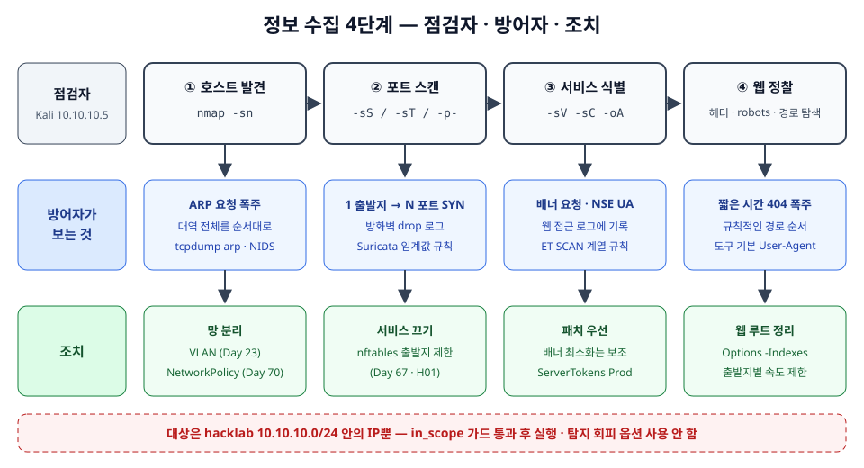
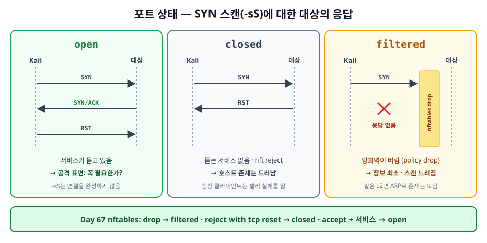
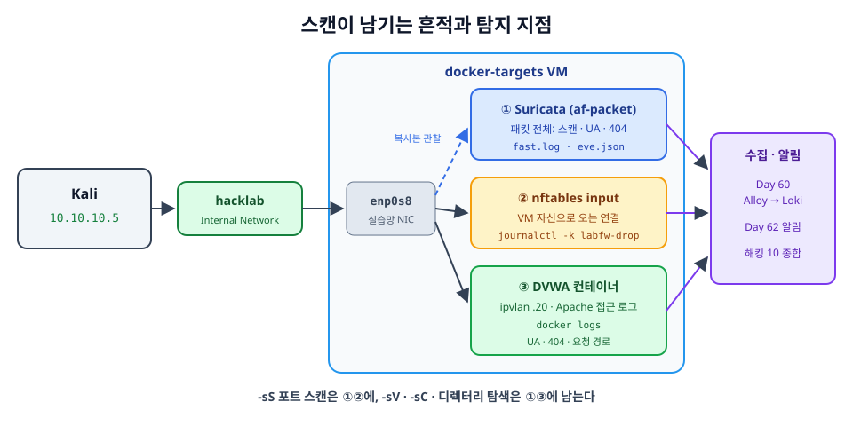

> **해킹 트랙 · 화이트해커 입문** | 난이도 ★★★☆☆ | 예상 소요 2.5 ~ 3시간

> ⚠️ **실습 전 반드시 읽으세요.** 이 챕터의 모든 실습은 **본인 소유의 격리된 실습장**(해킹 02의 `hacklab` 네트워크) 또는 **의도적으로 취약하게 만든 연습용 대상**(DVWA, OWASP Juice Shop, Metasploitable, Kubernetes Goat, CloudGoat 등)에만 합니다. 허가 없이 타인의 시스템을 스캔하거나 공격하면 **정보통신망법 등으로 형사 처벌**될 수 있습니다. 오늘의 스캔 대상은 **`10.10.10.0/24` 안의 IP뿐**이며, 모든 명령은 해킹 01의 범위 가드 `in_scope`를 앞에 붙여 실행합니다.

## 🎯 오늘의 목표

- 모의해킹의 정보 수집 단계가 **방어자의 공격 표면 조사(Day 66)와 같은 작업**임을 이해한다
- nmap으로 **호스트 발견 → 포트 스캔 → 서비스 식별(`-sV`) → 기본 스크립트(`-sC`)** 를 수행하고 결과를 **파일로 저장**한다
- 포트 상태(open / closed / filtered)를 해석하고, 결과에서 **위험한 노출**을 골라낸다
- 웹의 헤더·`robots.txt`를 수동으로 살피고, gobuster·ffuf로 DVWA·Juice Shop의 경로를 탐색한다
- **방어자 관점**: 각 스캔이 대상의 로그·nftables·IDS(Suricata)에 어떻게 보이는지 확인하고, 포트 닫기·배너 최소화로 **노출을 줄인 뒤 다시 측정**한다

---

## 1. 정보 수집 = 공격 표면 조사

Day 66에서 우리는 방어자로서 "우리 시스템에 무엇이 열려 있나"를 조사했습니다(`ss -tlnp`, `kubectl get svc`). 오늘 하는 일도 본질은 같습니다. 차이는 **바깥에서 본다**는 것뿐입니다.

| 관점 | 질문 | 도구 | 보이는 것 |
|---|---|---|---|
| 안에서 (Day 66) | 이 서버가 무엇을 열어 두었나? | `ss -tlnp`, 설정 파일 | 의도한 노출 + 의도치 않은 노출 |
| **밖에서 (오늘)** | 네트워크 너머에서 **실제로** 무엇이 닿나? | nmap, curl, gobuster/ffuf | 방화벽을 통과한 **실제 공격 표면** |

둘의 차이가 곧 발견입니다. "`ss`에는 3306이 `0.0.0.0`으로 보이는데 밖에서는 `filtered`" → 방화벽이 일하고 있다. "설정상 막았는데 밖에서 `open`" → 어딘가 구멍이 있다(Homelab 01의 Docker-ufw 우회처럼).



> 💡 오늘은 **퍼플팀 방식**으로 진행합니다. 스캔하기 전에 대상 쪽 관찰 장치(tcpdump, 로그, Suricata)를 먼저 켜고, 각 단계마다 "방어자에게는 어떻게 보였나"를 바로 확인합니다.

> ⚠️ 이 Day는 **스캔 속도 조절·디코이·단편화 같은 탐지 회피 옵션을 다루지 않습니다.** 우리의 목적은 숨는 것이 아니라 **보이는 것을 확인**하는 것입니다. 실무 모의해킹에서도 회피 기법은 RoE에 명시적으로 합의된 레드팀 훈련에서만 쓰입니다.

---

## 2. 준비 — 실습 모드와 관찰 장치

### 2-1. 실습 모드 확인

해킹 02 7장의 **격리 체크리스트**를 먼저 통과시키세요. Kali에서:

```bash
ip route                         # 10.10.10.0/24 하나만 — default 없음
mkdir -p ~/hacklab/scans
script -q -a ~/hacklab/notes/hack03-terminal.log    # 이 셸의 기록 시작 (끝낼 때 exit)
```

### 2-2. 방어자 쪽 터미널 열기 (docker-targets VM)

docker-targets VM 콘솔에 터미널을 두 개 띄웁니다.

```bash
# 터미널 A — 실습망 NIC로 들어오는 새 TCP 연결 시도(SYN)만 보기
sudo tcpdump -ni enp0s8 'tcp[tcpflags] & (tcp-syn) != 0 and tcp[tcpflags] & (tcp-ack) == 0'

# 터미널 B — DVWA(Apache) 접근 로그 실시간
docker logs -f --since 1m hacklab-targets-dvwa-1
```

> 💡 ipvlan 컨테이너(DVWA·Juice Shop)로 가는 패킷도 부모 NIC `enp0s8`을 지나므로 VM에서 tcpdump로 볼 수 있습니다. 이 위치가 실무의 **네트워크 IDS 센서** 자리입니다(8장).

---

## 3. 호스트 발견 — 누가 살아 있나

```bash
in_scope 10.10.10.0/24 && sudo nmap -sn 10.10.10.0/24 -oA ~/hacklab/scans/01-discovery
```

```
Nmap scan report for 10.10.10.10
Host is up (0.00040s latency).
MAC Address: 08:00:27:3A:1B:2C (Oracle VirtualBox virtual NIC)
Nmap scan report for 10.10.10.20
Host is up (0.00052s latency).
MAC Address: 08:00:27:3A:1B:2C (Oracle VirtualBox virtual NIC)
Nmap scan report for 10.10.10.21
Host is up (0.00049s latency).
MAC Address: 08:00:27:3A:1B:2C (Oracle VirtualBox virtual NIC)
Nmap scan report for 10.10.10.30
Host is up (0.00061s latency).
MAC Address: 08:00:27:9D:4E:5F (Oracle VirtualBox virtual NIC)
Nmap scan report for 10.10.10.5
Host is up.
Nmap done: 256 IP addresses (5 hosts up) scanned in 2.1 seconds
```

| 옵션 | 의미 |
|---|---|
| `-sn` | 포트 스캔 없이 **호스트 발견만** |
| 같은 L2 대역 + root 권한 | nmap은 ICMP 대신 **ARP 요청**으로 확인 → 방화벽이 ping을 막아도 존재가 드러남 |
| `-oA <이름>` | 일반(`.nmap`)·XML(`.xml`)·grep용(`.gnmap`) 세 형식으로 동시 저장 |

**해석 포인트:** `.10`, `.20`, `.21`의 MAC 주소가 같습니다. 해킹 02에서 ipvlan으로 컨테이너를 붙였기 때문이죠. 공격자 입장에서는 "**세 IP가 한 대의 호스트 뒤에 있다**"는 단서가 되고, 방어자 입장에서는 "컨테이너 IP가 실습망에 그대로 드러난다"는 설계상 특징을 확인한 것입니다.

### 🛡️ 방어자에게는 이렇게 보인다

```bash
# docker-targets VM — ARP 요청이 대역 전체에 순차적으로 쏟아짐
sudo tcpdump -ni enp0s8 arp
# ARP, Request who-has 10.10.10.2 tell 10.10.10.5, length 28
# ARP, Request who-has 10.10.10.3 tell 10.10.10.5, length 28
# ...
```

| 탐지 | 조치 |
|---|---|
| 짧은 시간에 한 출발지가 대역 전체 주소를 ARP로 묻는 패턴 (Suricata·Zeek 같은 NIDS나 스위치의 ARP 감시로 탐지) | 같은 L2에 있으면 존재 자체는 숨길 수 없다 → **망 분리**가 핵심. 사용자망·서버망·관리망을 VLAN(Day 23)으로 나누고, K8s에서는 NetworkPolicy(Day 70)로 Pod 간 접근을 기본 거부 |

---

## 4. 포트 스캔 — 무엇이 열려 있나

### 4-1. 스캔 종류

| 옵션 | 방식 | 권한 | 특징 |
|---|---|---|---|
| `-sS` (root 기본값) | **SYN 스캔** — SYN을 보내고 응답만 보고 연결을 완성하지 않음 | root | 가장 많이 쓰는 기본. "half-open" |
| `-sT` | **Connect 스캔** — OS의 `connect()`로 3-way handshake 완성 | 일반 사용자 | 대상 애플리케이션 로그에 **연결 기록이 남기 쉬움** |
| `-sU` | **UDP 스캔** | root | 느리고 해석이 어려움 (응답 없음 = open\|filtered) |
| `-p 22,80` / `-p-` | 지정 포트 / **전체 65535 포트** | — | 기본은 자주 쓰이는 상위 1000개 포트 |
| `-Pn` | 호스트 발견 생략, 무조건 스캔 | — | 방화벽이 탐지 패킷을 다 막을 때 |

### 4-2. 포트 상태 읽기



| 상태 | 대상의 응답 | 의미 | 방어 관점 |
|---|---|---|---|
| **open** | SYN/ACK | 서비스가 듣고 있음 | **공격 표면**. 필요한 것인가? |
| **closed** | RST | 호스트는 있으나 듣는 서비스 없음 | 안전하지만 "호스트가 있다"는 사실은 알려 줌 |
| **filtered** | 응답 없음 (또는 ICMP 도달 불가) | 방화벽이 버림 | Day 67 `policy drop`의 결과 |

### 4-3. Metasploitable 2 스캔

```bash
in_scope 10.10.10.30 && sudo nmap -sS 10.10.10.30 -oA ~/hacklab/scans/02-msf2-top1000
```

```
PORT     STATE SERVICE
21/tcp   open  ftp
22/tcp   open  ssh
23/tcp   open  telnet
25/tcp   open  smtp
53/tcp   open  domain
80/tcp   open  http
111/tcp  open  rpcbind
139/tcp  open  netbios-ssn
445/tcp  open  microsoft-ds
512/tcp  open  exec
513/tcp  open  login
514/tcp  open  shell
1099/tcp open  rmiregistry
1524/tcp open  ingreslock
2049/tcp open  nfs
2121/tcp open  ccproxy-ftp
3306/tcp open  mysql
5432/tcp open  postgresql
5900/tcp open  vnc
6000/tcp open  X11
6667/tcp open  irc
8009/tcp open  ajp13
8180/tcp open  unknown
```

여기서 `SERVICE` 열은 **포트 번호로 추측한 이름**일 뿐입니다(`/usr/share/nmap/nmap-services`). 2121이 정말 ccproxy인지, 8180이 무엇인지는 다음 단계(`-sV`)가 확인합니다. 전체 포트를 보려면 `-p-`를 붙입니다. 상위 1000개 밖에 숨어 있는 서비스가 나올 수 있습니다.

```bash
in_scope 10.10.10.30 && sudo nmap -sS -p- 10.10.10.30 -oA ~/hacklab/scans/03-msf2-allports
```

### 🛡️ 방어자에게는 이렇게 보인다

터미널 A(tcpdump)에는 **한 출발지(10.10.10.5)가 짧은 시간에 수많은 서로 다른 포트로 SYN**을 보내는 모습이 찍힙니다. 정상 사용자는 한두 개 포트에만 연결합니다.

```
IP 10.10.10.5.48712 > 10.10.10.20.443: Flags [S], seq ...
IP 10.10.10.5.48712 > 10.10.10.20.8080: Flags [S], seq ...
IP 10.10.10.5.48712 > 10.10.10.20.21: Flags [S], seq ...
```

| 스캔 | 대상 쪽 흔적 |
|---|---|
| `-sS` | 연결이 완성되지 않아 **애플리케이션 로그에는 거의 안 남음**. 그러나 네트워크(tcpdump, IDS, 방화벽 로그)에는 그대로 보임 |
| `-sT` | 연결이 완성되므로 sshd 등 서비스 로그에 "연결 후 바로 끊김" 기록이 남을 수 있음 |

| 탐지 | 조치 |
|---|---|
| "1 출발지 → N 포트, 짧은 시간" 임계값 규칙(8장 Suricata), nftables 차단 로그(9-1) | **필요 없는 서비스는 끄고**, 필요한 서비스는 **필요한 출발지에만** 연다(9장). 열린 포트 수가 곧 공격 표면 |

---

## 5. 서비스 식별과 기본 스크립트 — 무엇이 돌고 있나

```bash
in_scope 10.10.10.30 && sudo nmap -sV -sC -p 21,22,80,3306,8180 10.10.10.30 \
  -oA ~/hacklab/scans/04-msf2-svc
```

```
PORT     STATE SERVICE VERSION
21/tcp   open  ftp     vsftpd 2.3.4
|_ftp-anon: Anonymous FTP login allowed (FTP code 230)
22/tcp   open  ssh     OpenSSH 4.7p1 Debian 8ubuntu1 (protocol 2.0)
| ssh-hostkey:
|   1024 60:0f:cf:e1:c0:5f:6a:74:d6:90:24:fa:c4:d5:6c:cd (DSA)
|_  2048 56:56:24:0f:21:1d:de:a7:2b:ae:61:b1:24:3d:e8:f3 (RSA)
80/tcp   open  http    Apache httpd 2.2.8 ((Ubuntu) DAV/2)
|_http-title: Metasploitable2 - Linux
|_http-server-header: Apache/2.2.8 (Ubuntu) DAV/2
3306/tcp open  mysql   MySQL 5.0.51a-3ubuntu5
8180/tcp open  http    Apache Tomcat/Coyote JSP engine 1.1
|_http-title: Apache Tomcat/5.5
Service Info: OS: Linux; CPE: cpe:/o:linux:linux_kernel
```

(스크립트 출력은 nmap 버전에 따라 조금씩 다릅니다)

| 옵션 | 하는 일 |
|---|---|
| `-sV` | 열린 포트에 실제로 말을 걸어 **배너·응답 패턴**으로 제품과 버전을 식별 |
| `-sC` | `--script=default`와 같음. NSE(Nmap Scripting Engine)의 **default 카테고리** 스크립트 실행 — 익명 FTP 허용 여부, HTTP 제목, SSH 호스트 키 등 |
| `-O` (참고) | TCP/IP 응답 특성으로 OS 추정 (root 필요) |

> ⚠️ `-sC`의 기본 스크립트도 대상에 실제 요청(로그인 시도 포함)을 보냅니다. 실무에서는 RoE에 허용된 경우에만 쓰고, `--script`로 **취약점 공격 카테고리(`exploit`, `brute`, `dos` 등)를 실행하는 것은 이 챕터의 범위가 아닙니다.** 스크립트 카테고리 설명은 nmap 공식 문서(nmap.org/book/nse-usage.html)를 참고하세요.

### 5-1. 결과 저장과 비교

```bash
ls ~/hacklab/scans/
# 01-discovery.gnmap  01-discovery.nmap  01-discovery.xml  02-msf2-top1000.* ...

grep -h 'open' ~/hacklab/scans/04-msf2-svc.gnmap | tr ',' '\n' | head
```

| 형식 | 옵션 | 쓰임 |
|---|---|---|
| 일반 | `-oN` | 사람이 읽기, 보고서 첨부 |
| XML | `-oX` | 도구 연동(보고서 생성기, `ndiff`) |
| grep용 | `-oG` | 한 호스트 한 줄 — `grep`/`awk` 처리 |
| 전부 | `-oA` | 위 세 개 동시 |

조치 전후를 비교할 때는 XML 두 개를 `ndiff`로 비교합니다(9장에서 사용). Kali에 없다면 업데이트 모드에서 `sudo apt install -y ndiff`.

### 🛡️ 방어자에게는 이렇게 보인다

`-sV`·`-sC`는 실제로 HTTP 요청을 보내므로 **웹 접근 로그에 남습니다.** DVWA를 대상으로 같은 스캔을 하면 터미널 B에 다음과 같은 줄이 찍힙니다.

```bash
in_scope 10.10.10.20 && sudo nmap -sV -sC -p 80 10.10.10.20 -oA ~/hacklab/scans/05-dvwa-svc
```

```
10.10.10.5 - - [15/Nov/2026:14:02:11 +0900] "GET / HTTP/1.1" 302 ... "-" "Mozilla/5.0 (compatible; Nmap Scripting Engine; https://nmap.org/book/nse.html)"
10.10.10.5 - - [15/Nov/2026:14:02:11 +0900] "GET /nmaplowercheck1763182931 HTTP/1.1" 404 ...
10.10.10.5 - - [15/Nov/2026:14:02:11 +0900] "OPTIONS / HTTP/1.1" 200 ...
```

| 탐지 | 조치 |
|---|---|
| 접근 로그의 **User-Agent에 `Nmap Scripting Engine`**, 존재하지 않는 경로(`/nmaplowercheck...`) 요청, `OPTIONS` 요청 — Suricata의 공개 규칙(ET Open)에도 이런 패턴을 잡는 `ET SCAN` 계열 규칙이 있음 | 배너에 **버전을 드러내지 않기**(9-2). 그리고 무엇보다 `vsftpd 2.3.4`, `Apache 2.2.8`처럼 **오래된 버전 자체를 업데이트** — 배너 숨기기는 보조 수단일 뿐 |

---

## 6. 결과 해석 — 무엇이 위험한가

스캔 결과는 "열린 포트 목록"이 아니라 **위험 목록**으로 읽어야 합니다. Metasploitable 2 결과를 방어자의 언어로 분류하면 이렇습니다.

| 분류 | 해당 포트·서비스 | 왜 위험한가 | 일반적인 조치 |
|---|---|---|---|
| **평문 원격 접속** | 21 ftp, 23 telnet, 512~514 r-서비스 | 계정·데이터가 암호화 없이 흐름 | 끄고 SSH/SFTP로 대체 |
| **익명·약한 인증** | ftp-anon 허용, VNC, X11 | 인증 없이 또는 약한 인증으로 접근 | 익명 접근 금지, 원격 데스크톱은 VPN 뒤로 |
| **DB·관리 포트의 네트워크 노출** | 3306 MySQL, 5432 PostgreSQL, 1099 RMI, 8009 AJP | 원래 내부·로컬에서만 써야 할 포트 | `127.0.0.1` 바인딩 또는 방화벽으로 앱 서버만 허용 |
| **지원 종료된 오래된 버전** | OpenSSH 4.7, Apache 2.2.8, Tomcat 5.5, MySQL 5.0 | 알려진 취약점(CVE)이 공개되어 있음 | 패치·업그레이드. 보고서에 CVE와 CVSS로 근거 제시(해킹 11) |
| **설명할 수 없는 포트** | 1524 ingreslock | Metasploitable에서는 의도적으로 넣은 원격 셸 | 실무에서 이런 포트를 발견하면 **침해사고 징후** — 즉시 보고(해킹 01 비상 중단 조건) |

> 💡 실무 보고서는 "포트 23이 열려 있음"이 아니라 **"평문 원격 관리 프로토콜(Telnet)이 사용자망에 노출되어 계정 탈취 위험이 있음 → 비활성화하고 SSH 키 인증으로 대체 권고"** 처럼 씁니다. 발견 → 위험 → 조치의 세 칸입니다(해킹 11).

> ⚠️ 이 Day에서는 발견한 서비스의 취약점을 **실제로 악용하지 않습니다.** 버전이 오래됐다는 사실과 공개된 CVE를 확인하는 것까지가 정보 수집 단계입니다. 웹 취약점의 원리는 해킹 04·78에서 DVWA·Juice Shop의 내장 학습 안내와 함께 다룹니다.

---

## 7. 웹 정보 수집 — 수동 정찰과 디렉터리 탐색

### 7-1. 수동 정찰 — 헤더와 robots.txt

도구를 돌리기 전에 **사람처럼 한 번 둘러보는 것**이 먼저입니다. 요청 수가 적고, 생각보다 많은 것이 보입니다.

```bash
in_scope 10.10.10.20 && curl -sI http://10.10.10.20/
```

```
HTTP/1.1 302 Found
Server: Apache/2.4.x (Debian)
X-Powered-By: PHP/8.x.x
Set-Cookie: PHPSESSID=...; path=/
Location: login.php
```

```bash
curl -s http://10.10.10.20/robots.txt
in_scope 10.10.10.21 && curl -sI http://10.10.10.21:3000/
curl -s http://10.10.10.21:3000/robots.txt
```

| 관찰 | 의미 | 방어 관점 |
|---|---|---|
| `Server: Apache/2.4.x (Debian)` | 웹 서버 제품·버전·OS 배포판 | 정보 노출 — 9-2에서 줄임 |
| `X-Powered-By: PHP/8.x` | 백엔드 언어와 버전 | `expose_php = Off` |
| `robots.txt`의 `Disallow:` 경로 | 검색 엔진에 "여기는 수집하지 마"라고 한 경로 | **robots.txt는 접근 통제가 아니다** — 오히려 숨기고 싶은 경로의 목록이 될 수 있음 |
| Juice Shop의 `Access-Control-Allow-Origin`, `X-Frame-Options` 등 보안 헤더 | 어떤 브라우저 보호가 켜져 있는지 | OWASP Secure Headers Project 기준으로 점검 |

> 💡 Juice Shop의 `robots.txt`가 가리키는 경로는 Juice Shop **Score Board**에 관련 문제가 있습니다. 그다음 단계는 Juice Shop의 내장 힌트와 공식 안내서 *Pwning OWASP Juice Shop*(pwning.owasp-juice.shop)를 따라가세요.

### 7-2. 디렉터리 탐색 — gobuster (DVWA)

링크로 연결되지 않은 경로(백업 파일, 관리 페이지, 설정 파일)를 단어 목록으로 확인합니다.

```bash
in_scope 10.10.10.20 && gobuster dir \
  -u http://10.10.10.20/ \
  -w /usr/share/wordlists/dirb/common.txt \
  -t 10 \
  -o ~/hacklab/scans/06-gobuster-dvwa.txt
```

```
/.htaccess            (Status: 403) [Size: 277]
/config               (Status: 301) [Size: 313] [--> http://10.10.10.20/config/]
/docs                 (Status: 301) [Size: 311] [--> http://10.10.10.20/docs/]
/external             (Status: 301) [Size: 315] [--> http://10.10.10.20/external/]
/index.php            (Status: 302) [Size: 0] [--> login.php]
/php.ini              (Status: 200) [Size: ...]
/phpinfo.php          (Status: 302) [Size: 0] [--> login.php]
/robots.txt           (Status: 200) [Size: 26]
/server-status        (Status: 403) [Size: 277]
```

(DVWA 버전에 따라 결과가 다를 수 있습니다)

| 옵션 | 의미 |
|---|---|
| `dir` | 디렉터리·파일 경로 탐색 모드 |
| `-w` | 단어 목록. Kali 기본 `dirb/common.txt`(약 4,600개), 더 큰 목록은 `/usr/share/seclists/Discovery/Web-Content/` |
| `-t 10` | 동시 요청 수. 실습장이라도 대상이 작은 VM이므로 **낮게** |
| 상태 코드 | 200 존재, 301/302 이동, 403 존재하지만 금지, 404 없음 |

**해석:** `/config/`, `/php.ini` 같은 경로가 웹에서 **존재한다는 것 자체**가 발견입니다. 설정 파일·디렉터리 목록(Directory Listing)이 웹 루트에 노출돼 있지 않은지, `403`이 정말 막힌 것인지 확인하는 것이 방어자의 숙제입니다.

### 7-3. 디렉터리 탐색 — ffuf (Juice Shop)

Juice Shop 같은 **SPA(단일 페이지 앱)** 는 없는 경로에도 `200`과 같은 `index.html`을 돌려줍니다. 그래서 상태 코드만으로는 구분이 안 됩니다. gobuster를 그대로 돌리면 "존재하지 않는 URL도 200을 반환한다"는 경고와 함께 멈춥니다. ffuf의 **자동 보정(`-ac`)** 은 무작위 경로 몇 개를 먼저 요청해 "없는 경로의 응답 크기·단어 수"를 학습하고 그와 같은 응답을 걸러 냅니다.

```bash
in_scope 10.10.10.21 && ffuf \
  -u http://10.10.10.21:3000/FUZZ \
  -w /usr/share/wordlists/dirb/common.txt \
  -t 10 -ac \
  -o ~/hacklab/scans/07-ffuf-juice.json -of json
```

| 옵션 | 의미 |
|---|---|
| `FUZZ` | 단어 목록의 각 단어가 들어갈 자리 |
| `-ac` | 자동 보정 — "없는 경로" 응답 패턴을 걸러 냄 |
| `-fs <크기>` / `-fc <코드>` | 수동 필터 — 특정 크기·상태 코드 제외 |
| `-o … -of json` | 결과를 JSON으로 저장 |

결과에는 SPA의 기본 응답과 다른 경로(예: `robots.txt`, API·정적 파일 경로)만 남습니다. 각 경로가 무엇인지는 Juice Shop Score Board의 문제 설명과 대조해 보세요.

### 🛡️ 방어자에게는 이렇게 보인다

```bash
# docker-targets VM — 디렉터리 탐색 직후 DVWA 접근 로그
docker logs --since 10m hacklab-targets-dvwa-1 2>&1 | grep -c '" 404 '
# 4583

docker logs --since 10m hacklab-targets-dvwa-1 2>&1 | awk -F'"' '{print $6}' | sort | uniq -c | sort -rn | head -3
#   4612 gobuster/3.x
#     21 Mozilla/5.0 (compatible; Nmap Scripting Engine; https://nmap.org/book/nse.html)
#      9 curl/8.x
```

| 탐지 | 조치 |
|---|---|
| 한 출발지에서 **짧은 시간 수천 건의 404**, 알파벳 순서처럼 규칙적인 경로, 도구 기본 User-Agent(`gobuster/…`, `Fuzz Faster U Fool …`). User-Agent는 바꿀 수 있으므로 **404 비율·요청 속도**가 더 믿을 만한 신호 | 웹 루트에 **설정·백업·문서 파일을 두지 않는다**, 디렉터리 목록 비활성화(Apache `Options -Indexes`), 관리 경로는 인증·IP 제한, 리버스 프록시·WAF에서 **출발지별 요청 속도 제한**(Homelab 03의 Caddy·Cloudflare, K8s Ingress의 rate limit) |

---

## 8. 탐지 — 네트워크 IDS(Suricata)로 스캔 보기



tcpdump와 로그를 사람이 보는 것은 실습에서만 가능합니다. 실무에서는 **네트워크 IDS**가 패킷을 규칙과 비교해 알림을 만듭니다. Suricata는 대표적인 오픈소스 NIDS로, Day 72의 Falco가 **호스트 안의 시스템 콜**을 보는 것처럼 Suricata는 **네트워크의 패킷**을 봅니다.

| | Falco (Day 72) | Suricata |
|---|---|---|
| 보는 것 | 커널 시스템 콜, K8s 감사 이벤트 | 네트워크 패킷 (L3~L7: IP, TCP, HTTP, TLS, DNS …) |
| 설치 위치 | 각 노드 | 트래픽이 지나가는 길목 (미러 포트, 게이트웨이) |
| 스캔 탐지 | 거의 못 봄 | **잘 봄** — 포트 스캔, 스캐너 User-Agent, 비정상 프로토콜 |

### 8-1. 설치와 설정 (docker-targets VM, 선택 실습)

설치와 공개 규칙 다운로드는 **업데이트 모드**에서 합니다.

```bash
sudo apt install -y suricata jq
sudo suricata-update            # ET Open 공개 규칙 내려받기 → /var/lib/suricata/rules/suricata.rules
suricata --build-info | head -n 1
```

`/etc/suricata/suricata.yaml`에서 세 군데를 바꿉니다.

```yaml
vars:
  address-groups:
    HOME_NET: "[10.10.10.0/24]"          # 보호 대상 = 실습망

af-packet:
  - interface: enp0s8                    # 실습망 NIC (기본값 eth0에서 변경)

rule-files:
  - suricata.rules
  - /etc/suricata/rules/local.rules      # 오늘 만들 실습용 규칙 추가
```

### 8-2. 실습용 탐지 규칙

이 규칙들은 오늘 본 흔적을 그대로 규칙으로 옮긴 것입니다. 숫자(임계값)는 실습장 기준이며, 실무에서는 정상 트래픽을 보고 조정합니다.

```bash
sudo mkdir -p /etc/suricata/rules
sudo tee /etc/suricata/rules/local.rules > /dev/null <<'EOF'
# 1) 한 출발지에서 5초 안에 SYN 30개 이상 → 포트 스캔 의심
alert tcp any any -> $HOME_NET any (msg:"HACKLAB possible TCP port scan"; flow:stateless; flags:S,12; threshold:type threshold, track by_src, count 30, seconds 5; classtype:attempted-recon; sid:9000001; rev:1;)

# 2) Nmap NSE 기본 User-Agent
alert http any any -> $HOME_NET any (msg:"HACKLAB Nmap NSE User-Agent"; flow:established,to_server; http.user_agent; content:"Nmap Scripting Engine"; nocase; classtype:attempted-recon; sid:9000002; rev:1;)

# 3) 같은 클라이언트에게 10초 안에 404 응답 50개 이상 → 디렉터리 탐색 의심
alert http $HOME_NET any -> any any (msg:"HACKLAB many 404 responses (content discovery)"; flow:established,to_client; http.stat_code; content:"404"; threshold:type threshold, track by_dst, count 50, seconds 10; classtype:attempted-recon; sid:9000003; rev:1;)
EOF

sudo suricata -T -c /etc/suricata/suricata.yaml -v     # 설정·규칙 검사
sudo systemctl restart suricata
```

| 규칙 요소 | 의미 |
|---|---|
| `flags:S,12` | SYN 플래그만 켜진 패킷 (예약 비트 1·2는 무시) |
| `threshold: … track by_src, count 30, seconds 5` | 같은 출발지에서 5초에 30번 걸릴 때마다 알림 |
| `http.user_agent` / `http.stat_code` | HTTP 파서가 뽑아 준 필드(sticky buffer)에서 `content` 비교 |
| `sid:9000001` | 규칙 ID. 로컬 규칙은 공개 규칙과 겹치지 않는 큰 번호대를 씀 |

### 8-3. 스캔을 다시 돌리고 알림 보기

실습 모드로 돌아와 Kali에서 3~7장의 스캔을 다시 실행한 뒤 docker-targets VM에서:

```bash
sudo tail -n 20 /var/log/suricata/fast.log
```

```
11/15/2026-14:20:03.112  [**] [1:9000001:1] HACKLAB possible TCP port scan [**] [Classification: Attempted Information Leak] [Priority: 2] {TCP} 10.10.10.5:51234 -> 10.10.10.20:995
11/15/2026-14:21:40.508  [**] [1:9000002:1] HACKLAB Nmap NSE User-Agent [**] [Classification: Attempted Information Leak] [Priority: 2] {TCP} 10.10.10.5:40112 -> 10.10.10.20:80
11/15/2026-14:24:12.774  [**] [1:9000003:1] HACKLAB many 404 responses (content discovery) [**] ... {TCP} 10.10.10.20:80 -> 10.10.10.5:38870
```

```bash
# 구조화된 로그(eve.json)로 출발지별 알림 수 집계
sudo jq -r 'select(.event_type=="alert") | "\(.src_ip) \(.alert.signature)"' /var/log/suricata/eve.json | sort | uniq -c
```

`ET SCAN`으로 시작하는 공개 규칙의 알림도 섞여 나올 수 있습니다. 어떤 공개 규칙이 걸렸는지 읽어 보는 것도 좋은 공부입니다. `eve.json`은 Day 60의 Loki(Alloy)로 수집해 Grafana에서 볼 수 있고, 알림 설계는 Day 62의 원칙을 따릅니다. 이 흔적들을 한 화면에 모으는 일은 **해킹 10 탐지 관점**에서 다시 합니다.

> 💡 스캔 탐지 알림은 양이 많고, 인터넷에 열린 서버라면 **하루 종일 울립니다**(Homelab 02에서 본 SSH 봇처럼). 그래서 스캔 자체는 보통 "참고(낮은 우선순위)"로 두고, **스캔 직후 같은 출발지의 로그인 시도·이상 요청**처럼 다음 단계와 엮일 때 우선순위를 올립니다.

---

## 9. 조치 — 노출을 줄이고 다시 측정하기

정보 수집의 결과는 곧 **하드닝 체크리스트**입니다. 조치의 우선순위는 이렇습니다.

| 순서 | 조치 | 효과 |
|---|---|---|
| 1 | **안 쓰는 서비스를 끈다** | 포트 자체가 사라짐 → 가장 확실 |
| 2 | 필요한 서비스는 **필요한 곳에서만** 닿게 한다 | `127.0.0.1` 바인딩(Homelab 01), 방화벽 출발지 제한(Day 67) |
| 3 | **패치한다** | 알려진 취약점 제거 |
| 4 | **배너·버전 정보를 줄인다** | 공격자의 정보 수집 비용 증가 (보조 수단) |
| 5 | **탐지·속도 제한**을 둔다 | 막지 못한 것을 보이게 함 (8장) |

### 9-1. 실습망에서 관리 포트 닫기 — nftables (Day 67 연결)

docker-targets VM 자신(10.10.10.10)은 실습망 쪽으로 sshd(22)를 열어 두고 있습니다. 관리 접속은 VirtualBox 콘솔이나 NAT 쪽으로만 하기로 하고, **실습망 NIC로 들어오는 새 연결을 모두 막습니다.** Day 67처럼 내 테이블만 다루고 `flush ruleset`은 쓰지 않습니다(Docker 규칙 보존).

먼저 조치 전 상태를 저장합니다.

```bash
# Kali
in_scope 10.10.10.10 && sudo nmap -sS -sV 10.10.10.10 -oA ~/hacklab/scans/08-targets-before
# 22/tcp open  ssh  OpenSSH 9.6p1 Ubuntu 3ubuntu13.x (Ubuntu Linux; protocol 2.0)
```

```bash
# docker-targets VM
sudo mkdir -p /etc/nftables.d
sudo tee /etc/nftables.d/labfw.nft > /dev/null <<'EOF'
table inet labfw
delete table inet labfw

table inet labfw {
    chain input {
        type filter hook input priority filter; policy accept;

        # 실습망(enp0s8)에서 이 VM 자신으로 들어오는 것만 다룬다
        iifname != "enp0s8" accept
        ct state { established, related } accept
        icmp type echo-request limit rate 5/second accept

        # 그 외 새 연결은 기록 후 버림 → 스캔에는 filtered로 보임
        limit rate 5/minute log prefix "labfw-drop: " level info
        drop
    }
}
EOF
sudo nft -c -f /etc/nftables.d/labfw.nft && sudo nft -f /etc/nftables.d/labfw.nft
sudo nft list table inet labfw
```

> 💡 이 룰셋은 docker-targets VM **자신을 향하는(input)** 패킷만 다룹니다. ipvlan 컨테이너(DVWA·Juice Shop)로 가는 패킷은 VM의 input 훅을 지나지 않으므로 영향이 없습니다. 컨테이너의 노출은 Compose 설정(포트·네트워크)과 앱 설정으로 관리합니다. 부팅 시 자동 적용하려면 Day 67 5-3의 방식대로 `/etc/nftables.conf`에 `include`하세요.

다시 측정하고 비교합니다.

```bash
# Kali
in_scope 10.10.10.10 && sudo nmap -sS -sV 10.10.10.10 -oA ~/hacklab/scans/09-targets-after
# All 1000 scanned ports on 10.10.10.10 are in ignored states.
# Not shown: 1000 filtered tcp ports (no-response)

ndiff ~/hacklab/scans/08-targets-before.xml ~/hacklab/scans/09-targets-after.xml
```

```
-22/tcp open  ssh  OpenSSH 9.6p1 Ubuntu 3ubuntu13.x (Ubuntu Linux; protocol 2.0)
+Not shown: 1000 filtered tcp ports (no-response)
```

```bash
# docker-targets VM — 차단 기록
sudo journalctl -k -g 'labfw-drop' --since "10 min ago" | tail -n 3
```

호스트 발견(`-sn`)을 다시 해 보면 `.10`은 여전히 **up**으로 나옵니다. 같은 L2에서는 ARP로 존재가 드러나기 때문입니다(3장). 방화벽은 **존재를 숨기는 도구가 아니라 닿는 범위를 줄이는 도구**입니다.

> 💡 `drop` 대신 `reject with tcp reset`을 쓰면 포트가 `closed`로 보입니다. drop은 스캔을 느리게 하고 정보를 덜 주며, reject는 정상 클라이언트가 빨리 실패를 알게 해 줍니다. 외부 경계는 drop, 내부망은 reject를 쓰는 조직도 많습니다(4-2 그림).

### 9-2. 배너 최소화 — DVWA 컨테이너

DVWA 이미지는 공식 `php:8-apache` 기반입니다. Apache와 PHP 설정 한 줄씩으로 헤더의 버전 정보를 줄입니다.

```bash
# docker-targets VM
docker exec hacklab-targets-dvwa-1 sh -c '
  printf "ServerTokens Prod\nServerSignature Off\n" > /etc/apache2/conf-enabled/zz-hide-version.conf
  printf "expose_php = Off\n" > /usr/local/etc/php/conf.d/zz-hide-version.ini
'
docker restart hacklab-targets-dvwa-1
```

```bash
# Kali — 조치 전후 비교
curl -sI http://10.10.10.20/ | grep -iE '^(server|x-powered-by):'
# Server: Apache          ← 버전·배포판 사라짐, X-Powered-By 줄 없음
```

| 설정 | 효과 |
|---|---|
| `ServerTokens Prod` | `Server: Apache/2.4.x (Debian)` → `Server: Apache` |
| `ServerSignature Off` | 오류 페이지 하단의 서버 버전 문구 제거 |
| `expose_php = Off` | `X-Powered-By: PHP/…` 헤더 제거 |

이 변경은 컨테이너의 쓰기 계층에만 있으므로 `docker compose down`하면 사라집니다. 실제 서비스라면 Day 03처럼 **이미지에 굽습니다.**

```dockerfile
FROM ghcr.io/digininja/dvwa:latest
RUN printf "ServerTokens Prod\nServerSignature Off\n" > /etc/apache2/conf-enabled/zz-hide-version.conf \
 && printf "expose_php = Off\n" > /usr/local/etc/php/conf.d/zz-hide-version.ini
```

다른 서버의 같은 설정:

| 서버 | 설정 |
|---|---|
| nginx | `server_tokens off;` (Homelab 03의 리버스 프록시 앞단에서) |
| Caddy | 기본 `Server: Caddy` — 버전은 내보내지 않음. 필요하면 `header -Server` |
| Express (Node.js) | `app.disable('x-powered-by')` |
| OpenSSH | 프로토콜상 버전 문자열을 완전히 숨길 수 없음. Debian·Ubuntu는 `DebianBanner no`로 배포판 꼬리표만 제거 가능 → **패치와 접근 제한**이 답 |

> ⚠️ `-sV`를 다시 돌려 보면 배너를 줄여도 응답 패턴으로 제품을 어느 정도 맞힙니다. 배너 최소화는 자동화된 대량 스캔에 덜 걸리게 하는 **보조 수단**이지 취약점 조치가 아닙니다. 오래된 버전이라는 사실은 숨기는 게 아니라 **업데이트**로 해결합니다.

### 9-3. Metasploitable 2는 어떻게?

Metasploitable 2는 **고치지 않는 것이 목적인** 교재입니다. 대신 6장의 표를 "만약 이것이 우리 서버라면"으로 바꿔 Day 67 기준 조치 계획을 써 보세요(셀프 체크 Q5). 실습 후에는 해킹 02의 스냅샷 `00-clean`으로 되돌립니다.

---

## 10. 트러블슈팅

| 증상 | 원인 | 해결 |
|---|---|---|
| `in_scope: command not found` | Kali `~/.bashrc`에 범위 가드 미등록 | 해킹 01 6-2 코드 추가 후 `source ~/.bashrc` |
| `-sS` 실행 시 `requires root privileges` | SYN 스캔은 raw 소켓 필요 | `sudo nmap ...` 또는 일반 사용자라면 `-sT` |
| 모든 포트가 `filtered`이고 호스트도 down | 대상 VM 꺼짐, 내부 네트워크 이름 불일치 | 해킹 02 7-3 확인, `sudo nmap -sn`으로 ARP 응답부터 확인 |
| gobuster가 `the server returns a status code that matches the provided options for non existing urls`로 중단 | SPA가 없는 경로에도 200 반환 (Juice Shop) | ffuf `-ac` 또는 gobuster의 제외 옵션 사용 — `gobuster dir --help`로 현재 버전 옵션 확인 |
| ffuf 결과가 단어 목록 전체 | 자동 보정 미사용 | `-ac` 추가, 또는 기본 응답 크기를 확인해 `-fs <크기>` |
| Suricata 알림이 하나도 없음 | 인터페이스·`HOME_NET` 설정 오류, 로컬 규칙 파일 미등록 | `sudo suricata -T -c /etc/suricata/suricata.yaml -v`, `journalctl -u suricata`, `fast.log` 경로 확인 |
| `suricata-update` 실패 | 실습 모드라 인터넷 없음 | 업데이트 모드에서 실행 |
| nftables 적용 후 Docker 컨테이너가 이상해짐 | `flush ruleset`이나 `systemctl restart nftables` 사용 | Day 67 5-3 경고대로 내 테이블만 다루기, `sudo systemctl restart docker`로 Docker 규칙 복구 |
| 배너 설정 후에도 `Server:`에 버전이 보임 | 설정 파일 이름 순서(나중에 읽힌 값이 이김) 또는 재시작 누락 | `zz-` 접두사 확인, `docker restart` 후 다시 확인 |

---

## 11. 핵심 정리

- 정보 수집은 **밖에서 하는 공격 표면 조사**다. `ss`(안)와 nmap(밖)의 차이가 곧 발견이다
- nmap 기본 흐름: `-sn`(호스트 발견) → `-sS`/`-sT`(포트) → `-sV -sC`(서비스·기본 스크립트) → **`-oA`로 저장**, `ndiff`로 조치 전후 비교
- 포트 상태: **open**(공격 표면) / **closed**(RST) / **filtered**(방화벽 drop). 같은 L2에서는 방화벽이 있어도 ARP로 존재가 드러난다
- 결과는 "열린 포트 목록"이 아니라 **평문 프로토콜, 약한 인증, DB·관리 포트 노출, 지원 종료 버전, 설명할 수 없는 포트**라는 위험 목록으로 읽는다
- 스캔은 **네트워크(tcpdump·Suricata·방화벽 로그)** 에, `-sV`·`-sC`와 디렉터리 탐색은 **웹 접근 로그**(User-Agent, 404 폭주)에 남는다
- 조치 우선순위: **서비스 끄기 → 접근 범위 제한(nftables, 127.0.0.1) → 패치 → 배너 최소화 → 탐지·속도 제한**

---

## 12. 셀프 체크

<details>
<summary>Q1. 방화벽에서 ICMP를 막았는데도 같은 대역의 nmap <code>-sn</code>에 호스트가 up으로 나오는 이유는?</summary>

같은 L2 대역에서 root로 실행한 nmap은 ICMP가 아니라 **ARP 요청**으로 호스트를 찾습니다. ARP는 IP 계층 아래에서 동작해 nftables `inet` 테이블의 input 규칙으로 막히지 않고, IP 통신을 하려면 ARP에 응답해야 하므로 존재가 드러납니다. 존재 자체를 숨기려면 망을 분리해야 합니다.
</details>

<details>
<summary>Q2. SYN 스캔(<code>-sS</code>)과 Connect 스캔(<code>-sT</code>)은 대상 서버의 애플리케이션 로그에 어떻게 다르게 남나?</summary>

SYN 스캔은 SYN/ACK를 받은 뒤 연결을 완성하지 않고 RST로 끊으므로 애플리케이션은 연결을 받은 적이 없어 로그에 거의 남지 않습니다(네트워크 계층에는 보임). Connect 스캔은 3-way handshake를 완성하므로 애플리케이션이 연결을 받고 바로 끊기는 기록이 남을 수 있습니다.
</details>

<details>
<summary>Q3. 포트가 <code>filtered</code>로 보이는 것과 <code>closed</code>로 보이는 것은 방화벽 설정으로 어떻게 달라지나?</summary>

nftables에서 `drop`하면 응답이 없어 `filtered`, `reject with tcp reset`하면 RST가 돌아가 `closed`로 보입니다. 서비스가 없는 포트에 방화벽이 없으면 OS가 RST를 보내 `closed`입니다.
</details>

<details>
<summary>Q4. 접근 로그에서 디렉터리 탐색을 탐지할 때 User-Agent보다 404 비율과 요청 속도가 더 믿을 만한 이유는?</summary>

User-Agent는 클라이언트가 마음대로 정하는 값이라 도구 기본값이 아닐 수 있습니다. 반면 존재하지 않는 경로를 대량으로 확인하는 행위의 본질은 바뀌지 않으므로 **한 출발지의 짧은 시간 내 대량 404**는 어떤 도구를 쓰든 나타납니다.
</details>

<details>
<summary>Q5. Metasploitable 2의 21/23/3306/1524 포트가 우리 회사 서버에서 발견됐다면, 우선순위대로 무엇을 하겠나?</summary>

1524처럼 설명할 수 없는 원격 셸 포트는 **침해사고 징후**이므로 가장 먼저 보고하고 사고 대응 절차로 전환합니다. 그다음 23(Telnet)·21(평문 FTP, 익명 허용)은 서비스를 끄고 SSH/SFTP로 대체, 3306(MySQL)은 `127.0.0.1` 바인딩이나 nftables로 앱 서버만 허용합니다. 이어서 지원 종료 버전을 패치하고, 마지막으로 배너를 최소화하고 탐지 규칙을 둡니다.
</details>

---

## ⏭️ 다음 예고 — 해킹 04. 웹 취약점 ① — Burp Suite, SQL Injection, XSS

오늘 찾은 DVWA와 Juice Shop의 입구로 들어가 봅니다. 브라우저와 서버 사이에서 요청을 들여다보는 프록시 **Burp Suite**를 실습장 범위(Scope)에 묶어 설정하고, 웹 취약점의 고전인 **SQL Injection**과 **XSS**가 왜 생기는지 DVWA의 보안 단계별 코드로 비교합니다. 그리고 항상 그렇듯, 그 공격이 로그에 어떻게 남는지와 **Prepared Statement·출력 인코딩**으로 어떻게 막는지를 짝으로 확인합니다.
