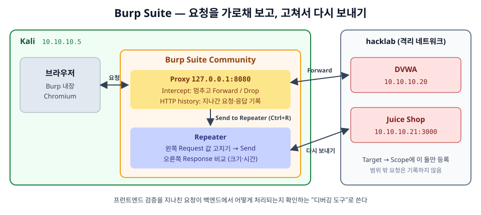
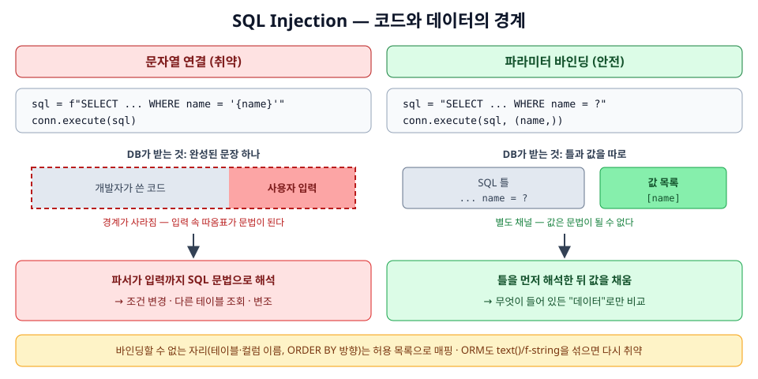
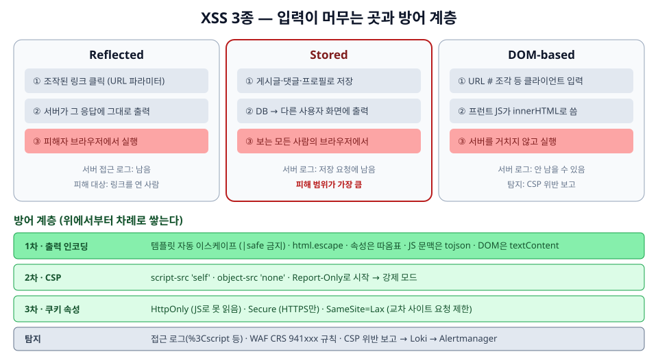

> **해킹 트랙 · 화이트해커 입문** | 난이도 ★★★☆☆ | 예상 소요 2.5 ~ 3시간

> ⚠️ **실습 전 반드시 읽을 것**
> 실습은 **본인 소유의 격리된 실습장**(해킹 02의 `hacklab` 네트워크) 또는 **의도적으로 취약하게 만든 연습용 대상**(DVWA, OWASP Juice Shop, Metasploitable, Kubernetes Goat, CloudGoat 등)에만 합니다. 허가 없이 타인의 시스템을 스캔하거나 공격하면 **정보통신망법 등으로 처벌**될 수 있습니다. 오늘 배우는 내용의 목적은 **내 서비스에서 같은 실수를 하지 않고, 일어나면 알아채는 것**입니다.

## 🎯 오늘의 목표

- Burp Suite Community의 **Proxy**와 **Repeater**가 무엇을 하는 도구인지 이해하고, 내 실습장 트래픽을 가로채 볼 수 있다
- SQL Injection이 **"데이터가 코드로 해석되는"** 문제라는 것을 그림으로 설명하고, 파라미터 바인딩·ORM으로 막을 수 있다
- XSS 3종(Reflected / Stored / DOM)의 차이를 알고, **출력 인코딩 · 템플릿 자동 이스케이프 · CSP · HttpOnly 쿠키**를 층층이 적용할 수 있다
- 두 취약점이 웹 접근 로그·WAF·앱 로그에 남기는 흔적을 알고, **Loki 쿼리와 알림**으로 연결할 수 있다

---

## 1. 오늘의 위치 — 정보 수집 다음은 "요청 하나 들여다보기"

해킹 03에서 내 실습장의 서비스와 경로를 목록으로 만들었습니다. 오늘부터 두 Day는 그 경로 하나하나에 **요청을 보내고 응답을 읽는** 단계입니다. 다만 이 시리즈의 관점은 끝까지 같습니다.

| 단계 | 공격자 시점 질문 | 우리가(개발·운영자) 오늘 답할 질문 |
|---|---|---|
| 원리 | 어디서 입력이 코드가 되나? | 내 코드의 **어느 줄**이 같은 실수를 하나? |
| 확인 | 실습장에서 정말 그런가? | DVWA·Juice Shop의 **안내와 소스 보기**로 차이를 눈으로 본다 |
| 탐지 | — | 로그·WAF·알림에 **무엇이 남나**? |
| 조치 | — | **안전한 코드와 설정**은 무엇인가? |

> 💡 실습 대상 주소는 해킹 02에서 정한 그대로입니다. Kali `10.10.10.5`, DVWA `http://10.10.10.20/`, Juice Shop `http://10.10.10.21:3000/`. 모두 인터넷과 분리된 `hacklab` 네트워크 안에 있습니다.

---

## 2. Burp Suite Community — 요청을 가로채 보고 고쳐 보는 도구

### 2-1. 무엇을 하는 도구인가

Burp Suite는 브라우저와 웹 서버 사이에 끼어드는 **HTTP 프록시**입니다. 브라우저 개발자 도구(F12)의 Network 탭이 "보기"만 한다면, Burp는 **멈춰 세우고, 고치고, 다시 보내기**까지 할 수 있습니다. 개발자에게는 "프런트엔드 검증을 우회한 요청이 백엔드에 오면 어떻게 되나?"를 확인하는 디버깅 도구이기도 합니다.



| 에디션 | 가격 | 오늘 쓰는 기능 |
|---|---|---|
| **Community** | 무료, Kali에 기본 포함 | Proxy, Repeater, Decoder, Comparer (오늘은 Proxy·Repeater만) |
| Professional | 유료 | 자동 스캐너 등 — 이 시리즈에서는 쓰지 않음 |

### 2-2. 프록시 설정 — 내장 브라우저를 쓰면 끝

Kali에서 Burp Suite Community를 실행하고 `Temporary project` → `Use Burp defaults`로 시작합니다.

| 설정 위치 | 확인할 것 |
|---|---|
| `Proxy` → `Proxy settings` → *Proxy listeners* | `127.0.0.1:8080`이 Running 상태 (기본값) |
| `Proxy` → `Intercept` → **Open browser** | Burp에 미리 연결된 **내장 Chromium**이 열림. 인증서 설치·프록시 설정이 필요 없음 |
| `Target` → `Scope` | `http://10.10.10.20`, `http://10.10.10.21:3000`만 추가 → 범위 밖 요청은 기록하지 않게 설정 |

> 💡 Firefox 등 다른 브라우저를 쓰려면 브라우저 프록시를 `127.0.0.1:8080`으로 지정하고, HTTPS 사이트를 보려면 `http://burpsuite`에서 받은 CA 인증서를 **그 브라우저에만** 신뢰시킵니다. 실습이 끝나면 인증서를 지우세요. 내장 브라우저를 쓰면 이 과정이 없습니다.

> ⚠️ **Scope 설정은 습관입니다.** 해킹 01에서 본 "허가된 범위"를 도구 수준에서 강제하는 장치입니다. 실습장 주소 외에는 Burp에 기록조차 남지 않게 하세요.

### 2-3. Proxy 화면 — 요청 멈춰 세우기

| 탭 | 하는 일 |
|---|---|
| `Intercept` | **Intercept is on**이면 요청이 Burp에서 멈춥니다. 내용을 보고 `Forward`(보내기) 또는 `Drop`(버리기) |
| `HTTP history` | Intercept를 꺼도 지나간 모든 요청·응답이 기록됩니다. 대부분의 시간은 여기서 보냅니다 |

내장 브라우저로 DVWA에 로그인한 뒤 `HTTP history`를 열어 보세요. 로그인 POST 요청 하나에서 다음을 읽을 수 있어야 합니다.

- 요청 줄(메서드, 경로, 쿼리 문자열)과 헤더(`Cookie: PHPSESSID=...; security=low`)
- 본문의 폼 파라미터(`username=...&password=...&user_token=...`)
- 응답 상태 코드와 `Set-Cookie` 헤더의 속성(`HttpOnly`가 붙어 있나? → 6-5에서 다시 봅니다)

### 2-4. Repeater 화면 — 같은 요청을 고쳐서 다시 보내기

`HTTP history`에서 요청을 우클릭 → **Send to Repeater**(`Ctrl+R`). Repeater 탭은 왼쪽 **Request**, 오른쪽 **Response** 두 창으로 나뉩니다.

| 영역 | 설명 |
|---|---|
| Request 편집기 | 원본 요청 그대로. 파라미터 값이나 헤더를 **손으로** 고칠 수 있음 |
| `Send` 버튼 | 고친 요청을 서버로 보내고 오른쪽에 응답 표시 |
| Response | `Pretty` / `Raw` / `Render` 보기, 아래쪽에 응답 크기와 시간(ms) |
| `<` `>` 화살표 | 보냈던 요청 이력을 앞뒤로 넘겨 보며 비교 |

개발자 관점에서 Repeater는 이런 질문에 답할 때 씁니다.

- "프런트에서 `maxlength=10`을 걸었는데, 백엔드는 100자가 와도 받아들이나?"
- "다른 사용자의 ID를 넣으면 403이 나오나, 200이 나오나?" (해킹 05의 IDOR)
- "에러가 나면 응답에 스택 트레이스나 SQL 문이 그대로 노출되나?"

> 💡 Burp Community는 자동 공격 기능(Intruder)에 속도 제한이 걸려 있고, 이 시리즈에서는 **자동화 도구를 쓰지 않습니다.** 원리 이해에는 요청 하나를 손으로 고쳐 보는 것으로 충분합니다.

---

## 3. SQL Injection — 원리

### 3-1. 데이터가 코드의 일부가 될 때

SQL Injection은 **사용자 입력(데이터)을 SQL 문자열에 이어 붙여 하나의 문장을 만들 때** 생깁니다. DB는 "어디까지가 개발자가 쓴 코드고 어디부터가 사용자가 준 값인지" 알 수 없습니다. 입력에 따옴표 같은 **문법 문자**가 들어 있으면, 그 값은 문자열 안에 머물지 않고 SQL 문법의 일부로 해석됩니다.



| 방식 | DB가 받는 것 | 결과 |
|---|---|---|
| 문자열 연결 | 완성된 SQL 문장 **하나** (코드와 데이터가 섞임) | 입력이 문장 구조를 바꿀 수 있음 |
| **파라미터 바인딩** | SQL 틀(placeholder 포함) + 값 목록 **따로** | 값은 무엇이 들어 있든 **값으로만** 취급 |

### 3-2. 피해 범위

| 결과 | 설명 |
|---|---|
| 인증 우회 | 로그인 쿼리의 조건이 바뀌어 비밀번호 확인이 무력화 |
| 데이터 유출 | 다른 테이블(회원, 결제)의 내용이 응답에 섞여 나옴 |
| 데이터 변조·삭제 | DB 계정 권한이 넓으면 UPDATE/DELETE까지 |
| 간접 확대 | DB 계정이 파일 쓰기·외부 명령 권한을 가진 경우 서버까지 |

마지막 줄이 **DB 계정 최소 권한**이 중요한 이유입니다(7-3).

### 3-3. Blind SQLi — 응답에 안 보여도 위험하다

응답 본문에 데이터가 직접 나오지 않아도, **참/거짓에 따라 응답이 달라지거나 응답 시간이 달라지면** 정보가 한 비트씩 새어 나갑니다(Blind SQLi). "에러 메시지만 숨기면 안전하다"가 틀린 이유입니다. 근본 조치는 언제나 **바인딩**입니다.

---

## 4. SQL Injection — 실습장에서 확인하기

> 이 절은 **공격 절차가 아니라 "어디서 무엇을 보면 되는지" 안내**입니다. 실제 확인은 각 실습장의 내장 안내를 따라가세요.

### 4-1. DVWA — 난이도별 소스 비교가 핵심

DVWA(`http://10.10.10.20/`)는 같은 기능을 **보안 수준 4단계**로 구현해 두었습니다. 왼쪽 메뉴 `DVWA Security`에서 수준을 바꿉니다.

| 수준 | 의미 |
|---|---|
| Low | 아무 방어 없음 |
| Medium | 흔히 하는 **불완전한** 방어 (입력 필터, 드롭다운 등) |
| High | 조금 더 꼼꼼하지만 여전히 불완전 |
| **Impossible** | 올바른 구현 — **우리가 배울 정답 코드** |

`SQL Injection`, `SQL Injection (Blind)` 페이지 오른쪽 아래의 두 버튼을 활용합니다.

- **View Help** — 이 모듈의 목표와 참고 자료
- **View Source** — 그 수준의 PHP 소스. **Low와 Impossible의 소스를 나란히 놓고** 차이를 찾아보세요. Impossible에는 PDO **prepared statement**(`:id` 자리표시자 + `bindParam`), 숫자 형식 검사, CSRF 토큰, 결과 행 수 확인이 들어 있습니다.

> 💡 Medium·High가 "왜 여전히 뚫리는가"를 소스로 읽어 보는 것이 오늘의 가장 좋은 공부입니다. **입력 필터(블랙리스트)는 근본 조치가 아니다**라는 결론에 도달하면 성공입니다.

### 4-2. OWASP Juice Shop — 힌트와 공식 안내서

Juice Shop(`http://10.10.10.21:3000/`)은 실제 쇼핑몰처럼 생긴 연습 앱입니다.

- **Score Board** 페이지에서 챌린지 목록을 보고, 카테고리 필터를 `Injection`으로 좁힙니다. 각 챌린지에는 난이도(별)와 **힌트** 버튼이 있습니다.
- 막히면 공식 안내서 *Pwning OWASP Juice Shop*(https://pwning.owasp-juice.shop)의 해당 카테고리 설명을 읽습니다. 이 책은 각 취약점의 **원인과 방어**까지 설명합니다.

### 4-3. PortSwigger Web Security Academy

Burp를 만든 PortSwigger의 무료 교육 사이트에 SQLi 토픽이 개념 → 실습 Lab 순으로 정리돼 있습니다. Lab은 PortSwigger가 제공하는 **연습용 인스턴스**이므로 허가 문제 없이 연습할 수 있습니다.

- SQL injection: https://portswigger.net/web-security/sql-injection
- 같은 페이지의 *How to prevent SQL injection* 절이 오늘 7장의 내용과 같습니다

### 4-4. Repeater로 "관찰"만 하기

DVWA Low 수준의 SQLi 페이지에서 정상 값(`1`, `2`)을 넣은 요청을 Repeater로 보내고, 값을 바꿀 때마다 **응답이 어떻게 달라지는지**만 관찰해 보세요. 이어서 Impossible 수준에서 같은 요청을 보내면, 숫자가 아닌 값은 아예 처리되지 않는 것을 볼 수 있습니다. 이 차이가 곧 7장 코드의 차이입니다.

---

## 5. SQL Injection — 탐지

### 5-1. 웹 접근 로그에 남는 흔적

GET 파라미터는 nginx·Apache 접근 로그에 **URL 인코딩된 채로** 남습니다. 탐지에서 볼 특징은 다음과 같습니다(POST 본문은 접근 로그에 남지 않으므로 앱 로그·WAF가 필요합니다).

| 특징 | 로그에서 보이는 모습 (인코딩) | 의미 |
|---|---|---|
| 따옴표 | `%27`(`'`), `%22`(`"`) | 문자열 탈출 시도 |
| 주석 | `--`, `%23`(`#`), `/*` | 뒤쪽 쿼리 무력화 |
| SQL 키워드 | `UNION`, `SELECT`, `SLEEP(`, `information_schema` | 다른 데이터 조회·시간 지연 |
| 짧은 시간 다수 요청 | 같은 IP, 같은 경로, 파라미터만 바뀜 | 자동화 도구 |
| 응답 상태 | 500 비율 급증, 응답 크기 들쭉날쭉 | DB 오류 유발 |

DVWA 컨테이너의 Apache 로그 예입니다(실습 중 생긴 로그, 값 일부는 `…`로 생략).

```
10.10.10.5 - - [15/Nov/2026:14:21:07 +0900] "GET /vulnerabilities/sqli/?id=1&Submit=Submit HTTP/1.1" 200 4389 "-" "Mozilla/5.0 ..."
10.10.10.5 - - [15/Nov/2026:14:21:31 +0900] "GET /vulnerabilities/sqli/?id=1%27&Submit=Submit HTTP/1.1" 200 1012 "-" "Mozilla/5.0 ..."
10.10.10.5 - - [15/Nov/2026:14:22:02 +0900] "GET /vulnerabilities/sqli/?id=1%27+UNION+SELECT+%E2%80%A6&Submit=Submit HTTP/1.1" 200 4521 "-" "Mozilla/5.0 ..."
```

두 번째 줄에서 따옴표 하나에 응답 크기가 4389 → 1012로 급변(SQL 오류 페이지)했고, 세 번째 줄에서 `UNION SELECT`가 나타납니다. 탐색 단계의 전형적인 순서입니다.

서버에서 바로 찾아보는 명령:

```bash
# URL 디코딩 없이 인코딩된 형태 그대로 찾기 (대소문자 무시)
sudo grep -iE "(%27|%22|union(\+|%20)+select|sleep\(|information_schema|%23|--)" \
  /var/log/nginx/access.log | tail -n 20

# IP별 의심 요청 수
sudo grep -iE "(%27|union(\+|%20)+select)" /var/log/nginx/access.log \
  | awk '{print $1}' | sort | uniq -c | sort -rn | head
```

> ⚠️ 이런 정규식은 **오탐이 많습니다**(이름에 `'`가 들어간 검색어, `--` 들어간 정상 값). 접근 로그 패턴은 "누가 탐색 중인가"를 보는 **보조 신호**이고, 차단 근거로 단독 사용하지 않습니다.

### 5-2. WAF — 개념과 위치

**WAF(Web Application Firewall)** 는 HTTP 요청 내용(경로, 쿼리, 본문, 헤더)을 규칙과 비교해 기록·차단하는 계층입니다. 오픈소스 표준 조합은 **ModSecurity(또는 Coraza) 엔진 + OWASP CRS(Core Rule Set)** 입니다.

| 항목 | 설명 |
|---|---|
| 위치 | 리버스 프록시(nginx, Caddy, Traefik 플러그인) 또는 Ingress 앞 |
| 동작 방식 | CRS는 규칙마다 **이상 점수(anomaly score)** 를 더하고, 합계가 임계값을 넘으면 차단 |
| 모드 | **DetectionOnly**(기록만)로 시작해 오탐을 튜닝한 뒤 차단 모드로 |
| Paranoia Level | 1~4. 높을수록 많이 잡지만 오탐도 증가. 보통 1에서 시작 |
| 한계 | 인코딩·문법 변형을 모두 막을 수 없음. **안전한 코드의 대체물이 아니라 보완재** |

> 💡 WAF는 "코드 수정이 배포되기 전까지 시간을 버는 장치"이자 "누가 두드리고 있는지 알려 주는 센서"로 보는 것이 정확합니다. 해킹 10에서 실습장 트래픽이 WAF 로그에 어떻게 남는지 다시 봅니다.

### 5-3. 앱 로그 — 가장 정확한 신호

공격 시도는 결국 **앱 안에서 이상한 일**을 일으킵니다. 접근 로그보다 정확한 신호는 다음입니다.

- **DB 문법 오류 예외**(`sqlite3.OperationalError`, `psycopg.errors.SyntaxError`)가 정상 운영 중에 나올 일은 거의 없습니다. 바인딩을 쓰는 앱에서 이 예외가 나왔다면 **어딘가 연결 코드가 남아 있다**는 뜻입니다.
- **입력 검증 실패**(FastAPI의 422) 급증 — 숫자여야 할 `id`에 문자열이 계속 들어옴.

FastAPI에서 DB 오류를 구조화된 로그로 남기는 예:

```python
# app/errors.py
import logging
from fastapi import Request
from fastapi.responses import JSONResponse
from sqlalchemy.exc import DBAPIError

log = logging.getLogger("security")

async def db_error_handler(request: Request, exc: DBAPIError):
    log.warning(
        "db_error",
        extra={"event": "db_error", "path": request.url.path,
               "client": request.client.host if request.client else None,
               "error_class": type(exc.orig).__name__},
    )
    # 사용자에게는 SQL 문이나 스택 트레이스를 보여 주지 않는다
    return JSONResponse({"detail": "internal error"}, status_code=500)

# app/main.py 에서: app.add_exception_handler(DBAPIError, db_error_handler)
```

### 5-4. 알림 연결 — Loki + Alertmanager (Day 60·62)

Day 60의 Loki에 접근 로그와 앱 로그가 모이고 있다면, LogQL로 **비율**을 봅니다.

```logql
# 5분 동안 IP별 SQLi 의심 요청 수 (ingress-nginx 로그 예)
sum by (remote_addr) (
  count_over_time({namespace="ingress-nginx"} |~ `(?i)(%27|union(\+|%20)+select|information_schema)` | json [5m])
)
```

Loki ruler에 경보 규칙을 두면 Day 62의 Alertmanager 라우팅을 그대로 탑니다.

```yaml
groups:
  - name: web-attack-signals
    rules:
      - alert: WebSQLiProbing
        expr: |
          sum by (namespace) (
            count_over_time({namespace="demo-dev"} | json | event="db_error" [10m])
          ) > 5
        for: 0m
        labels:
          severity: ticket          # Day 62: 사람을 깨우지 않는 티켓 등급
        annotations:
          summary: "demo-dev에서 DB 문법 오류가 10분간 5회 초과 — SQL 연결 코드 잔존 의심"
```

> 💡 Day 62의 원칙대로, **보안 신호도 증상 기반**으로 설계합니다. "따옴표가 들어왔다"(원인)보다 "DB 문법 오류가 난다"(증상)가 훨씬 조용하고 정확합니다.

---

## 6. XSS — 원리

### 6-1. 브라우저 입장에서 "누가 쓴 스크립트인가"

XSS(Cross-Site Scripting)는 **사용자 입력이 HTML·JavaScript 문맥에 그대로 출력되어 브라우저가 그것을 코드로 실행**하는 문제입니다. SQLi와 구조가 똑같습니다. 다른 점은 해석기가 DB가 아니라 **피해자의 브라우저**라는 것입니다. 브라우저는 그 스크립트가 사이트 주인의 것인지 공격자의 것인지 구분하지 못하고, 그 사이트의 권한(쿠키, 화면, API 호출)으로 실행합니다.



| 유형 | 입력이 어디에 머무나 | 출력되는 곳 | 특징 |
|---|---|---|---|
| **Reflected** | 요청(URL 파라미터) | 그 요청의 응답 | 피해자가 조작된 링크를 열어야 함 |
| **Stored** | 서버 DB (게시글, 댓글, 프로필) | 그 데이터를 보는 **모든 사용자**의 화면 | 가장 피해 범위가 큼 |
| **DOM-based** | URL 조각(`#`), `postMessage` 등 | **클라이언트 JS**가 DOM에 씀 | 서버 로그에 안 남을 수 있음(`#` 뒤는 서버로 안 감) |

### 6-2. 피해

- 세션 쿠키 탈취 → 계정 탈취 (HttpOnly가 없을 때)
- 피해자 권한으로 API 호출 — 비밀번호 변경, 송금 요청, 관리자 기능 실행
- 화면 위조(가짜 로그인 폼), 키 입력 가로채기

### 6-3. 문맥(context)이 전부다

"`<`만 바꾸면 된다"는 틀렸습니다. 출력 위치마다 위험한 문자가 다릅니다.

| 출력 문맥 | 예 | 필요한 처리 |
|---|---|---|
| HTML 본문 | `<p>{{ name }}</p>` | HTML 엔티티 인코딩 (`<` → `&lt;`) |
| HTML 속성 | `<input value="{{ name }}">` | 속성 인코딩 + **반드시 따옴표로 감싸기** |
| URL | `<a href="{{ url }}">` | 스킴 허용 목록(`http`, `https`만) — `javascript:` 차단 |
| JavaScript | `<script>var x = {{ v }}</script>` | 직접 넣지 말 것. `data-*` 속성이나 JSON(`tojson`)으로 전달 |
| CSS | `style="{{ s }}"` | 사용자 입력을 넣지 않는 것이 원칙 |

---

## 7. XSS — 실습장에서 확인하기

- **DVWA**: `XSS (Reflected)`, `XSS (Stored)`, `XSS (DOM)` 세 모듈이 따로 있습니다. 4-1과 같은 방법으로 **Low와 Impossible의 View Source를 비교**하세요. Impossible은 출력 시 `htmlspecialchars()`로 인코딩합니다. Stored 모듈은 방명록이므로 확인 후 `Setup / Reset DB`로 초기화합니다.
- **Juice Shop**: Score Board에서 카테고리 `XSS`로 필터. 별 1~2개 챌린지의 힌트만으로 Reflected·DOM 유형의 차이를 체감할 수 있습니다. 안내서의 *Cross Site Scripting (XSS)* 장이 각 챌린지의 **원인 코드**를 설명합니다.
- **PortSwigger Academy**: https://portswigger.net/web-security/cross-site-scripting — 유형별 설명, *Content security policy*, *How to prevent XSS* 절.
- **Burp에서 볼 것**: 응답의 `Content-Security-Policy` 헤더 유무, `Set-Cookie`의 `HttpOnly` 유무. Repeater 응답의 `Render` 탭은 HTML을 미리 보여 주지만 **스크립트는 실행하지 않습니다**.

> 💡 브라우저 개발자 도구의 **Elements** 탭에서 내 입력이 **텍스트 노드**로 들어갔는지 **태그**로 들어갔는지 보는 것이 가장 빠른 확인법입니다. 텍스트 노드면 안전하게 인코딩된 것입니다.

---

## 8. XSS — 탐지

| 신호 | 어디서 | 비고 |
|---|---|---|
| 접근 로그의 `%3Cscript`, `%3Csvg`, `onerror%3D`, `javascript%3A` | nginx/Apache | Reflected 위주. DOM XSS(`#` 뒤)는 안 남음 |
| WAF(CRS)의 XSS 규칙 그룹(941xxx) 적중 | ModSecurity/Coraza 감사 로그 | 이상 점수와 규칙 ID로 분류 |
| 게시글·프로필 저장 시 HTML 태그 포함 비율 | 앱 로그 | Stored XSS. 저장은 허용하되 **기록** |
| **CSP 위반 보고서** | 브라우저 → 내 보고 수집 엔드포인트 | **DOM XSS까지 잡는 유일한 서버 측 신호** |

CSP 위반 보고는 브라우저가 "정책상 막힌 스크립트가 실행되려 했다"를 서버에 알려 주는 기능입니다. 정책에 `report-to`(구형 `report-uri`)를 지정하면 됩니다. 처음에는 `Content-Security-Policy-Report-Only` 헤더로 **차단 없이 보고만** 받아 오탐을 정리한 뒤 강제 모드로 바꿉니다.

```python
# app/csp_report.py — CSP 위반 보고 수집 (FastAPI)
import logging
from fastapi import APIRouter, Request

router = APIRouter()
log = logging.getLogger("security")

@router.post("/csp-report")
async def csp_report(request: Request):
    body = await request.body()
    # 크기 제한: 보고서는 작다. 큰 본문은 버린다.
    if len(body) > 10_000:
        return {"ok": False}
    log.warning("csp_violation", extra={"event": "csp_violation",
                                        "report": body.decode("utf-8", "replace")[:2000]})
    return {"ok": True}
```

Loki에서는 `| json | event="csp_violation"`으로 세고, 5-4와 같은 방식으로 알림 규칙을 둡니다. 배포 직후 위반이 급증하면 **새 코드가 정책과 충돌**한 것이고, 평소에 특정 페이지에서만 튀면 **XSS 시도**를 의심합니다.

---

## 9. 조치 — 안전한 코드와 설정 (Python / FastAPI)

> **실습 환경**: Python 3.12, FastAPI, SQLAlchemy 2.x, Jinja2. Kali나 H01 어디서든 가상 환경을 만들어 실행할 수 있습니다.
> ```bash
> python3 -m venv .venv && . .venv/bin/activate
> pip install "fastapi[standard]" sqlalchemy jinja2
> ```

### 9-1. SQLi — 문자열 연결 vs 파라미터 바인딩

```python
# ❌ 취약: f-string으로 SQL 조립
import sqlite3
from fastapi import FastAPI

app = FastAPI()
conn = sqlite3.connect("shop.db", check_same_thread=False)

@app.get("/products")
def search(name: str):
    sql = f"SELECT id, name, price FROM products WHERE name = '{name}'"
    return conn.execute(sql).fetchall()
```

```python
# ✅ 안전: 자리표시자(?) + 값 튜플을 따로 전달
@app.get("/products")
def search(name: str):
    sql = "SELECT id, name, price FROM products WHERE name = ?"
    return conn.execute(sql, (name,)).fetchall()
```

| 포인트 | 설명 |
|---|---|
| 자리표시자 | sqlite3는 `?`, psycopg는 `%s`, SQLAlchemy `text()`는 `:name` |
| `%` 포맷과 혼동 금지 | psycopg의 `cur.execute("... %s", (v,))`는 바인딩이지만 `cur.execute("... %s" % v)`는 **연결**입니다. 쉼표 하나 차이 |
| 바인딩 불가 위치 | 테이블·컬럼 이름, `ORDER BY` 방향은 바인딩이 안 됩니다 → **허용 목록**으로 매핑 |

### 9-2. ORM과 `text()` — 그리고 ORDER BY

```python
from typing import Literal
from fastapi import FastAPI, Depends, Query
from sqlalchemy import create_engine, select, text, String, Integer
from sqlalchemy.orm import DeclarativeBase, Mapped, mapped_column, Session

engine = create_engine("sqlite:///shop.db")

class Base(DeclarativeBase): ...

class Product(Base):
    __tablename__ = "products"
    id: Mapped[int] = mapped_column(Integer, primary_key=True)
    name: Mapped[str] = mapped_column(String(100))
    price: Mapped[int] = mapped_column(Integer)

Base.metadata.create_all(engine)
app = FastAPI()

def get_db():
    with Session(engine) as s:
        yield s

# ✅ ORM: 값은 항상 바인딩된다
@app.get("/products")
def search(name: str = Query(max_length=100),
           sort: Literal["name", "price"] = "name",      # 허용 목록 (FastAPI가 422로 거부)
           db: Session = Depends(get_db)):
    sort_col = {"name": Product.name, "price": Product.price}[sort]
    stmt = select(Product).where(Product.name == name).order_by(sort_col)
    return [{"id": p.id, "name": p.name, "price": p.price} for p in db.scalars(stmt)]

# ✅ 원시 SQL이 꼭 필요하면 text() + 이름 있는 바인딩
@app.get("/products/raw")
def search_raw(name: str, db: Session = Depends(get_db)):
    rows = db.execute(text("SELECT id, name FROM products WHERE name = :n"), {"n": name})
    return [dict(r._mapping) for r in rows]

# ❌ ORM을 써도 이렇게 하면 다시 취약해진다
#    db.execute(text(f"SELECT id FROM products WHERE name = '{name}'"))
#    select(Product).order_by(text(sort))          # 사용자 입력을 그대로 SQL 조각으로
```

> 💡 코드 리뷰 체크 포인트: `execute(`, `text(` 안에 **f-string, `+`, `%`, `.format(`** 이 있으면 무조건 멈춰서 봅니다. Day 51의 GitHub Actions에 **Bandit**(Python 보안 린터, 규칙 B608 "SQL 문자열 조립 의심")이나 **Semgrep**을 넣으면 PR 단계에서 자동으로 걸러집니다.

### 9-3. DB 계정 하드닝 — 뚫려도 덜 아프게

```sql
-- PostgreSQL 예: 앱 전용 계정은 필요한 테이블의 DML만
CREATE ROLE shop_app LOGIN PASSWORD '...';
REVOKE ALL ON SCHEMA public FROM PUBLIC;
GRANT USAGE ON SCHEMA public TO shop_app;
GRANT SELECT, INSERT, UPDATE ON products, orders TO shop_app;   -- DELETE·DDL 없음
-- 슈퍼유저 아님, 파일 읽기/쓰기·외부 프로그램 실행 역할(pg_read_server_files 등) 부여 금지
```

| 하드닝 | 효과 |
|---|---|
| 앱 계정 ≠ 마이그레이션 계정 | DDL(`DROP TABLE`) 권한은 배포 파이프라인만 |
| 읽기 전용 화면은 읽기 전용 계정 | 조회 API 취약점이 쓰기로 번지지 않음 |
| DB 오류 메시지를 사용자에게 노출 금지 | 5-3의 예외 핸들러. FastAPI `debug=False` |
| 비밀번호는 Secret으로 | Day 13·55·71 (External Secrets, OpenBao) |

### 9-4. XSS — 문자열 HTML vs 템플릿 자동 이스케이프

```python
# ❌ 취약: 사용자 입력을 HTML 문자열에 직접
from fastapi import FastAPI
from fastapi.responses import HTMLResponse

app = FastAPI()

@app.get("/hello", response_class=HTMLResponse)
def hello(name: str):
    return f"<h1>안녕하세요, {name}님</h1>"
```

```python
# ✅ 안전 ①: 직접 HTML을 만들어야 한다면 출력 직전에 인코딩
import html

@app.get("/hello", response_class=HTMLResponse)
def hello(name: str):
    return f"<h1>안녕하세요, {html.escape(name)}님</h1>"   # < > & " ' 모두 엔티티로
```

```python
# ✅ 안전 ②(권장): 템플릿 엔진의 자동 이스케이프
from fastapi import Request
from fastapi.templating import Jinja2Templates

templates = Jinja2Templates(directory="templates")   # Starlette는 autoescape=True가 기본

@app.get("/hello", response_class=HTMLResponse)
def hello(request: Request, name: str):
    return templates.TemplateResponse(request, "hello.html", {"name": name})
```

```html
<!-- templates/hello.html -->
<h1>안녕하세요, {{ name }}님</h1>                    <!-- ✅ 자동 이스케이프 -->
<input value="{{ name }}">                           <!-- ✅ 속성은 반드시 따옴표 -->
<div id="app" data-user="{{ name }}"></div>          <!-- ✅ JS에 넘길 값은 data-* 로 -->
<script>const cfg = {{ cfg | tojson }};</script>      <!-- ✅ JS 문맥은 tojson 필터 -->

<p>{{ bio | safe }}</p>                              <!-- ❌ |safe 는 이스케이프를 끈다 -->
```

| 규칙 | 이유 |
|---|---|
| `|safe`, `Markup()`은 **신뢰된 정적 HTML에만** | 사용자 입력에 쓰면 자동 이스케이프가 무력화 |
| 게시판처럼 HTML 서식이 꼭 필요하면 | 허용 태그만 남기는 **HTML Sanitizer**(Python은 `nh3` 등)를 저장·출력 시 적용 |
| 링크 URL | `urllib.parse.urlparse(u).scheme in {"http", "https"}` 검사 |

### 9-5. DOM XSS — 프런트엔드 코드

```javascript
// ❌ 취약: URL 조각을 HTML로 해석
const q = decodeURIComponent(location.hash.slice(1));
document.getElementById("result").innerHTML = "검색어: " + q;

// ✅ 안전: 텍스트로만 넣기
document.getElementById("result").textContent = "검색어: " + q;
```

`innerHTML`, `outerHTML`, `document.write`, `insertAdjacentHTML`, `eval`, `setTimeout(문자열)` 을 **위험 싱크(sink)** 라고 부릅니다. React·Vue 같은 프레임워크는 기본적으로 텍스트로 넣어 주지만, `dangerouslySetInnerHTML`·`v-html`은 같은 위험을 다시 엽니다.

### 9-6. 방어 계층 ② — CSP와 쿠키 속성

출력 인코딩이 1차 방어라면, **CSP**와 **HttpOnly 쿠키**는 "어딘가 하나 놓쳤을 때"의 피해를 줄이는 2차 방어입니다.

```python
# app/security_headers.py
from fastapi import FastAPI, Request

CSP = (
    "default-src 'self'; "
    "script-src 'self'; "              # 인라인 스크립트·외부 도메인 스크립트 차단
    "object-src 'none'; "
    "base-uri 'none'; "
    "frame-ancestors 'none'; "
    "report-uri /csp-report"           # 8장의 수집 엔드포인트
)

def add_security_headers(app: FastAPI) -> None:
    @app.middleware("http")
    async def _headers(request: Request, call_next):
        resp = await call_next(request)
        resp.headers.setdefault("Content-Security-Policy", CSP)
        resp.headers.setdefault("X-Content-Type-Options", "nosniff")
        resp.headers.setdefault("Referrer-Policy", "strict-origin-when-cross-origin")
        return resp
```

```python
# 로그인 성공 시 세션 쿠키
from fastapi import Response

def set_session_cookie(resp: Response, session_id: str) -> None:
    resp.set_cookie(
        "session", session_id,
        httponly=True,     # JS(document.cookie)에서 읽을 수 없음 → XSS로 쿠키 탈취 차단
        secure=True,       # HTTPS에서만 전송
        samesite="lax",    # 다른 사이트에서 시작된 POST 요청에 쿠키 미포함 (CSRF 완화)
        max_age=60 * 60 * 8,
        path="/",
    )
```

| 설정 | 막는 것 | 못 막는 것 |
|---|---|---|
| CSP `script-src 'self'` | 인라인·외부 스크립트 실행 | 내 도메인에 업로드된 JS 파일(해킹 05 파일 업로드와 연결) |
| HttpOnly | 스크립트로 세션 쿠키 읽기 | 피해자 브라우저 안에서의 API 호출(쿠키는 자동 전송됨) |
| SameSite=Lax | 대부분의 CSRF | 같은 사이트 안에서 일어나는 XSS |

> ⚠️ 인라인 `<script>`와 `onclick=` 속성을 많이 쓰는 기존 앱에 `script-src 'self'`를 바로 걸면 화면이 깨집니다. **Report-Only로 시작 → 위반 보고를 보며 인라인 코드를 파일로 분리 → 강제 모드**의 순서로 갑니다. 인라인이 꼭 필요하면 요청마다 바뀌는 `nonce`를 씁니다.

Ingress에서 일괄로 헤더를 붙일 수도 있습니다. Day 15의 Traefik이라면 `headers` Middleware의 `contentSecurityPolicy`, `contentTypeNosniff` 필드를 씁니다. 다만 CSP는 **앱마다 다르므로** 앱 코드나 앱별 Middleware에서 관리하는 편이 안전합니다.

### 9-7. 확인

```bash
uvicorn app.main:app --port 8000 &
curl -sI http://127.0.0.1:8000/hello?name=test | grep -iE "content-security|x-content-type"
curl -s "http://127.0.0.1:8000/hello?name=%3Cb%3Ehi%3C/b%3E"
```

```
content-security-policy: default-src 'self'; script-src 'self'; ...
x-content-type-options: nosniff
<h1>안녕하세요, &lt;b&gt;hi&lt;/b&gt;님</h1>
```

`<b>` 태그가 **텍스트로** 출력되면 인코딩이 적용된 것입니다.

---

## 10. 트러블슈팅

| 증상 | 원인 | 해결 |
|---|---|---|
| Burp 내장 브라우저가 열리지 않음 | Kali를 root로 실행 중이라 Chromium 샌드박스 오류 | 일반 사용자로 Burp 실행, 또는 `Settings` → `Burp's browser`에서 샌드박스 옵션 확인 |
| `HTTP history`가 비어 있음 | Scope 필터가 켜졌는데 대상이 Scope에 없음 | `Target` → `Scope`에 실습장 주소 추가, 필터 바 확인 |
| 내장 브라우저가 계속 멈춤 | `Intercept is on` 상태 | Intercept를 끄고 `HTTP history`로 보기 |
| DVWA 페이지에서 "CSRF token is incorrect" | Repeater로 같은 `user_token`을 재사용 | 페이지를 새로 로드해 새 토큰으로 요청 (Impossible 수준의 방어가 동작한 것) |
| DVWA 수준 변경이 반영 안 됨 | `security` 쿠키가 이전 값 | `DVWA Security`에서 다시 Submit, 쿠키 확인 |
| Jinja2 템플릿에서 태그가 그대로 렌더링됨 | `|safe`, `Markup`, `` 사용 | 해당 부분 제거, 서식이 필요하면 sanitizer |
| CSP 적용 후 버튼이 동작 안 함 | 인라인 `onclick`·`<script>` 차단 | Report-Only로 전환 후 인라인 코드를 외부 JS 파일로 분리 |
| `report-uri`로 보고가 안 옴 | 브라우저가 Report-Only/강제 헤더 중 어느 것도 받지 않음, 경로 오타 | `curl -I`로 헤더 확인, 엔드포인트 경로 확인 |

---

## 11. 핵심 정리

- Burp Suite = 브라우저와 서버 사이의 **프록시**. Proxy로 **보고**, Repeater로 **고쳐서 다시 보낸다**. 내장 브라우저 + Scope 설정이 기본
- SQLi와 XSS는 같은 병: **데이터가 해석기(DB, 브라우저)에서 코드가 된다**
- SQLi 조치: **파라미터 바인딩 / ORM**. 바인딩 불가 위치(컬럼명, 정렬)는 **허용 목록**. DB 계정 최소 권한. 블랙리스트 필터는 조치가 아니다
- XSS 조치: **문맥에 맞는 출력 인코딩**(템플릿 자동 이스케이프, `|safe` 금지) → **CSP** → **HttpOnly·Secure·SameSite 쿠키**의 다층 방어. DOM XSS는 `textContent`
- 탐지: 접근 로그 패턴(보조 신호) → WAF(CRS, DetectionOnly부터) → **앱 로그의 DB 오류·CSP 위반 보고**(가장 정확) → Loki 규칙 → Alertmanager
- DVWA는 **Low vs Impossible 소스 비교**, Juice Shop은 **Score Board 힌트와 공식 안내서**, 개념은 **PortSwigger Academy**

---

## 12. 셀프 체크

<details>
<summary>Q1. 입력에서 따옴표와 SQL 키워드를 제거하는 필터를 넣었다. 이것으로 SQLi 조치가 끝났다고 할 수 있나?</summary>

아닙니다. 블랙리스트 필터는 인코딩·대소문자·다른 문법 변형을 다 막을 수 없고, 숫자형 파라미터처럼 따옴표가 필요 없는 위치도 있습니다(DVWA Medium·High 소스가 바로 그 예). 근본 조치는 **파라미터 바인딩**으로 코드와 데이터를 분리하는 것이고, 필터·WAF는 보조 수단입니다.
</details>

<details>
<summary>Q2. <code>ORDER BY</code> 뒤에 오는 정렬 컬럼을 사용자가 고르게 하려면 어떻게 해야 안전한가?</summary>

컬럼 이름은 바인딩할 수 없으므로, `Literal["name", "price"]` 같은 **허용 목록**으로 입력을 제한하고 그 값을 미리 정의한 컬럼 객체에 매핑합니다. 사용자 입력 문자열을 `text()`나 f-string으로 SQL에 넣지 않습니다.
</details>

<details>
<summary>Q3. DOM-based XSS가 서버 접근 로그와 WAF에 잘 잡히지 않는 이유와, 그래도 서버가 알 수 있는 방법은?</summary>

URL의 `#` 뒤(fragment)는 브라우저가 서버로 보내지 않고, 위험한 처리는 클라이언트 JS 안에서 일어나기 때문입니다. **CSP 위반 보고(report-uri / report-to)** 를 설정하면 브라우저가 차단된 스크립트 실행 시도를 서버에 알려 주므로 탐지 신호로 쓸 수 있습니다.
</details>

<details>
<summary>Q4. 세션 쿠키에 HttpOnly를 붙였다. 이제 XSS가 있어도 괜찮은가?</summary>

아닙니다. HttpOnly는 스크립트가 쿠키 **값을 읽는 것**만 막습니다. 스크립트는 피해자 브라우저 안에서 그 사이트로 API를 호출할 수 있고, 쿠키는 자동으로 함께 전송됩니다. HttpOnly·CSP는 피해를 줄이는 2차 방어이고, 1차 방어는 출력 인코딩입니다.
</details>

<details>
<summary>Q5. 접근 로그에서 <code>%27</code>이 들어간 요청을 발견할 때마다 IP를 자동 차단하는 규칙은 좋은 설계인가?</summary>

단독으로는 좋지 않습니다. 정상 사용자의 검색어(예: 아포스트로피가 들어간 이름)도 걸리는 **원인 기반 신호**라 오탐과 알림 피로가 큽니다. 접근 로그 패턴은 보조 신호로 두고, **DB 문법 오류·CSP 위반 같은 증상 기반 신호**와 WAF 이상 점수를 조합해 판단합니다(Day 62).
</details>

---

## ⏭️ 다음 예고 — 해킹 05. 웹 취약점 ② — 인증 우회, IDOR, SSRF, 파일 업로드, 명령 주입

2025년 11월에 발표된 **OWASP Top 10:2025**를 한 장의 표로 정리하고, 오늘 본 Injection 외에 실무에서 자주 터지는 다섯 가지 — **인증 실패와 세션 관리, IDOR(객체 단위 인가), SSRF(클라우드 메타데이터), 파일 업로드, OS 명령 주입** — 를 같은 틀(원리 → 확인 → 탐지 → 안전한 코드)로 다룹니다.
