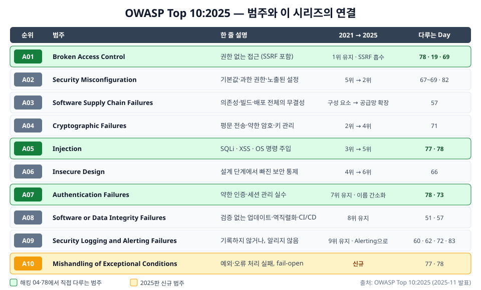
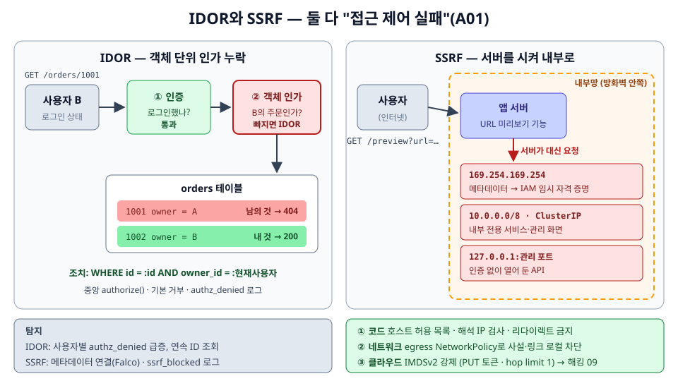
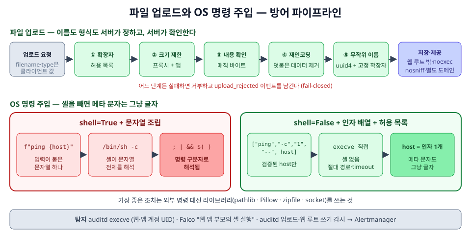

> **해킹 트랙 · 화이트해커 입문** | 난이도 ★★★★☆ | 예상 소요 3 ~ 3.5시간

> ⚠️ **실습 전 반드시 읽을 것**
> 실습은 **본인 소유의 격리된 실습장**(해킹 02의 `hacklab` 네트워크) 또는 **의도적으로 취약하게 만든 연습용 대상**(DVWA, OWASP Juice Shop, Metasploitable, Kubernetes Goat, CloudGoat 등)에만 합니다. 허가 없이 타인의 시스템을 스캔하거나 공격하면 **정보통신망법 등으로 처벌**될 수 있습니다. 오늘의 목적은 **내 서비스에서 같은 실수를 찾아 막고, 일어나면 알아채는 것**입니다.

## 🎯 오늘의 목표

- **OWASP Top 10:2025**의 10개 범주를 2021판과 비교해 설명하고, 이 시리즈의 어느 Day가 각 범주를 다루는지 연결할 수 있다
- 인증 실패와 세션 관리의 흔한 실수를 알고, 비밀번호 해시·세션 재발급·로그인 시도 제한을 코드로 적용할 수 있다
- **IDOR**를 막는 **객체 단위 인가 검사** 코드를 쓸 수 있다
- **SSRF**를 허용 목록·내부 주소 차단·메타데이터 보호(IMDSv2)·egress 정책으로 막을 수 있다
- 파일 업로드와 OS 명령 주입을 **검증 + 격리 + 최소 기능**으로 막고, auditd·Falco·로그로 탐지할 수 있다

---

## 1. OWASP Top 10:2025 — 한 장으로 보기

**OWASP Top 10**은 웹 애플리케이션의 가장 중요한 보안 위험 범주를 정리한 인식(awareness) 문서입니다. 2025년 11월에 2021판 이후 4년 만에 **2025판**이 발표됐습니다(공식: https://owasp.org/Top10/2025/ → `top10.owasp.org/2025`).



| 순위 | 범주 | 한 줄 설명 | 2021판과 비교 | 이 시리즈에서 |
|---|---|---|---|---|
| A01 | **Broken Access Control** | 권한 없는 데이터·기능 접근. **SSRF가 여기로 합쳐짐** | 1위 유지, 2021 A10 SSRF 흡수 | **오늘(IDOR·SSRF)**, Day 19·69 RBAC |
| A02 | **Security Misconfiguration** | 기본값·불필요 기능·과한 권한·노출된 설정 | 5위 → 2위 | Day 67~69 하드닝, 해킹 09 클라우드 |
| A03 | **Software Supply Chain Failures** | 의존성·빌드·배포 파이프라인 전체의 무결성 | 2021 "취약하고 오래된 구성 요소" 확장 | Day 57 Trivy·cosign·Kyverno |
| A04 | **Cryptographic Failures** | 평문 전송, 약한 알고리즘, 키 관리 실패 | 2위 → 4위 | Day 71 cert-manager·OpenBao |
| A05 | **Injection** | SQLi, XSS, 명령 주입 등 데이터가 코드로 해석 | 3위 → 5위 | **해킹 04**, **오늘(명령 주입)** |
| A06 | **Insecure Design** | 설계 단계에서 빠진 보안 통제 | 4위 → 6위 | Day 66 위협 모델링 |
| A07 | **Authentication Failures** | 약한 인증, 세션 관리 실수 | 7위 유지(이름 간소화) | **오늘**, Day 73 Keycloak |
| A08 | **Software or Data Integrity Failures** | 검증 없는 업데이트·역직렬화·CI/CD 신뢰 | 8위 유지 | Day 51·57 |
| A09 | **Security Logging and Alerting Failures** | 기록하지 않거나, 기록해도 **알리지 않음** | 9위 유지, "Monitoring" → "Alerting" | Day 60·62·72, 해킹 10 |
| A10 | **Mishandling of Exceptional Conditions** | 예외·오류 처리 실패(에러 노출, fail-open) | **신규** | 해킹 04 예외 핸들러, 오늘 전반 |

> 💡 2025판에서 눈여겨볼 변화 세 가지: ① **SSRF가 독립 범주에서 빠져 접근 제어(A01)의 한 형태로** 정리됐고, ② 공급망이 "오래된 라이브러리"에서 **빌드·배포 전체**로 넓어졌으며, ③ 로깅 범주 이름이 "모니터링"에서 **"알림(Alerting)"** 으로 바뀌었습니다. 이 챕터가 공격마다 "탐지 → 알림"을 짝으로 두는 이유와 같습니다.

> ⚠️ Top 10은 **표준이나 체크리스트가 아니라 인식 문서**입니다. 검증 기준이 필요하면 OWASP **ASVS**(Application Security Verification Standard)를 씁니다. 해킹 11의 보고서에서 조치 권고를 쓸 때 ASVS 항목 번호를 참조하면 좋습니다.

### 오늘 다룰 다섯 가지와 Top 10 범주

| 오늘의 주제 | 범주 | 확인할 실습장 모듈 | PortSwigger Academy 토픽 |
|---|---|---|---|
| 인증 실패·세션 | A07 | DVWA *Brute Force*, *Weak Session IDs* / Juice Shop *Broken Authentication* | https://portswigger.net/web-security/authentication |
| IDOR | A01 | DVWA *Authorisation Bypass* / Juice Shop *Broken Access Control* | https://portswigger.net/web-security/access-control/idor |
| SSRF | A01 | Juice Shop Score Board에서 "SSRF" 검색 | https://portswigger.net/web-security/ssrf |
| 파일 업로드 | A01·A05·A06 | DVWA *File Upload* / Juice Shop *Improper Input Validation* | https://portswigger.net/web-security/file-upload |
| OS 명령 주입 | A05 | DVWA *Command Injection* | https://portswigger.net/web-security/os-command-injection |

> 💡 확인 방법은 해킹 04과 같습니다. **DVWA는 `View Source`로 Low와 Impossible을 비교**, **Juice Shop은 Score Board의 힌트와 공식 안내서**(https://pwning.owasp-juice.shop), 개념은 **PortSwigger Academy**. Burp는 Proxy `HTTP history`에서 요청을 보고 Repeater로 **값 하나를 바꿔 응답 차이를 관찰**하는 데까지만 씁니다.

---

## 2. 인증 실패와 세션 관리 (A07)

### 2-1. 원리

인증은 "당신이 누구인가"를 확인하고, 세션은 그 확인 결과를 **이후 요청에도 이어 주는 표(ticket)** 입니다. 둘 중 어디가 약해도 다른 사람이 될 수 있습니다.

| 실수 | 왜 위험한가 |
|---|---|
| 로그인 시도 횟수 제한 없음 | 비밀번호 추측·유출 비밀번호 목록 대입(credential stuffing)이 무제한 |
| "없는 아이디입니다" / "비밀번호가 틀렸습니다" 구분 | 존재하는 계정을 가려낼 수 있음(계정 열거) |
| 비밀번호를 평문·빠른 해시(MD5, SHA-256 한 번)로 저장 | DB 유출 시 바로 복원 가능 |
| 예측 가능한 세션 ID (순번, 시간 기반) | 남의 세션을 추측 — DVWA *Weak Session IDs* 모듈의 주제 |
| 로그인 후에도 세션 ID 그대로 | 로그인 전에 심어 둔 ID가 그대로 인증된 세션이 됨(세션 고정) |
| 로그아웃해도 서버에서 세션 유지, 만료 없음 | 탈취된 토큰이 영원히 유효 |
| JWT 서명 검증 생략·알고리즘 미고정·`exp` 없음 | 토큰을 위조하거나 무기한 사용 |

### 2-2. 실습장에서 확인하기

- **DVWA *Weak Session IDs***: 수준별로 `dvwaSession` 쿠키 값이 어떻게 만들어지는지 View Source로 비교합니다. Burp `HTTP history`에서 연속으로 받은 쿠키 값을 나란히 보면 "예측 가능"이 무슨 뜻인지 바로 보입니다. Impossible은 안전한 난수 기반입니다.
- **DVWA *Brute Force***: 공격 도구를 돌리지 말고 **Impossible 소스**를 읽으세요. 실패 횟수 기록, 계정 잠금 시간, 실패 시 지연, CSRF 토큰이 모두 들어 있습니다. 이것이 오늘 2-4 코드의 PHP 버전입니다.
- **Juice Shop**: Score Board 카테고리 *Broken Authentication*의 힌트와 안내서 설명.

### 2-3. 탐지

| 패턴 | 신호 | 의미 |
|---|---|---|
| 한 IP → 한 계정, 실패 다수 | `login_failed` 같은 user, 같은 IP | 비밀번호 추측 |
| 한 IP → **여러 계정**, 계정당 실패 1~2회 | 계정 수가 많음 | 유출 목록 대입(credential stuffing) |
| 여러 IP → 한 계정 | 분산된 출발지 | 분산 추측 |
| 실패 다수 후 **성공** | `login_failed` × N → `login_success` | **가장 중요한 알림** — 계정 탈취 가능성 |

앱은 이런 판단을 할 수 있게 **구조화된 인증 이벤트**를 남겨야 합니다(비밀번호 값은 절대 로그에 남기지 않습니다).

```json
{"event":"login_failed","user":"alice","client":"10.10.10.5","reason":"bad_credentials","ts":"2026-11-15T14:30:01+09:00"}
{"event":"login_success","user":"alice","client":"10.10.10.5","mfa":false,"ts":"2026-11-15T14:31:12+09:00"}
```

Loki 규칙(Day 60·62)으로 "IP 하나가 10분간 계정 20개 이상에 실패"를 알림으로 만듭니다.

```yaml
- alert: CredentialStuffingSuspected
  expr: |
    count by (client) (
      sum by (client, user) (
        count_over_time({namespace="demo-dev"} | json | event="login_failed" [10m])
      )
    ) > 20
  labels:
    severity: page
  annotations:
    summary: "{{ $labels.client }}가 10분간 20개 이상 계정에 로그인 실패"
```

호스트에서 직접 운영하는 앱이라면 Day 67의 **fail2ban**에 이 JSON 로그를 읽는 jail을 추가해 IP를 nftables로 막을 수도 있습니다(`failregex = "event":"login_failed".*"client":"<HOST>"`).

### 2-4. 조치 — 취약한 코드 vs 안전한 코드

```python
# ❌ 취약
import hashlib
from fastapi import FastAPI, Form, Response, HTTPException

app = FastAPI()
USERS = {"alice": hashlib.md5(b"password1").hexdigest()}
SESSIONS: dict[str, str] = {}
counter = 0

@app.post("/login")
def login(response: Response, username: str = Form(), password: str = Form()):
    global counter
    if username not in USERS:
        raise HTTPException(404, "없는 아이디입니다")              # 계정 열거
    if USERS[username] != hashlib.md5(password.encode()).hexdigest():   # 빠른 해시
        raise HTTPException(401, "비밀번호가 틀렸습니다")
    counter += 1
    sid = str(counter)                                             # 예측 가능한 세션 ID
    SESSIONS[sid] = username
    response.set_cookie("sid", sid)                                # HttpOnly·Secure 없음, 만료 없음
    return {"ok": True}
```

```python
# ✅ 안전 (pip install "pwdlib[argon2]")
import logging, secrets, time
from collections import defaultdict
from fastapi import FastAPI, Form, Request, Response, HTTPException
from pwdlib import PasswordHash

app = FastAPI()
log = logging.getLogger("security")
hasher = PasswordHash.recommended()                 # Argon2id
USERS = {"alice": hasher.hash("correct horse battery staple")}
DUMMY_HASH = hasher.hash("dummy-password-for-timing")
SESSIONS: dict[str, tuple[str, float]] = {}         # 운영에서는 Redis 등 서버 측 저장소
FAILS: dict[str, list[float]] = defaultdict(list)
SESSION_TTL = 8 * 3600
MAX_FAILS, WINDOW = 5, 15 * 60

def too_many_failures(key: str) -> bool:
    now = time.time()
    FAILS[key] = [t for t in FAILS[key] if now - t < WINDOW]
    return len(FAILS[key]) >= MAX_FAILS

@app.post("/login")
def login(request: Request, response: Response,
          username: str = Form(max_length=64), password: str = Form(max_length=256)):
    client = request.client.host if request.client else "unknown"
    if too_many_failures(f"user:{username}") or too_many_failures(f"ip:{client}"):
        log.warning("login_locked", extra={"event": "login_locked", "user": username, "client": client})
        raise HTTPException(429, "잠시 후 다시 시도하세요")

    stored = USERS.get(username)
    # 없는 계정도 같은 시간만큼 해시 검증 → 응답 시간으로 계정 존재를 구분할 수 없게
    ok = hasher.verify(password, stored if stored else DUMMY_HASH) and stored is not None
    if not ok:
        FAILS[f"user:{username}"].append(time.time()); FAILS[f"ip:{client}"].append(time.time())
        log.info("login_failed", extra={"event": "login_failed", "user": username, "client": client})
        raise HTTPException(401, "아이디 또는 비밀번호가 올바르지 않습니다")   # 같은 메시지

    # 로그인 성공 시 **새** 세션 ID 발급 (세션 고정 방지), 기존 쿠키 값은 재사용하지 않음
    old = request.cookies.get("sid")
    if old:
        SESSIONS.pop(old, None)
    sid = secrets.token_urlsafe(32)                 # 256비트 난수
    SESSIONS[sid] = (username, time.time() + SESSION_TTL)
    response.set_cookie("sid", sid, httponly=True, secure=True, samesite="lax", max_age=SESSION_TTL)
    log.info("login_success", extra={"event": "login_success", "user": username, "client": client})
    return {"ok": True}

@app.post("/logout")
def logout(request: Request, response: Response):
    SESSIONS.pop(request.cookies.get("sid", ""), None)   # 서버 측에서 무효화
    response.delete_cookie("sid")
    return {"ok": True}
```

| 조치 | 코드 위치 |
|---|---|
| 느린 전용 해시(Argon2id / bcrypt) | `PasswordHash.recommended()` |
| 동일한 오류 메시지 + 더미 해시로 시간 차 제거 | `DUMMY_HASH` |
| 계정·IP 기준 시도 제한 | `too_many_failures` (운영에서는 Redis, 또는 리버스 프록시 레이트 리밋 병행) |
| 안전한 난수 세션 ID, 로그인 시 재발급 | `secrets.token_urlsafe(32)` |
| 서버 측 만료와 로그아웃 무효화 | `SESSION_TTL`, `/logout` |
| 쿠키 속성 | 해킹 04의 HttpOnly·Secure·SameSite |

> 💡 **인증은 직접 만들지 않는 것이 가장 좋은 조치**인 경우가 많습니다. Day 73의 **Keycloak OIDC**에 맡기면 MFA, 잠금 정책, 세션 만료, 감사 이벤트를 설정으로 얻습니다. JWT를 직접 검증해야 한다면 라이브러리에 **허용 알고리즘을 명시**하고(`algorithms=["RS256"]`) `exp`·`aud`·`iss`를 반드시 검사합니다.

---

## 3. IDOR — 객체 단위 인가 실패 (A01)

### 3-1. 원리

**IDOR**(Insecure Direct Object Reference)는 "로그인은 확인했지만, **이 객체가 이 사용자의 것인지**는 확인하지 않은" 실수입니다. `/orders/1001`이 내 주문이면 `/orders/1002`는 남의 주문인데, 서버가 ID만 보고 돌려줍니다.



| 검사 | 질문 | 빠지면 |
|---|---|---|
| 인증(Authentication) | 로그인한 사람인가? | 누구나 접근 |
| 기능 단위 인가 | 이 **기능**(관리자 API)을 쓸 수 있는 역할인가? | 일반 사용자가 관리 기능 사용 |
| **객체 단위 인가** | 이 **객체**(주문 1002)에 접근할 수 있는가? | **IDOR** |

> 💡 UUID처럼 추측하기 어려운 ID는 **피해를 늦출 뿐 조치가 아닙니다.** ID는 URL·로그·공유 링크로 새어 나갑니다. 인가 검사가 본질입니다.

### 3-2. 실습장에서 확인하기

- **DVWA *Authorisation Bypass***: 관리자로 보던 화면·API를 일반 사용자 계정(`gordonb` 등 DVWA 기본 계정)으로 보면 어떻게 되는지, View Help와 수준별 소스에서 **서버가 어디서 역할을 확인하는지** 봅니다.
- **Juice Shop**: *Broken Access Control* 카테고리의 별 1~2개 챌린지 힌트. Burp `HTTP history`에서 API 경로의 숫자 ID를 찾아보고, Repeater로 **내 계정 객체 두 개**의 응답을 비교하는 것까지만 해 보세요.
- PortSwigger: *Access control* 토픽과 *Insecure direct object references* 절.

### 3-3. 탐지

| 신호 | 의미 |
|---|---|
| 한 사용자가 짧은 시간에 **연속된 ID**를 많이 요청 | 열거 |
| 한 사용자의 **403/404 비율** 급증 | 남의 객체를 시도 중 (조치된 앱이라면) |
| 조치 전 앱: 한 사용자가 응답 200으로 **평소보다 훨씬 많은 고유 객체** 조회 | 이미 유출 중 |

탐지하려면 앱이 **누가, 어떤 객체를, 왜 거부당했는지**를 남겨야 합니다.

```python
log.warning("authz_denied", extra={"event": "authz_denied", "user": user.id,
                                    "resource": "order", "object_id": order_id})
```

```logql
# 5분간 사용자별 인가 거부 수 상위
topk(5, sum by (user) (count_over_time({namespace="demo-dev"} | json | event="authz_denied" [5m])))
```

### 3-4. 조치 — 객체 단위 인가 검사

```python
# ❌ 취약: 로그인 여부만 확인
@app.get("/orders/{order_id}")
def get_order(order_id: int, user: User = Depends(current_user), db: Session = Depends(get_db)):
    order = db.get(Order, order_id)
    if order is None:
        raise HTTPException(404)
    return order
```

```python
# ✅ 안전 ①: 조회 조건에 소유자를 포함 — "내 것 중에서" 찾는다
from sqlalchemy import select

@app.get("/orders/{order_id}")
def get_order(order_id: int, user: User = Depends(current_user), db: Session = Depends(get_db)):
    order = db.scalar(select(Order).where(Order.id == order_id, Order.owner_id == user.id))
    if order is None:
        log.warning("authz_denied", extra={"event": "authz_denied", "user": user.id,
                                            "resource": "order", "object_id": order_id})
        raise HTTPException(404)        # 403 대신 404: 남의 객체가 "존재한다"는 사실도 숨김
    return OrderOut.model_validate(order)   # 응답 스키마로 필요한 필드만
```

```python
# ✅ 안전 ②: 역할·공유가 섞이면 인가 로직을 한곳에 모은다
def authorize(user: User, action: str, order: Order) -> bool:
    if user.role == "admin":
        return True
    if action == "read":
        return order.owner_id == user.id or user.id in order.shared_with_ids
    if action in ("update", "cancel"):
        return order.owner_id == user.id and order.status == "pending"
    return False                         # 기본 거부 (A10: 예외 상황에서 fail-closed)

def load_order(action: str):
    def dep(order_id: int, user: User = Depends(current_user), db: Session = Depends(get_db)) -> Order:
        order = db.get(Order, order_id)
        if order is None or not authorize(user, action, order):
            log.warning("authz_denied", extra={"event": "authz_denied", "user": user.id,
                                                "action": action, "object_id": order_id})
            raise HTTPException(404)
        return order
    return dep

@app.post("/orders/{order_id}/cancel")
def cancel(order: Order = Depends(load_order("cancel")), db: Session = Depends(get_db)):
    order.status = "cancelled"; db.commit()
    return {"ok": True}
```

| 원칙 | 설명 |
|---|---|
| 모든 객체 접근 경로에 검사 | 조회뿐 아니라 수정·삭제·다운로드·**목록 API의 필터**까지 |
| 클라이언트가 보낸 소유자 값 불신 | 요청 본문의 `user_id`가 아니라 **세션에서 꺼낸** 사용자 |
| 기본 거부 | `authorize`의 마지막 `return False` |
| 응답 스키마 | `response_model`로 내부 필드(다른 사용자 정보, 내부 상태) 노출 차단 |
| 테스트 | "사용자 A로 만든 객체를 사용자 B로 요청하면 404" 테스트를 CI(Day 51)에 |

---

## 4. SSRF — 서버를 시켜 내부로 (A01)

### 4-1. 원리

**SSRF**(Server-Side Request Forgery)는 "URL을 주면 서버가 대신 가져오는" 기능(링크 미리보기, 웹훅, 이미지 URL 업로드, PDF 변환)에서 생깁니다. 사용자는 인터넷 쪽에 있지만, **요청을 보내는 주체는 내부망 안의 서버**입니다. 서버는 방화벽 안쪽을 볼 수 있으므로 사용자가 직접은 닿을 수 없는 곳에 대신 닿게 됩니다.

| 내부 목적지 | 위험 |
|---|---|
| `127.0.0.1`, `localhost`의 관리 포트 | 인증 없이 열어 둔 관리 API, 디버그 엔드포인트 |
| 사설 대역(`10.0.0.0/8`, `192.168.0.0/16`, K8s Service) | 내부 전용 서비스(Day 12 ClusterIP), DB 관리 화면 |
| **클라우드 메타데이터 `169.254.169.254`** | 인스턴스에 붙은 **IAM 임시 자격 증명** → 클라우드 계정 접근 (해킹 09) |

> 💡 Chapter 4의 OpenStack Nova도 인스턴스에 같은 주소(`169.254.169.254`)로 메타데이터를 제공합니다(Day 29). 클라우드든 사설 클라우드든 "링크 로컬 주소의 메타데이터"는 SSRF의 1순위 목표입니다.

### 4-2. 클라우드 메타데이터 보호 — IMDSv2 개념

AWS EC2 메타데이터 서비스(IMDS)는 두 방식이 있습니다.

| | IMDSv1 | **IMDSv2** |
|---|---|---|
| 접근 방법 | 단순 GET 한 번 | ① `PUT`으로 세션 토큰 발급 ② 이후 GET에 토큰 헤더 필수 |
| SSRF에 대한 내성 | 약함 — URL만 바꿀 수 있는 SSRF로도 접근 | 강함 — 대부분의 SSRF는 메서드(PUT)와 헤더를 마음대로 못 바꿈 |
| 홉 제한 | 없음 | 토큰 응답의 IP TTL(`http-put-response-hop-limit`). **1이면** 인스턴스 밖·컨테이너 네트워크로 토큰이 못 나감 |

조치는 **IMDSv2 강제**입니다(인스턴스 설정 또는 계정 기본값).

```bash
aws ec2 modify-instance-metadata-options \
  --instance-id i-0123456789abcdef0 \
  --http-tokens required \
  --http-put-response-hop-limit 1
```

> 💡 컨테이너가 IMDS를 정말 써야 한다면 홉 제한을 2로 두지만, 그보다 **IRSA·Pod Identity처럼 Pod 단위 자격 증명**을 주고 IMDS 접근은 막는 편이 낫습니다. IAM 권한 자체를 좁히는 이야기는 **해킹 09**에서 CloudGoat 개념과 함께 이어집니다.

### 4-3. 실습장에서 확인하기

- **Juice Shop**: Score Board 검색창에 `SSRF`를 넣으면 해당 챌린지와 힌트가 나옵니다. 난이도가 높은 편이므로 **안내서의 설명을 읽고 원인 코드가 어디인지 이해하는 것**을 목표로 합니다.
- **PortSwigger**: *Server-side request forgery (SSRF)* 토픽. 개념과 *How to prevent SSRF* 절.
- **Burp에서 볼 것**: URL을 인자로 받는 요청(`url=`, `callback=`, `webhook=`, `image=` 같은 파라미터)을 `HTTP history`에서 찾아 목록으로 만드는 것. 이 목록이 곧 **내 서비스의 SSRF 점검 대상 목록**입니다.

### 4-4. 탐지

| 신호 | 어디서 |
|---|---|
| 앱 서버에서 `169.254.169.254`, `metadata.google.internal` 등으로 나가는 연결 | **Falco**(Day 72), VPC Flow Logs, 프록시 로그 |
| 앱의 "외부 URL 가져오기" 기능이 사설·루프백 주소로 요청 | 앱 로그 (`ssrf_blocked` 이벤트) |
| NetworkPolicy에서 차단된 egress | Cilium Hubble 등 CNI 관측 도구(Day 70) |

Falco 커스텀 룰 예(Day 72의 `rules.d`에 추가):

```yaml
- rule: Contact cloud metadata from app container
  desc: 앱 컨테이너가 클라우드 메타데이터 주소로 연결을 시도함 (SSRF 의심)
  condition: >
    evt.type = connect and evt.dir = < and container
    and fd.sip = "169.254.169.254"
    and not k8s.ns.name in (kube-system)
  output: >
    Metadata access from container (proc=%proc.cmdline ns=%k8s.ns.name pod=%k8s.pod.name
    image=%container.image.repository)
  priority: WARNING
  tags: [network, ssrf, cloud]
```

Falcosidekick → Alertmanager 경로(Day 72 7장)를 그대로 타므로 별도 설정이 필요 없습니다.

### 4-5. 조치 — 허용 목록, 내부 주소 차단, 리다이렉트 금지

```python
# ❌ 취약: 사용자가 준 URL을 그대로 가져온다
import httpx

@app.get("/preview")
def preview(url: str):
    r = httpx.get(url, follow_redirects=True, timeout=10)
    return {"status": r.status_code, "body": r.text[:500]}
```

```python
# ✅ 안전
import ipaddress, logging, socket
from urllib.parse import urlsplit
import httpx
from fastapi import HTTPException

log = logging.getLogger("security")
ALLOWED_HOSTS = {"api.github.com", "images.example.com"}     # 기능에 필요한 곳만
ALLOWED_SCHEMES = {"https"}

def _is_public(ip: str) -> bool:
    a = ipaddress.ip_address(ip)
    return not (a.is_private or a.is_loopback or a.is_link_local or a.is_reserved
                or a.is_multicast or a.is_unspecified)

def validate_url(url: str) -> str:
    parts = urlsplit(url)
    host = (parts.hostname or "").lower()
    if parts.scheme not in ALLOWED_SCHEMES or host not in ALLOWED_HOSTS:
        raise ValueError("host not allowed")
    if parts.username or parts.password:                      # user@host 형태 거부
        raise ValueError("credentials in url")
    # 이름이 가리키는 모든 IP가 공인 주소인지 확인 (허용 목록 호스트가 내부를 가리키는 사고 방지)
    infos = socket.getaddrinfo(host, parts.port or 443, proto=socket.IPPROTO_TCP)
    if not all(_is_public(info[4][0]) for info in infos):
        raise ValueError("resolves to internal address")
    return url

@app.get("/preview")
def preview(url: str):
    try:
        safe = validate_url(url)
    except ValueError as e:
        log.warning("ssrf_blocked", extra={"event": "ssrf_blocked", "url": url[:200], "reason": str(e)})
        raise HTTPException(400, "허용되지 않은 URL입니다")
    with httpx.Client(follow_redirects=False, timeout=5) as c:   # 리다이렉트 따라가지 않음
        r = c.get(safe)
    if r.is_redirect:
        raise HTTPException(400, "리다이렉트는 허용되지 않습니다")
    return {"status": r.status_code, "body": r.text[:500]}    # 내부 오류 본문을 그대로 돌려주지 않기
```

| 조치 | 이유 |
|---|---|
| **호스트 허용 목록** | 차단 목록(블랙리스트)은 주소 표기 변형을 다 막을 수 없음 |
| 해석된 IP 검사 | 허용된 이름이 내부 IP를 가리키게 바뀌는 경우 대비 |
| 리다이렉트 금지 | 허용된 호스트가 내부 주소로 리다이렉트하는 경우 차단 |
| 응답 최소화 | 가져온 본문·오류를 그대로 돌려주지 않으면 "내부 탐색 도구"로 쓰기 어려움 |

> ⚠️ 앱 코드의 검사는 "검사 시점과 연결 시점의 DNS 결과가 다를 수 있다"는 한계가 있습니다. 그래서 **네트워크 계층에서도 막아야** 합니다. 코드와 네트워크, 두 겹이 정답입니다.

### 4-6. 네트워크 계층 하드닝 — egress 기본 거부 (Day 70)

```yaml
# demo-dev 네임스페이스: 앱 Pod의 외부 통신은 DNS와 허용된 외부 대역만, 메타데이터·사설 대역 차단
apiVersion: networking.k8s.io/v1
kind: NetworkPolicy
metadata:
  name: demo-app-egress
  namespace: demo-dev
spec:
  podSelector:
    matchLabels:
      app.kubernetes.io/name: demo-app
  policyTypes: [Egress]
  egress:
    - to:                                   # DNS (kube-system의 CoreDNS)
        - namespaceSelector:
            matchLabels:
              kubernetes.io/metadata.name: kube-system
      ports:
        - { protocol: UDP, port: 53 }
        - { protocol: TCP, port: 53 }
    - to:
        - ipBlock:
            cidr: 0.0.0.0/0
            except:
              - 169.254.0.0/16              # 링크 로컬(메타데이터)
              - 10.0.0.0/8
              - 172.16.0.0/12
              - 192.168.0.0/16
      ports:
        - { protocol: TCP, port: 443 }
```

URL을 가져오는 기능이 핵심인 서비스라면, 그 기능만 **별도 egress 프록시**(허용 목록을 가진 Squid 등)나 별도 네임스페이스로 떼어 내는 설계(A06 Insecure Design의 답)도 고려합니다.

---

## 5. 파일 업로드 (A01·A05·A06)

### 5-1. 원리

업로드 기능은 "남이 준 파일을 **내 서버에 저장**하고, 경우에 따라 **내 도메인으로 다시 제공**"합니다. 문제는 세 지점에서 생깁니다.



| 지점 | 실수 | 결과 |
|---|---|---|
| 검증 | 확장자·Content-Type 헤더만 믿음(둘 다 클라이언트가 정함) | 이미지가 아닌 파일 저장 |
| 저장 | **웹 루트 안**, 원래 파일명 그대로 | 서버가 업로드 파일을 **스크립트로 실행**(PHP 등), 경로 조작(`../`)으로 다른 파일 덮어쓰기 |
| 제공 | 브라우저가 내용을 추측(sniffing)해 HTML로 렌더링 | Stored XSS(해킹 04), 피싱 페이지 호스팅 |
| 자원 | 크기·개수 제한 없음 | 디스크 고갈(A10 예외 상황 처리 실패) |

### 5-2. 실습장에서 확인하기

- **DVWA *File Upload***: Low·Medium·High·Impossible 소스를 비교합니다. Medium은 Content-Type 헤더만, High는 확장자와 이미지 크기 함수만 봅니다. **Impossible은 파일명을 무작위로 바꾸고, 이미지를 다시 인코딩(re-encode)해서 저장**합니다. 이 두 가지가 핵심입니다.
- **Burp에서 볼 것**: 업로드 요청은 `multipart/form-data`입니다. `HTTP history`에서 파트마다 `filename=`과 `Content-Type:`이 **클라이언트가 적어 보내는 값**이라는 것을 확인하는 것으로 충분합니다.
- PortSwigger: *File upload vulnerabilities* 토픽의 개념과 *How to prevent* 절.

### 5-3. 탐지

| 신호 | 어디서 |
|---|---|
| 업로드 디렉터리에 허용 목록 밖 확장자 생성 | **auditd** 파일 감시, 주기 점검(`find`) |
| 웹 서버 사용자(`www-data`)가 셸·인터프리터 **실행** | **auditd execve 규칙**, Falco |
| 업로드 직후 같은 IP가 업로드 경로로 GET → 200 | 접근 로그 |
| 업로드 거부(`upload_rejected`) 급증 | 앱 로그 |

Day 67의 `/etc/audit/rules.d/`에 규칙을 추가합니다(H01, DVWA처럼 호스트·VM에서 직접 도는 웹 서버 기준).

```bash
sudo tee /etc/audit/rules.d/60-webapp.rules > /dev/null <<'EOF'
## 웹 루트·업로드 디렉터리 쓰기 감시
-w /var/www/html/ -p wa -k webroot
-w /srv/uploads/ -p wa -k uploads

## 웹 서버 계정(www-data, Ubuntu UID 33)이 프로그램을 실행하면 기록
-a always,exit -F arch=b64 -S execve -F uid=33 -k www-exec
EOF
sudo augenrules --load
sudo ausearch -k www-exec -i --start today | tail -n 5
```

> 💡 정상 운영 중인 웹 서버(nginx·PHP-FPM)는 보통 **외부 프로그램을 실행하지 않습니다.** `www-exec` 키로 무언가 잡히면 그 자체가 강한 신호입니다. 운영 환경에서는 Day 72의 Falco 기본 룰과 함께 "웹 서버 부모 프로세스에서 셸이 태어남"을 알림으로 보냅니다(6-3).

### 5-4. 조치 — 검증, 무작위 이름, 웹 루트 밖 저장

```python
# ❌ 취약
import shutil
from fastapi import UploadFile

@app.post("/upload")
async def upload(file: UploadFile):
    with open(f"static/uploads/{file.filename}", "wb") as f:   # 원래 이름 + 웹으로 공개되는 곳
        shutil.copyfileobj(file.file, f)                       # 크기 제한 없음
    return {"url": f"/static/uploads/{file.filename}"}
```

```python
# ✅ 안전 (pip install python-multipart pillow)
import io, logging, uuid
from pathlib import Path
from fastapi import FastAPI, UploadFile, HTTPException, Depends
from fastapi.responses import FileResponse
from PIL import Image

log = logging.getLogger("security")
UPLOAD_DIR = Path("/srv/uploads")                # 웹 루트·코드 디렉터리 밖
MAX_BYTES = 5 * 1024 * 1024
ALLOWED = {".png": "PNG", ".jpg": "JPEG", ".jpeg": "JPEG"}   # 확장자 → Pillow 포맷

async def read_limited(file: UploadFile, limit: int) -> bytes:
    buf = bytearray()
    while chunk := await file.read(64 * 1024):
        buf += chunk
        if len(buf) > limit:
            raise HTTPException(413, "파일이 너무 큽니다")
    return bytes(buf)

@app.post("/upload")
async def upload(file: UploadFile, user: User = Depends(current_user)):
    ext = Path(file.filename or "").suffix.lower()
    if ext not in ALLOWED:                                    # ① 확장자 허용 목록
        log.warning("upload_rejected", extra={"event": "upload_rejected", "user": user.id, "reason": "ext"})
        raise HTTPException(400, "PNG/JPEG만 허용됩니다")
    data = await read_limited(file, MAX_BYTES)                # ② 크기 제한
    try:
        img = Image.open(io.BytesIO(data))
        if img.format != ALLOWED[ext]:                        # ③ 실제 내용(매직 바이트) 확인
            raise ValueError("format mismatch")
        img = img.convert("RGB")                              # ④ 재인코딩: 메타데이터·덧붙은 데이터 제거
    except Exception:
        log.warning("upload_rejected", extra={"event": "upload_rejected", "user": user.id, "reason": "content"})
        raise HTTPException(400, "올바른 이미지가 아닙니다")
    name = f"{uuid.uuid4().hex}.jpg"                          # ⑤ 서버가 정한 무작위 이름
    img.save(UPLOAD_DIR / name, format="JPEG", quality=90)
    return {"id": name}

@app.get("/files/{file_id}")
def download(file_id: str, user: User = Depends(current_user)):
    if not (len(file_id) == 36 and file_id.endswith(".jpg") and file_id[:32].isalnum()):
        raise HTTPException(404)                              # 경로 조작(../) 차단
    path = UPLOAD_DIR / file_id
    if not path.is_file():
        raise HTTPException(404)
    # (객체 단위 인가는 3장처럼: 이 파일의 소유자인지 DB로 확인)
    return FileResponse(path, media_type="image/jpeg",        # 서버가 정한 Content-Type
                        headers={"X-Content-Type-Options": "nosniff",
                                 "Content-Disposition": "inline; filename=\"image.jpg\""})
```

설정 하드닝:

| 위치 | 설정 | 효과 |
|---|---|---|
| 리버스 프록시 | nginx `client_max_body_size 5m;` | 앱에 닿기 전에 큰 본문 차단 |
| 저장 위치 | 별도 볼륨을 `noexec,nosuid,nodev`로 마운트, 또는 **오브젝트 스토리지**(Day 31 Swift, S3) | 저장된 파일이 실행될 여지 제거 |
| 제공 도메인 | 업로드 파일은 **별도 도메인**(예: `usercontent.example.test`)에서 제공 | 업로드 파일에 스크립트가 있어도 본 서비스 쿠키·Origin과 분리 |
| 컨테이너 | `readOnlyRootFilesystem: true` + 업로드용 볼륨만 쓰기 가능 (Day 68·69) | 코드 디렉터리 변조 불가 |
| 악성 파일 | 문서·압축 파일을 받는다면 ClamAV 등으로 비동기 검사 | — |

---

## 6. OS 명령 주입 (A05)

### 6-1. 원리

앱이 "ping 테스트", "이미지 변환", "백업 실행"처럼 **외부 프로그램을 셸을 통해 실행**할 때, 입력이 명령 문자열에 이어 붙으면 생깁니다. 셸은 `;`, `|`, `&&`, `$( )`, 백틱 같은 **메타 문자**를 "다음 명령"으로 해석합니다. SQLi에서 DB가 하던 역할을 셸이 하는 셈입니다.

| 실행 방식 | 셸 해석 | 입력의 의미 |
|---|---|---|
| `subprocess.run("ping -c 1 " + host, shell=True)` | ✅ `/bin/sh -c`가 문자열 전체를 해석 | 메타 문자가 **명령 구분자**가 됨 |
| `subprocess.run(["ping", "-c", "1", host])` | ❌ 셸 없이 바로 `execve` | `host`는 무엇이든 **인자 하나**일 뿐 |

### 6-2. 실습장에서 확인하기

- **DVWA *Command Injection***: 핑 기능 하나로 수준별 차이를 보여 줍니다. Medium·High는 특정 문자를 지우는 **블랙리스트**(그래서 불완전), **Impossible은 입력을 IP 주소 네 숫자로 쪼개 각각 숫자인지 확인**하는 **허용 목록**입니다. View Source로 두 방식을 비교하세요.
- PortSwigger: *OS command injection* 토픽과 *How to prevent* 절.

### 6-3. 탐지

명령 주입이 성공하면 **앱 프로세스가 평소에 낳지 않던 자식 프로세스**를 낳습니다. 프로세스 계보가 가장 정확한 신호입니다.

| 신호 | 도구 |
|---|---|
| 앱 계정 UID의 `execve` (특히 `sh`, `bash`, `curl`, `wget`, `nc`) | auditd (5-3의 `www-exec` 규칙과 같은 방식) |
| 부모가 `python`/`uvicorn`/`php-fpm`인 셸 프로세스 | Falco |
| 응답 시간 급증, 500 증가 | 접근 로그, Day 17 메트릭 |

컨테이너 앱이라면 Falco 커스텀 룰(Day 72 `rules.d`):

```yaml
- list: web_app_procs
  items: [uvicorn, gunicorn, python3, python, php-fpm, node]

- rule: Shell spawned by web application
  desc: 웹 앱 프로세스가 셸을 실행함 (명령 주입 의심)
  condition: >
    spawned_process and container
    and proc.pname in (web_app_procs)
    and proc.name in (shell_binaries)
  output: >
    Shell from web app (parent=%proc.pname cmd=%proc.cmdline pod=%k8s.pod.name
    ns=%k8s.ns.name image=%container.image.repository)
  priority: CRITICAL
  tags: [process, injection]
```

> 💡 이 룰이 정상 동작에서도 울린다면, 그것 자체가 "**앱이 셸을 쓰고 있다**"는 설계 문제의 증거입니다. 6-4의 조치로 셸 호출을 없애면 룰이 조용해집니다.

호스트(H01)에서는 앱 전용 계정을 만들어 실행하고 auditd로 그 계정의 실행을 기록합니다.

```
-a always,exit -F arch=b64 -S execve -F uid=<앱 계정 UID> -k app-exec
```

### 6-4. 조치 — 셸을 쓰지 말고, 인자는 배열로, 입력은 허용 목록으로

```python
# ❌ 취약
import subprocess

@app.get("/ping")
def ping(host: str):
    out = subprocess.run(f"ping -c 1 {host}", shell=True, capture_output=True, text=True)
    return {"output": out.stdout}
```

```python
# ✅ 안전
import ipaddress, re, subprocess
from fastapi import HTTPException

HOSTNAME_RE = re.compile(r"^(?=.{1,253}$)([a-z0-9]([a-z0-9-]{0,61}[a-z0-9])?)(\.[a-z0-9]([a-z0-9-]{0,61}[a-z0-9])?)*$")

def validate_host(host: str) -> str:
    host = host.strip().lower()
    try:
        return str(ipaddress.ip_address(host))      # IP라면 정규화된 문자열
    except ValueError:
        pass
    if not HOSTNAME_RE.fullmatch(host):              # 허용 문자: 영소문자·숫자·하이픈·점
        raise HTTPException(400, "잘못된 호스트 이름")
    return host

@app.get("/ping")
def ping(host: str):
    target = validate_host(host)                      # ① 허용 목록 검증
    try:
        out = subprocess.run(
            ["/usr/bin/ping", "-c", "1", "-W", "2", "--", target],   # ② 인자 배열, 절대 경로, -- 로 옵션 끝 표시
            shell=False,                              # ③ 셸 없음 (기본값이지만 명시)
            capture_output=True, text=True, timeout=5,  # ④ 시간 제한
            env={"PATH": "/usr/bin:/bin", "LANG": "C"},  # ⑤ 최소 환경
        )
    except subprocess.TimeoutExpired:
        raise HTTPException(504, "시간 초과")
    return {"reachable": out.returncode == 0}         # ⑥ 원시 출력 대신 필요한 결과만
```

| 순위 | 조치 | 설명 |
|---|---|---|
| 1 | **외부 명령을 쓰지 않는다** | 파일 처리는 `pathlib`·`shutil`, 이미지는 Pillow, 압축은 `zipfile`, 네트워크 확인은 `socket` 연결 시도 등 **라이브러리로** |
| 2 | 써야 한다면 `shell=False` + **인자 배열** | `shlex.quote`로 이스케이프하는 것보다 셸 자체를 빼는 것이 확실 |
| 3 | 입력 **허용 목록** | 형식(IP, 호스트 이름, 정해진 선택지)을 엄격히 |
| 4 | `--` | 입력이 `-`로 시작해도 **옵션**으로 해석되지 않게 (인자 주입 방지) |
| 5 | 최소 권한 실행 | 앱 전용 비root 계정, 컨테이너 `runAsNonRoot`·capabilities drop (Day 68·69) |

> ⚠️ `shell=False`여도 **실행할 프로그램 자체가 위험한 옵션을 가진 경우**(예: 사용자 입력이 `tar`, `git`, `find`의 옵션 위치에 들어감)는 여전히 위험합니다. Day 67에서 본 "sudo로 허용하면 root가 되는 명령" 표가 여기에도 그대로 적용됩니다. 입력이 들어가는 위치를 고정하고 `--`를 쓰세요.

### 6-5. 코드 리뷰·CI에서 자동으로 거르기

| 도구 | 잡는 것 |
|---|---|
| Bandit `B602`/`B605` | `shell=True` 호출, `os.system` |
| Bandit `B608` | SQL 문자열 조립 (해킹 04) |
| Semgrep 공개 규칙(python) | SSRF 패턴(`requests.get(사용자 입력)`), 경로 조작 |

```yaml
# .github/workflows/ci.yaml 의 job 단계에 추가 (Day 51)
- name: Bandit
  run: |
    pip install bandit
    bandit -r app -ll       # 중간(Medium) 이상만 보고
```

---

## 7. 오늘의 조치를 한눈에

| 취약점 | 1차 방어(코드) | 2차 방어(설정·인프라) | 탐지 신호 |
|---|---|---|---|
| 인증 실패 | Argon2id, 동일 오류 메시지, 시도 제한, 세션 재발급·만료 | Keycloak OIDC·MFA(Day 73), 쿠키 속성 | `login_failed` 다수 → `login_success` |
| IDOR | 조회 조건에 소유자, 중앙 `authorize()`, 기본 거부 | 응답 스키마 최소화, 교차 사용자 테스트 | `authz_denied` 급증 |
| SSRF | 호스트 허용 목록, 해석 IP 검사, 리다이렉트 금지 | **egress NetworkPolicy**, **IMDSv2**(hop 1) | 메타데이터 연결(Falco), `ssrf_blocked` |
| 파일 업로드 | 확장자 허용 목록, 크기 제한, 내용 확인·재인코딩, 무작위 이름 | 웹 루트 밖·`noexec`·별도 도메인, `nosniff` | auditd `uploads`·`www-exec` |
| 명령 주입 | 셸 없이 라이브러리 / `shell=False` + 배열 + 허용 목록 | 비root, read-only FS, seccomp(Day 68) | 웹 앱 부모의 셸 실행(Falco, auditd) |

---

## 8. 트러블슈팅

| 증상 | 원인 | 해결 |
|---|---|---|
| `UploadFile` 사용 시 `Form data requires "python-multipart"` | 패키지 누락 | `pip install python-multipart` (`fastapi[standard]`에는 포함) |
| 정상 PNG 업로드가 400 | 확장자는 `.jpg`인데 실제 PNG 등 형식 불일치 | 의도된 거부. 사용자 안내 문구 개선 또는 형식별 처리 |
| `pwdlib` 임포트 오류 | argon2 추가 의존성 누락 | `pip install "pwdlib[argon2]"` |
| SSRF 검증에서 허용 호스트도 거부 | 사내 DNS가 허용 호스트를 사설 IP로 응답(split DNS) | 의도 확인 후, 그 호스트만 **명시적 예외 목록**으로 관리 |
| NetworkPolicy 적용 후 외부 API 호출 실패 | DNS(53) 허용 누락, 대상 포트 누락 | `egress`에 kube-system DNS 규칙 확인, `kubectl exec`로 `getent hosts` 테스트 |
| Falco 메타데이터 룰이 노드 에이전트에서 계속 울림 | 클라우드 에이전트·CNI가 정상적으로 IMDS 사용 | `k8s.ns.name`·`container.image.repository` 기준 예외 추가(Day 72 튜닝) |
| auditd `www-exec`가 아무것도 안 잡힘 | 웹 서버가 다른 UID(컨테이너 내부 UID 등) | `ps -o uid,cmd -C nginx,php-fpm8.3`로 UID 확인 후 규칙 수정 |
| DVWA Impossible에서 요청이 계속 거부 | Repeater로 오래된 `user_token` 재사용 | 페이지를 새로 열어 토큰 갱신(방어가 동작한 것) |

---

## 9. 핵심 정리

- **OWASP Top 10:2025**: A01 접근 제어(SSRF 포함) · A02 잘못된 설정 · A03 공급망 · A04 암호화 · A05 인젝션 · A06 불안전한 설계 · A07 인증 · A08 무결성 · A09 로깅과 **알림** · A10 예외 상황 처리(신규)
- 인증: 느린 해시(Argon2id), **같은 오류 메시지**, 계정·IP 시도 제한, **로그인 시 세션 재발급**, 서버 측 만료. 가능하면 OIDC(Keycloak)에 위임
- IDOR: 인증 ≠ 인가. **"내 것 중에서 찾는다"**(`where owner_id == user.id`), 중앙 인가 함수, 기본 거부, 404로 존재 숨김
- SSRF: 호스트 **허용 목록** + 해석 IP 검사 + 리다이렉트 금지 + **egress NetworkPolicy** + **IMDSv2(hop 1)**. 코드와 네트워크 두 겹
- 파일 업로드: 확장자 허용 목록·크기 제한·내용 확인·**재인코딩**·**무작위 이름**·**웹 루트 밖 저장**·`nosniff`
- 명령 주입: **셸을 쓰지 않는다**. 필요하면 `shell=False` + 인자 배열 + 허용 목록 + `--`
- 탐지는 **증상**에서: `login_failed→success`, `authz_denied`, 메타데이터 연결, 웹 앱이 낳은 셸 → Loki·Falco → Alertmanager

---

## 10. 셀프 체크

<details>
<summary>Q1. OWASP Top 10:2025에서 SSRF는 어디에 있나? 왜 그렇게 분류하는 것이 자연스러운가?</summary>

독립 범주(2021의 A10)에서 빠져 **A01 Broken Access Control**에 포함됐습니다. SSRF의 본질은 사용자가 직접 접근할 권한이 없는 내부 자원(메타데이터, 내부 서비스)에 **서버의 권한을 빌려** 접근하는 것이므로, 접근 제어 실패의 한 형태로 보는 것이 자연스럽습니다.
</details>

<details>
<summary>Q2. 주문 ID를 순번에서 UUID로 바꿨다. IDOR이 해결됐나?</summary>

아닙니다. 추측을 어렵게 만들 뿐, ID는 URL·로그·공유 링크·다른 API 응답으로 새어 나갈 수 있습니다. 서버가 **요청한 사용자가 그 객체에 접근할 권한이 있는지** 매번 확인하는 객체 단위 인가 검사가 조치입니다.
</details>

<details>
<summary>Q3. IMDSv2가 SSRF에 강한 이유 두 가지는?</summary>

① 메타데이터를 읽으려면 먼저 **PUT 요청으로 토큰**을 받고 이후 요청에 **커스텀 헤더**로 넣어야 하는데, 대부분의 SSRF는 URL만 조작할 수 있어 메서드·헤더를 바꾸지 못합니다. ② 토큰 응답의 **홉 제한**을 1로 두면 인스턴스 밖이나 추가 네트워크 홉(컨테이너 브리지 등)으로 토큰 응답이 전달되지 않습니다.
</details>

<details>
<summary>Q4. 업로드 파일의 Content-Type 헤더가 <code>image/png</code>인지 확인했다. 충분한가?</summary>

아닙니다. multipart의 `Content-Type`과 `filename`은 **클라이언트가 적어 보내는 값**이라 무엇이든 될 수 있습니다(DVWA Medium의 실수). 서버에서 실제 내용을 확인(매직 바이트, 이미지 라이브러리로 열기)하고, 가능하면 **재인코딩**해 저장하며, 이름은 서버가 정하고, 웹 루트 밖에 저장해야 합니다.
</details>

<details>
<summary>Q5. <code>subprocess.run(["ping", "-c", "1", host])</code>로 바꿨는데도 <code>--</code>와 입력 검증이 필요한 이유는?</summary>

셸 메타 문자 해석은 사라졌지만, `host`가 `-`로 시작하면 ping이 그것을 **옵션**으로 해석할 수 있습니다(인자 주입). `--`로 옵션의 끝을 표시하고, 입력이 IP·호스트 이름 형식인지 허용 목록으로 검증해야 프로그램 자체의 위험한 옵션까지 막을 수 있습니다.
</details>

---

## ⏭️ 다음 예고 — 해킹 06. 리눅스 권한 상승 — SUID, sudo 설정 실수, cron (점검·하드닝 중심)

웹 앱의 실수가 `www-data` 같은 낮은 권한의 발판이 됐다고 가정해 봅시다. 그다음 질문은 "**이 서버에서 root까지 가는 길이 열려 있나?**"입니다. 방어자의 눈으로 **SUID 파일 감사와 기준선 비교, sudoers의 흔한 실수와 안전한 작성법, 쓰기 가능한 cron 스크립트와 PATH, 커널 패치 관리**를 점검하고, Day 67의 auditd와 Day 72의 Falco로 변화를 탐지합니다.
