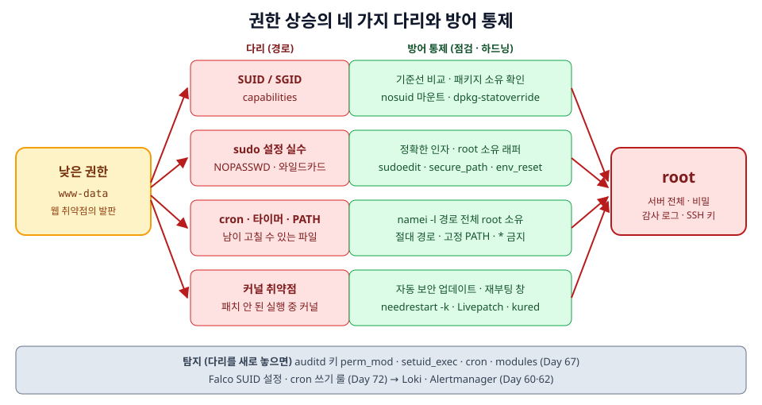
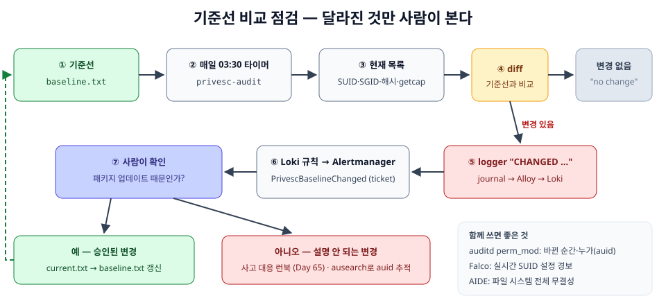

> **해킹 트랙 · 화이트해커 입문** | 난이도 ★★★★☆ | 예상 소요 2.5 ~ 3시간

> ⚠️ **실습 전 반드시 읽을 것**
> 실습은 **본인 소유의 격리된 실습장**(해킹 02의 `hacklab` 네트워크) 또는 **의도적으로 취약하게 만든 연습용 대상**(DVWA, OWASP Juice Shop, Metasploitable, Kubernetes Goat, CloudGoat 등)에만 합니다. 허가 없이 타인의 시스템을 스캔하거나 공격하면 **정보통신망법 등으로 처벌**될 수 있습니다. 오늘은 **방어자가 내 서버를 점검**하는 날입니다. 모든 명령은 내가 관리하는 서버에서, 관리자 권한으로 실행하는 **감사(audit) 명령**입니다.

## 🎯 오늘의 목표

- 권한 상승(privilege escalation)이 왜 "두 번째 사고"인지, 대표 경로 네 가지(SUID, sudo, cron·PATH, 커널)를 그림으로 설명할 수 있다
- SUID/SGID 파일과 file capabilities를 **기준선과 비교**하는 점검을 만들고 주기적으로 돌릴 수 있다
- sudoers의 흔한 실수(NOPASSWD, 와일드카드, 편집기·인터프리터 허용)를 찾아내고 **안전한 규칙**으로 고쳐 쓸 수 있다
- root가 실행하는 cron·타이머 스크립트와 PATH가 **누구에게 쓰기 가능한지** 점검할 수 있다
- 커널 패치 상태를 확인하고, 변화를 **auditd(Day 67)와 Falco(Day 72)** 로 탐지해 알림으로 연결할 수 있다

---

## 1. 권한 상승 — 왜 "두 번째 사고"인가

해킹 04·78의 웹 취약점이 터지면 공격자가 처음 얻는 것은 보통 **웹 서버 계정**(`www-data`)이나 앱 계정의 권한입니다. 이것만으로도 피해가 크지만, 서버 전체(다른 서비스의 비밀, 감사 로그, 다른 서버로 가는 SSH 키)는 아직 손에 없습니다. **권한 상승**은 이 낮은 권한에서 root로 넘어가는 단계입니다.

방어자 입장에서 핵심은 단순합니다.

> **낮은 권한 계정이 root로 넘어갈 수 있는 "다리"를 미리 찾아서 없애고, 누군가 다리를 새로 놓으면 알아챈다.**



| 경로 | 무엇이 다리가 되나 | 오늘 점검 | 방어 통제 |
|---|---|---|---|
| **SUID/SGID·capabilities** | 실행하면 소유자(root) 권한으로 도는 파일 | 2장 | 기준선 비교, `nosuid` 마운트, 불필요한 비트 제거 |
| **sudo 설정** | 과하게 넓은 sudoers 규칙 | 3장 | 명령·인자 단위 허용, `sudoedit`, 래퍼 스크립트 |
| **cron·타이머·PATH** | root가 실행하는데 **남이 고칠 수 있는** 파일·디렉터리 | 4장 | 소유권·권한 점검, 절대 경로, 고정 PATH |
| **커널 취약점** | 패치 안 된 커널의 로컬 권한 상승 버그 | 5장 | 자동 보안 업데이트, 재부팅 관리, Livepatch |

> 💡 Day 67에서 sudo 정책과 auditd를 **설정**했다면, 오늘은 그 설정이 **실제로 지켜지고 있는지 점검**하고 **망가지면 알림이 오게** 만드는 날입니다. Day 66 위협 모델의 T02(sudo로 root 획득)를 깊게 파는 셈입니다.

### 실습 환경

| 대상 | 용도 |
|---|---|
| 홈랩 H01 (Ubuntu Server 24.04 LTS, Day 67 하드닝 완료) | **기준선**을 만들고 주기 점검·탐지를 붙일 운영 서버 |
| 실습용 VM 또는 컨테이너 (`hacklab` 안, Ubuntu 24.04) | 일부러 잘못된 설정을 넣어 보고 **점검 명령이 잡아내는지** 확인 |
| Metasploitable `10.10.10.30` | 오래되고 설정이 엉망인 서버의 **나쁜 예**. 제공된 실습 계정으로 로그인해 같은 점검 명령을 돌려 H01과 비교 |

> ⚠️ 실습용 VM에 일부러 넣는 잘못된 설정은 **실습 후 반드시 되돌리거나 VM을 스냅샷으로 복구**하세요. H01에는 잘못된 설정을 넣지 않습니다.

---

## 2. SUID/SGID 파일 감사

### 2-1. 원리 — "실행하는 동안만 주인의 권한"

일반 파일은 실행한 사람의 권한으로 돕니다. **SUID**(Set User ID) 비트가 있으면 **파일 소유자의 권한**으로 돕니다. `passwd`가 대표적입니다. 일반 사용자가 자기 비밀번호를 바꾸려면 root만 쓸 수 있는 `/etc/shadow`를 고쳐야 하니, `passwd`는 root 소유 + SUID입니다.

```bash
ls -l /usr/bin/passwd
# -rwsr-xr-x 1 root root 64152 ... /usr/bin/passwd      ← 소유자 x 자리의 s = SUID
```

| 비트 | 8진수 | `ls -l` 표시 | 효과 |
|---|---|---|---|
| SUID | 4000 | 소유자 `s` | 소유자 UID로 실행 |
| SGID | 2000 | 그룹 `s` | 소유 그룹 GID로 실행 (디렉터리면 새 파일이 그룹 상속) |
| Sticky | 1000 | 기타 `t` | 디렉터리에서 남의 파일 삭제 금지 (`/tmp`) |

SUID 프로그램은 **"좁은 일만 하도록 신중하게 만든 프로그램"** 이어야 안전합니다. 위험해지는 경우는 다음과 같습니다.

- **범용 프로그램**(편집기, 인터프리터, `find`, `cp` 등)에 SUID가 붙음 → 그 프로그램의 기능 전체를 root 권한으로 쓸 수 있음 (Day 67의 "sudo로 허용하면 root가 되는 명령" 표와 같은 목록이 그대로 적용. GTFOBins 프로젝트의 *SUID* 항목)
- 직접 만든 SUID 프로그램(사내 도구)에 입력 검증·환경 변수 처리 버그
- 알려진 취약점이 있는 오래된 SUID 프로그램(패치 미적용)
- **누군가 새로 붙인** SUID 비트 — 침입 후 다시 들어오기 위한 뒷문

### 2-2. 점검 명령

```bash
# 로컬 파일 시스템 전체에서 SUID 또는 SGID 일반 파일 찾기
sudo find / -xdev \( -perm -4000 -o -perm -2000 \) -type f \
  -printf '%M %u:%g %p\n' 2>/dev/null | sort -k3
```

| 옵션 | 의미 |
|---|---|
| `-perm -4000` | SUID 비트가 **포함된** 파일 (`-`는 "이 비트들이 모두 켜져 있으면") |
| `-o -perm -2000` | 또는 SGID |
| `-xdev` | 다른 파일 시스템(`/proc`, NFS, 컨테이너 오버레이)으로 넘어가지 않음 |
| `-printf '%M %u:%g %p\n'` | 권한 문자열, 소유자, 경로 |

> 💡 `-xdev` 때문에 `/boot`, `/home`이 별도 파티션이면 빠집니다. 마운트 지점마다 돌리려면 `findmnt -rn -o TARGET -t ext4,xfs,btrfs`로 목록을 얻어 각각 실행합니다.

Ubuntu Server 24.04 H01에서의 출력 예(설치한 패키지에 따라 다릅니다):

```
-rwsr-xr-x root:root /usr/bin/chfn
-rwsr-xr-x root:root /usr/bin/chsh
-rwxr-sr-x root:shadow /usr/bin/chage
-rwxr-sr-x root:crontab /usr/bin/crontab
-rwsr-xr-x root:root /usr/bin/fusermount3
-rwsr-xr-x root:root /usr/bin/gpasswd
-rwsr-xr-x root:root /usr/bin/mount
-rwsr-xr-x root:root /usr/bin/newgrp
-rwsr-xr-x root:root /usr/bin/passwd
-rwsr-xr-x root:root /usr/bin/su
-rwsr-xr-x root:root /usr/bin/sudo
-rwsr-xr-x root:root /usr/bin/umount
-rwsr-xr-- root:messagebus /usr/lib/dbus-1.0/dbus-daemon-launch-helper
-rwsr-xr-x root:root /usr/lib/openssh/ssh-keysign
...
```

목록을 읽는 질문 세 가지:

1. **패키지가 설치한 파일인가?** 아니면 누가 직접 넣었나?
2. **패키지 원본과 같은가?** (변조되지 않았나)
3. **이 서버에 꼭 필요한가?**

```bash
# 1) 어느 패키지 소유인가 — 소유자가 없으면 즉시 조사 대상
for f in $(sudo find / -xdev -perm -4000 -type f 2>/dev/null); do
  pkg=$(dpkg -S "$f" 2>/dev/null | cut -d: -f1)
  echo "${pkg:-<패키지 없음>}  $f"
done

# 2) 패키지 원본과 비교 — 출력이 없으면 변경 없음. 3번째 글자 5 = 내용(체크섬) 변경
sudo dpkg --verify 2>/dev/null | grep -E '^..5' | head
```

### 2-3. file capabilities — SUID의 "작은 조각" 버전

리눅스는 root 권한을 40여 개의 **capability**로 쪼개 두었습니다(Day 07·68). 실행 파일에 필요한 조각만 붙일 수 있고, 이것도 점검 대상입니다.

```bash
sudo getcap -r / 2>/dev/null
# 예: /usr/bin/mtr-packet cap_net_raw=ep
#     /usr/lib/x86_64-linux-gnu/gstreamer1.0/... cap_sys_nice=ep   (데스크톱 패키지가 있을 때)
```

| 위험한 capability가 붙은 파일 | 이유 |
|---|---|
| `cap_setuid` | 아무 UID로나 바꿀 수 있음 = root |
| `cap_dac_override`, `cap_dac_read_search` | 파일 권한 검사 무시 → `/etc/shadow` 읽기·쓰기 |
| `cap_sys_admin` | "새로운 root"라 불릴 만큼 범위가 넓음 |
| 인터프리터(`python3`, `perl`)에 붙은 어떤 capability든 | 임의 코드가 그 권한을 얻음 |

### 2-4. 기준선 만들기와 비교 — 주기 점검 자동화

한 번 보고 끝내면 의미가 없습니다. **"지금 정상인 목록"을 기준선으로 저장**하고, 주기적으로 비교해 **달라진 것만** 사람이 봅니다.



```bash
sudo tee /usr/local/sbin/privesc-audit > /dev/null <<'EOF'
#!/bin/bash
# SUID/SGID·capabilities 기준선 비교 점검 (H01)
set -euo pipefail
umask 077
DIR=/var/lib/privesc-audit
mkdir -p "$DIR"

snapshot() {
  find / -xdev \( -perm -4000 -o -perm -2000 \) -type f -printf '%M %u:%g %p\n' 2>/dev/null \
    | while read -r mode owner path; do
        echo "$mode $owner $(sha256sum "$path" | cut -c1-16) $path"
      done | sort -k4
  getcap -r / 2>/dev/null | sed 's/^/CAP /' | sort
}

snapshot > "$DIR/current.txt"

if [[ ! -f "$DIR/baseline.txt" ]]; then
  cp "$DIR/current.txt" "$DIR/baseline.txt"
  logger -t privesc-audit -p auth.notice "baseline created ($(wc -l < "$DIR/baseline.txt") entries)"
  exit 0
fi

if diff -u "$DIR/baseline.txt" "$DIR/current.txt" > "$DIR/diff.txt"; then
  logger -t privesc-audit -p auth.info "no change"
else
  # 추가(+)·삭제(-) 줄을 한 줄씩 journal로 → Alloy → Loki → 알림
  grep -E '^[+-][^+-]' "$DIR/diff.txt" | while read -r line; do
    logger -t privesc-audit -p auth.warning "CHANGED $line"
  done
fi
EOF
sudo chown root:root /usr/local/sbin/privesc-audit
sudo chmod 0755 /usr/local/sbin/privesc-audit
sudo /usr/local/sbin/privesc-audit          # 첫 실행 = 기준선 생성
```

매일 돌리도록 systemd 타이머를 붙입니다(서비스 유닛에도 하드닝 옵션을 줍니다).

```bash
sudo tee /etc/systemd/system/privesc-audit.service > /dev/null <<'EOF'
[Unit]
Description=SUID/SGID and capabilities baseline audit

[Service]
Type=oneshot
ExecStart=/usr/local/sbin/privesc-audit
Nice=10
IOSchedulingClass=idle
ProtectHome=read-only
PrivateTmp=true
EOF

sudo tee /etc/systemd/system/privesc-audit.timer > /dev/null <<'EOF'
[Unit]
Description=Daily privesc audit

[Timer]
OnCalendar=*-*-* 03:30:00
RandomizedDelaySec=15min
Persistent=true

[Install]
WantedBy=timers.target
EOF

sudo systemctl daemon-reload
sudo systemctl enable --now privesc-audit.timer
systemctl list-timers privesc-audit.timer
```

**실습용 VM에서 확인**: 실습용 VM에 같은 스크립트를 설치해 기준선을 만든 뒤, 무해한 파일 하나에 SUID 비트를 붙였다가 점검을 다시 돌려 봅니다.

```bash
# (실습용 VM에서만) 테스트 파일에 SUID를 붙여 점검이 잡는지 확인
sudo install -m 0644 /dev/null /usr/local/bin/suid-test && sudo chmod 4755 /usr/local/bin/suid-test
sudo /usr/local/sbin/privesc-audit
journalctl -t privesc-audit --since "5 min ago"
```

```
... privesc-audit[4121]: CHANGED +-rwsr-xr-x root:root e3b0c44298fc1c14 /usr/local/bin/suid-test
```

```bash
sudo rm /usr/local/bin/suid-test            # 정리
```

> 💡 패키지 업데이트로 SUID 파일의 **해시가 바뀌는 것은 정상**입니다. 업데이트 직후 변경분을 확인하고 `sudo cp /var/lib/privesc-audit/current.txt /var/lib/privesc-audit/baseline.txt`로 기준선을 갱신하는 것을 **변경 관리 절차**에 넣으세요. 파일 전체의 무결성 감시가 필요하면 **AIDE** 같은 파일 무결성 검사 도구가 같은 일을 더 넓게 합니다.

### 2-5. 조치 — 줄이고, 막고, 대체한다

| 조치 | 명령·설정 |
|---|---|
| 불필요한 SUID 제거 | 쓰지 않는 기능이면 패키지 자체를 제거(`apt purge`). 꼭 필요하지만 일반 사용자가 쓸 일이 없으면 `dpkg-statoverride`로 비트를 영구히 제거 |
| 사용자 쓰기 가능 파티션에 `nosuid` | `/home`, `/tmp`, `/var/tmp`, 이동식 미디어, 업로드 볼륨(해킹 05)을 `nosuid,nodev`(가능하면 `noexec`)로 마운트 |
| 컨테이너 | `allowPrivilegeEscalation: false`(= `no_new_privs`), capabilities `drop: [ALL]` — Day 68·69. 컨테이너 안의 SUID가 무력화됨 |
| 직접 만든 도구 | SUID 대신 **좁은 sudo 규칙**(3장)이나 **systemd 서비스**(소켓·D-Bus로 요청 받기)로 |

`dpkg-statoverride`는 패키지 업데이트 후에도 설정한 권한이 유지됩니다.

```bash
# 예: 이 서버에서 일반 사용자가 chfn(사용자 정보 변경)을 쓸 일이 없다면
sudo dpkg-statoverride --update --add root root 0755 /usr/bin/chfn
ls -l /usr/bin/chfn          # -rwxr-xr-x  (s가 사라짐)
dpkg-statoverride --list     # 등록된 예외 목록
```

```bash
# 마운트 옵션 확인
findmnt -no TARGET,OPTIONS /home /tmp /dev/shm 2>/dev/null
```

> ⚠️ `su`, `sudo`, `passwd`, `mount`처럼 시스템이 의존하는 SUID는 제거하지 마세요. 줄이는 대상은 **이 서버에서 쓰지 않는 기능**입니다. 바꾼 뒤에는 기준선을 갱신합니다.

---

## 3. sudo 설정 실수 점검

### 3-1. 흔한 실수 패턴

Day 67에서 "명령·인자 단위로 허용하고, 편집은 `sudoedit`"를 배웠습니다. 실제 서버에서 자주 보이는 실수는 다음과 같습니다.

| 실수 | 예 | 왜 위험한가 |
|---|---|---|
| **NOPASSWD: ALL** | `deploy ALL=(ALL) NOPASSWD: ALL` | 그 계정의 셸 하나만 얻으면(웹 앱 취약점, 유출된 SSH 키) **비밀번호 없이 root** |
| **와일드카드 인자** | `alice ALL=(root) /usr/bin/cat /var/log/*` | sudoers의 `*`는 `/`와 공백도 매치합니다. **경로를 거슬러 올라가는 인자나 추가 인자**까지 허용되어 의도한 디렉터리 밖 파일에 닿음 |
| **편집기·페이저·인터프리터 허용** | `vim`, `less`, `python3`, `find`, `tar`, `git`, `systemctl` | 프로그램 안에서 셸·명령 실행 기능이 있음 (Day 67 4-4 표, GTFOBins) |
| **사용자가 고칠 수 있는 스크립트 허용** | `/home/deploy/restart.sh` 허용 | 스크립트 내용을 바꾸면 root로 무엇이든 실행 |
| **위험한 환경 변수 유지** | `Defaults env_keep += "LD_PRELOAD PYTHONPATH"`, `SETENV:` 태그 | 허용된 명령이 공격자가 지정한 라이브러리·모듈을 로드 |
| **부정(`!`)으로 막기** | `alice ALL=(ALL) ALL, !/usr/bin/su` | 다른 셸·복사본·심볼릭 링크로 쉽게 피해 감. sudoers 매뉴얼도 이 방식이 효과 없다고 경고 |
| **root와 동등한 그룹** | 사용자를 `docker`, `lxd`, `disk` 그룹에 넣음 | sudo 없이도 root와 같음 (docker는 해킹 07) |

### 3-2. 점검 명령

```bash
# 1) 문법·권한 검사 (파일 소유자·모드까지 확인)
sudo visudo -c

# 2) 위험 패턴 찾기
sudo grep -rnE 'NOPASSWD|SETENV|env_keep|!env_reset|\*|ALL[[:space:]]*$' \
  /etc/sudoers /etc/sudoers.d/ 2>/dev/null

# 3) 사람별 실제 권한 (규칙을 합친 최종 결과)
for u in $(getent passwd | awk -F: '$3>=1000 && $3<65534 {print $1}'); do
  echo "== $u"; sudo -l -U "$u" 2>/dev/null | sed -n '/may run/,$p'
done

# 4) root와 동등한 그룹 구성원
getent group sudo admin docker lxd disk 2>/dev/null
```

규칙에 들어 있는 **명령 파일과 그 상위 디렉터리**가 모두 root 소유이고 남이 쓸 수 없는지 `namei`로 확인합니다.

```bash
namei -l /usr/local/sbin/restart-demo-app
```

```
f: /usr/local/sbin/restart-demo-app
drwxr-xr-x root root /
drwxr-xr-x root root usr
drwxr-xr-x root root local
drwxr-xr-x root root sbin
-rwxr-xr-x root root restart-demo-app
```

경로의 **어느 한 단계라도** 다른 사용자 소유이거나 `w`가 그룹·기타에 열려 있으면, 그 사용자는 파일을 바꿔치기할 수 있습니다.

> 💡 Ubuntu 25.10부터 기본 sudo가 Rust로 다시 작성된 **sudo-rs**로 바뀌었습니다. sudoers 문법은 대부분 같지만 일부 오래된 기능은 지원하지 않으므로, 배포판을 올릴 때는 `sudo -l`과 `visudo -c` 점검을 다시 하세요. 오늘의 예시는 H01(Ubuntu 24.04, sudo 1.9.x) 기준입니다.

### 3-3. 조치 — 안전한 sudoers 작성

"배포 계정이 데모 앱을 재시작하고 로그를 볼 수 있어야 한다"는 요구를 두 가지로 써 봅니다.

```
# ❌ 흔한 나쁜 예 — /etc/sudoers.d/30-deploy
deploy ALL=(ALL) NOPASSWD: ALL
# 또는 조금 "좁힌" 것처럼 보이지만 여전히 위험한 예
deploy ALL=(root) NOPASSWD: /usr/bin/systemctl *, /usr/bin/journalctl *, /usr/bin/vim /etc/demo-app/*
```

```
# ✅ 안전한 예 — sudo visudo -f /etc/sudoers.d/30-deploy
Defaults:deploy  env_reset
Defaults:deploy  secure_path="/usr/local/sbin:/usr/local/bin:/usr/sbin:/usr/bin:/sbin:/bin"
Defaults:deploy  !setenv

Cmnd_Alias DEMO_RESTART = /usr/local/sbin/restart-demo-app
Cmnd_Alias DEMO_LOGS    = /usr/bin/journalctl -u demo-app --no-pager -n 200
Cmnd_Alias DEMO_EDIT    = sudoedit /etc/demo-app/config.yaml

deploy ALL=(root) DEMO_RESTART, DEMO_LOGS, DEMO_EDIT
```

래퍼 스크립트는 **인자를 받지 않거나, 받더라도 허용 목록으로만** 처리하고 root 소유로 둡니다.

```bash
sudo tee /usr/local/sbin/restart-demo-app > /dev/null <<'EOF'
#!/bin/bash
set -euo pipefail
PATH=/usr/sbin:/usr/bin:/sbin:/bin
/usr/bin/systemctl restart demo-app.service
/usr/bin/systemctl is-active demo-app.service
EOF
sudo chown root:root /usr/local/sbin/restart-demo-app
sudo chmod 0755 /usr/local/sbin/restart-demo-app
sudo visudo -c && sudo -l -U deploy
```

| 원칙 | 위의 예에서 |
|---|---|
| 와일드카드 대신 **정확한 인자** | `journalctl -u demo-app --no-pager -n 200` 그대로만 허용. `--no-pager`로 페이저(`less`)가 뜨지 않게 |
| 넓은 명령 대신 **root 소유 래퍼** | `systemctl *` 대신 `restart-demo-app` |
| 편집은 **`sudoedit`** | 편집기는 사용자 권한으로 실행 (Day 67) |
| 비밀번호 요구 유지 | `NOPASSWD`는 비대화형 자동화(CI 러너)에만, 그때도 명령 하나로 좁게 |
| 환경 초기화 | `env_reset`, `secure_path`, `!setenv` |
| 파일명 | `sudoers.d`의 파일명에 `.` 금지, `visudo -f`로 편집 (Day 67) |

> 💡 sudo에는 `NOEXEC:` 태그도 있습니다. 허용된 프로그램이 **다른 프로그램을 실행하지 못하게** 막는 장치인데, 동적 링크된 프로그램에만 동작하는 등 한계가 있어 **보조 수단**입니다. 우선은 "셸 기능이 있는 프로그램을 허용하지 않는다"가 원칙입니다.

---

## 4. cron·타이머 스크립트와 PATH 점검

### 4-1. 원리 — "root가 실행하는데 남이 고칠 수 있는 것"

root가 주기적으로 실행하는 작업은 **root가 대신 실행해 주는 코드**입니다. 그 코드(스크립트), 코드가 있는 디렉터리, 코드가 부르는 다른 프로그램, 프로그램을 찾는 **PATH**의 디렉터리 중 **하나라도** 일반 사용자가 쓸 수 있으면, 그 사용자는 다음 실행 때 root로 자기 코드를 실행시킬 수 있습니다.

| 약한 고리 | 예 |
|---|---|
| 스크립트 파일이 쓰기 가능 | `/opt/backup/backup.sh`가 `-rwxrwxrwx` 또는 `deploy` 소유 |
| 스크립트가 있는 **디렉터리**가 쓰기 가능 | 파일은 root 소유지만 디렉터리가 `deploy` 소유 → 파일을 지우고 새로 만들 수 있음 |
| 스크립트가 **상대 경로**로 명령 호출 + PATH에 쓰기 가능한 디렉터리 | `tar czf ...`라고만 쓰고, PATH 앞쪽에 남이 쓸 수 있는 디렉터리 |
| 스크립트가 읽는 설정·입력 파일이 쓰기 가능 | `source /opt/backup/env` — env 파일을 바꾸면 코드 실행 |
| 쓰기 가능한 디렉터리에서 와일드카드 사용 | `cd /srv/uploads && tar czf /backup/u.tgz *` — **파일 이름**이 옵션으로 해석될 수 있음(해킹 05 6-4의 `--`와 같은 문제) |

### 4-2. 점검 명령

```bash
# 1) root가 실행하는 예약 작업 전체 목록
sudo cat /etc/crontab
sudo ls -l /etc/cron.d/ /etc/cron.hourly/ /etc/cron.daily/ /etc/cron.weekly/ /etc/cron.monthly/
sudo ls -l /var/spool/cron/crontabs/          # 사용자별 crontab (root 포함)
systemctl list-timers --all                   # systemd 타이머

# 2) /etc/crontab·/etc/cron.d에서 실행 명령(7번째 필드)이 절대 경로인 것의 경로 권한
sudo awk '!/^[[:space:]]*(#|$)/ && NF>=7 && $7 ~ /^\// {print $7}' /etc/crontab /etc/cron.d/* \
  | sort -u | xargs -r -n1 namei -l

# 3) 시스템 디렉터리 안의 world-writable 파일과, sticky 비트 없는 world-writable 디렉터리
sudo find /etc /usr /opt /srv /var/lib -xdev -type f -perm -0002 -printf '%M %u %p\n' 2>/dev/null
sudo find / -xdev -type d -perm -0002 ! -perm -1000 -printf '%M %u %p\n' 2>/dev/null

# 4) 타이머가 실행하는 서비스의 ExecStart 경로
systemctl cat $(systemctl list-timers --all --no-legend | awk '{print $(NF)}') 2>/dev/null \
  | grep -E '^(# /|ExecStart=)'
```

**PATH 점검** — root가 쓰는 PATH의 각 디렉터리가 root 소유이고 남이 쓸 수 없는지, 빈 항목이나 `.`(현재 디렉터리)이 없는지 봅니다.

```bash
# root 로그인 셸의 PATH와 /etc/crontab의 PATH를 각각 점검
for p in "$(sudo -i bash -c 'echo $PATH')" "$(sudo grep -E '^PATH=' /etc/crontab | cut -d= -f2)"; do
  echo "== PATH: $p"
  IFS=':' read -ra dirs <<< "$p"
  for d in "${dirs[@]}"; do
    if [[ -z "$d" || "$d" == "." ]]; then echo "  !! 빈 항목 또는 '.' (현재 디렉터리)"; continue; fi
    [[ -d "$d" ]] && stat -c '  %A %U:%G %n' "$d" || echo "  (없음) $d"
  done
done
```

```
== PATH: /usr/local/sbin:/usr/local/bin:/usr/sbin:/usr/bin:/sbin:/bin:/snap/bin
  drwxr-xr-x root:root /usr/local/sbin
  drwxr-xr-x root:root /usr/local/bin
  ...
```

> 💡 **실습용 VM에서 확인**: `/opt/lab-backup/`을 일반 사용자 소유로 만들고 root crontab에서 그 안의 스크립트를 부르게 한 뒤, 위 2)와 3)의 점검이 무엇을 보여 주는지 확인하세요. `namei -l` 출력에서 **root가 아닌 소유자**가 나오는 줄이 곧 약한 고리입니다. 확인 후 설정을 되돌립니다.

### 4-3. 조치

```
# ❌ /etc/cron.d/backup
* 2 * * * root cd /srv/uploads && tar czf /backup/uploads.tgz * && backup-upload
```

```
# ✅ /etc/cron.d/backup  (파일은 root:root 0644)
SHELL=/bin/bash
PATH=/usr/sbin:/usr/bin:/sbin:/bin
0 2 * * * root /usr/local/sbin/backup-uploads
```

```bash
# /usr/local/sbin/backup-uploads  (root:root 0755)
#!/bin/bash
set -euo pipefail
umask 077
/usr/bin/tar -czf /backup/uploads.tgz -C /srv uploads   # 와일드카드 대신 디렉터리 지정
/usr/local/sbin/backup-upload /backup/uploads.tgz
```

| 원칙 | 설명 |
|---|---|
| 스크립트·디렉터리 전체가 root 소유, 그룹·기타 쓰기 금지 | `namei -l`로 경로 전 단계 확인 |
| **절대 경로**와 고정 `PATH` | crontab 맨 위에 `PATH=`, 스크립트 안에서도 `PATH=` |
| 쓰기 가능한 디렉터리에서 `*` 금지 | 디렉터리 단위로 지정하거나 `--` 사용 |
| 필요 이상으로 root로 돌리지 않기 | 백업 대상 읽기만 필요하면 전용 계정으로. systemd 서비스라면 `User=`, `ProtectSystem=strict`, `ReadWritePaths=` 로 제한 |
| cron 대신 systemd 타이머 고려 | 실행 기록이 journal에 남고(`systemctl status`), 하드닝 옵션을 붙이기 쉬움 (2-4의 예) |

---

## 5. 커널 패치 관리

### 5-1. 원리

SUID·sudo·cron이 **설정** 문제라면, 커널 취약점은 **코드** 문제입니다. 로컬 사용자가 특정 시스템 콜을 부르는 것만으로 root가 되는 커널 버그가 해마다 발표되고, 그때 할 수 있는 일은 **빨리 패치하고, 패치된 커널로 실제로 재부팅하는 것**입니다. 흔한 함정은 "업데이트는 설치했는데 **재부팅을 안 해서 옛 커널이 돌고 있는**" 상태입니다.

### 5-2. 점검 명령

```bash
uname -r                                        # 지금 돌고 있는 커널
dpkg -l 'linux-image-*' | awk '/^ii/ {print $2, $3}'   # 설치된 커널 패키지
cat /var/run/reboot-required 2>/dev/null        # 재부팅 필요 표시 (없으면 필요 없음)
cat /var/run/reboot-required.pkgs 2>/dev/null   # 어떤 패키지 때문인지
sudo needrestart -b -k                          # 커널: 실행 중 vs 최신 설치 비교 (배치 출력)
apt list --upgradable 2>/dev/null | grep -i security
```

```
NEEDRESTART-VER: 3.6
NEEDRESTART-KCUR: 6.8.0-85-generic
NEEDRESTART-KEXP: 6.8.0-87-generic
NEEDRESTART-KSTA: 3                      ← 3 = 재부팅 필요(실행 중 커널이 최신이 아님)
```

Ubuntu Pro를 연결했다면(Day 67 8-2, 개인 5대 무료) 보안 상태와 특정 CVE의 조치 여부를 바로 볼 수 있습니다.

```bash
pro security-status
sudo pro fix CVE-2025-XXXXX         # 해당 CVE의 영향 여부를 확인하고, 수정 패키지가 있으면 설치
```

### 5-3. 조치

| 조치 | 설정 |
|---|---|
| 보안 업데이트 자동 설치 | `unattended-upgrades` (Ubuntu Server 기본 설치·활성). `/etc/apt/apt.conf.d/50unattended-upgrades`의 `-security` 출처 확인 |
| 재부팅 관리 | 같은 파일에서 `Unattended-Upgrade::Automatic-Reboot "true";` + `Automatic-Reboot-Time "04:00";` — 홈랩이라면 자동 재부팅, 운영이라면 **정기 점검 창**에서 재부팅 |
| 재부팅 없는 패치 | **Canonical Livepatch**(`sudo pro enable livepatch`, Ubuntu Pro) — 중요한 커널 보안 수정을 재부팅 없이 적용. 그래도 정기 재부팅은 필요 |
| K8s 노드 | 노드 하나씩 `kubectl drain` → 업데이트·재부팅 → `uncordon` (Day 20). 자동화하려면 **kured**(Kubernetes Reboot Daemon)가 `/var/run/reboot-required`를 보고 순서대로 재부팅 |
| 공격 표면 축소 | Ubuntu 24.04 기본값 유지 확인: `kernel.yama.ptrace_scope=1`, `kernel.kptr_restrict=1`, `kernel.dmesg_restrict=1`, `kernel.unprivileged_bpf_disabled=2`, **비특권 user namespace 제한**(`kernel.apparmor_restrict_unprivileged_userns=1`) |

```bash
sysctl kernel.yama.ptrace_scope kernel.kptr_restrict kernel.dmesg_restrict \
       kernel.unprivileged_bpf_disabled kernel.apparmor_restrict_unprivileged_userns
grep -E 'Automatic-Reboot' /etc/apt/apt.conf.d/50unattended-upgrades
```

> ⚠️ 비특권 user namespace를 쓰는 애플리케이션(일부 브라우저 샌드박스, rootless 컨테이너 도구)은 AppArmor 프로파일로 예외가 필요할 수 있습니다. 끄지 말고 **필요한 프로그램만** 예외 처리하세요(Day 68 rootless Docker 참조).

---

## 6. 탐지 — 다리를 새로 놓으면 알아채기

점검은 "지금 상태"를 보고, 탐지는 "**바뀌는 순간**"을 봅니다. 둘 다 필요합니다.

### 6-1. auditd 규칙 (Day 67 확장)

Day 67의 `50-homelab.rules`에는 sudoers·계정 파일·root 명령 실행 감시가 이미 있습니다. 오늘의 경로를 덮도록 규칙을 추가합니다.

```bash
sudo tee /etc/audit/rules.d/55-privesc.rules > /dev/null <<'EOF'
## 사람이 한 권한·소유권 변경 (SUID 비트 부여 포함)
-a always,exit -F arch=b64 -S chmod,fchmod,fchmodat -F auid>=1000 -F auid!=unset -k perm_mod
-a always,exit -F arch=b64 -S chown,fchown,fchownat,lchown -F auid>=1000 -F auid!=unset -k perm_mod
-a always,exit -F arch=b64 -S setxattr,lsetxattr,fsetxattr -F auid>=1000 -F auid!=unset -k perm_mod

## SUID 실행: 실제 UID와 유효 UID가 다르고 유효 UID가 root인 실행
-a always,exit -F arch=b64 -S execve -C uid!=euid -F euid=0 -k setuid_exec

## 예약 작업 변경
-w /etc/crontab -p wa -k cron
-w /etc/cron.d/ -p wa -k cron
-w /etc/cron.hourly/ -p wa -k cron
-w /etc/cron.daily/ -p wa -k cron
-w /etc/cron.weekly/ -p wa -k cron
-w /etc/cron.monthly/ -p wa -k cron
-w /var/spool/cron/ -p wa -k cron
-w /etc/systemd/system/ -p wa -k systemd_units

## root가 실행하는 코드 위치 변경
-w /usr/local/sbin/ -p wa -k local_bin
-w /usr/local/bin/ -p wa -k local_bin

## 커널 모듈 적재
-a always,exit -F arch=b64 -S init_module,finit_module,delete_module -k modules
EOF
sudo augenrules --load
sudo auditctl -l | grep -cE 'perm_mod|setuid_exec|cron|modules'
```

| 키 | 무엇을 잡나 |
|---|---|
| `perm_mod` | `chmod u+s` 같은 SUID 부여, 소유권 변경, capability 부여(`setcap`은 확장 속성 `security.capability`를 씀) |
| `setuid_exec` | SUID 프로그램 실행. `sudo`·`passwd`도 매번 기록되므로 **실행 파일별 집계**로 봅니다 |
| `cron`, `systemd_units` | 예약 작업 추가·변경 |
| `local_bin` | root 래퍼 스크립트(3-3, 4-3) 변조 |
| `modules` | 커널 모듈 적재 (루트킷의 흔한 단계) |

```bash
# setuid_exec를 실행 파일별로 집계 → 기준선(2장 목록)에 없는 이름이 보이면 조사
sudo ausearch -k setuid_exec -i --start today 2>/dev/null \
  | grep -oE 'exe=[^ ]+' | sort | uniq -c | sort -rn

# 최근 권한 변경을 누가 했나 (auid)
sudo ausearch -k perm_mod -i --start recent | grep -E 'type=SYSCALL' | tail -n 5
```

### 6-2. Falco 규칙 (Day 72)

Falco는 노드의 커널에서 시스템 콜을 보므로, kind 노드 컨테이너든 H01 호스트 프로세스든(`container.id=host`) 같은 방식으로 잡습니다. Day 72의 `rules.d` 커스텀 룰에 추가합니다.

```yaml
- rule: Set SUID or SGID bit (homelab)
  desc: 파일에 SUID/SGID 비트가 설정됨
  condition: >
    evt.type in (chmod, fchmod, fchmodat) and evt.dir = <
    and (evt.arg.mode contains "S_ISUID" or evt.arg.mode contains "S_ISGID")
  output: >
    SUID/SGID set (user=%user.name loginuid=%user.loginuid cmd=%proc.cmdline
    file=%evt.arg.filename container=%container.id)
  priority: WARNING
  tags: [host, privesc]

- rule: Write to cron or systemd unit (homelab)
  desc: 예약 작업 또는 systemd 유닛 디렉터리에 파일 쓰기
  condition: >
    open_write and (fd.name startswith /etc/cron or fd.name startswith /var/spool/cron
    or fd.name startswith /etc/systemd/system/)
    and not proc.name in (apt, apt-get, dpkg, unattended-upgr, systemctl)
  output: >
    Scheduled job modified (user=%user.name loginuid=%user.loginuid file=%fd.name
    cmd=%proc.cmdline container=%container.id)
  priority: WARNING
  tags: [host, persistence, privesc]
```

Day 72의 기본 룰 *Read sensitive file untrusted*는 `/etc/shadow` 같은 민감 파일 읽기를 이미 잡습니다. 권한 상승 직후 흔히 일어나는 일이므로 이 룰의 알림도 함께 봅니다.

### 6-3. 알림 연결 (Day 60·62)

| 출처 | 경로 | 알림 예 |
|---|---|---|
| `privesc-audit` (journal) | Alloy가 journal 수집 → Loki | `{job="systemd-journal"} |= "privesc-audit" |= "CHANGED"`가 1건 이상 → `severity: ticket` |
| auditd (`/var/log/audit/audit.log`) | Alloy 파일 수집 → Loki | `key="perm_mod"`이면서 `S_ISUID` 관련, 또는 `key="modules"` → `severity: page` |
| Falco | Falcosidekick → Alertmanager (Day 72 7장) | priority `WARNING` 이상을 보안 채널로 |

```yaml
# Loki ruler 규칙 예
- alert: PrivescBaselineChanged
  expr: sum(count_over_time({job="systemd-journal"} |= "privesc-audit" |= "CHANGED" [1h])) > 0
  labels:
    severity: ticket
  annotations:
    summary: "SUID/SGID·capabilities 목록이 기준선과 달라짐 — 패키지 업데이트인지 확인"
```

> 💡 Day 62의 원칙대로 **사람을 깨우는 것(page)** 과 **다음 근무일에 볼 것(ticket)** 을 나눕니다. 패키지 업데이트로 자주 바뀌는 기준선 차이는 ticket, 사람이 한 SUID 부여·커널 모듈 적재는 page가 적당합니다.

---

## 7. 점검 도구 — 손으로 한 것을 자동으로

오늘 손으로 한 점검을 한꺼번에 해 주는 도구들이 있습니다.

| 도구 | 성격 | 오늘과의 관계 |
|---|---|---|
| **Lynis** (Day 67) | 방어자용 감사 도구. 읽기만 함 | SUID·sudo·cron·커널 항목 다수 포함. `lynis show details`로 확인 |
| **USG / CIS Benchmark** (Day 67) | 기준 대비 준수 점검 | 마운트 옵션, cron 권한, auditd 규칙 항목 |
| **AIDE** | 파일 무결성 검사 | 2-4 기준선 비교를 파일 시스템 전체로 |
| **LinPEAS** 등 열거 스크립트 | 권한 상승 경로를 찾는 점검 스크립트 | 모의해킹에서 쓰이는 도구가 있다는 정도만 알아 두기 |

> ⚠️ 출처가 불분명한 점검 스크립트를 **인터넷에서 받아 운영 서버에서 root로 실행하는 것** 자체가 공급망 위험입니다(Day 57). 운영 서버의 정기 점검은 오늘 만든 스크립트처럼 **내가 읽고 이해한 명령**과 Lynis 같은 검증된 패키지로 하세요.

---

## 8. 방어자 체크리스트

| # | 영역 | 점검 항목 | 확인 명령 | 기대 결과 | 주기 |
|---|---|---|---|---|---|
| 1 | SUID | SUID/SGID 목록이 기준선과 같음 | `privesc-audit` → `journalctl -t privesc-audit` | `no change` 또는 설명 가능한 변경만 | 매일(타이머) |
| 2 | SUID | 모든 SUID 파일이 패키지 소유 | `dpkg -S <파일>` | `<패키지 없음>` 0건 | 매주 |
| 3 | SUID | 위험 capability 없음 | `getcap -r /` | `cap_setuid`, `cap_sys_admin`, 인터프리터 0건 | 매일(타이머) |
| 4 | SUID | 사용자 쓰기 영역 `nosuid` | `findmnt -no OPTIONS /home /tmp` | `nosuid` 포함 | 변경 시 |
| 5 | sudo | 문법·파일 권한 | `visudo -c` | `parsed OK` | 변경 시 |
| 6 | sudo | `NOPASSWD: ALL`, 와일드카드, `!` 부정, `SETENV` 없음 | 3-2의 `grep` | 0건(예외는 문서화) | 매주 |
| 7 | sudo | 허용 명령에 편집기·인터프리터 없음 | `sudo -l -U <사용자>` | 래퍼·정확한 인자·`sudoedit`만 | 매주 |
| 8 | sudo | 허용 명령 경로 전체 root 소유 | `namei -l <명령>` | 모든 단계 `root root`, 그룹·기타 쓰기 없음 | 변경 시 |
| 9 | 그룹 | root 동등 그룹 최소화 | `getent group sudo docker lxd disk` | 필요한 사람만 | 매주 |
| 10 | cron | root 작업 스크립트·디렉터리 root 소유 | 4-2의 `namei -l` | 비root 소유 0건 | 매주 |
| 11 | cron | world-writable 파일·sticky 없는 디렉터리 없음 | 4-2의 `find` | 0건 | 매주 |
| 12 | PATH | root·cron PATH에 빈 항목·`.`·쓰기 가능 디렉터리 없음 | 4-2의 PATH 점검 | 모두 `root:root`, `drwxr-xr-x` | 변경 시 |
| 13 | 커널 | 실행 중 커널이 최신 설치 커널 | `needrestart -b -k` | `KSTA: 1` | 매주 |
| 14 | 커널 | 보안 업데이트 자동 설치 | `systemctl is-enabled unattended-upgrades` | `enabled` | 매월 |
| 15 | 커널 | 커널 하드닝 sysctl 기본값 유지 | 5-3의 `sysctl` | 표의 값 | 매월 |
| 16 | 탐지 | auditd 규칙 적재 | `auditctl -l \| grep -c perm_mod` | 3 이상 | 재부팅 후 |
| 17 | 탐지 | Falco 커스텀 룰 로드 | Falco 로그의 rules 로드 메시지 | 오류 없음 | 변경 시 |
| 18 | 탐지 | 알림이 실제로 도착 | 실습용 VM에서 2-4 테스트 → Alertmanager 확인 | 알림 수신 | 분기 |

> 💡 이 표는 해킹 11의 **모의해킹 보고서**에서 "조치 권고" 절의 뼈대로 그대로 쓸 수 있습니다. 항목마다 "현재 상태 / 기대 결과 / 조치"를 채우면 됩니다.

---

## 9. 트러블슈팅

| 증상 | 원인 | 해결 |
|---|---|---|
| `find`가 오래 걸리고 `/proc` 오류가 쏟아짐 | `-xdev` 누락, 오류 출력 | `-xdev`와 `2>/dev/null` 추가 |
| `privesc-audit`가 매일 변경을 보고 | 패키지 업데이트로 해시 변경 | 업데이트 후 확인하고 기준선 갱신을 변경 관리 절차에 포함 |
| `dpkg-statoverride` 후 업데이트하니 다시 SUID | `--update` 없이 `--add`만 함, 또는 snap 패키지 | `dpkg-statoverride --list`로 확인, `--update` 포함해 다시 등록 |
| `sudo -l -U`가 `unknown user` | LDAP·SSSD 사용자 캐시 | `getent passwd <사용자>` 확인 후 실행 |
| sudoers.d 수정 후 sudo 전체가 안 됨 | `visudo` 없이 편집해 문법 오류 | 다른 root 세션이나 `pkexec visudo`, 최악이면 복구 모드 콘솔에서 수정. 항상 `visudo -f` |
| `journalctl -u demo-app` 허용했는데 거부됨 | 실제 실행 인자가 규칙과 한 글자라도 다름 | sudoers에 적은 인자와 **똑같이** 입력, 또는 래퍼 스크립트로 |
| auditd `-C uid!=euid` 규칙 적재 오류 | auditctl 버전·문법 오타 | `sudo auditctl -l`, `augenrules --check`로 확인. Ubuntu 24.04의 auditd 3.1.x는 지원 |
| `setuid_exec` 로그가 너무 많음 | sudo·passwd 등 정상 SUID 실행도 기록 | 집계로 보거나, 운영에서는 Falco 쪽 탐지로 대체하고 auditd 규칙은 범위 축소 |
| Falco cron 룰이 apt 업데이트 때 울림 | 패키지 관리자의 정상 쓰기 | `not proc.name in (...)` 예외에 실제 프로세스 이름 추가(Day 72 튜닝) |
| `needrestart` 명령 없음 | 최소 설치 | `sudo apt install -y needrestart` |

---

## 10. 핵심 정리

- 권한 상승은 낮은 권한 → root로 가는 **다리**. 방어자는 다리를 **미리 찾아 없애고(점검·하드닝)**, **새로 놓이면 알아챈다(탐지·알림)**
- SUID/SGID·capabilities: `find / -xdev -perm -4000` / `getcap -r /` → **패키지 소유 확인·`dpkg --verify`** → **기준선 비교 타이머** → 불필요하면 `dpkg-statoverride`, 사용자 영역은 `nosuid`
- sudo: `NOPASSWD: ALL`, **와일드카드 인자**, 편집기·인터프리터, 사용자 쓰기 가능 스크립트, `env_keep`, `!` 부정이 대표 실수. **정확한 인자 + root 소유 래퍼 + `sudoedit` + `secure_path`**
- cron·PATH: root가 실행하는 파일과 **경로의 모든 단계**가 root 소유인지 `namei -l`로. 절대 경로, 고정 PATH, 쓰기 가능 디렉터리에서 `*` 금지
- 커널: `needrestart -k`·`/var/run/reboot-required`로 **실행 중 커널** 확인, unattended-upgrades + 재부팅 창, Livepatch, K8s는 drain·kured
- 탐지: auditd `perm_mod`·`setuid_exec`·`cron`·`modules` 키(Day 67), Falco SUID·cron 룰(Day 72) → Loki·Alertmanager(Day 60·62)

---

## 11. 셀프 체크

<details>
<summary>Q1. <code>find / -perm -4000</code>과 <code>find / -perm 4000</code>의 차이는?</summary>

`-perm -4000`은 SUID 비트가 **포함된** 모든 파일(예: 4755)을 찾습니다. `-perm 4000`은 권한이 **정확히** 4000인 파일만 찾으므로 실제로는 거의 아무것도 나오지 않습니다. 감사에는 `-` 형식을 씁니다.
</details>

<details>
<summary>Q2. <code>alice ALL=(root) /usr/bin/cat /var/log/*</code> 규칙이 "로그만 읽기"로 좁혀지지 않는 이유와 대안은?</summary>

sudoers의 와일드카드 `*`는 `/`와 공백까지 매치하므로, 상위 디렉터리를 가리키는 경로나 추가 인자를 붙여 `/var/log` 밖의 파일(예: `/etc/shadow`)까지 읽을 수 있습니다. 로그 열람이 목적이면 `adm` 그룹(로그 읽기 권한)에 넣거나, 정확한 인자를 가진 명령(`journalctl -u <서비스> --no-pager -n 200`)이나 root 소유 래퍼 스크립트만 허용합니다.
</details>

<details>
<summary>Q3. root crontab의 스크립트 파일은 <code>root:root 0755</code>인데도 위험할 수 있는 경우는?</summary>

스크립트가 있는 **상위 디렉터리**가 일반 사용자 소유이거나 쓰기 가능하면, 파일을 지우고 같은 이름으로 새로 만들 수 있습니다. 또 스크립트가 상대 경로로 명령을 부르는데 PATH에 쓰기 가능한 디렉터리가 있거나, 쓰기 가능한 설정 파일을 `source`하거나, 쓰기 가능한 디렉터리에서 `*`를 쓰는 경우도 위험합니다. `namei -l`로 경로 전체를 확인합니다.
</details>

<details>
<summary>Q4. 보안 업데이트로 새 커널을 설치했다. 이제 커널 권한 상승 취약점에서 안전한가?</summary>

재부팅 전까지는 **옛 커널이 계속 실행 중**이므로 안전하지 않습니다. `uname -r`과 `needrestart -b -k`(KSTA 값), `/var/run/reboot-required`로 확인하고 재부팅 창에서 재부팅하거나 Livepatch로 적용합니다. K8s 노드는 drain 후 재부팅(kured로 자동화 가능)합니다.
</details>

<details>
<summary>Q5. auditd에서 <code>uid!=euid</code>이고 <code>euid=0</code>인 execve를 기록하면 무엇을 알 수 있나? 왜 그대로 알림으로 보내면 안 되나?</summary>

일반 사용자가 **SUID root 프로그램을 실행한 순간**을 모두 기록합니다. 하지만 `sudo`, `passwd`, `su` 같은 정상 프로그램도 매번 기록되므로 그대로 알림으로 보내면 알림 피로가 큽니다. 실행 파일별로 집계해 **기준선 목록에 없는 프로그램**이 나타날 때만 알림을 보내는 식으로 증상 기반으로 좁힙니다.
</details>

---

## ⏭️ 다음 예고 — 해킹 07. 컨테이너 탈출 위험 — privileged, docker.sock 노출

오늘 "root와 동등한 그룹"으로 잠깐 언급한 **docker 그룹**과 **docker.sock**이 주인공입니다. 컨테이너 안의 root가 언제 **호스트의 root**가 되는지 — `--privileged`, 호스트 경로 마운트, 위험한 capabilities, docker.sock 마운트 — 를 Day 07·68에서 쌓은 격리 원리로 설명하고, 같은 형식으로 **탐지(Falco)와 조치(rootless, Pod Security Admission)** 를 짝지어 정리합니다.
