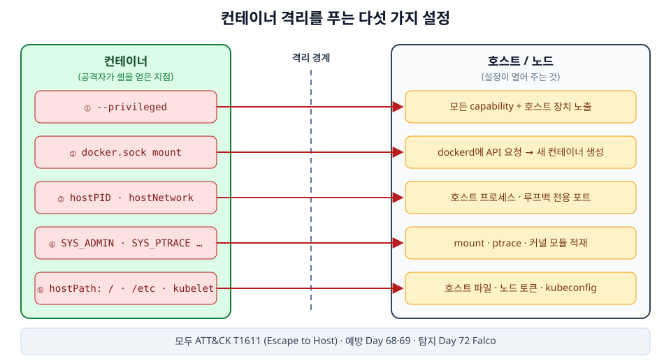
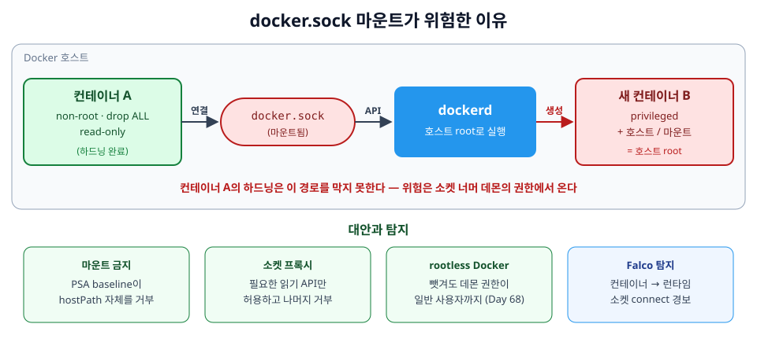
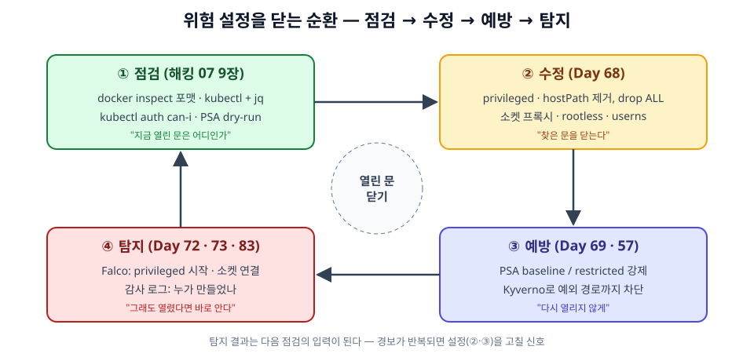

> **해킹 트랙 · 화이트해커 입문** | 난이도 ★★★★☆ | 예상 소요 2 ~ 2.5시간

> ⚠️ **실습 전 반드시 읽기** — 이 글의 모든 실습은 **본인 소유의 격리된 실습장**(해킹 02의 `hacklab`) 또는 **의도적으로 취약하게 만든 연습용 대상**(DVWA, Juice Shop, Metasploitable, Kubernetes Goat, CloudGoat 등)에서만 합니다. 허가 없이 타인의 시스템을 스캔하거나 공격하면 **정보통신망법** 등에 따라 처벌받을 수 있습니다. 오늘 글은 **실제 탈출 절차나 익스플로잇 코드를 다루지 않습니다.** "어떤 설정이 격리를 풀어 주는가"를 확인하고, 그 설정을 **찾고·탐지하고·고치는** 방법에 집중합니다.

## 🎯 오늘의 목표

- 컨테이너 탈출이 대부분 **"격리를 스스로 풀어 준 설정"** 에서 시작한다는 것을 공격자 시각으로 설명할 수 있다
- `--privileged`, `docker.sock` 마운트, 호스트 PID·네트워크 namespace 공유, 위험한 capabilities, 민감한 hostPath가 각각 **무엇을 가능하게 하는지** 안전한 확인 명령으로 직접 본다
- `docker inspect`와 `kubectl` + `jq`로 **위험 설정을 일괄 점검**하는 체크리스트를 만든다
- 같은 설정이 실행될 때 **Falco(Day 72)** 에서 어떻게 보이는지, 어떤 룰로 잡는지 안다
- 예방은 **Day 68(런타임)·Day 69(PSA)** 로, 정책 강제는 **Day 57(Kyverno)** 로 연결할 수 있다

---

## 1. 공격자는 "벽"이 아니라 "열린 문"을 찾는다

Day 07에서 컨테이너는 **namespace(보이는 범위) + cgroup(쓸 수 있는 양) + 보안 장치(할 수 있는 일)** 로 감싼 리눅스 프로세스라고 했습니다. Day 68에서는 그 장치를 직접 설계했습니다. 오늘은 반대편, **"공격자가 컨테이너 안의 셸을 하나 얻었다면 맨 먼저 무엇을 확인할까?"** 의 시각으로 같은 그림을 다시 봅니다.

모의해킹에서 컨테이너 안에 들어온 공격자의 첫 질문은 늘 같습니다.

| 공격자의 질문 | 확인하는 것 | 오늘 다룰 설정 |
|---|---|---|
| "나는 얼마나 강한 root인가?" | 유효 capability, seccomp·AppArmor 상태 | `--privileged`, `--cap-add` |
| "호스트의 무엇이 보이는가?" | `/proc`의 프로세스, 네트워크 인터페이스, 마운트 | `--pid=host`, `--network=host`, hostPath |
| "누구에게 명령할 수 있는가?" | 런타임 소켓, ServiceAccount 토큰 | `docker.sock`, (해킹 08의 RBAC) |

핵심은 이것입니다. **커널 취약점 같은 "벽 뚫기"는 어렵고 드뭅니다. 하지만 설정 실수라는 "열린 문"은 흔합니다.** 그래서 방어자도 같은 순서로 점검하면 가장 많은 위험을 가장 싸게 없앨 수 있습니다.



> 💡 Day 68 2장의 표(시나리오별 ATT&CK 매핑, 방어 장치 효과 매트릭스)를 먼저 한 번 훑고 오면 오늘 내용이 훨씬 잘 연결됩니다. 오늘은 그 표의 각 줄을 **"확인 → 점검 → 탐지 → 수정"** 으로 풀어 봅니다. MITRE ATT&CK 기준으로는 모두 **T1611 (Escape to Host)** 계열입니다.

---

## 2. 실습 환경

| 항목 | 값 |
|---|---|
| Docker 실습 | 해킹 02 `hacklab`의 **실습 전용 Ubuntu 24.04 VM**(Kali와 같은 격리 네트워크). Docker Engine은 Day 01 방식으로 설치한 최신 안정판 |
| K8s 실습 | Day 09의 kind `infra-lab` (kind v0.33, Kubernetes v1.37 기준 출력) + Day 72의 Falco |
| 도구 | `jq`, `libcap2-bin`(`capsh`) — `sudo apt-get install -y jq libcap2-bin` |

> ⚠️ 오늘 만드는 위험한 컨테이너는 **모두 `--rm`으로 즉시 사라지는 일회용**이고, 실행하는 명령은 **읽기·조회만** 합니다. 그래도 운영 서버나 개인 노트북의 Docker가 아니라 **실습 VM에서만** 실행하세요. 격리 네트워크라 인터넷이 없다면, 쓸 이미지(`alpine`, `docker:cli`)는 격리 전에 미리 받아 둡니다.

```bash
docker pull alpine:3.22
docker pull docker:cli
```

---

## 3. 기준선 — "보통 컨테이너"는 이렇게 생겼다

비교 기준부터 잡습니다. Day 07 5-5에서 본 값과 같아야 합니다.

```bash
docker run --rm alpine:3.22 sh -c '
  grep -E "CapEff|Seccomp:|NoNewPrivs" /proc/self/status
  echo "LSM: $(cat /proc/self/attr/current)"
  echo "/dev 항목 수: $(ls /dev | wc -l)"'
```

```
CapEff:	00000000a80425fb
NoNewPrivs:	0
Seccomp:	2
LSM: docker-default (enforce)
/dev 항목 수: 15
```

| 값 | 의미 |
|---|---|
| `CapEff a80425fb` | Docker 기본 14개 capability만 |
| `Seccomp: 2` | 필터 모드 — 기본 seccomp 프로파일 적용 중 |
| `docker-default (enforce)` | AppArmor가 마운트·`/proc` 쓰기 등을 막는 중 |
| `/dev` 15개 | `null`, `zero`, `random`, `tty` 정도의 가상 장치만 |

이 네 줄이 **방어선이 살아 있다는 신호**입니다. 이제 설정 하나씩 풀어 가며 무엇이 달라지는지 봅니다.

---

## 4. 위험 ① `--privileged` — 방어선을 한꺼번에 내림

### 4-1. 무엇이 가능해지는가 (개념)

`--privileged`는 "조금 더 권한을 주는 옵션"이 아니라 **Day 07 표의 보안 장치를 전부 끄는 스위치**입니다.

- 모든 capability(`SYS_ADMIN`, `SYS_MODULE`, `SYS_RAWIO` …) 부여
- seccomp·AppArmor 해제
- 호스트의 **모든 장치 파일**(`/dev/sda`, `/dev/nvme0n1` 등) 노출
- `/sys`, `/proc`의 일부 경로가 쓰기 가능

결과적으로 "호스트 디스크를 마운트한다", "커널 모듈을 올린다", "cgroup 설정을 바꾼다" 같은 **호스트 관리자의 일을 컨테이너 안에서** 할 수 있는 상태가 됩니다. 탈출 방법이 여러 가지 알려져 있지만, 방어자 입장에서 중요한 결론은 하나입니다. **privileged 컨테이너의 root = 호스트 root로 취급한다.**

### 4-2. 확인 명령

```bash
docker run --rm --privileged alpine:3.22 sh -c '
  grep -E "CapEff|Seccomp:" /proc/self/status
  echo "LSM: $(cat /proc/self/attr/current)"
  echo "/dev 항목 수: $(ls /dev | wc -l)"
  echo "블록 장치: $(ls /dev | grep -E "^(sd|vd|nvme|xvd)" | tr "\n" " ")"'
```

```
CapEff:	000001ffffffffff
Seccomp:	0
LSM: unconfined
/dev 항목 수: 187
블록 장치: sda sda1 sda2 sda3
```

호스트에서 값을 해석해 봅니다.

```bash
capsh --decode=000001ffffffffff | tr ',' '\n' | grep -E 'sys_admin|sys_module|sys_rawio|sys_ptrace'
```

```
cap_sys_module
cap_sys_rawio
cap_sys_ptrace
cap_sys_admin
```

**기준선과 네 줄이 전부 달라졌습니다.** capability는 전부, seccomp는 0(꺼짐), AppArmor는 unconfined, 그리고 호스트의 실제 디스크 장치(`sda`)가 컨테이너 안에 그대로 보입니다. 여기서 더 나아가는 단계(장치 마운트 등)는 하지 않습니다. "보인다"는 것만으로 위험은 충분히 증명됐습니다.

### 4-3. 왜 쓰게 되는가 — 그리고 대안

| privileged를 요구하는 흔한 이유 | 대안 |
|---|---|
| Docker-in-Docker(CI 러너) | rootless BuildKit, Kaniko 계열 빌더, 원격 빌더 |
| 특정 장치 접근(GPU, USB) | `--device /dev/xxx`로 **그 장치만**, GPU는 Day 37 Container Toolkit |
| 네트워크 설정 변경 | `--cap-add NET_ADMIN` 하나만 |
| "안 돼서 일단 켰다" | Day 68 5장 — drop ALL 후 로그 보며 필요한 것만 추가 |

---

## 5. 위험 ② `docker.sock` 마운트 — 데몬에게 명령할 수 있는 권한

### 5-1. 무엇이 가능해지는가 (개념)



`/var/run/docker.sock`은 dockerd의 **REST API 입구**입니다(Day 01 아키텍처 그림의 "REST API" 화살표). 이 소켓을 컨테이너에 마운트하면, 그 컨테이너는 **호스트의 `docker` CLI와 똑같은 권한**을 갖습니다. Day 07에서 "docker 그룹 = 사실상 root"라고 했던 바로 그 권한입니다.

중요한 점은 **컨테이너 자신의 설정이 아무리 단단해도 소용없다**는 것입니다. 컨테이너가 non-root, drop ALL, read-only여도 소켓에 쓸 수만 있으면 dockerd에게 "**privileged에 호스트 `/`를 마운트한 새 컨테이너**를 만들어 줘"라고 부탁할 수 있고, dockerd는 호스트 root로 그 일을 해 줍니다. 그래서 Day 68 매트릭스에서 seccomp·capability가 이 시나리오에 효과가 없다고 표시했던 것입니다.

### 5-2. 확인 명령

```bash
docker run --rm -v /var/run/docker.sock:/var/run/docker.sock docker:cli \
  docker ps --format '{{.Names}}\t{{.Image}}'
```

```
infra-lab-worker2        kindest/node:v1.37.0
infra-lab-worker         kindest/node:v1.37.0
infra-lab-control-plane  kindest/node:v1.37.0
eloquent_hopper          docker:cli
```

컨테이너 안에서 **호스트의 모든 컨테이너 목록**이 보입니다. 마지막 줄은 자기 자신입니다. 같은 API로 조회만이 아니라 생성·삭제·exec도 할 수 있다는 것이 문제의 전부입니다. 확인은 여기까지만 합니다.

> 💡 kind 노드 자체도 **privileged 컨테이너**라는 점을 눈여겨보세요(`docker inspect infra-lab-worker --format '{{.HostConfig.Privileged}}'` → `true`). kind는 노드 안에서 다시 컨테이너를 돌려야 해서 그렇습니다. kind가 **실습·개발용**인 이유 중 하나이고, 해킹 08에서 취약한 실습 앱을 kind에 올릴 때 **별도 VM에서 하라**고 하는 이유이기도 합니다.

### 5-3. 흔한 사용처와 대안

| 소켓을 요구하는 도구 | 대안 |
|---|---|
| Traefik·리버스 프록시(컨테이너 자동 발견) | **소켓 프록시**로 `GET /containers`류 읽기 API만 허용, 또는 파일 기반 설정 |
| Portainer 등 관리 UI | 관리 UI는 별도 관리 호스트·관리망에만, 접근은 SSO(Day 73) |
| 모니터링 에이전트 | cAdvisor·node-exporter처럼 소켓 없이 cgroup/proc을 읽는 방식 |
| CI에서 이미지 빌드 | rootless 빌더, Day 51의 GitHub Actions 호스티드 러너 |
| 어쩔 수 없이 필요 | **rootless Docker**(Day 68 4-2) — 소켓을 뺏겨도 "일반 사용자" 권한까지만 |

Kubernetes에서는 같은 문제가 `/run/containerd/containerd.sock`(또는 CRI-O 소켓)의 hostPath 마운트로 나타납니다. 이름만 다를 뿐 **런타임 소켓 = 노드 root** 공식은 같습니다.

---

## 6. 위험 ③ 호스트 PID·네트워크·IPC namespace 공유

### 6-1. 무엇이 가능해지는가 (개념)

Day 07 2장의 "namespace는 공유도 할 수 있다"를 공격자 시각으로 보면, **공유 = 그 영역의 격리 포기**입니다.

| 설정 (Docker / K8s) | 보이게 되는 것 | 위험이 커지는 조합 |
|---|---|---|
| `--pid=host` / `hostPID: true` | 호스트의 **모든 프로세스**와 그 명령줄, `/proc/<pid>/` | + root + `SYS_PTRACE` → 다른 프로세스 메모리·환경 변수 접근 |
| `--network=host` / `hostNetwork: true` | 호스트의 **모든 인터페이스**, `127.0.0.1`에만 열린 관리 포트 | 루프백 전용 서비스(kubelet 읽기 포트, DB 관리 포트)에 바로 접근, 네트워크 정책 우회 |
| `--ipc=host` / `hostIPC: true` | 호스트의 공유 메모리(`/dev/shm`) | 다른 프로세스가 공유 메모리에 둔 데이터 열람 |

특히 `hostNetwork`는 **Day 70 NetworkPolicy가 적용되지 않는** 경우가 많다는 점(Pod가 노드의 네트워크를 그대로 쓰므로)이 방어 쪽에서 자주 놓치는 부분입니다.

### 6-2. 확인 명령

```bash
# 기본: 자기 자신만 보임 (Day 01 5-5)
docker run --rm alpine:3.22 ps -o pid,comm | head -3

# 호스트 PID namespace 공유
docker run --rm --pid=host alpine:3.22 ps -o pid,user,comm | head -5
```

```
PID   COMMAND
    1 ps

PID   USER     COMMAND
    1 root     systemd
    2 root     kthreadd
    3 root     pool_workqueue_
    4 root     kworker/R-rcu_g
```

```bash
# 호스트 네트워크 공유 — 호스트의 루프백 전용 리스닝 포트가 보임
docker run --rm --network=host alpine:3.22 netstat -tln | grep 127.0.0
```

```
tcp        0      0 127.0.0.53:53           0.0.0.0:*               LISTEN
tcp        0      0 127.0.0.1:41235         0.0.0.0:*               LISTEN
```

`127.0.0.53:53`(systemd-resolved)처럼 **호스트 바깥에서는 보이지 않도록 루프백에만 연** 서비스가 컨테이너 앞에 그대로 노출됩니다. 실제 K8s 노드라면 여기에 kubelet·컨테이너 런타임의 로컬 포트가 섞여 나옵니다.

---

## 7. 위험 ④ 위험한 capabilities

### 7-1. 무엇이 가능해지는가 (개념)

`--privileged`까지는 아니어도, 특정 capability 하나가 격리의 핵심을 풉니다. Day 07이 "root를 40여 개 조각으로 나눈 것"이라고 했던 그 조각 중 **위험한 조각**입니다.

| capability | 가능해지는 것 | 위험도 |
|---|---|---|
| `SYS_ADMIN` | mount, namespace 조작 등 "잡동사니 관리자 권한" — 사실상 privileged의 절반 | 🔴 매우 높음 |
| `SYS_MODULE` | 커널 모듈 적재 → 커널 = 호스트 전체 | 🔴 매우 높음 |
| `SYS_PTRACE` | 다른 프로세스 추적·메모리 접근 (hostPID와 만나면 호스트 프로세스) | 🔴 높음 |
| `DAC_READ_SEARCH` | 파일 권한 검사 우회 + 파일 핸들로 파일 열기 → 마운트 밖 호스트 파일 접근 사례 | 🔴 높음 |
| `SYS_RAWIO` | 장치·I/O 포트 직접 접근 | 🔴 높음 |
| `NET_ADMIN` | 인터페이스·라우팅·방화벽 변경 (hostNetwork면 **호스트 방화벽**) | 🟠 중간~높음 |
| `BPF`, `PERFMON` | eBPF 프로그램 적재·커널 관찰 | 🟠 중간~높음 |
| `NET_RAW` | 원시 패킷 생성 — 같은 네트워크 스푸핑 | 🟡 중간 (Docker 기본 포함, PSA restricted는 제거 요구) |

### 7-2. 확인 명령

```bash
docker run --rm --cap-add SYS_ADMIN alpine:3.22 grep CapEff /proc/self/status
# CapEff:	00000000a82425fb

capsh --decode=00000000a82425fb | tr ',' '\n' | grep sys_admin
# cap_sys_admin
```

기준선 `a80425fb`에서 비트 하나(`0x200000` = `SYS_ADMIN`)가 켜졌습니다. 점검할 때는 이 16진수를 `capsh --decode`로 바꿔 **목록에 위 표의 이름이 있는지** 보면 됩니다.

> 💡 seccomp·AppArmor가 켜져 있으면 `SYS_ADMIN`만으로 할 수 있는 일이 상당 부분 막힙니다. 그래서 공격자는 "capability 추가 + seccomp=unconfined" 같은 **조합**을 찾고, 방어자는 조합이 아니라 **각각을 따로** 금지해야 합니다(Day 68 매트릭스의 "여러 겹" 원칙).

---

## 8. 위험 ⑤ 민감한 hostPath

### 8-1. 무엇이 가능해지는가 (개념)

호스트 경로를 마운트하면 컨테이너 root가 **그 경로에서는 호스트 root**입니다(user namespace를 안 쓸 때 — Day 68 4장). 경로별로 의미가 다릅니다.

| 마운트 경로 | 노출되는 것 |
|---|---|
| `/` | 전부 |
| `/etc` | 계정·sudoers·cron·systemd 설정 → 쓰기 가능하면 영구적인 호스트 장악 |
| `/root`, `/home` | SSH 키, 셸 이력, 클라우드 CLI 자격 증명 |
| `/var/run/docker.sock`, `/run/containerd/containerd.sock` | 5장 — 런타임 조종 |
| `/var/lib/kubelet` | 노드의 **다른 Pod들의 볼륨과 ServiceAccount 토큰**, kubelet 자격 증명 |
| `/etc/kubernetes` | 컨트롤 플레인 노드라면 **관리자 kubeconfig**·인증서 |
| `/proc`, `/sys` | 커널 파라미터·cgroup 조작 경로 |
| `/var/log` | 다른 서비스의 로그(토큰·개인정보가 섞였을 수 있음) |

`readOnly: true`는 **쓰기만** 막습니다. `/etc/kubernetes`나 `/var/lib/kubelet`은 **읽기만으로도** 클러스터 자격 증명이 새어 나갑니다. "읽기 전용이니 괜찮다"는 판단은 위험합니다.

### 8-2. 확인 명령

```bash
docker run --rm -v /:/host:ro alpine:3.22 sh -c '
  ls /host
  ls -ld /host/etc /host/root /host/var/lib/docker'
```

```
bin   boot  dev   etc   home  lib  ...  root  run  srv  sys  tmp  usr  var
drwxr-xr-x  108 root root 4096 Nov 15 09:10 /host/etc
drwx------    6 root root 4096 Nov 14 21:03 /host/root
drwx--x---   13 root root 4096 Nov 15 09:12 /host/var/lib/docker
```

호스트의 `root` 홈(`drwx------`, 호스트 root만 들어갈 수 있는 디렉터리)까지 목록이 보입니다. 컨테이너 root가 호스트 UID 0이기 때문입니다. 내용은 열어 보지 않습니다.

---

## 9. 점검 체크리스트 — 위험 설정을 일괄로 찾기

여기서부터가 오늘의 본론입니다. 방어자는 하나하나 실험하는 대신 **전체를 훑는 명령**을 가지고 있어야 합니다.



### 9-1. Docker 호스트

```bash
# ① 실행 중인 모든 컨테이너의 위험 플래그 한 줄 요약
docker ps -q | xargs -r docker inspect --format \
'{{.Name}} priv={{.HostConfig.Privileged}} pid={{.HostConfig.PidMode}} net={{.HostConfig.NetworkMode}} ipc={{.HostConfig.IpcMode}} capAdd={{.HostConfig.CapAdd}} secOpt={{.HostConfig.SecurityOpt}} user={{.Config.User}}'
```

```
/web priv=false pid= net=bridge ipc=private capAdd=[] secOpt=[] user=101
/traefik priv=false pid= net=bridge ipc=private capAdd=[] secOpt=[] user=
/node-agent priv=false pid=host net=host ipc=private capAdd=[SYS_PTRACE] secOpt=[] user=
/infra-lab-worker priv=true pid= net=kind ipc=private capAdd=[] secOpt=[seccomp=unconfined apparmor=unconfined] user=
```

```bash
# ② 위험한 마운트만 골라 보기 (런타임 소켓, 호스트 루트, 민감 경로)
docker ps -q | xargs -r docker inspect --format \
'{{.Name}}{{range .Mounts}} {{.Source}}->{{.Destination}}(rw={{.RW}}){{end}}' \
| grep -E 'docker\.sock|containerd\.sock| /->|/etc|/root|/var/lib/kubelet|/proc|/sys'
```

```
/traefik /var/run/docker.sock->/var/run/docker.sock(rw=true)
/node-agent /proc->/host/proc(rw=false) /sys->/host/sys(rw=false)
```

| 결과에서 볼 것 | 판정 |
|---|---|
| `priv=true` | 🔴 이유를 문서로 설명할 수 없다면 제거 |
| `pid=host`, `net=host`, `ipc=host` | 🟠 모니터링 에이전트 등 명확한 예외만 |
| `capAdd`에 7장 표의 🔴 이름 | 🔴 |
| `secOpt`에 `seccomp=unconfined`, `apparmor=unconfined` | 🔴 방어선 해제 |
| `user=` (빈 값) 또는 `0`, `root` | 🟡 root로 실행 중 — 위 항목과 겹치면 🔴 |
| 마운트에 `docker.sock` | 🔴 rw 여부와 무관하게 위험 (읽기 전용 마운트도 API 호출은 가능) |

> ⚠️ 마지막 줄을 꼭 기억하세요. 소켓을 `:ro`로 마운트해도 **소켓 파일에 연결해 API를 호출하는 것은 막지 못합니다.** `ro`는 파일 자체를 지우거나 바꾸는 것만 막습니다.

데몬 차원의 기본값도 한 번 봅니다.

```bash
docker info --format '{{.SecurityOptions}}'
# [name=apparmor name=seccomp,profile=builtin name=cgroupns]
getent group docker        # docker 그룹 구성원 = 사실상 root 목록 (Day 07)
ls -l /var/run/docker.sock # srw-rw---- root docker — 권한이 더 넓으면 즉시 수정
```

### 9-2. Kubernetes 클러스터

```bash
kubectl config use-context kind-infra-lab

kubectl get pods -A -o json | jq -r '
  .items[] | . as $p |
  [ (if .spec.hostPID     then "hostPID"     else empty end),
    (if .spec.hostNetwork then "hostNetwork" else empty end),
    (if .spec.hostIPC     then "hostIPC"     else empty end),
    ( .spec.containers[]?, .spec.initContainers[]?
      | select(.securityContext.privileged == true) | "privileged:" + .name ),
    ( .spec.containers[]?, .spec.initContainers[]?
      | select(.securityContext.capabilities.add != null)
      | "capAdd:" + .name + "=" + (.securityContext.capabilities.add | join(",")) ),
    ( .spec.volumes[]? | select(.hostPath != null) | "hostPath:" + .hostPath.path )
  ] | select(length > 0)
  | "\($p.metadata.namespace)/\($p.metadata.name)\t\(join(" "))"'
```

```
kube-system/kindnet-7xk2p	hostNetwork capAdd:kindnet-cni=NET_RAW,NET_ADMIN hostPath:/etc/cni/net.d hostPath:/run/xtables.lock hostPath:/lib/modules
kube-system/kube-proxy-4m9qd	hostNetwork privileged:kube-proxy hostPath:/run/xtables.lock hostPath:/lib/modules
kube-system/etcd-infra-lab-control-plane	hostNetwork hostPath:/etc/kubernetes/pki/etcd hostPath:/var/lib/etcd
falco/falco-8dj2s	hostPath:/etc ... hostPath:/proc hostPath:/sys/kernel/tracing ...
team-a/debug-shell	hostPID privileged:shell hostPath:/
```

결과 읽는 법:

- **`kube-system`의 CNI·kube-proxy·컨트롤 플레인**과 **Falco 같은 보안 에이전트**는 노드를 다뤄야 하므로 이런 설정이 정상입니다. Day 69에서 `kube-system`을 PSA `privileged`로 남겨 둔 이유입니다. 이들은 **허용 목록**으로 관리하고, 이미지·버전을 신뢰할 수 있는지(Day 57 서명 검증)에 집중합니다.
- **애플리케이션 네임스페이스**(`team-a`, `demo-*`)에 한 줄이라도 나오면 🔴 입니다. 위 예의 `team-a/debug-shell`은 누군가 "디버깅용"으로 띄운 **노드 루트 셸**과 같습니다.

한 가지 더 — 런타임 소켓 hostPath만 따로 찾습니다.

```bash
kubectl get pods -A -o json | jq -r '
  .items[] | . as $p | .spec.volumes[]?
  | select(.hostPath.path? // "" | test("docker\\.sock|containerd\\.sock|crio\\.sock|/var/run$|/run$"))
  | "\($p.metadata.namespace)/\($p.metadata.name)\t\(.hostPath.path)"'
```

### 9-3. "누가 이런 Pod를 만들 수 있는가"

위험한 Pod를 **만들 수 있는 권한** 자체도 점검 대상입니다. PSA가 없는 네임스페이스에서 `create pods` 권한은 곧 **노드 root 권한**입니다.

```bash
# Day 19의 team-a 개발자 SA가 Pod를 만들 수 있는가
kubectl auth can-i create pods -n team-a --as=system:serviceaccount:team-a:dev-sa
# yes

# 그 네임스페이스에 PSA가 걸려 있는가
kubectl get ns team-a -o jsonpath='{.metadata.labels}' | jq 'with_entries(select(.key|startswith("pod-security")))'
# { "pod-security.kubernetes.io/enforce": "baseline" }   ← 없다면 🔴
```

PSA `baseline`이 붙어 있는지 **모든 네임스페이스**를 한 번에 보려면 Day 69 6-1의 `kubectl label --dry-run=server` 방법을 그대로 씁니다.

### 9-4. 체크리스트 요약

| # | 점검 항목 | Docker 명령 | K8s 명령 | 기준 |
|---|---|---|---|---|
| 1 | privileged | `inspect … .HostConfig.Privileged` | `jq … securityContext.privileged` | 앱 워크로드 0건 |
| 2 | 런타임 소켓 마운트 | `inspect … .Mounts` + `grep docker.sock` | `jq … hostPath` + `test("sock")` | 0건, 예외는 소켓 프록시 |
| 3 | 호스트 namespace | `PidMode`, `NetworkMode`, `IpcMode` | `hostPID/hostNetwork/hostIPC` | 시스템 에이전트만 |
| 4 | 위험 capability | `.HostConfig.CapAdd` | `capabilities.add` | 7장 🔴 0건 |
| 5 | 보안 프로파일 해제 | `.HostConfig.SecurityOpt` | `seccompProfile.type: Unconfined` | 0건 |
| 6 | 민감 hostPath | `.Mounts` | `.spec.volumes[].hostPath` | 앱 워크로드 0건 |
| 7 | 생성 권한 | `getent group docker` | `kubectl auth can-i create pods` + PSA 라벨 | 최소 인원, PSA 필수 |

이 표를 해킹 11 모의해킹 보고서의 "점검 범위" 부록으로 그대로 쓸 수 있습니다.

---

## 10. 탐지 — Falco에서 어떻게 보이나

점검은 "지금 이 순간"의 상태만 봅니다. 그 사이에 누군가 위험한 컨테이너를 띄우거나, 이미 떠 있는 컨테이너에서 이상한 일이 벌어지는 것은 **런타임 탐지**(Day 72)가 맡습니다.

### 10-1. 기본 룰셋에서 관련 있는 룰

| 룰 (룰셋) | 우선순위 | 오늘의 어떤 위험과 연결되나 |
|---|---|---|
| *Detect release_agent File Container Escapes* (stable) | CRITICAL | privileged·`SYS_ADMIN` 컨테이너에서 cgroup을 이용한 대표적 탈출 시도 |
| *Debugfs Launched in Privileged Container* (stable) | WARNING | privileged 컨테이너에서 호스트 디스크를 들여다보려는 시도 |
| *Linux Kernel Module Injection Detected* (stable) | WARNING | `SYS_MODULE` 남용 |
| *PTRACE attached to process* (stable) | WARNING | `SYS_PTRACE` + hostPID |
| *Contact K8S API Server From Container* (stable) | NOTICE | 탈취한 토큰으로 API 호출 (해킹 08 RBAC로 이어짐) |
| *Read sensitive file untrusted* (stable) | WARNING | hostPath로 노출된 민감 파일 읽기 |
| *Launch Privileged Container* (incubating) | INFO | privileged 컨테이너 시작 자체 |
| *Launch Excessively Capable Container* (incubating) | INFO | 위험 capability를 가진 컨테이너 시작 |
| *Mount Launched in Privileged Container* (incubating) | WARNING | privileged 컨테이너 안의 `mount` 실행 |

stable에 없는 것은 Day 72 5-3에서 본 것처럼 **필요한 것만 커스텀 룰로** 가져오는 방식을 씁니다.

### 10-2. 커스텀 룰 — privileged 시작과 런타임 소켓 접근

Day 72의 `falco-values.yaml` `customRules`에 이어 붙입니다.

```yaml
customRules:
  infra-lab-rules.yaml: |-
    # (Day 72에서 만든 룰들은 그대로 두고 아래를 추가)

    - list: infra_lab_trusted_priv_images
      items: [registry.k8s.io/kube-proxy, docker.io/kindest/kindnetd, docker.io/falcosecurity/falco]

    - rule: Privileged container started (infra-lab)
      desc: privileged 컨테이너의 첫 프로세스(PID 1)가 시작됨. 허용 목록 이미지 제외
      condition: >
        spawned_process and container and proc.vpid = 1
        and container.privileged = true
        and not container.image.repository in (infra_lab_trusted_priv_images)
      output: >-
        Privileged container started
        (image=%container.image.repository pod=%k8s.pod.name ns=%k8s.ns.name cmd=%proc.cmdline)
      priority: WARNING
      tags: [container, infra_lab, mitre_privilege_escalation, T1611]

    - rule: Container runtime socket connect (infra-lab)
      desc: 컨테이너 안의 프로세스가 docker/containerd 소켓에 연결함
      condition: >
        evt.type = connect and container and fd.typechar = u
        and (fd.name contains "docker.sock" or fd.name contains "containerd.sock")
      output: >-
        Container connected to runtime socket
        (socket=%fd.name process=%proc.name cmd=%proc.cmdline image=%container.image.repository
        pod=%k8s.pod.name ns=%k8s.ns.name)
      priority: CRITICAL
      tags: [container, infra_lab, mitre_privilege_escalation, T1610]
```

```bash
helm upgrade falco falcosecurity/falco --version 9.2.2 -n falco -f falco-values.yaml
kubectl -n falco rollout status ds/falco
```

재현은 **아무것도 하지 않는 privileged Pod**를 띄웠다가 지우는 것으로 충분합니다. PSA가 없는 Day 72의 `falco-lab` 네임스페이스, Falco가 있는 노드에 띄웁니다.

```bash
kubectl -n falco-lab run priv-test --image=alpine:3.22 --restart=Never \
  --overrides='{"spec":{"nodeSelector":{"kubernetes.io/hostname":"infra-lab-worker"},
    "containers":[{"name":"priv-test","image":"alpine:3.22","command":["sleep","30"],
    "securityContext":{"privileged":true}}]}}'

kubectl -n falco logs ds/falco -c falco | grep 'Privileged container started'
kubectl -n falco-lab delete pod priv-test
```

```json
{"priority":"Warning","rule":"Privileged container started (infra-lab)",
 "output":"... Privileged container started (image=docker.io/library/alpine pod=priv-test ns=falco-lab cmd=sleep 30)", ...}
```

> 💡 런타임 소켓 룰은 소켓을 마운트한 컨테이너가 실제로 연결할 때만 울립니다. Traefik처럼 **정상적으로** 소켓을 쓰는 컨테이너가 있다면 그 이미지를 예외로 빼야 합니다(Day 72 6-2의 튜닝 방법). 예외가 너무 많아진다면, 그건 탐지보다 **설계(소켓 프록시)를 고칠 신호**입니다.

### 10-3. 생성 시점 탐지 — 감사 로그

Falco syscall 룰은 컨테이너가 **실행된 뒤**에 봅니다. "누가 privileged Pod를 **만들었는가**"는 API 서버 **감사 로그**(Day 73)에 남습니다. `pods` `create` 이벤트의 `requestObject`에 `privileged: true`, `hostPID: true`, `hostPath`가 있는지 보면 되고, Falco의 k8saudit 플러그인 룰셋(*Create Privileged Pod*, *Create Sensitive Mount Pod*, *Create HostNetwork Pod* 등)이 바로 이것을 봅니다. 실습 공격이 이런 로그와 알림에 **어떤 흔적으로 남는지**는 해킹 10에서 한 번에 정리합니다.

---

## 11. 수정 — 예방은 어디서 하나

탐지는 "이미 일어난 일"을 알려 줄 뿐입니다. 각 위험의 **근본 수정**은 앞 Day에서 이미 만들었습니다. 오늘은 연결만 합니다.

| 위험 | 1차 수정 (설정) | 강제 수단 | 참고 |
|---|---|---|---|
| privileged | 필요한 capability·장치만 개별 부여 | PSA **baseline** 이상이 거부 | Day 68 5장, Day 69 2장 |
| 런타임 소켓 | 소켓 프록시, rootless Docker, 소켓 없는 도구 | PSA baseline이 hostPath 자체를 거부, Kyverno로 경로 지정 차단 | Day 68 4-2, Day 57 |
| 호스트 namespace | 제거. 에이전트는 별도 네임스페이스로 분리 | PSA baseline이 거부 | Day 69 2장 |
| 위험 capability | `drop: [ALL]` 후 필요한 것만 | baseline은 허용 목록 밖 추가를 거부, restricted는 `NET_BIND_SERVICE`만 | Day 68 5장, Day 69 4장 |
| seccomp/AppArmor 해제 | `RuntimeDefault` 명시 | baseline이 `Unconfined` 거부 | Day 68 6·7장 |
| 민감 hostPath | emptyDir·PVC·ConfigMap·projected 볼륨으로 대체 | baseline이 hostPath 거부, 예외 네임스페이스는 Kyverno로 경로 제한 | Day 14, Day 57 |
| 생성 권한 | Pod 생성 권한 최소화, 디버깅은 `kubectl debug`와 감사 | RBAC + 감사 로그 | Day 19, Day 73 |
| (공통) 컨테이너 root = 호스트 root | userns-remap / rootless, K8s 사용자 namespace(`hostUsers: false`) | — | Day 68 4장 |

> 💡 위 표의 대부분이 **PSA baseline 한 줄**로 막힌다는 점이 중요합니다. 오늘 체크리스트(9-2)에서 앱 네임스페이스에 위험 Pod가 나왔다면, 그 네임스페이스에 `pod-security.kubernetes.io/enforce: baseline`(가능하면 `restricted`)이 없는지부터 확인하세요.

---

## 12. 정리

```bash
kubectl -n falco-lab delete pod priv-test --ignore-not-found
# 실습 VM에서 만든 컨테이너는 모두 --rm 이라 남지 않음
docker ps -a --filter status=exited
```

Falco 커스텀 룰은 해킹 10에서 다시 쓰므로 남겨 둡니다.

---

## 13. 트러블슈팅

| 증상 | 원인 | 해결 |
|---|---|---|
| `capsh: command not found` | `libcap2-bin` 미설치 | `sudo apt-get install -y libcap2-bin` |
| privileged 컨테이너의 `CapEff`가 `000001ffffffffff`가 아님 | 커널마다 capability 개수가 다름 | 값이 아니라 `capsh --decode`로 **이름**을 확인 |
| `docker:cli` 컨테이너에서 `permission denied ... docker.sock` | rootless Docker이거나 소켓 그룹이 다름 | rootless라면 소켓 경로가 `/run/user/<UID>/docker.sock` — 즉 **방어가 동작 중** |
| `jq` 결과에 아무것도 없음 | 위험 설정이 없거나, 컨텍스트가 다른 클러스터 | `kubectl config current-context` 확인. kind라면 최소한 `kube-proxy`는 나와야 정상 |
| Falco 커스텀 룰이 안 울림 | Pod가 Falco가 없는 노드에 뜸(Day 72 4-1 제약) | `nodeSelector`로 `infra-lab-worker` 지정 |
| Falco가 CrashLoopBackOff | 룰 문법 오류 | `kubectl -n falco logs ds/falco -c falco`에서 `LOAD_ERR` 줄 번호 확인 |
| 소켓 룰이 정상 도구(Traefik 등) 때문에 계속 울림 | 정상 사용 | 이미지 예외 추가, 장기적으로 소켓 프록시로 교체 |

---

## 14. 핵심 정리

- 컨테이너 탈출의 대부분은 **커널 버그가 아니라 격리를 풀어 준 설정**에서 시작한다. 방어자도 이 "열린 문"부터 닫는다
- `--privileged` = 모든 capability + seccomp·AppArmor 해제 + 호스트 장치 노출 → **호스트 root로 취급**
- `docker.sock`(또는 containerd 소켓) 마운트 = 런타임 조종 권한. 컨테이너 자신의 하드닝과 **무관하게** 위험하고, `:ro`로도 막히지 않는다
- 호스트 PID·네트워크·IPC 공유는 그 영역의 격리 포기. `hostNetwork`는 NetworkPolicy 바깥으로 빠지기 쉽다
- `SYS_ADMIN`, `SYS_MODULE`, `SYS_PTRACE`, `DAC_READ_SEARCH`는 하나만으로도 위험. hostPath는 **읽기 전용이어도** 자격 증명이 샌다
- 점검: `docker inspect` 포맷 + `kubectl … | jq` 로 **일괄 조회**, 시스템 컴포넌트는 허용 목록으로
- 탐지: Falco stable(release_agent, debugfs, 모듈 적재, ptrace) + 커스텀(privileged 시작, 소켓 연결) + 감사 로그(생성 시점)
- 예방: **PSA baseline 이상**(Day 69), drop ALL(Day 68), Kyverno(Day 57), user namespace

---

## 15. 셀프 체크

<details>
<summary>Q1. 컨테이너를 non-root, drop ALL, read-only로 단단하게 만들었는데 <code>docker.sock</code>을 마운트했다. 왜 여전히 위험한가?</summary>

컨테이너 자신이 무엇을 할 수 있는지와 관계없이, 소켓에 연결만 할 수 있으면 **dockerd에게** 새 컨테이너 생성을 요청할 수 있고 dockerd는 **호스트 root로** 그 요청을 수행합니다. 위험은 컨테이너 프로세스의 권한이 아니라 **소켓 너머 데몬의 권한**에서 옵니다. 그래서 seccomp·capability 같은 컨테이너 내부 장치로는 막히지 않습니다.
</details>

<details>
<summary>Q2. hostPath를 <code>readOnly: true</code>로 마운트하면 안전한가?</summary>

아닙니다. `/var/lib/kubelet`(다른 Pod의 토큰), `/etc/kubernetes`(관리자 kubeconfig), `/root/.ssh` 같은 경로는 **읽기만으로도** 자격 증명이 유출됩니다. 또 런타임 소켓은 읽기 전용 마운트여도 연결·API 호출이 가능합니다. 원칙은 "앱 워크로드에는 hostPath 자체를 쓰지 않는다"(PSA baseline)입니다.
</details>

<details>
<summary>Q3. 점검 결과 <code>kube-system/kube-proxy</code>가 privileged + hostNetwork로 나왔다. 조치해야 하나?</summary>

kube-proxy는 노드의 iptables/nftables 규칙을 직접 관리해야 해서 이 설정이 **정상**입니다. 시스템 컴포넌트는 허용 목록으로 관리하고, 대신 이미지 출처·서명(Day 57)과 버전 패치를 관리합니다. 문제는 같은 설정이 **애플리케이션 네임스페이스**에 나타날 때입니다.
</details>

<details>
<summary>Q4. Falco의 <i>Privileged container started</i> 룰과 감사 로그의 <i>Create Privileged Pod</i>는 무엇이 다른가?</summary>

Falco syscall 룰은 노드에서 컨테이너 프로세스가 **실행되는 순간**을 봅니다(어떤 이미지가, 어느 노드에서). 감사 로그는 API 서버에 **생성 요청이 들어온 순간**을 보며 **누가**(사용자·SA) 요청했는지가 남습니다. 둘을 함께 보면 "누가 만들었고, 실제로 무엇이 실행됐는가"가 이어집니다(해킹 10).
</details>

<details>
<summary>Q5. 오늘 다룬 위험 대부분을 한 번에 막는 K8s 설정 하나를 꼽는다면?</summary>

네임스페이스에 **Pod Security Admission `enforce: baseline`**(가능하면 `restricted`) 라벨을 붙이는 것. baseline이 privileged, hostPID/hostNetwork/hostIPC, hostPath, 허용 목록 밖 capability 추가, seccomp `Unconfined`를 모두 거부합니다(Day 69). 단, PSA는 **Pod 생성 시점**에만 동작하므로 기존 Pod 점검(9-2)과 런타임 탐지(10장)를 같이 둡니다.
</details>

---

## ⏭️ 다음 예고 — 해킹 08. K8s 공격 시나리오 — Kubernetes Goat

오늘은 위험한 설정 **하나하나**를 따로 봤습니다. 실제 침해는 이것들이 **이어지면서** 커집니다 — 노출된 앱 → 컨테이너 안의 비밀 → 과한 RBAC → 다른 네임스페이스 → 노드. 내일은 의도적으로 취약하게 만든 클러스터 **Kubernetes Goat**를 일회용 kind 클러스터에 올리고, 대표 시나리오마다 **원인 → 점검 → 탐지 → 수정**을 Day 19·69·70과 연결해 정리합니다.
