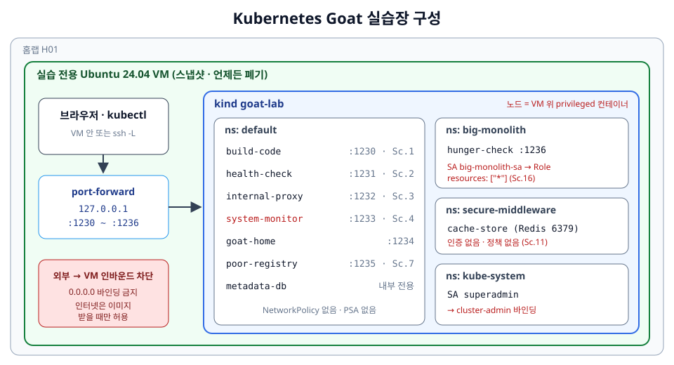
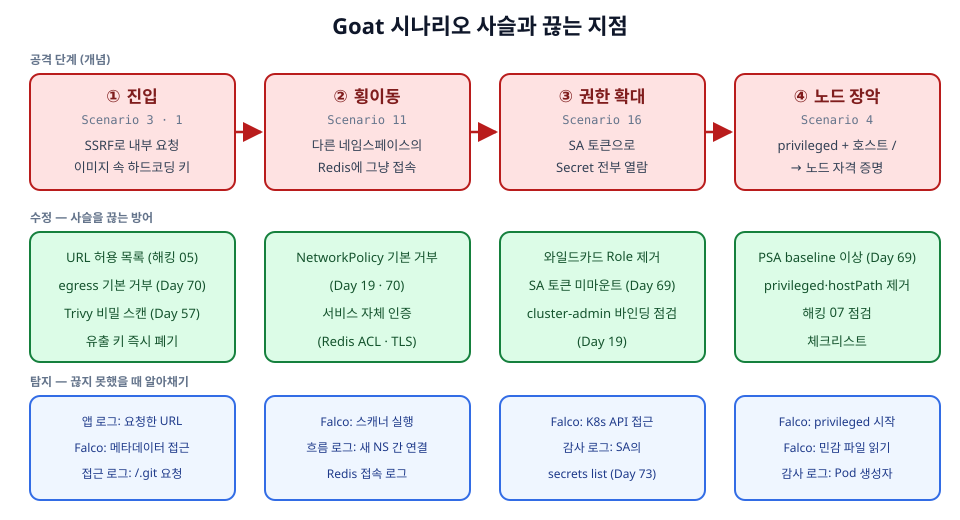

> **해킹 트랙 · 화이트해커 입문** | 난이도 ★★★★☆ | 예상 소요 2.5 ~ 3시간

> ⚠️ **실습 전 반드시 읽기** — 이 글의 모든 실습은 **본인 소유의 격리된 실습장** 또는 **의도적으로 취약하게 만든 연습용 대상**(DVWA, Juice Shop, Metasploitable, Kubernetes Goat, CloudGoat 등)에서만 합니다. 허가 없이 타인의 시스템을 스캔하거나 공격하면 **정보통신망법** 등에 따라 처벌받을 수 있습니다. Kubernetes Goat는 **일부러 뚫리도록 만든 클러스터**입니다. 운영·개인 클러스터(`infra-lab` 포함)에는 절대 설치하지 말고, 오늘 만드는 **일회용 kind 클러스터**에만 올린 뒤 실습이 끝나면 클러스터째 지웁니다. 각 시나리오의 실제 풀이 절차는 이 글에 싣지 않고 **공식 문서 링크**로 대신합니다.

## 🎯 오늘의 목표

- Kubernetes Goat가 무엇이고 왜 **별도 VM의 일회용 kind 클러스터**에 올려야 하는지 설명할 수 있다
- Goat를 설치하고 **외부에 노출되지 않게(127.0.0.1)** 접속 환경을 만든다
- 대표 시나리오 5개(컨테이너 안의 비밀, SSRF, 컨테이너 탈출, 네임스페이스 우회, 과도한 RBAC)를 **원인 → 공격 경로(개념) → 점검 → 탐지 → 수정** 으로 분석한다
- 각 수정을 **Day 19(RBAC)·69(PSA·SA 토큰)·70(NetworkPolicy)** 와 연결해 직접 매니페스트로 고친다
- 실습 후 **클러스터와 흔적을 완전히 삭제**한다

---

## 1. Kubernetes Goat란

**Kubernetes Goat**(github.com/madhuakula/kubernetes-goat)는 Madhu Akula가 만든 오픈소스 **"의도적으로 취약한 쿠버네티스 클러스터 환경"** 입니다. 해킹 02의 DVWA·Juice Shop이 웹 취약점 연습장이라면, Goat는 **클러스터 설정 실수** 연습장입니다.

| 구분 | 내용 |
|---|---|
| 형태 | 기존 클러스터에 취약한 워크로드·RBAC·Helm 차트를 배포하는 스크립트 묶음 |
| 시나리오 | 22개 — 공격형(비밀 노출, SSRF, 탈출, 레지스트리, RBAC …)과 **방어형**(kube-bench, kubeaudit, Falco, Popeye, NetworkPolicy, Tetragon, Kyverno) |
| 요구 사항 | 클러스터 관리자 권한, `kubectl`, `helm` |
| 접속 | 포트 포워딩 후 브라우저 `http://127.0.0.1:1234` (시나리오별 1230~1236) |
| 문서 | madhuakula.com/kubernetes-goat/docs — 시나리오마다 설명·풀이·참고 자료 |

시나리오 목록 중 일부는 이미 이 시리즈에서 **방어 쪽으로** 다뤘습니다.

| Goat 시나리오 | 이 시리즈에서 |
|---|---|
| 5·6. Docker/Kubernetes CIS 벤치마크 | Day 67(Lynis/CIS), Day 69(kube-bench) |
| 18. Falco 런타임 탐지 | Day 72 |
| 20. NetworkPolicy로 경계 만들기 | Day 19, Day 70 |
| 22. Kyverno 정책 엔진 | Day 57 |

오늘은 나머지 **공격형 시나리오**를 "왜 뚫리는가"의 관점에서 보고, 결론은 항상 **위 Day들의 방어로 돌아오게** 합니다.

---

## 2. 실습 환경 — 왜 별도 VM인가



| 항목 | 값 |
|---|---|
| 호스트 | 홈랩(H01) 위 **실습 전용 Ubuntu 24.04 VM** (해킹 07의 Docker 실습 VM 재사용 가능). vCPU 4 / RAM 8GB 이상 |
| 네트워크 | 이미지 받을 때만 인터넷 필요. **VM으로 들어오는 포트는 열지 않음**. 브라우저는 VM 안에서, 또는 SSH 포트 포워딩으로 |
| 클러스터 | kind **`goat-lab`** (control-plane 1 + worker 1), kind v0.33 / Kubernetes v1.37 기준 |
| 도구 | Docker, kind, kubectl, Helm 3 (Day 09·16 방식 설치), `jq` |

**왜 `infra-lab`이 아니라 별도 VM의 별도 클러스터인가?**

1. Goat는 `cluster-admin`에 바인딩된 ServiceAccount, privileged + 호스트 `/` 마운트 Pod 같은 **클러스터 전체를 위험하게 만드는 설정**을 일부러 깝니다. 다른 실습(Ch7 GitOps, Ch8 모니터링)과 섞이면 안 됩니다.
2. 해킹 07 5-2에서 봤듯이 **kind 노드 자체가 privileged 컨테이너**입니다. Goat의 컨테이너 탈출 시나리오에서 "호스트"는 kind 노드 컨테이너지만, 그 노드는 다시 VM 위의 privileged 컨테이너입니다. 즉 **최악의 경우 VM까지** 영향을 받을 수 있다고 가정하고, 그 VM은 **언제든 버릴 수 있는 것**이어야 합니다.
3. Goat의 `access-kubernetes-goat.sh`는 포트 포워딩을 **`0.0.0.0`** 에 엽니다. 취약한 앱이 같은 LAN 전체에 노출된다는 뜻입니다. 오늘은 이 스크립트 대신 **`127.0.0.1`에만** 여는 방법을 씁니다(4-3).

> 💡 VM 스냅샷을 먼저 찍어 두면 "실습 끝 → 스냅샷 복원"으로 가장 깨끗하게 원복됩니다. 스냅샷이 없다면 10장의 삭제 절차를 그대로 따르세요.

---

## 3. 시나리오가 이어지는 방식



Goat의 시나리오는 하나씩 독립적이지만, 실제 침해에서는 **사슬**로 이어집니다. 오늘 고른 다섯 개를 이으면 전형적인 클러스터 침해 흐름이 됩니다.

| 단계 | 시나리오 | 공격자가 얻는 것 | 끊는 방어 |
|---|---|---|---|
| ① 진입 | 3. SSRF / 1. 컨테이너 안의 비밀 | 내부 요청 능력, 하드코딩된 키 | 앱 입력 검증, 이미지 비밀 스캔 |
| ② 횡이동 | 11. 네임스페이스 우회 | 다른 네임스페이스 서비스 | NetworkPolicy 기본 거부 (Day 70) |
| ③ 권한 확대 | 16. 과도한 RBAC | Secret 열람 → 더 많은 자격 증명 | 최소 권한 Role, SA 토큰 미마운트 (Day 19·69) |
| ④ 노드 장악 | 4. 컨테이너 탈출 | 노드 root, 노드 자격 증명 | PSA baseline 이상 (Day 69) |

**한 군데만 끊어도 사슬은 길어지고, 공격은 시끄러워집니다.** 방어를 여러 겹 두는 이유입니다(Day 66 위협 모델).

---

## 4. 설치

### 4-1. 일회용 kind 클러스터

```yaml
# goat-lab.yaml
kind: Cluster
apiVersion: kind.x-k8s.io/v1alpha4
name: goat-lab
nodes:
  - role: control-plane
  - role: worker
```

```bash
kind create cluster --config goat-lab.yaml
kubectl config use-context kind-goat-lab
kubectl config current-context
# kind-goat-lab
```

> ⚠️ Goat의 설치 스크립트는 **현재 kubectl 컨텍스트**에 설치합니다. 실행 직전에 `kubectl config current-context`가 **`kind-goat-lab`** 인지 꼭 확인하세요. 실수로 `kind-infra-lab`에 깔면 그 클러스터에 `cluster-admin` 백도어 SA가 생깁니다.

### 4-2. Goat 받기와 설치

```bash
mkdir -p ~/goat && cd ~/goat
git clone https://github.com/madhuakula/kubernetes-goat.git
cd kubernetes-goat
git log -1 --format='%h %cs'          # 실습한 커밋을 기록해 둔다 (재현성)
```

인터넷에서 받은 스크립트이므로 **실행 전에 읽어 봅니다.** 무엇을 깔고 무엇을 지우는지 알아야 나중에 정리도 할 수 있습니다.

```bash
less setup-kubernetes-goat.sh
less teardown-kubernetes-goat.sh
```

설치 스크립트가 하는 일을 요약하면 다음과 같습니다.

| 순서 | 내용 |
|---|---|
| 1 | `kubectl`이 클러스터에 붙는지 확인 |
| 2 | `scenarios/insecure-rbac/setup.yaml` — `kube-system`에 `superadmin` SA를 만들고 **`cluster-admin`에 바인딩** |
| 3 | Helm으로 `metadata-db` 차트 설치 (SSRF 시나리오의 내부 서비스) |
| 4 | 취약 워크로드 배포 — `build-code`, `health-check`, `internal-proxy`, `system-monitor`, `kubernetes-goat-home`, `poor-registry`, `hunger-check`, `cache-store`, `batch-check`, `hidden-in-layers` |

```bash
bash setup-kubernetes-goat.sh
kubectl get pods -A | grep -vE 'kube-system|local-path-storage'
```

```
NAMESPACE           NAME                                               READY   STATUS
big-monolith        hunger-check-deployment-6c9b8d7f5c-hq2xm           1/1     Running
default             batch-check-job-8m2kp                              0/1     Completed
default             build-code-deployment-5d8f6c8b7d-r7t2n             1/1     Running
default             health-check-deployment-7f4b9c6d8-9wq4p            1/1     Running
default             hidden-in-layers-xk2lp                             1/1     Running
default             internal-proxy-deployment-6b7c8d9f5-mn3bv          2/2     Running
default             kubernetes-goat-home-deployment-58f7b9c6d-2kxjz    1/1     Running
default             metadata-db-7d6c5b8f9-plq8w                        1/1     Running
default             poor-registry-deployment-6f8d7c9b5-tg4vh           1/1     Running
default             system-monitor-deployment-74c8b6d9f7-zx5kw         1/1     Running
secure-middleware   cache-store-deployment-5b9f8c7d6-w8jrn             1/1     Running
```

이미지를 받는 동안 `ContainerCreating`이 몇 분 이어질 수 있습니다. 모두 `Running`(또는 Job은 `Completed`)이 되면 설치 완료입니다.

### 4-3. 접속 — 127.0.0.1에만 열기

공식 `access-kubernetes-goat.sh`는 `kubectl port-forward --address 0.0.0.0`을 씁니다. 오늘은 같은 매핑을 **기본값(127.0.0.1)** 으로 엽니다. 포트 매핑은 공식 스크립트와 같습니다.

```bash
# goat-forward.sh — 공식 access 스크립트와 같은 포트, 단 localhost 전용
set -e
fwd() {  # fwd <namespace> <app 라벨> <로컬 포트> <컨테이너 포트>
  pod=$(kubectl -n "$1" get pods -l app="$2" -o jsonpath='{.items[0].metadata.name}')
  kubectl -n "$1" port-forward "$pod" "$3:$4" > /dev/null 2>&1 &
  echo "$2 → http://127.0.0.1:$3"
}
fwd default      build-code            1230 3000
fwd default      health-check          1231 80
fwd default      internal-proxy        1232 3000
fwd default      system-monitor        1233 8080
fwd default      kubernetes-goat-home  1234 80
fwd default      poor-registry         1235 5000
fwd big-monolith hunger-check          1236 8080
```

```bash
bash goat-forward.sh
ss -tln | grep -E ':123[0-6]'
```

```
LISTEN 0  4096  127.0.0.1:1230  0.0.0.0:*
LISTEN 0  4096  127.0.0.1:1231  0.0.0.0:*
...
```

`127.0.0.1`에만 바인딩된 것을 확인하고, VM 안의 브라우저(또는 `ssh -L 1234:127.0.0.1:1234 <VM>`로 노트북에서)에서 `http://127.0.0.1:1234`를 엽니다. Goat 홈 화면에 시나리오 목록이 보이면 준비 완료입니다.

---

## 5. 시나리오 ① 컨테이너 안의 민감 정보 (Scenario 1 · `build-code`, 1230)

### 원인

- 웹 앱이 **`.git` 디렉터리를 웹 루트에 그대로 둔 채** 서비스합니다. 저장소 메타데이터가 HTTP로 열려 있으면 소스와 **커밋 이력 전체**를 복원할 수 있습니다.
- 이력 속 이전 커밋에 **`.env` 파일과 하드코딩된 클라우드 키**가 있습니다. 나중 커밋에서 지웠어도 이력에는 남습니다.
- 같은 파일이 **컨테이너 이미지 안에도** 들어 있어서, Pod에 exec 할 수 있는 사람이면 누구나 찾을 수 있습니다.

### 공격 경로 (개념)

외부 → 노출된 `.git` 또는 컨테이너 파일 시스템 → 이력 속 키 → (클라우드 키라면) **클러스터 밖 클라우드 계정**으로 확대 — 해킹 09의 시작점이 바로 이런 유출 키입니다. 풀이: [Scenario 1 공식 문서](https://madhuakula.com/kubernetes-goat/docs/scenarios/scenario-1/sensitive-keys-in-codebases-in-kubernetes-containers/welcome)

### 점검 (방어자)

이미지 안에 비밀이 있는지는 **이미지를 스캔**해서 봅니다. Day 57의 Trivy를 비밀 스캐너로 씁니다.

```bash
IMG=$(kubectl get pods -l app=build-code -o jsonpath='{.items[0].spec.containers[0].image}')
echo "$IMG"
trivy image --scanners secret "$IMG"
```

```
... (Secrets)
Total: 2 (UNKNOWN: 0, LOW: 0, MEDIUM: 0, HIGH: 0, CRITICAL: 2)

CRITICAL: AWS (aws-access-key-id)
...
```

> 💡 결과에 나오는 키 값은 **보고서에 그대로 옮기지 말고** 앞뒤 몇 글자만 남겨 가립니다(해킹 11). Goat의 키는 가짜지만, 실제 점검에서는 습관이 중요합니다.

소스 저장소 쪽은 커밋 이력까지 보는 비밀 스캐너(gitleaks, trufflehog 등)를 **pre-commit 훅과 CI**(Day 51)에 둡니다. 현재 트리만 보는 스캔으로는 "지운 커밋"을 못 찾습니다.

### 탐지

| 어디서 | 무엇을 |
|---|---|
| 웹 서버·Ingress 접근 로그 (Day 60 Loki) | `/.git/`, `/.env` 경로 요청 — 정상 사용자는 절대 요청하지 않는 경로 |
| 클라우드 감사 로그 (해킹 09 CloudTrail) | 유출된 키가 **평소와 다른 IP·리전**에서 쓰임 |
| Falco (Day 72) | *Read sensitive file untrusted*, *Search Private Keys or Passwords*(stable) — 컨테이너 안을 뒤지는 행위 |

### 수정

| 위치 | 조치 |
|---|---|
| 빌드 | `.dockerignore`에 `.git`, `.env*` 추가 + 멀티 스테이지 빌드로 **빌드 산출물만** 런타임 이미지에 (Day 03) |
| 웹 서버 | 점(.)으로 시작하는 경로 거부 — nginx라면 `location ~ /\. { deny all; }` |
| 비밀 관리 | 코드·이미지가 아니라 Secret / External Secrets / Vault로 주입 (Day 13·55·71) |
| 사고 대응 | 이력에서 지우는 것으로는 부족 — **키를 즉시 폐기·교체**하고 사용 이력 감사 |

---

## 6. 시나리오 ② SSRF (Scenario 3 · `internal-proxy`, 1232)

### 원인

- 앱이 **사용자가 준 URL을 서버가 대신 요청**하는 기능을 검증 없이 제공합니다(해킹 05의 SSRF와 같은 원리).
- 클러스터 안에는 외부에 노출되지 않은 **`metadata-db`** 서비스가 있고, Pod에서 **서비스 DNS 이름만으로** 닿습니다.
- **Egress NetworkPolicy가 없어서** 이 Pod가 클러스터 내부 아무 곳, 그리고 클라우드라면 **인스턴스 메타데이터 주소(169.254.169.254)** 까지 요청할 수 있습니다.

### 공격 경로 (개념)

외부 사용자 → 앱의 URL 요청 기능 → 앱 Pod가 내부 주소에 요청 → **내부 전용 서비스의 응답이 외부로 되돌아옴**. 클라우드에서는 같은 경로로 노드의 **클라우드 자격 증명**을 노립니다(해킹 09 IMDS). 풀이: [Scenario 3 공식 문서](https://madhuakula.com/kubernetes-goat/docs/scenarios/scenario-3/ssrf-in-the-kubernetes-world/welcome)

### 점검 (방어자)

```bash
# 1) 이 Pod의 egress를 제한하는 정책이 있는가
kubectl get networkpolicy -A
# No resources found        ← 클러스터 전체가 "모두 허용" 상태

# 2) 내부 전용이어야 할 서비스 목록 — 외부에서 직접은 안 닿지만, Pod에서는 전부 닿는다
kubectl get svc -A -o custom-columns=NS:.metadata.namespace,NAME:.metadata.name,TYPE:.spec.type,PORTS:.spec.ports[*].port \
  | grep -v kube-system
```

"Pod 하나가 뚫리면 이 목록 전체가 공격면"이라는 점을 확인하는 것이 점검의 핵심입니다.

### 탐지

| 어디서 | 무엇을 |
|---|---|
| 앱 로그 | 서버가 요청한 **목적지 URL**을 반드시 기록 — 내부 IP, `*.svc`, `169.254.169.254`가 나오면 경보 |
| Falco incubating | *Contact cloud metadata service from container*, *Contact EC2 Instance Metadata Service From Container* |
| 네트워크 흐름 | Cilium을 쓴다면 Hubble 흐름 로그로 `internal-proxy → metadata-db` 같은 **처음 보는 연결** (Day 70 5장) |

### 수정

1차는 **앱 코드** — 허용 목록(도메인·스킴·포트) 기반 URL 검증, 리다이렉트 추적 금지, 내부 주소 해석 결과 차단(해킹 05). 2차는 **네트워크** — 앱이 뚫려도 갈 수 있는 곳을 줄입니다. Day 70의 기본 거부 패턴을 egress에 적용합니다.

```yaml
# fix-internal-proxy-egress.yaml
apiVersion: networking.k8s.io/v1
kind: NetworkPolicy
metadata:
  name: internal-proxy-egress
  namespace: default
spec:
  podSelector:
    matchLabels:
      app: internal-proxy
  policyTypes: [Egress]
  egress:
    # DNS만 허용
    - to:
        - namespaceSelector:
            matchLabels:
              kubernetes.io/metadata.name: kube-system
          podSelector:
            matchLabels:
              k8s-app: kube-dns
      ports:
        - { protocol: UDP, port: 53 }
        - { protocol: TCP, port: 53 }
    # 외부 HTTPS만 허용 — 사설 대역과 링크 로컬(메타데이터) 제외
    - to:
        - ipBlock:
            cidr: 0.0.0.0/0
            except: [10.0.0.0/8, 172.16.0.0/12, 192.168.0.0/16, 169.254.0.0/16]
      ports:
        - { protocol: TCP, port: 443 }
```

```bash
kubectl apply -f fix-internal-proxy-egress.yaml
kubectl describe networkpolicy internal-proxy-egress | sed -n '/Allowing egress/,$p'
```

적용 후 Goat 화면에서 시나리오 3을 다시 열어 보면 내부 서비스 요청이 **시간 초과로 실패**해야 합니다. kind의 기본 CNI(kindnet)는 v0.24부터 NetworkPolicy를 지원합니다(Day 70 3장).

> 💡 클라우드라면 여기에 **IMDSv2 강제와 hop limit 1**(해킹 09)을 더합니다. 네트워크 정책은 "Pod → 메타데이터"를 막고, IMDSv2는 "단순 GET 요청으로는 토큰을 못 받게" 막습니다. 서로 다른 층입니다.

---

## 7. 시나리오 ③ 컨테이너 탈출 (Scenario 4 · `system-monitor`, 1233)

### 원인

해킹 07에서 하나씩 본 위험 설정이 **한 Pod에 전부** 모여 있습니다.

| 설정 | 값 | 해킹 07 |
|---|---|---|
| `securityContext.privileged` | `true` | 4장 |
| `allowPrivilegeEscalation` | `true` | — |
| `hostPID` / `hostIPC` | `true` / `true` | 6장 |
| `hostPath` | 호스트 `/` → 컨테이너 `/host-system` | 8장 |
| 환경 변수 | Secret `goatvault`의 값을 평문 env로 주입 | — |

### 공격 경로 (개념)

앱(1233)에서 셸 획득 → privileged + 호스트 `/` 마운트로 **노드 파일 시스템을 자기 것처럼** 사용 → 노드에 있는 kubelet·관리자 **kubeconfig** → 클러스터 API를 노드(또는 관리자) 권한으로. 즉 **"Pod 하나 = 노드 = 클러스터"** 가 됩니다. 풀이: [Scenario 4 공식 문서](https://madhuakula.com/kubernetes-goat/docs/scenarios/scenario-4/container-escape-to-the-host-system-in-kubernetes-containers/welcome)

### 점검 (방어자)

해킹 07 9-2의 `jq` 점검을 그대로 돌립니다.

```bash
kubectl get pods -A -o json | jq -r '
  .items[] | . as $p |
  [ (if .spec.hostPID then "hostPID" else empty end),
    (if .spec.hostIPC then "hostIPC" else empty end),
    ( .spec.containers[] | select(.securityContext.privileged == true) | "privileged:" + .name ),
    ( .spec.volumes[]? | select(.hostPath != null) | "hostPath:" + .hostPath.path )
  ] | select(length > 0) | "\($p.metadata.namespace)/\($p.metadata.name)\t\(join(" "))"' \
  | grep -v '^kube-system/'
```

```
default/system-monitor-deployment-74c8b6d9f7-zx5kw	hostPID hostIPC privileged:system-monitor hostPath:/
default/health-check-deployment-7f4b9c6d8-9wq4p	privileged:health-check hostPath:/ hostPath:/run/containerd/containerd.sock hostPath:/var/run/docker.sock
```

두 번째 줄도 눈여겨보세요. `health-check`(Scenario 2, Docker-in-Docker)는 privileged에 호스트 `/`, 그리고 **런타임 소켓 경로(containerd·docker)를 hostPath로 선언**합니다 — 해킹 07 5·8장 그대로입니다. (init 컨테이너만 privileged인 경우도 잡으려면 `.spec.initContainers[]`까지 보는 해킹 07 9-2의 전체 버전을 쓰세요.) 소켓이 실제로 어떻게 연결되는지와 별개로, **매니페스트가 그런 설정을 요구한다는 것 자체**가 점검 결과입니다.

PSA를 걸면 어떤 Pod가 걸리는지 **dry-run**으로 확인합니다(Day 69 6-1).

```bash
kubectl label --dry-run=server --overwrite ns default pod-security.kubernetes.io/enforce=baseline
```

```
Warning: existing pods in namespace "default" violate the new PodSecurity enforce level "baseline:latest"
Warning: system-monitor-deployment-...: host namespaces, hostPath volumes, privileged
Warning: health-check-deployment-...: hostPath volumes, privileged
namespace/default labeled (server dry run)
```

### 탐지

- 해킹 07 10-2의 커스텀 룰 *Privileged container started* — 이 클러스터에 Falco를 올렸다면 Goat 설치 순간 울립니다.
- stable 룰 *Read sensitive file untrusted* — `/host-system/etc/shadow`처럼 마운트를 통한 호스트 민감 파일 읽기.
- 감사 로그 — `privileged: true`인 Pod **생성 요청**과 요청자(Day 73).

> 💡 Goat 자체에 **Scenario 18(Falco)** 이 있습니다. 이 일회용 클러스터에 Day 72의 values로 Falco를 올리고 시나리오를 따라가며 경보를 보는 것이 해킹 10의 좋은 예습이 됩니다.

### 수정

```yaml
# system-monitor 수정본의 핵심 (Pod 템플릿 부분)
spec:
  automountServiceAccountToken: false
  # hostPID, hostIPC 삭제 (기본값 false)
  securityContext:
    runAsNonRoot: true
    runAsUser: 10001
    seccompProfile: { type: RuntimeDefault }
  containers:
    - name: system-monitor
      securityContext:
        privileged: false
        allowPrivilegeEscalation: false
        readOnlyRootFilesystem: true
        capabilities: { drop: [ALL] }
      # 호스트 지표가 필요하면 hostPath / 대신 node-exporter(Day 17)를 쓴다
      # 비밀은 env 대신 파일로 마운트하거나 외부 시크릿 매니저에서 (Day 71)
```

그리고 **재발 방지**는 개별 Pod가 아니라 네임스페이스 정책입니다.

```bash
kubectl label ns default pod-security.kubernetes.io/enforce=baseline \
  pod-security.kubernetes.io/warn=restricted --overwrite
```

이후 같은 매니페스트를 다시 적용하면 Day 69 6-4처럼 ReplicaSet 이벤트에 `violates PodSecurity "baseline"`이 남고 Pod가 생성되지 않습니다.

---

## 8. 시나리오 ④ 네임스페이스 우회 (Scenario 11 · `cache-store`)

### 원인

- 이름이 `secure-middleware`인 네임스페이스에 Redis(`cache-store-service`, 6379)가 있지만 **NetworkPolicy가 하나도 없습니다.** Day 19 6-7에서 봤듯이 **네임스페이스는 네트워크 경계가 아닙니다.**
- Redis가 **인증 없이** 접속을 받습니다.
- 그 안에 민감한 값이 들어 있습니다.

### 공격 경로 (개념)

`default`의 아무 Pod(예: 뚫린 웹 앱) → 클러스터 대역 스캔 또는 서비스 DNS(`<서비스>.<네임스페이스>`) 추측 → 다른 네임스페이스의 Redis에 **그냥 접속**. 풀이: [Scenario 11 공식 문서](https://madhuakula.com/kubernetes-goat/docs/scenarios/scenario-11/kubernetes-namespaces-bypass-from-kubernetes-cluster-pod/welcome)

### 점검 (방어자)

```bash
# NetworkPolicy가 하나도 없는 네임스페이스 찾기
for ns in $(kubectl get ns -o jsonpath='{.items[*].metadata.name}'); do
  n=$(kubectl -n "$ns" get networkpolicy --no-headers 2>/dev/null | wc -l)
  [ "$n" -eq 0 ] && echo "NetworkPolicy 없음: $ns"
done
```

```
NetworkPolicy 없음: big-monolith
NetworkPolicy 없음: kube-node-lease
NetworkPolicy 없음: kube-public
NetworkPolicy 없음: kube-system
NetworkPolicy 없음: local-path-storage
NetworkPolicy 없음: secure-middleware
```

`default`가 빠진 것은 6장에서 egress 정책을 하나 넣었기 때문입니다 — 하지만 그 정책은 `internal-proxy`만 고릅니다. **"정책이 있다"와 "기본 거부다"는 다릅니다.**

### 탐지

| 어디서 | 무엇을 |
|---|---|
| Falco incubating | *Launch Suspicious Network Tool in Container* — 컨테이너 안에서 `nmap`·`zmap` 같은 스캐너 실행 |
| 네트워크 흐름 (Cilium Hubble 등) | 평소에 없던 **네임스페이스 간 연결**, 짧은 시간에 많은 IP·포트로 가는 연결 |
| Redis | `CLIENT LIST`·접속 로그에 앱이 아닌 Pod IP |

### 수정

Day 70 4장의 **기본 거부 + 필요한 것만 허용**을 그대로 적용합니다. Redis를 쓰는 앱이 `big-monolith`에 있다고 가정합니다.

```yaml
# fix-secure-middleware.yaml
apiVersion: networking.k8s.io/v1
kind: NetworkPolicy
metadata:
  name: default-deny
  namespace: secure-middleware
spec:
  podSelector: {}
  policyTypes: [Ingress, Egress]
---
apiVersion: networking.k8s.io/v1
kind: NetworkPolicy
metadata:
  name: allow-redis-from-app
  namespace: secure-middleware
spec:
  podSelector:
    matchLabels:
      app: cache-store
  policyTypes: [Ingress]
  ingress:
    - from:
        - namespaceSelector:
            matchLabels:
              kubernetes.io/metadata.name: big-monolith
          podSelector:              # 하이픈 없음 → AND (Day 70 2-3)
            matchLabels:
              app: hunger-check
      ports:
        - { protocol: TCP, port: 6379 }
```

```bash
kubectl apply -f fix-secure-middleware.yaml
kubectl -n secure-middleware get networkpolicy
```

여기에 Redis 자체의 **ACL/비밀번호와 TLS**를 더해야 합니다. 네트워크 정책은 "닿을 수 있는가", 인증은 "닿아도 쓸 수 있는가"입니다. 제로 트러스트(Day 70 1장)는 둘 다 요구합니다.

---

## 9. 시나리오 ⑤ 과도한 RBAC (Scenario 16 · `big-monolith`)

### 원인

`scenarios/hunger-check/deployment.yaml`을 읽어 보면 원인이 그대로 보입니다.

| 오브젝트 | 내용 | 문제 |
|---|---|---|
| ServiceAccount | `big-monolith-sa` | Pod에 **토큰이 자동 마운트**됨 |
| Role | `secret-reader` — apiGroups `[""]`, resources **`["*"]`**, verbs `get, list, watch` | 이름은 "secret-reader"지만 실제로는 **코어 그룹 전부**를 읽음 |
| RoleBinding | `secret-reader-binding` → `big-monolith-sa` | — |

여기에 설치 스크립트가 만든 **클러스터 수준** 문제가 하나 더 있습니다. `kube-system`의 `superadmin` SA가 **`cluster-admin`** 에 바인딩되어 있습니다(`insecure-rbac`).

### 공격 경로 (개념)

`hunger-check` 앱 침해 → Pod 안에 마운트된 SA 토큰 → API 서버에 그 SA로 요청 → 네임스페이스의 **Secret 전부** 열람 → 그 안의 API 키로 다음 단계. 토큰이 `cluster-admin` SA의 것이라면 한 번에 클러스터 전체입니다. 풀이: [Scenario 16 공식 문서](https://madhuakula.com/kubernetes-goat/docs/scenarios/scenario-16/rbac-least-privileges-misconfiguration-in-kubernetes-cluster/welcome)

### 점검 (방어자)

```bash
# 1) 이 SA가 실제로 무엇을 할 수 있는가 (Day 19의 can-i)
kubectl auth can-i --list -n big-monolith \
  --as=system:serviceaccount:big-monolith:big-monolith-sa | head
```

```
Resources                                       Non-Resource URLs   Resource Names   Verbs
*                                               []                  []               [get watch list]
selfsubjectreviews.authentication.k8s.io        []                  []               [create]
...
```

```bash
kubectl auth can-i get secrets -n big-monolith \
  --as=system:serviceaccount:big-monolith:big-monolith-sa
# yes
```

```bash
# 2) 와일드카드(*)를 쓰는 Role/ClusterRole 찾기 (system: 기본 역할 제외)
kubectl get roles,clusterroles -A -o json | jq -r '
  .items[] | select(.metadata.name | startswith("system:") | not)
  | select([.rules[]? | (.resources // []) + (.verbs // []) | .[]] | index("*"))
  | "\(.kind)\t\(.metadata.namespace // "-")\t\(.metadata.name)"'
```

```
Role         big-monolith   secret-reader
ClusterRole  -              admin
ClusterRole  -              cluster-admin
ClusterRole  -              edit
```

`admin`, `edit`, `cluster-admin`은 기본 제공 역할이라 와일드카드가 정상입니다(Day 19 4장). 확인할 것은 **사용자가 만든** `secret-reader`입니다.

```bash
# 3) cluster-admin에 묶인 주체 — 사람·SA가 예상한 목록과 같은가
kubectl get clusterrolebindings -o json | jq -r '
  .items[] | select(.roleRef.name == "cluster-admin")
  | "\(.metadata.name)\t" + ([.subjects[]? | "\(.kind):\(.namespace // "-")/\(.name)"] | join(", "))'
```

```
cluster-admin   Group:-/system:masters
kubeadm:cluster-admins   Group:-/kubeadm:cluster-admins
superadmin      ServiceAccount:kube-system/superadmin      ← 🔴 예상에 없는 SA
```

### 탐지

| 어디서 | 무엇을 |
|---|---|
| Falco stable | *Contact K8S API Server From Container* — API를 쓸 이유가 없는 앱 컨테이너가 API 서버에 연결 |
| 감사 로그 (Day 73) | `user.username`이 `system:serviceaccount:big-monolith:…`이고 `objectRef.resource=secrets`, `verb=list` — **앱 SA가 Secret을 나열**하는 것은 거의 항상 이상 징후 |
| 주기 점검 | 위 `jq` 점검을 CI나 크론으로 — 새 와일드카드 Role·cluster-admin 바인딩이 생기면 알림 |

### 수정

```yaml
# fix-big-monolith-rbac.yaml — 앱이 정말 필요한 것만 (예: 자기 ConfigMap 하나 읽기)
apiVersion: rbac.authorization.k8s.io/v1
kind: Role
metadata:
  name: secret-reader          # 같은 이름으로 덮어써서 권한 축소
  namespace: big-monolith
rules:
  - apiGroups: [""]
    resources: ["configmaps"]
    resourceNames: ["hunger-check-config"]
    verbs: ["get"]
```

```bash
kubectl apply -f fix-big-monolith-rbac.yaml

# 앱이 API를 안 쓴다면 토큰 자체를 넣지 않는다 (Day 69 8장)
kubectl -n big-monolith patch sa big-monolith-sa -p '{"automountServiceAccountToken": false}'
kubectl -n big-monolith rollout restart deploy hunger-check-deployment

# 클러스터 수준 백도어 제거
kubectl delete clusterrolebinding superadmin
kubectl -n kube-system delete sa superadmin

# 재확인
kubectl auth can-i get secrets -n big-monolith --as=system:serviceaccount:big-monolith:big-monolith-sa
# no
```

> 💡 RBAC 수정 원칙은 Day 19 그대로입니다. **와일드카드 금지, 가능하면 `resourceNames`로 대상 고정, Secret `list`/`watch`는 특히 신중히**(list 한 번에 네임스페이스의 모든 Secret 값이 옵니다), 그리고 **쓰지 않는 토큰은 마운트하지 않기.**

---

## 10. 실습 정리 — 클러스터째 삭제

Goat는 "지우고 끝"이 원칙입니다. 공식 teardown 스크립트는 Goat가 만든 리소스만 지우고, 스스로도 **클러스터를 지우는 편이 더 안전하다**고 안내합니다.

```bash
# 1) 포트 포워딩 종료
pkill -f 'kubectl.*port-forward' || true
ss -tln | grep -E ':123[0-6]' || echo "포트 포워딩 없음"

# 2) 클러스터 삭제 — kubeconfig의 kind-goat-lab 컨텍스트도 함께 제거됨
kind delete cluster --name goat-lab
kind get clusters                       # goat-lab 이 없어야 함
kubectl config get-contexts | grep goat || echo "goat 컨텍스트 없음"

# 3) 받은 저장소와 매니페스트 정리
rm -rf ~/goat

# 4) VM에 남은 Goat 이미지 정리 (kind 노드와 함께 대부분 사라지지만 로컬 Docker에 받은 것이 있다면)
docker images --format '{{.Repository}}:{{.Tag}}' | grep -i 'k8s-goat' | xargs -r docker rmi
```

```
포트 포워딩 없음
Deleting cluster "goat-lab" ...
Deleted nodes: ["goat-lab-control-plane" "goat-lab-worker"]
goat 컨텍스트 없음
```

마지막으로 컨텍스트를 원래 실습 클러스터로 돌립니다.

```bash
kubectl config use-context kind-infra-lab
```

VM 스냅샷을 찍어 두었다면 스냅샷 복원이 가장 확실합니다.

---

## 11. 트러블슈팅

| 증상 | 원인 | 해결 |
|---|---|---|
| `setup-kubernetes-goat.sh`가 "kubectl 확인 실패"로 종료 | 컨텍스트가 없거나 클러스터가 안 떠 있음 | `kubectl cluster-info --context kind-goat-lab` 확인 |
| Pod가 오래 `ContainerCreating` / `ImagePullBackOff` | 이미지 다운로드 중이거나 VM 인터넷 차단 | `kubectl describe pod`의 Events 확인. 격리망이면 설치 동안만 NAT 허용 |
| `metadata-db` 설치 실패 | Helm 미설치·구버전 | `helm version`으로 v3 확인 (Day 16) |
| 포트 포워딩이 바로 끊김 | Pod 재시작으로 대상 Pod 이름이 바뀜 | `goat-forward.sh` 다시 실행 |
| 실수로 `infra-lab`에 설치함 | 컨텍스트 확인 누락 | 그 클러스터에서 `bash teardown-kubernetes-goat.sh` 실행 후 9장의 `superadmin` 바인딩이 사라졌는지 `jq` 점검으로 재확인. 가장 안전한 것은 클러스터 재생성 |
| NetworkPolicy를 넣어도 차단이 안 됨 | 구버전 kind(v0.24 미만)의 kindnet | `kind version` 확인 후 업그레이드 (Day 70 3장) |
| PSA 라벨 후에도 기존 Pod가 그대로 | PSA는 **생성 시점**만 검사 | `kubectl rollout restart` 후 새 Pod가 거부되는지 이벤트 확인 (Day 69 3장) |

---

## 12. 핵심 정리

- Kubernetes Goat는 **의도적으로 취약한 클러스터**. 반드시 **별도 VM의 일회용 kind 클러스터**에, 포트는 **127.0.0.1에만** 열고, 끝나면 **클러스터째 삭제**
- 다섯 시나리오는 하나의 사슬: **진입(SSRF·비밀) → 횡이동(네임스페이스) → 권한 확대(RBAC) → 노드 장악(탈출)**
- 컨테이너 안의 비밀 → 이미지 비밀 스캔(Trivy), `.dockerignore`·멀티 스테이지, **유출 키는 즉시 폐기**
- SSRF → 앱의 URL 허용 목록 + **egress 기본 거부**(Day 70) + 클라우드 IMDSv2(해킹 09)
- 컨테이너 탈출 → 해킹 07 점검 + **PSA baseline 이상**(Day 69)
- 네임스페이스 우회 → 네임스페이스는 경계가 아니다. **기본 거부 NetworkPolicy** + 서비스 자체 인증
- 과도한 RBAC → 와일드카드 금지, `resourceNames`, **토큰 미마운트**, cluster-admin 바인딩 정기 점검(Day 19·69)
- 탐지는 Falco(*Contact K8S API Server From Container*, *Read sensitive file untrusted*, 커스텀 privileged 룰) + 감사 로그 + 네트워크 흐름

---

## 13. 셀프 체크

<details>
<summary>Q1. Kubernetes Goat를 Day 09의 <code>infra-lab</code>이 아니라 별도 VM의 <code>goat-lab</code>에 설치하는 이유 두 가지는?</summary>

① Goat는 `cluster-admin` SA, privileged + 호스트 `/` 마운트 Pod 등 **클러스터 전체를 위험하게 만드는 설정**을 일부러 설치하므로 다른 실습과 섞이면 안 됩니다. ② kind 노드 자체가 VM 위의 **privileged 컨테이너**라서, 탈출 시나리오의 영향이 kind 노드를 넘어 VM까지 갈 수 있다고 가정해야 합니다. 그래서 언제든 버릴 수 있는 VM에서 합니다.
</details>

<details>
<summary>Q2. SSRF 시나리오에서 앱 코드를 고치기 전에 플랫폼 팀이 먼저 할 수 있는 조치는?</summary>

해당 Pod에 **egress NetworkPolicy**를 걸어 DNS와 꼭 필요한 외부 목적지만 허용하고, 사설 대역과 `169.254.0.0/16`(메타데이터)을 제외합니다. 앱이 여전히 취약해도 **갈 수 있는 곳**이 줄어 피해가 제한됩니다. 클라우드에서는 IMDSv2 강제를 함께 둡니다.
</details>

<details>
<summary>Q3. 이름이 <code>secret-reader</code>인 Role이 왜 문제였나? 이름만 보고 판단하면 안 되는 이유는?</summary>

`resources: ["*"]`라서 Secret만이 아니라 **코어 API 그룹 전부**를 읽을 수 있었습니다. RBAC은 이름이 아니라 **규칙**이 권한을 결정합니다. `kubectl auth can-i --list --as=…`로 **실제 권한**을 확인하는 습관이 필요합니다.
</details>

<details>
<summary>Q4. <code>secure-middleware</code> 네임스페이스에 NetworkPolicy를 넣었는데 Redis에 비밀번호도 걸어야 하는 이유는?</summary>

NetworkPolicy는 "누가 **닿을 수 있는가**"만 정합니다. 허용된 Pod(예: `hunger-check`)가 뚫리면 그 Pod에서는 여전히 Redis에 닿습니다. 서비스 자체 인증은 "닿아도 **쓸 수 있는가**"를 정합니다. 제로 트러스트는 네트워크 위치를 신뢰하지 않으므로 둘 다 필요합니다.
</details>

<details>
<summary>Q5. 실습이 끝난 뒤 teardown 스크립트만 돌리는 것보다 <code>kind delete cluster</code>가 나은 이유는?</summary>

teardown은 Goat가 **만든 것으로 알려진 리소스**만 지웁니다. 실습 중에 직접 만든 Pod·바인딩, 시나리오를 따라가다 바뀐 설정은 남을 수 있습니다. 클러스터를 통째로 지우면 남은 것이 없음을 보장할 수 있고, VM 스냅샷 복원은 그보다 더 확실합니다.
</details>

---

## ⏭️ 다음 예고 — 해킹 09. 클라우드 IAM 설정 실수 — CloudGoat 개념

오늘 시나리오 1·3의 끝은 늘 "클라우드 자격 증명"이었습니다. 클러스터 밖, **클라우드 계정의 IAM**이 다음 무대입니다. 과도한 권한, `iam:PassRole`을 이용한 권한 상승 경로, 공개 S3, 메타데이터 SSRF(IMDSv1과 v2의 차이)를 Rhino Security Labs의 **CloudGoat** 시나리오로 개념 정리하고, 최소 권한·IAM Access Analyzer·IMDSv2 강제·CloudTrail 탐지로 막는 방법을 봅니다. OpenStack Keystone(Day 27) 역할 모델과도 비교합니다.
