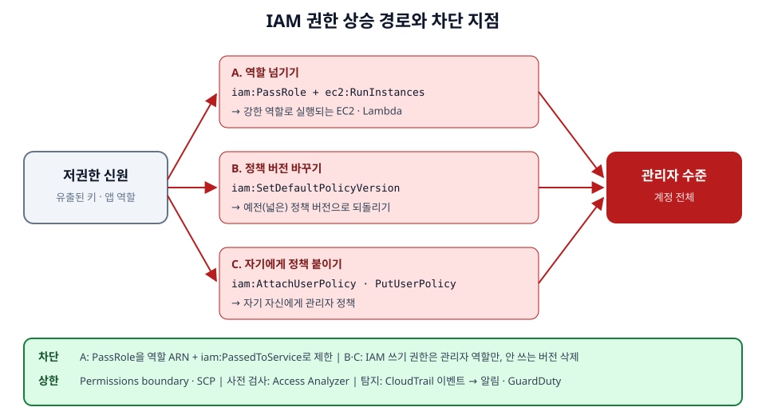
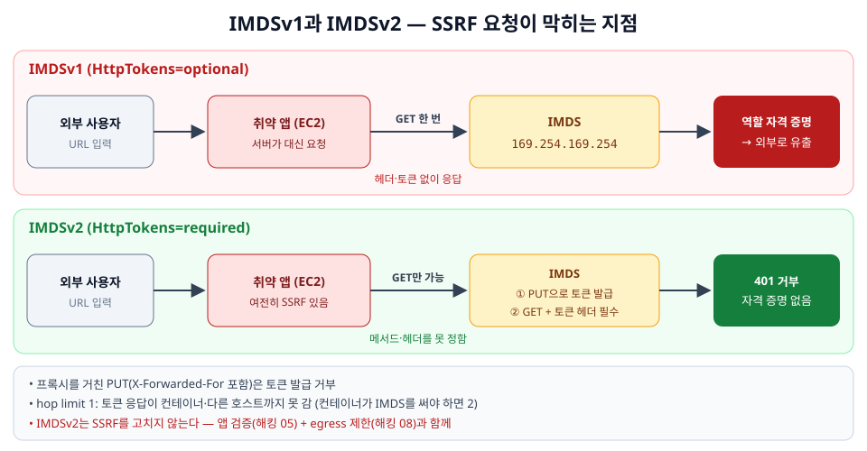
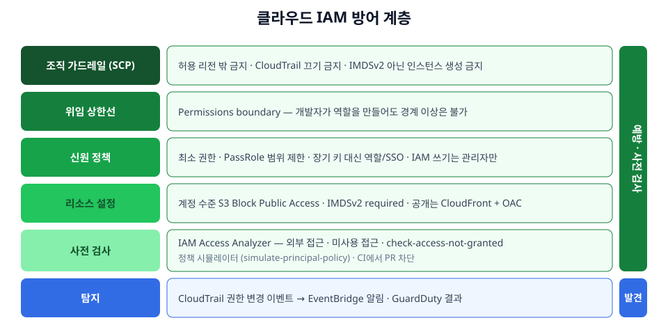

> **해킹 트랙 · 화이트해커 입문** | 난이도 ★★★★☆ | 예상 소요 2 ~ 2.5시간 (AWS 계정 준비 제외)

> ⚠️ **실습 전 반드시 읽기** — 이 글의 모든 실습은 **본인 소유의 격리된 실습장** 또는 **의도적으로 취약하게 만든 연습용 대상**(DVWA, Juice Shop, Metasploitable, Kubernetes Goat, CloudGoat 등)에서만 합니다. 허가 없이 타인의 시스템을 스캔하거나 공격하면 **정보통신망법** 등에 따라 처벌받을 수 있습니다. 클라우드에서는 특히 **"내 회사 계정이니까 괜찮겠지"가 통하지 않습니다.** CloudGoat는 **본인이 소유하고 비용을 내는, 운영 리소스가 전혀 없는 샌드박스 AWS 계정**에서만 쓰세요. 회사·학교·고객 계정, 다른 사람이 만들어 준 계정은 대상이 아닙니다. 또 AWS 자체도 고객 계정 안에서 하는 보안 테스트에 대해 **허용·금지 활동 정책**을 두고 있으니 실습 전에 확인하세요.

> 💸 **요금 경고** — CloudGoat는 시나리오마다 EC2, Lambda, RDS, ECS 같은 **실제 과금 리소스**를 만듭니다. 무료 사용 범위를 넘을 수 있고, **켜 둔 채 잊으면 계속 과금**됩니다. 실습을 시작하기 전에 **결제 알림(AWS Budgets)** 을 걸고, 끝나면 반드시 **`cloudgoat destroy`** 로 지운 뒤 남은 리소스가 없는지 확인합니다(7-5).

## 🎯 오늘의 목표

- 클라우드 침해의 흔한 출발점인 **IAM 설정 실수** 네 가지(과도한 권한, 권한 상승 경로, 공개 S3, 메타데이터 SSRF)를 설명할 수 있다
- `iam:PassRole`, 정책 버전 되돌리기 같은 **권한 상승 경로**가 왜 생기는지 원리 수준으로 이해한다
- **IMDSv1과 IMDSv2의 차이**를 설명하고, IMDSv2를 강제하는 방법을 안다
- CloudGoat를 **본인 샌드박스 계정**에 설치해 시나리오 하나를 띄우고, **방어자 시각으로 점검한 뒤 반드시 destroy** 한다
- 최소 권한, **IAM Access Analyzer**, **IMDSv2 강제**, **CloudTrail·GuardDuty 탐지**로 각 실수를 막고 찾는 방법을 정리한다

---

## 1. 왜 클라우드 IAM인가

해킹 08의 시나리오 1(컨테이너 안의 비밀)과 3(SSRF)은 결국 **클라우드 자격 증명**에서 끝났습니다. 클러스터를 아무리 단단히 해도, 그 밖의 클라우드 계정에서 키 하나가 너무 많은 일을 할 수 있다면 피해는 클러스터를 넘어갑니다.

클라우드에서는 "네트워크 경계"보다 **"신원(identity)이 곧 경계"** 입니다. 방화벽 뒤에 있는 서버가 아니라, **API를 부를 수 있는 자격 증명**이 공격 대상입니다.

| 온프레미스 사고방식 | 클라우드 현실 |
|---|---|
| 내부망에 들어와야 공격 가능 | 인터넷 어디서든 **키만 있으면** API 호출 |
| 서버 root가 최고 권한 | **IAM 권한**이 최고 권한 (서버 생성·삭제, 데이터 복사, 로그 끄기) |
| 방화벽 규칙이 핵심 설정 | **IAM 정책 JSON**이 핵심 설정 |
| 침입 흔적은 서버 로그 | 침입 흔적은 **CloudTrail**(API 호출 기록) |

Day 27에서 본 Keystone의 비교표(Project ↔ Account, Role Assignment ↔ IAM Policy 연결)를 떠올리면, 오늘은 그 표의 **AWS 칸에서 생기는 실수**를 보는 날입니다. 9장에서 다시 비교합니다.

---

## 2. CloudGoat란

**CloudGoat**(github.com/RhinoSecurityLabs/cloudgoat)는 클라우드 보안 회사 Rhino Security Labs가 만든 **"의도적으로 취약하게 설계된 AWS(일부 Azure) 배포 도구"** 입니다. Terraform으로 시나리오별 취약 환경을 내 계정에 만들고, 끝나면 지웁니다. Kubernetes Goat의 클라우드판이라고 보면 됩니다.

| 항목 | 내용 (2026-11 확인) |
|---|---|
| 설치 | `pipx install cloudgoat` (작성 시점 GitHub 최신 릴리스 v2.5.0) |
| 요구 사항 | Linux 또는 macOS(**Windows는 공식 미지원** → WSL2 Ubuntu 사용), Python 3.9+, **Terraform 1.5.0 이상**, AWS CLI, jq |
| 핵심 명령 | `cloudgoat config aws` · `config whitelist` · `create <시나리오>` · `list` · **`destroy <시나리오>`** / **`destroy all`** |
| 시나리오 | 난이도 Easy / Medium / Hard로 20여 개 |

오늘의 네 가지 개념과 관련된 대표 시나리오는 다음과 같습니다. **풀이 절차는 이 글에 싣지 않고**, 각 시나리오 폴더의 공식 README와 cheat sheet(저장소의 `cloudgoat/scenarios/aws/<이름>/`)를 참고하세요.

| 개념 | 시나리오 (난이도) | 한 줄 요약 |
|---|---|---|
| 과도한 권한 / 열거 | `iam_enum_basics` (Easy) | 낮은 권한 사용자로 정책·그룹·역할을 열거하는 연습 |
| 권한 상승 — 정책 버전 | `iam_privesc_by_rollback` (Easy) | 예전 정책 버전에 숨어 있던 관리자 권한 |
| 권한 상승 — PassRole | `lambda_privesc` (Easy), `iam_privesc_by_attachment` (Medium) | 더 강한 역할을 서비스(Lambda·EC2)에 "넘겨" 실행 |
| 공개 S3 | `static` (Medium) | 공개 쓰기가 열린 S3의 정적 파일 |
| 메타데이터 SSRF | `cloud_breach_s3`, `ec2_ssrf` (Medium) | 잘못 설정된 프록시·SSRF로 인스턴스 메타데이터의 임시 자격 증명 → S3 |

---

## 3. 개념 ① 과도한 권한

가장 흔하고 가장 단순한 실수입니다.

| 패턴 | 예 | 왜 위험한가 |
|---|---|---|
| 와일드카드 | `"Action": "*"`, `"Resource": "*"`, `"Action": "s3:*"` | 앱이 필요한 것보다 수십~수백 배 많은 일을 할 수 있음 |
| 관리형 정책 남용 | 앱 역할에 `AdministratorAccess`, `PowerUserAccess` | 키 하나 = 계정 전체 |
| 장기 자격 증명 | IAM 사용자 액세스 키를 코드·CI·노트북에 오래 보관 | 유출되면 폐기 전까지 계속 유효 (해킹 08 시나리오 1) |
| 사람 계정 공유 | 팀이 IAM 사용자 하나를 같이 씀 | 누가 무엇을 했는지 CloudTrail로 구분 불가 |
| 쓰지 않는 권한 방치 | 1년 동안 한 번도 안 쓴 `iam:*` | 공격면만 넓힘 |

Day 19 RBAC에서 "와일드카드 금지, 필요한 동사만"이라고 했던 원칙과 정확히 같습니다. 다만 AWS는 서비스와 액션이 수천 개라 **사람이 손으로 최소 권한을 맞추기 어렵다**는 점이 다르고, 그래서 8장의 **Access Analyzer** 같은 도구가 필요합니다.

---

## 4. 개념 ② 권한 상승 경로



### 4-1. "관리자 권한이 없는데 관리자가 된다"

권한 상승은 **직접 가진 권한은 약하지만, 그 권한으로 "더 강한 권한을 만들거나 빌릴 수 있는"** 조합에서 생깁니다. 해킹 06의 리눅스 권한 상승(sudo 설정 실수)과 구조가 같습니다. 대표 조합을 원리 수준으로 보면 다음과 같습니다.

| 가진 권한 (조합) | 원리 | 관련 시나리오 |
|---|---|---|
| `iam:PassRole` + `ec2:RunInstances` | 강한 역할을 붙인 EC2를 만들 수 있음 → 그 인스턴스 안의 코드는 **강한 역할로** 실행 | `iam_privesc_by_attachment` |
| `iam:PassRole` + `lambda:CreateFunction` + `lambda:InvokeFunction` | 강한 역할로 실행되는 Lambda를 만들어 호출 | `lambda_privesc` |
| `iam:CreatePolicyVersion` | 자기에게 붙은 관리형 정책의 **새 버전**(기본 버전으로 지정)을 만들 수 있음 → 내용을 마음대로 | (교과서 사례) |
| `iam:SetDefaultPolicyVersion` | 정책의 **예전 버전**으로 되돌릴 수 있음 → 예전 버전에 넓은 권한이 남아 있었다면 그대로 획득 | `iam_privesc_by_rollback` |
| `iam:AttachUserPolicy` / `iam:PutUserPolicy` (자기 자신 대상) | 자기에게 관리자 정책을 붙임 | (교과서 사례) |
| `iam:CreateAccessKey` (다른 사용자 대상) | 더 강한 사용자의 키를 새로 발급 | (교과서 사례) |
| `iam:UpdateAssumeRolePolicy` | 강한 역할의 **신뢰 정책**에 자기를 추가해 그 역할을 맡음 | (교과서 사례) |

### 4-2. `iam:PassRole`이 특별한 이유

`PassRole`은 그 자체로는 **아무 API도 아닙니다.** "EC2·Lambda 같은 서비스에 역할을 **넘겨 줄** 수 있는가"를 확인하는 **권한 검사**일 뿐입니다. 그래서 두 가지 함정이 있습니다.

1. 정책을 쓸 때 `"Action": "iam:PassRole", "Resource": "*"` 처럼 **넓게 주기 쉽습니다.** "역할을 넘기는 건 위험해 보이지 않으니까." 하지만 `Resource: *`면 계정의 **관리자 역할도** 넘길 수 있습니다.
2. CloudTrail에 `PassRole`이라는 **이벤트가 따로 남지 않습니다.** `RunInstances`, `CreateFunction` 이벤트의 요청 파라미터에 **어떤 역할이 붙었는지**로 봐야 합니다(8-5).

> 💡 K8s로 바꿔 보면 해킹 07 9-3의 "`create pods` 권한 + PSA 없음 = 노드 root"와 같은 구조입니다. **무언가를 "만들 수 있는" 권한은, 그것이 가진 권한까지 빌려 쓸 수 있는 권한**입니다.

---

## 5. 개념 ③ 공개 S3

| 공개되는 방식 | 설명 |
|---|---|
| 버킷 정책 | `"Principal": "*"` + `s3:GetObject`(읽기) 또는 `s3:PutObject`(쓰기) |
| ACL | `public-read` / `public-read-write` 같은 예전 방식 |
| 정적 웹 호스팅 | 웹 사이트용으로 공개했는데 **업로드 경로나 백업 파일**까지 같이 공개 |

**읽기 공개**는 데이터 유출(백업, 로그, 고객 파일)이고, **쓰기 공개**는 더 나쁩니다. CloudGoat `static` 시나리오처럼 공개 버킷의 **JavaScript 파일을 바꿔치기**할 수 있으면, 그 파일을 불러오는 모든 사용자(관리자 포함) 브라우저에서 공격자 코드가 돕니다 — 해킹 04의 XSS와 Day 57의 공급망 공격이 만나는 지점입니다.

> 💡 AWS는 2023년 4월부터 **새 버킷에 S3 Block Public Access를 기본으로 켜고 ACL을 비활성화**합니다. 그래서 요즘의 공개 S3 사고는 대부분 **누군가 일부러 끈 것**입니다. "왜 껐는지"가 점검 질문입니다.

---

## 6. 개념 ④ 메타데이터 SSRF — IMDSv1 vs IMDSv2



EC2 인스턴스 안에서는 링크 로컬 주소 **`169.254.169.254`** 의 **인스턴스 메타데이터 서비스(IMDS)** 에 물어서 인스턴스 정보와 **인스턴스에 붙은 IAM 역할의 임시 자격 증명**을 받습니다. 앱이 키를 코드에 넣지 않아도 되게 해 주는 좋은 기능이지만, 해킹 05·81의 **SSRF**와 만나면 문제가 됩니다. 서버가 대신 요청해 주는 기능이 있으면, 외부 사용자가 **서버를 시켜 메타데이터에 물어보게** 할 수 있기 때문입니다.

| 구분 | IMDSv1 | IMDSv2 |
|---|---|---|
| 요청 방식 | **단순 GET 한 번** | ① **PUT**으로 세션 토큰 발급 (TTL 헤더 필수) → ② 이후 GET에 **토큰 헤더** 필수 |
| 전형적인 SSRF로 | 닿기만 하면 응답을 받음 | 대부분 실패 — SSRF는 보통 **메서드·헤더를 마음대로 못 정함** |
| 프록시·WAF 경유 | 통과 | PUT 요청에 `X-Forwarded-For`가 붙어 있으면 **토큰 발급 거부** |
| 홉 제한 | — | 토큰 응답의 IP TTL = `http-put-response-hop-limit` (기본 1) → 컨테이너·다른 호스트로 **한 홉 더 가면 응답이 못 감** |
| 권장 | 끄기 | **`HttpTokens=required`** 로 강제 |

핵심 정리: **IMDSv2는 SSRF 자체를 고치지 않습니다.** "단순 GET 하나로 자격 증명이 나가는" 가장 쉬운 경로를 막을 뿐이고, 앱의 SSRF는 여전히 앱에서 고쳐야 합니다(해킹 05). 다층 방어의 한 층입니다.

> ⚠️ 홉 제한 주의: EC2 위에서 **컨테이너**(Docker 브리지, EKS Pod)가 IMDS를 정상적으로 써야 한다면 홉 제한을 2로 둡니다. 반대로 Pod가 노드의 IMDS를 쓸 이유가 없다면 홉 제한 1 + Pod별 자격 증명(EKS Pod Identity·IRSA)으로 **Pod가 노드 역할을 빌려 쓰지 못하게** 하는 것이 더 안전합니다. 해킹 08 6장의 egress 정책으로 `169.254.0.0/16`을 막는 것도 같은 목적입니다.

---

## 7. 실습 — 본인 샌드박스 계정에서 CloudGoat

### 7-1. 실습 전 안전 수칙 (전부 체크하고 시작)

| # | 수칙 | 이유 |
|---|---|---|
| 1 | **본인 소유의 전용 AWS 계정**(가능하면 AWS Organizations의 별도 멤버 계정). 운영 리소스·개인 데이터가 없는 곳 | CloudGoat는 일부러 취약한 리소스를 만든다. 다른 리소스와 섞이면 실제 피해 |
| 2 | **AWS Budgets 예산 알림**(예: 월 5~10달러에서 이메일) 설정 | 지우는 것을 잊었을 때 빨리 알기 위해 |
| 3 | 한 **리전**만 사용, 실습 날짜를 메모 | 정리할 때 빠짐없이 확인 |
| 4 | 실습용 자격 증명은 **실습 전용**, 끝나면 폐기 | 실습 키가 다음 사고의 시작이 되지 않게 |
| 5 | `cloudgoat config whitelist`로 **내 IP만** 허용 | 시나리오 리소스를 인터넷 전체에 열지 않기 |
| 6 | 실습 후 **`cloudgoat destroy`** + 잔여 리소스 확인 + 다음 날 비용 확인 | 7-5 |

> 💸 비용 감각: 오늘 본문 실습 A(`iam_privesc_by_rollback`)는 **IAM 리소스만** 만들어 사실상 비용이 거의 없습니다. 선택 실습 B(`cloud_breach_s3`)는 **EC2 인스턴스**가 떠서 켜져 있는 시간만큼 과금됩니다. RDS·ECS를 쓰는 Medium/Hard 시나리오는 더 비쌉니다. 가격은 반드시 AWS 공식 요금 페이지에서 확인하세요.

### 7-2. 도구 설치 (Ubuntu 24.04 / WSL2)

CloudGoat는 Windows를 공식 지원하지 않으므로 WSL2 Ubuntu 24.04나 Linux VM에서 합니다.

```bash
# 1) 기본 도구
sudo apt-get update
sudo apt-get install -y pipx jq unzip gnupg lsb-release
pipx ensurepath          # 새 셸을 열어 PATH 반영

# 2) Terraform (HashiCorp 공식 apt 저장소)
wget -O- https://apt.releases.hashicorp.com/gpg \
  | sudo gpg --dearmor -o /usr/share/keyrings/hashicorp-archive-keyring.gpg
echo "deb [arch=$(dpkg --print-architecture) signed-by=/usr/share/keyrings/hashicorp-archive-keyring.gpg] \
https://apt.releases.hashicorp.com $(lsb_release -cs) main" \
  | sudo tee /etc/apt/sources.list.d/hashicorp.list
sudo apt-get update && sudo apt-get install -y terraform

# 3) AWS CLI v2 (공식 설치 프로그램)
curl -sSL "https://awscli.amazonaws.com/awscli-exe-linux-x86_64.zip" -o awscliv2.zip
unzip -q awscliv2.zip && sudo ./aws/install && rm -rf aws awscliv2.zip

# 4) CloudGoat
pipx install cloudgoat
```

```bash
terraform version | head -1     # Terraform v1.x — 1.5.0 이상이면 OK
aws --version                   # aws-cli/2.x ...
cloudgoat --help | head -3
```

> 💡 Day 35에서 Terraform을 이미 설치했다면 2단계는 건너뜁니다. CloudGoat는 OpenTofu가 아니라 `terraform` 실행 파일을 `PATH`에서 찾습니다.

### 7-3. 자격 증명과 설정

샌드박스 계정에서 CloudGoat가 리소스를 만들고 지울 수 있는 **실습 전용 관리자 자격 증명**을 프로파일 `cloudgoat-sandbox`로 등록합니다. IAM Identity Center(SSO)를 쓰고 있다면 `aws configure sso --profile cloudgoat-sandbox`, 아니라면 샌드박스 계정에 실습 전용 IAM 사용자를 만들고 그 액세스 키를 씁니다(7-5에서 폐기).

```bash
aws configure --profile cloudgoat-sandbox      # 또는 aws configure sso --profile cloudgoat-sandbox
aws sts get-caller-identity --profile cloudgoat-sandbox
```

```json
{
    "UserId": "AIDA...",
    "Account": "111122223333",
    "Arn": "arn:aws:iam::111122223333:user/cloudgoat-lab-admin"
}
```

**`Account`가 샌드박스 계정 번호인지** 반드시 확인합니다. 회사 계정 프로파일이 기본값으로 잡혀 있는 실수가 가장 위험합니다.

```bash
cloudgoat config aws            # 프롬프트에 cloudgoat-sandbox 입력
cloudgoat config whitelist --auto
```

`--auto`는 외부 서비스(ifconfig.co)로 내 공인 IP를 조회해 `/32`로 등록합니다. 외부 조회가 싫다면 공유기 관리 화면 등에서 확인한 내 IP를 직접 입력해도 됩니다. 이 IP 목록이 시나리오의 보안 그룹·정책 조건에 들어가서, **내 IP에서만** 실습 리소스에 닿게 합니다.

### 7-4. 실습 A — `iam_privesc_by_rollback`을 방어자 시각으로 점검

시나리오를 만듭니다.

```bash
cloudgoat create iam_privesc_by_rollback
```

```
...
Apply complete! Resources: N added, 0 changed, 0 destroyed.
[cloudgoat] terraform apply completed with no error code.
[cloudgoat] terraform output completed with no error code.
...
[cloudgoat] Output file written to:
    .../iam_privesc_by_rollback_cgid<랜덤>/start.txt
```

`start.txt`에는 **시나리오 출발점으로 주어지는 저권한 사용자 정보**가 들어 있습니다. 공격자 역할로 푸는 절차는 공식 시나리오 README와 cheat sheet를 따르세요. 이 글에서는 같은 환경을 **관리자(방어자) 프로파일로** 들여다보며 "점검에서 무엇이 보였어야 했는가"를 확인합니다.

```bash
export AWS_PROFILE=cloudgoat-sandbox

# 1) 이 계정의 고객 관리형 정책 중 여러 버전을 가진 것
aws iam list-policies --scope Local \
  --query "Policies[].[PolicyName,DefaultVersionId,Arn]" --output table
```

```
-----------------------------------------------------------------------------------------
|                                     ListPolicies                                      |
+--------------------------------+-----+------------------------------------------------+
|  cg-raynor-policy-cgid<랜덤>   |  v1 |  arn:aws:iam::111122223333:policy/cg-raynor-...  |
+--------------------------------+-----+------------------------------------------------+
```

```bash
POLICY_ARN=$(aws iam list-policies --scope Local \
  --query "Policies[?starts_with(PolicyName,'cg-')].Arn | [0]" --output text)

# 2) 모든 버전과 각 버전의 권한 요약
for v in $(aws iam list-policy-versions --policy-arn "$POLICY_ARN" \
             --query 'Versions[].VersionId' --output text); do
  echo "== $v"
  aws iam get-policy-version --policy-arn "$POLICY_ARN" --version-id "$v" \
    --query 'PolicyVersion.[IsDefaultVersion, Document.Statement[].Action]' --output json | jq -c .
done
```

```
== v1
[true,[["iam:Get*","iam:List*","iam:SetDefaultPolicyVersion"]]]
== v2
[false,["*"]]
...
```

(버전 수와 세부 내용은 시나리오 버전에 따라 다를 수 있습니다.) 점검자가 봐야 할 것은 두 가지입니다.

1. **기본 버전(v1)이 `iam:SetDefaultPolicyVersion`을 허용**합니다. 이 권한이 있으면 다른 버전 중 무엇이든 기본으로 되돌릴 수 있습니다.
2. **기본이 아닌 버전에 `"*"`** 가 남아 있습니다. 기본 버전만 보는 점검은 이것을 놓칩니다.

**탐지** — 시나리오를 공식 문서대로 풀었다면 CloudTrail에 이벤트가 남아 있습니다(관리 이벤트는 트레일 없이도 **이벤트 기록**에서 90일간 조회 가능).

```bash
aws cloudtrail lookup-events \
  --lookup-attributes AttributeKey=EventName,AttributeValue=SetDefaultPolicyVersion \
  --max-results 5 \
  --query 'Events[].[EventTime,Username,EventName]' --output table
```

```
-------------------------------------------------------------------
|                          LookupEvents                           |
+---------------------------+---------------------+----------------+
|  2026-11-15T13:42:10+09:00|  raynor-cgid<랜덤>  | SetDefaultPolicyVersion |
+---------------------------+---------------------+----------------+
```

**저권한 사용자가 정책 기본 버전을 바꿨다**는 것은 그 자체로 경보 대상입니다(8-5).

**수정** — 오늘의 결론을 IAM 명령으로 확인해 봅니다.

```bash
# 기본이 아닌 버전 정리 (관리형 정책은 최대 5개 버전까지 보관됨)
for v in $(aws iam list-policy-versions --policy-arn "$POLICY_ARN" \
             --query 'Versions[?!IsDefaultVersion].VersionId' --output text); do
  aws iam delete-policy-version --policy-arn "$POLICY_ARN" --version-id "$v"
done
aws iam list-policy-versions --policy-arn "$POLICY_ARN" --query 'Versions[].VersionId'
# [ "v1" ]
```

근본 수정은 **`iam:SetDefaultPolicyVersion`·`iam:CreatePolicyVersion`을 일반 사용자에게 주지 않는 것**, 그리고 정책을 바꿀 때 **오래된 버전을 남기지 않는 것**입니다.

### 7-5. 실습 정리 — `cloudgoat destroy`와 잔여 확인 (필수)

```bash
cloudgoat destroy iam_privesc_by_rollback
cloudgoat list deployed
```

```
[cloudgoat] terraform destroy completed with no error code.
...
No deployed scenarios.
```

여러 시나리오를 띄웠다면 `cloudgoat destroy all`을 씁니다. 그리고 **CloudGoat가 만든 것만 지운다**는 점을 기억하세요. 실습 중에 손으로 만든 리소스(새 정책 버전, 새 키, 새 인스턴스)는 **먼저 직접 지워야** destroy가 깨끗하게 끝납니다.

```bash
# 잔여 확인 — 이름에 cg- 가 들어간 IAM 리소스, 실행 중인 인스턴스
aws iam list-users    --query "Users[?contains(UserName,'cg')].UserName"
aws iam list-roles    --query "Roles[?contains(RoleName,'cg')].RoleName"
aws iam list-policies --scope Local --query "Policies[?contains(PolicyName,'cg')].PolicyName"
aws ec2 describe-instances --filters Name=instance-state-name,Values=pending,running,stopped \
  --query 'Reservations[].Instances[].[InstanceId,Tags[?Key==`Name`]|[0].Value]' --output table
# 모두 빈 결과([])여야 함

# 실습용 자격 증명 폐기 (IAM 사용자 키를 썼다면)
aws iam list-access-keys --user-name cloudgoat-lab-admin
aws iam delete-access-key --user-name cloudgoat-lab-admin --access-key-id AKIA...
```

다음 날 **Billing → Bills / Cost Explorer**에서 실습 리전의 비용이 더 이상 늘지 않는지 한 번 더 확인합니다.

### 7-6. 선택 실습 B — `cloud_breach_s3`로 IMDS 설정 점검하기

> 💸 EC2 인스턴스가 생성되어 **켜져 있는 동안 과금**됩니다. 점검을 마치면 바로 destroy 합니다.

```bash
cloudgoat create cloud_breach_s3

# 방어자 점검: 계정의 모든 인스턴스 IMDS 설정
aws ec2 describe-instances \
  --query 'Reservations[].Instances[].[InstanceId, MetadataOptions.HttpTokens, MetadataOptions.HttpPutResponseHopLimit, IamInstanceProfile.Arn]' \
  --output table
```

```
---------------------------------------------------------------------------------------------
|                                     DescribeInstances                                     |
+----------------------+-----------+----+--------------------------------------------------+
|  i-0abc123def4567890 |  optional |  1 |  arn:aws:iam::111122223333:instance-profile/cg-... |
+----------------------+-----------+----+--------------------------------------------------+
```

`HttpTokens = optional` → **IMDSv1이 허용**된 상태이고, 인스턴스에 **역할(인스턴스 프로파일)** 이 붙어 있습니다. 이 둘에 "프록시·SSRF가 가능한 앱"이 더해지는 것이 이 시나리오의 원인입니다(풀이는 공식 README). 8-3의 명령으로 `required`로 바꾼 뒤 다시 조회해 보고, 바로 정리합니다.

```bash
cloudgoat destroy cloud_breach_s3
cloudgoat list deployed
```

---

## 8. 방어 — 막고, 찾고, 알아채기



### 8-1. 최소 권한 — PassRole부터 좁히기

`iam:PassRole`은 **넘길 수 있는 역할(Resource)** 과 **넘겨받을 서비스(Condition)** 를 둘 다 고정합니다.

```json
{
  "Version": "2012-10-17",
  "Statement": [
    {
      "Sid": "PassOnlyAppRoleToEc2",
      "Effect": "Allow",
      "Action": "iam:PassRole",
      "Resource": "arn:aws:iam::111122223333:role/app-web-ec2-role",
      "Condition": { "StringEquals": { "iam:PassedToService": "ec2.amazonaws.com" } }
    }
  ]
}
```

그 밖의 원칙:

| 원칙 | 방법 |
|---|---|
| 사람은 장기 키 대신 SSO | IAM Identity Center + 짧은 세션 |
| 워크로드는 역할 | EC2 인스턴스 프로파일, Lambda 실행 역할, EKS Pod Identity — 코드에 키 없음 |
| 위임할 때 상한선 | **Permissions boundary** — 개발자가 역할을 만들어도 경계 이상의 권한은 불가 |
| 조직 수준 가드레일 | **SCP** — 예: CloudTrail 끄기 금지, 허용 리전 밖 금지, IMDSv2 아닌 인스턴스 생성 금지(8-3) |
| IAM 쓰기 권한은 특별 취급 | `iam:Create*/Put*/Attach*/SetDefault*/UpdateAssumeRolePolicy`는 관리자 역할에만 |

사람이 정책을 읽고 판단하기 어려울 때는 **정책 시뮬레이터**로 "이 주체가 위험한 액션을 할 수 있는가"를 직접 물어봅니다.

```bash
aws iam simulate-principal-policy \
  --policy-source-arn arn:aws:iam::111122223333:user/dev-alice \
  --action-names iam:PassRole iam:CreatePolicyVersion iam:SetDefaultPolicyVersion iam:AttachUserPolicy \
  --query 'EvaluationResults[].[EvalActionName,EvalDecision]' --output table
```

```
------------------------------------------------
|            SimulatePrincipalPolicy           |
+-------------------------------+--------------+
|  iam:PassRole                 |  allowed     |   ← Resource 범위 확인 필요
|  iam:CreatePolicyVersion      |  implicitDeny|
|  iam:SetDefaultPolicyVersion  |  implicitDeny|
|  iam:AttachUserPolicy         |  implicitDeny|
+-------------------------------+--------------+
```

### 8-2. IAM Access Analyzer

Access Analyzer는 정책을 **수학적으로(자동 추론)** 분석해 사람이 놓치는 것을 찾습니다. 기능이 세 갈래입니다.

| 기능 | 무엇을 찾나 | 비용 |
|---|---|---|
| **외부 접근 분석** | S3 버킷, IAM 역할 신뢰 정책, KMS 키 등이 **계정(조직) 밖**에 열려 있는가 — 공개 S3 포함 | 무료 |
| **미사용 접근 분석** | 쓰지 않는 역할·액세스 키·권한 | 유료 (분석 대상 수 기준) |
| **정책 검사** | 정책 문법·보안 경고(`validate-policy`), "이 정책이 특정 액션을 허용하지 않는가"(`check-access-not-granted`) | 검사 횟수 기준 과금 (`validate-policy`는 무료) |

```bash
# 외부 접근 분석기 만들기 (리전마다)
aws accessanalyzer create-analyzer --analyzer-name lab-external --type ACCOUNT
ANALYZER_ARN=$(aws accessanalyzer list-analyzers --query 'analyzers[0].arn' --output text)
aws accessanalyzer list-findings-v2 --analyzer-arn "$ANALYZER_ARN" \
  --query 'findings[].[resourceType,resource,status]' --output table
```

정책을 **배포하기 전에** CI(Day 51)에서 검사할 수도 있습니다.

```bash
# app-policy.json 이 PassRole·IAM 쓰기 권한을 주지 않는지
aws accessanalyzer check-access-not-granted \
  --policy-type IDENTITY_POLICY \
  --policy-document file://app-policy.json \
  --access '[{"actions":["iam:PassRole","iam:CreatePolicyVersion","iam:SetDefaultPolicyVersion","iam:AttachUserPolicy"]}]' \
  --query 'result' --output text
```

```
FAIL
```

`FAIL`이면 PR을 막습니다. Day 57의 Kyverno가 K8s 매니페스트에 하는 일을, 이것이 IAM 정책에 합니다.

### 8-3. IMDSv2 강제

```bash
# 기존 인스턴스 하나
aws ec2 modify-instance-metadata-options --instance-id i-0abc123def4567890 \
  --http-tokens required --http-endpoint enabled --http-put-response-hop-limit 1

# 이 리전에서 앞으로 만들 인스턴스의 계정 기본값
aws ec2 modify-instance-metadata-defaults --http-tokens required --http-put-response-hop-limit 2
aws ec2 get-instance-metadata-defaults
```

조직 차원에서는 **SCP**로 "IMDSv2가 아닌 인스턴스는 만들 수 없게" 합니다.

```json
{
  "Sid": "RequireImdsV2",
  "Effect": "Deny",
  "Action": "ec2:RunInstances",
  "Resource": "arn:aws:ec2:*:*:instance/*",
  "Condition": { "StringNotEquals": { "ec2:MetadataHttpTokens": "required" } }
}
```

바꾸기 전에 **아직 IMDSv1을 쓰는 애플리케이션이 있는지** 먼저 봅니다. CloudWatch의 EC2 지표 **`MetadataNoToken`** 이 0이 아니면 토큰 없이(v1로) 호출하는 프로세스가 있다는 뜻입니다. 오래된 SDK를 업데이트한 뒤 강제합니다.

### 8-4. S3 공개 차단

```bash
ACCOUNT_ID=$(aws sts get-caller-identity --query Account --output text)
aws s3control put-public-access-block --account-id "$ACCOUNT_ID" \
  --public-access-block-configuration \
  BlockPublicAcls=true,IgnorePublicAcls=true,BlockPublicPolicy=true,RestrictPublicBuckets=true
aws s3control get-public-access-block --account-id "$ACCOUNT_ID"
```

**계정 수준**에서 켜 두면 버킷 하나하나의 실수를 덮어씁니다. 정말 공개가 필요한 정적 사이트는 S3를 직접 공개하지 말고 **CloudFront + OAC**(버킷은 비공개)로 내보냅니다.

### 8-5. CloudTrail·GuardDuty — 탐지

CloudTrail은 계정의 **API 호출 기록**입니다. 이벤트 기록(최근 90일 관리 이벤트)은 기본으로 켜져 있지만, 장기 보관·조직 전체 수집·S3 객체 수준(데이터 이벤트) 기록은 **트레일**을 만들어야 합니다(S3 저장 비용, 데이터 이벤트는 추가 과금).

오늘 다룬 실수와 연결되는 **경보 후보 이벤트**:

| 이벤트 | 왜 보나 |
|---|---|
| `CreatePolicyVersion`, `SetDefaultPolicyVersion` | 정책 내용 바꿔치기·되돌리기 (4장) |
| `AttachUserPolicy`, `PutUserPolicy`, `AttachRolePolicy` | 자기에게 권한 붙이기 |
| `CreateAccessKey` (요청자 ≠ 대상 사용자) | 남의 키 발급 |
| `UpdateAssumeRolePolicy` | 역할 신뢰 관계 변경 |
| `RunInstances`, `CreateFunction` 의 **역할 파라미터** | PassRole 남용 — PassRole은 별도 이벤트가 없음 |
| `PutBucketPolicy`, `DeletePublicAccessBlock`, `PutBucketAcl` | S3 공개 전환 |
| `ModifyInstanceMetadataOptions` (`HttpTokens`→`optional`) | IMDSv2 해제 |
| `StopLogging`, `DeleteTrail` | 흔적 지우기 — 최우선 경보 |

```bash
# 최근 IAM 권한 변경 이벤트 한눈에 보기
for e in CreatePolicyVersion SetDefaultPolicyVersion AttachUserPolicy PutUserPolicy UpdateAssumeRolePolicy; do
  aws cloudtrail lookup-events --lookup-attributes AttributeKey=EventName,AttributeValue=$e \
    --max-results 5 --query "Events[].[EventTime,Username,'$e']" --output text
done
```

운영에서는 이 조회를 사람이 돌리지 않고 **EventBridge 규칙 → SNS/Slack**, 또는 CloudTrail을 SIEM(Day 60 Loki로 모으는 것도 가능)으로 보내 알림을 겁니다. 그리고 **GuardDuty**가 CloudTrail·VPC 흐름·DNS 로그를 분석해 이런 상황을 자동으로 찾아 줍니다(30일 무료 체험 후 과금).

| GuardDuty 결과 유형 (예) | 오늘의 개념 |
|---|---|
| `UnauthorizedAccess:IAMUser/InstanceCredentialExfiltration.OutsideAWS` | 메타데이터에서 나온 인스턴스 자격 증명이 **AWS 밖**에서 쓰임 (6장) |
| `PrivilegeEscalation:IAMUser/AnomalousBehavior` | 평소와 다른 권한 상승성 API 호출 (4장) |
| `Policy:S3/BucketBlockPublicAccessDisabled` | 버킷 공개 차단 해제 (5장) |
| `Stealth:IAMUser/CloudTrailLoggingDisabled` | 로깅 중단 |

실습 공격이 이런 로그에 **실제로 어떤 모양으로 남는지**는 해킹 10에서 Falco·K8s 감사 로그와 함께 비교합니다.

---

## 9. OpenStack Keystone(Day 27)과 비교

| 관점 | OpenStack Keystone | AWS IAM |
|---|---|---|
| 권한 표현 | 역할 **이름표**(`reader`/`member`/`admin`) + 서비스별 `policy.yaml`이 의미를 정함 | 역할·사용자에 붙는 **JSON 정책**(Action·Resource·Condition)이 의미 자체 |
| 범위 | 역할 할당 = (사용자/그룹) + (**프로젝트**/도메인) + 역할 | 정책이 붙는 주체 + 정책 안의 **Resource ARN**, 계정이 경계 |
| 대표적 설정 실수 | 예전 기본 정책에서 `admin` 역할이 **어느 프로젝트에서 받든 클라우드 전체 관리자**로 해석되던 문제 → Secure RBAC·scope로 개선 | `Resource: *`, `iam:PassRole` 남용, 오래된 정책 버전 |
| 임시 자격 증명 | 토큰 (Fernet, 만료 있음) | STS 임시 자격 증명 (역할 맡기·인스턴스 프로파일) |
| 앱·스크립트용 | Application Credential (Day 27 6-4) | 역할 우선, 불가피하면 액세스 키 |
| 인스턴스가 자격 증명 얻기 | Nova 메타데이터 서비스는 **자격 증명을 주지 않음**(설정 데이터 위주) | IMDS가 **역할 자격 증명**을 줌 → SSRF 표적 |
| 감사 | 서비스 로그·CADF 감사 알림 | CloudTrail, GuardDuty |

> 💡 같은 질문을 두 클라우드에 똑같이 던질 수 있습니다. "**이 신원이 다른 신원의 권한을 빌리거나 만들 수 있는가?**" Keystone이라면 역할 할당 권한(`identity:create_grant`)이, AWS라면 PassRole·정책 쓰기 권한이 그 답을 쥐고 있습니다.

---

## 10. 트러블슈팅

| 증상 | 원인 | 해결 |
|---|---|---|
| `cloudgoat: command not found` | pipx 경로가 PATH에 없음 | `pipx ensurepath` 후 새 셸 |
| `terraform` 관련 오류로 create 실패 | Terraform 미설치 또는 1.5 미만 | `terraform version` 확인 후 7-2 |
| `AccessDenied` 로 create 실패 | 프로파일 권한 부족 | 샌드박스 계정의 관리자 권한 프로파일인지 `aws sts get-caller-identity`로 확인 |
| 시나리오 리소스에 접속이 안 됨 | whitelist IP가 바뀜(유동 IP) | `cloudgoat config whitelist --auto` 다시 실행 후 시나리오 재생성 |
| `destroy`가 `DeleteConflict` 등으로 실패 | 실습 중 손으로 만든 정책 버전·키·리소스가 남아 있음 | 직접 만든 것을 먼저 삭제 후 다시 `destroy` |
| destroy 후에도 비용이 계속 발생 | 다른 리전·수동 생성 리소스, 스냅샷, EIP | Cost Explorer에서 리전·서비스별로 확인, Tag Editor로 리소스 검색 |
| `lookup-events` 결과가 비어 있음 | 다른 리전에서 조회 / 아직 전달 전(수 분 지연) | IAM 이벤트는 대개 `us-east-1`에 기록 — `--region us-east-1`로 다시 조회 |
| IMDSv2 강제 후 앱이 자격 증명을 못 받음 | 오래된 SDK가 v1만 사용, 또는 컨테이너에서 홉 제한 1 | SDK 업데이트, 필요한 경우 홉 제한 2 (6장 주의) |

---

## 11. 핵심 정리

- 클라우드에서는 **신원이 곧 경계**. 공격 대상은 서버가 아니라 **API를 부를 수 있는 자격 증명**
- 네 가지 대표 실수: **과도한 권한**(와일드카드·관리형 정책 남용·장기 키), **권한 상승 경로**(PassRole, 정책 버전, 자기에게 정책 붙이기), **공개 S3**, **메타데이터 SSRF**
- `iam:PassRole`은 Resource와 `iam:PassedToService`로 **둘 다** 좁힌다. CloudTrail에는 별도 이벤트가 없으므로 `RunInstances`·`CreateFunction`의 역할 파라미터로 본다
- IMDSv2는 **PUT 토큰 + 헤더 + 홉 제한**으로 단순 SSRF를 막는다. `HttpTokens=required`를 기본값·SCP로 강제하고, `MetadataNoToken` 지표로 v1 사용처를 먼저 찾는다
- S3는 **계정 수준 Block Public Access**, 공개가 필요하면 CloudFront + OAC
- **IAM Access Analyzer**: 외부 접근(무료), 미사용 접근, 배포 전 정책 검사(`check-access-not-granted`)
- 탐지: **CloudTrail** 권한 변경 이벤트 + **GuardDuty** 결과 → 알림
- CloudGoat는 **본인 샌드박스 계정에서만**, 결제 알림을 걸고, 끝나면 **`cloudgoat destroy`** + 잔여 리소스·비용 확인 + 실습 키 폐기

---

## 12. 셀프 체크

<details>
<summary>Q1. 어떤 사용자가 관리자 정책은 없지만 <code>iam:PassRole</code>(Resource <code>*</code>)과 <code>lambda:CreateFunction</code>, <code>lambda:InvokeFunction</code>을 가졌다. 왜 위험한가?</summary>

계정에 있는 **아무 역할(관리자 역할 포함)** 이나 Lambda에 넘겨 함수를 만들고 실행할 수 있습니다. 그 함수의 코드는 **넘긴 역할의 권한으로** 실행되므로, 사용자는 간접적으로 그 역할의 권한을 얻습니다. PassRole의 Resource를 특정 역할 ARN으로, Condition을 `iam:PassedToService`로 좁혀야 합니다.
</details>

<details>
<summary>Q2. IMDSv2를 강제하면 앱의 SSRF 취약점은 고쳐진 것인가?</summary>

아닙니다. IMDSv2는 **단순 GET 요청으로 메타데이터 자격 증명을 받는 경로**를 막을 뿐입니다. SSRF로 내부 서비스(DB 관리 화면, 내부 API 등)에 닿는 문제는 그대로이므로 앱의 URL 허용 목록 검증(해킹 05)과 egress 제한(해킹 08)을 함께 둡니다.
</details>

<details>
<summary>Q3. <code>iam_privesc_by_rollback</code>에서 "기본 버전만 점검"하면 놓치는 것은?</summary>

기본이 아닌 **예전 정책 버전**에 남아 있는 넓은 권한입니다. 사용자가 `iam:SetDefaultPolicyVersion`을 가졌다면 그 버전으로 언제든 되돌릴 수 있으므로, 실질적인 권한은 "모든 버전의 합"입니다. 점검은 모든 버전을 보고, 수정은 쓰지 않는 버전 삭제 + 해당 권한 회수입니다.
</details>

<details>
<summary>Q4. CloudGoat 실습을 마친 뒤 해야 할 일 네 가지는?</summary>

① 실습 중 손으로 만든 리소스 삭제 → ② `cloudgoat destroy <시나리오>`(또는 `destroy all`)와 `cloudgoat list deployed`로 확인 → ③ IAM·EC2 등 잔여 리소스 조회와 다음 날 비용 확인 → ④ 실습용 액세스 키 폐기(또는 SSO 세션 종료).
</details>

<details>
<summary>Q5. Keystone과 AWS IAM에서 "권한의 의미"가 정해지는 위치는 어떻게 다른가?</summary>

Keystone은 역할이 **이름표**이고, 그 이름표로 무엇을 할 수 있는지는 각 서비스(Nova, Neutron …)의 `policy.yaml`이 정합니다. AWS는 주체에 붙는 **JSON 정책 문서 자체**가 Action·Resource·Condition으로 권한의 의미를 담습니다. 그래서 AWS는 정책 문서 분석(Access Analyzer)이, Keystone은 역할 할당과 서비스 정책 파일 점검이 중심이 됩니다.
</details>

---

## ⏭️ 다음 예고 — 해킹 10. 탐지 관점 — 실습 공격이 Falco·로그·알림에 남는 흔적

해킹 03부터 오늘까지 실습장에서 해 본 행동들 — 스캔, 웹 공격, 권한 상승 점검, 위험한 컨테이너, Goat 시나리오, CloudGoat — 은 각각 **어딘가에 흔적**을 남겼습니다. 내일은 방어자 의자에 앉아 같은 행동을 **Falco 경보, K8s 감사 로그, 웹 서버 로그, CloudTrail**에서 다시 찾아보고, 어떤 것은 잘 잡히고 어떤 것은 놓치는지 비교해 탐지 공백을 메우는 방법을 정리합니다.
