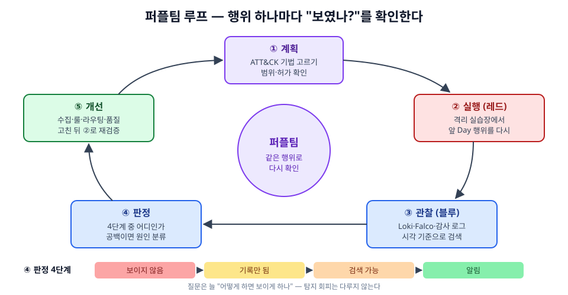
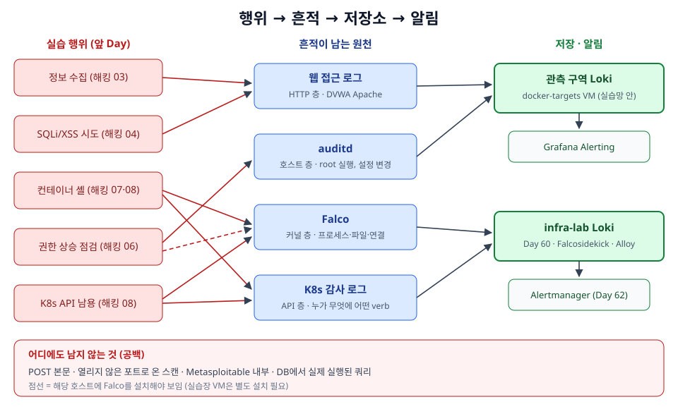
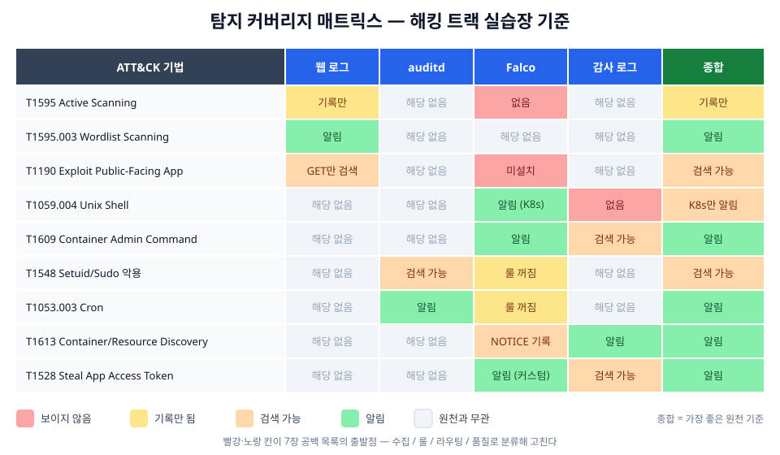

> **해킹 트랙 · 화이트해커 입문** | 난이도 ★★★★☆ | 예상 소요 2.5 ~ 3시간

> ⚠️ **실습 범위 경고** — 이 글의 모든 실습은 **본인 소유의 격리된 실습장**(해킹 02의 `hacklab` 네트워크) 또는 **의도적으로 취약하게 만든 연습용 대상**(DVWA, Juice Shop, Metasploitable, Kubernetes Goat, CloudGoat 등)에서만 합니다. 허가 없이 타인의 시스템을 스캔하거나 공격하면 **정보통신망법** 등에 따라 처벌될 수 있습니다. 오늘은 공격을 새로 하지 않습니다. 앞 Day에서 한 실습이 **방어 쪽 어디에 어떤 모양으로 남는지**만 봅니다.

## 🎯 오늘의 목표

- **퍼플팀**이 무엇이고, 왜 "공격 실습"은 "탐지 확인"으로 끝나야 하는지 설명할 수 있다
- 해킹 트랙의 실습 행위(정보 수집, SQLi/XSS 시도, 컨테이너 셸, 권한 상승 점검, K8s API 남용)가 **웹 접근 로그 · auditd · Falco · K8s 감사 로그** 중 어디에 남는지 표로 매핑할 수 있다
- 실습장 로그를 **Loki**로 모으고, **LogQL 탐지 쿼리 · Falco 커스텀 룰 · Alertmanager 라우팅**을 작성할 수 있다
- 실습 행위를 **MITRE ATT&CK** 기법 ID에 매핑하고, **탐지 공백(gap)** 을 찾아 우선순위를 매길 수 있다

---

## 1. 퍼플팀 — 레드와 블루가 같은 표를 본다

해킹 01부터 82까지 우리는 주로 "공격자의 눈"으로 실습장을 봤습니다. 그런데 실무에서 모의해킹의 가치는 "뚫었다"에서 끝나지 않습니다. 고객(또는 우리 팀)이 정말 알고 싶은 것은 이것입니다.

> "그 공격을 **우리는 알아챘는가?** 몰랐다면 **무엇을 더 봐야 하는가?**"

| 팀 | 목표 | 산출물 |
|---|---|---|
| 레드팀 | 허가된 범위 안에서 실제 공격자처럼 목표 달성 | 침투 경로, 발견 사항 |
| 블루팀 | 탐지·대응·복구 | 탐지 룰, 대응 런북, 포스트모템 |
| **퍼플팀** | 둘이 **같은 자리에서** 행위 하나마다 "보였나?"를 확인하고 즉시 고침 | **탐지 커버리지 표**, 개선된 룰 |

퍼플팀은 별도 조직이라기보다 **일하는 방식**입니다. 행위 하나를 실행하면 블루 쪽이 바로 대시보드를 열어 확인하고, 안 보이면 수집이나 룰을 고친 뒤 **같은 행위로 다시 확인**합니다.



> 💡 퍼플팀의 질문은 "어떻게 하면 안 들키나?"가 아니라 **"어떻게 하면 반드시 보이게 하나?"** 입니다. 이 글은 탐지를 늘리는 쪽만 다루며, 탐지를 피하는 기법은 다루지 않습니다.

### 1-1. "탐지됐다"의 네 단계

탐지는 켜져 있다/아니다의 두 값이 아닙니다. 행위 하나에 대해 아래 네 단계 중 어디까지 왔는지 따집니다.

| 단계 | 의미 | 예 |
|---|---|---|
| ❌ 보이지 않음 | 어떤 로그에도 남지 않음 | 수집기가 없는 Metasploitable에 대한 포트 스캔 |
| 🟡 기록만 됨 | 로그는 있지만 아무도 안 봄 | Apache 접근 로그에 404가 수천 줄 |
| 🟠 검색 가능 | Loki에 모여 있고, 쿼리를 알면 찾을 수 있음 | LogQL로 IP별 404 집계 가능 |
| ✅ 알림 | 룰이 있고, 사람에게 알림이 감 | Falco → Alertmanager → 보안 채널 |

대부분의 조직은 생각보다 많은 행위가 🟡에 머물러 있습니다. 오늘의 목표는 해킹 트랙 실습 행위를 이 표에 올리고, 🟡·❌를 한 칸씩 위로 올리는 것입니다.

---

## 2. 흔적은 어디에 남나 — 네 가지 원천과 한 곳의 저장소



| 원천 | 무엇을 보나 | 못 보는 것 | 배운 Day |
|---|---|---|---|
| **웹 접근 로그** (DVWA의 Apache) | 요청 줄(메서드·경로·쿼리 문자열), 상태 코드, 클라이언트 IP, User-Agent | **POST 본문**, 응답 내용, DB 안에서 실행된 쿼리 | Day 01 `docker logs` |
| **auditd** (리눅스 호스트) | 감시 파일 변경, root 권한으로 실행된 명령, sudo 사용 | 컨테이너/Pod 문맥, 네트워크 | Day 67 |
| **Falco** (커널 syscall) | 프로세스 실행·파일 열기·네트워크 연결 + 컨테이너/Pod 이름 | 애플리케이션 계층 의미(어떤 SQL인지) | Day 72 |
| **K8s 감사 로그** (API 서버) | 누가 어떤 리소스에 어떤 동사(verb)를 썼고, 허용/거부됐는지 | 컨테이너 **안**에서 벌어진 일 | Day 73 |
| **Loki** (저장·검색) | 위 모든 것을 라벨로 모아 LogQL로 검색·집계·알림 | 수집하지 않은 것 | Day 60 |

핵심은 **원천마다 보는 층이 다르다**는 점입니다. 웹 로그는 HTTP 층, Falco는 커널 층, 감사 로그는 API 층입니다. 하나의 행위가 여러 층에 동시에 흔적을 남기기도 하고, 어느 층에도 안 남기도 합니다.

---

## 3. 실습 ① 실습장 로그 모으기

**실습 환경**: 해킹 02의 실습장(`hacklab` 10.10.10.0/24 — Kali VM `10.10.10.5`, **docker-targets** VM `10.10.10.10` 위의 DVWA `10.10.10.20`·Juice Shop `10.10.10.21`, Metasploitable `10.10.10.30`)과 Day 09의 kind `infra-lab`(Day 60 Loki, Day 72 Falco, Day 73 감사 로그, Day 17·62 Alertmanager)입니다. 해킹 08의 Kubernetes Goat도 `infra-lab`처럼 Falco와 감사 로그가 켜진 kind 클러스터에서 돌렸다고 가정합니다.

### 3-0. 저장소가 두 개인 이유

| 구역 | 원천 | 저장소 | 알림 |
|---|---|---|---|
| **hacklab** (docker-targets VM) | DVWA·Juice Shop 컨테이너 로그, VM의 auditd | VM 안에 띄운 **관측 구역**(Loki + Grafana) | Grafana Alerting (실습장 안에서 확인) |
| **K8s** (`infra-lab`) | Falco, K8s 감사 로그 | Day 60의 Loki | Falcosidekick · Loki ruler → Alertmanager |

해킹 02에서 실습망은 **인터넷·집 LAN과 연결하지 않기로** 했습니다. 실습장 로그를 클러스터의 Loki로 보내려면 실습망에서 밖으로 나가는 길을 만들어야 하므로, 그 대신 **실습장 안에 작은 관측 구역을 하나 더** 둡니다. 저장소가 둘로 나뉘어 한 화면에서 상관 분석을 할 수 없다는 점은 그대로 7장의 공백 목록에 올립니다.

> 💡 운영 환경이라면 관측 스택은 **별도 관리망**에 두고, 공격 대상과 같은 망에 두지 않습니다. 오늘은 혼자 레드와 블루를 다 하는 실습이라 편의상 실습망 안에 둡니다.

### 3-1. 관측 구역 띄우기 (docker-targets VM)

이미지와 패키지는 해킹 02의 **업데이트 모드**(NAT 케이블 연결)에서 받고, 다 받은 뒤 **실습 모드**로 돌아갑니다.

```bash
# docker-targets 안에서 (업데이트 모드)
mkdir -p ~/hacklab-observe && cd ~/hacklab-observe
docker pull grafana/loki:3.7.10
docker pull grafana/grafana:13.2.6

# Alloy 패키지 (Grafana APT 저장소)
sudo mkdir -p /etc/apt/keyrings
wget -q -O - https://apt.grafana.com/gpg.key | gpg --dearmor | sudo tee /etc/apt/keyrings/grafana.gpg > /dev/null
echo "deb [signed-by=/etc/apt/keyrings/grafana.gpg] https://apt.grafana.com stable main" \
  | sudo tee /etc/apt/sources.list.d/grafana.list
sudo apt-get update && sudo apt-get install -y alloy
```

```yaml
# ~/hacklab-observe/compose.yaml
name: hacklab-observe

services:
  loki:
    image: grafana/loki:3.7.10           # 이미지 내장 단일 바이너리 설정(파일 시스템 저장)
    ports:
      - "127.0.0.1:3100:3100"            # VM 자신(Alloy)만 접근
    volumes:
      - loki-data:/loki
    restart: unless-stopped

  grafana:
    image: grafana/grafana:13.2.6
    ports:
      - "10.10.10.10:3000:3000"          # Kali 브라우저에서 접속 (해킹 02: 브라우저 작업은 Kali에서)
    volumes:
      - grafana-data:/var/lib/grafana
    restart: unless-stopped

volumes:
  loki-data:
  grafana-data:
```

```bash
docker compose up -d
docker compose ps
# hacklab-observe-grafana-1   ...   10.10.10.10:3000->3000/tcp
# hacklab-observe-loki-1      ...   127.0.0.1:3100->3100/tcp
curl -s localhost:3100/ready
# ready
```

Kali 브라우저에서 `http://10.10.10.10:3000`에 들어가 첫 로그인(`admin`/`admin`) 후 비밀번호를 바꾸고, **Connections → Data sources → Loki**에 URL `http://loki:3100`을 넣어 저장합니다(같은 Compose 네트워크라 서비스 이름으로 닿습니다).

> ⚠️ ipvlan의 특성상 DVWA·Juice Shop 컨테이너는 VM 자신의 주소(`10.10.10.10`)에 닿지 못합니다(해킹 02). 그래서 실습 대상 웹 앱이 Grafana를 건드릴 수는 없지만, **Kali와 Metasploitable은 닿습니다.** Grafana 기본 비밀번호를 꼭 바꾸세요.

### 3-2. Alloy 수집 설정

```alloy
// /etc/alloy/config.alloy  (docker-targets VM)

// (1) hacklab 네트워크에 붙은 컨테이너만 찾기
discovery.docker "hacklab" {
  host = "unix:///var/run/docker.sock"
  filter {
    name   = "network"
    values = ["hacklab"]
  }
}

// Compose 서비스 이름(dvwa, juice-shop)을 container 라벨로
discovery.relabel "hacklab" {
  targets = []
  rule {
    source_labels = ["__meta_docker_container_label_com_docker_compose_service"]
    target_label  = "container"
  }
}

loki.source.docker "hacklab" {
  host          = "unix:///var/run/docker.sock"
  targets       = discovery.docker.hacklab.targets
  labels        = { job = "hacklab" }
  relabel_rules = discovery.relabel.hacklab.rules
  forward_to    = [loki.write.lab.receiver]
}

// (2) VM의 auditd 로그
local.file_match "auditd" {
  path_targets = [{ "__path__" = "/var/log/audit/audit.log", "job" = "auditd", "host" = "docker-targets" }]
}

loki.source.file "auditd" {
  targets    = local.file_match.auditd.targets
  forward_to = [loki.write.lab.receiver]
}

loki.write "lab" {
  endpoint {
    url = "http://127.0.0.1:3100/loki/api/v1/push"
  }
}
```

Alloy는 `alloy` 사용자로 돌기 때문에 읽기 권한 두 가지가 필요합니다. auditd 설치와 기본 규칙은 Day 67과 같습니다(`sudo apt install -y auditd`는 업데이트 모드에서).

```bash
# auditd 로그 읽기: 로그 그룹을 adm으로 바꾸고 alloy를 adm에 추가
sudo sed -i 's/^log_group = .*/log_group = adm/' /etc/audit/auditd.conf
sudo service auditd restart
sudo usermod -aG adm alloy

# Docker 로그 읽기
sudo usermod -aG docker alloy
sudo systemctl restart alloy
```

> ⚠️ **`docker` 그룹 = 사실상 root**입니다. 해킹 07에서 본 `docker.sock` 노출 위험이 수집기에도 그대로 적용됩니다. 실습장에서는 편의상 허용하지만, 운영에서는 소켓 대신 `/var/lib/docker/containers/*/*-json.log` 파일을 읽거나(`loki.source.file`), 로깅 드라이버로 내보내는 방식을 검토하세요. **탐지를 위해 넣은 도구가 새 공격 경로가 되지 않는지**도 퍼플팀이 확인할 항목입니다.

확인:

```bash
curl -s localhost:3100/loki/api/v1/label/job/values
# {"status":"success","data":["auditd","hacklab"]}
curl -s localhost:3100/loki/api/v1/label/container/values
# {"status":"success","data":["dvwa","juice-shop"]}
```

> 💡 DVWA 이미지는 Apache 접근 로그를 컨테이너 표준 출력으로 내보내므로 `docker logs`로 보이는 줄이 그대로 Loki에 들어갑니다. ipvlan이라 NAT가 없으므로 **클라이언트 IP가 실제 Kali 주소(10.10.10.5)로** 찍힙니다.

---

## 4. 행위 → 흔적 매핑

이번 장에서는 공격 명령을 다시 적지 않습니다. 각 행위는 앞 Day의 실습을 그대로 다시 실행했다고 보고, **방어 쪽 화면에 무엇이 보이는지**만 봅니다.

### 4-1. 정보 수집 — 포트·서비스 스캔, 디렉터리 탐색 (해킹 03)

| 원천 | 남는 흔적 | 단계 |
|---|---|---|
| 웹 접근 로그 | 짧은 시간에 한 IP(`10.10.10.5`)에서 **404가 대량**으로, 존재하지 않는 경로가 사전 순서처럼 이어짐. 스캐너 기본 User-Agent가 그대로 찍히는 경우가 많음 | 🟡 → 🟠 |
| docker-targets VM 방화벽 | ipvlan 컨테이너로 가는 패킷은 컨테이너 네트워크 네임스페이스로 바로 들어가 **VM의 호스트 방화벽(nftables) 로그를 거치지 않음** | ❌ |
| (없음) | Metasploitable(10.10.10.30)에 대한 포트 스캔 — 그 VM에는 수집기가 없음 | ❌ |
| Falco | 열려 있지 않은 포트로 온 SYN은 프로세스가 받지 않으므로 syscall 이벤트가 생기지 않음 | ❌ |

Apache combined 형식 한 줄은 이렇게 생겼습니다.

```
10.10.10.5 - - [15/Nov/2026:10:02:11 +0900] "GET /backup.zip HTTP/1.1" 404 437 "-" "<스캐너 UA>"
```

```logql
# IP별 1분당 404 건수 — 디렉터리 탐색의 전형적인 모양
sum by (client) (
  count_over_time(
    {job="hacklab", container="dvwa"}
      | pattern `<client> <_> <_> [<_>] "<method> <path> <_>" <status> <_>`
      | status = "404" [1m]
  )
)
```

> 💡 **User-Agent는 탐지 근거로 약합니다.** 바꾸기 쉬운 값이므로 "있으면 확실한 신호, 없다고 안전한 것은 아님"으로 다룹니다. 탐지 룰의 기둥은 **행위의 모양**(비율·양·순서)이어야 합니다.

### 4-2. SQLi/XSS 시도 (해킹 04)

| 원천 | 남는 흔적 | 단계 |
|---|---|---|
| 웹 접근 로그 | GET 쿼리 문자열에 URL 인코딩된 따옴표(`%27`), `UNION`·`SELECT`·`<script` 같은 토큰 | 🟠 |
| 웹 접근 로그 | **POST 본문으로 보낸 시도는 접근 로그에 안 남음** (Juice Shop 로그인 폼 등) | ❌ |
| DB (MySQL) | general log가 기본 꺼짐 → 실제 실행된 쿼리 기록 없음 | ❌ |
| Falco | 단순 SQLi로는 프로세스 실행이 없어 조용함. 다만 DB 서버가 셸을 띄우면 incubating 룰 *DB program spawned process* (T1190) | ❌ / ✅ |

```logql
# 쿼리 문자열에 SQLi·XSS 흔적이 있는 요청 (raw string으로 이스케이프 최소화)
{job="hacklab", container="dvwa"}
  |~ `(?i)(union(\s|%20|\+)+select|%27(\s|%20|\+)*or|<script|%3cscript)`
  | pattern `<client> <_> <_> [<_>] "<method> <path> <_>" <status> <_>`
  | line_format "{{.client}} {{.status}} {{.path}}"
```

> ⚠️ 이런 **시그니처 기반** 규칙은 교과서 예시는 잘 잡지만, 인코딩이 조금만 달라도 놓칩니다. 그래서 탐지만으로 SQLi를 막으려 하면 안 되고, 근본 조치는 해킹 04에서 본 **파라미터 바인딩**과 입력 검증입니다. 탐지는 "누군가 문을 두드리고 있다"는 **조기 경보**로 씁니다.

### 4-3. 컨테이너 안 셸 (해킹 07·08)

| 원천 | 남는 흔적 | 단계 |
|---|---|---|
| Falco | *Terminal shell in container* (stable, `-it`로 붙었을 때), *Run shell untrusted* (stable, **웹 서버 같은 비셸 프로세스 밑에서 셸이 뜸** — RCE의 전형), *Drop and execute new binary in container* (stable, 이미지에 없던 실행 파일) | ✅ |
| K8s 감사 로그 | `kubectl exec`를 썼다면 `pods/exec` 서브리소스 요청이 남음 | 🟠 |
| K8s 감사 로그 | 앱 취약점으로 셸이 열렸다면 API를 거치지 않으므로 **아무것도 없음** | ❌ |

```logql
# Falcosidekick이 Loki로 보낸 셸 관련 경보 (Day 72의 라벨 그대로)
sum by (rule, k8s_ns_name) (
  count_over_time({source="syscall", rule=~"Terminal shell in container|Run shell untrusted"} [1h])
)

# 감사 로그: 누가 어느 Pod에 exec 했나 (Day 73)
{job="kubernetes-audit"} | json | objectRef_subresource="exec"
  | line_format "{{.user_username}} -> {{.objectRef_namespace}}/{{.objectRef_name}} ({{.responseStatus_code}})"
```

> 💡 Falcosidekick이 Loki에 붙이는 라벨 이름(예: `k8s_ns_name`)은 버전에 따라 다를 수 있습니다. Grafana Explore의 라벨 브라우저에서 실제 이름을 먼저 확인하세요.

### 4-4. 권한 상승 점검 (해킹 06)

권한 상승 점검은 일반 사용자로 들어온 뒤 SUID 파일, sudo 설정, cron을 살피고, 설정 실수가 있으면 root가 되는 흐름입니다. 리눅스 호스트에서는 auditd가 주 원천입니다. Day 67의 규칙(`root-cmd`, `sudoers`, `identity`)에 아래 두 줄을 더합니다.

```bash
# /etc/audit/rules.d/90-privesc.rules
# 일반 사용자 세션에서 권한(퍼미션) 변경 — SUID 비트 설정 포함
-a always,exit -F arch=b64 -S chmod,fchmod,fchmodat -F auid>=1000 -F auid!=unset -k perm_mod
# cron 설정 변경
-w /etc/crontab -p wa -k cron
-w /etc/cron.d/ -p wa -k cron
```

```bash
sudo augenrules --load
sudo auditctl -l | grep -E "perm_mod|cron"
```

| 원천 | 남는 흔적 | 단계 |
|---|---|---|
| auditd `root-cmd` | **로그인한 사람(auid=1000)인데 실효 권한이 root(euid=0)** 인 명령 실행 — sudo든 설정 실수든 | 🟠 → ✅ |
| auditd `USER_CMD` | sudo로 실행된 명령 줄 (`ausearch -m USER_CMD`) | 🟠 |
| auditd `perm_mod` / `cron` / `sudoers` | SUID 설정, cron·sudoers 변경 — **지속성(persistence)** 확보 시도 | ✅ |
| Falco | *Read sensitive file untrusted* (stable, `/etc/shadow` 읽기), incubating의 *Set Setuid or Setgid bit*, *Non sudo setuid* | ✅ (incubating은 켜야 함) |
| (없음) | 파일 목록을 **읽기만** 하는 점검 단계 (SUID 파일 찾기 등) | ❌ (정상 활동과 구별 불가) |

auditd 한 레코드는 `key="root-cmd"`로 끝납니다. LogQL로 사용자별 집계를 냅니다.

```logql
# root 권한으로 실행된 명령을 로그인 사용자(auid)·실행 파일별로
sum by (auid, exe) (
  count_over_time(
    {job="auditd"} |= `key="root-cmd"`
      | regexp `auid=(?P<auid>\d+).*exe="(?P<exe>[^"]+)"` [10m]
  )
)

# 권한 상승 뒤 흔히 이어지는 지속성 시도: cron·sudoers·SUID 변경
{job="auditd"} |~ `key="(cron|sudoers|perm_mod)"`
```

> 💡 "읽기만 하는 점검"이 안 보이는 것은 **정상**입니다. 모든 `find`를 알림으로 만들면 알림 피로(Day 62)만 커집니다. 탐지는 **상태가 바뀌는 순간**(root 실행, 설정 변경)에 겁니다.

### 4-5. K8s API 남용 (해킹 08)

Kubernetes Goat 시나리오처럼 Pod 안에서 ServiceAccount 토큰으로 API를 부르는 경우입니다.

| 원천 | 남는 흔적 | 단계 |
|---|---|---|
| K8s 감사 로그 | `user.username = system:serviceaccount:<ns>:<sa>`로 `secrets` list/get, 권한 밖 요청의 **403 연속**, `selfsubjectaccessreviews`/`selfsubjectrulesreviews` 생성(권한 탐색) | 🟠 → ✅ |
| K8s 감사 로그 | `pods` create — privileged·hostPath 같은 위험 설정은 `RequestResponse`/`Request` 수준으로 기록해야 본문이 보임 | 🟡 (정책에 따라) |
| Falco | *Contact K8S API Server From Container* (stable, NOTICE) — 시스템 컴포넌트가 아닌 컨테이너가 API 서버에 연결 | ✅ |

```logql
# ServiceAccount가 Secret을 조회한 기록
{job="kubernetes-audit"} | json
  | user_username =~ "system:serviceaccount:.*"
  | objectRef_resource = "secrets"
  | verb =~ "get|list|watch"
  | line_format "{{.user_username}} {{.verb}} {{.objectRef_namespace}}/{{.objectRef_name}} {{.responseStatus_code}}"

# 5분 동안 403을 많이 받은 주체 — 권한 탐색의 모양
topk(5, sum by (user_username) (
  count_over_time({job="kubernetes-audit"} | json | responseStatus_code = "403" [5m])
))
```

> ⚠️ Day 73의 감사 정책이 `secrets`를 `Metadata` 수준으로 기록하는 것은 **올바른 설정**입니다. Secret 본문이 감사 로그에 남으면 그 로그 자체가 유출 경로가 됩니다. "누가 언제 무엇을"만 있으면 탐지에는 충분합니다.

---

## 5. 실습 ② 탐지 규칙 만들기

### 5-1. Falco 커스텀 룰

Day 72의 `falco-values.yaml` `customRules`에 실습장용 룰을 추가합니다. 기본 룰셋의 매크로(`spawned_process`, `container`, `shell_procs`, `open_read`)와 리스트(`http_server_binaries`)를 재사용합니다.

```yaml
customRules:
  hacklab-detections.yaml: |-
    # (1) 웹 서버 프로세스가 셸을 직접 띄움 — 명령 주입·RCE의 가장 흔한 모양
    - rule: Web server spawned shell (hacklab)
      desc: 웹 서버(Apache/nginx) 또는 PHP 프로세스의 자식으로 셸이 실행됨
      condition: >
        spawned_process and container and shell_procs
        and (proc.pname in (http_server_binaries) or proc.pname startswith "php")
      output: >-
        Shell spawned by web server
        (parent=%proc.pname cmd=%proc.cmdline user=%user.name
        container=%container.name image=%container.image.repository
        pod=%k8s.pod.name ns=%k8s.ns.name)
      priority: CRITICAL
      tags: [hacklab, container, mitre_execution, T1059.004, T1190]

    # (2) API를 쓸 이유가 없는 네임스페이스에서 SA 토큰 파일을 읽음
    - list: hacklab_no_api_namespaces
      items: [falco-lab, demo-dev]

    - rule: SA token read in no-API namespace (hacklab)
      desc: API 서버를 호출하지 않아야 할 워크로드가 ServiceAccount 토큰을 읽음
      condition: >
        open_read and container
        and fd.name startswith "/var/run/secrets/kubernetes.io/serviceaccount/"
        and k8s.ns.name in (hacklab_no_api_namespaces)
      output: >-
        ServiceAccount token read
        (file=%fd.name proc=%proc.name cmd=%proc.cmdline pod=%k8s.pod.name ns=%k8s.ns.name)
      priority: WARNING
      tags: [hacklab, k8s, mitre_credential_access, T1528]
```

```bash
helm upgrade falco falcosecurity/falco --version 9.2.2 -n falco -f falco-values.yaml
kubectl -n falco logs ds/falco -c falco | grep "hacklab-detections"
#    /etc/falco/rules.d/hacklab-detections.yaml | schema validation: ok
```

| 룰 | 왜 이 우선순위인가 |
|---|---|
| Web server spawned shell | 정상 운영에서 거의 일어나지 않음 → 오탐이 적으니 CRITICAL로 바로 사람을 부름 |
| SA token read | 클라이언트 라이브러리를 쓰는 앱은 정상적으로 읽음 → **API를 안 쓰는 네임스페이스로 범위를 좁혀** WARNING |

> 💡 두 번째 룰은 "토큰을 읽는 것 자체"보다 **애초에 토큰이 마운트되지 않게** 하는 조치(Day 69의 `automountServiceAccountToken: false`)가 더 근본적입니다. 탐지 룰을 쓰다가 "이건 막을 수 있잖아?"가 보이면 그쪽이 먼저입니다.

> ⚠️ 이 Falco는 kind `infra-lab`(와 Kubernetes Goat 클러스터)의 커널만 봅니다. DVWA·Juice Shop은 **docker-targets VM**에서 돌기 때문에, 첫 번째 룰을 실습장 웹 앱에 적용하려면 그 VM에 Falco를 패키지로 따로 설치해야 합니다(Falco 공식 문서의 Debian/Ubuntu 설치 절차, 업데이트 모드에서). 설치하기 전까지 실습장 웹 앱의 셸 실행은 **보이지 않는 영역**이며, 7장의 공백 목록에 들어갑니다.

### 5-2. LogQL 알림 규칙 (Loki ruler)

Falco가 못 보는 HTTP 층·API 층은 LogQL 메트릭 쿼리로 알림을 만듭니다. 아래 파일은 Loki **ruler** 형식(Day 62의 Prometheus 규칙과 같은 모양, `expr`에 LogQL)으로 네 규칙을 한눈에 보이게 모은 것입니다. 실제로 넣는 곳은 구역마다 다릅니다.

| 규칙 | 넣는 곳 | 알림이 가는 곳 |
|---|---|---|
| `HacklabDirectoryBruteforce`, `HacklabSQLiPattern`, `HostPersistenceChange` | 관측 구역 Grafana의 **Alerting → Alert rules**에 같은 쿼리로 생성 (Grafana 관리 규칙) | Grafana 화면의 Firing 목록 (실습망 밖으로는 보내지 않음) |
| `K8sServiceAccountForbiddenBurst` | `infra-lab` Loki의 ruler | Alertmanager (5-3) |

```yaml
# hacklab-loki-rules.yaml
groups:
- name: hacklab-detections
  rules:
  - alert: HacklabDirectoryBruteforce
    expr: |
      sum by (client) (
        count_over_time({job="hacklab", container="dvwa"}
          | pattern `<client> <_> <_> [<_>] "<method> <path> <_>" <status> <_>`
          | status = "404" [5m])
      ) > 200
    for: 1m
    labels:
      severity: warning
      team: security
    annotations:
      summary: "{{ $labels.client }}에서 5분간 404 {{ $value }}건 — 디렉터리 탐색 의심"
      runbook_url: https://github.com/<your-org>/runbooks/blob/main/security/web-recon.md

  - alert: HacklabSQLiPattern
    expr: |
      sum(count_over_time({job="hacklab"}
        |~ `(?i)(union(\s|%20|\+)+select|%27(\s|%20|\+)*or)` [5m])) > 0
    labels:
      severity: warning
      team: security
    annotations:
      summary: "쿼리 문자열에 SQLi 패턴 {{ $value }}건"

  - alert: K8sServiceAccountForbiddenBurst
    expr: |
      sum by (user_username) (
        count_over_time({job="kubernetes-audit"} | json
          | user_username =~ "system:serviceaccount:.*"
          | responseStatus_code = "403" [5m])
      ) > 20
    labels:
      severity: critical
      team: security
    annotations:
      summary: "{{ $labels.user_username }}가 5분간 403 {{ $value }}건 — 권한 탐색 의심"

  - alert: HostPersistenceChange
    expr: |
      sum by (host) (count_over_time({job="auditd"} |~ `key="(cron|sudoers|perm_mod)"` [5m])) > 0
    labels:
      severity: warning
      team: security
    annotations:
      summary: "{{ $labels.host }}에서 cron/sudoers/권한 변경 감지"
```

Loki 쪽에서 해야 할 일은 두 가지입니다.

| 할 일 | Loki 설정 | 비고 |
|---|---|---|
| ruler 켜기와 규칙 로드 | 차트의 ruler 관련 values (규칙을 ConfigMap으로 넣는 sidecar 또는 로컬 디렉터리) | 키 이름은 Day 60 차트 버전에서 `helm show values grafana-community/loki --version 21.2.3 \| grep -n -A10 ruler`로 확인 |
| 알림을 Alertmanager로 | `ruler.alertmanager_url: http://monitoring-kube-prometheus-alertmanager.monitoring.svc.cluster.local:9093` | Day 17·62의 Alertmanager |

> 💡 ruler 설정이 부담스럽다면 **Grafana Alerting**에서 Loki 데이터 소스로 같은 쿼리를 알림 규칙으로 만들어도 됩니다. 중요한 것은 쿼리 자체이고, 실행기는 바꿀 수 있습니다. 규칙 파일은 어느 쪽이든 **Git으로 관리**합니다(Day 50의 GitOps).

### 5-3. Alertmanager 라우팅

Day 72에서 Falco 경보에는 `source="falco"`가, 오늘 Loki 규칙에는 `team: security`가 붙었습니다. 두 가지를 모두 `security-team` receiver로 보냅니다.

Alertmanager 라우팅은 **위에서부터 첫 번째로 맞는 라우트에서 멈춥니다**(Day 62). Day 62의 `team-ticket` 라우트는 `severity =~ "ticket|warning"`을 받기 때문에, 보안 라우트를 그 **뒤에** 두면 `severity: warning`인 보안 알림이 일반 티켓 채널로 빠집니다. 그래서 보안 라우트를 `null` 라우트 바로 다음, 즉 **Day 62 라우트들보다 앞에** 둡니다.

```yaml
# kube-prometheus-stack values — Day 62의 routes 목록 전체 (순서가 중요)
alertmanager:
  config:
    route:
      routes:
      - receiver: 'null'                       # Day 62 그대로
        matchers: ['alertname = "Watchdog"']
      - receiver: security-team                # ↓ 오늘 추가 (Day 62 라우트보다 앞)
        matchers: ['team = "security"']
        group_by: [alertname]
        repeat_interval: 1h
      - receiver: security-team                # Day 72의 Falco 라우트를 이 위치로 옮김
        matchers: ['source = "falco"']
        group_by: [alertname, k8s_ns_name]
        repeat_interval: 1h
      - receiver: oncall-page                  # ↓ Day 62 그대로
        matchers: ['severity = "page"']
      - receiver: team-ticket
        matchers: ['severity =~ "ticket|warning"']
```

> 💡 보안 규칙에는 일부러 `severity: page`를 쓰지 않았습니다. 보안 경보는 먼저 보안 담당이 판단하고, 필요하면 Day 65의 SEV 기준으로 장애를 선언해 온콜을 부릅니다. 오늘 규칙 중 가장 높은 것은 `critical`(SA 403 연속)입니다. Day 62의 inhibition 규칙(`critical`이 `warning`을 숨김)이 서로 다른 보안 알림까지 가리지 않는지 확인하고, 필요하면 inhibit 규칙에 `equal: [alertname]`처럼 범위를 좁히세요. `security-team` receiver는 Day 72에서 만든 것을 그대로 씁니다.

라우팅은 공격을 다시 하지 않고도 Day 62의 `amtool`로 확인할 수 있습니다.

```bash
AM=alertmanager-monitoring-kube-prometheus-alertmanager-0
kubectl exec -n monitoring $AM -c alertmanager -- amtool config routes test   --config.file=/etc/alertmanager/config_out/alertmanager.env.yaml   team=security severity=warning alertname=HacklabSQLiPattern
# security-team

kubectl exec -n monitoring $AM -c alertmanager -- amtool config routes test   --config.file=/etc/alertmanager/config_out/alertmanager.env.yaml   source=falco severity=critical alertname="Web server spawned shell (hacklab)"
# security-team
```

---

## 6. MITRE ATT&CK 매핑

**MITRE ATT&CK**는 실제 공격에서 관찰된 행위를 **전술(Tactic, 왜)** 과 **기법(Technique, 어떻게)** 으로 정리한 공개 지식 베이스입니다. 기법 ID를 쓰면 레드·블루·경영진이 같은 말을 쓰게 되고, Falco 기본 룰도 `T1059` 같은 태그를 달고 있습니다.

| 실습 행위 (Day) | 전술 | 기법 ID · 이름 | 주 원천 | 오늘의 탐지 | 단계 |
|---|---|---|---|---|---|
| 포트·서비스 스캔 (76) | Reconnaissance | T1595 Active Scanning | nftables, 웹 로그 | (호스트 경계만) | 🟡 |
| 디렉터리 탐색 (76) | Reconnaissance | T1595.003 Wordlist Scanning | 웹 로그 | `HacklabDirectoryBruteforce` | ✅ |
| SQLi/XSS 시도 (77) | Initial Access | T1190 Exploit Public-Facing Application | 웹 로그 | `HacklabSQLiPattern` (GET만) | 🟠 |
| 웹 서버 밑 셸 (78·80) | Execution | T1059.004 Unix Shell | Falco | *Web server spawned shell* | ✅ K8s / ❌ 실습장 VM (Falco 미설치) |
| `kubectl exec` (81) | Execution | T1609 Container Administration Command | 감사 로그, Falco | *Terminal shell in container* + LogQL | ✅ |
| 민감 파일 읽기 (79) | Credential Access | T1003.008 /etc/passwd and /etc/shadow | Falco | *Read sensitive file untrusted* | ✅ |
| 권한 상승 점검 — SUID·sudo 설정 실수 (79) | Privilege Escalation | T1548.001 Setuid and Setgid / T1548.003 Sudo and Sudo Caching | auditd | `root-cmd`, `perm_mod` | 🟠 |
| cron 변경 (79) | Persistence | T1053.003 Cron | auditd | `HostPersistenceChange` | ✅ |
| privileged·docker.sock 탈출 (80) | Privilege Escalation | T1611 Escape to Host | Falco | *Detect release_agent File Container Escapes* 등 일부 | 🟠 |
| SA 토큰 사용 (81) | Credential Access | T1528 Steal Application Access Token | Falco | *SA token read …* | ✅ |
| API로 리소스 탐색 (81) | Discovery | T1613 Container and Resource Discovery | 감사 로그 | `K8sServiceAccountForbiddenBurst` | ✅ |
| 클라우드 키 남용 (82) | Initial Access / Privilege Escalation | T1078.004 Cloud Accounts | CloudTrail 등 | 범위 밖 (해킹 09 참조) | ❌ |

> 💡 기법 ID는 ATT&CK 버전이 오르며 이름이 바뀌거나 하위 기법이 추가되기도 합니다. 보고서에 쓸 때는 [attack.mitre.org](https://attack.mitre.org/)에서 현재 이름을 확인하고, 사용한 ATT&CK 버전을 함께 적으세요.

---

## 7. 탐지 공백(gap) 분석



공백 분석은 위 표를 **"그래서 무엇을 고칠까"** 로 바꾸는 작업입니다.

### 7-1. 절차

| 단계 | 할 일 | 산출물 |
|---|---|---|
| ① 범위 정하기 | 이번에 확인할 기법 목록 (오늘은 해킹 트랙에서 실습한 것만) | 기법 ID 목록 |
| ② 실행과 관찰 | 실습장에서 앞 Day의 행위를 한 번씩 다시 하고, 시각을 기록한 뒤 원천별로 검색 | 시각 + 쿼리 + 결과 캡처 |
| ③ 단계 판정 | ❌ / 🟡 / 🟠 / ✅ 중 하나로 판정 | 커버리지 표 |
| ④ 원인 분류 | **수집 공백**(로그가 없음) / **룰 공백**(로그는 있는데 룰이 없음) / **라우팅 공백**(알림이 사람에게 안 감) / **품질 공백**(오탐이 많아 무시됨) | 공백 목록 |
| ⑤ 우선순위 | 영향(그 기법이 성공하면 얼마나 나쁜가) × 개선 비용 | 액션 아이템 |
| ⑥ 재검증 | 고친 뒤 **같은 행위**로 다시 ②부터 | 갱신된 표 |

> 💡 **MITRE ATT&CK Navigator**(웹 도구)에 기법별 점수를 넣은 레이어(JSON)를 만들면 커버리지를 히트맵으로 볼 수 있습니다. 분기마다 레이어를 저장해 두면 "탐지가 늘었다"를 숫자로 보여 줄 수 있습니다.

### 7-2. 오늘 실습장에서 찾은 공백 예시

| # | 공백 | 분류 | 개선 | 우선순위 |
|---|---|---|---|---|
| 1 | POST 본문의 SQLi/XSS가 안 보임 | 수집 | 앱 단 보안 로깅(실패한 입력 검증 이벤트 기록) 또는 WAF(예: ModSecurity + OWASP CRS) 감지 모드 로그 | P1 |
| 2 | 실습망 안의 포트 스캔(열리지 않은 포트 포함)이 어디에도 안 보임 | 수집 | 실습망 트래픽을 보는 네트워크 IDS(Suricata, Zeek 등)를 관측 구역에 추가 | P2 |
| 3 | 실습장 웹 앱 컨테이너 안의 프로세스 실행이 안 보임 | 수집 | docker-targets VM에 Falco 별도 설치 | P1 |
| 8 | 실습장 로그와 K8s 로그가 다른 Loki에 있어 한 화면에서 시간순 상관 분석 불가 | 품질 | 운영에서는 관리망을 따로 두고 단일 저장소로 모음 | P3 |
| 4 | Metasploitable(VM)에서 일어난 일이 아무 데도 없음 | 수집 | 오래된 OS라 에이전트 설치가 어려움 → **"감시 불가 자산" 목록에 올리고 격리로 보완** | P2 |
| 5 | MySQL에서 실행된 쿼리 기록 없음 | 수집 | 감사 플러그인 또는 실습용 general log (용량·개인정보 주의) | P3 |
| 6 | incubating 룰(*Set Setuid or Setgid bit*)이 꺼져 있음 | 룰 | 필요한 룰만 커스텀으로 가져오기(Day 72 방식) | P2 |
| 7 | 보안 알림이 일반 팀 채널로 섞여 감 | 라우팅 | 5-3의 `team=security` 라우트 | P1 |

> ⚠️ 공백을 모두 메우는 것은 불가능하고, 목표도 아닙니다. 탐지할 수 없는 영역은 **예방(하드닝·정책)** 과 **격리**로 보완합니다. "이건 못 본다"를 **알고 있는 것**과 **모르는 것**은 완전히 다릅니다. 앞의 것은 위험 관리이고, 뒤의 것은 운입니다.

---

## 8. 운영 습관 — 탐지도 코드다

| 습관 | 방법 | 연결 |
|---|---|---|
| 룰을 Git으로 | Falco 룰·Loki 규칙·Alertmanager 설정을 설정 레포에 두고 PR로 변경 | Day 50, 53 |
| CI에서 문법 검사 | `falco --validate <파일>`, `amtool check-config`, Loki 규칙은 `lokitool rules lint` | Day 51 |
| 룰마다 런북 | 알림의 `runbook_url` → "이 알림이 울리면 무엇을 확인하나" | Day 65 |
| 정기 퍼플팀 연습 | 분기마다 같은 행위 목록으로 커버리지 표 갱신 | 오늘 7장 |
| 오탐 회고 | 무시된 알림은 룰 품질 문제로 보고 튜닝 | Day 62 |

---

## 9. 트러블슈팅

| 증상 | 원인 | 해결 |
|---|---|---|
| Loki에 `job="hacklab"`이 없음 | Alloy가 Docker 소켓 권한 없음, 또는 컨테이너가 `hacklab` 네트워크에 없음 | `journalctl -u alloy -n 50`, `docker network inspect hacklab` |
| Kali에서 `10.10.10.10:3000`이 안 열림 | Grafana 포트를 VM의 다른 주소에 공개했거나, VM의 `enp0s8`에 10.10.10.10이 없음 | `ip -br addr show enp0s8`, `docker compose ps`의 포트 표시 확인 |
| `job="auditd"` 로그가 안 들어옴 | `audit.log`가 root 전용(0600) | `log_group = adm` 설정 후 auditd 재시작, `alloy`를 `adm` 그룹에 추가 |
| `pattern` 파서 결과의 `status`가 비어 있음 | 로그 형식이 combined가 아님(앞에 가상 호스트 등) | Explore에서 원본 한 줄을 보고 패턴을 맞춤 |
| Loki 규칙이 로드되지 않음 | ruler 미활성, 규칙 파일의 테넌트 디렉터리 위치 오류 | Loki 로그에서 `ruler` 검색, 차트 values 재확인 |
| Falco 커스텀 룰 로드 실패 | 없는 매크로·리스트 참조 | `LOAD_ERR_COMPILE_CONDITION` 메시지 확인, 기본 룰셋에 있는 이름인지 확인 |
| 알림이 일반 채널로 감 | 보안 라우트가 기존 라우트보다 뒤에 있어 앞에서 먼저 매칭 | 라우트 순서 조정 또는 `continue: true`, `amtool config routes test`로 확인 |

---

## 10. 핵심 정리

- **퍼플팀** = 행위 하나마다 "보였나?"를 확인하고 즉시 고치는 방식. 질문은 늘 "어떻게 하면 **보이게** 하나"
- 탐지는 ❌ 보이지 않음 → 🟡 기록만 → 🟠 검색 가능 → ✅ 알림의 **네 단계**로 판정한다
- 원천마다 보는 층이 다르다: 웹 로그(HTTP) · auditd(호스트) · Falco(커널) · 감사 로그(API) → **Loki**에서 합친다 (실습장은 격리를 지키려고 실습망 안에 관측 구역을 따로 둔다)
- 탐지 룰은 **행위의 모양**(비율·양·상태 변화)에 건다. User-Agent나 문자열 시그니처는 보조 신호
- **MITRE ATT&CK** 기법 ID로 매핑하면 커버리지를 공통 언어로 말할 수 있다
- 공백은 **수집 / 룰 / 라우팅 / 품질**로 나눠 고치고, 못 메우는 곳은 예방과 격리로 보완한다

---

## 11. 셀프 체크

<details>
<summary>Q1. 웹 서버 접근 로그만으로 SQLi 시도를 모두 탐지할 수 없는 이유 두 가지는?</summary>

① 접근 로그에는 요청 줄(쿼리 문자열)만 남고 **POST 본문은 남지 않습니다**. ② 시그니처(따옴표, `UNION SELECT`)는 인코딩·대소문자·공백 표현이 조금만 달라도 놓칩니다. 그래서 탐지는 조기 경보로 쓰고, 근본 조치는 파라미터 바인딩 같은 안전한 코드로 합니다.
</details>

<details>
<summary>Q2. 앱 취약점으로 컨테이너 안에 셸이 열렸을 때 K8s 감사 로그에 흔적이 없는 이유와, 무엇이 대신 잡는가?</summary>

셸이 앱 프로세스의 자식으로 떴을 뿐 API 서버를 거치지 않았기 때문입니다. 커널 syscall을 보는 **Falco**가 *Run shell untrusted*나 오늘 만든 *Web server spawned shell* 룰로 잡습니다.
</details>

<details>
<summary>Q3. 권한 상승 점검 중 "SUID 파일 목록 찾기" 단계를 알림으로 만들지 않은 이유는?</summary>

읽기만 하는 활동이라 정상 관리 작업과 구별되지 않고, 알림으로 만들면 오탐이 넘쳐 알림 피로가 생깁니다. 대신 **상태가 바뀌는 순간**(로그인 사용자가 root로 실행, cron·sudoers·SUID 변경)에 탐지를 겁니다.
</details>

<details>
<summary>Q4. 탐지 공백의 네 가지 분류와 각각의 예는?</summary>

수집 공백(POST 본문이 로그에 없음), 룰 공백(감사 로그에 403이 있는데 룰이 없음), 라우팅 공백(보안 알림이 일반 채널로 감), 품질 공백(오탐이 많아 무시되는 룰).
</details>

<details>
<summary>Q5. 로그 수집기에 Docker 소켓 권한을 주는 것이 왜 퍼플팀 점검 대상인가?</summary>

`docker` 그룹은 사실상 root 권한입니다(해킹 07). 탐지를 위해 넣은 수집기가 탈취되면 호스트 전체가 넘어갈 수 있으므로, 탐지 도구 자체도 공격 표면으로 보고 파일 기반 수집 같은 대안을 검토합니다.
</details>

---

## ⏭️ 다음 예고 — 해킹 11. 모의해킹 보고서 — 재현 절차, CVSS, 조치 권고

찾은 것과 본 것을 **남이 읽고 행동할 수 있는 문서**로 만드는 날입니다. 경영진용 요약부터 발견 사항 템플릿, **CVSS v4.0** 점수 매기는 법(실습장 취약점으로 직접 계산), 재현 절차와 조치 권고, 그리고 오늘 만든 탐지 커버리지 표를 부록으로 넣는 법까지 다룹니다. 조치 후 **재점검(retest)** 과 Day 65 포스트모템을 잇는 흐름도 함께 봅니다.
