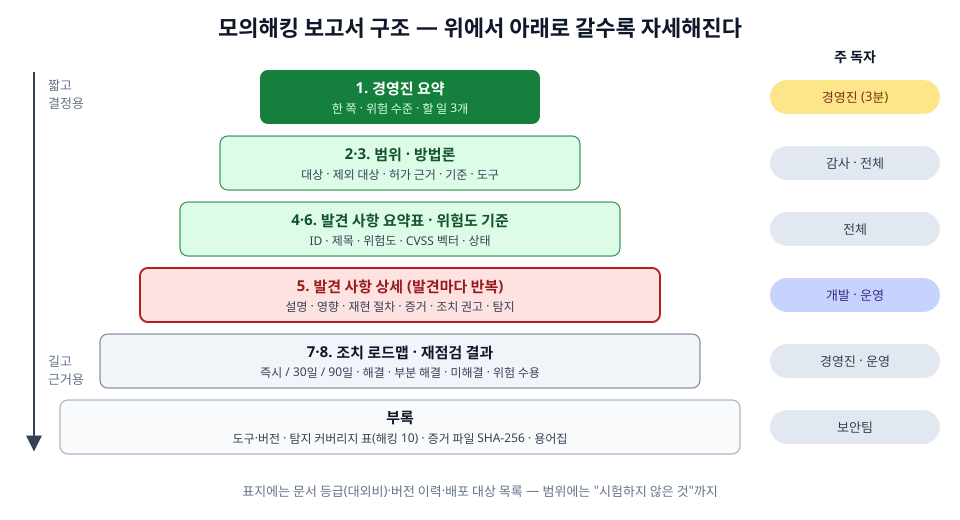
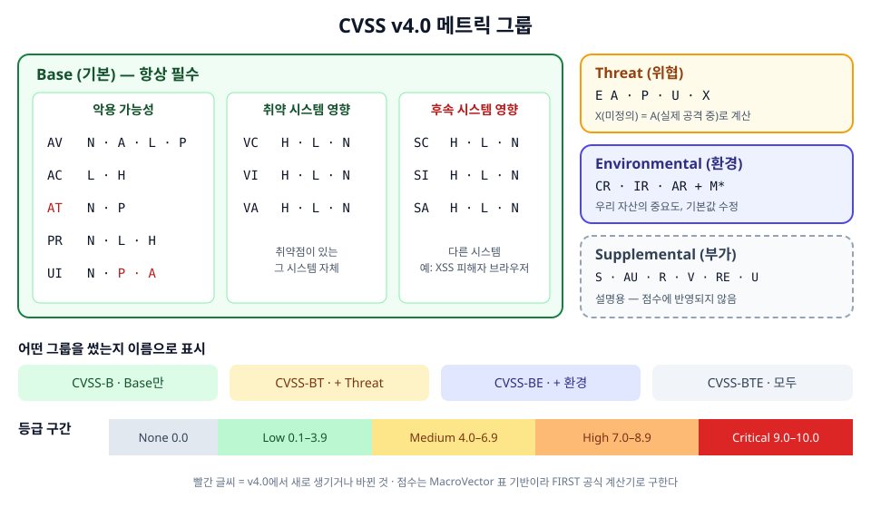
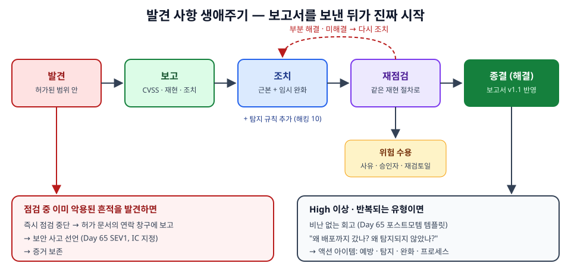

> **해킹 트랙 · 화이트해커 입문** | 난이도 ★★★☆☆ | 예상 소요 2 ~ 2.5시간

> ⚠️ **실습 범위 경고** — 이 글의 모든 실습은 **본인 소유의 격리된 실습장**(해킹 02의 `hacklab` 네트워크) 또는 **의도적으로 취약하게 만든 연습용 대상**(DVWA, Juice Shop, Metasploitable, Kubernetes Goat, CloudGoat 등)에서만 합니다. 허가 없이 타인의 시스템을 스캔하거나 공격하면 **정보통신망법** 등에 따라 처벌될 수 있습니다. 보고서도 마찬가지로, **허가받은 범위에서 얻은 결과만** 쓰고, 그 결과는 허가한 사람에게만 전달합니다.

## 🎯 오늘의 목표

- 모의해킹 보고서의 표준 구조(**요약 · 범위 · 방법론 · 발견 사항 · 위험도 · 재현 절차 · 조치 권고 · 부록**)와 각 부분의 독자를 설명할 수 있다
- **CVSS v4.0** 기본 메트릭을 이해하고, 실습장 취약점 세 개의 점수를 공식 계산기로 매길 수 있다
- 재현 가능하고 **고칠 수 있게 만드는** 발견 사항 하나를 템플릿대로 쓸 수 있다
- 경영진용 요약을 한 쪽으로 쓰고, **재점검(retest)** 과 Day 65 포스트모템으로 이어지는 흐름을 안다

---

## 1. 보고서가 곧 결과물이다

모의해킹을 의뢰한 쪽이 실제로 손에 쥐는 것은 **보고서 한 부**입니다. 아무리 멋진 침투를 했어도 보고서가 모호하면 아무것도 고쳐지지 않고, 고쳐지지 않은 취약점은 찾지 않은 것과 같습니다.

> "좋은 보고서는 **읽는 사람이 다음에 무엇을 할지** 알게 만든다."

같은 보고서를 여러 사람이 각자 다른 목적으로 읽습니다.

| 독자 | 알고 싶은 것 | 읽는 부분 | 읽는 시간 |
|---|---|---|---|
| 경영진 | 얼마나 위험한가? 돈과 시간을 어디에 써야 하나? | 경영진 요약 | 3분 |
| 개발·운영 담당 | 정확히 어디가, 왜 문제인가? 어떻게 고치나? | 발견 사항 상세, 재현 절차, 조치 권고 | 발견 사항당 10~30분 |
| 보안팀 | 탐지는 됐나? 비슷한 곳이 또 있나? | 방법론, 부록(탐지 커버리지, 해킹 10) | 전체 |
| 감사·컴플라이언스 | 범위와 기간, 허가 근거, 재점검 결과 | 범위, 재점검 | 필요 부분 |

그래서 보고서는 **위에서 아래로 갈수록 자세해지는** 역피라미드 구조를 씁니다.

---

## 2. 보고서 구조



| # | 섹션 | 내용 | 주 독자 |
|---|---|---|---|
| 0 | 표지 · 문서 관리 | 문서 등급(대외비), 버전 이력, **배포 대상 목록** | 전체 |
| 1 | **경영진 요약** | 한 쪽. 전체 위험 수준, 핵심 위험 3개, 해야 할 일 3개 | 경영진 |
| 2 | **범위** | 대상(IP·URL·계정), 기간, **제외 대상**, 허가 근거(해킹 01의 작업 범위 합의서·RoE), 제약 | 감사, 전체 |
| 3 | **방법론** | 따른 기준(OWASP WSTG, PTES, NIST SP 800-115 등), 접근 방식(블랙/그레이/화이트박스), 사용 도구와 버전 | 보안팀 |
| 4 | 발견 사항 요약표 | ID, 제목, 위험도, CVSS, 상태 — 한 표로 | 전체 |
| 5 | **발견 사항 상세** | 발견 사항마다 설명 · 영향 · **재현 절차** · 증거 · **조치 권고** · 탐지 · 참고 | 개발·운영 |
| 6 | **위험도 기준** | CVSS 버전과 등급 구간, 우선순위를 정한 방식 | 전체 |
| 7 | 조치 로드맵 | 즉시 / 30일 / 90일 | 경영진, 운영 |
| 8 | 재점검 결과 | 조치 후 다시 확인한 결과 (해결/부분 해결/미해결/위험 수용) | 전체 |
| 부록 | **부록** | 도구 목록, 탐지 커버리지 표(해킹 10), 증거 파일 목록과 해시, 용어집 | 보안팀 |

> 💡 **범위(2장)를 대충 쓰면 보고서 전체가 흔들립니다.** "무엇을 시험하지 않았는가"가 적혀 있어야 독자가 "보고서에 없으니 안전하다"고 오해하지 않습니다. 해킹 01에서 정한 허가 문서의 번호나 날짜를 그대로 적어 두세요.

---

## 3. 위험도 — CVSS v4.0

### 3-1. CVSS란

**CVSS(Common Vulnerability Scoring System)** 는 FIRST가 관리하는 취약점 **심각도** 점수 체계입니다. 0.0~10.0 점수와, 어떤 판단으로 그 점수가 나왔는지 보여 주는 **벡터 문자열**로 이루어집니다. 2023년 11월에 나온 **v4.0**이 현재 버전이며, 공개 CVE에는 v3.1 점수가 여전히 많이 함께 쓰입니다.

v3.1과 비교해 달라진 점은 다음과 같습니다.

| 항목 | v3.1 | v4.0 |
|---|---|---|
| 영향 범위 | Scope(S:U/C) 한 칸 | **취약 시스템(VC/VI/VA)** 과 **후속 시스템(SC/SI/SA)** 영향을 따로 |
| 공격 조건 | Attack Complexity(AC) | AC + **Attack Requirements(AT)** (경쟁 조건, 특정 배치 같은 전제) |
| 사용자 상호작용 | None / Required | None / **Passive** / **Active** |
| 시간에 따라 변하는 값 | Temporal (E, RL, RC) | **Threat** (E만 남음) |
| 점수에 안 들어가는 부가 정보 | — | **Supplemental** (Safety, Automatable, Recovery 등) |
| 이름 붙이기 | 점수 하나 | **CVSS-B / CVSS-BT / CVSS-BE / CVSS-BTE** — 어떤 그룹을 썼는지 표시 |

### 3-2. 메트릭 한눈에 보기



| 그룹 | 메트릭 | 값 | 질문 |
|---|---|---|---|
| 악용 가능성 | **AV** Attack Vector | N 네트워크 / A 인접 / L 로컬 / P 물리 | 어디서 공격할 수 있나? |
| | **AC** Attack Complexity | L / H | 방어 기법을 우회해야 하나? |
| | **AT** Attack Requirements | N / P | 공격자가 통제할 수 없는 전제 조건이 필요한가? |
| | **PR** Privileges Required | N / L / H | 로그인이 필요한가? 얼마나 높은 권한이? |
| | **UI** User Interaction | N / P / A | 다른 사람이 무언가를 해야 하나? (P=보기만, A=클릭 등 능동 행동) |
| 취약 시스템 영향 | **VC / VI / VA** | H / L / N | 그 시스템의 기밀성·무결성·가용성에 미치는 영향 |
| 후속 시스템 영향 | **SC / SI / SA** | H / L / N | 다른 시스템(사용자 브라우저, 연결된 서비스)에 미치는 영향 |
| Threat | **E** Exploit Maturity | A 실제 공격 중 / P PoC 있음 / U 보고 없음 / X 미정의 | 지금 악용되고 있나? (X는 **A로 간주**) |
| Environmental | CR/IR/AR, 수정 기본 메트릭 | — | 우리 환경에서 이 자산은 얼마나 중요한가? |

등급 구간은 v3.1과 같습니다.

| 등급 | None | Low | Medium | High | Critical |
|---|---|---|---|---|---|
| 점수 | 0.0 | 0.1–3.9 | 4.0–6.9 | 7.0–8.9 | 9.0–10.0 |

### 3-3. 점수는 공식 계산기로

v3.1은 공식(곱셈·덧셈)으로 손 계산이 가능했지만, v4.0은 다릅니다. 전문가들이 비슷한 심각도의 벡터 조합을 **MacroVector**라는 묶음으로 나누고, 묶음마다 **표(lookup table)로 점수**를 정해 둔 뒤, 개별 벡터는 묶음 안에서의 거리만큼 점수를 조금씩 깎습니다. 그래서 점수는 손으로 계산하지 말고 **FIRST 공식 계산기**([first.org/cvss/calculator/4-0](https://www.first.org/cvss/calculator/4-0))에 벡터를 넣어 구합니다. 보고서에는 **점수와 벡터 문자열을 반드시 함께** 적습니다. 벡터가 있어야 독자가 판단 근거를 검증할 수 있습니다.

```
CVSS:4.0/AV:N/AC:L/AT:N/PR:L/UI:N/VC:H/VI:N/VA:N/SC:N/SI:N/SA:N
```

> 💡 계산기 주소 끝에 `#CVSS:4.0/AV:N/...`처럼 벡터를 붙이면 그 값이 채워진 상태로 열립니다. 보고서에 이 링크를 넣어 두면 검토자가 클릭 한 번으로 확인할 수 있습니다.

### 3-4. 실습장 취약점으로 점수 매기기

앞 Day의 실습 결과 세 개를 채점해 봅니다. 핵심은 **메트릭 하나하나에 "왜 이 값인가"를 한 줄씩 붙이는 것**입니다. 점수는 2026-11-15 기준 FIRST 계산기 결과입니다.

#### 예시 ① F-01 — DVWA SQL Injection (해킹 04 "SQLi 시도", DVWA 보안 수준 Low)

| 메트릭 | 값 | 근거 |
|---|---|---|
| AV | N | 실습망 안 어디서든 HTTP로 접근 |
| AC | L | 특별한 우회 없이 재현됨 |
| AT | N | 경쟁 조건 등 전제 없음 |
| PR | L | DVWA 로그인(일반 사용자 수준)이 필요 |
| UI | N | 다른 사람의 행동 필요 없음 |
| VC | H | `users` 테이블 전체(비밀번호 해시 포함)를 읽을 수 있음 |
| VI | N | 이번 점검에서는 **읽기만 확인**. 수정 가능성은 확인하지 않았으므로 보수적으로 N |
| VA | N | 서비스 중단 없음 |
| SC/SI/SA | N | 다른 시스템 영향 확인 안 됨 |

**CVSS-B 7.1 (High)** — `CVSS:4.0/AV:N/AC:L/AT:N/PR:L/UI:N/VC:H/VI:N/VA:N/SC:N/SI:N/SA:N`

#### 예시 ② F-02 — Juice Shop DOM 기반 XSS (해킹 04 "XSS 시도")

| 메트릭 | 값 | 근거 |
|---|---|---|
| AV / AC / AT | N / L / N | 링크 하나로 재현, 전제 조건 없음 |
| PR | N | 공격자는 로그인할 필요가 없음 |
| UI | **A** | 피해자가 조작된 링크를 **직접 클릭**해야 함(능동) |
| VC / VI / VA | N / N / N | 서버(취약 시스템) 자체의 데이터는 그대로 |
| SC / SI | **L / L** | 영향은 **피해자 브라우저(후속 시스템)** 에서 — 그 사용자 세션 범위의 정보 노출·화면 변조 |
| SA | N | |

**CVSS-B 5.1 (Medium)** — `CVSS:4.0/AV:N/AC:L/AT:N/PR:N/UI:A/VC:N/VI:N/VA:N/SC:L/SI:L/SA:N`

> 💡 XSS가 v4.0에서 "후속 시스템" 영향으로 들어가는 것이 v3.1과 가장 다른 점입니다. v3.1에서는 Scope:Changed로 표현했던 것을, v4.0은 **어느 시스템이 다치는지**를 칸으로 나눠 적습니다.

#### 예시 ③ F-03 — sudo 설정 실수로 root 획득 (해킹 06 "권한 상승 점검")

| 메트릭 | 값 | 근거 |
|---|---|---|
| AV | **L** | 이미 셸을 가진 사용자만 가능 |
| AC / AT | L / N | 설정 그대로 재현됨 |
| PR | L | 일반 사용자 계정 필요 |
| UI | N | |
| VC / VI / VA | H / H / H | root 획득 → 그 호스트 전체 |
| SC / SI / SA | N / N / N | 다른 호스트로 확산은 이번 범위에서 확인 안 함 |

**CVSS-B 8.5 (High)** — `CVSS:4.0/AV:L/AC:L/AT:N/PR:L/UI:N/VC:H/VI:H/VA:H/SC:N/SI:N/SA:N`

#### Threat 메트릭을 넣으면

E를 비워 두면(X) 계산기는 **최악(A, 실제 공격 중)** 으로 봅니다. 맞춤형 웹 앱의 취약점처럼 "공개된 공격 보고는 없고 점검자가 PoC만 만든" 경우 E:P를 넣으면 점수가 내려갑니다.

| 벡터 | 이름 | 점수 |
|---|---|---|
| F-01 기본 | CVSS-B | 7.1 High |
| F-01 + `E:P` | **CVSS-BT** | 5.7 Medium |

> ⚠️ 점수가 내려간다고 위험이 사라지는 것은 아닙니다. 공개 CVE가 있는 취약점이라면 **CISA KEV**(실제 악용 목록)나 **EPSS**(악용 확률 예측) 같은 외부 정보를 근거로 E 값을 정하고, 근거를 보고서에 적습니다.

### 3-5. CVSS는 "심각도"이지 "위험"이 아니다

CVSS는 **취약점 자체**의 성질을 잽니다. 같은 7.1이라도 인터넷에 열린 결제 서버와 격리된 테스트 VM은 위험이 전혀 다릅니다. 보고서의 최종 **위험도(우선순위)** 는 아래를 함께 봅니다.

| 요소 | 예 |
|---|---|
| CVSS 점수 | 7.1 |
| 노출 | 인터넷 공개? 내부망? 관리자만? (H02·H03의 노출 관점) |
| 자산 중요도 | 개인정보·결제 데이터를 다루나? (Environmental의 CR/IR/AR로 반영 가능) |
| 악용 현황 | KEV 등재, 공개 익스플로잇 |
| 보완 통제 | WAF, 탐지 룰(해킹 10)이 있나 |

---

## 4. 발견 사항 템플릿 (전문)

보고서의 5장은 이 템플릿을 발견 사항 수만큼 반복합니다. 그대로 복사해 쓰세요.

```markdown
### F-XX. <한 줄 제목: 어디에 / 무엇이 / 그래서 무엇이 가능한가>

| 항목 | 내용 |
|---|---|
| ID | F-XX |
| 위험도 | Critical / High / Medium / Low / 정보 |
| CVSS | <점수> (<CVSS-B 또는 CVSS-BT>) — `CVSS:4.0/...` |
| 대상 | <호스트·URL·파라미터·컴포넌트> |
| 분류 | <CWE-ID 이름>, <OWASP Top 10 항목> |
| ATT&CK | <기법 ID> (해당 시) |
| 발견 일시 | YYYY-MM-DD HH:MM KST |
| 상태 | 신규 / 조치 중 / 해결 / 부분 해결 / 위험 수용 |

#### 설명
무엇이 왜 취약한지 2~4문장. 원인(입력 검증 누락, 설정 실수 등)을 쓴다.

#### 영향
이 취약점으로 **무엇이 가능해지는가**를 비즈니스 언어로. 확인한 것과 추정을 구분한다.
- 확인됨: 
- 가능성 있음(미확인): 

#### 재현 절차
- 전제: <계정, 권한, 환경 — 실습장 주소, 앱 버전·이미지 다이제스트>
1. 
2. 
3. 
- 기대 결과(정상): 
- 실제 결과(취약): 

#### 증거
- 그림 F-XX-1: <스크린숏 설명> (민감 정보 마스킹)
- 요청/응답 일부 (필요한 부분만, 쿠키·토큰 마스킹)
- 증거 파일: `evidence/F-XX/` (SHA-256은 부록 C)

#### 조치 권고
- **근본 조치**: <코드·설정을 어떻게 바꾸는가 — 구체적으로>
- **임시 완화**: <근본 조치 전까지 위험을 줄이는 방법>
- **검증 방법**: <조치 후 무엇을 확인하면 해결인가 — 재점검 기준>

#### 탐지
- 현재 탐지 상태: 알림 / 검색 가능 / 기록만 / 보이지 않음 (부록 B 참조)
- 권장 탐지 규칙: <Falco 룰·LogQL 이름>

#### 참고
- <OWASP Cheat Sheet, CWE, 벤더 문서 링크>
```

| 항목 | 잘 쓴 예 | 못 쓴 예 |
|---|---|---|
| 제목 | "DVWA SQLi 페이지 `id` 파라미터 SQL Injection으로 전체 사용자 해시 노출" | "SQL Injection" |
| 영향 | "인증된 일반 사용자가 모든 사용자의 비밀번호 해시를 읽을 수 있음(확인됨)" | "해킹당할 수 있음" |
| 조치 | "`mysqli_prepare` + `bind_param`으로 쿼리를 바꾸고 `id`를 정수로 검증" | "입력값 검증 필요" |
| 검증 | "같은 재현 절차에서 SQL 오류나 추가 행이 나오지 않으면 해결" | (없음) |

---

## 5. 재현 절차 쓰는 법

재현 절차의 목적은 **"개발자가 혼자서, 같은 결과를 볼 수 있게"** 하는 것입니다. 공격 기술을 자랑하는 곳이 아닙니다.

| 원칙 | 설명 |
|---|---|
| 최소 단계 | 결과를 보여 주는 데 필요한 단계만. 탐색 과정 전체를 쓰지 않는다 |
| 환경을 고정 | 대상 주소, 앱 버전·이미지 다이제스트(해킹 02에서 기록), 계정 권한, 날짜 |
| 정상 vs 취약 | "정상이라면 이렇게 나와야 하는데, 실제로는 이렇게 나온다"를 짝으로 |
| 최소한의 입력 | 원리를 보여 주는 **교과서 수준의 최소 예시**만. 데이터를 빼내거나 망가뜨리는 입력은 쓰지 않는다 |
| 마스킹 | 실제 비밀번호, 해시 전체, 토큰, 개인정보는 일부만 남기고 가린다(`5f4d…(생략)`) |
| 증거와 연결 | 각 단계에 스크린숏·요청 번호를 붙인다 |

> ⚠️ 보고서는 여러 사람에게 전달되고 오래 보관됩니다. **그대로 복사하면 다른 시스템을 공격할 수 있는 수준의 단계**를 보고서에 넣지 마세요. 개발자가 문제를 확인하는 데는 "이 입력에서 SQL 오류가 난다" 정도면 충분합니다.

---

## 6. 조치 권고 쓰는 법

조치 권고는 **"무엇을 바꾸면 이 재현 절차가 실패하는가"** 를 쓰는 곳입니다.

| 원칙 | 예 (F-01) |
|---|---|
| 근본 원인을 고친다 | 문자열 연결 쿼리 → **매개변수화된 쿼리**(prepared statement) |
| 계층을 나눠 쓴다 | 코드(바인딩) + 설정(DB 계정 권한 최소화) + 탐지(해킹 10 LogQL) |
| 임시 완화도 준다 | 근본 조치 배포 전까지 WAF 규칙, 해당 기능 일시 비활성화 |
| 검증 기준을 준다 | "재현 절차 2단계에서 오류·추가 행이 없어야 함" — 재점검의 합격 기준 |
| 우리가 배운 곳과 연결 | 컨테이너 설정(Day 68), K8s 정책(Day 69), 시크릿(Day 71), 공급망(Day 57) |

해킹 트랙 실습 주제별로 짝이 되는 조치를 정리하면 다음과 같습니다.

| 발견 유형 | 근본 조치 | 탐지 (해킹 10) | 관련 Day |
|---|---|---|---|
| SQLi | 매개변수화 쿼리, DB 계정 최소 권한 | 쿼리 문자열 패턴 LogQL | 77 |
| XSS | 출력 인코딩, CSP 헤더, 프레임워크 기본 이스케이프 유지 | 웹 로그 패턴 | 77 |
| 권한 상승 (sudo/SUID) | sudoers 최소화, 불필요 SUID 제거, 정기 점검(Lynis) | auditd `root-cmd`, `perm_mod` | 67, 79 |
| 컨테이너 탈출 위험 | privileged 금지, `docker.sock` 마운트 금지, PSA restricted | Falco 셸·탈출 룰 | 68, 69, 80 |
| K8s 과도한 권한 | RBAC 최소 권한, `automountServiceAccountToken: false` | 감사 로그 403·Secret 조회 | 19, 69, 81 |

---

## 7. 경영진용 요약 쓰는 법

경영진 요약은 **한 쪽**, 전문 용어 없이, 결정을 돕는 글입니다.

| 해야 할 것 | 하지 말 것 |
|---|---|
| 전체 위험 수준을 한 문장으로 | 기술 용어 나열 ("UNION 기반 SQLi…") |
| 등급별 건수 (그래프나 표 하나) | 모든 발견 사항을 다 언급 |
| 비즈니스 영향으로 번역 ("고객 정보가 노출될 수 있음") | 공포 마케팅 ("완전히 뚫렸다") |
| 핵심 위험 3개와 해야 할 일 3개 | 책임자 지목 (Day 65의 비난 없는 원칙) |
| 잘 된 점도 함께 ("컨테이너 셸 실행은 즉시 탐지됨") | 점수만 나열 |

구성 틀:

1. **한 줄 결론** — "전체 위험 수준: 높음. 인증된 사용자 누구나 전체 회원의 비밀번호 해시를 볼 수 있는 문제가 있습니다."
2. **숫자** — High 2 · Medium 1 · Low 0
3. **핵심 위험 3개** — 각 한 문장, 비즈니스 영향 중심
4. **잘 된 점** — 방어가 작동한 부분
5. **권고 3개와 기한** — 즉시 / 30일 / 90일

---

## 8. 재점검(retest)과 포스트모템



보고서를 보내는 것으로 끝나지 않습니다. 조치가 끝나면 **같은 재현 절차로 다시 확인**합니다.

| 재점검 결과 | 의미 | 보고서 표시 |
|---|---|---|
| 해결 | 재현 절차가 더 이상 성공하지 않음 + 근본 조치 확인 | ✅ 해결 (재점검 일자) |
| 부분 해결 | 원래 경로는 막혔지만 비슷한 다른 입력·경로로 재현됨 | ⚠️ 부분 해결 + 새 설명 |
| 미해결 | 그대로 재현됨 | ❌ 미해결 |
| 위험 수용 | 조직이 알고도 고치지 않기로 결정 (사유·승인자·재검토일 기록) | 위험 수용 |

> 💡 재점검은 해킹 10의 퍼플팀 루프와 같은 모양입니다. 취약점이 고쳐졌는지와 함께 **탐지 커버리지 표도 다시 채워** 보고서 8장에 넣으면, "고쳤다"와 "이제 보인다"를 함께 보여 줄 수 있습니다.

### 8-1. Day 65 포스트모템과 잇기

모의해킹 결과와 장애 대응은 다른 일 같지만 같은 도구를 씁니다.

| 상황 | 이어지는 곳 |
|---|---|
| 점검 중 **이미 누군가 악용한 흔적**을 발견 | 즉시 점검 중단 → 의뢰자에게 알림 → **보안 사고로 선언**(Day 65의 SEV1 "데이터 손실·보안 사고") → IC·Comms·Ops 체계로 대응 |
| Critical/High 발견 사항 | 보고서와 별개로 **비난 없는 포스트모템 형식의 회고**: "이 취약점은 왜 배포까지 갔나? 왜 탐지되지 않았나?" |
| 같은 유형이 반복 발견됨 | 개별 수정이 아니라 **구조적 원인**(코드 리뷰 체크리스트, CI 정적 분석, Kyverno 정책)을 액션 아이템으로 |

Day 65 포스트모템 템플릿의 **액션 아이템 유형**(예방 / 탐지 / 완화 / 프로세스)이 보고서의 조치 권고와 그대로 대응합니다.

| 보고서 조치 권고 | 포스트모템 액션 아이템 유형 |
|---|---|
| 근본 조치 (매개변수화 쿼리) | 예방 |
| 탐지 규칙 (해킹 10 LogQL) | 탐지 |
| 임시 완화 (WAF 규칙) | 완화 |
| 구조적 원인 (코드 리뷰 체크리스트에 SQL 바인딩 항목) | 프로세스 |

---

## 9. 샘플 보고서 — 실습장 결과로

해킹 트랙 실습장에서 얻은 결과로 쓴 **짧은** 보고서입니다. 실제 보고서는 이보다 훨씬 길지만, 뼈대는 같습니다.

```markdown
# 모의해킹 결과 보고서 — hacklab 실습장 (학습용)

| 항목 | 내용 |
|---|---|
| 문서 등급 | 대외비 (학습용 샘플) |
| 버전 | v1.0 (2026-11-15) / v1.1 재점검 반영 예정 |
| 배포 대상 | 실습장 소유자 본인 |
| 점검자 | <이름> |

## 1. 경영진 요약
전체 위험 수준은 **높음**입니다. 로그인한 일반 사용자 누구나 전체 회원의 비밀번호
해시를 볼 수 있는 문제(F-01)와, 서버에 계정을 가진 사람이 관리자 권한을 얻을 수 있는
설정 문제(F-03)가 확인되었습니다. 발견 사항은 High 2건, Medium 1건입니다.
컨테이너 안 셸 실행과 K8s 권한 탐색은 탐지 체계가 즉시 알림을 보냈지만, 웹 공격 시도는
일부만 기록되었습니다.
권고: ① F-01·F-03 즉시 조치(7일) ② 웹 요청 본문 보안 로깅 도입(30일)
③ 실습장 VM에 런타임 탐지(Falco) 설치(30일).

## 2. 범위
- 대상: DVWA 10.10.10.20 (이미지 다이제스트 부록 A), Juice Shop 10.10.10.21 (v20.4.0),
  권한 상승 점검용 실습 VM
- 기간: 2026-11-10 ~ 2026-11-14
- 제외: Metasploitable 10.10.10.30, kind infra-lab 컨트롤 플레인, 실습망 외부 전체
- 허가 근거: 실습장 소유자 본인 (해킹 01 작업 범위 합의서 양식 사용)
- 방식: 그레이박스 (DVWA 일반 사용자 계정 제공)

## 3. 방법론
OWASP WSTG의 입력 검증·인증·세션 항목, 리눅스 권한 상승 점검 체크리스트(해킹 06).
도구: Burp Suite Community, nmap, 브라우저 개발자 도구 (버전은 부록 A).

## 4. 발견 사항 요약
| ID | 제목 | 위험도 | CVSS v4.0 | 상태 |
|---|---|---|---|---|
| F-01 | DVWA SQLi 페이지 `id` 파라미터 SQL Injection | High | 7.1 (B) | 신규 |
| F-03 | 실습 VM의 sudo 설정으로 일반 사용자가 root 획득 | High | 8.5 (B) | 신규 |
| F-02 | Juice Shop 검색의 DOM 기반 XSS | Medium | 5.1 (B) | 신규 |

## 5. 발견 사항 상세
### F-01. DVWA SQLi 페이지 `id` 파라미터 SQL Injection으로 전체 사용자 해시 노출
| 항목 | 내용 |
|---|---|
| CVSS | 7.1 (CVSS-B) — `CVSS:4.0/AV:N/AC:L/AT:N/PR:L/UI:N/VC:H/VI:N/VA:N/SC:N/SI:N/SA:N` |
| 대상 | http://10.10.10.20/vulnerabilities/sqli/ `id` (GET) |
| 분류 | CWE-89, OWASP Top 10:2025 A05 Injection |
| ATT&CK | T1190 |

**설명** 입력값 `id`가 SQL 문자열에 그대로 이어 붙어 실행된다.
**영향** 확인됨: 인증된 사용자가 `users` 테이블 전체를 조회. 미확인: 데이터 변경 가능성.
**재현 절차** (전제: DVWA 보안 수준 Low, 일반 사용자 로그인)
1. SQL Injection 메뉴에서 `id`에 정상 값 `1` 입력 → 사용자 1명 표시(정상)
2. `id`에 작은따옴표 한 개를 덧붙여 제출 → SQL 문법 오류 메시지 표시(입력이 쿼리에 섞임)
3. 해킹 04 실습 노트의 조회 입력으로 제출 → 모든 사용자 행 표시(그림 F-01-1, 해시 마스킹)
**조치 권고** 근본: prepared statement + `id` 정수 검증. 완화: DB 계정에서 `users` 테이블
SELECT 권한 분리. 검증: 2·3단계에서 오류·추가 행이 없을 것.
**탐지** 검색 가능(GET 쿼리 문자열) — `HacklabSQLiPattern` 규칙 적용 권장. POST는 보이지 않음.

(F-02, F-03 생략 — 같은 템플릿)

## 6. 위험도 기준
CVSS v4.0 기본 점수(CVSS-B) 사용, E 미정의. 우선순위는 노출(실습망 내부)과 자산 중요도를 함께 고려.

## 7. 조치 로드맵
| 기한 | 항목 |
|---|---|
| 7일 | F-01, F-03 근본 조치 |
| 30일 | F-02 출력 인코딩·CSP, 웹 보안 로깅, 실습 VM Falco |
| 90일 | 재점검, 탐지 커버리지 표 갱신 |

## 8. 재점검 결과
(조치 후 작성 — 재점검일, 결과, 남은 위험)

## 부록
- A. 테스트 환경: 이미지 다이제스트, 도구 버전
- B. 탐지 커버리지 표 (해킹 10 7장)
- C. 증거 파일 목록과 SHA-256
```

> 💡 샘플에서 F-01의 재현 3단계가 구체적인 입력을 쓰지 않고 "실습 노트"를 가리킨 것은 의도적입니다. 실제 보고서도 **보고서 본문에는 원리를 보여 주는 최소 입력만**, 상세 요청·응답은 **접근이 통제된 증거 저장소**에 둡니다.

---

## 10. 보고서와 증거 다루기

| 항목 | 방법 |
|---|---|
| 문서 등급 | 표지와 모든 쪽 머리말에 "대외비" |
| 전달 | 암호화된 채널(암호화 압축 + 비밀번호는 다른 경로로), 배포 대상 목록과 일치 확인 |
| 증거 무결성 | 원본 파일의 해시를 부록에 기록 |
| 보관과 폐기 | 계약·합의서에 정한 기간 뒤 폐기하고, 폐기 사실을 기록 |
| 민감 정보 | 실제 비밀번호·토큰·개인정보는 보고서에 넣지 않는다(마스킹) |

```bash
# 증거 디렉터리의 해시 목록 만들기 (부록 C)
cd evidence && find . -type f -exec sha256sum {} + | sort -k2 > ../SHA256SUMS.txt
head -3 ../SHA256SUMS.txt
# 3f9c…  ./F-01/F-01-1.png
```

---

## 11. 자주 하는 실수

| 증상 | 원인 | 해결 |
|---|---|---|
| 개발자가 "재현이 안 된다"고 회신 | 환경(버전·계정 권한·보안 수준)을 안 적음 | 재현 절차 맨 앞에 "전제" 항목을 필수로 |
| 경영진이 요약을 읽고도 결정을 못 함 | 기술 용어와 점수 나열뿐 | 비즈니스 영향 + 해야 할 일 3개 + 기한 |
| CVSS 점수에 이의 제기 | 벡터 없이 점수만 씀 | 벡터 문자열 + 메트릭별 근거 한 줄 |
| 보고서에 실제 비밀번호·토큰이 남음 | 스크린숏 마스킹 누락 | 제출 전 체크리스트에 마스킹 항목, 두 사람이 검토 |
| "보고서에 없으니 안전하다"는 오해 | 범위·제외 대상을 안 적음 | 2장에 제외 대상과 제약을 명시 |
| 고쳤다는데 재점검에서 또 나옴 | 증상(특정 입력)만 막음 | 근본 조치와 "검증 기준"을 권고에 명시 |

---

## 12. 핵심 정리

- 보고서는 **역피라미드**: 경영진 요약 → 범위·방법론 → 발견 사항 상세 → 부록. 독자마다 읽는 곳이 다르다
- **범위와 제외 대상**, 허가 근거를 먼저 쓴다. "시험하지 않은 것"이 적혀 있어야 오해가 없다
- **CVSS v4.0**: AV·AC·**AT**·PR·UI(N/P/A) + 취약 시스템(VC/VI/VA)과 **후속 시스템(SC/SI/SA)** 분리. 점수는 공식 계산기로, **벡터와 근거를 함께**
- CVSS는 심각도일 뿐, 최종 우선순위는 노출·자산 중요도·악용 현황·보완 통제로 정한다
- 재현 절차는 개발자가 혼자 재현할 수 있을 만큼 **최소한으로**, 조치 권고는 **근본 조치 + 임시 완화 + 검증 기준**
- 조치 후 **재점검**으로 닫고, 심각한 발견은 Day 65 방식의 비난 없는 회고와 액션 아이템으로 이어 간다

---

## 13. 셀프 체크

<details>
<summary>Q1. 같은 XSS를 v3.1에서는 Scope:Changed로 표현했다. v4.0에서는 어떻게 표현하나?</summary>

취약 시스템(서버)에는 영향이 없으므로 VC/VI/VA는 N, 피해가 일어나는 **후속 시스템(피해자 브라우저)** 쪽 SC/SI에 L 등을 줍니다. 피해자가 링크를 클릭해야 하므로 UI는 A(Active)입니다.
</details>

<details>
<summary>Q2. Threat 메트릭 E를 비워 두면(X) 점수는 어떻게 계산되나?</summary>

E:X는 **E:A(실제 공격 중)** 와 같게 취급되어 가장 높은 점수가 나옵니다. 그래서 E 값을 정할 근거(KEV, 공개 PoC 여부 등)가 있을 때만 넣고, 넣었다면 이름을 CVSS-BT로 표시합니다.
</details>

<details>
<summary>Q3. CVSS 9.0인 발견 사항보다 7.1인 발견 사항을 먼저 고치라고 권할 수 있는 경우는?</summary>

9.0짜리는 격리된 내부 테스트 장비에 있고, 7.1짜리는 인터넷에 공개된 고객 데이터 서비스에 있다면 실제 위험은 뒤쪽이 큽니다. CVSS는 심각도이고, 우선순위는 노출·자산 중요도·악용 현황을 함께 봅니다.
</details>

<details>
<summary>Q4. 좋은 조치 권고의 세 요소는?</summary>

**근본 조치**(원인 제거, 예: 매개변수화 쿼리), **임시 완화**(근본 조치 전까지 위험 감소), **검증 기준**(재점검에서 무엇이 확인되면 해결인지).
</details>

<details>
<summary>Q5. 점검 중 이미 악용된 흔적을 발견하면 어떻게 해야 하나?</summary>

점검을 멈추고 즉시 의뢰자(허가 문서에 정한 연락 창구)에게 알립니다. 이것은 더 이상 점검 결과가 아니라 **보안 사고**이므로 Day 65의 장애 대응 체계(SEV 선언, IC 지정)로 넘어가고, 증거를 보존합니다.
</details>

---

## ⏭️ 다음 예고 — 해킹 12. 다음 단계 — CTF, 학습 플랫폼, 버그바운티, 자격증

해킹 트랙의 마지막 날입니다. 실습장 밖에서도 **합법적으로** 실력을 키울 수 있는 길 — CTF 분야, TryHackMe·Hack The Box·PortSwigger Academy·드림핵 같은 학습 플랫폼, KISA 신고포상제와 해외 버그바운티의 범위·규칙, 정보보안기사·OSCP 같은 자격증 — 을 정리하고, 6개월 학습 로드맵과 함께 Chapter 0부터 10까지 시리즈 전체를 돌아봅니다.
