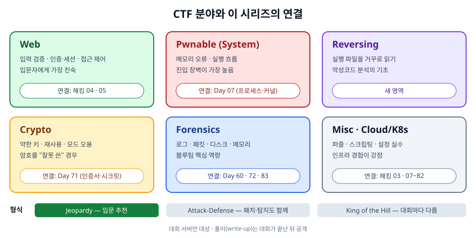
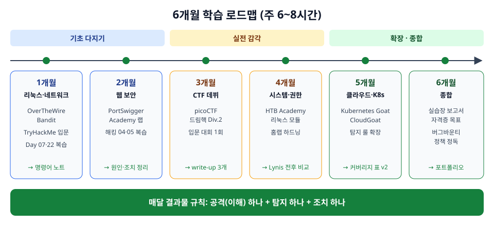
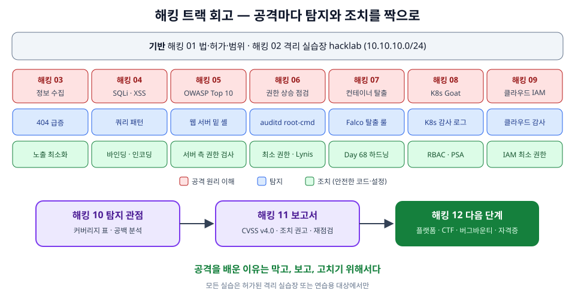

> **해킹 트랙 · 화이트해커 입문** | 난이도 ★★☆☆☆ | 예상 소요 1.5 ~ 2시간

> ⚠️ **실습 범위 경고** — 이 챕터의 모든 실습은 **본인 소유의 격리된 실습장**(해킹 02의 `hacklab` 네트워크) 또는 **의도적으로 취약하게 만든 연습용 대상**(DVWA, Juice Shop, Metasploitable, Kubernetes Goat, CloudGoat 등)에서만 했습니다. 실습장 밖으로 나가도 원칙은 같습니다. **허가가 문서로 확인된 대상**(학습 플랫폼의 머신, CTF 대회 서버, 버그바운티 정책이 명시한 범위)에만 시도하세요. 허가 없이 타인의 시스템을 스캔하거나 공격하면 **정보통신망법** 등에 따라 처벌될 수 있고, "공부하려고 했다"는 이유가 되지 않습니다.

## 🎯 오늘의 목표

- 실습장 밖에서 **합법적으로** 실력을 키우는 세 갈래(학습 플랫폼 · CTF · 버그바운티)와 각각의 "허가 문서"가 무엇인지 설명할 수 있다
- CTF의 형식과 분야(Web, Pwnable, Reversing, Crypto, Forensics, Misc)를 알고, 이 시리즈의 어느 Day와 이어지는지 안다
- 버그바운티의 **범위(scope)·규칙·책임 있는 공개**를 이해하고, KISA 신고포상제와 해외 플랫폼의 차이를 안다
- 목표에 맞는 자격증을 고르고, **6개월 학습 로드맵**을 세울 수 있다
- 해킹 트랙과 시리즈 전체(Chapter 0~9와 해킹 트랙)를 한 장의 표로 돌아볼 수 있다

---

## 1. 실습장 밖으로 — 합법의 세 갈래

해킹 트랙에서는 "내 것"만 공격했습니다. 실력을 더 키우려면 남이 만든 대상이 필요한데, 이때 기준은 단 하나입니다. **"이 대상을 시험해도 된다는 허가가 어디에 적혀 있는가?"**

| 갈래 | 대상 | 허가 문서 | 성격 |
|---|---|---|---|
| **학습 플랫폼** | 플랫폼이 띄워 주는 연습용 머신·랩 | 플랫폼 이용약관, 랩 안내 | 혼자, 언제든, 정답이 있는 문제 |
| **CTF** | 대회가 제공한 문제 서버 | 대회 규칙(Rules) | 시간 제한, 팀 경쟁, 다양한 분야 |
| **버그바운티** | **실제 운영 중인 서비스** 중 프로그램이 지정한 범위 | 프로그램 정책(범위·규칙·세이프 하버) | 실전, 보상, 가장 엄격한 규칙 |

> 💡 순서도 이대로가 좋습니다. 학습 플랫폼에서 기본기를 쌓고, CTF로 시간 압박과 낯선 문제에 익숙해진 뒤, 버그바운티는 **정책을 끝까지 읽을 수 있을 때** 시작합니다.

### 1-1. 어디서나 지킬 공통 규칙

| 규칙 | 이유 |
|---|---|
| 지정된 대상·주소만 | 플랫폼 VPN에 붙었다고 같은 망의 다른 참가자나 플랫폼 인프라가 대상이 되는 것은 아니다 |
| 서비스 거부(DoS)·대량 스캔 금지 (명시 허가가 없으면) | 다른 사용자에게 피해, 대부분의 규칙에서 금지 |
| 필요 이상의 데이터 접근 금지 | 취약점을 증명하는 최소한까지만. 실데이터는 보지도 저장하지도 않는다 |
| 풀이 공개 시점 지키기 | 진행 중인 CTF·플랫폼 문제의 풀이를 공개하면 규칙 위반 |
| 발견한 것은 정해진 경로로만 | 버그바운티는 프로그램 채널로만, 수정 전 공개 금지 |

---

## 2. CTF 입문

**CTF(Capture The Flag)** 는 문제 속에 숨겨진 문자열(**플래그**, 예: `FLAG{...}`)을 찾아 제출하는 보안 대회입니다.

### 2-1. 형식

| 형식 | 방식 | 입문자에게 |
|---|---|---|
| **Jeopardy** | 분야·점수별 문제 목록에서 골라 풂 | ✅ 가장 흔하고 입문용 |
| Attack-Defense | 팀마다 같은 서비스를 받아 **자기 것은 패치하고** 상대 것은 공격 | 방어(패치·탐지) 감각을 같이 기름. 경험 쌓은 뒤 |
| King of the Hill | 한 대상을 차지하고 유지 | 대회마다 다름 |

### 2-2. 분야

| 분야 | 다루는 것 | 이 시리즈와 연결 | 방어 쪽 가치 |
|---|---|---|---|
| **Web** | 입력 검증, 인증·세션, 접근 제어 | 해킹 04·05 (SQLi/XSS, OWASP Top 10) | 안전한 코드 리뷰 |
| **Pwnable (System)** | 메모리 오류(버퍼 오버플로 등), 바이너리 실행 흐름 | Day 07 (프로세스·커널 기초) | 메모리 안전성, 보호 기법 이해 |
| **Reversing** | 실행 파일을 거꾸로 읽어 동작 이해 | — (새 영역) | 악성코드 분석, 바이너리 검증 |
| **Crypto** | 잘못 쓴 암호(약한 키, 재사용, 모드 오용) | Day 71 (인증서·시크릿) | 암호 라이브러리를 올바로 쓰는 법 |
| **Forensics** | 디스크·메모리·패킷 캡처·로그에서 흔적 찾기 | Day 60·72·83 (로그·Falco·탐지) | **블루팀 핵심 역량** |
| **Misc / OSINT** | 퍼즐, 공개 정보 분석, 스크립팅 | 해킹 03 (정보 수집 원리) | 자동화·도구 활용 |
| Cloud / K8s | 잘못된 IAM·RBAC·컨테이너 설정 | 해킹 07~09 | 설정 점검 |

> 💡 인프라를 공부해 온 독자라면 **Forensics**와 **Web**, 그리고 최근 늘어난 **Cloud/K8s** 문제가 가장 친숙할 겁니다. 처음부터 Pwnable에 매달리기보다, 잘하는 분야에서 첫 플래그를 따는 경험을 먼저 하세요.

### 2-3. 시작하는 법

| 단계 | 할 일 |
|---|---|
| 1 | 상시 열려 있는 입문 대회로 시작 — **picoCTF**(카네기멜런 대학교 운영, 학생 대상이지만 연습 문제는 누구나), **드림핵 CTF Div.2**(기초 중심) |
| 2 | **CTFtime**(ctftime.org)에서 대회 일정을 보고, 난이도 낮은(weight 낮은) 온라인 대회에 팀 또는 혼자 참가 |
| 3 | 대회가 **끝난 뒤** 다른 사람의 write-up(풀이)을 읽고, 못 푼 문제를 다시 풀어 보기 |
| 4 | 내 풀이를 write-up으로 정리 — 해킹 11의 "재현 절차" 연습이 된다 |

국내 대회로는 **코드게이트(CODEGATE)**, 국가정보원 주최 **사이버공격방어대회(CCE)**, 드림핵의 정기·초청 대회(2026년 Dreamhack Invitational 본선은 .HACK 2026 컨퍼런스에서 열림) 등이 있습니다. 일정과 참가 자격은 해마다 바뀌므로 각 공식 사이트에서 확인하세요.

---

## 3. 합법적인 학습 플랫폼

| 플랫폼 | 특징 | 비용 | 추천 시점 |
|---|---|---|---|
| **TryHackMe** | 브라우저 안에서 단계별 "룸"과 학습 경로. 공격·방어(SOC) 경로 모두 | 무료 + 구독 | 첫 1~2개월 |
| **Hack The Box** | **Academy**(체계적 모듈)와 **Labs**(실전형 머신), 프로랩 | 무료 일부 + 구독/크레딧 | 기본기 이후 |
| **PortSwigger Web Security Academy** | Burp Suite 제작사의 웹 보안 교재 + 실습 랩. 개념 설명이 매우 좋음 | **무료** | 해킹 04·05 직후 |
| **OverTheWire** | SSH로 접속해 단계별로 푸는 워게임. **Bandit**은 리눅스 명령 연습에 최적 | 무료 | 리눅스가 낯설 때 |
| **picoCTF** | 입문자용 CTF 연습장 | 무료 | CTF 첫걸음 |
| **드림핵 (Dreamhack)** | 국내 플랫폼(티오리 운영). 한국어 강의 + 워게임 + 정기 CTF(Div.1/Div.2) | 무료 + 유료 강의 | 한국어로 체계적으로 |

> ⚠️ 플랫폼 VPN에 연결하면 내 PC가 다른 참가자들과 같은 가상망에 들어갈 수 있습니다. **실습용 VM에서만 연결**하고(해킹 02의 Kali처럼), 내 PC의 공유 폴더·서비스가 열려 있지 않은지 확인하세요. 방어도 실력입니다.

---

## 4. 버그바운티 — 실전에 들어갈 때

**버그바운티(Bug Bounty)** 는 기업·기관이 "이 범위에서 찾은 취약점을 이 경로로 알려 주면 보상하겠다"고 **공개적으로 허가**한 프로그램입니다. 허가는 **정책 문서에 적힌 만큼만** 유효합니다.

### 4-1. 정책에서 반드시 읽을 것

| 항목 | 확인할 내용 |
|---|---|
| **In scope** | 허가된 도메인·앱·API·버전. 와일드카드(`*.example.com`)의 의미 |
| **Out of scope** | 제외 자산(타사 서비스, 고객사 도메인), **제외 취약점 유형**(자기 XSS, 레이트 리밋 부재 등) |
| 금지 행위 | DoS, 사회공학, 물리 접근, 다른 사용자 데이터 접근, 자동 대량 스캔 |
| 테스트 계정 | 본인 계정·테스트 계정만 사용. 다른 사람의 계정으로 증명하지 않는다 |
| **세이프 하버** | 정책을 지킨 선의의 연구에 법적 조치를 하지 않겠다는 약속 — **정책을 어기면 보호도 없다** |
| 공개(disclosure) | 수정 전 공개 금지, 공개 시점과 방식 |
| 보상 기준 | 심각도별 금액, 중복 신고 처리 |

> ⚠️ 범위 밖 자산을 "혹시나" 시험하는 순간 그것은 버그바운티가 아니라 **허가 없는 접근**입니다. 프로그램이 없는 서비스에서 우연히 문제를 발견했다면 더 시험하지 말고, 그 회사의 보안 연락처(`security.txt`, 취약점 신고 창구)나 아래 KISA 경로로 **발견 사실만** 알립니다.

### 4-2. 국내 — KISA 취약점 신고포상제와 관련 제도

| 제도 | 내용 (2026-11 기준 확인) |
|---|---|
| **KISA 취약점 신고포상제** | KISA **사이버 보안취약점 정보포털**(knvd.krcert.or.kr)의 신고 접수 메뉴로 신고. 포털 공지에 따르면 **운영 중인 서비스(홈페이지 등)를 대상으로 취약점을 찾는 행위는 불법 소지(정보통신망법 제48조·제71조)가 있어 평가·포상에서 제외**됨 → 본인 환경에 설치한 소프트웨어에서 찾은 취약점이 기본 대상 |
| 핵더챌린지 | KISA의 버그바운티 대회. 2025년부터 '화이트햇 투게더'에서 이름이 바뀜. 참여 기업이 **허가한 대상**에서 진행 |
| 보안 취약점 신고·조치·공개(CVD/VDP) 시범사업 | 2026년 5월 과기정통부·국정원·KISA 등이 국내 처음으로 시범 운영 발표. 참여 기관의 **실제 운영망**을 대상으로 신고를 받았으며(신고 기간 7월 24일까지), 취약점별 현금 포상은 없음 |
| 금융권 보안취약점 신고포상제 | 금융감독원·금융보안원이 별도 운영. 2026년에는 참여 대상이 가상자산사업자 등으로 확대 |

> 💡 국내 제도는 해마다 이름·대상·기간이 바뀝니다. 위 표는 출발점일 뿐, 참여 전에 **그해 공고문**을 직접 읽으세요.

### 4-3. 해외·민간 플랫폼

| 플랫폼 | 특징 |
|---|---|
| **HackerOne** | 대형 버그바운티·VDP 플랫폼. 공개 프로그램과 초대제(private) 프로그램, 연습용 **Hacker101** 강의·CTF |
| **Bugcrowd** | 대형 플랫폼. 취약점 심각도 분류 기준(VRT)을 공개 |
| **Intigriti** | 유럽 기반 플랫폼 |
| **파인더갭 (FINDTHEGAP)** | 국내 크라우드소싱 버그바운티 플랫폼 |

### 4-4. 좋은 신고서 = 해킹 11의 발견 사항 한 개

버그바운티 신고서는 해킹 11의 발견 사항 템플릿과 거의 같습니다. **제목 · 범위 안 자산 · 재현 절차 · 영향 · 증거 · 제안 조치**. 차이는 두 가지입니다. ① 증명은 **최소한**으로(내 테스트 계정 데이터만), ② 보상을 위해 **영향을 과장하지 않기**. 과장된 신고는 신뢰를 잃고, 같은 프로그램에서 다음 신고가 늦게 처리됩니다.

---

## 5. 자격증

자격증은 실력 그 자체가 아니라 **학습 목표와 이력서의 공통 언어**입니다. 목표에 맞게 고르세요.

| 자격증 | 주관 | 형태 | 성격 | 상태 (2026-11 확인) |
|---|---|---|---|---|
| **정보보안기사** | 한국방송통신전파진흥원(KCA) — 2022년 KISA에서 이관된 국가기술자격 | 필기(CBT, 5과목) + 실기(필답형) | 국내 공공·대기업 채용, 이론 전반 | 2026년 정기검정 1·2·4회. 일정은 공식 공고 확인 |
| **OSCP+** | OffSec (PEN-200 과정) | 실기 시험(제한 시간 내 실제 머신 침투 + 보고서) | 실전 모의해킹의 대표 자격 | 2024-11부터 OSCP+로 발급, **3년 유효**(재시험 또는 CPE로 갱신). 기존 OSCP는 만료 없음. **2026-12-01부터 고정 합격선 대신 환산 점수(scaled scoring)** 도입 예고 |
| **CEH** | EC-Council | 객관식(+ 선택 실기 CEH Practical) | 공격 기법 용어·개념 폭넓게 | 현재 **v13**(AI 내용 통합). 3년마다 갱신 |
| 보안 기초 (CompTIA Security+ 등) | CompTIA | 객관식 | 보안 기초 전반, 해외 채용 기준 | 시험 버전 코드가 주기적으로 바뀌므로 공식 확인 |
| **CKS** | Linux Foundation / CNCF | 실기 | K8s 보안 (Chapter 9와 직결) | CKA 선행 필요 여부 등 공식 확인 |

| 목표 | 추천 순서 |
|---|---|
| 국내 보안 직무 취업 | 정보보안기사 → (실무 경험) → OSCP+ |
| 모의해킹 전문가 | 플랫폼(HTB Academy 등)으로 실력 → OSCP+ |
| 클라우드·K8s 보안 엔지니어 | CKA → CKS + 클라우드 보안 자격 |
| 보안 관제·탐지(블루팀) | 해킹 10 같은 탐지 엔지니어링 포트폴리오 + 블루팀 계열 자격 |

> ⚠️ 이 표의 시험 형식·가격·유효 기간은 자주 바뀝니다. **응시 전 반드시 주관 기관 공식 페이지**를 확인하세요. 특히 OSCP+의 채점 방식 변경처럼 응시 시점에 따라 규칙이 달라질 수 있습니다.

---

## 6. 6개월 학습 로드맵

주당 6~8시간을 기준으로 합니다. **매달 "공격 하나 + 탐지 하나 + 조치 하나"** 를 결과물로 남기는 것이 해킹 트랙의 방식을 이어 가는 길입니다.

| 월 | 주제 | 할 일 | 결과물 |
|---|---|---|---|
| 1 | 리눅스·네트워크 기초 다지기 | OverTheWire Bandit, TryHackMe 입문 경로, Day 07·22 복습 | 명령어 노트 |
| 2 | 웹 보안 | PortSwigger Academy의 SQLi·XSS·접근 제어 랩, 해킹 04·05 복습 | 랩별 "원인 · 조치 코드" 정리 |
| 3 | CTF 데뷔 | picoCTF·드림핵 Div.2, CTFtime의 입문 대회 1회 참가 | write-up 3개 |
| 4 | 시스템·권한 상승 | HTB Academy 리눅스 모듈, 해킹 06 하드닝 체크리스트를 내 홈랩에 적용 | 하드닝 전후 Lynis 점수 |
| 5 | 클라우드·K8s 보안 | Kubernetes Goat·CloudGoat 다시 풀기, Day 69·72·83 탐지 룰 확장 | 커버리지 표 v2 |
| 6 | 종합 | 실습장 전체를 해킹 11 형식 보고서로, 자격증 하나 목표 설정, 첫 버그바운티 정책 정독 | 샘플 보고서 + 공개 포트폴리오 |

> 💡 포트폴리오는 GitHub에 올리되, **실제 서비스 이름·취약점 상세·플랫폼 진행 중 문제의 풀이**는 올리지 않습니다. 실습장 구성(IaC), 탐지 룰, 하드닝 스크립트, 끝난 대회의 write-up이 좋은 재료입니다.

---

## 7. 해킹 트랙 회고

| Day | 주제 | 공격(이해) | 탐지 | 조치 |
|---|---|---|---|---|
| 74 | 입문·법 | 허가와 범위 | — | 작업 범위 합의서 |
| 75 | 격리 실습장 | — | 실습장이 새지 않는지 체크리스트 | Internal 네트워크, 업데이트/실습 모드 |
| 76 | 정보 수집 | 포트·서비스·디렉터리 | 웹 로그 404 급증 | 노출 최소화(H02·H03) |
| 77 | 웹 ① | SQLi/XSS 시도 | 쿼리 문자열 패턴 | 매개변수화 쿼리, 출력 인코딩 |
| 78 | 웹 ② | 인증 우회·IDOR·SSRF·업로드·명령 주입 | 웹 서버 밑 셸(Falco) | 서버 측 권한 검사, 허용 목록 |
| 79 | 권한 상승 점검 | SUID·sudo·cron | auditd `root-cmd` | 최소 권한, Lynis(Day 67) |
| 80 | 컨테이너 탈출 위험 | privileged, docker.sock | Falco 탈출 룰 | Day 68 하드닝 |
| 81 | K8s 공격 시나리오 | Kubernetes Goat | 감사 로그, API 연결 | RBAC·PSA(Day 19·69) |
| 82 | 클라우드 IAM | CloudGoat 개념 | 클라우드 감사 로그 | 최소 권한 IAM |
| 83 | 탐지 관점 | — | **커버리지 표·공백 분석** | 룰을 코드로 |
| 84 | 보고서 | — | 부록에 커버리지 | CVSS·조치 권고·재점검 |
| 85 | 다음 단계 | 합법적인 실전 | — | 로드맵 |

해킹 트랙의 한 줄 요약은 이렇습니다. **"공격을 배운 이유는 막고, 보고, 고치기 위해서다."** 모든 공격 주제에 탐지와 조치를 짝으로 둔 것도 그 때문입니다.

---

## 8. 시리즈 전체 회고 — Chapter 0 ~ 10

| Chapter | Day | 주제 | 핵심 질문 | 남은 것 (다음 Chapter가 쓴 것) |
|---|---|---|---|---|
| 0. 홈랩 | H01~H03 | 남는 PC를 서버로, 안전한 공개 | 내 서버를 어떻게 만들고 열까? | Ubuntu 서버 H01, 노출 원칙 |
| 1. Docker | 01~07 | 컨테이너, 이미지, 네트워크, Compose, 내부 원리 | 앱을 어떻게 똑같이 실행할까? | namespace·cgroup 이해 → Ch9·10 컨테이너 보안 |
| 2. Kubernetes | 08~20 | Pod부터 RBAC, kubeadm까지 | 여러 컨테이너를 어떻게 자동 운영할까? | kind `infra-lab` — 이후 모든 실습의 무대 |
| 3. 가상화·네트워크 | 21~24 | KVM, 리눅스 네트워킹, VXLAN, OVS | 그 밑의 VM과 네트워크는? | bridge·veth 감각 → 해킹 02 실습망 |
| 4. OpenStack | 25~33 | 프라이빗 클라우드 구성 요소 | 클라우드는 어떻게 만들어지나? | IAM·네트워크 개념 → 해킹 09 |
| 5. 종합 | 34~35 | K8s on OpenStack, Terraform | 전체를 코드로 묶으려면? | IaC 습관 |
| 6. AI 인프라 | 36~49 | GPU, LLM 서빙, RAG, K8s 운영 | LLM 서비스를 어떻게 운영할까? | Day 48 LLM 보안 |
| 7. GitOps | 50~57 | Actions, Kustomize, Argo CD, 공급망 보안 | 배포를 Git 하나로? | 룰·정책도 Git으로 (해킹 10) |
| 8. SRE·관측성 | 58~65 | SLO, OTel, Loki, Tempo, 알림, 카오스, 포스트모템 | 숫자로 약속하고 지키려면? | Loki·Alertmanager·포스트모템 → 해킹 10·11 |
| 9. 보안 | 66~73 | 위협 모델링, 하드닝, 런타임 보안, 제로 트러스트, Falco, SSO·감사 | 4C 레이어별로 어떻게 지키나? | 방어 도구 전부 → Ch10에서 검증 |
| 10. 화이트해커 입문 | 74~85 | 법, 실습장, 공격 원리, 탐지, 보고서 | 내가 만든 방어는 정말 작동하나? | 퍼플팀 습관, 보고서, 로드맵 |

> 💡 시리즈를 한 문장으로 줄이면 **"만들고(Ch0~5) → 키우고(Ch6~7) → 지키고(Ch8~9) → 검증한다(Ch10)"** 입니다. 같은 홈랩과 같은 `infra-lab` 위에서 85일을 이어 온 덕분에, 마지막 장에서 공격 하나가 1장의 namespace부터 9장의 Falco까지 한 줄로 이어졌습니다.

---

## 9. 막히는 지점

| 증상 | 원인 | 해결 |
|---|---|---|
| CTF 문제를 하나도 못 풀겠음 | 대회 난이도가 너무 높음 | picoCTF·드림핵 Div.2부터, 대회 후 write-up으로 역으로 배우기 |
| 플랫폼 VPN 연결 후 머신에 접속 안 됨 | VPN 설정 파일 리전·만료, 방화벽 | 플랫폼 접속 확인 페이지, Kali VM에서 연결 |
| 버그바운티 신고가 "범위 밖"으로 닫힘 | 정책의 Out of scope를 안 읽음 | 시험 **전에** 자산과 유형을 정책과 대조, 애매하면 프로그램에 질문 |
| 신고가 "정보성/영향 없음"으로 닫힘 | 영향을 증명하지 못함 | 해킹 11의 "영향" 항목처럼 확인된 영향을 구체적으로 |
| 공부가 공격 기법 모으기로만 흐름 | 탐지·조치 없이 진행 | 매달 "공격 하나 + 탐지 하나 + 조치 하나" 결과물 규칙 |
| 자격증 준비가 끝이 없음 | 목표 없이 여러 개 동시 준비 | 5장 목표표에서 하나만 골라 기한 설정 |

---

## 10. 핵심 정리

- 실습장 밖의 합법적인 길은 **학습 플랫폼 → CTF → 버그바운티**. 각자 허가 문서(약관 · 대회 규칙 · 프로그램 정책)가 있고, **그 문서가 허가한 만큼만** 시도한다
- CTF는 Jeopardy 형식의 Web·Forensics부터 시작하고, 끝난 대회의 write-up으로 배운다
- 버그바운티는 **In/Out of scope, 금지 행위, 세이프 하버, 공개 정책**을 시험 전에 읽는다. 국내 KISA 신고포상제는 운영 중인 서비스 대상 발굴을 포상에서 제외한다
- 자격증은 목표별로 하나씩: 정보보안기사(국내, KCA), OSCP+(실전 모의해킹, 3년 유효), CEH(v13), CKS(K8s 보안). 응시 전 공식 페이지 확인
- 6개월 로드맵의 규칙: **매달 공격 하나 + 탐지 하나 + 조치 하나**
- 시리즈 전체는 **만들고 → 키우고 → 지키고 → 검증한다**

---

## 11. 셀프 체크

Q1. 학습 플랫폼 VPN에 연결했더니 같은 대역에 다른 IP들이 보인다. 이들을 스캔해도 되나?

안 됩니다. 허가된 대상은 **플랫폼이 나에게 배정한 머신**뿐입니다. 같은 가상망의 다른 참가자나 플랫폼 인프라는 대상이 아니며, 약관 위반이자 허가 없는 접근이 될 수 있습니다.

Q2. 버그바운티 프로그램의 범위가 <code>app.example.com</code>인데, 정찰 중 <code>admin.example.com</code>을 발견했다. 어떻게 해야 하나?

범위 밖이므로 시험하지 않습니다. 정책이 허용하면 프로그램에 "범위 확대 여부"를 질문하거나, 노출 자체가 문제라면 **발견 사실만** 신고합니다. 범위 밖 자산에 대한 시도는 세이프 하버의 보호를 받지 못합니다.

Q3. KISA 신고포상제에서 운영 중인 웹사이트의 취약점 발굴이 포상 대상에서 제외되는 이유는?

운영 중인 서비스를 허가 없이 시험하는 행위 자체가 정보통신망법(제48조 침해 금지, 제71조 처벌)에 따라 불법 소지가 있기 때문입니다. 본인이 설치한 소프트웨어 환경에서 찾은 취약점, 또는 핵더챌린지처럼 기업이 대상을 허가한 프로그램을 이용합니다.

Q4. CTF의 Forensics 분야가 인프라 엔지니어에게 특히 유용한 이유는?

로그·패킷·디스크에서 흔적을 찾는 능력은 Day 60(Loki), 72(Falco), 83(탐지 관점)에서 한 블루팀 업무와 같습니다. 장애 분석과 보안 사고 조사 모두에 바로 쓰입니다.

Q5. OSCP와 OSCP+의 차이는?

2024년 11월 이후 시험 합격자는 OSCP+를 받으며, OSCP+는 **3년 유효**하고 재시험이나 CPE로 갱신합니다. 기존 OSCP는 만료가 없습니다. 또 2026년 12월 1일부터 OSCP+ 시험에 환산 점수 방식이 예고되어 있으므로 응시 전 공식 공지를 확인합니다.

---

## ⏭️ 다음 시즌 예고

85일 동안 홈랩 한 대에서 시작해 컨테이너, Kubernetes, 가상화, OpenStack, AI 인프라, GitOps, SRE, 보안, 그리고 그 보안을 직접 검증하는 화이트해커 입문까지 왔습니다. 이제 여러분의 `infra-lab`에는 **배포 파이프라인, 관측성 스택, 방어 도구, 그리고 그것을 시험하는 실습장**이 모두 있습니다.

다음 시즌은 이 홈랩을 벗어나 **퍼블릭 클라우드와 실제 운영 규모**로 나아가는 방향을 준비하고 있습니다. 관리형 Kubernetes(EKS 등)와 Terraform 모듈로 같은 구성을 클라우드에 다시 세우고, 비용·멀티 계정 IAM·클라우드 네이티브 보안 서비스를 Chapter 9·10의 눈으로 점검하는 흐름입니다. 구체적인 목차는 README 로드맵에서 공개됩니다.

그때까지 할 일은 하나입니다. 6장의 로드맵에서 **이번 달 칸 하나**를 골라 시작하세요. 그리고 언제나 — **허가된 곳에서만**.
