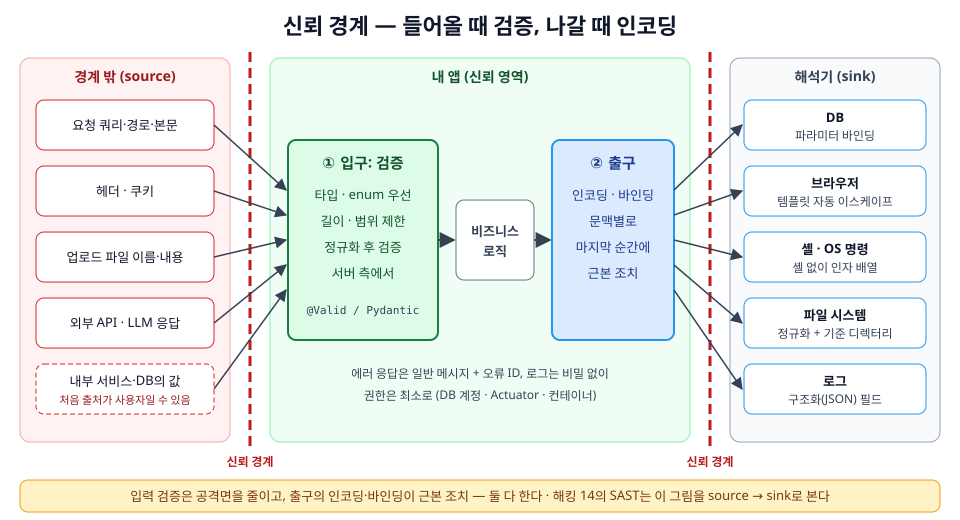
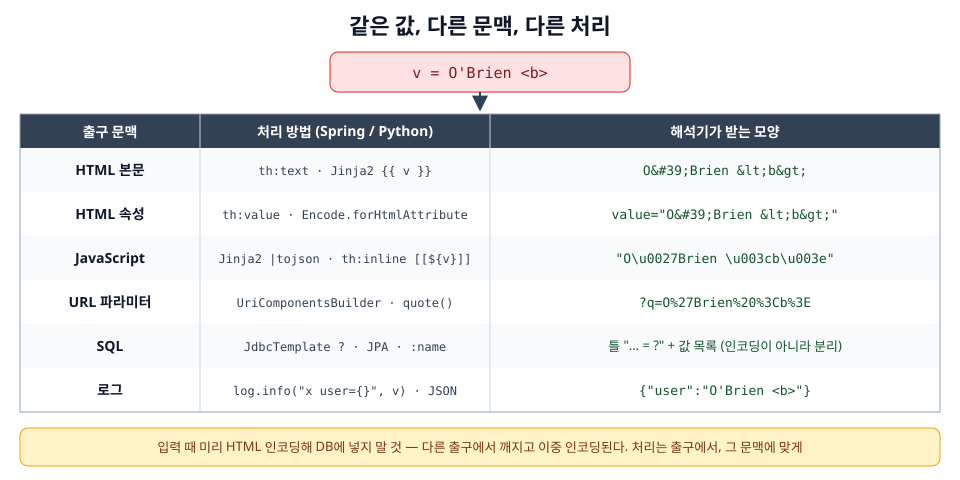
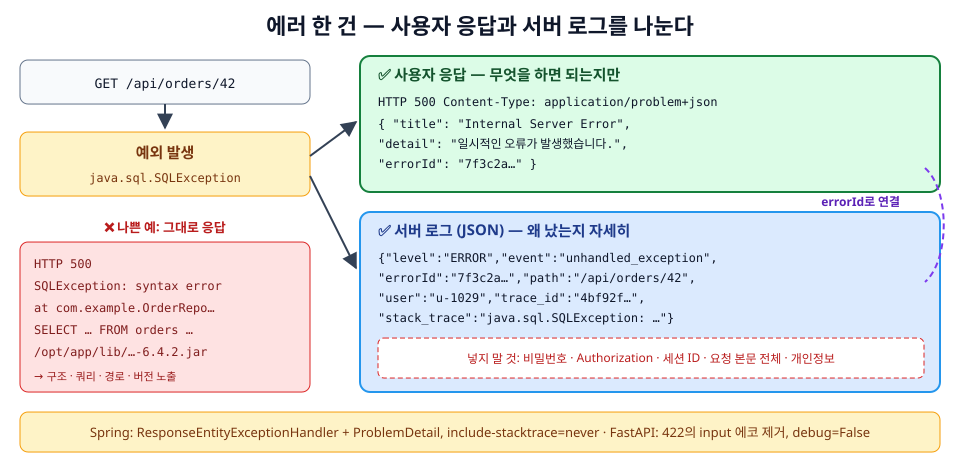

> **해킹 트랙 · 개발 보안** | 난이도 ★★★☆☆ | 예상 소요 2.5 ~ 3시간

> ⚠️ **실습 전 반드시 읽을 것**
> 이 편의 모든 실습은 **본인이 작성한 앱**과 **본인 소유의 격리된 실습장**(해킹 02의 `hacklab` 네트워크, Day 09의 kind `infra-lab`)에서만 합니다. 허가 없이 타인의 서비스에 요청을 조작해 보내거나 오류를 유발하는 것은 **정보통신망법 등으로 처벌**될 수 있습니다. 오늘의 목적은 **내 코드가 같은 실수를 하지 않게 만들고, 일어나면 알아채는 것**입니다.

## 🎯 오늘의 목표

- **신뢰 경계(trust boundary)** 를 그림으로 그리고, 내 앱에서 "검증이 필요한 입구"와 "인코딩이 필요한 출구"를 찾을 수 있다
- **허용 목록 · 정규화 후 검증 · 서버 측 검증** 원칙을 Spring Boot(Bean Validation)와 FastAPI(Pydantic)로 구현할 수 있다
- 같은 값이라도 **출력 문맥(HTML, 속성, JS, URL, 로그, 헤더)** 마다 다른 인코딩이 필요하다는 것을 설명할 수 있다
- 사용자에게는 **일반 메시지와 오류 ID**만, 서버 로그에는 **민감정보를 가린 상세 정보**를 남기도록 에러 처리를 설계할 수 있다
- **최소 권한**을 코드·DB·컨테이너·프레임워크 설정 단위로 점검하고, 팀에서 쓸 **코드 리뷰 체크리스트**를 만들 수 있다

---

## 1. 오늘의 위치 — 밖에서 두드리던 것을 안에서 막기

해킹 01~12는 실습장을 **밖에서 보는** 연습이었습니다. 해킹 04·05에서 SQLi, XSS, 명령 주입, 파일 업로드를 보며 매번 같은 결론에 도달했습니다. "**데이터가 어딘가에서 코드로 해석됐다**", 그리고 "**에러 메시지가 너무 많은 것을 알려 줬다**". 해킹 13~20의 개발 보안 구간은 이 결론을 **코드 작성 습관**으로 바꾸는 단계입니다.

| 편 | 질문 |
|---|---|
| **13 (오늘)** | 코드를 쓸 때 지킬 기본 원칙은? |
| 14 | 그 원칙을 어겼는지 **도구로 자동 확인**하려면? (SAST) |
| 15 | 인증·인가 코드에서 특히 자주 하는 실수는? |
| 16~18 | API, 브라우저, 역직렬화처럼 영역별 심화 |
| 19~20 | 의존성·시크릿, 배포 전 동적 점검(ZAP) |

모든 주제를 같은 순서로 봅니다.

| 단계 | 오늘 답할 질문 |
|---|---|
| **원리** | 왜 이 실수가 위험한가? |
| **내 환경 점검** | 내 코드·설정 어디에 같은 실수가 있나? (grep, curl, 설정 확인) |
| **탐지** | 운영 중이라면 로그·알림에 무엇이 남나? (Day 60 Loki, Day 62 알림) |
| **수정** | 안전한 코드와 설정은 무엇인가? (Spring Boot / FastAPI) |

> 💡 **실습 환경**: 코드는 **Spring Boot 4.1**(Java 21, Spring Security 7)과 **Python 3.12 + FastAPI 0.16x + Pydantic v2** 기준입니다. Spring Boot 4부터 웹 스타터 이름이 `spring-boot-starter-webmvc`로 바뀌었습니다(이전 이름 `spring-boot-starter-web`은 deprecated지만 아직 동작). 두 앱 모두 H01 서버나 개발 PC에서 로컬로 띄우면 됩니다.

---

## 2. 신뢰 경계 — 모든 원칙의 출발점

### 2-1. 원리

**신뢰 경계**는 "내가 통제하는 영역"과 "통제하지 못하는 영역"의 경계선입니다. 경계를 넘어 **들어오는** 값은 무엇이든 검증하고, 경계를 넘어 **나가는** 값은 받는 쪽(해석기)의 문법에 맞게 인코딩합니다.



| 들어오는 값 (검증 대상) | 흔한 착각 |
|---|---|
| 쿼리 문자열, 경로 변수, 본문(JSON·폼) | "프런트에서 이미 막았다" — Burp Repeater(해킹 04)로 얼마든지 우회 |
| HTTP 헤더(`User-Agent`, `X-Forwarded-For`, `Referer`) | "헤더는 브라우저가 만든다" — 클라이언트가 마음대로 정함 |
| 쿠키 | "내가 발급한 값이다" — 서명·서버 측 저장이 없으면 변조 가능 |
| 업로드 파일의 이름·타입·내용 | "확장자를 봤다" — 해킹 05 5장 |
| **다른 내부 서비스·DB·메시지 큐에서 온 값** | "내부니까 안전하다" — 그 값의 처음 출처가 사용자일 수 있음(Stored XSS) |
| 외부 API 응답, LLM 출력 | "유명 서비스다" — Day 48의 간접 프롬프트 주입 |

| 나가는 곳 (인코딩·바인딩 대상) | 해석기 | 실수했을 때 |
|---|---|---|
| SQL | DB 파서 | SQLi (해킹 04) |
| HTML·JS | 브라우저 | XSS (해킹 04) |
| OS 명령 | 셸 | 명령 주입 (해킹 05) |
| 파일 경로 | 파일 시스템 | 경로 조작 |
| 로그 | 로그 뷰어·수집기 | 로그 위조, 로그에 비밀 유출 |
| HTTP 헤더 | 브라우저·프록시 | 헤더 분할 |

> 💡 해킹 14의 SAST 도구는 이 그림을 그대로 씁니다. 들어오는 곳을 **source**, 나가는 곳을 **sink**, 그 사이의 검증·인코딩을 **sanitizer**라고 부릅니다. 오늘 경계를 그려 두면 다음 편 결과를 읽기가 훨씬 쉽습니다.

### 2-2. 내 환경 점검 — 경계 목록 만들기

Day 66의 위협 모델링에서 그린 데이터 흐름도(DFD)를 앱 코드 수준으로 내립니다. Spring이라면 다음 명령으로 "들어오는 입구"를 빠르게 셀 수 있습니다.

```bash
# Spring: 외부 입력을 받는 컨트롤러 메서드 매개변수
grep -rnE "@(RequestParam|PathVariable|RequestBody|RequestHeader|CookieValue|ModelAttribute)" src/main/java | wc -l

# FastAPI: 라우트 함수 목록
grep -rnE "@(app|router)\.(get|post|put|patch|delete)\(" app/ | wc -l
```

| 정리할 칸 | 예 |
|---|---|
| 입구 | `POST /api/users` 본문 `SignupRequest` |
| 검증 위치 | DTO의 Bean Validation, 서비스의 중복 검사 |
| 출구 | DB INSERT(JPA), 환영 메일 HTML, 감사 로그 |
| 출구별 처리 | JPA 바인딩, Thymeleaf `th:text`, 구조화 로그 |

이 표에서 **"검증 위치"나 "출구별 처리"가 빈 칸인 줄**이 오늘 고칠 곳입니다.

---

## 3. 입력 검증

### 3-1. 원리 — 네 가지 원칙

| 원칙 | 설명 | 왜 |
|---|---|---|
| **허용 목록(allowlist)** | "이것만 허용"을 정의하고 나머지를 거부 | 차단 목록(blocklist)은 인코딩·대소문자·변형을 다 막을 수 없음 (해킹 04의 DVWA Medium·High) |
| **정규화 후 검증** | 유니코드 정규화(NFKC), 공백 정리, 경로 정규화를 **먼저** 하고 검사 | 검사 후에 바뀌면 검사가 무의미. `ｓｃｒｉｐｔ`(전각), `..%2f` 같은 변형 |
| **구문 + 의미 검증** | 구문: 형식·길이·범위. 의미: 비즈니스 규칙(시작일 < 종료일, 내 소유 객체) | 형식만 맞는 "말이 안 되는 값"도 막아야 함 |
| **서버 측에서** | 브라우저 검증은 사용자 편의, 보안은 서버 | 클라이언트는 신뢰 경계 밖 |

> ⚠️ **입력 검증은 SQLi·XSS의 근본 조치가 아닙니다.** 이름 필드에 `O'Brien`이 들어와야 하는 것처럼, 정상 데이터에도 따옴표·꺾쇠가 들어갑니다. 입력 검증은 **공격면을 줄이는 1차 필터**이고, 근본 조치는 **출구의 바인딩·인코딩**(4장, 해킹 04)입니다. 둘 다 합니다.

허용 목록을 만들 때의 우선순위는 다음과 같습니다.

1. **타입으로 제한** — `long`, `enum`, `LocalDate`, `UUID`. 파싱이 곧 검증입니다.
2. **열거형으로 제한** — 정렬 컬럼, 상태 값, 국가 코드.
3. **길이·범위** — 모든 문자열에 최대 길이. 숫자에 최소·최대.
4. **정규식** — 앞의 셋으로 안 될 때만. `^…$`로 전체 일치, 반복 중첩 금지(ReDoS).

### 3-2. 내 환경 점검

```bash
# Spring: @RequestBody인데 @Valid가 없는 곳
grep -rnE "@RequestBody" src/main/java | grep -v "@Valid"

# Spring: 엔티티를 그대로 요청 본문으로 받는 곳 (Mass Assignment 위험)
grep -rnE "@RequestBody\s+(@Valid\s+)?[A-Z][a-zA-Z]*Entity|@RequestBody\s+Map<" src/main/java

# FastAPI: dict·Any로 본문을 받는 곳, 길이 제한 없는 str
grep -rnE "(: dict|: Any|Body\(\))" app/
grep -rnE "^\s+\w+: str\s*$" app/schemas/
```

`curl`로 경계 값을 직접 보내 보는 것도 점검입니다. **내 로컬 앱에만** 보냅니다.

```bash
# 길이 제한이 있나? (10,000자 이름)
curl -s -o /dev/null -w "%{http_code}\n" -X POST localhost:8080/api/users \
  -H 'Content-Type: application/json' \
  -d "{\"username\":\"$(head -c 10000 /dev/zero | tr '\0' a)\",\"email\":\"a@b.test\",\"age\":20,\"plan\":\"FREE\"}"
# 기대: 400  /  문제: 201 또는 500

# 모르는 필드(role)를 같이 보내면 무시되나, 반영되나?
curl -s -X POST localhost:8080/api/users -H 'Content-Type: application/json' \
  -d '{"username":"kim","email":"k@b.test","age":20,"plan":"FREE","role":"ADMIN"}'
```

### 3-3. 수정 — Spring Boot: Bean Validation

의존성은 `spring-boot-starter-validation` 하나입니다(Hibernate Validator 포함).

```java
// ❌ 취약: Map으로 아무거나 받고, 엔티티에 그대로 복사
@PostMapping("/api/users")
public User signup(@RequestBody Map<String, Object> body) {
    User u = new User();
    BeanUtils.populate(u, body);          // role, verified 같은 필드까지 덮어쓸 수 있음
    return repo.save(u);
}
```

```java
// ✅ 안전: 요청 전용 DTO(record) + 선언적 검증
public enum Plan { FREE, PRO }                            // 허용 목록 = enum

public record SignupRequest(
    @NotBlank @Size(min = 3, max = 20)
    @Pattern(regexp = "^[a-z0-9_]+$") String username,    // 소문자·숫자·밑줄만
    @NotBlank @Email @Size(max = 254) String email,
    @NotNull @Min(14) @Max(130) Integer age,
    @NotNull Plan plan                                     // "ADMIN" 같은 값은 역직렬화 단계에서 거부
) {
    public SignupRequest {                                 // compact constructor: 정규화를 먼저
        username = username == null ? null
            : Normalizer.normalize(username, Normalizer.Form.NFKC).strip().toLowerCase(Locale.ROOT);
        email = email == null ? null : email.strip();
    }
}

@RestController
@RequestMapping("/api/users")
class UserController {                                      // Spring 6.1+: @PathVariable·@RequestParam 제약도 내장 메서드 검증이 처리
    private final UserService service;
    UserController(UserService service) { this.service = service; }

    @PostMapping
    ResponseEntity<UserResponse> signup(@Valid @RequestBody SignupRequest req) {
        return ResponseEntity.status(HttpStatus.CREATED).body(service.signup(req));
    }

    @GetMapping("/{id}")
    UserResponse get(@PathVariable @Positive long id) {    // 타입이 곧 검증
        return service.get(id);
    }

    @GetMapping
    List<UserResponse> list(@RequestParam(defaultValue = "username") SortKey sort,
                            @RequestParam(defaultValue = "20") @Min(1) @Max(100) int size) {
        return service.list(sort, size);
    }
    enum SortKey { username, createdAt }                   // ORDER BY 허용 목록 (해킹 04 9-2)
}
```

| 포인트 | 설명 |
|---|---|
| DTO ≠ 엔티티 | 요청 DTO에는 **사용자가 정해도 되는 필드만**. `role`, `verified`, `ownerId`는 없음 → Mass Assignment 차단 (해킹 16에서 다시) |
| record의 compact constructor | Jackson이 값을 넣을 때 정규화가 먼저 실행되고, 그 다음 `@Valid`가 검사 |
| 매개변수 제약 | Spring Framework 6.1(Boot 3.2)부터 `@PathVariable`·`@RequestParam`의 제약을 **내장 메서드 검증**이 처리하고 실패 시 `HandlerMethodValidationException`(400). 클래스에 `@Validated`를 붙이면 예전 AOP 방식(`ConstraintViolationException`)으로 바뀌므로 새 코드에서는 붙이지 않음 |
| 의미 검증 | "이미 쓰는 이름", "내 주문인가"는 서비스 계층에서. 실패 시 409·404 |

> 💡 **정규식 주의**: `@Pattern`은 전체 일치(`matches`)로 동작하지만, 다른 곳에서 `find()`를 쓰면 부분 일치가 됩니다. `^…$`를 항상 씁니다. `(a+)+` 같은 중첩 반복은 ReDoS(정규식 서비스 거부)를 부릅니다.

**경로는 "정규화 후 검증"의 대표 예**입니다. 해킹 14에서 SAST가 찾는 경로 조작(path traversal)의 수정 코드이기도 합니다.

```java
// ✅ 업로드 디렉터리 밖으로 나가지 못하게
private static final Path BASE = Path.of("/srv/app/files").toAbsolutePath().normalize();

Path resolveSafe(String fileName) {
    if (!fileName.matches("^[A-Za-z0-9._-]{1,100}$")) {               // 1) 허용 목록
        throw new ResponseStatusException(HttpStatus.BAD_REQUEST);
    }
    Path target = BASE.resolve(fileName).normalize();                   // 2) 정규화
    if (!target.startsWith(BASE)) {                                     // 3) 정규화된 결과로 검증
        throw new ResponseStatusException(HttpStatus.BAD_REQUEST);
    }
    return target;
}
```

### 3-4. 수정 — FastAPI: Pydantic v2

FastAPI는 타입 힌트가 곧 검증입니다. 실패하면 자동으로 **422**를 돌려줍니다.

```python
# ❌ 취약: dict로 받고 그대로 저장
@app.post("/api/users")
def signup(body: dict):
    db.users.insert_one(body)          # role, is_admin 등 무엇이든 들어감
    return body
```

```python
# ✅ 안전: app/schemas.py
import unicodedata
from typing import Annotated, Literal
from pydantic import BaseModel, BeforeValidator, ConfigDict, EmailStr, Field

def nfkc(v: object) -> object:
    return unicodedata.normalize("NFKC", v).strip().lower() if isinstance(v, str) else v

Username = Annotated[
    str,
    BeforeValidator(nfkc),                                   # 정규화가 먼저
    Field(min_length=3, max_length=20, pattern=r"^[a-z0-9_]+$"),
]

class SignupRequest(BaseModel):
    model_config = ConfigDict(extra="forbid")                # 모르는 필드(role 등)는 422
    username: Username
    email: EmailStr = Field(max_length=254)                  # pip install "pydantic[email]"
    age: int = Field(ge=14, le=130)
    plan: Literal["free", "pro"]                             # 허용 목록

class UserResponse(BaseModel):                               # 응답도 모델로 — 내보낼 필드만
    id: int
    username: str
    plan: str
```

```python
# app/main.py
from typing import Annotated, Literal
from fastapi import FastAPI, Path, Query

app = FastAPI()

@app.post("/api/users", status_code=201, response_model=UserResponse)
def signup(req: SignupRequest):
    return service.signup(req)

@app.get("/api/users/{user_id}", response_model=UserResponse)
def get_user(user_id: Annotated[int, Path(gt=0)]):
    return service.get(user_id)

@app.get("/api/users", response_model=list[UserResponse])
def list_users(sort: Literal["username", "created_at"] = "username",
               size: Annotated[int, Query(ge=1, le=100)] = 20):
    return service.list(sort, size)
```

| Spring (Bean Validation) | FastAPI (Pydantic v2) |
|---|---|
| `@Size(max=20)` | `Field(max_length=20)` |
| `@Min/@Max`, `@Positive` | `Field(ge=, le=)`, `Path(gt=0)` |
| `@Pattern(regexp=)` | `Field(pattern=)` |
| `enum` 타입 | `Literal[...]` 또는 `Enum` |
| 요청 DTO에 필드를 두지 않음 | `extra="forbid"` |
| compact constructor에서 정규화 | `BeforeValidator` |
| 실패 시 400 (`MethodArgumentNotValidException`) | 실패 시 422 (`RequestValidationError`) |

### 3-5. 탐지

정상 사용자는 검증 실패를 거의 일으키지 않습니다. 특정 클라이언트에서 **400/422가 몰리면** 누군가 입력 경계를 더듬고 있다는 신호입니다. Day 60의 Loki에 앱 로그가 JSON으로 모인다고 가정합니다.

```logql
# 10분 동안 클라이언트별 검증 실패 수 (demo-dev 네임스페이스)
sum by (client) (
  count_over_time({namespace="demo-dev"} | json | event="validation_failed" [10m])
)
```

이 이벤트를 남기는 코드는 5장의 에러 핸들러에 들어 있습니다. 경보 규칙은 해킹 04 5-4와 같은 방식으로 `severity: ticket` 등급으로 둡니다(Day 62의 증상 기반 원칙).

---

## 4. 출력 인코딩 — 문맥이 전부다

### 4-1. 원리

해킹 04에서 XSS를 볼 때 "문맥(context)이 전부다"라고 했습니다. 이것은 HTML에만 해당하는 이야기가 아닙니다. **값이 어떤 해석기로 나가느냐**에 따라 위험한 문자와 올바른 처리가 모두 다릅니다.



| 출구 문맥 | 위험한 문자 | 올바른 처리 | 잘못된 처리 |
|---|---|---|---|
| HTML 본문 | `< > &` | 템플릿 자동 이스케이프 | 문자열 연결로 HTML 조립 |
| HTML 속성 | `" ' ` 공백 | 속성 인코딩 + **따옴표로 감싸기** | 따옴표 없는 속성 |
| JavaScript 문자열 | `' " \ </` 줄바꿈 | 값을 JSON으로 직렬화, 또는 `data-*` 속성으로 전달 | `<script>var x='${v}'</script>` |
| URL 파라미터 | `& = ? #` 공백 | 퍼센트 인코딩(`UriComponentsBuilder`, `urllib.parse.quote`) | 문자열로 쿼리 조립 |
| URL 전체(`href`) | `javascript:` 스킴 | **스킴 허용 목록**(`http`, `https`) | 인코딩만 하고 스킴 미확인 |
| SQL | `'` `;` 등 | **파라미터 바인딩** (인코딩 아님) | 이스케이프 함수로 "처리" |
| OS 명령 | `; | & $ ` 공백 | 셸 없이 인자 배열 (해킹 05) | 이스케이프 후 셸 실행 |
| 로그 | `\r \n`, 제어 문자 | **구조화(JSON) 로그**, 값 필드로 분리 | 사용자 값을 메시지 문자열에 연결 |
| HTTP 헤더 | `\r \n` | 프레임워크 API(`ContentDisposition` 등) | 헤더 문자열 직접 조립 |

> 💡 규칙 한 줄 요약: **값은 마지막 순간에, 그 출구의 문법에 맞게** 처리합니다. 입력할 때 미리 HTML 인코딩해서 DB에 넣으면, 그 값을 JSON API나 메일 제목으로 내보낼 때 `&lt;` 같은 깨진 문자열이 나오고, 이중 인코딩·누락이 생깁니다.

### 4-2. 내 환경 점검

```bash
# Spring + Thymeleaf: 이스케이프를 끄는 th:utext, 인라인 [(...)]
grep -rnE "th:utext|\[\(\\$\{" src/main/resources/templates

# Spring: 문자열로 HTML·헤더를 조립하는 곳
grep -rnE "\"<(html|div|p|a|script)[ >]|setHeader\(\"Content-Disposition\"" src/main/java

# Python: |safe, Markup, autoescape false, f-string HTML
grep -rnE "\|\s*safe|Markup\(|autoescape\s+false|HTMLResponse" app/ templates/

# 로그에 사용자 값을 문자열 연결로 넣는 곳 (Java)
grep -rnE "log\.(info|warn|error)\(\".*\"\s*\+" src/main/java
```

### 4-3. 수정 — Spring

```html
<!-- Thymeleaf (Spring MVC 서버 렌더링) -->
<p th:text="${user.bio}">소개</p>                         <!-- ✅ HTML 이스케이프 -->
<input th:value="${user.nickname}">                        <!-- ✅ 속성 이스케이프, 따옴표 자동 -->
<a th:href="@{/users/{id}(id=${user.id})}">프로필</a>       <!-- ✅ URL 인코딩 -->
<script th:inline="javascript">
  const nickname = [[${user.nickname}]];                   // ✅ JS 문맥 이스케이프(JSON 형태)
</script>

<p th:utext="${user.bio}">소개</p>                         <!-- ❌ 이스케이프 없음 -->
```

템플릿 밖에서 직접 인코딩해야 한다면 OWASP Java Encoder(`org.owasp.encoder:encoder`, 작성 시점 Maven Central 최신 1.6.0)를 씁니다. 메서드 이름이 곧 문맥입니다.

```java
import org.owasp.encoder.Encode;

String html  = "<p>" + Encode.forHtml(bio) + "</p>";
String attr  = "<input value=\"" + Encode.forHtmlAttribute(nickname) + "\">";
String js    = "var n = '" + Encode.forJavaScript(nickname) + "';";
String query = "/search?q=" + Encode.forUriComponent(keyword);
```

헤더와 로그는 문자열을 직접 만들지 않습니다.

```java
// ✅ 다운로드 파일명 헤더: 프레임워크가 인코딩 (RFC 6266/5987)
ContentDisposition cd = ContentDisposition.attachment()
        .filename(originalName, StandardCharsets.UTF_8).build();
return ResponseEntity.ok()
        .header(HttpHeaders.CONTENT_DISPOSITION, cd.toString())
        .body(resource);

// ❌ 로그 위조: username에 줄바꿈이 있으면 가짜 로그 줄이 생김
log.info("login failed user=" + username);
// ✅ 자리표시자 + 구조화 로그(JSON)에서는 줄바꿈이 값 안에 이스케이프되어 들어감
log.info("login_failed user={}", username);
```

Spring Boot 3.4부터는 **구조화 로깅**이 내장돼 있어 설정 한 줄로 JSON 로그를 냅니다. Day 60의 Loki가 `| json`으로 바로 파싱할 수 있고, 값 속 줄바꿈이 새 로그 줄이 되지 않습니다.

```yaml
# application.yml
logging:
  structured:
    format:
      console: ecs        # ecs | logstash | gelf
```

### 4-4. 수정 — FastAPI

HTML 출력은 해킹 04 9-4(Jinja2 자동 이스케이프, `|tojson`, `|safe` 금지)를 그대로 따릅니다. 여기서는 URL과 로그만 봅니다.

```python
from urllib.parse import quote, urlparse

# ✅ URL 파라미터
url = f"/search?q={quote(keyword, safe='')}"

# ✅ 사용자가 준 링크: 스킴 허용 목록
def safe_link(u: str) -> str | None:
    p = urlparse(u)
    return u if p.scheme in {"http", "https"} and p.netloc else None
```

```python
# ✅ JSON 로그: python-json-logger 등으로 extra 필드를 값으로 분리
import logging
log = logging.getLogger("app")
log.info("login_failed", extra={"event": "login_failed", "user": username})
```

### 4-5. 탐지

출력 인코딩이 빠졌을 때 운영에서 볼 수 있는 신호는 해킹 04 8장의 **CSP 위반 보고**가 가장 정확합니다. 여기에 로그 쪽 신호를 하나 더합니다.

| 신호 | 의미 |
|---|---|
| CSP 위반 보고 급증 (`event="csp_violation"`) | 어딘가 인코딩이 빠져 스크립트가 끼어들었거나, 새 배포가 정책과 충돌 |
| 텍스트 로그에서 **타임스탬프로 시작하지 않는 줄** | 로그 위조 시도 또는 멀티라인 예외 — 구조화 로그로 전환하면 사라짐 |

---

## 5. 안전한 에러 처리와 로깅

### 5-1. 원리

에러는 두 독자를 가집니다. **사용자**는 "무엇을 하면 되는지"만 알면 되고, **운영자**는 "왜 났는지"를 자세히 알아야 합니다. 둘을 섞으면 사용자 화면에 스택 트레이스·SQL 문·내부 경로·라이브러리 버전이 나가고, 해킹 03의 정보 수집이 그만큼 쉬워집니다.



| 원칙 | 설명 |
|---|---|
| **안전하게 실패(fail closed)** | 예외가 나면 "허용"이 아니라 "거부"로. 인가 검사 중 예외 → 403 |
| **사용자에게는 일반 메시지 + 오류 ID** | `errorId`로 사용자 문의와 서버 로그를 연결 |
| **서버에는 상세 + 문맥** | 스택 트레이스, 요청 경로, 사용자 ID, trace ID(Day 59) |
| **로그에 비밀 금지** | 비밀번호, 토큰, 세션 ID, 주민번호·카드번호, 전체 요청 본문 |
| **보안 이벤트는 이름 있는 이벤트로** | `login_failed`, `validation_failed`, `access_denied` — 세고 알림을 걸 수 있게 |

> ⚠️ 로그를 "다 남기면 안전하다"고 생각하기 쉽지만, **로그 저장소는 공격자가 노리는 두 번째 DB**입니다. Authorization 헤더를 통째로 남긴 로그가 Loki에 30일 보관되면, Loki에 접근할 수 있는 모든 사람이 토큰을 가진 셈입니다.

### 5-2. 내 환경 점검

```bash
# 1) 일부러 잘못된 요청을 보내고 응답에 내부 정보가 있는지 (내 로컬 앱)
curl -s localhost:8080/api/users/abc | jq .
curl -s -X POST localhost:8000/api/users -H 'Content-Type: application/json' -d '{"age":"x"}' | jq .
#    찾을 것: "trace", "exception", "at org.", "Traceback", SQL 문, /home/... 경로, 입력값 그대로

# 2) Spring 설정에서 노출 옵션
grep -rnE "include-(stacktrace|message|exception|binding-errors)" src/main/resources
grep -n "spring-boot-devtools" build.gradle* pom.xml 2>/dev/null

# 3) FastAPI debug 모드, 개발 서버 옵션
grep -rnE "FastAPI\(.*debug\s*=\s*True|--reload" app/ Dockerfile* k8s/ 2>/dev/null

# 4) 로그에 비밀이 이미 있는지 (Loki, Day 60)
#    {namespace="demo-dev"} |~ `(?i)(authorization: bearer|password=|"password":|eyJ[A-Za-z0-9_-]{10,}\.)`
```

| 확인 항목 | Spring Boot 기본값 | 위험한 상태 |
|---|---|---|
| `server.error.include-stacktrace` | `never` | `always` 또는 `on-param` |
| `server.error.include-message` | `never` | `always` (예외 메시지에 SQL·경로가 담길 수 있음) |
| `spring-boot-devtools` | 패키징된 jar 실행 시 자동 비활성 | 운영 이미지에서 exploded 형태로 실행 — devtools는 위 옵션들을 `always`로 바꿈 |
| `management.endpoints.web.exposure.include` | `health` | `*` (env, heapdump 등 노출) — 6장 |

### 5-3. 수정 — Spring: `@RestControllerAdvice` + ProblemDetail

Spring은 RFC 9457 **Problem Details** 형식을 `ProblemDetail` 클래스로 지원합니다.

```java
// ResponseEntityExceptionHandler를 상속하면 Spring MVC 표준 예외(400·404·405·415, 검증 실패 등)를
// ProblemDetail로 알맞은 상태 코드에 매핑해 준다. 우리는 필요한 것만 덮어쓴다.
@RestControllerAdvice
class GlobalErrorHandler extends ResponseEntityExceptionHandler {
    private static final Logger log = LoggerFactory.getLogger(GlobalErrorHandler.class);

    // 400: 어떤 필드가 틀렸는지만. 거부된 값(rejectedValue)은 돌려주지 않는다
    @Override
    protected ResponseEntity<Object> handleMethodArgumentNotValid(
            MethodArgumentNotValidException e, HttpHeaders headers,
            HttpStatusCode status, WebRequest request) {
        List<String> fields = e.getBindingResult().getFieldErrors().stream()
                .map(FieldError::getField).distinct().toList();
        log.warn("validation_failed path={} fields={}", request.getDescription(false), fields);
        ProblemDetail pd = ProblemDetail.forStatusAndDetail(HttpStatus.BAD_REQUEST, "입력값을 확인하세요.");
        pd.setProperty("fields", fields);
        return ResponseEntity.badRequest().body(pd);
    }

    // 인가 예외는 Spring Security가 처리(403)하도록 그대로 던진다 — 500으로 바꾸지 않기
    @ExceptionHandler(AccessDeniedException.class)
    void rethrow(AccessDeniedException e) { throw e; }

    // 그 밖의 모든 예외: 사용자에게는 오류 ID만, 로그에는 스택 트레이스
    @ExceptionHandler(Exception.class)
    ProblemDetail unexpected(Exception e, HttpServletRequest req) {
        String errorId = UUID.randomUUID().toString();
        log.error("unhandled_exception errorId={} path={}", errorId, req.getRequestURI(), e);
        ProblemDetail pd = ProblemDetail.forStatusAndDetail(
                HttpStatus.INTERNAL_SERVER_ERROR, "일시적인 오류가 발생했습니다.");
        pd.setProperty("errorId", errorId);
        return pd;
    }
}
```

```yaml
# application.yml — 기본값이지만 "명시"해 두면 리뷰·SAST에서 의도가 보인다
server:
  error:
    include-stacktrace: never
    include-message: never
    include-binding-errors: never
    whitelabel:
      enabled: false
```

**민감정보 마스킹**은 "로그 단계에서 지우기"보다 "애초에 로그에 들어갈 문자열을 안전하게 만들기"가 확실합니다.

```java
// ✅ record의 toString()이 비밀번호를 찍지 않게
public record LoginRequest(@NotBlank String username, @NotBlank String password) {
    @Override public String toString() {
        return "LoginRequest[username=" + username + ", password=***]";
    }
}
```

| 하지 말 것 | 대신 |
|---|---|
| `log.debug("request={}", requestBody)` | 필요한 필드만 골라서 |
| `log.info("headers={}", request.getHeaderNames()…)` 전체 헤더 | `Authorization`, `Cookie`는 제외 |
| 예외 메시지에 비밀 포함(`"invalid key " + apiKey`) | 키 ID나 앞 4자만 |
| HTTP 클라이언트 wire 로그를 운영에서 DEBUG | 개발 환경에서만 |

### 5-4. 수정 — FastAPI

FastAPI의 기본 422 응답은 **입력값(`input`)을 그대로 되돌려 줍니다.** 비밀번호 필드 검증이 실패하면 응답 본문에 비밀번호가 실립니다. 응답 형식을 바꿉니다.

```python
# app/errors.py
import logging, uuid
from fastapi import FastAPI, Request
from fastapi.exceptions import RequestValidationError
from fastapi.responses import JSONResponse

log = logging.getLogger("security")

def install_error_handlers(app: FastAPI) -> None:
    @app.exception_handler(RequestValidationError)
    async def on_validation(request: Request, exc: RequestValidationError):
        fields = sorted({".".join(str(p) for p in e["loc"][1:]) for e in exc.errors()})
        log.warning("validation_failed", extra={"event": "validation_failed",
                    "path": request.url.path,
                    "client": request.client.host if request.client else None,
                    "fields": fields})
        # input·ctx는 돌려주지 않는다
        return JSONResponse({"detail": "입력값을 확인하세요.", "fields": fields}, status_code=422)

    @app.exception_handler(Exception)
    async def on_unexpected(request: Request, exc: Exception):
        error_id = str(uuid.uuid4())
        log.error("unhandled_exception", exc_info=exc,
                  extra={"event": "unhandled_exception", "error_id": error_id,
                         "path": request.url.path})
        return JSONResponse({"detail": "일시적인 오류가 발생했습니다.", "error_id": error_id},
                            status_code=500)
```

```python
# app/logging_filter.py — 마지막 안전망: 알려진 비밀 형태를 가림
import logging, re

PATTERNS = [
    (re.compile(r"(?i)(bearer\s+)[A-Za-z0-9._~+/=-]+"), r"\1***"),
    (re.compile(r'(?i)("?(password|secret|token)"?\s*[:=]\s*"?)[^",\s]+'), r"\1***"),
]

class RedactFilter(logging.Filter):
    def filter(self, record: logging.LogRecord) -> bool:
        msg = record.getMessage()
        for pat, rep in PATTERNS:
            msg = pat.sub(rep, msg)
        record.msg, record.args = msg, ()
        return True

for h in logging.getLogger().handlers:
    h.addFilter(RedactFilter())
```

```python
# app/main.py — 운영 설정
import os
from fastapi import FastAPI
from app.errors import install_error_handlers

PROD = os.getenv("APP_ENV") == "prod"
app = FastAPI(debug=False,
              docs_url=None if PROD else "/docs",        # 운영에서 Swagger UI 비공개(6장)
              redoc_url=None if PROD else "/redoc",
              openapi_url=None if PROD else "/openapi.json")
install_error_handlers(app)
```

> 💡 마스킹 필터는 **안전망**이지 주된 대책이 아닙니다. 정규식은 새 형식의 비밀을 놓칩니다. 1순위는 "비밀이 담긴 객체를 통째로 로그에 넘기지 않는 것"입니다.

### 5-5. 탐지

| 신호 | LogQL (Day 60) | 의미 |
|---|---|---|
| 처리되지 않은 예외 급증 | `sum(count_over_time({namespace="demo-dev"} \| json \| event="unhandled_exception" [5m]))` | 버그 또는 입력 탐색. 특정 경로·IP에 몰리면 후자 |
| 로그 속 비밀 | `{namespace="demo-dev"} \|~ "(?i)bearer [A-Za-z0-9._-]{20,}"` | **마스킹 실패** — 찾으면 즉시 수정하고, 노출된 토큰은 폐기(해킹 15) |
| 응답 크기 5xx 이상치 | 접근 로그의 `status=500` + 큰 `bytes_sent` | 오류 페이지에 상세 정보가 실렸을 가능성 |

```yaml
# Loki ruler — 로그에 토큰이 보이면 티켓 (Day 62 라우팅)
groups:
  - name: secure-coding
    rules:
      - alert: SecretInAppLogs
        expr: |
          sum by (namespace) (
            count_over_time({namespace="demo-dev"} |~ `(?i)(authorization: bearer|"password":\s*"[^*])` [15m])
          ) > 0
        labels:
          severity: ticket
        annotations:
          summary: "demo-dev 로그에 토큰/비밀번호 패턴 — 마스킹 누락 점검, 노출 토큰 폐기"
```

---

## 6. 최소 권한 — 뚫려도 덜 아프게

### 6-1. 원리

앞의 원칙을 다 지켜도 실수는 남습니다. **최소 권한**은 실수 하나가 사고 전체로 번지지 않게 막는 장치입니다. 코드 한 줄의 취약점이 "그 기능이 할 수 있는 일"까지만 피해를 내도록, 각 층의 권한을 필요한 만큼만 줍니다.

| 층 | 최소 권한 | 연결 |
|---|---|---|
| **DB 계정** | 앱 계정은 필요한 테이블의 DML만, DDL은 마이그레이션 계정 | 해킹 04 9-3 |
| **프레임워크 기능** | Actuator는 `health`만 외부 노출, Swagger UI는 운영에서 비공개 | 아래 6-3 |
| **메서드 단위 인가** | 관리자 기능에 `@PreAuthorize`, 기본은 인증 필요 | 해킹 15 |
| **컨테이너** | non-root, `readOnlyRootFilesystem`, capabilities `drop: [ALL]` | Day 68·69 |
| **K8s ServiceAccount** | API를 쓰지 않으면 `automountServiceAccountToken: false` | Day 19·69 |
| **네트워크** | 앱이 나가야 하는 곳만 egress 허용 | Day 70, 해킹 05 4-6 |
| **시크릿** | 앱별·환경별 분리, 짧은 수명 | Day 55·71 |

### 6-2. 내 환경 점검

```bash
# Spring Actuator 노출 범위 (로컬 앱)
curl -s localhost:8080/actuator | jq '._links | keys'
#   기대: ["health","self"] 정도  /  문제: env, heapdump, configprops, loggers, threaddump

# FastAPI 문서 노출 (운영 설정으로 띄운 로컬 앱)
curl -s -o /dev/null -w "%{http_code}\n" localhost:8000/docs     # 기대: 404

# 컨테이너가 root로 도는지 (kind infra-lab, demo-dev)
kubectl -n demo-dev get pod -l app.kubernetes.io/name=demo-app \
  -o jsonpath='{.items[0].spec.containers[0].securityContext}{"\n"}'
```

### 6-3. 수정

```yaml
# Spring Boot application.yml — Actuator 최소 노출
management:
  endpoints:
    web:
      exposure:
        include: health,prometheus        # Day 17 Prometheus 스크레이프만 추가
  endpoint:
    health:
      show-details: never
  server:
    port: 8081                            # 관리 포트 분리 → Service/Ingress에 노출하지 않음
```

```java
// Spring Security 7: 기본 거부 + 필요한 것만 열기
@Bean
SecurityFilterChain api(HttpSecurity http) throws Exception {
    http.authorizeHttpRequests(a -> a
            .requestMatchers("/actuator/health").permitAll()
            .requestMatchers(HttpMethod.POST, "/api/users").permitAll()
            .requestMatchers("/api/admin/**").hasRole("ADMIN")
            .anyRequest().authenticated());          // 목록에 없는 것은 전부 인증 필요
    return http.build();
}
```

> 💡 "기본 거부"가 최소 권한의 코드 버전입니다. `anyRequest().permitAll()`로 시작해 막을 곳을 추가하는 방식은, **새 엔드포인트가 생길 때마다 열린 채로 배포**됩니다.

---

## 7. 코드 리뷰 체크리스트

PR 템플릿(`.github/pull_request_template.md`)에 넣어 쓰도록 만든 목록입니다. 해킹 14의 SAST가 이 중 상당수를 자동으로 잡지만, **의미 검증·인가·로그 내용**은 사람이 봐야 합니다.

**입력**
- [ ] 새 엔드포인트의 모든 입력에 타입·길이·범위 제약이 있다 (`@Valid` / Pydantic 모델)
- [ ] 요청 DTO와 엔티티가 분리돼 있고, 권한·소유자 필드가 DTO에 없다 (`extra="forbid"`)
- [ ] 정렬·필터 컬럼, 상태 값은 enum/Literal 허용 목록이다
- [ ] 파일 경로는 정규화 후 기준 디렉터리 안인지 확인한다
- [ ] 정규식은 `^…$` 전체 일치이고 중첩 반복이 없다

**출력**
- [ ] SQL은 바인딩/ORM이다. `+`, `String.format`, f-string, `.format(`로 조립한 쿼리가 없다
- [ ] HTML은 템플릿 자동 이스케이프다. `th:utext`, `|safe`, `Markup`, `innerHTML`이 없다(있다면 sanitizer와 이유)
- [ ] 사용자 URL은 스킴 허용 목록을 거친다
- [ ] OS 명령은 셸 없이 인자 배열이다
- [ ] 헤더는 프레임워크 API로 만든다

**에러·로그**
- [ ] 사용자 응답에 스택 트레이스·SQL·내부 경로·입력값 에코가 없다
- [ ] 예상 못한 예외는 오류 ID와 함께 일반 메시지로 응답한다
- [ ] 로그에 비밀번호·토큰·세션 ID·개인정보가 없다 (`toString()` 확인)
- [ ] 보안 이벤트(`validation_failed`, `access_denied`, `login_failed`)가 이름 있는 이벤트로 남는다

**권한·설정**
- [ ] 새 엔드포인트가 기본 거부 정책 안에 있고, 필요한 역할이 명시돼 있다
- [ ] 객체 단위 인가(내 것인가)를 서비스 계층에서 확인한다 (해킹 05 3장)
- [ ] Actuator·Swagger·디버그 옵션이 운영 프로필에서 꺼져 있다
- [ ] 새 시크릿은 코드·설정 파일이 아니라 Secret/Vault에서 온다 (Day 55·71)

---

## 8. 트러블슈팅

| 증상 | 원인 | 해결 |
|---|---|---|
| `@Valid`를 붙였는데 검증이 안 됨 | `spring-boot-starter-validation` 의존성 누락 | 의존성 추가 후 재빌드 |
| 경로 변수 검증 실패가 500으로 나옴 | 클래스에 `@Validated`가 남아 `ConstraintViolationException`이 던져지는데, 전역 핸들러가 이를 500으로 처리 | `@Validated`를 빼고 내장 검증(`HandlerMethodValidationException`, 400)을 쓰거나 해당 예외를 400으로 매핑 |
| enum 필드에 잘못된 값 → 400이지만 메시지가 Jackson 내부 문구 | `HttpMessageNotReadableException` 기본 메시지 | 핸들러에서 일반 메시지로 바꿈 |
| `@ExceptionHandler(Exception.class)` 추가 후 403이 500이 됨 | `AccessDeniedException`까지 잡음 | 5-3처럼 다시 던지기 |
| 잘못된 JSON·지원 안 하는 메서드가 모두 500으로 나옴 | 전역 핸들러가 `ResponseEntityExceptionHandler`를 상속하지 않아 표준 예외까지 `Exception`으로 잡힘 | 5-3처럼 상속해 표준 예외는 원래 상태 코드로 |
| Pydantic `pattern`이 예상과 다르게 동작 | Pydantic v2는 Rust `regex` 엔진 — 전방 탐색(lookahead) 미지원 | 단순 패턴으로 바꾸거나 `field_validator`에서 검사 |
| `extra="forbid"` 후 프런트 요청이 422 | 프런트가 쓰지 않는 필드를 함께 보냄 | 프런트 수정이 정답. 임시로 해당 필드만 모델에 추가 후 무시 |
| JSON 로그가 Loki에서 파싱 안 됨 | 일부 로그(시작 배너, 다른 로거)가 평문 | `| json` 뒤 `__error__=""` 필터, 로거 설정 통일 |

---

## 9. 핵심 정리

- 모든 원칙의 출발점은 **신뢰 경계**: 들어올 때 **검증**, 나갈 때 그 해석기에 맞게 **인코딩·바인딩**
- 입력 검증: **허용 목록**(타입 → enum → 길이·범위 → 정규식 순), **정규화 후 검증**, **서버 측**. 입력 검증은 1차 필터이지 SQLi·XSS의 근본 조치가 아니다
- Spring은 요청 전용 **record DTO + Bean Validation(`@Valid`) + 매개변수 제약(6.1+ 내장 메서드 검증)**, FastAPI는 **Pydantic 모델 + `extra="forbid"` + `Literal`**
- 출력 인코딩은 **문맥별**: HTML·속성·JS·URL·SQL(바인딩)·셸(인자 배열)·로그(구조화)·헤더(프레임워크 API). **마지막 순간에** 처리
- 에러: 사용자에게는 **일반 메시지 + 오류 ID**, 서버에는 **상세 + 문맥**. FastAPI 기본 422의 `input` 에코, Spring devtools·`include-*` 옵션 주의
- 로그 저장소는 두 번째 DB: **비밀을 넣지 않는 것**이 1순위, 마스킹 필터는 안전망. 로그 속 토큰 패턴에 알림
- **최소 권한**은 실수의 피해 반경을 줄인다: DB 계정, Actuator·Swagger, 기본 거부 인가, non-root 컨테이너, SA 토큰

---

## 10. 셀프 체크

<details>
<summary>Q1. 회원 이름 필드에서 <code>'</code>와 <code>&lt;</code>를 제거하는 입력 필터를 넣었다. 무엇이 문제인가?</summary>

두 가지입니다. 첫째, `O'Brien`처럼 정상 데이터가 망가집니다. 둘째, 차단 목록은 인코딩·변형을 다 막지 못하고, 이 값이 나가는 출구(SQL, HTML, 로그)마다 위험한 문자가 다르므로 하나의 필터로는 충분하지 않습니다. 이름은 길이·문자 범주 정도로 검증하고, **출구에서** 바인딩(SQL)과 자동 이스케이프(HTML)를 적용해야 합니다.
</details>

<details>
<summary>Q2. 왜 "검증 후 정규화"가 아니라 "정규화 후 검증"이어야 하는가? 경로 예로 설명하라.</summary>

검증한 문자열과 실제로 쓰이는 문자열이 달라지면 검증이 의미가 없기 때문입니다. `reports/../../etc/passwd`는 "`reports/`로 시작하는가"라는 검사를 통과하지만, 정규화하면 기준 디렉터리 밖을 가리킵니다. `resolve()` → `normalize()`로 최종 경로를 만든 다음 `startsWith(BASE)`로 검사해야 합니다.
</details>

<details>
<summary>Q3. 입력할 때 HTML 인코딩해서 DB에 저장하면 출력 때 신경 쓸 필요가 없지 않은가?</summary>

아닙니다. 같은 값이 HTML 말고도 JSON API, 메일 제목, CSV 내보내기, JS 문맥 등 여러 출구로 나갑니다. 미리 HTML 인코딩해 두면 다른 출구에서는 `&lt;` 같은 깨진 값이 나오고, 템플릿이 다시 인코딩하면 이중 인코딩이 됩니다. 또 JS·URL 문맥에는 HTML 인코딩이 맞는 처리도 아닙니다. 인코딩은 **출구에서, 그 문맥에 맞게** 합니다.
</details>

<details>
<summary>Q4. FastAPI 앱의 비밀번호 변경 API에서 검증이 실패했을 때 기본 422 응답이 왜 문제가 될 수 있나?</summary>

기본 응답의 `detail` 항목에 실패한 값이 `input`으로 그대로 들어갑니다. 비밀번호가 응답 본문에 실려 브라우저 캐시, 프록시 로그, 프런트엔드 오류 수집 도구 등에 남을 수 있습니다. `RequestValidationError` 핸들러를 바꿔 필드 이름만 돌려주고, 서버 로그에도 값은 남기지 않습니다.
</details>

<details>
<summary>Q5. 모든 예외를 잡는 <code>@ExceptionHandler(Exception.class)</code>를 추가했더니 권한 없는 사용자가 관리자 API를 호출할 때 403 대신 500이 나온다. 무엇이 잘못됐고 왜 보안상 문제인가?</summary>

메서드 보안에서 던진 `AccessDeniedException`까지 전역 핸들러가 잡아 500으로 바꿨습니다. 기능적으로는 여전히 거부되지만, 인가 실패가 "서버 오류"로 기록돼 `access_denied` 이벤트 기반 탐지가 깨지고, 알림이 엉뚱한 곳으로 갑니다. 인가 예외는 다시 던져 Spring Security의 `ExceptionTranslationFilter`가 403으로 처리하게 둡니다.
</details>

---

## ⏭️ 다음 예고 — 해킹 14. 소스코드 정적 분석 — Semgrep, CodeQL로 Java/Spring 점검

오늘 만든 코드 리뷰 체크리스트의 상당수는 사람이 매번 볼 필요가 없습니다. 다음 편에서는 **SAST(정적 애플리케이션 보안 테스트)** 도구로 이 원칙을 자동으로 확인합니다. 작은 Spring Boot 예제 프로젝트에 **SQL Injection, 경로 조작, 하드코딩 시크릿**을 일부러 넣고, **Semgrep**(로컬 CLI, 규칙 직접 작성, CI 연동)과 **CodeQL**(GitHub code scanning, Java 쿼리 팩)로 찾아냅니다. 오늘 그린 신뢰 경계가 도구 안에서 **source → sink** 흐름으로 어떻게 표현되는지, 오탐을 어떻게 다루고 규칙을 튜닝하는지, 결과 형식인 **SARIF**까지 봅니다.
