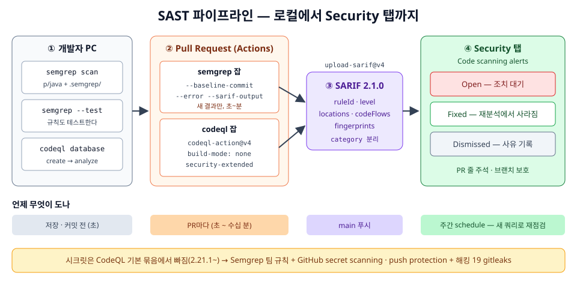
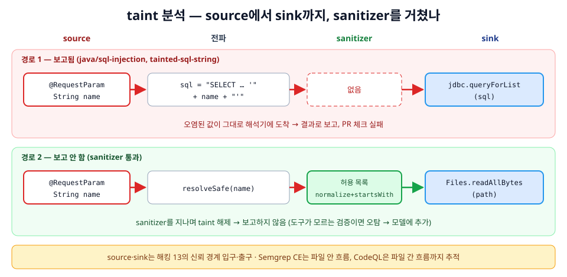
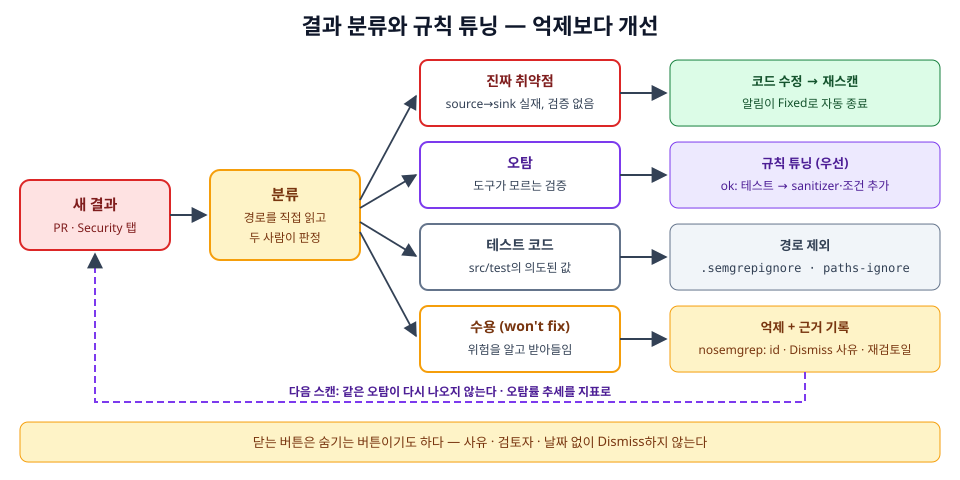

> **해킹 트랙 · 개발 보안** | 난이도 ★★★☆☆ | 예상 소요 3 ~ 3.5시간

> ⚠️ **실습 전 반드시 읽을 것**
> 이 편의 분석 대상은 **본인이 만든 예제 프로젝트와 본인 소유 저장소**뿐입니다. 정적 분석은 코드를 실행하지 않지만, 찾은 취약점을 **허가 없이 타인의 서비스에 시험하는 것은 정보통신망법 등으로 처벌**될 수 있습니다. 공개 오픈소스에서 취약점을 발견했다면 해당 프로젝트의 보안 정책(`SECURITY.md`)에 따라 비공개로 제보합니다(해킹 12의 책임 있는 공개). 오늘의 목적은 **내 코드의 실수를 머지 전에 자동으로 찾는 것**입니다.

## 🎯 오늘의 목표

- SAST가 **패턴 매칭**과 **데이터 흐름(taint) 분석**으로 무엇을 찾는지, 해킹 13의 신뢰 경계가 **source → sink**로 어떻게 표현되는지 설명할 수 있다
- **Semgrep**을 로컬 CLI로 돌리고, Spring 프로젝트에 맞는 **규칙을 직접 작성·테스트**하고, GitHub Actions에 붙일 수 있다
- **CodeQL**을 GitHub code scanning(default/advanced setup)과 로컬 CLI로 실행하고, Java 쿼리 팩의 결과를 읽을 수 있다
- 결과 표준 형식 **SARIF**의 구조를 알고, 두 도구의 결과를 한곳(GitHub Security 탭)에 모을 수 있다
- **오탐(false positive)** 을 근거와 함께 처리하고, 규칙을 **튜닝**하는 순환을 만들 수 있다

---

## 1. SAST는 어디에 있나

### 1-1. 보안 테스트 도구 지도

| 종류 | 무엇을 보나 | 언제 | 이 시리즈 |
|---|---|---|---|
| **SAST** (정적 분석) | **내가 쓴 소스코드** | 코드 작성·PR 시점 | **오늘** |
| SCA (구성 요소 분석) | 의존성 라이브러리의 알려진 취약점(CVE) | 빌드 시점 | 해킹 19, Day 57 Trivy |
| 시크릿 스캔 | 커밋에 들어간 키·토큰 | 커밋·푸시 시점 | 해킹 19 gitleaks, GitHub secret scanning |
| DAST (동적 분석) | **실행 중인 앱**에 요청을 보내 응답 관찰 | 배포 전 스테이징 | 해킹 20 ZAP |
| IaC 스캔 | Terraform·K8s 매니페스트 | PR 시점 | 해킹 24 |

SAST의 장점은 **가장 이른 시점**에, **정확한 코드 줄**을 가리킨다는 것입니다. 단점은 실행 환경을 모르기 때문에 **오탐**이 있고, 설정·인프라·비즈니스 로직 문제는 잘 못 본다는 것입니다.



### 1-2. 오늘 쓰는 두 도구

| 항목 | **Semgrep CE** (Community Edition) | **CodeQL** |
|---|---|---|
| 방식 | 코드와 비슷한 모양의 **패턴** + 파일 안 taint 분석 | 코드를 **DB로 만들고** 쿼리 언어(QL)로 질의, 파일 간 데이터 흐름 |
| 규칙 작성 | YAML, 몇 분이면 첫 규칙 | QL 언어, 학습 곡선 있음 |
| 속도 | 빠름(초~분) — 저장 시·PR마다 | 느림(분~수십 분) — PR·야간 |
| 라이선스 | CE 엔진·CLI는 오픈소스(LGPL-2.1). 크로스파일 분석 등은 유료 Semgrep 플랫폼 | 공개 저장소의 code scanning은 무료. **비공개 저장소는 GitHub Code Security 필요**. CLI도 오픈소스·연구 목적 외 비공개 코드에는 라이선스 필요 |
| 작성 시점 버전 | 1.185.0 (2026-11-10) | CLI 번들 2.27.4, `github/codeql-action` **v4** |

> 💡 둘 중 하나를 고르는 문제가 아닙니다. **Semgrep은 빠른 피드백과 팀 고유 규칙**, **CodeQL은 깊은 데이터 흐름**에 강합니다. 결과가 둘 다 SARIF로 나오므로 한곳에 모을 수 있습니다(6장).

> ⚠️ `github/codeql-action` **v3는 2026년 12월에 deprecated** 됩니다(GitHub changelog 2025-10-28). v4는 Node.js 24 런타임에서 동작합니다. 기존 워크플로의 `@v3`를 오늘 `@v4`로 바꿔 두세요. 또 CodeQL 2.22.3 이하 버전은 2026-10-16에 지원이 끝났습니다.

---

## 2. 원리 — 패턴과 데이터 흐름

### 2-1. 패턴 매칭

가장 단순한 형태는 "이런 모양의 코드가 있으면 알려 줘"입니다. `grep`과 다른 점은 **문법을 이해한다**는 것입니다. 공백·줄바꿈·변수 이름이 달라도 같은 구조면 찾고, 주석이나 문자열 안의 글자는 무시합니다.

```yaml
# "JdbcTemplate의 쿼리 메서드에 문자열 연결이 들어간다"
pattern: (JdbcTemplate $J).queryForList("..." + $X, ...)
```

### 2-2. 데이터 흐름(taint) 분석

해킹 13에서 그린 신뢰 경계를 그대로 옮긴 것입니다.



| 용어 | 뜻 | Spring 예 |
|---|---|---|
| **source** | 신뢰 경계 밖에서 들어오는 값 | `@RequestParam`, `@PathVariable`, `@RequestBody`, `HttpServletRequest.getParameter()` |
| **전파(propagation)** | 값이 변수·문자열 연결·메서드 호출을 거쳐 이동 | `String sql = "..." + name;` |
| **sanitizer** | 위험을 없애는 처리 (지나가면 taint 해제) | 숫자 파싱, 허용 목록 검사, 경로 정규화 + `startsWith` 검사 |
| **sink** | 해석기로 나가는 위험한 출구 | `JdbcTemplate.queryForList(sql)`, `Files.readAllBytes(path)`, `Runtime.exec()` |

도구는 "source에서 출발한 값이 **sanitizer를 거치지 않고** sink에 도착하는 경로"를 찾아 보고합니다. CodeQL은 이 경로를 단계별로 보여 주는 **path-problem** 형태로 결과를 냅니다.

| 결과가 틀리는 두 방향 | 원인 | 대응 |
|---|---|---|
| **오탐 (false positive)** — 안전한데 보고 | 도구가 모르는 sanitizer(직접 만든 검증 함수), 실제로는 도달 불가능한 경로 | sanitizer를 규칙에 알려 주기, 근거를 남기고 억제 (7장) |
| **미탐 (false negative)** — 위험한데 놓침 | 도구가 모르는 source·sink(사내 프레임워크), 리플렉션, 파일 간 흐름(CE) | 규칙·모델 추가, 리뷰 체크리스트(해킹 13 7장) 병행 |

---

## 3. 실습 프로젝트 — 일부러 틀린 `sast-demo`

본인 GitHub 계정에 **비공개가 아닌 공개 저장소** `sast-demo`를 하나 만듭니다(공개 저장소는 CodeQL code scanning이 무료). Spring Initializr(https://start.spring.io)에서 Gradle, Java 21, Spring Boot 4.1.x, 의존성 **Spring Web MVC**, **JDBC API**, **H2 Database**를 고르고 생성합니다.

> ⚠️ 이 저장소는 **취약한 코드를 담은 교육용**입니다. README 첫 줄에 "의도적으로 취약한 예제 — 배포 금지"라고 쓰고, 어디에도 배포하지 않습니다. 실습이 끝나면 아카이브하거나 지웁니다.

일부러 넣는 취약점 세 가지입니다.

```java
// src/main/java/com/example/sastdemo/user/UserController.java
package com.example.sastdemo.user;

import java.util.List;
import java.util.Map;
import org.springframework.jdbc.core.JdbcTemplate;
import org.springframework.web.bind.annotation.*;

@RestController
class UserController {
    private final JdbcTemplate jdbc;
    UserController(JdbcTemplate jdbc) { this.jdbc = jdbc; }

    // ❌ (1) SQL Injection: 요청 파라미터를 SQL 문자열에 연결
    @GetMapping("/api/users/search")
    List<Map<String, Object>> search(@RequestParam String name) {
        String sql = "SELECT id, username FROM users WHERE username = '" + name + "'";
        return jdbc.queryForList(sql);
    }
}
```

```java
// src/main/java/com/example/sastdemo/file/FileController.java
package com.example.sastdemo.file;

import java.io.IOException;
import java.nio.file.Files;
import java.nio.file.Path;
import java.nio.file.Paths;
import org.springframework.web.bind.annotation.*;

@RestController
class FileController {
    // ❌ (2) 경로 조작: 사용자 입력으로 만든 경로를 그대로 읽음
    @GetMapping("/api/files")
    byte[] download(@RequestParam String name) throws IOException {
        Path p = Paths.get("/srv/app/files", name);
        return Files.readAllBytes(p);
    }
}
```

```java
// src/main/java/com/example/sastdemo/pay/PaymentClient.java
package com.example.sastdemo.pay;

import org.springframework.stereotype.Component;

@Component
class PaymentClient {
    // ❌ (3) 하드코딩 시크릿 (가짜 값 — 실제 키 형식을 흉내 내지 말 것)
    private static final String PAYMENT_API_KEY = "demo-hardcoded-key-0000-not-real";

    String authHeader() { return "Bearer " + PAYMENT_API_KEY; }
}
```

> 💡 시크릿 예시는 일부러 **어떤 서비스의 실제 키 형식과도 닮지 않은 값**을 씁니다. 실제 형식(예: 클라우드 액세스 키 접두사)을 흉내 내면 GitHub **push protection**이 푸시를 막거나, 공개 저장소를 감시하는 봇이 잘못 반응할 수 있습니다.

---

## 4. Semgrep

### 4-1. 설치와 첫 실행 (내 환경 점검)

Semgrep CE는 Linux·macOS에서 가장 안정적입니다. Windows라면 WSL2(Ubuntu 24.04)나 Docker를 씁니다.

```bash
# 방법 1: pipx (권장 — 시스템 Python과 분리)
sudo apt install -y pipx && pipx ensurepath
pipx install semgrep
semgrep --version
# 1.185.0

# 방법 2: Docker (설치 없이)
docker run --rm -v "$PWD:/src" semgrep/semgrep:1.185.0 semgrep --version
```

`sast-demo` 루트에서 레지스트리의 Java 규칙 묶음과 시크릿 규칙 묶음으로 돌립니다.

```bash
cd sast-demo
semgrep scan --config p/java --config p/secrets --metrics=off
```

```text
┌─────────────────┐
│ 3 Code Findings │
└─────────────────┘

    src/main/java/com/example/sastdemo/file/FileController.java
   ❯❯❱ java.spring.security.injection.tainted-file-path.tainted-file-path
          Detected user input controlling a file path. ...
           14┆ Path p = Paths.get("/srv/app/files", name);

    src/main/java/com/example/sastdemo/user/UserController.java
   ❯❯❱ java.spring.security.injection.tainted-sql-string.tainted-sql-string
          User data flows into this manually-constructed SQL string. ...
           16┆ String sql = "SELECT id, username FROM users WHERE username = '" + name + "'";
   ...
```

(출력 일부. 규칙 묶음 구성과 메시지는 시점에 따라 달라집니다.)

| 관찰 | 의미 |
|---|---|
| SQLi·경로 조작은 잡힘 | `p/java`의 Spring taint 규칙(`tainted-sql-string`, `tainted-file-path`)이 `@RequestParam`을 source로 봄 |
| **하드코딩 시크릿은 안 잡힘** | `p/secrets`는 **알려진 서비스의 키 형식**(접두사·길이)을 찾는 규칙 묶음. 우리 가짜 키는 형식이 없음 → 4-2에서 **팀 규칙**으로 |
| `--metrics=off` | 익명 사용 통계 전송 끄기 |

> 💡 레지스트리 규칙 일부는 메타데이터에 `interfile: true`가 붙어 있습니다. 이는 **파일 간 분석**(유료 플랫폼 기능)에서 더 잘 동작한다는 뜻이고, CE에서는 **파일 안** 흐름만 봅니다. 컨트롤러에서 받은 값을 다른 클래스의 리포지토리로 넘기는 흐름은 CE가 놓칠 수 있습니다 — CodeQL이 보완합니다(5장).

### 4-2. 규칙 작성 기초

프로젝트 루트에 `.semgrep/` 폴더를 만들고 팀 규칙을 둡니다. 규칙 하나는 **id, 언어, 심각도, 메시지, 패턴**으로 이뤄집니다.

```yaml
# .semgrep/sast-demo.yaml
rules:
  # (A) 패턴 규칙: JdbcTemplate 호출 인자에 문자열 연결/format
  - id: jdbctemplate-string-concat
    languages: [java]
    severity: ERROR
    message: >-
      JdbcTemplate에 문자열로 조립한 SQL을 넘기고 있습니다. '?' 자리표시자와
      인자 목록으로 바인딩하세요. (해킹 04, 해킹 13)
    metadata:
      cwe: ["CWE-89"]
    patterns:
      - pattern-either:
          - pattern: (JdbcTemplate $J).$M("..." + $X, ...)
          - pattern: (JdbcTemplate $J).$M(String.format(...), ...)
          - pattern: |
              String $SQL = "..." + $X;
              ...
              (JdbcTemplate $J).$M($SQL, ...);
      - metavariable-regex:
          metavariable: $M
          regex: ^(query|queryForList|queryForObject|queryForMap|update|execute|batchUpdate)$

  # (B) 패턴 규칙: 이름이 비밀처럼 생긴 String에 문자열 리터럴 대입
  - id: hardcoded-secret-string
    languages: [java]
    severity: WARNING
    message: >-
      비밀로 보이는 값이 코드에 하드코딩되어 있습니다. 환경 변수·Secret·Vault에서
      주입하고(Day 55·71), 이미 커밋된 값은 폐기·교체하세요.
    metadata:
      cwe: ["CWE-798"]
    patterns:
      - pattern: String $NAME = "$VALUE";
      - metavariable-regex:
          metavariable: $NAME
          regex: (?i).*(secret|passw(or)?d|api_?key|token|private_?key).*
      - metavariable-regex:
          metavariable: $VALUE
          regex: ^.{8,}$
```

| 문법 | 뜻 |
|---|---|
| `$J`, `$X` | **메타변수** — 아무 식이나 매칭하고 이름으로 다시 참조 |
| `(JdbcTemplate $J)` | **타입이 붙은 메타변수** — `JdbcTemplate` 타입인 것만 |
| `"..."` | 아무 문자열 리터럴 |
| `...` | 아무 인자들 / 아무 문장들 |
| `pattern-either` | 여러 패턴 중 하나 (OR) |
| `patterns` | 모두 만족 (AND) |
| `metavariable-regex` | 메타변수가 잡은 값에 정규식 조건 |

**taint 규칙**은 source·sink·sanitizer를 직접 정합니다. 경로 조작을 "해킹 13 3-3의 `resolveSafe()`를 거치면 안전"이라고 알려 주는 예입니다.

```yaml
  # (C) taint 규칙: 요청 파라미터 → 파일 읽기, 단 resolveSafe()는 sanitizer
  - id: requestparam-to-file-read
    mode: taint
    languages: [java]
    severity: ERROR
    message: 요청 값이 검증 없이 파일 경로로 쓰입니다. resolveSafe()로 정규화·검증하세요.
    metadata:
      cwe: ["CWE-22"]
    pattern-sources:
      - patterns:
          - pattern-either:
              - pattern-inside: |
                  $RET $METHOD(..., @RequestParam(...) $TYPE $SRC, ...) { ... }
              - pattern-inside: |
                  $RET $METHOD(..., @RequestParam $TYPE $SRC, ...) { ... }
              - pattern-inside: |
                  $RET $METHOD(..., @PathVariable $TYPE $SRC, ...) { ... }
          - focus-metavariable: $SRC
    pattern-sanitizers:
      - pattern: resolveSafe(...)
    pattern-sinks:
      - pattern-either:
          - pattern: Files.readAllBytes($P)
          - pattern: Files.newInputStream($P, ...)
          - pattern: new FileInputStream($P)
          - pattern: new FileSystemResource($P)
```

> 💡 `focus-metavariable: $SRC`가 핵심입니다. 이것이 없으면 메서드 **본문 전체**가 source로 잡혀 엉뚱한 곳까지 보고합니다. 레지스트리의 `tainted-sql-string` 규칙도 같은 방식을 씁니다.

### 4-3. 규칙 테스트

규칙도 코드라서 테스트합니다. 규칙 파일과 **같은 이름**의 대상 파일에 주석으로 기대 결과를 적습니다.

```java
// .semgrep/sast-demo.java  (규칙 테스트용 대상 — 빌드에 포함되지 않음)
class T {
    JdbcTemplate jdbc;
    void bad(String name) {
        // ruleid: jdbctemplate-string-concat
        jdbc.queryForList("SELECT * FROM users WHERE username = '" + name + "'");
    }
    void good(String name) {
        // ok: jdbctemplate-string-concat
        jdbc.queryForList("SELECT * FROM users WHERE username = ?", name);
    }
    // ruleid: hardcoded-secret-string
    private static final String API_KEY = "demo-hardcoded-key-0000";
    // ok: hardcoded-secret-string
    private static final String API_KEY_ENV = "PAYMENT_API_KEY";   // 환경 변수 "이름"일 뿐 — 지금 규칙은 이것도 잡는다(7-3에서 튜닝)
}
```

```bash
semgrep --test .semgrep/
# 1/1: ✓ All tests passed   (실패하면 어느 줄이 기대와 달랐는지 출력)
```

마지막 `ok:` 줄은 일부러 넣은 **실패 테스트**입니다. 환경 변수 **이름**을 담은 상수도 "비밀처럼 생긴 이름 + 8자 이상"이라 잡힙니다. 테스트가 실패하는 것을 확인하고 7-3에서 규칙을 고칩니다. 이렇게 **오탐을 테스트로 먼저 고정하고 규칙을 고치는 것**이 튜닝의 기본 순서입니다.

| 주석 | 뜻 |
|---|---|
| `ruleid: <id>` | 다음 줄에서 반드시 잡혀야 함 (미탐 방지) |
| `ok: <id>` | 다음 줄에서 잡히면 안 됨 (오탐 방지) |
| `todoruleid:` / `todook:` | 아직 못 하지만 언젠가 맞춰야 할 것 — 실패로 치지 않음 |

팀 규칙과 레지스트리 규칙을 함께 돌립니다.

```bash
semgrep scan --config p/java --config .semgrep/ --metrics=off --error
echo $?     # 결과가 있으면 1 → CI를 실패시킬 수 있음
```

### 4-4. CI 연동 — GitHub Actions

Day 51의 GitHub Actions에 붙입니다. 결과를 **SARIF**로 저장해 GitHub Security 탭에 올립니다.

```yaml
# .github/workflows/semgrep.yml
name: semgrep
on:
  pull_request: {}
  push:
    branches: [main]

permissions:
  contents: read

jobs:
  semgrep:
    runs-on: ubuntu-latest
    permissions:
      contents: read
      security-events: write          # SARIF 업로드에 필요
    container:
      image: semgrep/semgrep:1.185.0   # 버전 고정 (Day 57 공급망 원칙)
    steps:
      - uses: actions/checkout@v7
        with:
          fetch-depth: 0              # baseline 비교에 이력 필요
      - name: Semgrep scan
        run: |
          BASE_ARGS=""
          if [ "${{ github.event_name }}" = "pull_request" ]; then
            git config --global --add safe.directory "$GITHUB_WORKSPACE"
            BASE_ARGS="--baseline-commit ${{ github.event.pull_request.base.sha }}"
          fi
          semgrep scan --config p/java --config .semgrep/ --metrics=off \
            $BASE_ARGS --sarif-output=semgrep.sarif --error
      - name: Upload SARIF
        if: always()                   # 결과가 있어 앞 단계가 실패해도 업로드
        uses: github/codeql-action/upload-sarif@v4
        with:
          sarif_file: semgrep.sarif
          category: semgrep
```

| 설정 | 이유 |
|---|---|
| `--baseline-commit` | PR에서 **새로 생긴 결과만** 보고 → 기존 부채 때문에 모든 PR이 막히지 않음 |
| `--error` | 새 결과가 있으면 체크 실패 → 브랜치 보호 규칙으로 머지 차단 가능 |
| `--sarif-output` | 텍스트 출력은 로그에, SARIF는 파일로 동시에 |
| 이미지 버전 고정 | 규칙 엔진이 바뀌어 갑자기 결과가 늘어나는 것 방지, 업그레이드는 PR로 |

> ⚠️ 도입 첫날부터 `--error`로 막으면 팀이 도구를 끕니다. **처음 2주는 보고만**(`--error` 없이) 하며 오탐을 정리하고, 그다음 **ERROR 심각도만** 차단하는 순서를 권합니다(`--severity ERROR`).

---

## 5. CodeQL

### 5-1. GitHub code scanning — default setup

가장 빠른 길은 저장소 설정에서 켜는 것입니다.

1. `sast-demo` 저장소 → **Settings** → **Advanced Security**(또는 *Code security*) → **Code scanning**의 *CodeQL analysis* → **Set up** → **Default**
2. 언어(Java/Kotlin)가 자동 감지되고, 쿼리 묶음을 **Default** 또는 **Extended**로 고릅니다. 오늘은 **Extended**
3. **Enable CodeQL** → Actions 탭에서 첫 분석이 돌고, 몇 분 뒤 **Security → Code scanning**에 결과가 나옵니다

Java는 **빌드 없이 분석(`build-mode: none`)** 이 지원되므로 Gradle 빌드가 깨져 있어도 분석됩니다. 단 Kotlin 코드가 섞여 있으면 빌드가 필요합니다.

### 5-2. advanced setup — 워크플로로 관리

설정을 코드로 남기려면 워크플로 파일을 씁니다(Day 50의 GitOps 원칙).

```yaml
# .github/workflows/codeql.yml
name: codeql
on:
  push:
    branches: [main]
  pull_request:
    branches: [main]
  schedule:
    - cron: "23 3 * * 1"            # 매주 월요일 — 새 쿼리로 기존 코드 재점검

permissions:
  contents: read

jobs:
  analyze:
    runs-on: ubuntu-latest
    permissions:
      contents: read
      actions: read
      security-events: write
    steps:
      - uses: actions/checkout@v7
      - uses: github/codeql-action/init@v4
        with:
          languages: java-kotlin
          build-mode: none
          queries: security-extended
          config-file: ./.github/codeql/codeql-config.yml
      - uses: github/codeql-action/analyze@v4
        with:
          category: "/language:java-kotlin"
```

| 쿼리 묶음 | 내용 |
|---|---|
| `default` (지정 안 하면) | 정밀도 높은 보안 쿼리 — 오탐 적음 |
| **`security-extended`** | default + 정밀도가 조금 낮은 보안 쿼리 — 더 많이 찾고 오탐도 조금 더 |
| `security-and-quality` | 위 + 코드 품질 쿼리 |

> 💡 default setup과 advanced setup은 **동시에 쓸 수 없습니다.** 워크플로를 쓰려면 Settings에서 default setup을 먼저 끄세요.

### 5-3. 결과 읽기 — Security 탭

`sast-demo`에서 기대되는 결과입니다.

| 쿼리 ID | 이름 | 우리 코드 | 심각도(security-severity) |
|---|---|---|---|
| `java/sql-injection` | Query built from user-controlled sources | `UserController.search` | 8.8 (High) |
| `java/path-injection` | Uncontrolled data used in path expression | `FileController.download` | 7.5 (High) |

알림을 열면 **Show paths**로 source(`@RequestParam String name`) → 중간 단계 → sink(`queryForList(sql)`)가 단계별로 나옵니다. 이것이 2장의 taint 경로입니다.

> ⚠️ **하드코딩 시크릿은 CodeQL에서 나오지 않습니다.** GitHub는 CodeQL 2.21.1(2025년 5월)부터 하드코딩 자격 증명 쿼리(`java/hardcoded-credential-api-call` 등)를 기본 쿼리 묶음에서 빼고, **secret scanning**을 쓰라고 안내합니다. 쿼리 자체는 `codeql/java-queries` 팩에 남아 있어 직접 지정하면 실행할 수 있지만, 시크릿은 4-2의 Semgrep 팀 규칙, GitHub **secret scanning·push protection**(공개 저장소 무료), 해킹 19의 gitleaks로 다루는 것이 맞습니다.

### 5-4. 로컬 CLI — PR 전에 직접 돌려 보기

CodeQL CLI는 **CodeQL 번들**(CLI + 표준 쿼리 팩)로 받는 것이 편합니다. `github/codeql-action` 저장소의 Releases에서 `codeql-bundle-v2.27.4`의 `codeql-bundle-linux64.tar.gz`를 받습니다.

```bash
# 설치 (WSL2 Ubuntu 24.04)
tar -xzf codeql-bundle-linux64.tar.gz -C ~/tools
export PATH="$HOME/tools/codeql:$PATH"
codeql version
# CodeQL command-line toolchain release 2.27.4.

# 1) 데이터베이스 만들기 (빌드 없이)
cd sast-demo
codeql database create ../sast-demo-db --language=java --build-mode=none --source-root=.

# 2) security-extended 묶음으로 분석 → SARIF
codeql database analyze ../sast-demo-db \
  codeql/java-queries:codeql-suites/java-security-extended.qls \
  --format=sarif-latest --output=codeql-java.sarif
```

```text
Interpreting results.
...
Shutting down query evaluator.
```

> 💡 VS Code의 **CodeQL 확장**을 쓰면 DB를 열고 결과를 클릭해 경로를 따라갈 수 있습니다. **SARIF Viewer** 확장으로 `codeql-java.sarif`, `semgrep.sarif`를 열어도 같은 경험을 얻습니다.

> ⚠️ CodeQL CLI 라이선스는 **오픈소스 코드 분석과 학술 연구**에는 무료지만, 회사의 비공개 코드에 쓰려면 GitHub Code Security 라이선스가 필요합니다. 회사 코드에 쓰기 전 확인하세요.

---

## 6. SARIF — 결과의 공용어

**SARIF**(Static Analysis Results Interchange Format)는 OASIS 표준 JSON 형식(현재 2.1.0)입니다. 도구가 달라도 같은 구조로 결과를 내므로 GitHub, IDE, 대시보드가 하나의 뷰어로 보여 줄 수 있습니다.

```json
{
  "version": "2.1.0",
  "runs": [{
    "tool": { "driver": { "name": "Semgrep OSS",
              "rules": [{ "id": "jdbctemplate-string-concat", "...": "..." }] } },
    "results": [{
      "ruleId": "jdbctemplate-string-concat",
      "level": "error",
      "message": { "text": "JdbcTemplate에 문자열로 조립한 SQL을 ..." },
      "locations": [{ "physicalLocation": {
        "artifactLocation": { "uri": "src/main/java/com/example/sastdemo/user/UserController.java" },
        "region": { "startLine": 16 } } }],
      "partialFingerprints": { "...": "..." }
    }]
  }]
}
```

| 필드 | 쓰임 |
|---|---|
| `runs[].tool.driver.name` | 어떤 도구의 결과인가 |
| `ruleId`, `level` | 규칙과 심각도(`error`/`warning`/`note`) |
| `locations` | 파일·줄 — PR의 해당 줄에 주석으로 표시 |
| `codeFlows` | CodeQL의 source → sink 경로 단계 |
| `partialFingerprints` | 코드가 조금 움직여도 **같은 알림**으로 추적하는 지문 → 중복 알림 방지 |

명령줄에서 빠르게 요약하기:

```bash
jq -r '.runs[] | .tool.driver.name as $t | .results[] |
  [$t, .ruleId, .locations[0].physicalLocation.artifactLocation.uri,
   (.locations[0].physicalLocation.region.startLine|tostring)] | @tsv' \
  semgrep.sarif codeql-java.sarif
```

```text
Semgrep OSS   jdbctemplate-string-concat     src/main/java/.../UserController.java   16
Semgrep OSS   hardcoded-secret-string        src/main/java/.../PaymentClient.java    8
CodeQL        java/sql-injection             src/main/java/.../UserController.java   17
CodeQL        java/path-injection            src/main/java/.../FileController.java   15
```

GitHub에 올릴 때 `category`를 도구마다 다르게 주면(`semgrep`, `/language:java-kotlin`) 결과가 서로 덮어쓰지 않습니다. 업로드 파일 크기와 결과 개수에는 제한이 있으니, 거대한 모노레포는 문서의 제한을 확인합니다.

---

## 7. 탐지 결과 다루기 — 오탐 처리와 규칙 튜닝

SAST에서 "탐지"는 곧 결과 목록입니다. 결과를 **어떻게 분류하고 줄여 나가느냐**가 도구 도입의 성패를 가릅니다.



### 7-1. 분류(triage) 기준

| 판정 | 기준 | 처리 |
|---|---|---|
| **진짜 취약점** | source → sink 경로가 실제로 존재하고 sanitizer가 없음 | 이슈 등록, 수정(8장), 해킹 11 보고서 양식의 심각도 |
| **오탐** | 도구가 모르는 검증이 있음, 도달 불가능 | 근거를 남기고 억제 → **규칙에 sanitizer 추가가 우선** |
| **테스트 코드** | `src/test`의 의도적 값 | 경로 제외 |
| **수용(won't fix)** | 위험을 알고 받아들임(내부 관리 도구 등) | 사유·승인자·재검토 날짜 기록 |

> ⚠️ "오탐"이라고 닫기 전에 **두 사람이 본다**는 원칙을 권합니다. SAST 결과를 닫는 버튼은 취약점을 숨기는 버튼이기도 합니다.

### 7-2. 억제(suppression) — 근거와 함께

**Semgrep** — 줄 단위 주석. **규칙 ID를 반드시 적고**, 이유를 같은 줄에 남깁니다.

```java
// 관리자 전용 배치에서 테이블 이름을 고정 목록(TableName enum)으로만 받음 — 리뷰: 보안 담당 2026-11-15
jdbc.execute("TRUNCATE TABLE " + table.sqlName());  // nosemgrep: jdbctemplate-string-concat
```

파일·폴더 제외는 루트의 `.semgrepignore`(`.gitignore`와 비슷한 문법)에 둡니다.

```text
# .semgrepignore
:include .gitignore
src/test/
build/
```

특정 규칙 하나를 전체에서 끄려면 `--exclude-rule <규칙 id>`를 씁니다(근거를 워크플로 주석에).

**CodeQL** — Security 탭에서 알림을 열고 **Dismiss alert** → 사유(*False positive* / *Used in tests* / *Won't fix*)와 코멘트를 남깁니다. 반복되는 패턴은 설정 파일로 옮깁니다.

```yaml
# .github/codeql/codeql-config.yml
name: sast-demo CodeQL config
paths-ignore:
  - src/test
# 특정 쿼리를 이 저장소에서 제외 (사유를 주석으로)
# query-filters:
#   - exclude:
#       id: java/some-noisy-query
```

> 💡 `paths-ignore`는 빌드 방식에 따라 컴파일 언어에서 적용되지 않는 경우가 있습니다. 결과가 그대로 남으면 GitHub 문서의 *Specifying directories to scan* 항목을 확인하세요.

### 7-3. 튜닝 — 억제보다 규칙 개선

4-3에서 실패시켜 둔 테스트(환경 변수 **이름** 상수가 잡히는 오탐)를 고칩니다. 값이 "대문자·밑줄로만 된 이름"이면 비밀이 아니라고 규칙에 알려 줍니다.

```yaml
      - metavariable-regex:
          metavariable: $VALUE
          regex: ^.{8,}$
      - metavariable-regex:            # 추가: 환경 변수 이름처럼 생긴 값은 제외
          metavariable: $VALUE
          regex: ^(?![A-Z0-9_]+$).*
```

```bash
semgrep --test .semgrep/
# ✓ All tests passed
```

| 튜닝 방법 | Semgrep | CodeQL |
|---|---|---|
| 내 검증 함수를 sanitizer로 | `pattern-sanitizers` (4-2 C) | VS Code의 **CodeQL model editor**나 data extension으로 프로젝트 고유 모델 추가 |
| 사내 프레임워크의 source·sink 추가 | `pattern-sources`, `pattern-sinks` | 같은 방식으로 source·sink 모델 추가, 또는 커스텀 QL 쿼리 |
| 시끄러운 규칙 조정 | 심각도 낮추기, `--exclude-rule` | `query-filters`, 쿼리 묶음 변경 |
| 회귀 방지 | `ruleid:`/`ok:` 테스트 | 커스텀 쿼리의 테스트(`codeql test run`) |

### 7-4. 운영 지표

도구가 잘 쓰이는지는 숫자로 봅니다. GitHub Security 탭의 필터와 **Security overview**에서 확인할 수 있습니다.

| 지표 | 건강한 모습 |
|---|---|
| 새로 열린 알림 중 PR 단계에서 막힌 비율 | 높을수록 좋음 (머지 전 차단) |
| 오탐으로 닫힌 비율 | 낮아지는 추세 (튜닝 효과) |
| 열린 High 알림의 평균 나이 | 짧을수록 좋음 — 해킹 11의 조치 기한과 연결 |

> 💡 SAST 결과는 런타임 탐지와 짝을 이룹니다. 코드에서 `java/sql-injection`을 고쳤다면, 해킹 04 5-4의 **DB 문법 오류 알림**(`WebSQLiProbing`)이 그 뒤로 조용해져야 합니다. 둘이 어긋나면 SAST가 놓친 경로가 있다는 뜻입니다.

### 7-5. LLM 보조 도구도 선택지

규칙 기반 도구 외에, **LLM이 코드를 읽으며 감사를 돕는 도구**도 선택지가 됐습니다. 예를 들어 독자가 로컬에서 쓰는 Java/Spring 보안 감사용 **MCP 플러그인**처럼, 코딩 어시스턴트에 연결해 진입점에서 위험한 호출까지의 경로를 함께 따라가며 의심 지점을 정리하게 하는 방식입니다. 패턴으로 표현하기 어려운 **인가 누락이나 비즈니스 로직 문제**를 짚어 주는 데 도움이 될 수 있지만, 결과가 실행마다 달라질 수 있고 그럴듯한 오판도 섞이므로 **사람이 코드를 직접 읽고 확인한 것만** 발견 사항으로 기록합니다. Semgrep·CodeQL처럼 CI에서 재현 가능한 게이트를 대신하는 것이 아니라, 리뷰를 보조하는 **추가 시각**으로 두는 것이 좋습니다. 또 회사 코드를 외부 모델에 보내도 되는지 사내 정책을 먼저 확인합니다.

---

## 8. 수정 — 결과가 닫히는 것까지 확인

해킹 13의 원칙대로 고칩니다.

```java
// ✅ (1) SQLi: 바인딩
@GetMapping("/api/users/search")
List<Map<String, Object>> search(@RequestParam @Size(max = 50) String name) {
    return jdbc.queryForList("SELECT id, username FROM users WHERE username = ?", name);
}
```

```java
// ✅ (2) 경로 조작: 허용 목록 + 정규화 후 기준 디렉터리 확인 (해킹 13 3-3)
private static final Path BASE = Path.of("/srv/app/files").toAbsolutePath().normalize();

@GetMapping("/api/files")
byte[] download(@RequestParam String name) throws IOException {
    return Files.readAllBytes(resolveSafe(name));
}

static Path resolveSafe(String name) {
    if (!name.matches("^[A-Za-z0-9._-]{1,100}$")) throw new ResponseStatusException(HttpStatus.BAD_REQUEST);
    Path target = BASE.resolve(name).normalize();
    if (!target.startsWith(BASE)) throw new ResponseStatusException(HttpStatus.BAD_REQUEST);
    return target;
}
```

```java
// ✅ (3) 시크릿: 설정으로 주입, 값은 환경 변수/Secret에서
@ConfigurationProperties(prefix = "payment")
record PaymentProperties(@NotBlank String apiKey) {}

@Component
class PaymentClient {
    private final PaymentProperties props;
    PaymentClient(PaymentProperties props) { this.props = props; }
    String authHeader() { return "Bearer " + props.apiKey(); }
}
// application.yml:  payment.api-key: ${PAYMENT_API_KEY}
// K8s: Secret → env (Day 13), 운영: External Secrets/OpenBao (Day 55·71)
// (메인 클래스에 @ConfigurationPropertiesScan 추가)
```

> ⚠️ **하드코딩 시크릿은 코드에서 지우는 것으로 끝나지 않습니다.** Git 이력에 값이 남아 있으므로 **그 키를 폐기하고 새로 발급**해야 합니다. 이력 정리(`git filter-repo`)는 보조 수단입니다. 해킹 19에서 자세히 봅니다.

```bash
# 로컬 재확인
semgrep scan --config p/java --config .semgrep/ --metrics=off --error && echo "clean"
codeql database create ../sast-demo-db --overwrite --language=java --build-mode=none --source-root=.
codeql database analyze ../sast-demo-db codeql/java-queries:codeql-suites/java-security-extended.qls \
  --format=sarif-latest --output=codeql-java.sarif
jq '[.runs[].results[]] | length' codeql-java.sarif     # 0 이면 깨끗
```

PR을 올리면 Semgrep 체크가 통과하고, main에 머지된 뒤 CodeQL 분석이 돌면 Security 탭의 두 알림이 **Fixed**로 자동으로 닫힙니다. 2-2의 표대로 `resolveSafe()`가 도구가 아는 형태(`normalize()` + `startsWith()`)로 검증하기 때문에 CodeQL의 `java/path-injection`도 sanitizer로 인식합니다. 만약 직접 만든 검증 방식을 도구가 모른다면 7-3의 모델 추가로 알려 줍니다.

---

## 9. 트러블슈팅

| 증상 | 원인 | 해결 |
|---|---|---|
| `semgrep: command not found` (pipx 설치 후) | PATH에 `~/.local/bin` 없음 | `pipx ensurepath` 후 셸 재시작 |
| Semgrep이 Windows에서 오류 | 네이티브 Windows 지원이 제한적 | WSL2나 Docker 이미지 사용 |
| 컨테이너 잡에서 `fatal: detected dubious ownership` | 체크아웃 디렉터리 소유자와 컨테이너 사용자가 다름 | `git config --global --add safe.directory "$GITHUB_WORKSPACE"` |
| `--baseline-commit` 사용 시 오류 | 얕은 클론이라 기준 커밋이 없음 | `actions/checkout`에 `fetch-depth: 0` |
| SARIF 업로드 단계가 `Resource not accessible by integration` | `security-events: write` 권한 없음, 포크에서 온 PR | 잡 권한 추가. 포크 PR은 업로드 대신 아티팩트로 |
| CodeQL 워크플로가 "default setup과 충돌" | default setup이 켜져 있음 | Settings에서 default setup 끄기 |
| CodeQL 결과가 0건인데 취약 코드가 있음 | Kotlin 혼합인데 `build-mode: none`, 또는 쿼리 묶음이 default | `autobuild`/`manual`로, `security-extended`로 |
| `--test`에서 `ok:` 줄이 실패 | 규칙이 오탐을 냄 — 정상적인 튜닝 신호 | 7-3처럼 조건 추가 후 재실행 |
| push가 거부되며 "secret detected" | push protection이 실제 형식의 키를 감지 | 예제에는 형식 없는 가짜 값만, 진짜 키였다면 즉시 폐기 |

---

## 10. 핵심 정리

- SAST = **내 소스코드**를 **가장 이른 시점**에 보는 도구. SCA·시크릿 스캔·DAST·IaC 스캔과 역할이 다르다
- 원리는 **패턴 매칭**과 **taint 분석**(source → 전파 → sanitizer → sink) — 해킹 13의 신뢰 경계 그 자체
- **Semgrep CE 1.185.0**: `semgrep scan --config p/java --config .semgrep/`, YAML 규칙(메타변수, `pattern-either`, `metavariable-regex`, taint 모드의 `focus-metavariable`), `semgrep --test`로 규칙 테스트, CI에서 `--baseline-commit` + `--sarif-output`
- **CodeQL**: default setup(클릭) 또는 advanced setup(`codeql-action` **v4**, `build-mode: none`, `security-extended`). `java/sql-injection`, `java/path-injection`. 하드코딩 시크릿은 2.21.1부터 기본 묶음에서 빠짐 → secret scanning·Semgrep·gitleaks
- **SARIF 2.1.0**이 공용어: `category`로 도구별 결과를 분리해 Security 탭 하나에 모은다
- 오탐은 **근거와 함께 억제**하되, **규칙에 sanitizer를 알려 주는 튜닝**이 우선. 도입 초기는 보고만, 이후 ERROR만 차단
- LLM 보조 도구는 리뷰를 돕는 추가 시각 — 사람이 확인한 것만 기록, CI 게이트를 대신하지 않는다

---

## 11. 셀프 체크

<details>
<summary>Q1. Semgrep의 <code>p/java</code>로 돌렸더니 SQLi는 잡혔는데 하드코딩한 API 키는 안 잡혔다. <code>p/secrets</code>를 추가해도 안 잡힌다. 왜이고, 어떻게 해야 하나?</summary>

`p/secrets`는 알려진 서비스의 키 **형식**(접두사, 길이, 문자 집합)을 찾는 규칙 묶음이라, 형식이 없는 사내 키는 잡지 못합니다. 변수 이름과 값의 모양을 보는 **팀 규칙**(4-2의 `hardcoded-secret-string`)을 만들고, 저장소 수준에서는 GitHub secret scanning·push protection과 해킹 19의 gitleaks를 함께 씁니다. 이미 커밋된 키는 폐기·재발급합니다.
</details>

<details>
<summary>Q2. taint 규칙의 source에 <code>focus-metavariable</code>을 빼면 무슨 일이 생기나?</summary>

`pattern-inside`로 잡은 **메서드 전체**가 source로 취급되어, 메서드 안의 거의 모든 값이 오염된 것으로 보입니다. 그 결과 상수로 만든 안전한 쿼리까지 보고되는 오탐이 쏟아집니다. `focus-metavariable: $SRC`로 **매개변수 자체**만 source로 좁혀야 합니다.
</details>

<details>
<summary>Q3. 도입 첫날부터 모든 SAST 결과에서 PR을 실패시키는 것이 왜 나쁜 전략인가? 대안은?</summary>

기존 코드의 부채와 초기 오탐 때문에 거의 모든 PR이 막히고, 팀은 도구를 끄거나 결과를 무조건 닫게 됩니다. `--baseline-commit`으로 **새로 생긴 결과만** 보고, 처음 몇 주는 보고만 하며 오탐을 튜닝한 다음 **ERROR 심각도만** 차단하는 단계적 도입이 낫습니다.
</details>

<details>
<summary>Q4. 같은 저장소에 Semgrep과 CodeQL의 SARIF를 모두 올렸더니 한쪽 결과가 사라졌다. 원인과 해결은?</summary>

같은 `category`(또는 기본 category)로 올리면 나중 업로드가 앞의 결과를 같은 분석의 새 버전으로 대체합니다. `upload-sarif`의 `category`를 `semgrep`, `/language:java-kotlin`처럼 도구마다 다르게 지정합니다.
</details>

<details>
<summary>Q5. CodeQL이 <code>java/path-injection</code>을 보고했다. 팀원이 "우리는 파일명을 검사하니까 오탐"이라며 Dismiss하려 한다. 무엇을 확인해야 하나?</summary>

그 검사가 **정규화 후에** 이루어지는지(`normalize()` 결과로 `startsWith(BASE)` 확인), 허용 목록인지, **모든 경로에서** 검사를 거치는지(검사 없이 sink로 가는 다른 호출부는 없는지) 확인합니다. 정말 안전하다면 Dismiss 대신 그 검증 함수를 sanitizer로 모델링해 같은 패턴이 반복 보고되지 않게 하는 것이 좋습니다. 닫을 때는 사유와 검토자를 남깁니다.
</details>

---

## ⏭️ 다음 예고 — 해킹 15. 인증·인가 실수 — JWT 검증, 세션, OAuth2/OIDC 설정

SAST가 잘 잡는 것은 "값이 어디서 와서 어디로 가는가"입니다. 반면 **"이 요청을 보낸 사람이 정말 그 사람인가, 그 일을 해도 되는가"** 는 설정과 로직의 문제라 도구가 잘 보지 못합니다. 다음 편에서는 인증·인가에서 자주 하는 실수를 봅니다. **JWT**의 서명 검증 누락과 `alg` 처리, 키 관리, 만료와 폐기, **세션** 고정·재발급·타임아웃, 그리고 **OAuth2/OIDC**의 `redirect_uri` 검증, `state`·`nonce`·PKCE, 토큰 저장 위치까지. Spring Security와 FastAPI의 안전한 설정을 만들고, 인증 실패 로그를 Day 73의 Keycloak 이벤트와 연결해 탐지합니다.
