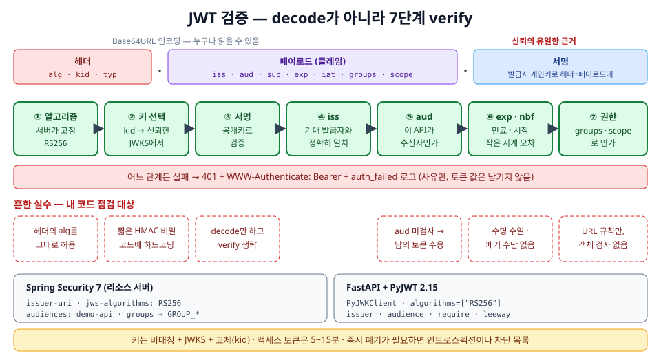
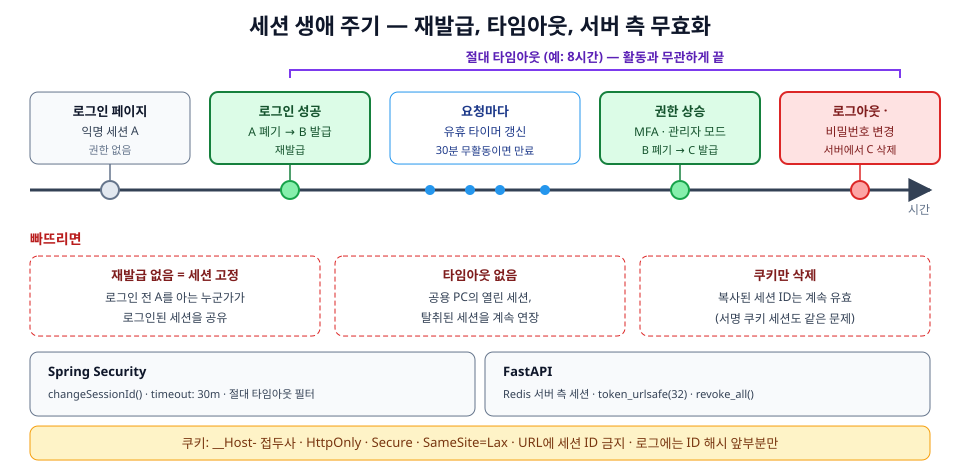
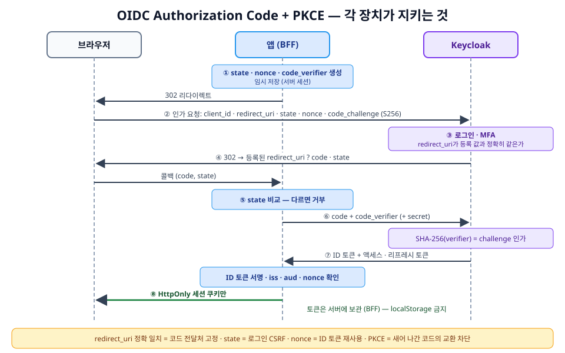

> **해킹 트랙 · 개발 보안** | 난이도 ★★★★☆ | 예상 소요 3 ~ 3.5시간

> ⚠️ **실습 전 반드시 읽을 것**
> 이 편의 실습은 **본인이 만든 앱**과 **본인 소유의 격리된 실습장**(Day 09의 kind `infra-lab`, Day 73의 Keycloak, 해킹 02의 `hacklab`)에서만 합니다. 다른 사람의 토큰·세션·계정을 사용하거나, 타인의 로그인 시스템에 요청을 조작해 보내는 것은 **정보통신망법 등으로 처벌**될 수 있습니다. 오늘은 토큰을 위조하거나 우회하는 방법을 다루지 않습니다. **내 설정이 그런 실수를 하고 있지 않은지 점검하고, 일어나면 알아채는 것**이 목적입니다.

## 🎯 오늘의 목표

- **JWT 검증**의 필수 단계(알고리즘 고정, 서명, `iss`·`aud`·`exp`)를 설명하고, 서명 검증 누락·`alg` 신뢰·약한 키·폐기 불가 같은 실수를 코드에서 찾을 수 있다
- **세션 관리**의 세 가지 축(로그인 시 재발급, 유휴·절대 타임아웃, 서버 측 무효화)을 Spring Security와 FastAPI에 적용할 수 있다
- **OAuth2/OIDC**의 `redirect_uri` 정확 일치, `state`·`nonce`·**PKCE**, 토큰 저장 위치를 설명하고, Keycloak 클라이언트 설정을 점검할 수 있다
- Spring Security 7과 FastAPI로 **안전한 리소스 서버·로그인 설정**을 만들 수 있다
- 앱의 **인증 실패 로그**와 Day 73 **Keycloak 이벤트**를 Loki로 모아 알림을 걸 수 있다

---

## 1. 오늘의 위치 — 도구가 잘 못 보는 영역

해킹 14의 SAST는 "값이 어디서 와서 어디로 가는가"를 잘 봅니다. 하지만 **"이 요청을 보낸 사람이 정말 그 사람인가(인증, authentication)"** 와 **"그 사람이 이 일을 해도 되는가(인가, authorization)"** 는 대부분 **설정과 로직**의 문제라서 도구가 놓치기 쉽습니다. OWASP Top 10:2025에서도 **A01 Broken Access Control**과 **A07 Authentication Failures**가 이 영역입니다(해킹 05).

| 영역 | 흔한 실수 | 결과 | 이 편 |
|---|---|---|---|
| JWT | 서명 검증 생략, 헤더의 `alg`를 믿음, 약한 HMAC 키, `aud` 미검사, 긴 수명 | 위조·다른 서비스용 토큰 재사용·무기한 사용 | 2장 |
| 세션 | 로그인 후 세션 ID 유지, 타임아웃 없음, 로그아웃이 쿠키만 지움 | 세션 고정, 탈취된 세션의 장기 사용 | 3장 |
| OAuth2/OIDC | `redirect_uri` 와일드카드, `state`·`nonce`·PKCE 누락, 토큰을 `localStorage`에 | 인가 코드·토큰 유출, 로그인 CSRF | 4장 |
| 인가 | 엔드포인트별 검사 누락, 객체 단위 검사 누락(IDOR) | 다른 사람 데이터 접근 | 해킹 05 3장, 해킹 16 |

> 💡 해킹 05 2장에서 비밀번호 해시, 로그인 시도 제한, 세션 재발급의 **기본형**을 봤습니다. 오늘은 그 위에 **토큰 기반 인증과 SSO**를 얹습니다. 그리고 가장 좋은 출발점은 Day 73처럼 **인증을 직접 만들지 않고 검증된 IdP(Keycloak)에 맡기는 것**입니다. 그래도 앱이 직접 해야 하는 일 — 토큰 검증, 세션, 리다이렉트 설정 — 에서 실수가 납니다.

> **실습 환경**: Day 73의 Keycloak(`https://keycloak.infra.test:8443/realms/infra`, 작성 시점 최신 26.8.x 계열), Spring Boot 4.1(Spring Security 7), Python 3.12 + FastAPI + **PyJWT 2.15**. Day 73에서 만든 CA 인증서(`ca.crt`)를 앱 런타임이 신뢰하도록 설정해 둡니다(Java는 truststore, Python은 `ssl_context`).

---

## 2. JWT — 검증은 "디코드"가 아니다

### 2-1. 원리

JWT는 `헤더.페이로드.서명` 세 부분을 Base64URL로 인코딩해 점으로 이은 문자열입니다. **헤더와 페이로드는 암호화가 아니라 인코딩**이라 누구나 읽을 수 있습니다. 토큰을 믿을 수 있는 근거는 오직 **서명**과, 서명이 맞는다는 전제 위에서의 **클레임 검사**입니다.



| 단계 | 확인할 것 | 빼먹으면 |
|---|---|---|
| ① **알고리즘 고정** | 서버가 허용 목록(예: `RS256`)을 **설정으로** 정한다. 토큰 헤더의 `alg`는 검증 입력이 아니다 | 헤더가 알고리즘을 바꾸면 검증 방식이 바뀌는 혼동 문제(`none`, RS↔HS 혼동) |
| ② **키 선택** | `kid`로 **신뢰하는 JWKS(발급자 공개키 목록)** 에서 키를 고른다 | 토큰이 가리키는 임의의 키 URL을 따라가면 공격자 키로 검증 |
| ③ **서명 검증** | 고른 키로 서명 확인 | **아무나 만든 토큰을 신뢰** |
| ④ **`iss`** | 기대하는 발급자 URL과 정확히 일치 | 다른 realm·다른 IdP의 토큰 수용 |
| ⑤ **`aud`** | 이 API가 수신자로 들어 있는가 | **다른 서비스용 토큰을 재사용** |
| ⑥ **`exp`/`nbf`** | 만료·사용 시작 시각 (작은 시계 오차 허용) | 무기한 사용 |
| ⑦ **권한 클레임** | `scope`, `groups` 등으로 인가 | 인증된 누구나 관리자 기능 |

| 키 관리 원칙 | 설명 |
|---|---|
| **비대칭 키(RS256/ES256) + JWKS** 우선 | 발급자만 개인키를 갖고, 검증하는 서비스는 공개키만 받는다. 서비스가 늘어도 비밀이 퍼지지 않음 |
| HS256(공유 비밀)은 발급자=검증자일 때만 | 최소 256비트 **무작위** 키, 코드·설정 파일이 아니라 Secret/Vault(Day 71) |
| **키 교체(rotation)** | 새 키를 JWKS에 먼저 게시 → 새 키로 서명 시작 → 옛 토큰이 다 만료된 뒤 옛 키 제거. `kid`가 이를 가능하게 함 |
| 페이로드에 비밀 금지 | 누구나 디코드 가능. 개인정보·내부 ID 구조도 최소화 |

| 만료·폐기 원칙 | 설명 |
|---|---|
| **액세스 토큰은 짧게** | 5~15분. Keycloak realm 기본 Access Token Lifespan은 5분(Day 73) |
| 리프레시 토큰은 회전 | 쓸 때마다 새로 발급하고 옛 것은 무효화 → 탈취된 리프레시 토큰의 재사용 탐지 |
| **즉시 폐기가 필요하면** | JWT는 자체 완결형이라 발급 후 서버가 "취소"할 수 없다. 짧은 수명 + ① 토큰 인트로스펙션(매번 IdP에 확인) ② `jti`/`sid` 차단 목록 ③ 사용자 비활성화 시 리프레시 차단 중 선택 |

### 2-2. 내 환경 점검

```bash
# Java: 검증 없는 디코드 (auth0 java-jwt의 JWT.decode는 서명을 검사하지 않음)
grep -rnE "JWT\.decode\(|Base64\.getUrlDecoder\(\)\.decode\(.*split" src/main/java
# Java: jjwt의 서명 없는 토큰 허용, 알고리즘 하드코딩된 약한 비밀
grep -rnE "unsecured\(\)|parseUnsecured|Keys\.hmacShaKeyFor\(\"" src/main/java

# Python: 서명 검증 끄기, 헤더의 alg를 그대로 사용, algorithms 미지정
grep -rnE "verify_signature\"?\s*:\s*False|get_unverified_header|jwt\.decode\([^)]*\)$" app/
grep -rnE "jwt\.decode\(" app/ | grep -v "algorithms="

# 설정: 하드코딩된 서명 키
grep -rnE "(jwt|token)[._-]?(secret|key)\s*[:=]" src/main/resources app/ .env* 2>/dev/null
```

해킹 14의 Semgrep `p/java`에는 `java-jwt-decode-without-verify`, `java-jwt-none-alg`, `java-jwt-hardcoded-secret` 같은 JWT 규칙이 들어 있어 위 실수 일부를 자동으로 찾습니다.

내 토큰의 클레임을 확인할 때는 **온라인 디코더에 실제 토큰을 붙여 넣지 말고** 로컬에서 봅니다(토큰은 그 자체로 자격 증명입니다).

```bash
# Day 73의 실습 사용자 토큰을 받아 페이로드만 로컬에서 디코드 (실습 realm 전용)
TOKEN="<실습 앱에서 받은 액세스 토큰>"
python3 - "$TOKEN" <<'EOF'
import sys, json, base64
p = sys.argv[1].split(".")[1]; p += "=" * (-len(p) % 4)
c = json.loads(base64.urlsafe_b64decode(p))
for k in ("iss", "aud", "azp", "exp", "iat", "scope", "groups"):
    print(f"{k:7} {c.get(k)}")
EOF
```

```text
iss     https://keycloak.infra.test:8443/realms/infra
aud     account
azp     demo-web
exp     1794729912
iat     1794729612
scope   openid profile email
groups  ['team-a-devs']
```

| 점검 질문 | 이 출력에서 |
|---|---|
| 수명이 짧은가? | `exp - iat = 300` → 5분 ✅ |
| `aud`가 내 API인가? | `account`뿐 ❌ — Keycloak은 기본적으로 내 API를 `aud`에 넣지 않음 → 4-4에서 **Audience 매퍼** 추가 |
| 권한 클레임이 있나? | `groups` ✅ (Day 73 Group Membership 매퍼) |

### 2-3. 수정 — Spring Security 7 리소스 서버

```java
// ❌ 취약: 서명을 검사하지 않고 페이로드의 역할을 믿음
@GetMapping("/api/admin/stats")
Stats stats(@RequestHeader("Authorization") String auth) {
    DecodedJWT jwt = JWT.decode(auth.substring(7));          // decode ≠ verify
    if (!jwt.getClaim("groups").asList(String.class).contains("platform-admins")) {
        throw new ResponseStatusException(HttpStatus.FORBIDDEN);
    }
    return service.stats();
}
```

토큰 검증은 직접 하지 않고 **리소스 서버 스타터**에 맡깁니다. Spring Boot 4에서 이름이 `spring-boot-starter-security-oauth2-resource-server`로 바뀌었습니다(이전 이름은 deprecated).

```yaml
# application.yml
spring:
  security:
    oauth2:
      resourceserver:
        jwt:
          issuer-uri: https://keycloak.infra.test:8443/realms/infra   # ④ iss + JWKS 위치 자동 탐색(②)
          jws-algorithms: RS256                                       # ① 허용 알고리즘 고정
          audiences: demo-api                                         # ⑤ aud 검사
```

```java
@Configuration
@EnableMethodSecurity
class ApiSecurityConfig {

    @Bean
    SecurityFilterChain api(HttpSecurity http, AuthFailureLogger authLog) throws Exception {
        http
            .securityMatcher("/api/**")
            .authorizeHttpRequests(a -> a
                .requestMatchers("/api/admin/**").hasAuthority("GROUP_platform-admins")   // ⑦
                .anyRequest().authenticated())
            .oauth2ResourceServer(o -> o
                .jwt(j -> j.jwtAuthenticationConverter(groupsConverter()))
                .authenticationEntryPoint(authLog.entryPoint())       // 5장: 401 로그
                .accessDeniedHandler(authLog.deniedHandler()))        // 5장: 403 로그
            .sessionManagement(s -> s.sessionCreationPolicy(SessionCreationPolicy.STATELESS))
            .csrf(c -> c.disable());     // 쿠키를 쓰지 않는 Bearer 전용 API일 때만
        return http.build();
    }

    // Keycloak의 groups 클레임 → GROUP_xxx 권한
    private JwtAuthenticationConverter groupsConverter() {
        JwtGrantedAuthoritiesConverter g = new JwtGrantedAuthoritiesConverter();
        g.setAuthoritiesClaimName("groups");
        g.setAuthorityPrefix("GROUP_");
        JwtAuthenticationConverter c = new JwtAuthenticationConverter();
        c.setJwtGrantedAuthoritiesConverter(g);
        return c;
    }
}
```

| 포인트 | 설명 |
|---|---|
| `issuer-uri` | 시작 시 `/.well-known/openid-configuration`에서 `jwks_uri`를 찾고, `iss`를 검사. `exp`·`nbf`는 기본 검사(기본 허용 오차 60초) |
| `jws-algorithms` | 이 목록 밖의 알고리즘은 거부 — 헤더가 무엇을 말하든 |
| `audiences` | `aud`에 `demo-api`가 없으면 401 |
| 키 교체 | JWKS를 캐시하고, 모르는 `kid`가 오면 다시 받아 옴 → IdP의 키 교체를 자동으로 따라감 |
| `csrf.disable()` | **Bearer 헤더만** 쓰는 API에서만. 쿠키 세션을 쓰는 화면에는 CSRF 보호 유지(해킹 17) |

> ⚠️ `@EnableMethodSecurity`를 켰다면 서비스 메서드에도 `@PreAuthorize("hasAuthority('GROUP_platform-admins')")`를 붙여 **URL 규칙이 빠져도 막히는** 이중 장치를 둡니다. 그리고 "내 주문인가" 같은 객체 단위 검사는 여전히 서비스 코드의 몫입니다(해킹 05 3장).

### 2-4. 수정 — FastAPI + PyJWT

```python
# ❌ 취약 1: 서명 검증 끄기
claims = jwt.decode(token, options={"verify_signature": False})

# ❌ 취약 2: 토큰 헤더가 말하는 알고리즘을 그대로 허용
alg = jwt.get_unverified_header(token)["alg"]
claims = jwt.decode(token, key, algorithms=[alg])

# ❌ 취약 3: aud·iss 검사 없음, 짧은 하드코딩 HMAC 비밀
claims = jwt.decode(token, "secret", algorithms=["HS256"])
```

```python
# ✅ app/auth.py — Keycloak 토큰 검증
import logging, ssl
import jwt
from jwt import PyJWKClient
from fastapi import Depends, HTTPException, Request, status
from fastapi.security import HTTPAuthorizationCredentials, HTTPBearer

ISSUER = "https://keycloak.infra.test:8443/realms/infra"
AUDIENCE = "demo-api"
_ctx = ssl.create_default_context(cafile="/etc/ssl/infra/ca.crt")      # Day 73 실습 CA
_jwks = PyJWKClient(f"{ISSUER}/protocol/openid-connect/certs", ssl_context=_ctx)

log = logging.getLogger("security")
bearer = HTTPBearer(auto_error=False)

def _unauthorized(request: Request, reason: str) -> HTTPException:
    log.warning("auth_failed", extra={"event": "auth_failed", "reason": reason,
                "path": request.url.path,
                "client": request.client.host if request.client else None})
    return HTTPException(status.HTTP_401_UNAUTHORIZED, "인증이 필요합니다.",
                         headers={"WWW-Authenticate": "Bearer"})

def current_claims(request: Request,
                   cred: HTTPAuthorizationCredentials | None = Depends(bearer)) -> dict:
    if cred is None:
        raise _unauthorized(request, "missing_token")
    try:
        key = _jwks.get_signing_key_from_jwt(cred.credentials)          # ② kid → JWKS
        return jwt.decode(
            cred.credentials, key.key,
            algorithms=["RS256"],                                       # ① 고정
            issuer=ISSUER,                                              # ④
            audience=AUDIENCE,                                          # ⑤
            leeway=30,                                                  # ⑥ 시계 오차
            options={"require": ["exp", "iat", "iss", "aud", "sub"]},
        )
    except jwt.ExpiredSignatureError:
        raise _unauthorized(request, "expired")
    except jwt.InvalidTokenError as e:                                  # 서명·aud·iss 등
        raise _unauthorized(request, type(e).__name__)

def require_group(group: str):
    def dep(request: Request, claims: dict = Depends(current_claims)) -> dict:
        if group not in claims.get("groups", []):                       # ⑦
            log.warning("access_denied", extra={"event": "access_denied",
                        "sub": claims.get("sub"), "path": request.url.path})
            raise HTTPException(status.HTTP_403_FORBIDDEN, "권한이 없습니다.")
        return claims
    return dep
```

```python
# app/main.py
@app.get("/api/me")
def me(claims: dict = Depends(current_claims)):
    return {"sub": claims["sub"], "groups": claims.get("groups", [])}

@app.get("/api/admin/stats")
def stats(claims: dict = Depends(require_group("platform-admins"))):
    return service.stats()
```

> 💡 로그에는 **토큰을 남기지 않습니다.** 실패 이유(`expired`, `InvalidAudienceError`, `InvalidSignatureError`)와 경로·IP만으로 충분합니다(해킹 13 5장).

```bash
# 확인 (로컬 앱)
curl -s -o /dev/null -w "%{http_code}\n" localhost:8000/api/me                       # 401
curl -s -H "Authorization: Bearer $TOKEN" localhost:8000/api/me                       # aud 매퍼 전: 401, 후: 200
curl -s -o /dev/null -w "%{http_code}\n" -H "Authorization: Bearer $TOKEN" localhost:8000/api/admin/stats   # team-a-devs: 403
```

---

## 3. 세션 관리 — 쿠키 하나에 걸린 신원

### 3-1. 원리

화면이 있는 웹 앱은 여전히 **서버 세션 + 쿠키**가 기본입니다(OIDC로 로그인해도 로그인 이후는 앱 세션). 세션 ID는 "이미 로그인한 사람"을 나타내므로 비밀번호만큼 중요합니다.



| 축 | 원칙 | 빼먹으면 |
|---|---|---|
| **재발급** | 로그인 성공, 권한 상승(관리자 모드, MFA 완료) 때 **새 세션 ID** 발급, 옛 ID 폐기 | **세션 고정**: 로그인 전 ID를 미리 알고 있던 누군가가 로그인된 세션을 공유 |
| **유휴 타임아웃** | 마지막 요청 후 일정 시간(예: 30분) 지나면 만료 | 공용 PC에 열린 세션이 무기한 |
| **절대 타임아웃** | 활동과 무관하게 로그인 후 최대 시간(예: 8시간) | 탈취된 세션을 계속 사용하며 연장 |
| **서버 측 무효화** | 로그아웃·비밀번호 변경·계정 비활성화 시 서버 저장소에서 삭제 | 쿠키만 지우면 복사된 세션 ID는 계속 유효 |
| **쿠키 속성** | `HttpOnly`, `Secure`, `SameSite=Lax`, 가능하면 `__Host-` 접두사 | XSS로 탈취, 평문 전송, CSRF (해킹 04·17) |
| **ID 품질** | 충분히 긴 무작위 값, URL에 넣지 않음 | 추측·로그·Referer로 유출 |

### 3-2. 내 환경 점검

```bash
# 쿠키 속성 확인 (내 로컬 Spring 앱)
curl -sI localhost:8080/login | grep -i set-cookie
#   기대: __Host-SESSION=...; Path=/; Secure; HttpOnly; SameSite=Lax

# Spring 설정에서 세션 재발급을 끈 곳
grep -rnE "sessionFixation.*none\(\)" src/main/java
# FastAPI: 로그인 상태를 서명 쿠키 세션에 넣는 곳
grep -rnE "SessionMiddleware|request\.session\[" app/
```

로그인 전후 세션 ID 비교는 브라우저로 하는 것이 가장 쉽습니다. 개발자 도구 **Application → Cookies**에서 로그인 페이지를 연 직후의 세션 쿠키 값을 적어 두고, 로그인한 뒤 다시 봅니다.

| 점검 | 정상 |
|---|---|
| 로그인 전후 세션 ID | **다름** |
| 로그아웃 후 이전 쿠키로 요청 | 로그인 페이지로 (401/302) |
| 비활성 30분 후 | 만료 |
| Starlette `SessionMiddleware`로 로그인 상태 저장 | 3-4 참고 — 서명된 **쿠키 자체**가 세션이라 서버 측 무효화가 안 됨 |

### 3-3. 수정 — Spring Security

Spring Security는 기본값이 안전한 편입니다. 핵심은 **기본값을 끄지 않는 것**과 **빠진 것(절대 타임아웃)을 채우는 것**입니다.

```yaml
# application.yml
server:
  servlet:
    session:
      timeout: 30m                 # 유휴 타임아웃
      cookie:
        name: __Host-SESSION       # Secure + Path=/ + Domain 없음일 때만 브라우저가 수용
        http-only: true
        secure: true
        same-site: lax
      tracking-modes: cookie       # URL에 jsessionid 붙이지 않기
```

```java
@Bean
SecurityFilterChain web(HttpSecurity http) throws Exception {
    http
        .authorizeHttpRequests(a -> a.anyRequest().authenticated())
        .formLogin(Customizer.withDefaults())
        .sessionManagement(s -> s
            .sessionFixation(f -> f.changeSessionId())    // 기본값: 로그인 시 ID 교체. none()으로 바꾸지 말 것
            .maximumSessions(3))                           // 사용자당 동시 세션 제한
        .logout(l -> l
            .logoutUrl("/logout")
            .invalidateHttpSession(true)                   // 서버 측 무효화 (기본값)
            .deleteCookies("__Host-SESSION"))
        .addFilterAfter(new AbsoluteSessionTimeoutFilter(Duration.ofHours(8)),
                        SecurityContextHolderFilter.class);
    return http.build();
}

// 절대 타임아웃: 서블릿 세션에는 기본 기능이 없어 필터로 보완
class AbsoluteSessionTimeoutFilter extends OncePerRequestFilter {
    private final Duration max;
    AbsoluteSessionTimeoutFilter(Duration max) { this.max = max; }

    @Override
    protected void doFilterInternal(HttpServletRequest req, HttpServletResponse res, FilterChain chain)
            throws ServletException, IOException {
        HttpSession s = req.getSession(false);
        if (s != null && System.currentTimeMillis() - s.getCreationTime() > max.toMillis()) {
            s.invalidate();
            SecurityContextHolder.clearContext();
            res.sendRedirect("/login?expired");
            return;
        }
        chain.doFilter(req, res);
    }
}
```

> 💡 `maximumSessions`가 제대로 동작하려면 세션 생성·소멸을 Spring Security가 알 수 있게 `HttpSessionEventPublisher` 빈을 등록합니다. 여러 Pod로 확장하면 세션을 **Spring Session + Redis**에 두어 어느 Pod에서든 무효화가 반영되게 합니다.

### 3-4. 수정 — FastAPI: 서버 측 세션 저장소

Starlette의 `SessionMiddleware`는 세션 데이터를 **서명된 쿠키**에 담습니다. 위조는 막지만, 서버가 특정 세션을 **취소할 방법이 없습니다**(로그아웃해도 복사해 둔 쿠키는 `max_age`까지 유효). 로그인 상태는 서버 저장소(Redis)에 두고 쿠키에는 **무작위 ID만** 넣습니다.

```python
# app/session.py — Redis 서버 측 세션 (pip install redis)
import secrets, time, json
import redis
from fastapi import Request, Response, HTTPException

r = redis.Redis(host="redis", port=6379, decode_responses=True)
COOKIE = "__Host-session"
IDLE, ABSOLUTE = 30 * 60, 8 * 60 * 60

def login(response: Response, request: Request, user_id: str) -> None:
    old = request.cookies.get(COOKIE)
    if old:
        r.delete(f"sess:{old}")                         # 재발급: 로그인 전 ID 폐기
    sid = secrets.token_urlsafe(32)                     # 256비트 무작위
    now = int(time.time())
    r.setex(f"sess:{sid}", IDLE, json.dumps({"uid": user_id, "created": now}))
    r.sadd(f"user_sessions:{user_id}", sid)             # 사용자 단위 일괄 무효화용
    response.set_cookie(COOKIE, sid, httponly=True, secure=True, samesite="lax", path="/")

def current_user(request: Request) -> str:
    sid = request.cookies.get(COOKIE)
    raw = r.get(f"sess:{sid}") if sid else None
    if not raw:
        raise HTTPException(401)
    data = json.loads(raw)
    if time.time() - data["created"] > ABSOLUTE:        # 절대 타임아웃
        r.delete(f"sess:{sid}")
        raise HTTPException(401)
    r.expire(f"sess:{sid}", IDLE)                        # 유휴 타임아웃 연장
    return data["uid"]

def logout(request: Request, response: Response) -> None:
    sid = request.cookies.get(COOKIE)
    if sid:
        r.delete(f"sess:{sid}")                         # 서버 측 무효화
    response.delete_cookie(COOKIE, path="/")

def revoke_all(user_id: str) -> None:                   # 비밀번호 변경·계정 정지 시
    for sid in r.smembers(f"user_sessions:{user_id}"):
        r.delete(f"sess:{sid}")
    r.delete(f"user_sessions:{user_id}")
```

> ⚠️ 이 코드는 원리를 보여 주는 최소 예입니다. 실제 서비스에서는 검증된 세션 라이브러리나 4장의 OIDC + BFF 구성을 쓰고, CSRF 보호(해킹 17)를 함께 적용합니다.

### 3-5. 탐지

| 신호 | 어디서 | 의미 |
|---|---|---|
| 한 사용자의 동시 세션 수 급증 | 세션 저장소, `login_success` 이벤트 | 계정 공유 또는 탈취 |
| 같은 세션 ID가 짧은 시간에 서로 다른 국가·ASN에서 사용 | 앱 로그(`sid` 해시 + IP) | 세션 탈취 의심 (모바일 이동은 오탐 — 보조 신호) |
| 만료·무효화된 세션 ID로 반복 요청 | 401 + `reason=session_expired` | 오래된 쿠키를 재사용하려는 시도 |

> 💡 세션 ID 자체는 로그에 남기지 말고 **해시의 앞 8자** 정도만 남겨 같은 세션인지 연결합니다.

---

## 4. OAuth2 / OIDC 설정 실수

### 4-1. 원리 — Authorization Code + PKCE

웹 앱과 SPA·모바일·CLI 모두 지금의 권장 방식은 **Authorization Code 흐름 + PKCE**입니다. OAuth 2.1 초안과 *OAuth 2.0 Security Best Current Practice*(RFC 9700)는 Implicit 흐름과 비밀번호 직접 전달(Resource Owner Password Credentials)을 쓰지 말라고 합니다.



| 장치 | 무엇을 막나 | 누가 만들고 누가 확인하나 |
|---|---|---|
| **`redirect_uri` 정확 일치** | 인가 코드·토큰이 **엉뚱한 주소**로 전달되는 것 | IdP에 등록한 값과 요청 값을 IdP가 **문자열 그대로** 비교 |
| **`state`** | 로그인 CSRF — 남이 시작한 로그인 응답을 내 브라우저가 받는 것 | 앱이 무작위 생성·세션에 저장 → 콜백에서 비교 |
| **`nonce`** | ID 토큰 재사용·주입 | 앱이 생성 → ID 토큰의 `nonce` 클레임과 비교 |
| **PKCE** (`code_verifier`/`code_challenge`, `S256`) | 인가 코드가 새어 나가도 **다른 주체가 토큰으로 교환**하는 것 | 앱이 verifier 생성, challenge(해시)를 보냄 → 토큰 교환 때 verifier 제출, IdP가 비교 |
| **`iss` 확인** | 여러 IdP를 쓸 때 응답 혼동(mix-up) | 앱이 기대 발급자와 비교 |

| 토큰 저장 위치 | 위험 | 권장 |
|---|---|---|
| `localStorage` / `sessionStorage` | **XSS 한 번이면 그대로 읽힘** (해킹 04) | 피한다 |
| JS 메모리 변수 | 새로고침 시 사라짐, XSS 시 여전히 접근 가능 | 짧은 수명 토큰에 한해 |
| **BFF(Backend for Frontend)** — 토큰은 서버에, 브라우저엔 `HttpOnly` 세션 쿠키만 | 토큰이 브라우저에 없음 | **웹 앱 기본 선택** |
| 모바일 | — | OS 보안 저장소(Keychain/Keystore) |

| 토큰 종류 | 용도 | 흔한 실수 |
|---|---|---|
| ID 토큰 | **앱(클라이언트)이** 로그인한 사람이 누구인지 확인 | API 호출에 ID 토큰을 Bearer로 사용 |
| 액세스 토큰 | **API(리소스 서버)가** 요청 권한 확인 | `aud` 확인 없이 아무 API에서나 수용 |
| 리프레시 토큰 | 새 액세스 토큰 발급 | 브라우저 JS에 노출 |

### 4-2. 내 환경 점검 — Keycloak 클라이언트 설정

Day 73의 realm JSON과 관리 콘솔(**Clients → 클라이언트 → Settings / Advanced**)을 다음 표로 점검합니다.

| 항목 (JSON 키 / 콘솔) | 안전한 값 | 위험한 값 |
|---|---|---|
| `redirectUris` / *Valid redirect URIs* | 정확한 전체 URL 목록 (Day 73: `http://localhost:3000/login/generic_oauth`) | `*`, `https://app.example.test/*`, `http://*` |
| `webOrigins` / *Web origins* | 필요한 오리진만, 또는 `+`(redirect URI의 오리진) | `*` |
| `implicitFlowEnabled` | `false` | `true` |
| `directAccessGrantsEnabled` / *Direct access grants* | `false` (Day 73 `kubernetes` 클라이언트처럼) | `true` — 앱이 비밀번호를 직접 받게 됨 |
| `attributes."pkce.code.challenge.method"` / *Advanced → PKCE Method* | `S256` (IdP가 PKCE를 **강제**) | 비어 있음 |
| `publicClient` | SPA·CLI는 `true`(비밀 없음), 서버 앱은 `false`(confidential) | 브라우저 JS에 client secret 포함 |
| Realm → *Tokens* → *Revoke Refresh Token* | ON (리프레시 토큰 회전) | OFF |

```bash
# 발급자 메타데이터에서 PKCE 지원 확인
curl -s --cacert ca.crt https://keycloak.infra.test:8443/realms/infra/.well-known/openid-configuration \
  | jq '{issuer, code_challenge_methods_supported, response_types_supported}'

# realm 설정 내보내기에서 와일드카드 redirect 찾기 (관리 API 토큰은 Day 73 방식으로)
jq -r '.clients[] | select(.redirectUris[]? | test("\\*")) | .clientId' infra-realm.json
```

> 💡 Day 73에서 `grafana`, `argocd` 클라이언트는 `directAccessGrantsEnabled`를 따로 지정하지 않았습니다. 관리 콘솔에서 만든 클라이언트는 *Direct access grants*가 켜진 채로 생기는 경우가 많으니, **필요 없는 흐름은 명시적으로 끄는 것**을 습관으로 합니다.

### 4-3. 수정 — Spring Security `oauth2Login` (BFF 방식)

Spring의 OAuth2 클라이언트는 `state`와 OIDC `nonce`를 자동으로 만들고 검증합니다. Spring Security 7 문서는 Authorization Code 그랜트에 **PKCE를 기본 적용**한다고 안내하지만, 버전에 따라 다를 수 있으므로 명시해 두면 의도가 코드에 남습니다.

```yaml
# application.yml — 스타터: spring-boot-starter-security-oauth2-client
spring:
  security:
    oauth2:
      client:
        registration:
          keycloak:
            client-id: demo-web
            client-secret: ${DEMO_WEB_CLIENT_SECRET}      # Secret/Vault에서 (Day 55·71)
            scope: openid,profile,email
            authorization-grant-type: authorization_code
            redirect-uri: "{baseUrl}/login/oauth2/code/{registrationId}"   # Keycloak에 이 값을 정확히 등록
        provider:
          keycloak:
            issuer-uri: https://keycloak.infra.test:8443/realms/infra
```

```java
@Bean
SecurityFilterChain web(HttpSecurity http, ClientRegistrationRepository repo) throws Exception {
    DefaultOAuth2AuthorizationRequestResolver resolver =
            new DefaultOAuth2AuthorizationRequestResolver(repo, "/oauth2/authorization");
    resolver.setAuthorizationRequestCustomizer(OAuth2AuthorizationRequestCustomizers.withPkce());

    http
        .authorizeHttpRequests(a -> a
            .requestMatchers("/", "/error").permitAll()
            .anyRequest().authenticated())
        .oauth2Login(o -> o.authorizationEndpoint(e -> e.authorizationRequestResolver(resolver)))
        .logout(l -> l.logoutSuccessUrl("/"))
        .sessionManagement(s -> s.sessionFixation(f -> f.changeSessionId()));
    // 토큰은 서버의 OAuth2AuthorizedClientService에 보관, 브라우저에는 세션 쿠키만 (BFF)
    return http.build();
}
```

| Spring이 해 주는 것 | 우리가 해야 하는 것 |
|---|---|
| `state` 생성·검증, `nonce` 생성·ID 토큰 검증, `iss` 확인 | Keycloak에 redirect URI를 **정확히** 등록 |
| 로그인 성공 시 세션 ID 교체 | 3-3의 쿠키 속성·타임아웃 |
| 토큰을 서버 측에 보관 | 프런트 JS에 토큰을 내려보내는 API를 만들지 않기 |

### 4-4. 수정 — Keycloak: Audience 매퍼와 클라이언트 하드닝

2-2에서 본 것처럼 Keycloak 액세스 토큰의 `aud`에는 기본적으로 내 API가 없습니다. API용 클라이언트 `demo-api`(bearer 전용, 로그인 흐름 없음)를 만들고, 웹 클라이언트 `demo-web`의 토큰에 그 이름을 넣습니다. Day 73의 realm JSON에 다음을 추가합니다.

```json
{
  "clientId": "demo-web",
  "publicClient": false,
  "secret": "demo-web-lab-secret",
  "standardFlowEnabled": true,
  "implicitFlowEnabled": false,
  "directAccessGrantsEnabled": false,
  "redirectUris": [ "http://localhost:8080/login/oauth2/code/keycloak" ],
  "webOrigins": [ "+" ],
  "attributes": { "pkce.code.challenge.method": "S256" },
  "protocolMappers": [
    { "name": "aud-demo-api", "protocol": "openid-connect",
      "protocolMapper": "oidc-audience-mapper",
      "config": { "included.client.audience": "demo-api",
                  "access.token.claim": "true", "id.token.claim": "false" } },
    { "name": "groups", "protocol": "openid-connect",
      "protocolMapper": "oidc-group-membership-mapper",
      "config": { "claim.name": "groups", "full.path": "false", "id.token.claim": "true",
                  "access.token.claim": "true", "userinfo.token.claim": "true" } }
  ]
},
{
  "clientId": "demo-api",
  "publicClient": false,
  "standardFlowEnabled": false,
  "directAccessGrantsEnabled": false,
  "serviceAccountsEnabled": false
}
```

> ⚠️ 실습 secret을 평문으로 둔 것은 Day 73과 마찬가지로 **실습 전용**입니다. 관리 콘솔에서는 *Client scopes → demo-web-dedicated → Add mapper → By configuration → Audience*로 같은 설정을 합니다.

### 4-5. 수정 — FastAPI 로그인 (Authlib)

FastAPI에서 로그인 흐름을 직접 구현하지 말고 **Authlib**(1.x)의 Starlette 통합을 씁니다. `state`·`nonce` 검증을 라이브러리가 하고, PKCE는 `code_challenge_method`로 켭니다.

```python
# app/login.py  (pip install authlib httpx itsdangerous)
import os
from authlib.integrations.starlette_client import OAuth
from fastapi import APIRouter, Request
from fastapi.responses import RedirectResponse
from app.session import login as create_session        # 3-4의 서버 측 세션

ISSUER = "https://keycloak.infra.test:8443/realms/infra"
oauth = OAuth()
oauth.register(
    name="keycloak",
    server_metadata_url=f"{ISSUER}/.well-known/openid-configuration",
    client_id="demo-web",
    client_secret=os.environ["DEMO_WEB_CLIENT_SECRET"],
    client_kwargs={"scope": "openid profile email", "code_challenge_method": "S256"},
)
router = APIRouter()

@router.get("/login")
async def login(request: Request):
    # redirect_uri는 Keycloak에 등록한 값과 정확히 같아야 한다
    return await oauth.keycloak.authorize_redirect(request, "http://localhost:8000/auth/callback")

@router.get("/auth/callback")
async def callback(request: Request):
    token = await oauth.keycloak.authorize_access_token(request)   # state·nonce·ID 토큰 검증
    user = token["userinfo"]
    resp = RedirectResponse("/")
    create_session(resp, request, user["sub"])                    # 브라우저엔 세션 쿠키만
    # 액세스·리프레시 토큰이 필요하면 서버 측 저장소에 sid와 묶어 보관 (BFF)
    return resp
```

```python
# app/main.py — Authlib가 state·nonce·code_verifier를 잠깐 보관할 곳
from starlette.middleware.sessions import SessionMiddleware
app.add_middleware(SessionMiddleware, secret_key=os.environ["STATE_COOKIE_KEY"],
                   https_only=True, same_site="lax", max_age=600)
```

> 💡 여기서 Starlette `SessionMiddleware`는 **로그인 진행 중의 짧은 상태값**(10분)만 담습니다. 로그인 이후의 신원은 3-4의 서버 측 세션이 맡습니다. 3-1의 "서명 쿠키 세션은 취소 불가" 문제를 피하는 역할 분담입니다.

---

## 5. 탐지 — 인증 실패 로그와 Keycloak 이벤트

### 5-1. 앱의 인증·인가 실패 로그

**Spring** — 리소스 서버의 401·403은 진입점과 거부 핸들러를 감싸 로그를 남깁니다(2-3에서 연결한 `AuthFailureLogger`).

```java
@Component
class AuthFailureLogger {
    private static final Logger log = LoggerFactory.getLogger("security");
    private final BearerTokenAuthenticationEntryPoint entry = new BearerTokenAuthenticationEntryPoint();
    private final BearerTokenAccessDeniedHandler denied = new BearerTokenAccessDeniedHandler();

    AuthenticationEntryPoint entryPoint() {
        return (req, res, ex) -> {
            log.warn("auth_failed reason={} detail=\"{}\" path={} client={}",   // 토큰 값은 남기지 않는다
                     ex.getClass().getSimpleName(), ex.getMessage(), req.getRequestURI(), req.getRemoteAddr());
            entry.commence(req, res, ex);         // 표준 401 + WWW-Authenticate 헤더
        };
    }

    AccessDeniedHandler deniedHandler() {
        return (req, res, ex) -> {
            log.warn("access_denied path={} user={}", req.getRequestURI(),
                     req.getUserPrincipal() != null ? req.getUserPrincipal().getName() : "-");
            denied.handle(req, res, ex);
        };
    }
}
```

폼·OIDC 로그인 실패는 Spring Security가 발행하는 인증 이벤트를 받습니다(Spring Boot가 `AuthenticationEventPublisher`를 자동 구성).

```java
@Component
class LoginEvents {
    private static final Logger log = LoggerFactory.getLogger("security");

    @EventListener
    void onFailure(AbstractAuthenticationFailureEvent e) {
        log.warn("login_failed user={} reason={}", e.getAuthentication().getName(),
                 e.getException().getClass().getSimpleName());
    }

    @EventListener
    void onSuccess(AuthenticationSuccessEvent e) {
        log.info("login_success user={}", e.getAuthentication().getName());
    }
}
```

FastAPI는 2-4의 `auth_failed`·`access_denied` 이벤트가 같은 역할입니다. 해킹 13처럼 JSON 로그로 내보내면 Loki에서 이름으로 셀 수 있습니다.

### 5-2. Keycloak 이벤트 켜기 (Day 73 연결)

Keycloak은 로그인 시도를 **이벤트**로 기록합니다. Day 73의 realm JSON에 다음 키를 추가하고 다시 import합니다(관리 콘솔: **Realm settings → Events → User events settings**, 무차별 대입 보호는 **Realm settings → Security defenses → Brute force detection**).

```json
{
  "realm": "infra",
  "eventsEnabled": true,
  "eventsExpiration": 604800,
  "eventsListeners": [ "jboss-logging" ],
  "adminEventsEnabled": true,
  "bruteForceProtected": true,
  "failureFactor": 5,
  "waitIncrementSeconds": 60,
  "maxFailureWaitSeconds": 900
}
```

| 키 | 의미 |
|---|---|
| `eventsEnabled` + `eventsExpiration` | 사용자 이벤트를 DB에 저장(7일) → 관리 콘솔 *Events* 탭에서 조회 |
| `eventsListeners: jboss-logging` | 이벤트를 **서버 로그**로도 출력. 기본값은 실패 이벤트를 WARN, 성공을 DEBUG로 → Loki로 수집 가능 |
| `adminEventsEnabled` | 관리 콘솔에서의 설정 변경 기록 (누가 redirect URI를 바꿨나) |
| `bruteForceProtected` 등 | 연속 실패 5회부터 계정 일시 잠금, 대기 시간 점증(최대 15분) |

Keycloak 로그에는 이런 줄이 남습니다(값 일부 생략, 필드 형식은 버전에 따라 따옴표 유무가 다름).

```text
WARN  [org.keycloak.events] (executor-thread-3) type="LOGIN_ERROR", realmId="…", clientId="demo-web", userId="…", ipAddress="10.244.0.1", error="invalid_user_credentials", auth_method="openid-connect", …
WARN  [org.keycloak.events] (executor-thread-5) type="LOGIN_ERROR", realmId="…", clientId="demo-web", ipAddress="10.244.0.1", error="invalid_redirect_uri", redirect_uri="…"
```

| 이벤트 / 오류 | 의미 | 대응 |
|---|---|---|
| `LOGIN_ERROR` + `invalid_user_credentials`, `user_not_found` | 비밀번호 실패 | 한 IP에서 여러 사용자 → 비밀번호 스프레이 의심 |
| `LOGIN_ERROR` + `user_temporarily_disabled` | 무차별 대입 보호가 잠금 | 잠금 급증 자체가 신호 |
| `invalid_redirect_uri` | 등록되지 않은 redirect URI로 요청 | 설정 실수(배포 직후) 또는 리다이렉트 조작 시도 |
| `CODE_TO_TOKEN_ERROR` (`invalid_code`, `invalid_code_verifier` 등) | 코드 교환 실패 | 코드 재사용·PKCE 불일치 — 클라이언트 버그 또는 가로챈 코드 사용 시도 |
| `REFRESH_TOKEN_ERROR` | 리프레시 실패 | 회전된(폐기된) 리프레시 토큰 재사용 → 탈취 의심 |

### 5-3. Loki 쿼리와 알림 (Day 60·62)

```logql
# Keycloak: 10분간 오류 종류별 로그인 실패 수
sum by (error) (
  count_over_time({namespace="keycloak"} |= "LOGIN_ERROR"
    | regexp `error="?(?P<error>[a-z_]+)` [10m])
)

# Keycloak: IP별로 실패한 "서로 다른 사용자" 수 — 스프레이 패턴
count by (ip) (
  sum by (ip, user) (
    count_over_time({namespace="keycloak"} |= "LOGIN_ERROR"
      | regexp `ipAddress="?(?P<ip>[0-9a-f.:]+)` | regexp `username="?(?P<user>[^",]+)` [15m])
  )
)

# 앱: 리소스 서버 401 사유별
sum by (reason) (count_over_time({namespace="demo-dev"} | json | event="auth_failed" [10m]))
```

```yaml
# Loki ruler — 증상 기반 알림 (Day 62)
groups:
  - name: authn-signals
    rules:
      - alert: KeycloakLoginFailureSpike
        expr: |
          sum(count_over_time({namespace="keycloak"} |= "LOGIN_ERROR" [10m])) > 50
        labels:
          severity: ticket
        annotations:
          summary: "infra realm 로그인 실패 10분 50회 초과 — IP·사용자 분포 확인"
      - alert: KeycloakInvalidRedirectUri
        expr: |
          sum(count_over_time({namespace="keycloak"} |= "invalid_redirect_uri" [15m])) > 0
        labels:
          severity: ticket
        annotations:
          summary: "등록되지 않은 redirect_uri 요청 — 배포 설정 확인 또는 조작 시도 의심"
      - alert: ApiTokenAudienceMismatch
        expr: |
          sum(count_over_time({namespace="demo-dev"} |= "auth_failed"
              |~ `(?i)(InvalidAudience|aud claim)` [10m])) > 10
        labels:
          severity: ticket
        annotations:
          summary: "demo-api에 다른 용도의 토큰 유입 — 클라이언트 설정 또는 토큰 오용"
```

> 💡 Day 73의 **K8s 감사 로그**도 같은 Keycloak 신원(`oidc:alice`)을 씁니다. Keycloak의 `LOGIN_ERROR` → 성공 → 감사 로그의 이상한 API 호출로 이어지는 흐름을 Grafana 한 화면에서 시간순으로 보면, 해킹 10의 "탐지 관점"이 인증 영역까지 완성됩니다.

---

## 6. 트러블슈팅

| 증상 | 원인 | 해결 |
|---|---|---|
| Spring 리소스 서버가 모든 요청에 401, 로그에 `The aud claim is not valid` | Keycloak 토큰에 `demo-api` audience 없음 | 4-4의 Audience 매퍼 추가 후 새 토큰 발급 |
| 시작 시 `Unable to resolve the Configuration with the provided Issuer` | 앱이 Keycloak HTTPS 인증서(실습 CA)를 신뢰하지 않음, DNS | JVM truststore에 `ca.crt` 추가, `keycloak.infra.test` 해석 확인 |
| `iss` 불일치로 401 | 토큰 발급 URL(브라우저가 본 주소)과 `issuer-uri`가 다름(호스트명·포트) | Keycloak `--hostname`과 앱 설정을 같은 외부 URL로 통일 (Day 73) |
| PyJWT `InvalidAudienceError` | 위와 같음, 또는 `audience` 인자 오타 | 토큰의 `aud` 확인(2-2 로컬 디코드) |
| PyJWT `PyJWKClientError` / SSL 오류 | JWKS URL 접근 실패, CA 미신뢰 | `ssl_context` 설정, 네트워크 확인 |
| Keycloak 로그인 화면에서 "Invalid parameter: redirect_uri" | 등록 값과 요청 값이 한 글자라도 다름(끝 `/`, 포트, http/https) | 앱이 보내는 값을 그대로 등록. 와일드카드로 "해결"하지 않기 |
| PKCE 강제 후 기존 클라이언트 로그인 실패 | 클라이언트가 `code_challenge`를 보내지 않음 | 클라이언트에 PKCE 적용(4-3, 4-5) 후 강제 |
| 로그아웃했는데 다른 탭에서 계속 로그인 상태 | 앱 세션만 지우고 IdP 세션 유지, 또는 서명 쿠키 세션 | RP-initiated logout(`end_session_endpoint`)까지 호출, 서버 측 세션 사용 |
| `maximumSessions` 설정이 동작하지 않음 | `HttpSessionEventPublisher` 미등록 | 빈 등록, 다중 Pod는 Spring Session |
| Keycloak 로그에 이벤트가 안 보임 | `eventsListeners`에 `jboss-logging` 없음, 성공 이벤트는 DEBUG라 안 보임 | realm 설정 확인. 실패 이벤트는 WARN으로 출력됨 |

---

## 7. 핵심 정리

- 인증·인가 실수는 **설정과 로직**의 문제라 SAST가 잘 못 본다 → 체크리스트와 로그 기반 탐지로 보완
- **JWT 검증 7단계**: 알고리즘 고정(헤더 `alg` 불신) → JWKS에서 `kid`로 키 → 서명 → `iss` → `aud` → `exp`/`nbf` → 권한 클레임. **decode ≠ verify**
- 키는 **비대칭 + JWKS + 교체**, HS256은 발급자=검증자일 때만 256비트 무작위 키. 액세스 토큰은 **짧게**, 리프레시는 **회전**, 즉시 폐기는 인트로스펙션·차단 목록
- Spring: `issuer-uri` + `jws-algorithms` + `audiences`로 리소스 서버. FastAPI: `PyJWKClient` + `algorithms=["RS256"]` + `issuer` + `audience` + `require`
- 세션: **로그인 시 재발급**(Spring 기본 `changeSessionId`), **유휴 + 절대 타임아웃**, **서버 측 무효화**, `HttpOnly`·`Secure`·`SameSite`·`__Host-`. Starlette 서명 쿠키 세션은 취소 불가 → 서버 저장소
- OIDC: Authorization Code + **PKCE(S256)**, `redirect_uri` **정확 일치**, `state`·`nonce`, Implicit·비밀번호 그랜트 끄기, 토큰은 **BFF로 서버에**. Keycloak은 **Audience 매퍼**로 `aud`를 채운다
- 탐지: 앱의 `auth_failed`·`access_denied`·`login_failed` + Keycloak **`LOGIN_ERROR`·`invalid_redirect_uri`·`REFRESH_TOKEN_ERROR`** 이벤트 → Loki → Alertmanager

---

## 8. 셀프 체크

<details>
<summary>Q1. 팀원이 "토큰 페이로드에 groups가 있으니 그걸 보고 관리자 여부를 판단한다"며 <code>JWT.decode()</code>를 썼다. 무엇이 문제인가?</summary>

`decode`는 Base64URL을 풀어 읽기만 하고 **서명을 검증하지 않습니다.** 페이로드는 누구나 만들 수 있으므로 서명 검증 없이 읽은 `groups`는 아무 근거가 없습니다. 검증은 리소스 서버 라이브러리(Spring `oauth2ResourceServer().jwt()`, PyJWT `jwt.decode(..., key, algorithms=[...], audience=..., issuer=...)`)에 맡기고, 권한 판단은 **검증을 통과한 클레임**으로만 합니다.
</details>

<details>
<summary>Q2. 검증 코드에서 허용 알고리즘을 토큰 헤더의 <code>alg</code> 값으로 정하면 왜 위험한가?</summary>

검증 방식(어떤 알고리즘·어떤 종류의 키로 확인할지)을 **검증 대상이 스스로 정하게** 되기 때문입니다. 서명 없음(`none`)이나 비대칭↔대칭 알고리즘 혼동처럼, 서버가 의도하지 않은 방식으로 검증이 통과하는 문제가 생길 수 있습니다. 허용 알고리즘은 서버 설정(`jws-algorithms: RS256`, `algorithms=["RS256"]`)으로 고정합니다.
</details>

<details>
<summary>Q3. 같은 Keycloak realm에서 발급된, 서명도 올바른 토큰인데 왜 <code>aud</code>를 검사해야 하나?</summary>

같은 realm에는 여러 클라이언트와 API가 있습니다. `aud`를 보지 않으면 **다른 서비스용으로 발급된 토큰**(예: 권한이 다르게 설계된 내부 도구용 토큰)을 내 API가 그대로 받아들입니다. 토큰이 "이 API를 위해" 발급됐는지 확인하는 것이 `aud`입니다. Keycloak은 기본적으로 내 API를 `aud`에 넣지 않으므로 Audience 매퍼를 추가합니다.
</details>

<details>
<summary>Q4. 로그인 성공 후에도 세션 ID를 바꾸지 않으면 어떤 문제가 생기고, Spring과 FastAPI에서 각각 어떻게 막나?</summary>

로그인 **전에** 정해진 세션 ID를 아는 누군가가, 사용자가 로그인한 뒤 같은 ID로 로그인된 세션을 공유하게 됩니다(세션 고정). Spring Security는 기본값 `sessionFixation().changeSessionId()`로 막으므로 `none()`으로 바꾸지 않으면 됩니다. FastAPI에서 직접 세션을 다룬다면 로그인 시 **새 무작위 ID를 발급하고 옛 ID를 서버 저장소에서 삭제**합니다(3-4).
</details>

<details>
<summary>Q5. Keycloak 클라이언트의 Valid redirect URIs를 <code>https://app.example.test/*</code>로 두면 편한데, 왜 정확한 URL 목록이 권장되나? 그리고 이 실수를 운영 중에 어떻게 알아챌 수 있나?</summary>

와일드카드는 인가 코드나 토큰이 **의도하지 않은 경로**(같은 도메인의 열린 리다이렉트 페이지, 사용자 콘텐츠 경로 등)로 전달될 여지를 남깁니다. 앱이 실제로 쓰는 콜백 URL만 정확히 등록하면 IdP가 문자열 비교로 나머지를 거부합니다. 운영 중에는 Keycloak 이벤트의 `invalid_redirect_uri`(정확 일치로 바꾼 뒤 거부된 요청)와 **admin 이벤트**(누가 redirect URI 설정을 바꿨는지)를 Loki로 모아 알림을 겁니다.
</details>

---

## ⏭️ 다음 예고 — 해킹 16. API 보안 — OWASP API Security Top 10, 데이터 노출, rate limiting

오늘 토큰을 제대로 검증하고 "누구인가"를 확정했습니다. 하지만 API 사고의 상당수는 **인증은 통과한 사용자**가 일으킵니다. 다음 편에서는 **OWASP API Security Top 10**을 기준으로, 객체·속성 단위 인가 실패(BOLA, 과다한 데이터 노출, Mass Assignment), 무제한 자원 소비와 **rate limiting**, 민감한 비즈니스 흐름 보호를 Spring Boot와 FastAPI로 점검하고, 오늘 만든 `auth_failed`·`access_denied` 로그 위에 API 남용 탐지를 얹습니다.
