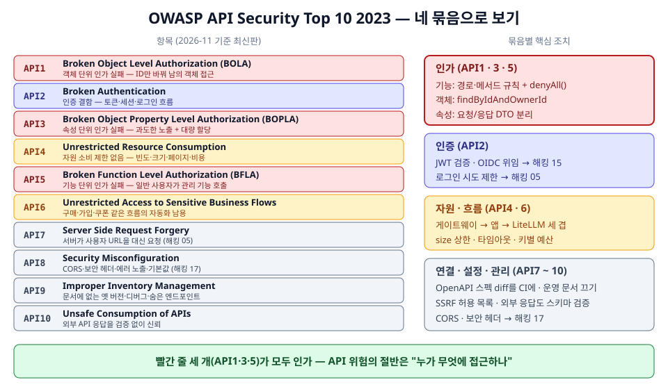
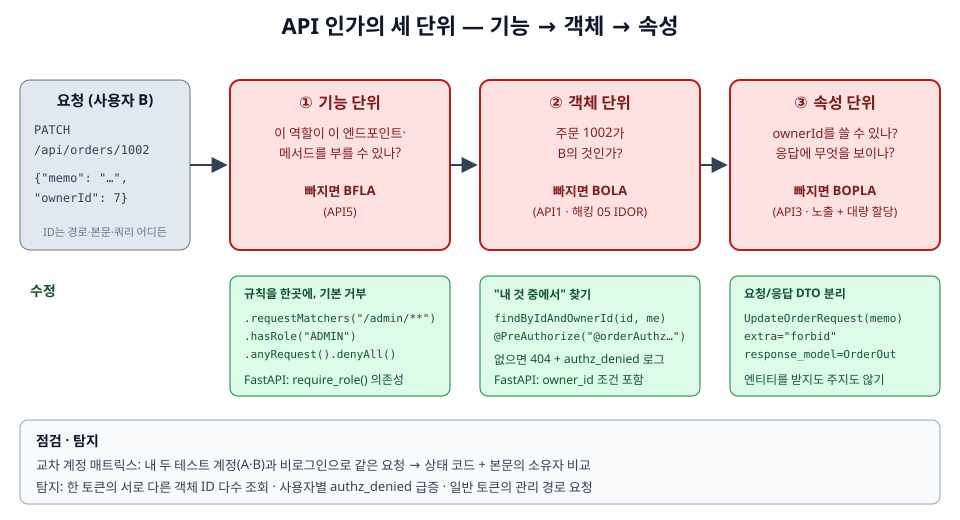
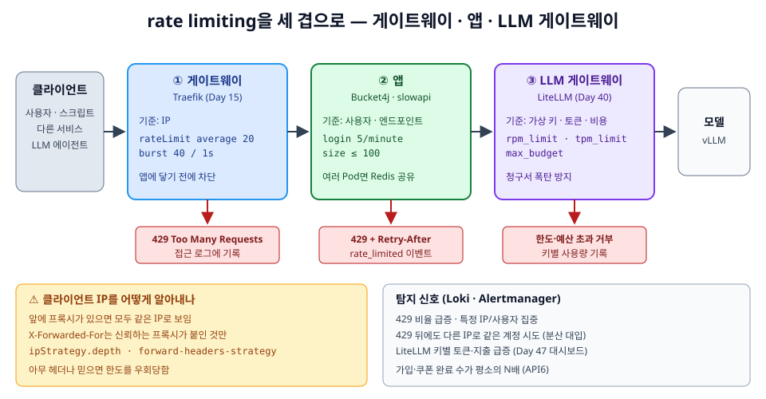

> **해킹 트랙 · 개발 보안** | 난이도 ★★★★☆ | 예상 소요 3 ~ 3.5시간

> ⚠️ **실습 전 반드시 읽을 것**
> 실습은 **본인 소유의 격리된 실습장**(해킹 02의 `hacklab` 네트워크, Juice Shop `10.10.10.21`)과 **본인이 만든 앱**에만 합니다. 허가 없이 타인의 API를 호출해 권한을 시험하거나 대량 요청을 보내면 **정보통신망법 등으로 처벌**될 수 있습니다. 오늘의 목적은 **내 API에서 같은 실수를 찾아 막고, 일어나면 알아채는 것**입니다.

## 🎯 오늘의 목표

- **OWASP API Security Top 10 2023**의 10개 항목을 설명하고, 해킹 05의 웹 Top 10:2025와 어떻게 다른지 말할 수 있다
- **BOLA·BOPLA·BFLA** 세 가지 인가를 구분하고, Spring과 FastAPI에서 객체·속성·기능 단위 검사를 코드로 넣을 수 있다
- 엔티티를 그대로 반환·바인딩하지 않고 **요청/응답 DTO를 분리**해 과도한 데이터 노출과 대량 할당을 막을 수 있다
- rate limiting을 **게이트웨이(Day 15 Traefik) → 앱(Bucket4j·slowapi) → LLM 게이트웨이(Day 40 LiteLLM)** 세 겹으로 설계할 수 있다
- OpenAPI 스펙으로 **API 인벤토리**를 관리하고, Juice Shop API로 내 점검 절차를 연습할 수 있다

---

## 1. 왜 API는 따로 봐야 하나

해킹 04·05에서 본 웹 취약점은 대부분 "**서버가 HTML을 만들어 주는**" 앱을 전제로 했습니다. 요즘 서비스는 화면을 SPA·모바일 앱이 그리고, 서버는 **JSON API만** 제공합니다. 이 구조에서는 위험의 무게 중심이 달라집니다.

| | 서버 렌더링 웹 | API 중심 서비스 |
|---|---|---|
| 클라이언트가 보는 것 | 서버가 고른 화면 | **응답 JSON 전체** (화면에 안 쓰는 필드까지) |
| 요청 형태 | 폼 필드 몇 개 | 객체 ID·JSON 본문을 클라이언트가 **직접 구성** |
| 인가 위치 | 화면 진입 시 한 번 | **엔드포인트·객체·필드마다** |
| 호출 주체 | 사람 | 사람 + 스크립트 + 다른 서비스 + LLM 에이전트 |
| 대표 위험 | 인젝션, XSS | **인가 실패**, 데이터 과다 노출, 자원 남용 |

"화면에 버튼이 없으니 못 부른다", "앱이 그 필드를 안 보여 주니 괜찮다"는 생각이 API에서는 통하지 않습니다. Burp(해킹 04)로 보면 **모든 요청과 응답이 그대로 보이고, 그대로 다시 보낼 수 있기** 때문입니다.

---

## 2. OWASP API Security Top 10 2023

**OWASP API Security Top 10**은 API 전용 위험 목록입니다. 2026-11-15 기준 공식 사이트(https://owasp.org/API-Security/ → `api-security.owasp.org`)의 최신판은 **2023판**이며(이전 판은 2019), 새 판 발표 소식은 아직 없습니다. 해킹 05의 웹 Top 10은 2025판이 나왔으니, **두 목록의 연도가 다르다**는 점을 기억해 두세요.



| ID | 항목 | 한 줄 설명 | 웹 Top 10:2025 대응 | 오늘 / 연결 |
|---|---|---|---|---|
| API1:2023 | **Broken Object Level Authorization** (BOLA) | 남의 **객체**를 ID만 바꿔 접근 | A01 (IDOR) | **3장**, 해킹 05 IDOR |
| API2:2023 | **Broken Authentication** | 토큰·세션·로그인 흐름의 결함 | A07 | 해킹 15 JWT·OIDC |
| API3:2023 | **Broken Object Property Level Authorization** (BOPLA) | 객체 안의 **속성** 단위 인가 실패 — 과도한 노출 + 대량 할당 | A01 | **4장** |
| API4:2023 | **Unrestricted Resource Consumption** | 요청 수·크기·페이지·비용 제한 없음 | A06·A10 | **5장**, Day 40 |
| API5:2023 | **Broken Function Level Authorization** (BFLA) | 일반 사용자가 관리자 **기능** 호출 | A01 | **3장** |
| API6:2023 | **Unrestricted Access to Sensitive Business Flows** | 구매·가입·쿠폰 같은 흐름의 자동화 남용 | A06 | 5장 끝 |
| API7:2023 | **Server Side Request Forgery** | 서버가 사용자 URL을 대신 요청 | A01 (SSRF 흡수) | 해킹 05 4장 |
| API8:2023 | **Security Misconfiguration** | CORS·헤더·에러·기본값 | A02 | **해킹 17** |
| API9:2023 | **Improper Inventory Management** | 문서화 안 된 옛 버전·디버그·숨은 엔드포인트 | A02 | **6장** |
| API10:2023 | **Unsafe Consumption of APIs** | 외부 API 응답을 검증 없이 신뢰 | A08 | 6장 끝, 해킹 18 |

> 💡 2019판과 비교하면 "Excessive Data Exposure"와 "Mass Assignment"가 **API3 BOPLA 하나로 합쳐졌고**, SSRF·민감한 비즈니스 흐름·안전하지 않은 API 소비가 새로 들어왔습니다. 핵심 메시지는 같습니다 — **API 위험의 절반은 인가(API1·3·5)** 입니다.

> ⚠️ 해킹 05와 마찬가지로 Top 10은 **인식 문서**입니다. 검증 기준은 OWASP **ASVS**(특히 API·웹 서비스 장)와 OWASP **REST Security Cheat Sheet**를 참조합니다.

---

## 3. 인가 세 겹 — BOLA, BFLA (API1·API5)

### 3-1. 원리

해킹 05에서 IDOR을 "**로그인은 확인했지만 이 객체가 이 사용자의 것인지는 확인하지 않은**" 실수라고 했습니다. API Top 10은 이것을 **BOLA**라고 부르고, 같은 질문을 세 단위로 나눕니다.



| 단위 | 질문 | 실패 이름 | 흔한 원인 |
|---|---|---|---|
| **기능** | 이 역할이 이 **엔드포인트**를 부를 수 있나? | BFLA (API5) | 관리자 API를 `/api/admin/**`가 아닌 곳에 두고 규칙 누락, HTTP 메서드별 검사 누락(`GET`은 막고 `DELETE`는 열림) |
| **객체** | 이 사용자가 이 **객체**(주문 1002)에 접근할 수 있나? | BOLA (API1) | 경로의 ID로 바로 조회 |
| **속성** | 이 사용자가 이 객체의 **이 필드**를 읽고/쓸 수 있나? | BOPLA (API3) | 엔티티를 그대로 직렬화·바인딩 (4장) |

> 💡 해킹 05의 IDOR은 BOLA의 한 형태입니다. 다만 API에서는 ID가 경로(`/orders/1002`)뿐 아니라 **쿼리, JSON 본문, 헤더, GraphQL 인자**에도 들어갑니다. "경로 변수만 검사"하면 본문 속 `{"orderId": 1002}`를 놓칩니다.

### 3-2. 내 환경 점검 — Juice Shop API와 교차 계정 테스트

Juice Shop(`v20.4.0`, 해킹 02)은 Angular SPA + REST API 구조라 API 점검 연습에 알맞습니다. Kali(`10.10.10.5`)에서 Burp를 켜고 Juice Shop을 한 바퀴 둘러본 뒤 `HTTP history`를 **API 인벤토리 초안**으로 정리합니다.

| 경로 접두사 | 성격 | 인벤토리에 적을 것 |
|---|---|---|
| `/rest/...` | 앱 전용 커스텀 API (로그인, 장바구니 등) | 메서드, 경로 변수, 필요한 토큰 |
| `/api/...` | 모델 단위 CRUD API (`/api/Users`, `/api/Products` 등) | **메서드별**로 어느 역할이 부를 수 있는지 |
| `/api-docs` | B2B 주문 API의 Swagger 문서 | 문서에 있는 것 vs `HTTP history`에 있는 것의 차이 |

다음으로 **내가 만든 두 테스트 계정**(예: `tester-a@lab.test`, `tester-b@lab.test`, 앱 회원가입으로 생성)의 토큰을 받아 둡니다.

```bash
# Kali(10.10.10.5)에서 — 본인이 만든 테스트 계정으로만
JS=http://10.10.10.21:3000
login() { curl -s "$JS/rest/user/login" -H 'Content-Type: application/json' \
  -d "{\"email\":\"$1\",\"password\":\"$2\"}" | jq -r '.authentication.token'; }
TOKEN_A=$(login tester-a@lab.test 'Lab-Only-Pass-1')
TOKEN_B=$(login tester-b@lab.test 'Lab-Only-Pass-2')

curl -s "$JS/rest/user/whoami" -H "Authorization: Bearer $TOKEN_A" | jq .
```

```json
{
  "user": { "id": 23, "email": "tester-a@lab.test", "lastLoginIp": "...", "profileImage": "..." }
}
```

점검의 핵심은 **교차 계정 인가 매트릭스**입니다. "A가 만든 객체를 B의 토큰으로 요청하면 어떻게 되는가"를 엔드포인트마다 표로 채웁니다. 내 앱(데모 앱 `demo-app`)에도 그대로 쓸 수 있게 작은 스크립트로 만들어 둡니다.

```python
# authz_matrix.py — 본인 소유 앱/실습장 전용 (pip install httpx)
import os, sys, httpx

BASE = os.environ["BASE"]                       # 예: http://10.10.10.21:3000
TOKENS = {"A": os.environ["TOKEN_A"], "B": os.environ["TOKEN_B"], "anon": None}
# (메서드, 경로, 소유자) — 소유자 A의 객체를 가리키는 경로를 HTTP history에서 골라 적는다
CASES = [line.split() for line in open(sys.argv[1]) if line.strip() and not line.startswith("#")]

print(f"{'METHOD':6} {'PATH':40} {'owner':5} " + " ".join(f"{k:>5}" for k in TOKENS))
for method, path, owner in CASES:
    row = []
    for who, tok in TOKENS.items():
        h = {"Authorization": f"Bearer {tok}"} if tok else {}
        r = httpx.request(method, BASE + path, headers=h, timeout=5)
        row.append(f"{r.status_code:>5}")
    print(f"{method:6} {path:40} {owner:5} " + " ".join(row))
```

```text
# cases.txt — 읽기(GET)만 넣는다. 쓰기·삭제 메서드는 내 앱의 테스트 DB에서만
GET /rest/user/whoami          A
GET /api/Users/23              A
```

```text
METHOD PATH                                     owner     A     B  anon
GET    /rest/user/whoami                        A       200   200   200
GET    /api/Users/23                            A       200     ?   401
```

| 칸의 기대값 | 의미 |
|---|---|
| 소유자 열 `200`, 다른 사용자 열 `403/404`, `anon` 열 `401` | 정상 |
| 다른 사용자 열이 `200`이고 **본문이 A의 데이터** | **BOLA** (상태 코드만 보지 말고 본문을 비교) |
| 일반 사용자 토큰으로 관리 기능 `200` | **BFLA** |

> 💡 `whoami`처럼 "**토큰의 주인**"을 돌려주는 엔드포인트는 세 열이 모두 200이어도 정상입니다(응답 내용이 각자 다름). 그래서 매트릭스는 **상태 코드 + 응답 본문의 소유자 필드**를 함께 봐야 합니다. Juice Shop은 의도적으로 취약하므로 일부 칸이 기대와 다르게 나옵니다. 어느 칸이 왜 그런지는 Score Board의 *Broken Access Control* 카테고리 힌트와 공식 안내서(https://pwning.owasp-juice.shop)로 확인하세요. PortSwigger Academy의 *API testing*·*Access control* 토픽도 같은 개념을 다룹니다.

### 3-3. 탐지

| 신호 | 의미 | 어디서 |
|---|---|---|
| 한 토큰이 짧은 시간에 **서로 다른 객체 ID** 다수 조회 | 열거(BOLA 탐색) | 앱 로그 `object_id`, 게이트웨이 접근 로그 |
| 사용자별 `authz_denied` 급증 | 남의 객체·관리 기능 시도 | 해킹 05의 `authz_denied` 이벤트 |
| 일반 역할 토큰의 `/admin`·`DELETE`·`PUT` 요청 | BFLA 탐색 | Traefik 접근 로그(Day 15) + 토큰 `sub` |
| 문서(OpenAPI)에 없는 경로로의 요청 | 숨은 엔드포인트 탐색 (6장) | 게이트웨이 404 로그 |

Loki(Day 60)에서 "한 사용자가 5분간 서로 다른 주문 ID 50개 이상 조회"를 알림으로 만듭니다(Day 62).

```yaml
- alert: ObjectEnumerationSuspected
  expr: |
    count by (user) (
      sum by (user, object_id) (
        count_over_time({namespace="demo-dev"} | json | event="object_read" | resource="order" [5m])
      )
    ) > 50
  labels: { severity: ticket }
  annotations:
    summary: "{{ $labels.user }}가 5분간 주문 50개 이상을 조회"
```

### 3-4. 수정 — Spring Security와 FastAPI

**기능 단위(BFLA)** 는 **경로·메서드 규칙을 한곳에**, 기본 거부로 둡니다. Spring Boot 4.x(Spring Security 7)의 람다 DSL 기준입니다.

```java
// ❌ 취약: 관리 API 일부만 규칙에 있고, 나머지는 "로그인만" 하면 통과
http.authorizeHttpRequests(auth -> auth
        .requestMatchers("/api/admin/users").hasRole("ADMIN")
        .anyRequest().authenticated());     // /api/admin/orders/{id} DELETE 도 통과
```

```java
// ✅ 안전: 접두사·메서드 단위 규칙 + 마지막은 기본 거부
@Bean
SecurityFilterChain api(HttpSecurity http) throws Exception {
    http.authorizeHttpRequests(auth -> auth
            .requestMatchers("/api/admin/**").hasRole("ADMIN")
            .requestMatchers(HttpMethod.GET, "/api/orders/**").hasAnyRole("USER", "ADMIN")
            .requestMatchers(HttpMethod.POST, "/api/orders").hasRole("USER")
            .requestMatchers("/actuator/health").permitAll()
            .anyRequest().denyAll());                 // 목록에 없는 것은 거부
    return http.build();
}
```

**객체 단위(BOLA)** 는 해킹 05처럼 "**내 것 중에서 찾는다**"가 기본입니다. Spring Data JPA에서는 리포지토리 메서드 이름에 소유자를 넣습니다.

```java
// ❌ 취약
@GetMapping("/api/orders/{id}")
OrderResponse get(@PathVariable Long id) {
    return OrderResponse.from(orderRepository.findById(id).orElseThrow(NotFound::new));
}

// ✅ 안전: 조회 조건에 소유자 포함, 없으면 404
interface OrderRepository extends JpaRepository<Order, Long> {
    Optional<Order> findByIdAndOwnerId(Long id, Long ownerId);
}

@GetMapping("/api/orders/{id}")
OrderResponse get(@PathVariable Long id, @AuthenticationPrincipal Jwt jwt) {
    Long me = Long.valueOf(jwt.getSubject());
    return orderRepository.findByIdAndOwnerId(id, me)
            .map(OrderResponse::from)
            .orElseThrow(() -> {
                log.warn("authz_denied user={} resource=order object_id={}", me, id);
                return new ResponseStatusException(HttpStatus.NOT_FOUND);
            });
}
```

역할·공유 규칙이 섞이면 메서드 보안으로 인가 로직을 빈 하나에 모읍니다.

```java
@Component("orderAuthz")
class OrderAuthz {
    private final OrderRepository repo;
    OrderAuthz(OrderRepository repo) { this.repo = repo; }

    public boolean canRead(Long orderId, Authentication auth) {
        if (auth.getAuthorities().stream().anyMatch(a -> a.getAuthority().equals("ROLE_ADMIN"))) return true;
        return repo.findById(orderId)
                .map(o -> o.getOwnerId().toString().equals(auth.getName()))
                .orElse(false);                                   // 기본 거부
    }
}

@PreAuthorize("@orderAuthz.canRead(#id, authentication)")       // @EnableMethodSecurity 필요
@GetMapping("/api/orders/{id}/invoice")
InvoiceResponse invoice(@PathVariable Long id) { ... }
```

FastAPI에서는 **의존성**으로 같은 구조를 만듭니다(해킹 05의 `load_order` 패턴에 역할 검사를 더함).

```python
from fastapi import Depends, HTTPException

def require_role(*roles: str):
    def dep(user: User = Depends(current_user)) -> User:
        if user.role not in roles:
            log.warning("authz_denied", extra={"event": "authz_denied", "user": user.id, "reason": "role"})
            raise HTTPException(403)
        return user
    return dep

@app.delete("/api/admin/orders/{order_id}")
def admin_delete(order_id: int, admin: User = Depends(require_role("admin")), db=Depends(get_db)): ...
```

| 원칙 | 체크 |
|---|---|
| 기능 규칙은 한 파일에, **기본 거부** | `anyRequest().denyAll()` / 라우터 단위 `dependencies=[Depends(...)]` |
| 객체 조회는 **소유자 조건 포함** | `findByIdAndOwnerId`, `where(Order.owner_id == user.id)` |
| 본문·쿼리 속 ID도 같은 검사 | `{"orderId": …}`를 받는 엔드포인트 목록화 |
| 교차 계정 테스트를 CI에 | `authz_matrix.py`를 테스트 DB 대상 통합 테스트로 (Day 51) |

---

## 4. 속성 단위 인가 — 과도한 노출과 대량 할당 (API3)

### 4-1. 원리

BOPLA는 방향이 둘입니다.

| 방향 | 이름(2019판) | 실수 | 결과 |
|---|---|---|---|
| **응답** (서버 → 클라이언트) | Excessive Data Exposure | 엔티티를 통째로 JSON 직렬화하고 "화면에서 안 보여 주면 된다"고 생각 | 비밀번호 해시, 내부 메모, 다른 사용자 이메일 등이 응답에 섞임 |
| **요청** (클라이언트 → 서버) | Mass Assignment | 요청 JSON을 엔티티에 통째로 바인딩 | `role`, `isAdmin`, `balance`, `ownerId` 같은 필드를 사용자가 바꿈 |

두 실수의 뿌리는 같습니다. **DB 엔티티가 곧 API 계약**이 되어 버린 것입니다. 엔티티에 필드를 하나 추가하면 그 필드가 **자동으로 API에 노출되고, 자동으로 수정 가능**해집니다.

### 4-2. 내 환경 점검

- **응답 필드 목록 만들기**: 3-2의 `HTTP history`에서 JSON 응답마다 `jq 'paths(scalars) | join(".")'`로 필드 경로를 뽑아, **화면에 실제로 쓰이는 필드와 비교**합니다. 화면에 안 쓰이는 필드가 곧 점검 대상입니다.

```bash
curl -s "$JS/rest/user/whoami" -H "Authorization: Bearer $TOKEN_A" \
  | jq -r 'paths(scalars) | map(tostring) | join(".")'
```

- **Juice Shop**: Score Board의 *Sensitive Data Exposure*·*Improper Input Validation* 카테고리에 이 두 방향의 챌린지가 있습니다. 풀이보다 **"어느 API의 어느 필드가 원인인가"를 인벤토리에 적는 것**을 목표로 합니다.
- **내 Spring 앱**: `@RestController`가 `@Entity` 타입을 반환하거나 `@RequestBody`로 받는 곳을 찾습니다. 해킹 14의 Semgrep으로 규칙화하면 CI에서 자동으로 걸러집니다.

```yaml
# semgrep-rules/entity-in-controller.yaml (해킹 14 규칙 폴더에 추가)
rules:
  - id: entity-bound-from-request-body
    languages: [java]
    severity: WARNING
    message: "@RequestBody로 JPA 엔티티를 직접 받고 있습니다. 요청 DTO(record)로 분리하세요 (API3 대량 할당)."
    patterns:
      - pattern: |
          $RET $M(..., @RequestBody $T $P, ...) { ... }
      - metavariable-regex:
          metavariable: $T
          regex: ^(User|Member|Order|Account)$     # 프로젝트의 엔티티 이름으로 바꿀 것
```

### 4-3. 탐지

| 신호 | 어디서 |
|---|---|
| 요청 본문에 **스키마에 없는 필드**(`role`, `isAdmin` 등) 포함 | 앱이 거부하며 남기는 `unknown_field` 이벤트 |
| 응답 크기가 같은 엔드포인트의 평소 크기보다 큼 | 게이트웨이 접근 로그 `bytes` |
| 응답 JSON에 민감 키(`password`, `hash`, `token`, `ssn`) 등장 | 통합 테스트·ZAP 패시브 스캔(해킹 20) |

### 4-4. 수정 — 요청/응답 DTO 분리

```java
// ❌ 취약: 엔티티를 그대로 받고, 그대로 돌려준다
@Entity
class Member {
    @Id Long id;
    String email;
    String nickname;
    String passwordHash;
    String role;          // "USER" / "ADMIN"
    Long point;
}

@PatchMapping("/api/me")
Member update(@RequestBody Member body, @AuthenticationPrincipal Jwt jwt) {
    Member me = repo.findById(Long.valueOf(jwt.getSubject())).orElseThrow();
    BeanUtils.copyProperties(body, me, "id");   // role·point·passwordHash까지 덮어씀
    return repo.save(me);                       // passwordHash까지 응답에 노출
}
```

```java
// ✅ 안전: 바꿀 수 있는 필드만 담은 요청 DTO, 보여 줄 필드만 담은 응답 DTO
record UpdateProfileRequest(
        @Size(min = 2, max = 20) String nickname,
        @Size(max = 200) String bio) {}

record MemberResponse(Long id, String nickname, String bio) {
    static MemberResponse from(Member m) { return new MemberResponse(m.getId(), m.getNickname(), m.getBio()); }
}

@PatchMapping("/api/me")
MemberResponse update(@Valid @RequestBody UpdateProfileRequest req, @AuthenticationPrincipal Jwt jwt) {
    Member me = repo.findById(Long.valueOf(jwt.getSubject())).orElseThrow();
    if (req.nickname() != null) me.changeNickname(req.nickname());   // 명시적으로 하나씩
    if (req.bio() != null) me.changeBio(req.bio());
    return MemberResponse.from(me);
}
```

알 수 없는 필드가 오면 **조용히 무시하지 말고 거부**하면 탐지 신호도 생깁니다. DTO에 `@JsonIgnoreProperties(ignoreUnknown = false)`를 붙이면 해당 DTO만 엄격해집니다.

```java
@JsonIgnoreProperties(ignoreUnknown = false)
record UpdateProfileRequest(...) {}
```

FastAPI는 Pydantic 모델이 곧 DTO입니다. **입력 모델은 `extra="forbid"`**, **출력은 `response_model`** 로 고정합니다.

```python
from pydantic import BaseModel, ConfigDict, Field

class UpdateProfileIn(BaseModel):
    model_config = ConfigDict(extra="forbid")          # role 같은 모르는 필드 → 422
    nickname: str | None = Field(default=None, min_length=2, max_length=20)
    bio: str | None = Field(default=None, max_length=200)

class MemberOut(BaseModel):
    id: int
    nickname: str
    bio: str | None

@app.patch("/api/me", response_model=MemberOut)        # 응답은 이 필드만 직렬화
def update_me(body: UpdateProfileIn, user: User = Depends(current_user), db=Depends(get_db)):
    for field, value in body.model_dump(exclude_unset=True).items():
        setattr(user, field, value)                    # 허용된 필드만 들어 있음
    db.commit()
    return user
```

| 원칙 | 이유 |
|---|---|
| 엔티티 ≠ API 계약 | 엔티티 변경이 자동으로 노출·수정 범위를 넓히지 않게 |
| 요청 DTO는 **허용 목록** | `role`·`ownerId`는 DTO에 아예 없음 |
| 응답 DTO는 **화면·용도별** | 관리자용 `MemberAdminResponse`는 별도 엔드포인트·별도 인가 |
| 모르는 필드는 거부 | 대량 할당 시도가 422/400 + 로그로 드러남 |

---

## 5. 자원 소비와 rate limiting (API4·API6)

### 5-1. 원리

API4는 "**한 번에, 자주, 크게, 비싸게**" 부를 수 있는 모든 것을 말합니다.

| 축 | 제한하지 않으면 | 제한 수단 |
|---|---|---|
| 빈도 | 로그인 대입, 스크래핑, 서비스 거부 | **rate limit** (IP·사용자·키 단위) |
| 크기 | 거대한 JSON·업로드로 메모리 고갈 | 본문 크기 제한, `@Size`/`max_length` |
| 페이지 | `?size=1000000`으로 DB 전체 덤프 | `size` 상한(예: 100) |
| 시간 | 느린 쿼리·외부 호출로 스레드 고갈 | 타임아웃, 쿼리 제한 |
| **비용** | LLM 호출·SMS·이메일 발송으로 청구서 폭탄 | 키별 예산, 일일 한도 (Day 40) |

API6(민감한 비즈니스 흐름)은 rate limit만으로 부족한 경우입니다. "한정판 구매", "가입 보상", "추천인 코드"는 **초당 1회라도 자동화되면 피해**입니다. 이런 흐름은 사용자·기기 단위 한도, 이상 패턴 탐지, 필요하면 추가 확인 단계로 다룹니다.

### 5-2. 세 겹으로 막기



| 층 | 무엇을 기준으로 | 잘하는 것 | 못하는 것 |
|---|---|---|---|
| ① 게이트웨이 (Day 15 Traefik) | IP, 헤더 | 앱에 닿기 전에 대량 트래픽 차단, 모든 서비스 공통 | 로그인한 **사용자·요금제** 구분 |
| ② 앱 (Bucket4j·slowapi) | 사용자 ID, 엔드포인트별 | 로그인·비밀번호 재설정처럼 **엔드포인트별** 세밀한 한도 | 여러 Pod 간 공유(→ Redis 백엔드 필요) |
| ③ LLM 게이트웨이 (Day 40 LiteLLM) | 가상 키, 토큰 수, 비용 | **분당 토큰(TPM)·예산** 같은 비용 축 | 일반 API |

#### ① 게이트웨이 — Traefik `rateLimit` 미들웨어 + HTTPRoute

Day 15에서 설치한 Traefik은 Gateway API의 `ExtensionRef` 필터로 Traefik 미들웨어를 붙일 수 있습니다.

```yaml
# demo-dev 네임스페이스: API 경로에 IP당 평균 20 req/s, 순간 40까지
apiVersion: traefik.io/v1alpha1
kind: Middleware
metadata:
  name: api-ratelimit
  namespace: demo-dev
spec:
  rateLimit:
    average: 20
    period: 1s
    burst: 40
---
apiVersion: gateway.networking.k8s.io/v1
kind: HTTPRoute
metadata:
  name: dev-demo-app
  namespace: demo-dev
spec:
  parentRefs:
    - name: traefik-gateway
      namespace: traefik
  hostnames: ["dev.demo.example.test"]
  rules:
    - matches:
        - path: { type: PathPrefix, value: /api }
      filters:
        - type: ExtensionRef
          extensionRef:
            group: traefik.io
            kind: Middleware
            name: api-ratelimit
      backendRefs:
        - name: dev-demo-app
          port: 80
```

> ⚠️ Traefik 앞에 다른 프록시·로드밸런서가 있으면 모든 요청이 **같은 IP**로 보입니다. 그때는 `rateLimit.sourceCriterion.ipStrategy.depth`로 `X-Forwarded-For`의 몇 번째 값을 쓸지 정해야 하고, **신뢰할 수 있는 프록시가 붙인 헤더만** 써야 합니다(클라이언트가 보낸 `X-Forwarded-For`를 그대로 믿으면 한도를 우회당합니다).

#### ② 앱 — Spring + Bucket4j

Bucket4j 8.x는 JDK 버전별 아티팩트(`com.bucket4j:bucket4j_jdk17-core`)로 배포됩니다. 버전은 Maven Central에서 최신을 확인해 고정하세요.

```java
// 로그인·재설정 같은 민감 엔드포인트에만, 사용자(없으면 IP) 기준 분당 5회
@Component
class SensitiveEndpointRateLimitFilter extends OncePerRequestFilter {
    private static final Set<String> PATHS = Set.of("/api/auth/login", "/api/auth/password-reset");
    private final Map<String, Bucket> buckets = new ConcurrentHashMap<>();   // 운영: Redis 백엔드(bucket4j_jdk17-lettuce)

    private Bucket newBucket() {
        return Bucket.builder()
                .addLimit(limit -> limit.capacity(5).refillGreedy(5, Duration.ofMinutes(1)))
                .build();
    }

    @Override
    protected boolean shouldNotFilter(HttpServletRequest req) {
        return !PATHS.contains(req.getRequestURI());
    }

    @Override
    protected void doFilterInternal(HttpServletRequest req, HttpServletResponse res, FilterChain chain)
            throws ServletException, IOException {
        String key = req.getRequestURI() + "|" + req.getRemoteAddr();
        ConsumptionProbe probe = buckets.computeIfAbsent(key, k -> newBucket()).tryConsumeAndReturnRemaining(1);
        if (probe.isConsumed()) {
            res.setHeader("X-RateLimit-Remaining", String.valueOf(probe.getRemainingTokens()));
            chain.doFilter(req, res);
        } else {
            long waitSec = TimeUnit.NANOSECONDS.toSeconds(probe.getNanosToWaitForRefill()) + 1;
            log.warn("rate_limited path={} client={}", req.getRequestURI(), req.getRemoteAddr());
            res.setStatus(429);
            res.setHeader("Retry-After", String.valueOf(waitSec));
        }
    }
}
```

> 💡 `req.getRemoteAddr()`가 프록시 IP로만 나온다면 Spring Boot의 `server.forward-headers-strategy=native`(또는 `framework`)로 **신뢰하는 프록시의** 전달 헤더를 반영하세요. 위 ⚠️와 같은 이유로 아무 헤더나 믿으면 안 됩니다.

#### ② 앱 — FastAPI + slowapi

```python
# pip install slowapi
from fastapi import FastAPI, Request
from slowapi import Limiter, _rate_limit_exceeded_handler
from slowapi.errors import RateLimitExceeded
from slowapi.util import get_remote_address

limiter = Limiter(key_func=get_remote_address)       # 운영: storage_uri="redis://redis:6379"
app = FastAPI()
app.state.limiter = limiter
app.add_exception_handler(RateLimitExceeded, _rate_limit_exceeded_handler)

@app.post("/api/auth/login")
@limiter.limit("5/minute")                             # 데코레이터 순서: route 아래에
async def login(request: Request, body: LoginIn): ...  # request 인자가 반드시 있어야 함

@app.get("/api/orders")
def list_orders(page: int = 1, size: int = Query(20, ge=1, le=100), user=Depends(current_user)): ...
```

#### ③ LLM 게이트웨이 — Day 40 LiteLLM 키 한도

Day 40에서 가상 키에 붙인 `rpm_limit`·`tpm_limit`·`max_budget`이 바로 **API4의 비용 축** 조치입니다. RAG 챗봇(Day 42~49)의 앱 키는 사용자 수에 맞춰 한도를 두고, 사용자별로 키를 나누면 한 사용자의 남용이 전체 예산을 태우지 않습니다.

| Day 40 설정 | API4 관점 |
|---|---|
| `rpm_limit` | 빈도 |
| `tpm_limit` | 크기(토큰) |
| `max_budget` + `budget_duration` | 비용 상한 |
| 키별 `models` | 비싼 모델 호출 제한 |

### 5-3. 내 환경 점검

```bash
# 내 데모 앱(dev)에서 로그인 엔드포인트가 6번째부터 429를 주는지 — 본인 앱에만
for i in $(seq 1 8); do
  curl -s -o /dev/null -w "%{http_code} " -X POST http://dev.demo.example.test:30080/api/auth/login \
    -H 'Content-Type: application/json' -d '{"username":"tester-a","password":"wrong"}'
done; echo
# 401 401 401 401 401 429 429 429

# 페이지 크기 상한
curl -s -o /dev/null -w "%{http_code}\n" "http://dev.demo.example.test:30080/api/orders?size=100000" \
  -H "Authorization: Bearer $DEMO_TOKEN"
# 422
```

Juice Shop의 *Broken Anti Automation* 카테고리는 자동화 남용(API6)을 다룹니다. 어떤 엔드포인트에 한도가 있고 없는지 **힌트로 확인**하는 것까지만 하고, 대량 요청 도구는 돌리지 않습니다.

### 5-4. 탐지

| 신호 | 어디서 |
|---|---|
| `429` 비율 급증, 특정 IP·사용자 집중 | Traefik 접근 로그, 앱 `rate_limited` 이벤트 |
| 로그인 `429` 뒤에도 다른 IP로 같은 계정 시도 | 해킹 05 `login_failed` 분석 (분산 대입) |
| LiteLLM 키별 지출·토큰 급증 | Day 40 사용량 API, Day 47 관측성 대시보드 |
| 같은 흐름(가입·쿠폰) 완료 수가 시간당 평소의 N배 | 비즈니스 메트릭 알림(Day 62) |

---

## 6. 인벤토리와 외부 API 소비 (API9·API10)

### 6-1. 원리

"**모르는 API는 지킬 수 없다**"가 API9의 요지입니다. 흔한 상황은 이렇습니다.

| 숨은 API | 왜 위험한가 |
|---|---|
| `/v1`을 `/v2`로 바꾸고 `/v1`을 그대로 둠 | 옛 버전에는 새 인가 검사가 없음 |
| `dev`·`staging` 호스트가 운영 DB에 연결 | 보안 설정이 느슨한 경로로 운영 데이터 접근 |
| 디버그·관리 엔드포인트(`/actuator/**`, `/debug`) | 환경 변수·힙 덤프 노출 |
| 문서에 없는 내부용 엔드포인트 | 리뷰·테스트 대상에서 빠짐 |

API10은 반대 방향입니다. **내가 부르는 외부 API의 응답**(결제사 콜백, 지도 API, LLM 출력)을 검증 없이 DB에 넣거나 리다이렉트에 쓰면, 그 외부 서비스가 침해됐을 때 내 서비스까지 넘어옵니다. 외부 응답도 **사용자 입력과 같은 신뢰 수준**으로 스키마 검증합니다(해킹 13 입력 검증, Day 48 LLM 출력 검증).

### 6-2. OpenAPI 스펙을 인벤토리로

| 스택 | 스펙 생성 | 확인 경로 |
|---|---|---|
| Spring Boot 4.x | `springdoc-openapi` **3.x** (`springdoc-openapi-starter-webmvc-ui`; 2.x는 Boot 3용) | `/v3/api-docs`, `/swagger-ui.html` |
| FastAPI | 내장 | `/openapi.json`, `/docs` |

스펙을 **CI 산출물로 저장하고 Git에서 diff**하면, 새 엔드포인트가 리뷰 없이 생기는 것을 막을 수 있습니다(Day 51).

```yaml
# .github/workflows/ci.yaml 의 단계 (FastAPI 예)
- name: Export OpenAPI
  run: python -c "import json; from app.main import app; print(json.dumps(app.openapi(), indent=2, sort_keys=True))" > openapi.json
- name: Fail if API surface changed without review
  run: git diff --exit-code openapi.json || (echo "::error::API 스펙이 바뀌었습니다. openapi.json을 커밋해 리뷰받으세요"; exit 1)
```

운영 노출은 최소화합니다.

```yaml
# Spring application.yaml — 운영 프로필
springdoc:
  api-docs:
    enabled: false          # 운영에서는 스펙·UI 비활성화 (스펙은 CI 산출물로 보관)
  swagger-ui:
    enabled: false
management:
  endpoints:
    web:
      exposure:
        include: health,prometheus
```

```python
# FastAPI — 운영에서 문서 끄기
import os
docs_on = os.getenv("ENV", "dev") != "prod"
app = FastAPI(docs_url="/docs" if docs_on else None,
              redoc_url=None,
              openapi_url="/openapi.json" if docs_on else None)
```

### 6-3. 내 환경 점검 — 스펙 vs 실제 트래픽

Juice Shop의 `/api-docs`(B2B 주문 API 문서)와 3-2에서 만든 `HTTP history` 목록을 나란히 놓고 **문서에 없는 경로**를 표시해 봅니다. 그 차이가 곧 "인벤토리 밖 API"입니다. 내 앱이라면 스펙의 경로 목록과 게이트웨이 접근 로그의 경로 목록을 비교합니다.

```bash
# 내 앱: 스펙의 경로 목록
curl -s http://dev.demo.example.test:30080/openapi.json | jq -r '.paths | keys[]' | sort > spec-paths.txt
# Loki에서 지난 24시간 실제 호출된 경로(템플릿화가 필요하면 숫자를 {id}로 치환)
logcli query --since=24h '{namespace="demo-dev"} | json | line_format "{{.path}}"' --quiet \
  | sed -E 's#/[0-9]+#/{id}#g' | sort -u > seen-paths.txt
comm -13 spec-paths.txt seen-paths.txt      # 스펙에 없는데 호출된 경로
```

### 6-4. 탐지와 수정 요약

| 대상 | 탐지 | 수정 |
|---|---|---|
| 옛 버전 API | 버전별 호출량 대시보드, `/v1` 호출 알림 | 폐기 일정 공지 → 게이트웨이에서 410 반환 → 라우트 제거 |
| 디버그·actuator | 게이트웨이에서 `/actuator` 외부 요청 로그 | `exposure.include` 최소화, 관리 포트 분리, CodeQL `java/spring-boot-exposed-actuators`(해킹 14) |
| 스펙 밖 경로 | 6-3의 `comm` 결과를 주기 실행 | 스펙 diff를 CI 필수 단계로 |
| 외부 API 응답 | 스키마 검증 실패 로그 | 응답도 DTO·Pydantic으로 검증, 타임아웃·크기 제한 |

---

## 7. 오늘의 조치를 한눈에

| 항목 | 1차(코드) | 2차(설정·인프라) | 탐지 신호 |
|---|---|---|---|
| BOLA | `findByIdAndOwnerId`, 중앙 인가 빈·의존성 | 교차 계정 테스트 CI | 서로 다른 객체 ID 다수 조회, `authz_denied` |
| BFLA | 경로·메서드 규칙 + `denyAll()` | 관리 API 별도 호스트·네트워크 | 일반 토큰의 관리 경로 요청 |
| BOPLA | 요청/응답 DTO 분리, `extra="forbid"` | Semgrep 규칙(해킹 14) | 모르는 필드 거부 로그, 응답 크기 이상 |
| 자원 소비 | Bucket4j·slowapi, `size` 상한, 타임아웃 | Traefik `rateLimit`, LiteLLM 키 한도 | 429 비율, 키별 지출 |
| 인벤토리 | springdoc·FastAPI 스펙 생성 | 스펙 diff CI, 운영 문서·actuator 비활성 | 스펙 밖 경로 호출 |

---

## 8. 트러블슈팅

| 증상 | 원인 | 해결 |
|---|---|---|
| `findByIdAndOwnerId` 도입 후 관리자도 404 | 관리자 경로까지 소유자 조건 적용 | 관리자용 엔드포인트를 분리하고 역할 검사 + `findById` |
| `@PreAuthorize`가 무시됨 | `@EnableMethodSecurity` 누락, 또는 같은 클래스 내부 호출 | 설정 클래스에 추가, 프록시를 거치도록 다른 빈에서 호출 |
| Pydantic `extra="forbid"` 후 기존 클라이언트가 422 | 클라이언트가 응답 객체를 그대로 다시 PATCH로 보냄 | 클라이언트 수정 기간 동안 `extra="ignore"` + `unknown_field` 로그로 사용처 파악 후 전환 |
| slowapi `No "request" or "websocket" argument` | 엔드포인트에 `request: Request` 인자 없음 | 인자 추가 |
| 모든 사용자가 한 번에 429 | 게이트웨이·앱이 프록시 IP 하나로 계산 | 신뢰 프록시의 전달 헤더 설정(`ipStrategy.depth`, `forward-headers-strategy`) |
| Pod 여러 개에서 한도가 Pod 수만큼 늘어남 | 메모리 버킷이 Pod마다 따로 | Redis 백엔드(Bucket4j Lettuce, slowapi `storage_uri`) |
| HTTPRoute `ExtensionRef` 적용 안 됨 | Traefik의 Kubernetes CRD 프로바이더 비활성, 다른 네임스페이스의 미들웨어 | Traefik values에서 `providers.kubernetesCRD.enabled`, 미들웨어를 HTTPRoute와 같은 네임스페이스에 |
| springdoc 의존성 추가 후 기동 실패 | Boot 4에 springdoc 2.x 사용 | springdoc 3.x로 교체 |

---

## 9. 핵심 정리

- **OWASP API Security Top 10의 최신판은 2023**(2026-11 기준). API1 BOLA · API2 인증 · API3 BOPLA · API4 자원 소비 · API5 BFLA · API6 비즈니스 흐름 · API7 SSRF · API8 설정 · API9 인벤토리 · API10 외부 API 소비
- 인가는 **기능(BFLA) → 객체(BOLA) → 속성(BOPLA)** 세 단위. 기능은 규칙 한곳 + `denyAll()`, 객체는 "**내 것 중에서 찾기**", 속성은 **DTO 분리**
- 엔티티를 그대로 받거나 돌려주지 않는다. 요청 DTO는 허용 목록, 모르는 필드는 거부(`extra="forbid"`)
- rate limit은 **게이트웨이(IP) + 앱(사용자·엔드포인트) + LLM 게이트웨이(토큰·비용)** 세 겹. 전달 헤더는 신뢰 프록시 것만
- **스펙이 곧 인벤토리**. 스펙 diff를 CI에서, 운영에서는 문서·actuator 최소 노출
- 점검은 **교차 계정 매트릭스**(상태 코드 + 본문 소유자), 탐지는 객체 열거·`authz_denied`·429·스펙 밖 경로

---

## 10. 셀프 체크

<details>
<summary>Q1. BOLA와 BFLA의 차이를 예로 들어 설명하라.</summary>

BOLA는 **객체** 단위 인가 실패입니다. 사용자 B가 자기에게 허용된 `GET /api/orders/{id}` 기능으로 A의 주문 1001을 읽는 경우입니다. BFLA는 **기능** 단위 인가 실패로, 일반 사용자가 관리자 전용 `DELETE /api/admin/orders/{id}` 자체를 호출할 수 있는 경우입니다. BOLA는 조회 조건에 소유자를 넣어서, BFLA는 경로·메서드 규칙과 기본 거부로 막습니다.
</details>

<details>
<summary>Q2. 2019판의 "Excessive Data Exposure"와 "Mass Assignment"가 2023판에서 하나로 합쳐진 이유는?</summary>

둘 다 **객체의 속성(필드) 단위 인가**가 없다는 같은 뿌리를 가집니다. 응답 방향에서는 읽으면 안 되는 필드가 나가고(노출), 요청 방향에서는 쓰면 안 되는 필드가 들어옵니다(대량 할당). 그래서 API3 **BOPLA**로 묶였고, 조치도 같습니다 — 엔티티와 API 계약을 분리하는 **요청/응답 DTO**.
</details>

<details>
<summary>Q3. Traefik에 rate limit을 걸었는데 앱에도 따로 거는 이유는?</summary>

게이트웨이는 주로 **IP** 기준이라 로그인한 사용자·엔드포인트별 정책(로그인 분당 5회, 비밀번호 재설정 시간당 3회 등)을 세밀하게 표현하기 어렵고, NAT 뒤 사용자들을 한 IP로 묶어 버립니다. 앱은 사용자 ID와 엔드포인트를 알기 때문에 민감한 흐름에 맞춘 한도를 둘 수 있습니다. 반대로 게이트웨이는 앱에 닿기 전에 대량 트래픽을 끊어 줍니다. 비용 축(토큰·예산)은 LiteLLM 같은 LLM 게이트웨이가 맡습니다.
</details>

<details>
<summary>Q4. 교차 계정 매트릭스에서 다른 사용자 열이 200인데 BOLA가 아닐 수 있는 경우는?</summary>

`/rest/user/whoami`나 `/api/me`처럼 경로에 ID가 없고 **토큰의 주인**을 기준으로 응답하는 엔드포인트입니다. 각자 자기 데이터를 받으므로 200이 정상입니다. 그래서 상태 코드만 보지 말고 **응답 본문의 소유자 필드**가 요청한 사용자와 같은지 함께 확인해야 합니다.
</details>

<details>
<summary>Q5. API 인벤토리를 OpenAPI 스펙으로 관리할 때 CI에서 할 수 있는 일 두 가지는?</summary>

① 스펙을 생성해 커밋된 `openapi.json`과 **diff** — 리뷰 없이 새 엔드포인트가 생기면 빌드 실패. ② 스펙을 ZAP API 스캔(해킹 20)·교차 계정 테스트의 **입력 목록**으로 사용해 모든 엔드포인트가 점검 대상이 되게 함. 운영에서는 스펙·Swagger UI를 끄고 CI 산출물로 보관합니다.
</details>

---

## ⏭️ 다음 예고 — 해킹 17. 브라우저 보안 — CORS, CSRF, 쿠키 속성, 보안 헤더

오늘은 API **서버**가 누구에게 무엇을 허락하는지를 봤습니다. 그런데 API를 부르는 주체가 **브라우저**라면, 브라우저 자신도 규칙을 가지고 있습니다. 다음 편에서는 **동일 출처 정책**이 무엇을 막고 무엇을 못 막는지, `Access-Control-Allow-Origin: *`와 자격 증명을 함께 쓰면 왜 위험한지, **CSRF 토큰과 SameSite**, 쿠키의 `Secure`·`HttpOnly`·`__Host-` 접두사, 그리고 **CSP·HSTS·frame-ancestors** 같은 보안 헤더를 Spring Security와 FastAPI로 설정하고 `curl`로 점검합니다.
