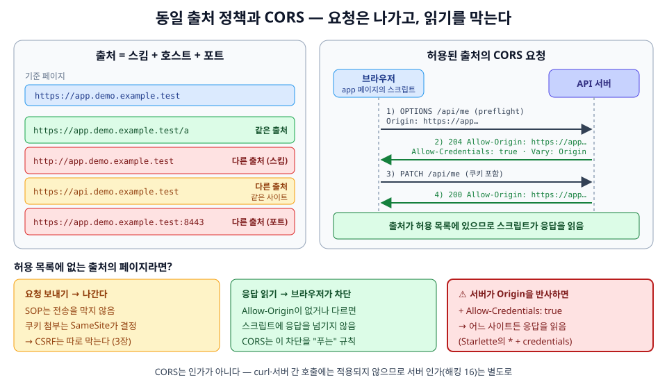
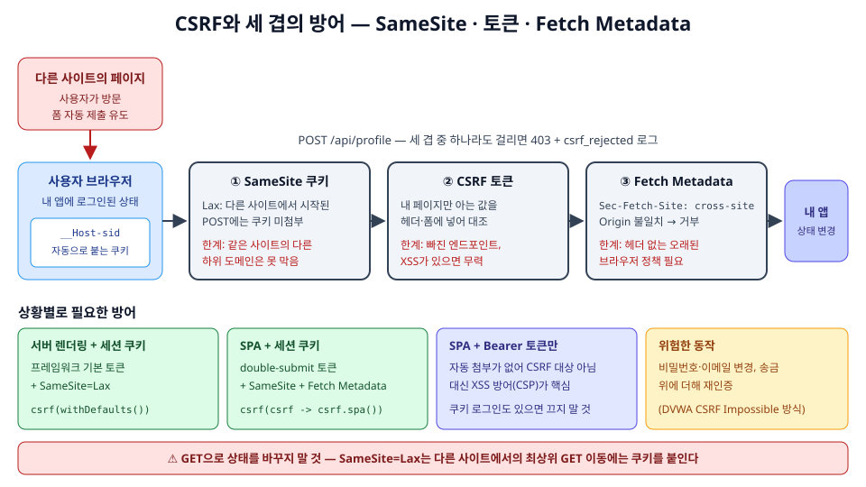
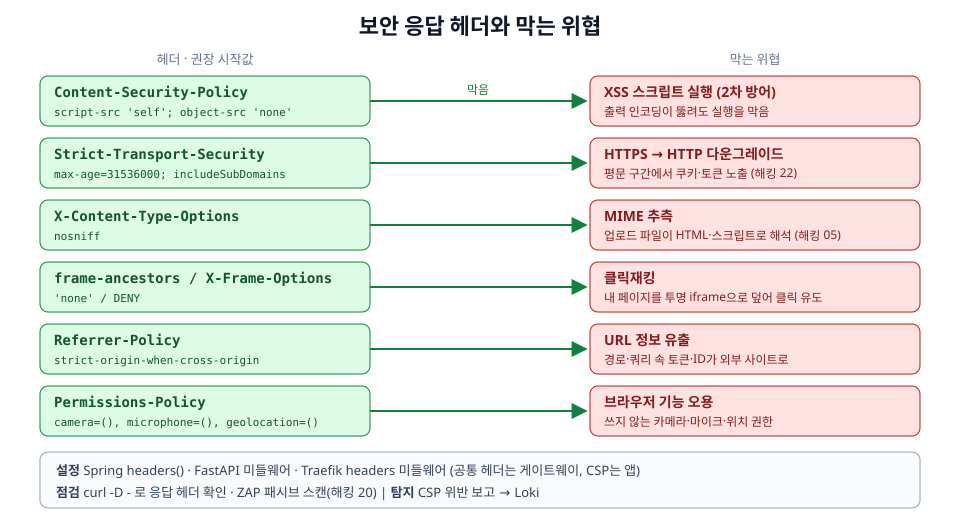

> **해킹 트랙 · 개발 보안** | 난이도 ★★★☆☆ | 예상 소요 2.5 ~ 3시간

> ⚠️ **실습 전 반드시 읽을 것**
> 실습은 **본인 소유의 격리된 실습장**(해킹 02의 `hacklab` 네트워크, Juice Shop `10.10.10.21`, DVWA `10.10.10.20`)과 **본인이 만든 앱**에만 합니다. 허가 없이 타인의 사이트를 점검하거나 공격 페이지를 만들어 사용자를 유도하면 **정보통신망법 등으로 처벌**될 수 있습니다. 오늘의 목적은 **내 앱의 브라우저 쪽 방어선을 올바르게 설정하고, 깨지면 알아채는 것**입니다.

## 🎯 오늘의 목표

- **출처(origin)** 와 **사이트(site)** 를 구분하고, 동일 출처 정책이 무엇을 막고 무엇을 못 막는지 설명할 수 있다
- CORS의 흔한 설정 실수(Origin 반사, 와일드카드 + 자격 증명, 느슨한 정규식, `null` 허용)를 찾아 Spring·FastAPI에서 고칠 수 있다
- **CSRF**를 토큰·SameSite·Fetch Metadata로 막고, SPA와 Bearer 토큰 API에서 각각 무엇이 필요한지 판단할 수 있다
- 쿠키에 `Secure`·`HttpOnly`·`SameSite`·`__Host-` 접두사를 붙이고 그 의미를 말할 수 있다
- **CSP·HSTS·X-Content-Type-Options·frame-ancestors·Referrer-Policy·Permissions-Policy**를 설정하고 `curl`로 점검할 수 있다

---

## 1. 동일 출처 정책 — 브라우저의 기본 방어선

### 1-1. 출처와 사이트

브라우저 보안 규칙은 두 가지 "같음"을 씁니다.

| 개념 | 정의 | 예: `https://app.demo.example.test:443` 과 비교 | 쓰이는 곳 |
|---|---|---|---|
| **출처(origin)** | **스킴 + 호스트 + 포트** 셋 다 같음 | `https://api.demo.example.test` → **다른 출처**(호스트 다름) | 동일 출처 정책, CORS |
| **사이트(site)** | **스킴 + 등록 가능 도메인**(eTLD+1) 같음 | `https://api.demo.example.test` → **같은 사이트** | SameSite 쿠키, `Sec-Fetch-Site` |

> 💡 `app.`과 `api.`는 **다른 출처지만 같은 사이트**입니다. 그래서 CORS 설정은 필요하고, SameSite 쿠키는 둘 사이에서 그대로 전송됩니다. 이 차이가 오늘 내용의 절반을 설명합니다.

### 1-2. 동일 출처 정책(SOP)이 막는 것과 못 막는 것



| 동작 | 다른 출처에서 가능? | 설명 |
|---|---|---|
| ``, `<script src>`, `<form>` 제출 | ✅ 가능 | 웹의 기본 동작. **요청은 나간다**(쿠키 포함 여부는 SameSite가 결정) |
| `fetch()`로 요청 **보내기** | ✅ 대부분 가능 | 단순 요청은 바로 전송, 그 외는 사전 요청(preflight) 후 |
| `fetch()` 응답 **읽기** | ❌ 기본 차단 | 서버가 CORS 헤더로 허락해야만 |
| 다른 출처 iframe의 DOM 접근 | ❌ 차단 | 대신 iframe으로 **띄우는 것** 자체는 가능 → `frame-ancestors`로 막음 |

정리하면 SOP는 **"남의 응답을 읽지 못하게"** 하는 규칙이지, **"남에게 요청을 못 보내게"** 하는 규칙이 아닙니다. 응답 읽기는 CORS가 풀어 주고, 요청 보내기의 악용(CSRF)은 별도로 막아야 합니다.

---

## 2. CORS — 읽기 권한을 누구에게 줄 것인가

### 2-1. 원리

CORS(Cross-Origin Resource Sharing)는 서버가 응답 헤더로 "**이 출처의 스크립트는 내 응답을 읽어도 된다**"고 허락하는 방식입니다.

| 요청 헤더 (브라우저가 붙임) | 응답 헤더 (서버가 허락) | 의미 |
|---|---|---|
| `Origin: https://app.demo.example.test` | `Access-Control-Allow-Origin: https://app.demo.example.test` | 이 출처에 읽기 허락 |
| (쿠키를 포함한 요청) | `Access-Control-Allow-Credentials: true` | 쿠키·인증 정보가 포함된 응답도 읽기 허락 |
| `Access-Control-Request-Method: PATCH` (preflight `OPTIONS`) | `Access-Control-Allow-Methods: GET, POST, PATCH` | 이 메서드 허락 |
| `Access-Control-Request-Headers: content-type` | `Access-Control-Allow-Headers: content-type` | 이 헤더 허락 |
| — | `Vary: Origin` | 출처마다 응답이 다름 → 캐시가 섞이지 않게 |

### 2-2. 흔한 설정 실수

| 실수 | 결과 | 위험도 |
|---|---|---|
| 요청의 `Origin`을 **그대로 반사** + `Allow-Credentials: true` | **어느 사이트든** 로그인한 사용자의 API 응답을 읽음 | 매우 높음 |
| `Allow-Origin: *` + `Allow-Credentials: true` | 브라우저가 이 조합을 거부해 기능이 깨짐 → 개발자가 "반사"로 바꿔 위 실수로 이어짐 | 높음(간접) |
| 정규식 `.*example\.test` 또는 `endsWith("example.test")` | `evil-example.test`, `example.test.attacker.test` 같은 이름 허용 | 높음 |
| `null` 출처 허용 | 샌드박스 iframe·로컬 파일 등에서 오는 `Origin: null` 허용 | 중간 |
| 공개 데이터에 `*` (자격 증명 없음) | 쿠키 없는 공개 API라면 **정상 설정** | 낮음 |

> ⚠️ **FastAPI(Starlette)의 함정**: `CORSMiddleware(allow_origins=["*"], allow_credentials=True)`로 두면 Starlette는 브라우저가 거부하지 않도록 **요청의 Origin을 그대로 반사**합니다(Starlette 소스의 `allow_all_origins and allow_credentials` 분기). 즉 "모든 출처 + 자격 증명"이 **실제로 동작**하는, 표의 첫 줄과 같은 상태가 됩니다. FastAPI 문서도 자격 증명을 쓰면 `["*"]`를 쓰지 말라고 안내합니다.

> 💡 반대로 **Spring**은 `allowCredentials(true)`와 `allowedOrigins("*")`를 함께 쓰면 기동 시 `IllegalArgumentException`으로 막아 줍니다. 이를 피하려고 `allowedOriginPatterns("*")`로 바꾸면 Starlette와 같은 "반사" 상태가 되니 주의하세요.

### 2-3. 내 환경 점검

브라우저 없이 `curl`로 `Origin` 헤더를 바꿔 보내고 **응답 헤더만** 봅니다. 해킹 실습이 아니라 **내 설정의 단위 테스트**입니다.

```bash
cors_check() {   # 사용법: cors_check <URL> <Origin>
  curl -s -o /dev/null -D - "$1" -H "Origin: $2" | tr -d '\r' \
    | grep -iE '^(access-control-allow-(origin|credentials)|vary):' || echo "(CORS 헤더 없음)"
}
# 1) 허용한 출처
cors_check http://dev.demo.example.test:30080/api/me https://app.demo.example.test
# 2) 허용하지 않은 출처 — CORS 헤더가 없어야 정상
cors_check http://dev.demo.example.test:30080/api/me https://not-allowed.example.test
# 3) null 출처
cors_check http://dev.demo.example.test:30080/api/me null

# preflight
curl -s -o /dev/null -D - -X OPTIONS http://dev.demo.example.test:30080/api/me \
  -H "Origin: https://app.demo.example.test" \
  -H "Access-Control-Request-Method: PATCH" \
  -H "Access-Control-Request-Headers: content-type" | tr -d '\r' | grep -i '^access-control'
```

| 결과 | 판정 |
|---|---|
| 2)·3)에서 `Access-Control-Allow-Origin`이 **보낸 Origin 그대로** | ❌ 반사 — 즉시 수정 |
| 2)·3)에서 CORS 헤더 없음 | ✅ |
| 1)에 `Vary: Origin` 없음 (출처별로 다른 값을 줄 때) | ⚠️ 캐시 오염 가능 |

Juice Shop(`http://10.10.10.21:3000/rest/products/search?q=`)에도 같은 함수를 돌려 보고, 결과가 **자격 증명이 필요한 API였다면** 어떤 위험이 되는지 표의 어느 줄에 해당하는지 판정해 보세요. PortSwigger Academy의 *CORS* 토픽이 각 설정 실수를 개념 수준으로 설명합니다.

### 2-4. 탐지

| 신호 | 어디서 |
|---|---|
| 허용 목록 밖 `Origin`으로 온 자격 증명 포함 요청 | 앱에서 `cors_rejected` 로그 (아래 FastAPI 예) |
| 짧은 시간에 `Origin` 값이 다양한 preflight | Traefik 접근 로그에 `Origin` 헤더 기록(`accessLog.fields.headers.names.Origin=keep`) |
| 배포 후 CORS 응답 헤더 변경 | 2-3의 `cors_check`를 CI 스모크 테스트로 |

### 2-5. 수정

```java
// ✅ Spring Security 7 — CORS는 보안 필터 체인 안에서, 출처는 정확한 목록으로
@Bean
CorsConfigurationSource corsConfigurationSource() {
    CorsConfiguration c = new CorsConfiguration();
    c.setAllowedOrigins(List.of("https://app.demo.example.test"));       // 패턴·* 금지
    c.setAllowedMethods(List.of("GET", "POST", "PATCH", "DELETE"));
    c.setAllowedHeaders(List.of("Content-Type", "X-XSRF-TOKEN"));
    c.setAllowCredentials(true);
    c.setMaxAge(Duration.ofHours(1));
    UrlBasedCorsConfigurationSource source = new UrlBasedCorsConfigurationSource();
    source.registerCorsConfiguration("/api/**", c);                       // 필요한 경로만
    return source;
}

@Bean
SecurityFilterChain web(HttpSecurity http) throws Exception {
    http.cors(Customizer.withDefaults());                                 // 위 빈을 사용
    // ...
    return http.build();
}
```

```python
# ❌ 취약
app.add_middleware(CORSMiddleware, allow_origins=["*"], allow_credentials=True,
                   allow_methods=["*"], allow_headers=["*"])

# ✅ 안전
from fastapi.middleware.cors import CORSMiddleware
ALLOWED_ORIGINS = ["https://app.demo.example.test"]
app.add_middleware(
    CORSMiddleware,
    allow_origins=ALLOWED_ORIGINS,          # 정확한 출처 목록
    allow_credentials=True,
    allow_methods=["GET", "POST", "PATCH", "DELETE"],
    allow_headers=["Content-Type", "X-CSRF-Token"],
    max_age=3600,
)
```

| 원칙 | 설명 |
|---|---|
| **정확한 출처 목록** | 정규식이 꼭 필요하면 `^https://(app|admin)\.demo\.example\.test$`처럼 앞뒤 고정 |
| 자격 증명이 필요 없는 API는 `credentials` 끄기 | 공개 API는 `*` + 자격 증명 없음이 안전 |
| CORS는 **인가가 아니다** | CORS는 "브라우저 스크립트가 읽을 수 있나"만 정함. `curl`·서버 간 호출은 CORS와 무관 → 서버 인가(해킹 16)는 별도 |

---

## 3. CSRF — 요청 보내기를 악용하는 공격

### 3-1. 원리

SOP는 응답 읽기만 막으므로, 다른 사이트의 페이지가 사용자의 브라우저를 시켜 **내 사이트로 상태 변경 요청을 보내게** 할 수 있습니다. 브라우저가 내 사이트의 쿠키를 자동으로 붙이면, 서버는 사용자가 직접 보낸 요청과 구분하지 못합니다. 이것이 **CSRF**(Cross-Site Request Forgery)입니다.



| 조건 | CSRF가 성립하려면 |
|---|---|
| 인증 방식 | 브라우저가 **자동으로 붙이는** 자격 증명(쿠키, HTTP Basic) |
| 요청 | 상태를 바꾸는 요청을 **예측 가능한 형태**로 만들 수 있음 |
| 방어 | 서버가 "이 요청이 내 페이지에서 시작됐는가"를 확인하지 않음 |

> 💡 `Authorization: Bearer` 헤더로만 인증하는 API는 브라우저가 토큰을 자동으로 붙이지 않으므로 CSRF 대상이 아닙니다. 대신 토큰을 JavaScript가 다루므로 **XSS에 더 민감**합니다(해킹 04). "쿠키냐 Bearer냐"는 CSRF와 XSS 사이의 트레이드오프입니다.

### 3-2. 세 겹의 방어

| 방어 | 동작 | 한계 |
|---|---|---|
| **SameSite 쿠키** | `Lax`: 다른 사이트에서 시작된 요청에는 쿠키를 붙이지 않음(최상위 이동 `GET`은 예외). `Strict`: 최상위 이동에도 안 붙임 | **같은 사이트**의 다른 출처(예: 취약한 `blog.example.test`)에서 오는 요청은 못 막음. 브라우저별 기본값 차이 |
| **CSRF 토큰** (synchronizer / double-submit) | 서버가 준 예측 불가능한 값을 요청 헤더·폼에 넣게 하고 대조 | 구현 누락 엔드포인트, XSS가 있으면 무력 |
| **Fetch Metadata / Origin 검사** | 브라우저가 붙이는 `Sec-Fetch-Site`(`same-origin`/`same-site`/`cross-site`)·`Origin`으로 상태 변경 요청 거부 | 오래된 브라우저는 헤더가 없을 수 있음 → 없을 때의 정책 필요 |

> ⚠️ `GET`으로 상태를 바꾸지 마세요. SameSite `Lax`는 다른 사이트에서의 **최상위 GET 이동**에는 쿠키를 붙이므로, `GET /api/account/delete` 같은 설계는 Lax로도 막히지 않습니다.

### 3-3. 내 환경 점검

- **DVWA *CSRF***: 비밀번호 변경 기능입니다. Low와 **Impossible**의 View Source를 비교하면 Impossible은 **`user_token` 대조 + 현재 비밀번호 확인**을 합니다. 이것이 토큰 방식과 "재인증" 방식의 교과서 예입니다.
- **Burp `HTTP history`**: 내 앱의 상태 변경 요청(`POST`·`PATCH`·`DELETE`)을 모아 **CSRF 토큰 헤더가 있는지**, 쿠키에 **SameSite가 있는지** 표로 정리합니다.
- **토큰 없이 보내기 테스트**(내 앱만): 토큰 헤더를 뺀 요청이 `403`이 되는지 확인합니다.

```bash
# 세션 쿠키는 있는데 CSRF 토큰 헤더가 없는 요청 → 403이어야 정상
curl -s -o /dev/null -w "%{http_code}\n" -X POST http://dev.demo.example.test:30080/api/profile \
  -H "Cookie: __Host-sid=$MY_SESSION" -H 'Content-Type: application/json' -d '{"bio":"x"}' \
  -H "Origin: https://not-allowed.example.test" -H "Sec-Fetch-Site: cross-site"
# 403
```

### 3-4. 탐지

| 신호 | 어디서 |
|---|---|
| CSRF 토큰 불일치·누락 `403` 증가 | Spring `AccessDeniedHandler` 로그(`InvalidCsrfTokenException`/`MissingCsrfTokenException`), 앱 `csrf_rejected` 이벤트 |
| 상태 변경 요청의 `Sec-Fetch-Site: cross-site` | 3-5 FastAPI 미들웨어 로그 |
| 특정 사용자에게 같은 형태의 상태 변경이 `Referer` 없이 반복 | 접근 로그 |

Spring에서는 거부 이유를 구조화 로그로 남겨 Loki(Day 60)에서 집계합니다.

```java
http.exceptionHandling(ex -> ex.accessDeniedHandler((req, res, e) -> {
    if (e instanceof CsrfException) {
        log.warn("csrf_rejected path={} origin={} fetch_site={}",
                req.getRequestURI(), req.getHeader("Origin"), req.getHeader("Sec-Fetch-Site"));
    }
    res.sendError(HttpServletResponse.SC_FORBIDDEN);
}));
```

### 3-5. 수정

**Spring Security는 CSRF 보호가 기본으로 켜져 있습니다.** 가장 흔한 실수는 "POST가 403이 나서" `csrf.disable()`을 붙이는 것입니다.

```java
// ❌ 쿠키 세션을 쓰면서 CSRF를 끔
http.csrf(csrf -> csrf.disable());

// ✅ 서버 렌더링(Thymeleaf): 기본값 그대로. 폼에 토큰이 자동 삽입됨
http.csrf(Customizer.withDefaults());

// ✅ SPA(쿠키 세션): Spring Security 7의 SPA 설정
//   XSRF-TOKEN 쿠키(JavaScript가 읽을 수 있음)를 내려 주고, 요청 헤더 X-XSRF-TOKEN과 대조
http.csrf(csrf -> csrf.spa());

// ✅ 쿠키를 전혀 쓰지 않는 Bearer 토큰 API (리소스 서버): CSRF 대상이 아니므로 비활성화 가능
http.oauth2ResourceServer(o -> o.jwt(Customizer.withDefaults()))
    .sessionManagement(s -> s.sessionCreationPolicy(SessionCreationPolicy.STATELESS))
    .csrf(csrf -> csrf.disable());
```

> 💡 마지막 경우에도 **같은 앱이 세션 쿠키 로그인도 함께 제공**한다면 CSRF를 끄면 안 됩니다. 경로별로 `SecurityFilterChain`을 나누세요(`securityMatcher("/api/**")`). CodeQL의 `java/spring-disabled-csrf-protection`(해킹 14)이 `disable()`을 찾아 주니, 경고가 뜨면 위 표의 어느 경우인지 PR에 근거를 남깁니다.

FastAPI에는 내장 CSRF 보호가 없습니다. 쿠키로 인증한다면 **Fetch Metadata + Origin 검사**와 **double-submit 토큰**을 미들웨어로 둡니다.

```python
import hmac, logging, secrets
from fastapi import FastAPI, Request, Response
from fastapi.responses import JSONResponse

log = logging.getLogger("security")
TRUSTED_ORIGINS = {"https://app.demo.example.test"}
UNSAFE = {"POST", "PUT", "PATCH", "DELETE"}

@app.middleware("http")
async def csrf_guard(request: Request, call_next):
    if request.method in UNSAFE and "__Host-sid" in request.cookies:
        site = request.headers.get("sec-fetch-site")
        origin = request.headers.get("origin")
        # ① Fetch Metadata: 다른 사이트에서 시작된 상태 변경 요청 거부
        if site == "cross-site" or (origin and origin not in TRUSTED_ORIGINS):
            log.warning("csrf_rejected", extra={"event": "csrf_rejected", "origin": origin, "fetch_site": site})
            return JSONResponse({"detail": "forbidden"}, status_code=403)
        # ② double-submit: 쿠키의 토큰과 헤더의 토큰이 같아야 함
        cookie_tok = request.cookies.get("__Host-csrf", "")
        header_tok = request.headers.get("x-csrf-token", "")
        if not cookie_tok or not hmac.compare_digest(cookie_tok, header_tok):
            log.warning("csrf_rejected", extra={"event": "csrf_rejected", "reason": "token"})
            return JSONResponse({"detail": "forbidden"}, status_code=403)
    return await call_next(request)

@app.get("/api/csrf")
def issue_csrf(response: Response):
    tok = secrets.token_urlsafe(32)
    # SPA가 읽어 헤더로 보내야 하므로 이 쿠키만 HttpOnly=False
    response.set_cookie("__Host-csrf", tok, secure=True, httponly=False, samesite="strict", path="/")
    return {"csrfToken": tok}
```

| 상황 | 필요한 방어 |
|---|---|
| 서버 렌더링 + 세션 쿠키 | 프레임워크 기본 CSRF 토큰 + SameSite=Lax |
| SPA + 세션 쿠키 | `csrf.spa()` / double-submit + SameSite + Fetch Metadata |
| SPA + Bearer 토큰(쿠키 없음) | CSRF 불필요. 대신 XSS 방어(CSP)와 토큰 저장 위치 주의 |
| 위험한 동작(비밀번호·이메일 변경, 송금) | 위에 더해 **재인증**(DVWA Impossible 방식) |

---

## 4. 쿠키 속성

### 4-1. 원리

| 속성 | 효과 | 없으면 |
|---|---|---|
| `Secure` | HTTPS에서만 전송 | 평문 HTTP 구간(공유기·공용 Wi-Fi, 해킹 22)에서 쿠키 노출 |
| `HttpOnly` | JavaScript(`document.cookie`)에서 읽기 불가 | XSS 한 번에 세션 탈취 |
| `SameSite=Lax`/`Strict` | 다른 사이트에서 시작된 요청에 쿠키 미첨부 | CSRF |
| `SameSite=None` | 모든 요청에 첨부 (**`Secure` 필수**) | — 꼭 필요할 때만(제3자 임베드) |
| `Domain` 생략 | 정확히 그 호스트에만 | `Domain=example.test`면 **모든 하위 도메인**에 전송 |
| `Path=/` | 전체 경로 | — |
| `Max-Age`/`Expires` | 만료 | 세션 쿠키(브라우저 종료 시) — 서버 측 만료는 별도로 필요(해킹 05) |

**쿠키 접두사**는 브라우저가 강제하는 약속입니다.

| 접두사 | 브라우저가 강제하는 조건 | 막는 것 |
|---|---|---|
| `__Secure-` | `Secure` 필수 | HTTP 응답이 같은 이름의 쿠키를 심는 것 |
| **`__Host-`** | `Secure` 필수, **`Domain` 금지**, **`Path=/`** | 위 + **하위 도메인이 상위의 세션 쿠키를 덮어쓰는 것**(쿠키 토싱) |

> 💡 세션 쿠키 이름을 `__Host-sid`로 바꾸는 것만으로 "속성을 빠뜨린 채 배포"가 불가능해집니다. 조건을 어기면 브라우저가 **쿠키 자체를 저장하지 않으므로** 개발 중에 바로 드러납니다. 단, `Secure`가 필수라 로컬 HTTP 개발 환경에서는 `localhost` 예외 동작이 브라우저마다 다를 수 있습니다.

### 4-2. 내 환경 점검

```bash
# 로그인 응답의 Set-Cookie 속성 확인 (내 앱)
curl -s -o /dev/null -D - -X POST https://dev.demo.example.test/api/auth/login \
  -H 'Content-Type: application/json' -d '{"username":"tester-a","password":"Lab-Only-Pass-1"}' \
  | tr -d '\r' | grep -i '^set-cookie'
# set-cookie: __Host-sid=…; Path=/; Max-Age=28800; Secure; HttpOnly; SameSite=Lax
```

| 확인 | 기준 |
|---|---|
| 세션 쿠키 | `Secure; HttpOnly; SameSite=Lax`(또는 Strict), `Domain` 없음, 가능하면 `__Host-` |
| CSRF 쿠키 | `HttpOnly` 없음(의도), `SameSite=Strict`, `__Host-` |
| 추적·분석 쿠키 | 인증과 무관한지, `Domain`이 넓지 않은지 |

Juice Shop은 로그인 토큰을 `token` 쿠키와 `localStorage`에 둡니다. 개발자 도구(Application 탭)에서 속성을 보고, 위 표 기준으로 **어떤 위험이 생기는지** 해킹 04의 XSS와 연결해 적어 보세요.

### 4-3. 수정

```yaml
# Spring Boot application.yaml (내장 Tomcat 세션 쿠키)
server:
  servlet:
    session:
      timeout: 8h
      cookie:
        name: __Host-SESSION
        path: /
        secure: true
        http-only: true
        same-site: lax
```

```python
# FastAPI
response.set_cookie("__Host-sid", sid, max_age=8 * 3600, path="/",
                    secure=True, httponly=True, samesite="lax")      # domain 인자는 주지 않는다
```

> ⚠️ TLS를 리버스 프록시(Traefik)에서 끝내면 앱은 요청을 HTTP로 받습니다. Spring은 `server.forward-headers-strategy=native`, Uvicorn은 `--proxy-headers --forwarded-allow-ips=<Traefik Pod 대역>`으로 **신뢰하는 프록시의** `X-Forwarded-Proto`를 반영해야 `Secure` 쿠키·HSTS·리다이렉트가 올바르게 동작합니다.

---

## 5. 보안 헤더

### 5-1. 원리 — 헤더마다 막는 것



| 헤더 | 권장 값(시작점) | 막는 것 |
|---|---|---|
| **Content-Security-Policy** | `default-src 'self'; script-src 'self'; object-src 'none'; base-uri 'none'; frame-ancestors 'none'` | XSS의 영향(외부·인라인 스크립트 실행), 클릭재킹 |
| **Strict-Transport-Security** | `max-age=31536000; includeSubDomains` | HTTPS → HTTP 다운그레이드, 쿠키 평문 노출 |
| **X-Content-Type-Options** | `nosniff` | 브라우저의 MIME 추측(업로드 파일이 HTML·스크립트로 해석, 해킹 05) |
| **frame-ancestors** (CSP) / X-Frame-Options | `'none'` 또는 `'self'` / `DENY` | 클릭재킹(투명 iframe 위 클릭 유도) |
| **Referrer-Policy** | `strict-origin-when-cross-origin` (또는 `no-referrer`) | URL의 토큰·ID가 외부 사이트로 새는 것 |
| **Permissions-Policy** | `camera=(), microphone=(), geolocation=()` | 쓰지 않는 강력한 브라우저 기능의 오용 |

> 💡 **CSP는 XSS의 "2차 방어"** 입니다. 1차는 출력 인코딩(해킹 04·13)이고, CSP는 그것이 뚫렸을 때 스크립트가 **실행되지 않게** 합니다. 인라인 스크립트가 꼭 필요하면 `'unsafe-inline'` 대신 **요청마다 바뀌는 nonce**(`script-src 'nonce-…'`)를 씁니다.

> ⚠️ HSTS는 한 번 내려가면 `max-age` 동안 브라우저가 HTTP 접속을 거부합니다. **처음엔 짧게**(`max-age=300`) 시작해 확인 후 늘리고, `preload`는 모든 하위 도메인이 HTTPS인지 확인한 뒤에만 붙입니다. 실습장처럼 HTTP로만 쓰는 호스트에는 의미가 없습니다(HSTS는 HTTPS 응답에서만 유효).

### 5-2. 내 환경 점검

```bash
sec_headers() {   # 사용법: sec_headers <URL>
  local h; h=$(curl -sk -o /dev/null -D - "$1" | tr -d '\r')
  for n in Content-Security-Policy Strict-Transport-Security X-Content-Type-Options \
           X-Frame-Options Referrer-Policy Permissions-Policy; do
    v=$(printf '%s\n' "$h" | grep -i "^$n:" | head -1 | cut -d' ' -f2-)
    printf '%-28s %s\n' "$n" "${v:-❌ (없음)}"
  done
}
sec_headers http://10.10.10.21:3000/          # Juice Shop
sec_headers http://10.10.10.20/login.php      # DVWA
sec_headers https://dev.demo.example.test/     # 내 앱
```

```text
# 내 앱(조치 후) 예
Content-Security-Policy      default-src 'self'; script-src 'self'; object-src 'none'; base-uri 'none'; frame-ancestors 'none'
Strict-Transport-Security    max-age=31536000 ; includeSubDomains
X-Content-Type-Options       nosniff
X-Frame-Options              DENY
Referrer-Policy              strict-origin-when-cross-origin
Permissions-Policy           camera=(), microphone=(), geolocation=()
```

실습장 두 대상의 결과를 해킹 11 보고서 양식의 "발견 사항" 한 건으로 정리해 보세요(심각도는 보통 Low~Medium, 조치는 5-4의 설정). 해킹 20에서는 **ZAP 패시브 스캔**이 같은 점검을 CI에서 자동으로 합니다.

> 💡 브라우저 개발자 도구의 **Console**에는 CSP 위반이, **Network → Headers**에는 실제 응답 헤더가 보입니다. 인터넷에 공개된 내 사이트라면 MDN HTTP Observatory로도 점검할 수 있지만, 실습장(`10.10.10.0/24`)은 외부 서비스가 접근할 수 없으므로 `curl`로 확인합니다.

### 5-3. 탐지 — CSP 위반 보고

CSP는 위반을 **보고**하게 할 수 있습니다. 먼저 `Content-Security-Policy-Report-Only`로 배포해 무엇이 깨지는지 모은 뒤 강제로 바꿉니다.

```python
# FastAPI: CSP 위반 보고 수신 → 구조화 로그 → Loki
@app.post("/csp-report")
async def csp_report(request: Request):
    body = await request.body()
    if len(body) > 10_000:                       # 보고 엔드포인트도 크기 제한
        return Response(status_code=413)
    log.warning("csp_violation", extra={"event": "csp_violation", "report": body.decode(errors="replace")[:2000]})
    return Response(status_code=204)
```

| 신호 | 의미 |
|---|---|
| 배포 직후 `csp_violation` 급증, 같은 `blocked-uri` | 정책이 정상 리소스를 막음 → 정책 수정 |
| 평소 없던 외부 도메인 `blocked-uri`가 특정 페이지에서만 | **XSS 주입 시도 가능성** → 해당 페이지 출력 인코딩 점검 |
| 응답 헤더가 배포 후 사라짐 | 5-2 `sec_headers`를 CI 스모크 테스트로 |

### 5-4. 수정 — Spring Security, FastAPI, Traefik

**Spring Security**는 `X-Content-Type-Options`, `X-Frame-Options: DENY`, `Cache-Control`, (HTTPS 요청에) HSTS를 **기본으로** 붙입니다. CSP·Referrer-Policy·Permissions-Policy는 앱마다 다르므로 직접 설정합니다(Spring Security 7.1 레퍼런스 기준).

```java
@Bean
SecurityFilterChain web(HttpSecurity http) throws Exception {
    http.headers(h -> h
        .contentSecurityPolicy(csp -> csp.policyDirectives(
            "default-src 'self'; script-src 'self'; object-src 'none'; base-uri 'none'; "
          + "frame-ancestors 'none'; report-uri /csp-report"))
        .httpStrictTransportSecurity(hsts -> hsts.includeSubDomains(true).maxAgeInSeconds(31536000))
        .frameOptions(f -> f.deny())
        .referrerPolicy(r -> r.policy(ReferrerPolicyHeaderWriter.ReferrerPolicy.STRICT_ORIGIN_WHEN_CROSS_ORIGIN))
        .permissionsPolicy(p -> p.policy("camera=(), microphone=(), geolocation=()")));
    // ...
    return http.build();
}
```

**FastAPI**는 기본 보안 헤더가 없으므로 미들웨어로 붙입니다.

```python
SECURITY_HEADERS = {
    "Content-Security-Policy": "default-src 'self'; script-src 'self'; object-src 'none'; "
                               "base-uri 'none'; frame-ancestors 'none'; report-uri /csp-report",
    "Strict-Transport-Security": "max-age=31536000; includeSubDomains",
    "X-Content-Type-Options": "nosniff",
    "X-Frame-Options": "DENY",
    "Referrer-Policy": "strict-origin-when-cross-origin",
    "Permissions-Policy": "camera=(), microphone=(), geolocation=()",
}

@app.middleware("http")
async def security_headers(request: Request, call_next):
    response = await call_next(request)
    for k, v in SECURITY_HEADERS.items():
        response.headers.setdefault(k, v)        # 라우트가 특별히 정한 값은 유지
    return response
```

> 💡 FastAPI의 `/docs`(Swagger UI)는 CDN 스크립트와 인라인 스크립트를 쓰므로 위 CSP에서 깨집니다. 해킹 16처럼 운영에서 문서를 끄거나, 문서 경로에만 별도 정책을 둡니다.

**게이트웨이에서 일괄**로 붙이고 싶다면 Day 15 Traefik의 `headers` 미들웨어를 해킹 16의 `rateLimit`과 같은 방식(`ExtensionRef`)으로 HTTPRoute에 연결합니다. 앱마다 다른 CSP는 앱에서, 공통 헤더(HSTS·nosniff·Referrer-Policy)는 게이트웨이에서 두는 분담이 관리하기 쉽습니다.

```yaml
apiVersion: traefik.io/v1alpha1
kind: Middleware
metadata:
  name: security-headers
  namespace: demo-dev
spec:
  headers:
    stsSeconds: 31536000
    stsIncludeSubdomains: true
    contentTypeNosniff: true
    frameDeny: true
    referrerPolicy: strict-origin-when-cross-origin
    permissionsPolicy: "camera=(), microphone=(), geolocation=()"
```

---

## 6. 오늘의 조치를 한눈에

| 주제 | 흔한 실수 | 수정 | 점검·탐지 |
|---|---|---|---|
| CORS | Origin 반사 + 자격 증명, `*` + credentials(Starlette), 느슨한 정규식, `null` | 정확한 출처 목록, 필요한 경로·메서드·헤더만 | `cors_check`, `cors_rejected` 로그 |
| CSRF | 쿠키 세션인데 `csrf.disable()`, GET으로 상태 변경 | 기본 CSRF 유지 / `csrf.spa()` / double-submit + Fetch Metadata | 토큰 누락 요청 403 테스트, `csrf_rejected` |
| 쿠키 | `Secure`·`HttpOnly` 누락, 넓은 `Domain` | `__Host-` 접두사, `SameSite=Lax` | `Set-Cookie` 확인 |
| 보안 헤더 | CSP 없음, HSTS 없음, nosniff 없음 | Spring `headers()`, FastAPI 미들웨어, Traefik `headers` | `sec_headers`, CSP 위반 보고 |

---

## 7. 트러블슈팅

| 증상 | 원인 | 해결 |
|---|---|---|
| 브라우저 콘솔 `The value of the 'Access-Control-Allow-Origin' header ... must not be the wildcard '*' when the request's credentials mode is 'include'` | `*` + 자격 증명 | 정확한 출처 목록으로 (반사로 "고치지" 말 것) |
| Spring 기동 시 `When allowCredentials is true, allowedOrigins cannot contain the special value "*"` | 위와 같은 조합을 Spring이 사전 차단 | `setAllowedOrigins(List.of(정확한 출처))` |
| preflight가 401/403 | `OPTIONS` 요청이 인증 필터에 막힘 | `http.cors(...)`로 CORS를 보안 필터 체인 안에서 처리 |
| Spring SPA에서 POST가 계속 403 | 로그인 직후 CSRF 쿠키가 비워졌는데 새 토큰을 받지 않음 | 로그인 후 토큰을 다시 받는 엔드포인트 호출(레퍼런스의 `/csrf` 패턴) |
| `__Host-` 쿠키가 저장되지 않음 | HTTP 응답, `Domain` 지정, `Path`가 `/`가 아님 | HTTPS, `Domain` 제거, `Path=/` |
| 프록시 뒤에서 `Secure` 쿠키·HSTS가 안 붙음 | 앱이 요청을 HTTP로 인식 | `forward-headers-strategy` / Uvicorn `--proxy-headers` + 신뢰 대역 |
| CSP 적용 후 화면이 하얗게 | 인라인 스크립트·외부 CDN 차단 | Report-Only로 위반 수집 → nonce·출처 추가 |
| HSTS 적용 후 HTTP 테스트 호스트 접속 불가 | 같은 도메인에 `includeSubDomains` | 브라우저 HSTS 설정 페이지에서 해당 도메인 삭제, 테스트 호스트는 다른 도메인으로 |

---

## 8. 핵심 정리

- **출처 = 스킴+호스트+포트**, **사이트 = 스킴+eTLD+1**. CORS는 출처, SameSite는 사이트 기준
- SOP는 **응답 읽기**를 막을 뿐 **요청 보내기**는 막지 않는다 → 읽기 허락은 CORS, 보내기 악용(CSRF)은 별도 방어
- CORS는 **정확한 출처 목록**. Origin 반사, `*` + 자격 증명(Starlette는 반사로 동작), 느슨한 정규식, `null` 허용 금지. CORS는 인가가 아니다
- CSRF는 **SameSite + 토큰 + Fetch Metadata** 세 겹. 쿠키 세션에서 `csrf.disable()` 금지, Bearer 전용 API는 대상 아님
- 세션 쿠키는 `__Host-` + `Secure; HttpOnly; SameSite=Lax`, `Domain` 생략
- 보안 헤더: **CSP**(XSS 2차 방어·`frame-ancestors`), **HSTS**(짧게 시작), `nosniff`, `Referrer-Policy`, `Permissions-Policy`. 점검은 `curl`, 탐지는 **CSP 위반 보고**

---

## 9. 셀프 체크

<details>
<summary>Q1. <code>https://app.example.test</code>와 <code>https://api.example.test</code>는 같은 출처인가, 같은 사이트인가? 이것이 CSRF 방어에 어떤 의미가 있나?</summary>

호스트가 다르므로 **다른 출처**이지만, 등록 가능 도메인(`example.test`)과 스킴이 같으므로 **같은 사이트**입니다. SameSite 쿠키는 같은 사이트 사이의 요청에는 그대로 붙으므로, 같은 사이트의 다른 하위 도메인(예: 취약한 블로그)에서 시작된 요청은 SameSite만으로는 막지 못합니다. 그래서 CSRF 토큰이나 `Origin` 검사를 함께 둡니다.
</details>

<details>
<summary>Q2. FastAPI에서 <code>allow_origins=["*"], allow_credentials=True</code>가 특히 위험한 이유는?</summary>

브라우저는 `Access-Control-Allow-Origin: *`과 자격 증명 조합을 거부하지만, Starlette의 CORSMiddleware는 이 설정에서 **요청의 Origin을 그대로 응답에 반사**합니다. 결과적으로 어느 사이트든 로그인한 사용자의 브라우저를 통해 API 응답을 읽을 수 있는, 가장 위험한 "Origin 반사 + 자격 증명" 상태가 됩니다.
</details>

<details>
<summary>Q3. Bearer 토큰만 쓰는 API에서 CSRF 보호를 꺼도 되는 이유와, 그 대신 더 신경 써야 하는 것은?</summary>

CSRF는 브라우저가 자격 증명을 **자동으로** 붙이는 것을 악용하는데, `Authorization` 헤더는 자동으로 붙지 않으므로 다른 사이트가 유효한 요청을 만들 수 없습니다. 대신 토큰을 JavaScript가 보관·전송하므로 **XSS가 생기면 토큰이 바로 탈취**됩니다. 출력 인코딩과 CSP, 짧은 토큰 수명이 더 중요해집니다. 같은 앱이 쿠키 세션도 쓴다면 CSRF를 끄면 안 됩니다.
</details>

<details>
<summary>Q4. <code>__Host-</code> 접두사가 <code>Secure</code> 속성만 붙이는 것보다 나은 점은?</summary>

`__Host-`는 브라우저가 `Secure`, `Path=/`, **`Domain` 없음**을 강제합니다. 조건을 어긴 쿠키는 저장 자체가 거부되므로 속성 누락이 배포 전에 드러나고, `Domain`이 없으니 **하위 도메인이 같은 이름의 쿠키를 심어 상위 도메인의 세션을 덮어쓰는 것**(쿠키 토싱)도 막힙니다.
</details>

<details>
<summary>Q5. CSP를 처음 도입할 때 Report-Only로 시작하는 이유와, 위반 보고를 보안 탐지에 쓰는 방법은?</summary>

처음부터 강제하면 인라인 스크립트·외부 리소스가 막혀 서비스가 깨질 수 있습니다. Report-Only는 막지 않고 **위반만 보고**하므로 정상 리소스를 정책에 반영한 뒤 강제로 전환할 수 있습니다. 운영 중에는 평소 없던 외부 도메인이 특정 페이지에서만 `blocked-uri`로 보고되면 XSS 주입 시도의 신호로 보고, 해당 페이지의 출력 인코딩을 점검합니다.
</details>

---

## ⏭️ 다음 예고 — 해킹 18. 역직렬화·XXE·SSTI — 원리와 안전한 대안

오늘까지는 요청이 **누구에게서**, **어디서** 왔는지를 따졌습니다. 다음 편은 요청에 담긴 **데이터가 코드처럼 해석되는** 세 가지 실수입니다. Java `ObjectInputStream`과 Python `pickle`이 왜 "데이터를 읽는" 것이 아니라 "객체를 되살리는" 것인지, XML 파서가 외부 엔티티를 따라가면 무슨 일이 생기는지, 템플릿에 사용자 입력을 **템플릿 자체로** 넣으면 왜 위험한지를 개념 그림으로 보고, **JSON + 스키마 검증, 역직렬화 필터(JEP 290), DocumentBuilderFactory 보안 설정, `defusedxml`, 템플릿 샌드박스**로 바꾸는 방법과 SAST·런타임 로그 탐지를 다룹니다.
