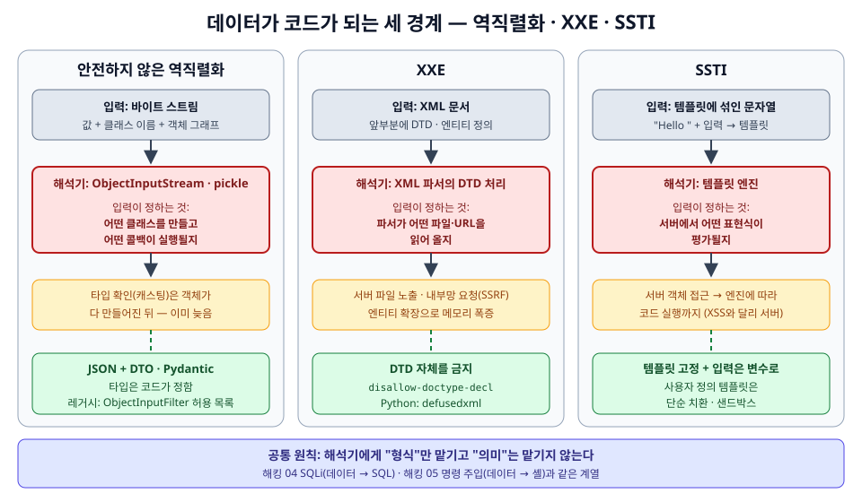
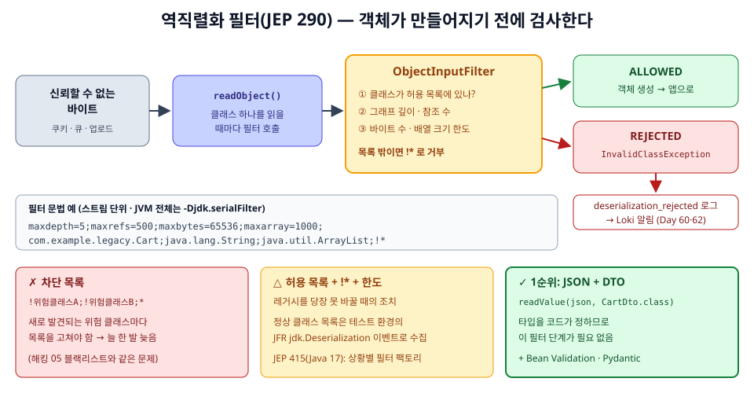
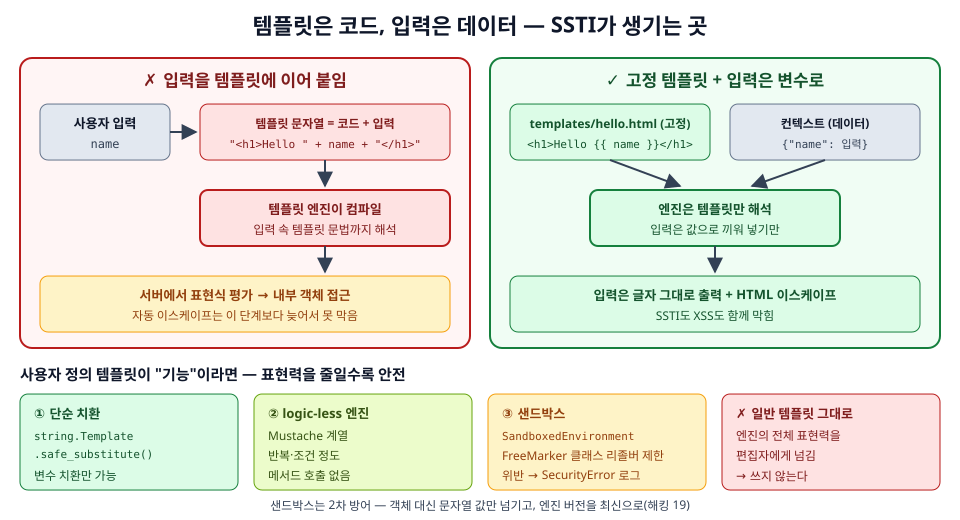

> **해킹 트랙 · 개발 보안** | 난이도 ★★★★☆ | 예상 소요 2.5 ~ 3시간

> ⚠️ **실습 전 반드시 읽을 것**
> 실습은 **본인 소유의 격리된 실습장**(해킹 02의 `hacklab` 네트워크)과 **본인이 만든 앱의 코드·테스트 환경**에만 합니다. 허가 없이 타인의 시스템에 조작된 데이터를 보내면 **정보통신망법 등으로 처벌**될 수 있습니다. 이 편은 세 취약점의 **원리를 개념으로만** 설명하고, 공격용 데이터(페이로드)나 가젯 체인은 다루지 않습니다. 목표는 **내 코드에서 위험한 지점을 찾아 안전한 방식으로 바꾸고, 시도가 있으면 알아채는 것**입니다.

## 🎯 오늘의 목표

- 역직렬화·XXE·SSTI가 공통으로 "**데이터가 코드처럼 해석되는 경계**"에서 생긴다는 것을 설명할 수 있다
- Java `ObjectInputStream`·Python `pickle`을 **JSON + 스키마 검증**으로 바꾸고, 바꿀 수 없을 때 **역직렬화 필터(JEP 290)** 를 걸 수 있다
- `DocumentBuilderFactory` 등 Java XML 파서의 **DTD·외부 엔티티를 끄는 설정**과 Python `defusedxml`을 적용할 수 있다
- 템플릿에 사용자 입력을 **템플릿으로** 넣지 않고 **데이터로** 넘기며, 사용자 정의 템플릿이 필요하면 샌드박스를 쓸 수 있다
- 세 취약점을 **SAST 규칙(해킹 14)** 과 **런타임 로그·JFR·Falco**로 탐지할 수 있다

---

## 1. 공통 원리 — 데이터가 코드가 되는 곳

해킹 04의 SQL Injection은 "**데이터가 SQL로 해석**"되는 문제였고, 해킹 05의 명령 주입은 "**데이터가 셸 명령으로 해석**"되는 문제였습니다. 오늘의 세 가지도 같은 계열입니다. 차이는 해석기가 **DB·셸이 아니라 언어 런타임, XML 파서, 템플릿 엔진**이라는 점뿐입니다.



| 취약점 | 해석기 | 입력이 결정하게 되는 것 | 웹 Top 10:2025 | 안전한 대안 |
|---|---|---|---|---|
| 안전하지 않은 역직렬화 | Java 직렬화, Python `pickle` | **어떤 클래스의 객체를 만들고 어떤 메서드가 불릴지** | A08 무결성 실패 | JSON + 스키마, 역직렬화 필터 |
| XXE | XML 파서의 DTD 처리 | **파서가 어떤 파일·URL을 읽을지** | A02 잘못된 설정 | DTD 금지, `defusedxml` |
| SSTI | 템플릿 엔진 | **템플릿 안에서 어떤 표현식이 평가될지** | A05 인젝션 | 고정 템플릿 + 데이터 전달, 샌드박스 |

> 💡 세 경우 모두 조치의 방향이 같습니다. **해석기에게 "형식"만 맡기고 "의미"는 맡기지 않는다.** JSON은 객체 타입을 정하지 못하고, DTD를 끈 XML은 외부를 읽지 못하고, 데이터로만 넘긴 입력은 템플릿 문법으로 해석되지 않습니다.

---

## 2. 안전하지 않은 역직렬화

### 2-1. 원리

**직렬화**는 메모리의 객체를 바이트로 바꾸는 것, **역직렬화**는 그 바이트로 객체를 되살리는 것입니다. JSON 파싱과 무엇이 다를까요?

| | JSON 파싱 (`Jackson` → DTO, `json.loads`) | 언어 고유 직렬화 (`ObjectInputStream`, `pickle`) |
|---|---|---|
| 바이트 안에 담긴 것 | 값(문자열·숫자·배열·객체) | 값 + **클래스 이름** + 객체 그래프 |
| 만들어지는 객체 타입 | **코드가 정함** (`readValue(json, OrderDto.class)`) | **바이트가 정함** |
| 생성 중 실행되는 코드 | 생성자·setter 정도 (DTO에 로직 없음) | `readObject()`·`readResolve()`(Java), `__reduce__`·`__setstate__`(Python) 같은 **콜백** |
| 타입 확인 시점 | 파싱 전에 이미 정해짐 | 객체가 **다 만들어진 뒤** 캐스팅할 때 — 이미 늦음 |

핵심은 마지막 줄입니다. Java에서 `(Cart) ois.readObject()`라고 써도, 캐스팅은 **역직렬화가 끝난 뒤**에 일어납니다. 그 사이에 바이트가 지정한 클래스들이 만들어지고 콜백이 실행됩니다. 클래스패스에 있는 평범한 라이브러리 클래스들의 콜백이 연쇄적으로 이어지면(이것을 "가젯 체인"이라고 부릅니다) 개발자가 의도하지 않은 동작, 최악에는 원격 코드 실행까지 이어질 수 있습니다. Python 공식 문서는 `pickle` 모듈 맨 위에 **"신뢰할 수 있는 데이터만 unpickle하라"** 고 경고합니다.

> ⚠️ "우리 코드에는 위험한 클래스가 없다"는 방어가 되지 않습니다. 위험은 **내 코드가 아니라 의존성 전체**(클래스패스)에 달려 있고, 의존성은 매주 바뀝니다(해킹 19). 그래서 조치는 "위험한 클래스를 찾는 것"이 아니라 **신뢰할 수 없는 데이터를 고유 직렬화로 읽지 않는 것**입니다.

같은 문제가 숨어 있는 곳:

| 위치 | 예 |
|---|---|
| Java | `ObjectInputStream.readObject()`, `XMLDecoder`, 세션·캐시를 JDK 직렬화로 저장(Redis·쿠키), RMI/JMX 노출 |
| Jackson | `activateDefaultTyping(...)` 또는 `@JsonTypeInfo(use = JsonTypeInfo.Id.CLASS)` — **JSON인데도 클래스 이름을 입력이 정함** |
| Python | `pickle.loads`, `shelve`, `jsonpickle`, `yaml.load`(SafeLoader 없이) |
| AI 인프라 | `torch.load`로 출처를 모르는 모델 파일 읽기, `joblib`·pickle 기반 모델 파일 (Day 38~45에서 내려받은 모델) |

### 2-2. 내 환경 점검

**① 코드에서 찾기** — 해킹 14에서 쓴 도구로 먼저 목록을 만듭니다.

```bash
# Java/Spring 프로젝트
grep -rnE "ObjectInputStream|readObject\(|XMLDecoder|activateDefaultTyping|JsonTypeInfo\.Id\.CLASS|JdkSerializationRedisSerializer" src/
# Python 프로젝트
grep -rnE "pickle\.loads?|shelve\.open|jsonpickle|yaml\.load\(|torch\.load\(|joblib\.load" app/
```

| 찾은 곳 | 판단 질문 |
|---|---|
| 각 호출 지점 | 바이트가 **어디서 오나?** 사용자 요청·쿠키·메시지 큐·업로드·외부 저장소면 위험 |
| 세션 저장소 | Spring Session Redis가 JDK 직렬화를 쓰는가? (`GenericJackson2JsonRedisSerializer` 등 JSON으로 바꿀 수 있음) |
| 모델 파일 | 출처를 검증했나? `safetensors` 형식으로 받을 수 있나? |

**② 트래픽에서 찾기** — 고유 직렬화 데이터는 앞부분 바이트가 정해져 있습니다. Burp `HTTP history`에서 요청 본문·쿠키·헤더를 검색해 **"이런 데이터가 오가는 곳이 있는지"** 만 확인합니다.

| 형식 | 시작 바이트 | Base64로 보이는 모양 |
|---|---|---|
| Java 직렬화 스트림 | `AC ED 00 05` | `rO0AB…` |
| Python pickle (프로토콜 4·5) | `80 04` / `80 05` | `gASV…` / `gAWV…` |

**③ 실습장** — Juice Shop의 *Insecure Deserialization* 챌린지는 호스트를 위험하게 할 수 있는 **"Danger Zone"** 으로 분류되어 Docker 실행 시 **기본 비활성화**되어 있습니다. 해킹 02의 설정 그대로 **비활성 상태로 두고**, 공식 안내서(https://pwning.owasp-juice.shop)의 해당 장에서 원인 코드 설명만 읽습니다. 개념은 PortSwigger Academy *Insecure deserialization* 토픽의 *How to prevent* 절이 정리돼 있습니다.

### 2-3. 탐지

| 층 | 신호 | 도구 |
|---|---|---|
| 코드 | `ObjectInputStream`·`pickle.loads` 새로 등장 | Semgrep `java.lang.security.audit.object-deserialization.object-deserialization`, `python.lang.security.deserialization.pickle.avoid-pickle`, CodeQL `java/unsafe-deserialization`·`py/unsafe-deserialization`, Bandit `B301`·`B403` (해킹 14) |
| 입력 | 요청에 `rO0AB`·`AC ED 00 05`·`gASV` | 게이트웨이·앱 로그에서 패턴 검색 (Loki) |
| JVM | 필터 거부 `InvalidClassException: filter status: REJECTED` | 앱 로그 → 알림 (2-4의 필터를 건 경우) |
| JVM | 어떤 클래스가 역직렬화됐는지 | **JFR `jdk.Deserialization` 이벤트**(JDK 17+, 기본 비활성 — 사용자 정의 `.jfc`에서 켬) |
| 프로세스 | 앱 프로세스가 셸·네트워크 도구 실행 | 해킹 05의 Falco 룰 *Shell spawned by web application*, auditd |

```bash
# JFR 기록에서 역직렬화 이벤트 보기 (테스트 환경)
jfr print --events jdk.Deserialization recording.jfr | head -40
```

```logql
# Loki: 직렬화 스트림 시그니처가 요청에 등장한 횟수 (게이트웨이 접근 로그에 본문 일부를 남기는 경우)
sum by (path) (count_over_time({namespace="demo-dev"} |~ "rO0AB|gASV|gAWV" [10m]))
```

### 2-4. 수정 — Java

**1순위: JSON + DTO + Bean Validation으로 바꾼다.**

```java
// ❌ 취약: 쿠키에 담긴 장바구니를 Java 직렬화로 복원
byte[] raw = Base64.getDecoder().decode(cookieValue);
try (ObjectInputStream in = new ObjectInputStream(new ByteArrayInputStream(raw))) {
    Cart cart = (Cart) in.readObject();          // 캐스팅 전에 이미 모든 객체가 만들어짐
}
```

```java
// ✅ 안전: 타입은 코드가 정하고, 값은 검증한다 (장바구니는 서버 측 저장이 더 낫다)
record CartItem(@NotNull Long productId, @Min(1) @Max(99) int qty) {}
record CartDto(@NotNull @Size(max = 50) List<@Valid CartItem> items) {}

CartDto cart = objectMapper.readValue(json, CartDto.class);   // 다른 클래스는 만들 수 없음
Set<ConstraintViolation<CartDto>> v = validator.validate(cart);
if (!v.isEmpty()) throw new ResponseStatusException(HttpStatus.BAD_REQUEST);
```

> ⚠️ Jackson도 **다형성 타입 정보를 클래스 이름으로** 받으면 같은 문제가 됩니다. `activateDefaultTyping`은 쓰지 말고, 다형성이 필요하면 **논리 이름 + 허용 목록**으로 둡니다.
>
> ```java
> @JsonTypeInfo(use = JsonTypeInfo.Id.NAME, property = "type")
> @JsonSubTypes({ @JsonSubTypes.Type(value = CardPayment.class, name = "card"),
>                 @JsonSubTypes.Type(value = BankPayment.class, name = "bank") })
> sealed interface Payment permits CardPayment, BankPayment {}
> ```

**2순위: 레거시라 당장 못 바꾸면 역직렬화 필터(JEP 290)를 건다.** JEP 290(Java 9, 8u121 백포트)은 `ObjectInputFilter`로 **허용 클래스 목록과 크기 한도**를 걸 수 있게 했고, JEP 415(Java 17)는 상황별 필터를 고르는 **필터 팩토리**를 추가했습니다.



```java
// 스트림 단위 필터: 허용 목록 + 한도, 마지막 !* 로 나머지 전부 거부
ObjectInputFilter filter = ObjectInputFilter.Config.createFilter(
        "maxdepth=5;maxrefs=500;maxbytes=65536;maxarray=1000;"
      + "com.example.legacy.Cart;com.example.legacy.CartItem;"
      + "java.lang.String;java.lang.Long;java.lang.Number;java.util.ArrayList;"
      + "!*");
try (ObjectInputStream in = new ObjectInputStream(new ByteArrayInputStream(raw))) {
    in.setObjectInputFilter(filter);             // readObject() 전에 설정
    Cart cart = (Cart) in.readObject();
} catch (InvalidClassException e) {
    log.warn("deserialization_rejected reason={}", e.getMessage());   // "filter status: REJECTED"
    throw new ResponseStatusException(HttpStatus.BAD_REQUEST);
}
```

JVM 전체의 기본값(라이브러리 내부의 `ObjectInputStream`까지)은 시스템 속성으로 겁니다.

```bash
# Dockerfile ENTRYPOINT 또는 K8s env JAVA_TOOL_OPTIONS (Day 03·13)
JAVA_TOOL_OPTIONS='-Djdk.serialFilter=maxdepth=10;maxrefs=1000;maxbytes=1048576;com.example.**;java.base/*;!*'
```

| 필터 문법 | 의미 |
|---|---|
| `com.example.legacy.Cart` | 이 클래스 허용 |
| `com.example.**` | 이 패키지와 하위 패키지 전부 허용 |
| `java.base/*` | `java.base` 모듈의 클래스 허용 (넓으므로 스트림 필터에서는 구체적으로) |
| `!*` | 나머지 전부 거부 — **반드시 마지막에** |
| `maxdepth`·`maxrefs`·`maxbytes`·`maxarray` | 그래프 깊이·참조 수·바이트·배열 크기 한도 (자원 고갈 방지) |

> 💡 필터는 "**허용 목록 + `!*`**"일 때만 의미가 있습니다. 위험 클래스를 `!`로 하나씩 막는 **차단 목록**은 새 가젯이 발견될 때마다 뚫립니다(해킹 05의 블랙리스트 이야기와 같습니다).

### 2-5. 수정 — Python

```python
# ❌ 취약
import base64, pickle
cart = pickle.loads(base64.b64decode(request.cookies["cart"]))
```

```python
# ✅ 안전: JSON + Pydantic
from pydantic import BaseModel, ConfigDict, Field

class CartItem(BaseModel):
    model_config = ConfigDict(extra="forbid")
    product_id: int
    qty: int = Field(ge=1, le=99)

class Cart(BaseModel):
    model_config = ConfigDict(extra="forbid")
    items: list[CartItem] = Field(max_length=50)

cart = Cart.model_validate_json(raw_json)        # 타입·범위·모르는 필드까지 검증
```

| 위험한 호출 | 대안 |
|---|---|
| `pickle.loads` / `shelve` (외부 데이터) | `json` + Pydantic, 서버 측 저장(Redis에 JSON) |
| `yaml.load(data)` | `yaml.safe_load(data)` |
| pickle + HMAC 서명 | 서명은 "**누가 만들었나**"만 증명. 키가 새면 그대로 위험 → 가능하면 JSON |
| `torch.load(출처 모를 파일)` | `safetensors` 형식, `torch.load(..., weights_only=True)`(PyTorch 2.6부터 기본값), 모델 출처·해시 검증(Day 57 cosign) |

---

## 3. XXE — XML 외부 엔티티

### 3-1. 원리

XML에는 문서 앞에 **DTD**(Document Type Definition)를 두어 "엔티티"라는 **치환용 이름**을 정의하는 기능이 있습니다. 엔티티는 문자열뿐 아니라 **외부 자원(파일 경로·URL)** 을 가리킬 수도 있습니다. 파서가 이 기능을 켠 채로 **신뢰할 수 없는 XML**을 읽으면, 문서를 보낸 쪽이 **파서가 무엇을 읽을지**를 정하게 됩니다.

| 파서가 DTD·엔티티를 처리할 때 | 결과 |
|---|---|
| 외부 엔티티가 로컬 파일을 가리킴 | 서버 파일 내용이 파싱 결과에 섞여 응답·오류 메시지로 노출 |
| 외부 엔티티가 URL을 가리킴 | **파서가 내부망으로 요청** — 해킹 05의 SSRF와 같은 결과 |
| 엔티티가 서로를 여러 번 참조 | 메모리 폭증(엔티티 확장 DoS) |

XML은 생각보다 많은 곳에 있습니다 — SOAP·SAML, `.docx`·`.xlsx`(압축된 XML), SVG 업로드, RSS, 설정 파일 업로드, `Content-Type`만 바꾸면 XML도 받는 API.

> 💡 대부분의 앱은 **DTD가 전혀 필요 없습니다.** 그래서 OWASP *XML External Entity Prevention Cheat Sheet*의 첫 권고도 "**DTD를 완전히 금지**"입니다.

### 3-2. 내 환경 점검

```bash
# Java: XML 파서를 직접 만드는 곳
grep -rnE "DocumentBuilderFactory|SAXParserFactory|XMLInputFactory|TransformerFactory|SchemaFactory|SAXReader|XMLReader" src/
# Python
grep -rnE "xml\.etree|xml\.dom|xml\.sax|lxml\.etree|minidom" app/
```

찾은 파서마다 **"DOCTYPE이 들어 있는 문서를 거부하는가"** 를 단위 테스트로 고정합니다. 테스트 입력은 외부 자원을 가리키지 않는 **무해한 내부 엔티티 하나**면 충분합니다 — 확인할 것은 "DOCTYPE 자체를 거부하는가"이기 때문입니다.

```java
// src/test/java/.../SafeXmlTest.java (JUnit 5)
@Test
void rejectsAnyDoctype() {
    String xml = "<?xml version=\"1.0\"?><!DOCTYPE note [<!ENTITY greet \"hello\">]><note>&greet;</note>";
    assertThrows(SAXParseException.class,
        () -> SafeXml.newDocumentBuilder().parse(new InputSource(new StringReader(xml))));
}
```

```python
# tests/test_safe_xml.py (pytest)
import pytest
from defusedxml import DTDForbidden, EntitiesForbidden
from app.xml_util import parse_xml

def test_rejects_doctype():
    xml = '<?xml version="1.0"?><!DOCTYPE note [<!ENTITY greet "hello">]><note>&greet;</note>'
    with pytest.raises((DTDForbidden, EntitiesForbidden)):
        parse_xml(xml)
```

실습장: Juice Shop의 XXE 챌린지도 **Danger Zone**(Docker 기본 비활성)입니다. 비활성 상태로 두고 안내서의 원인 설명과 PortSwigger *XML external entity (XXE) injection* 토픽의 *How to prevent* 절을 읽습니다.

### 3-3. 탐지

| 층 | 신호 | 도구 |
|---|---|---|
| 코드 | 보안 설정 없는 파서 생성 | Semgrep `java.lang.security.audit.xxe.documentbuilderfactory-disallow-doctype-decl-missing` 등 xxe 규칙군, CodeQL `java/xxe`·`py/xxe`, Bandit `B313`~`B320`(stdlib XML 파싱 호출)·`B405`~`B410`(import) |
| 입력 | 요청 본문에 `<!DOCTYPE`·`<!ENTITY` | 앱에서 거부하며 `xml_doctype_rejected` 로그 |
| 파서 | `DOCTYPE is disallowed when the feature ... is set to true` 예외 급증 | 앱 로그 → Loki 알림(Day 62) |
| 네트워크 | XML 처리 서비스에서 예상 밖 외부·내부 연결 | 해킹 05의 egress NetworkPolicy, Falco 메타데이터 룰 |
| 파일 | 앱 프로세스가 `/etc/passwd`·`/proc/self/environ` 등 읽기 | Falco 기본 룰 *Read sensitive file untrusted* (Day 72) |

### 3-4. 수정 — Java 파서 보안 설정

```java
// 한곳에서만 파서를 만들게 하는 유틸 (OWASP XXE Prevention Cheat Sheet 권고)
public final class SafeXml {
    private SafeXml() {}

    public static DocumentBuilder newDocumentBuilder() throws ParserConfigurationException {
        DocumentBuilderFactory dbf = DocumentBuilderFactory.newInstance();
        dbf.setFeature("http://apache.org/xml/features/disallow-doctype-decl", true);  // ① DTD 자체 금지
        dbf.setFeature(XMLConstants.FEATURE_SECURE_PROCESSING, true);                  // ② 처리 한도
        dbf.setAttribute(XMLConstants.ACCESS_EXTERNAL_DTD, "");                        // ③ 외부 DTD 접근 금지
        dbf.setAttribute(XMLConstants.ACCESS_EXTERNAL_SCHEMA, "");
        dbf.setXIncludeAware(false);                                                   // ④ XInclude 금지
        dbf.setExpandEntityReferences(false);
        return dbf.newDocumentBuilder();
    }

    public static SAXParser newSaxParser() throws Exception {
        SAXParserFactory spf = SAXParserFactory.newInstance();
        spf.setFeature("http://apache.org/xml/features/disallow-doctype-decl", true);
        spf.setFeature(XMLConstants.FEATURE_SECURE_PROCESSING, true);
        spf.setXIncludeAware(false);
        return spf.newSAXParser();
    }

    public static XMLInputFactory newStaxFactory() {
        XMLInputFactory xif = XMLInputFactory.newFactory();
        xif.setProperty(XMLInputFactory.SUPPORT_DTD, false);                          // StAX: DTD 끔
        xif.setProperty(XMLInputFactory.IS_SUPPORTING_EXTERNAL_ENTITIES, false);
        return xif;
    }
}
```

| 원칙 | 설명 |
|---|---|
| 파서 생성을 **유틸 하나로** | 새 코드가 `DocumentBuilderFactory.newInstance()`를 직접 부르면 Semgrep으로 경고 |
| DTD가 꼭 필요하면 | DTD는 허용하되 외부 엔티티·외부 DTD 로딩 기능을 각각 끄는 설정(Cheat Sheet의 대안 절) — 예외로 문서화 |
| XML이 필요 없다면 | API가 `application/xml`을 받지 않게 (`consumes = MediaType.APPLICATION_JSON_VALUE`) |
| 업로드 파일 | `.docx`·SVG 처리 라이브러리도 내부에서 XML 파서를 씀 → 라이브러리 버전 관리(해킹 19), 격리된 작업자에서 처리 |

### 3-5. 수정 — Python

Python 표준 라이브러리 XML 모듈은 최근 버전에서 외부 엔티티를 기본으로 가져오지 않지만, 공식 문서는 여전히 "**악의적으로 만든 데이터에 안전하지 않다**"고 경고합니다(엔티티 확장 DoS 등은 Expat 버전에 의존). 신뢰할 수 없는 XML은 **`defusedxml`** 로 파싱합니다(2026-11 기준 안정판 0.7.1).

```python
# ❌ 취약할 수 있음 (신뢰할 수 없는 입력)
import xml.etree.ElementTree as ET
root = ET.fromstring(body)

# ✅ 안전: pip install defusedxml
from defusedxml.ElementTree import fromstring

def parse_xml(body: str | bytes):
    return fromstring(body, forbid_dtd=True)      # DTD 자체 거부 (기본은 엔티티·외부 참조만 거부)
```

```python
# lxml을 써야 한다면 기능을 명시적으로 끈다 (기본값은 버전에 따라 달라짐)
from lxml import etree
parser = etree.XMLParser(resolve_entities=False, no_network=True, load_dtd=False, huge_tree=False)
root = etree.fromstring(body, parser=parser)
```

---

## 4. SSTI — 서버 측 템플릿 인젝션

### 4-1. 원리

템플릿 엔진(Jinja2, Thymeleaf, FreeMarker, Velocity, Pug…)은 **템플릿 문자열을 해석해 표현식을 평가**합니다. 템플릿은 코드이고, 템플릿에 넘기는 변수는 데이터입니다.



| 사용 방식 | 사용자 입력의 역할 | 결과 |
|---|---|---|
| `render("hello.html", name=user_input)` | **데이터** — 템플릿의 `{{ name }}` 자리에 값으로 들어가고 자동 이스케이프 | 안전 (XSS도 막힘) |
| `Template("Hello " + user_input).render()` | **템플릿의 일부** — 엔진이 입력 속 템플릿 문법까지 해석 | **SSTI**: 서버에서 표현식 평가 → 내부 객체 접근 → 엔진에 따라 코드 실행까지 |

XSS(해킹 04)와 헷갈리기 쉽지만 다릅니다. XSS는 **브라우저**에서 스크립트가 실행되고, SSTI는 **서버의 템플릿 엔진**이 입력을 평가합니다. 피해 범위가 서버 전체입니다.

흔히 생기는 곳:

| 패턴 | 예 |
|---|---|
| 문자열 결합으로 템플릿 생성 | Flask `render_template_string(f"<h1>{name}</h1>")`, Jinja2 `Environment().from_string(user_text)` |
| "사용자 정의 템플릿" 기능 | 관리자가 편집하는 알림 메일·청구서 템플릿, 마케팅 문구 템플릿 |
| Spring 뷰 이름에 입력 사용 | `return "pages/" + lang + "/home";` — Thymeleaf가 뷰 이름을 표현식으로 해석할 여지 |
| FreeMarker·Velocity를 문자열로 | `new Template("t", new StringReader(userText), cfg)` |
| LLM 출력을 템플릿으로 | 모델 응답을 템플릿 문자열에 이어 붙여 렌더링 (Day 48: LLM 출력도 신뢰할 수 없는 입력) |

### 4-2. 내 환경 점검

```bash
# Python
grep -rnE "render_template_string|from_string\(|jinja2\.Template\(|Template\(.*(request|input|body)" app/
# Java/Spring
grep -rnE "new Template\(|Velocity\.evaluate|evaluate\(.*Context|return \".*\" *\+ " src/main/java/
```

| 찾은 곳 | 판단 질문 |
|---|---|
| 템플릿 문자열의 출처 | 저장소의 고정 파일인가, 사용자·DB·LLM이 만든 문자열인가? |
| 뷰 이름을 반환하는 컨트롤러 | 입력이 뷰 이름에 섞이는가? `redirect:` 대상에 입력이 들어가는가? |
| 사용자 정의 템플릿 기능 | 누가 편집하나? 샌드박스·논리 없는 엔진인가? |

실습장: Juice Shop의 SSTI 챌린지도 **Danger Zone**(Docker 기본 비활성)입니다. 안내서의 원인 코드 설명과 PortSwigger *Server-side template injection* 토픽의 *How to prevent* 절로 개념을 확인합니다.

### 4-3. 탐지

| 층 | 신호 | 도구 |
|---|---|---|
| 코드 | 입력이 템플릿 문자열로 흐름 | CodeQL `java/server-side-template-injection`·`py/template-injection`, Bandit `B701`(Jinja2 autoescape 꺼짐)·`B702`(Mako), 아래 Semgrep 사용자 규칙 |
| 엔진 | 샌드박스 위반 예외(`jinja2.exceptions.SecurityError`) | 앱 로그 `template_sandbox_violation` → 알림 |
| 엔진 | 템플릿 렌더링 오류 급증, 특정 입력 필드에 템플릿 구분자(`{{`, `${`, `<#`) 반복 | 앱 로그 (오탐이 많으니 단독 알림보다 보조 신호로) |
| 프로세스 | 웹 앱이 셸 실행 | 해킹 05 Falco 룰 |

```yaml
# semgrep-rules/ssti.yaml (해킹 14 규칙 폴더)
rules:
  - id: jinja-template-from-nonliteral
    languages: [python]
    severity: ERROR
    message: "템플릿 문자열을 동적으로 만들고 있습니다. 고정 템플릿 파일 + 변수 전달로 바꾸세요 (SSTI)."
    patterns:
      - pattern-either:
          - pattern: flask.render_template_string($X, ...)
          - pattern: jinja2.Template($X, ...)
          - pattern: $ENV.from_string($X, ...)
      # 리터럴 문자열(고정 템플릿)은 제외
      - pattern-not: flask.render_template_string("...", ...)
      - pattern-not: jinja2.Template("...", ...)
      - pattern-not: $ENV.from_string("...", ...)
```

### 4-4. 수정

**1순위: 템플릿은 파일로 고정하고, 입력은 변수로만 넘긴다.**

```python
# ❌ 취약
from flask import render_template_string
@app.get("/hello")
def hello():
    name = request.args.get("name", "")
    return render_template_string(f"<h1>안녕하세요, {name}</h1>")     # 입력이 템플릿이 됨
```

```python
# ✅ 안전 (FastAPI + Jinja2Templates)
from fastapi import Request
from fastapi.templating import Jinja2Templates

templates = Jinja2Templates(directory="templates")    # .html 템플릿은 자동 이스케이프

@app.get("/hello")
def hello(request: Request, name: str = ""):
    return templates.TemplateResponse(request, "hello.html", {"name": name[:50]})
# templates/hello.html :  <h1>안녕하세요, {{ name }}</h1>
```

```java
// ❌ 취약: 입력이 뷰 이름에 섞임
@GetMapping("/home")
String home(@RequestParam String lang) {
    return "pages/" + lang + "/home";
}

// ✅ 안전: 허용 목록으로 고른 고정 뷰 + 입력은 모델 속성으로
private static final Map<String, String> VIEWS = Map.of("ko", "pages/ko/home", "en", "pages/en/home");

@GetMapping("/home")
String home(@RequestParam(defaultValue = "ko") String lang, Model model) {
    model.addAttribute("lang", lang);
    return VIEWS.getOrDefault(lang, "pages/ko/home");
}
```

**2순위: 사용자 정의 템플릿이 기능이라면 표현력을 줄인다.**

| 선택 | 예 | 표현력 |
|---|---|---|
| 단순 치환 | Python `string.Template("$name님 주문 $order_id").safe_substitute(...)` | 가장 낮음 — 변수 치환만 |
| 논리 없는(logic-less) 엔진 | Mustache 계열 | 반복·조건 정도 |
| **샌드박스** | Jinja2 `SandboxedEnvironment` | 위험한 속성 접근 차단, 위반 시 `SecurityError` |
| 엔진 보안 설정 | FreeMarker `new_builtin_class_resolver`를 `TemplateClassResolver.ALLOWS_NOTHING_RESOLVER`로, `api_builtin_enabled=false` 유지 | 클래스 생성·API 접근 제한 |

```python
# 관리자 편집 메일 템플릿: 샌드박스 + 최소 변수 + 위반 로그
from jinja2 import StrictUndefined
from jinja2.sandbox import ImmutableSandboxedEnvironment
from jinja2.exceptions import SecurityError, TemplateError

env = ImmutableSandboxedEnvironment(autoescape=True, undefined=StrictUndefined)

def render_mail(template_text: str, *, user_name: str, order_id: str) -> str:
    if len(template_text) > 5000:
        raise ValueError("template too long")
    try:
        # 객체를 넘기지 말고 필요한 문자열만 넘긴다
        return env.from_string(template_text).render(user_name=user_name, order_id=order_id)
    except SecurityError:
        log.warning("template_sandbox_violation", extra={"event": "template_sandbox_violation"})
        raise
    except TemplateError:
        log.info("template_error", extra={"event": "template_error"})
        raise
```

```java
// FreeMarker: 사용자 정의 템플릿을 쓸 때의 보안 설정
Configuration cfg = new Configuration(Configuration.VERSION_2_3_32);   // 사용 중인 FreeMarker 버전에 맞춤
cfg.setNewBuiltinClassResolver(TemplateClassResolver.ALLOWS_NOTHING_RESOLVER);
cfg.setAPIBuiltinEnabled(false);                  // 기본값 false — 명시해 두기
cfg.setTemplateExceptionHandler(TemplateExceptionHandler.RETHROW_HANDLER);   // 오류 내용을 화면에 노출하지 않음
```

> ⚠️ 샌드박스는 **2차 방어**입니다. 엔진 샌드박스 우회 취약점은 해마다 보고되므로 템플릿 엔진 버전을 최신으로 유지하고(해킹 19), 템플릿에 **객체 대신 문자열 값만** 넘기고, 렌더링을 권한이 낮은 별도 작업자에서 하는 설계를 함께 씁니다.

---

## 5. 오늘의 조치를 한눈에

| 취약점 | 1순위 수정 | 바꿀 수 없을 때 | 탐지 |
|---|---|---|---|
| Java 역직렬화 | JSON + DTO(record) + Bean Validation, Jackson 다형성은 `Id.NAME` 허용 목록 | `ObjectInputFilter` 허용 목록 + `!*` + 한도, `jdk.serialFilter` | Semgrep·CodeQL, `filter status: REJECTED`, JFR `jdk.Deserialization` |
| Python pickle | `json` + Pydantic, `yaml.safe_load`, `safetensors` | 서명 + 출처 제한 (임시) | Bandit `B301`·`B403`, `gASV` 시그니처 |
| XXE | DTD 금지(`disallow-doctype-decl`), 파서 유틸 단일화, `defusedxml` | 외부 엔티티·외부 DTD 개별 차단 | CodeQL `java/xxe`, DOCTYPE 거부 로그, Falco 민감 파일 읽기 |
| SSTI | 고정 템플릿 + 변수 전달, 뷰 이름 허용 목록 | 단순 치환·logic-less·`SandboxedEnvironment`·FreeMarker 리졸버 | CodeQL `*/template-injection`, `SecurityError` 로그 |
| 공통 | 해석기에 "형식"만 맡긴다 | 격리된 작업자, 최소 권한(Day 68·69), egress 제한(해킹 05) | 웹 앱이 셸 실행(Falco) |

---

## 6. 트러블슈팅

| 증상 | 원인 | 해결 |
|---|---|---|
| 필터 적용 후 정상 데이터도 `filter status: REJECTED` | 객체 그래프 안의 클래스(예: `java.util.HashMap`, 배열 원소 타입) 누락 | 테스트 환경에서 JFR `jdk.Deserialization` 이벤트로 실제 클래스 목록을 수집해 허용 목록 보완 |
| `jdk.serialFilter`를 줬는데 효과가 없음 | 셸에서 `;`가 명령 구분자로 해석됨 | 값 전체를 작은따옴표로 감싸기, K8s에서는 `env` 값으로 |
| `disallow-doctype-decl` 설정 시 `ParserConfigurationException` | 기본 JDK 파서가 아닌 다른 구현(오래된 Xerces 등)이 클래스패스에 있음 | `DocumentBuilderFactory.newInstance().getClass()`로 구현 확인, 의존성 정리 |
| SAML·SOAP 라이브러리가 DTD 금지 후 실패 | 라이브러리가 자체 파서 설정을 가짐 | 라이브러리 문서의 보안 설정 사용, 직접 만든 파서와 분리 |
| `defusedxml` 적용 후 `EntitiesForbidden` | 입력에 엔티티 선언 존재 | 정상 기능이라면 입력 생성 쪽을 확인. 대부분은 거부가 맞음 |
| Jinja2 샌드박스에서 기존 템플릿이 `SecurityError` | 템플릿이 객체 메서드·내부 속성 사용 | 필요한 값을 미리 계산해 문자열로 넘기기 |
| `Jinja2Templates.TemplateResponse` 인자 경고 | 옛 시그니처(`"name", {"request": request}`) 사용 | 첫 인자로 `request`를 넘기는 현재 시그니처 사용 |
| `torch.load`가 `weights_only` 관련 오류 | PyTorch 2.6+ 기본값 `weights_only=True`가 임의 객체를 거부 | 의도된 방어. 출처를 확인한 파일만 예외 처리하거나 `safetensors`로 변환 |

---

## 7. 핵심 정리

- 역직렬화·XXE·SSTI는 모두 **데이터가 코드처럼 해석되는 경계**에서 생긴다. 해석기에 형식만 맡기고 의미는 맡기지 않는다
- 고유 직렬화(`ObjectInputStream`, `pickle`)는 **바이트가 클래스를 정하고**, 타입 확인은 객체가 다 만들어진 뒤다 → 신뢰할 수 없는 데이터는 **JSON + 스키마 검증**
- 못 바꾸면 **JEP 290 `ObjectInputFilter` 허용 목록 + `!*` + 한도**. 차단 목록은 답이 아니다. Jackson도 클래스 이름 기반 다형성 금지
- XXE는 **DTD 금지**가 1순위(`disallow-doctype-decl`), 파서 생성은 유틸 하나로, Python은 **`defusedxml`**
- SSTI는 **템플릿 = 코드, 입력 = 데이터**. 고정 템플릿 + 변수 전달, 뷰 이름 허용 목록, 사용자 정의 템플릿은 단순 치환·샌드박스
- 탐지는 **SAST(해킹 14) → 런타임 예외 로그·JFR → Falco(셸·민감 파일)** 순서로 겹친다

---

## 8. 셀프 체크

<details>
<summary>Q1. <code>(Cart) in.readObject()</code>처럼 캐스팅하면 다른 타입이 들어와도 안전하지 않나?</summary>

아닙니다. 캐스팅은 `readObject()`가 **객체 그래프 전체를 다 만든 뒤**에 일어납니다. 그 과정에서 바이트가 지정한 클래스들이 생성되고 `readObject()` 같은 콜백이 이미 실행됩니다. 캐스팅 실패(`ClassCastException`)는 피해가 끝난 뒤에야 납니다. 그래서 역직렬화 **전에** 검사하는 필터(JEP 290)나, 애초에 코드가 타입을 정하는 JSON + DTO가 필요합니다.
</details>

<details>
<summary>Q2. JSON을 쓰는데도 역직렬화 문제가 생길 수 있는 경우는?</summary>

Jackson의 `activateDefaultTyping`이나 `@JsonTypeInfo(use = Id.CLASS)`처럼 **JSON 안의 값이 만들 클래스 이름을 정하게** 하는 경우입니다. 그러면 언어 고유 직렬화와 같은 구조가 됩니다. 다형성이 필요하면 `Id.NAME`과 `@JsonSubTypes`로 **논리 이름 → 허용된 클래스** 목록을 코드에 고정합니다. Python의 `jsonpickle`도 같은 이유로 신뢰할 수 없는 입력에 쓰면 안 됩니다.
</details>

<details>
<summary>Q3. XXE 방어로 "외부 엔티티만 끄기"보다 "DTD 자체 금지"를 먼저 권하는 이유는?</summary>

DTD를 허용하면 외부 엔티티 말고도 엔티티 확장 DoS, 외부 DTD 로딩, 파서 구현별 추가 기능 등 **끄고 확인해야 할 기능이 여러 개**가 되고, 파서·버전마다 설정 이름도 다릅니다. 대부분의 앱은 DTD가 필요 없으므로 `disallow-doctype-decl` 하나로 전체 범주를 닫는 것이 가장 단순하고 확실합니다. DTD가 꼭 필요한 경우에만 개별 기능을 끄는 설정을 예외로 씁니다.
</details>

<details>
<summary>Q4. SSTI와 XSS는 어떻게 다른가? 자동 이스케이프가 SSTI를 막아 주나?</summary>

XSS는 입력이 **브라우저**에서 스크립트로 실행되는 것이고, SSTI는 입력이 **서버의 템플릿 엔진**에서 표현식으로 평가되는 것입니다. 자동 이스케이프는 **변수 값**을 HTML로 출력할 때 적용되므로, 입력이 데이터로 넘겨질 때는 XSS를 막지만, 입력이 **템플릿 문자열 자체**에 들어가면 이스케이프 이전 단계(템플릿 해석)에서 평가되므로 막지 못합니다. SSTI의 조치는 입력을 템플릿에 넣지 않는 것입니다.
</details>

<details>
<summary>Q5. 레거시 Java 서비스가 메시지 큐에서 직렬화된 객체를 받는다. 오늘 바로 할 수 있는 조치와 탐지 두 가지씩은?</summary>

조치: ① 해당 `ObjectInputStream`에 **허용 목록 + `!*` + 크기 한도** 필터를 걸고, ② JVM 전체에 `jdk.serialFilter` 기본 필터를 둡니다(그 뒤 JSON 메시지로 전환 계획). 탐지: ① `InvalidClassException: filter status: REJECTED`를 구조화 로그로 남겨 Loki 알림을 걸고, ② 테스트·스테이징에서 JFR `jdk.Deserialization` 이벤트로 실제 역직렬화되는 클래스를 기록해 허용 목록과 비교합니다. 운영에서는 Falco의 "웹 앱이 셸 실행" 룰이 최후의 신호가 됩니다.
</details>

---

## ⏭️ 다음 예고 — 해킹 19. 의존성·시크릿 — OSV-Scanner, Dependabot, gitleaks

오늘 여러 번 "**위험은 내 코드가 아니라 의존성 전체에 있다**"고 했습니다. 역직렬화 가젯도, XML 파서 기본값도, 템플릿 엔진 샌드박스 우회도 결국 **라이브러리 버전**의 문제입니다. 다음 편에서는 **OSV-Scanner**로 Java·Python 의존성의 알려진 취약점을 찾고, **Dependabot**으로 업데이트 PR을 자동화하며, **gitleaks**로 코드와 Git 히스토리에 남은 키·비밀번호를 찾아 회수하는 방법을 다룹니다. Day 57의 Trivy·SBOM과 어떻게 역할을 나누는지도 정리합니다.
