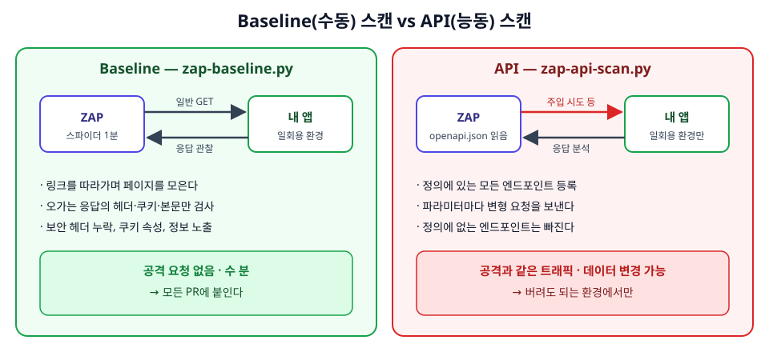
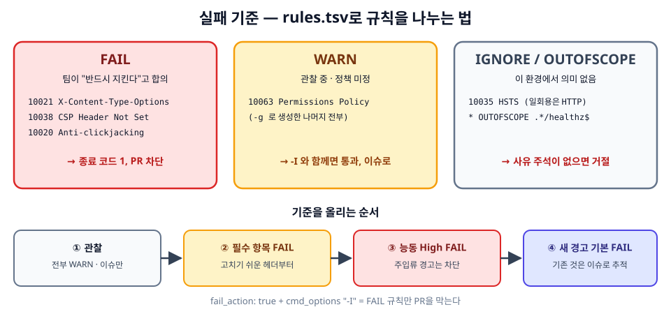
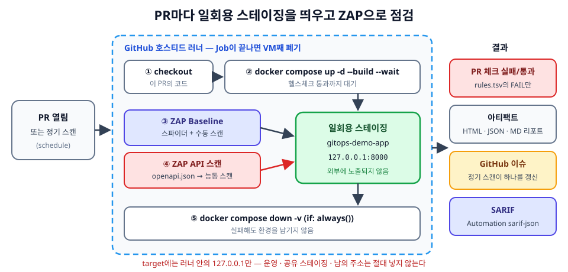

> **해킹 트랙 · 개발 보안** | 난이도 ★★★☆☆ | 예상 소요 2.5 ~ 3시간

> ⚠️ **실습 전 반드시 읽을 것**
> ZAP은 **실제 HTTP 요청을 보내는 스캐너**입니다. 특히 API 스캔과 Full 스캔의 능동 스캔(active scan)은 공격 요청과 똑같은 트래픽을 만듭니다. 오늘의 대상은 **PR마다 CI 러너 안에 띄웠다가 지우는 내 앱의 일회용 환경**뿐입니다. `target`에 운영 서버, 공유 스테이징, 남의 사이트, 클라우드 업체의 서비스 주소를 넣지 마세요. 허가 없는 타인 시스템 대상 스캔은 **정보통신망법 등으로 처벌**될 수 있고, 내 회사의 공유 환경이라도 담당자 허가(해킹 01의 RoE) 없이 능동 스캔을 돌리면 데이터 오염·장애를 일으킬 수 있습니다.

## 🎯 오늘의 목표

- DAST가 SAST·SCA(해킹 14·19)와 무엇이 다른지, **Baseline 스캔(수동)** 과 **API 스캔(능동)** 의 차이를 설명할 수 있다
- Day 50 데모 앱을 **Compose로 PR마다 일회용 스테이징**에 띄우고 ZAP을 붙인다
- 공식 액션 `zaproxy/action-baseline`, `zaproxy/action-api-scan`으로 워크플로를 만든다
- `rules.tsv`로 규칙을 IGNORE/WARN/FAIL로 튜닝하고 **실패 기준**을 팀 규칙으로 정한다
- 결과를 **GitHub 이슈**와 **SARIF**로 남기고, 인증이 필요한 앱을 스캔하는 방법의 개념을 안다

---

## 1. 원리 — 띄워 봐야 보이는 것들

해킹 14(SAST)와 해킹 19(SCA)는 **코드를 읽어서** 문제를 찾았습니다. 그런데 다음 문제들은 코드만 봐서는 잘 안 보입니다.

- 프레임워크·리버스 프록시·설정이 합쳐진 **최종 응답 헤더**(해킹 17의 CSP, `X-Content-Type-Options`, 쿠키 속성)
- 운영 설정에서 켜진 **디버그 페이지·스택 트레이스**
- 문서화되지 않은 경로가 실제로 응답하는지

**DAST(Dynamic Application Security Testing)** 는 앱을 실행해 두고 **밖에서 HTTP로** 두드려 봅니다. 해킹 04에서 Burp Suite로 손으로 하던 일의 일부를 자동화한 것입니다. ZAP(Zed Attack Proxy)은 오래 "OWASP ZAP"으로 불렸고, 2023년 OWASP를 떠나 지금은 Checkmarx가 후원하는 오픈소스 프로젝트("ZAP by Checkmarx")입니다. ZAP은 이를 CI용 "패키지 스캔"으로 제공합니다.

| 스캔 | 하는 일 | 공격 요청? | 소요 | CI 용도 |
|---|---|---|---|---|
| **Baseline** (`zap-baseline.py`) | 스파이더로 1분간 링크 수집 → **수동(passive) 스캔**: 오가는 응답만 관찰 | ❌ 일반 GET만 | 수 분 | **모든 PR** |
| **API** (`zap-api-scan.py`) | OpenAPI·GraphQL·SOAP 정의를 읽어 엔드포인트 등록 → **능동(active) 스캔** | ⭕ 주입 시도 등 | 수 분~수십 분 | PR 또는 야간 |
| Full (`zap-full-scan.py`) | 스파이더(+Ajax) → 전체 능동 스캔 | ⭕ | 수십 분~ | 야간·릴리스 전 |



> 💡 "Baseline은 공격 요청을 안 보낸다"는 점이 중요합니다. 그래서 Baseline은 비교적 안심하고 **모든 PR**에 붙일 수 있고, 능동 스캔은 **반드시 버려도 되는 환경**에서만 돌립니다. 능동 스캔은 폼을 제출하고 데이터를 만들고 지우려고 시도할 수 있습니다.

### 1-1. 왜 "PR마다 일회용 스테이징"인가

| 대상 | 문제 |
|---|---|
| 운영 | 능동 스캔이 실제 데이터를 오염시키고, 장애·차단·법적 문제 |
| 공유 스테이징 | 다른 사람 테스트와 섞임, 결과가 어떤 커밋의 것인지 불분명 |
| **PR마다 러너 안에 띄운 일회용 환경** | 그 PR 코드 그대로, 끝나면 `docker compose down -v`로 흔적 없음, 외부에 노출되지 않음 |

GitHub 호스티드 러너는 Job이 끝나면 VM째 버려지므로 일회용 환경으로 딱 맞습니다. 앱은 러너의 `127.0.0.1`에만 열고, ZAP 컨테이너가 같은 러너에서 접근합니다.

---

## 2. 실습 환경

| 항목 | 값 |
|---|---|
| 앱 | Day 50의 `gitops-demo-app`(FastAPI, 포트 8000, `/`, `/healthz`, 자동 문서 `/docs`, `/openapi.json`) |
| 로컬 | Docker + Compose v2 (Ubuntu 24.04 / Docker Desktop) |
| ZAP | 이미지 `ghcr.io/zaproxy/zaproxy:stable` (2026-11 기준 ZAP **2.17.0**) |
| 액션 | `zaproxy/action-baseline` **v0.15.0**, `zaproxy/action-api-scan` **v0.10.0** (각 릴리스 페이지 확인, 2025-10 이후 새 릴리스 없음) |
| 기타 | Day 51의 `ci.yaml`, 해킹 19의 `secrets-deps.yaml`과 별도 워크플로로 추가 |

```bash
docker pull ghcr.io/zaproxy/zaproxy:stable
```

> 💡 `stable` 태그는 움직이는 태그입니다(Day 51 7장과 같은 이야기). 결과가 ZAP 버전에 따라 달라지는 것을 막으려면 `docker pull` 후 `docker inspect --format '{{index .RepoDigests 0}}'`로 다이제스트를 확인해 `ghcr.io/zaproxy/zaproxy@sha256:...`으로 고정하고, 정기적으로 갱신합니다.

---

## 3. 내 환경 점검 — 로컬에서 먼저 띄우고 스캔

### 3-1. 일회용 스테이징 — compose.yaml

`gitops-demo-app` 레포 루트에 추가합니다.

```yaml
# compose.yaml — PR 스캔용 일회용 스테이징
services:
  app:
    build: .
    image: gitops-demo-app:pr-scan
    environment:
      APP_ENV: ci-staging
    ports:
      - "127.0.0.1:8000:8000"      # 러너/PC의 루프백에만 노출
    read_only: true                  # Day 68 습관 그대로
    tmpfs:
      - /tmp
    healthcheck:                     # slim 이미지에 curl이 없으므로 python으로
      test: ["CMD", "python", "-c", "import urllib.request; urllib.request.urlopen('http://127.0.0.1:8000/healthz')"]
      interval: 5s
      timeout: 3s
      retries: 12
```

```bash
docker compose up -d --build --wait     # healthy가 될 때까지 기다림
curl -si http://127.0.0.1:8000/healthz | head -5
```

```
HTTP/1.1 200 OK
date: Sun, 15 Nov 2026 03:10:22 GMT
server: uvicorn
content-length: 15
content-type: application/json
```

헤더를 보면 이미 몇 가지가 보입니다. `server: uvicorn`은 서버 종류를 알려 주고, `X-Content-Type-Options` 같은 보안 헤더가 하나도 없습니다(해킹 17).

### 3-2. 로컬 Baseline 스캔

ZAP 컨테이너를 **Compose가 만든 네트워크**에 붙이면 Docker Desktop에서도 `--network host` 없이 동작합니다.

```bash
mkdir -p .zap zap-out && chmod a+w zap-out
docker run --rm --network gitops-demo-app_default \
  -v "$PWD/zap-out:/zap/wrk:rw" \
  ghcr.io/zaproxy/zaproxy:stable \
  zap-baseline.py -t http://app:8000 -g gen.conf -r report.html -J report.json -I
```

출력 예(경고 이름과 개수는 ZAP 버전과 앱에 따라 다릅니다):

```
Total of 5 URLs
PASS: Vulnerable JS Library (Powered by Retire.js) [10003]
PASS: Cookie No HttpOnly Flag [10010]
...
WARN-NEW: X-Content-Type-Options Header Missing [10021] x 4
	http://app:8000/ (200 OK)
	http://app:8000/docs (200 OK)
	...
WARN-NEW: Content Security Policy (CSP) Header Not Set [10038] x 2
	http://app:8000/docs (200 OK)
WARN-NEW: Missing Anti-clickjacking Header [10020] x 1
	http://app:8000/docs (200 OK)
FAIL-NEW: 0	FAIL-INPROG: 0	WARN-NEW: 5	WARN-INPROG: 0	INFO: 0	IGNORE: 0	PASS: 61
```

| 옵션 | 의미 |
|---|---|
| `-t` | 대상 URL (**내 일회용 환경**) |
| `-g gen.conf` | 모든 규칙을 WARN으로 적은 **설정 파일 초안 생성** → 4장 튜닝의 출발점 |
| `-r` / `-J` / `-w` / `-x` | HTML / JSON / Markdown / XML 리포트 (`/zap/wrk`에 저장) |
| `-I` | WARN만 있을 때는 실패 코드를 내지 않음 (FAIL 규칙만 실패) |
| `-c <파일>` | 튜닝한 설정 파일 사용 |
| 종료 코드 | `0` 통과, `1` FAIL 있음, `2` WARN만 있음, `3` 스캔 자체 오류 |

`zap-out/report.html`을 브라우저로 열면 경고마다 **설명, 근거(응답 헤더), 해결 방법, CWE 번호**가 있습니다.

### 3-3. 로컬 API 스캔 (능동)

```bash
docker run --rm --network gitops-demo-app_default \
  -v "$PWD/zap-out:/zap/wrk:rw" \
  ghcr.io/zaproxy/zaproxy:stable \
  zap-api-scan.py -t http://app:8000/openapi.json -f openapi -r api-report.html -I
```

FastAPI가 자동으로 만들어 주는 `/openapi.json`을 읽어 **문서에 있는 모든 엔드포인트**를 등록한 뒤 능동 스캔을 합니다. Spring Boot라면 springdoc의 `/v3/api-docs`가 같은 역할입니다. 해킹 16의 API 인벤토리와 연결해 보면, **문서에 없는 엔드포인트는 이 스캔에서도 빠진다**는 점이 보입니다.

---

## 4. 규칙 튜닝 — rules.tsv

`-g`로 만든 `gen.conf`를 레포의 `.zap/rules.tsv`로 옮기고 다듬습니다. 형식은 **탭으로 구분된** `규칙ID	동작	(설명)` 입니다.

```tsv
# .zap/rules.tsv — 동작: IGNORE / INFO / WARN / FAIL  (구분자는 반드시 탭)
# 실패시킬 것: 해킹 17에서 "필수"로 정한 헤더
10021	FAIL	(X-Content-Type-Options Header Missing)
10038	FAIL	(Content Security Policy (CSP) Header Not Set)
10020	FAIL	(Missing Anti-clickjacking Header)
# 지켜보기만: 아직 정책을 정하지 못한 것
10063	WARN	(Permissions Policy Header Not Set)
# 무시: 사유를 주석으로 남긴다 (리뷰 대상)
# 10035 — 일회용 환경은 HTTP. HSTS는 Traefik(Day 15)에서 TLS와 함께 붙이고 운영 헤더 점검으로 확인
10035	IGNORE	(Strict-Transport-Security Header Not Set)
# 특정 URL만 범위 밖으로: /healthz는 쿠버네티스 프로브 전용
*	OUTOFSCOPE	http://.*/healthz$
```



| 동작 | 결과 | 쓰는 곳 |
|---|---|---|
| `FAIL` | 발견되면 종료 코드 1 → **PR 실패** | 팀이 "반드시 지킨다"고 합의한 것 |
| `WARN` | 리포트·이슈에 남지만 `-I`와 함께면 실패 아님 | 도입 초기, 정책 미정 |
| `INFO` | 참고로만 | 정보성 경고 |
| `IGNORE` | 리포트에서 제외 | 이 환경에서 의미 없는 것. **사유 주석 필수** |
| `OUTOFSCOPE` | 정규식에 맞는 URL에서 그 규칙(또는 `*`=전체)을 제외 | 프로브·정적 파일 등 |

> ⚠️ "실패가 귀찮아서 IGNORE"는 Day 62의 알림 피로와 같은 함정입니다. IGNORE는 **"이 환경에서는 오탐이거나, 다른 계층에서 해결된다"** 는 근거가 있을 때만, 그 근거를 주석으로 남깁니다. 예외도 Git에 남아 리뷰 대상이 된다는 점은 해킹 19의 `osv-scanner.toml`과 같습니다.

### 4-1. 실패 기준을 정하는 순서

| 단계 | 설정 | 기간 |
|---|---|---|
| ① 관찰 | 전부 WARN, `fail_action: false` — 이슈로만 받음 | 1~2주 |
| ② 필수 항목만 FAIL | 해킹 17의 필수 헤더 등 **고치기 쉬운 것**부터 FAIL | 다음 스프린트 |
| ③ API 능동 스캔 High를 FAIL | 주입류(SQLi·명령 주입·경로 조작) 경고는 FAIL | 앱이 안정된 뒤 |
| ④ 새 경고는 기본 FAIL | 새로 생긴 규칙 위반을 PR에서 막고, 기존 것은 이슈로 추적 | 상시 |

---

## 5. 탐지 — GitHub Actions에 붙이기



```yaml
# .github/workflows/dast.yaml
name: dast
on:
  pull_request:
    branches: [main]
  schedule:
    - cron: "0 18 * * 1-5"          # 평일 03:00 KST 정기 스캔 (UTC 기준)
  workflow_dispatch:

permissions:
  contents: read

concurrency:
  group: dast-${{ github.ref }}
  cancel-in-progress: true

jobs:
  zap:
    runs-on: ubuntu-latest
    timeout-minutes: 30
    permissions:
      contents: read
      issues: write                  # 정기 스캔 결과를 이슈로 남김 (PR에서는 쓰지 않음)
    steps:
      - uses: actions/checkout@v7
        with:
          persist-credentials: false

      - name: 일회용 스테이징 기동 (이 PR의 코드 그대로)
        run: docker compose up -d --build --wait

      - name: ZAP Baseline (수동 스캔)
        uses: zaproxy/action-baseline@de8ad967d3548d44ef623df22cf95c3b0baf8b25  # v0.15.0
        with:
          target: http://127.0.0.1:8000
          docker_name: ghcr.io/zaproxy/zaproxy:stable
          rules_file_name: .zap/rules.tsv
          cmd_options: "-I"          # WARN은 통과, FAIL 규칙만 실패
          fail_action: true
          allow_issue_writing: ${{ github.event_name != 'pull_request' }}
          issue_title: "ZAP Baseline — gitops-demo-app"
          artifact_name: zap-baseline

      - name: ZAP API 스캔 (능동 — 이 러너 안의 일회용 앱에만)
        uses: zaproxy/action-api-scan@5158fe4d9d8fcc75ea204db81317cce7f9e5453d  # v0.10.0
        with:
          target: http://127.0.0.1:8000/openapi.json
          format: openapi
          docker_name: ghcr.io/zaproxy/zaproxy:stable
          rules_file_name: .zap/rules-api.tsv
          cmd_options: "-I"
          fail_action: true
          allow_issue_writing: ${{ github.event_name != 'pull_request' }}
          issue_title: "ZAP API Scan — gitops-demo-app"
          artifact_name: zap-api

      - name: 앱 로그 (실패 원인 확인용)
        if: failure()
        run: docker compose logs --no-color app | tail -n 100

      - name: 일회용 환경 정리
        if: always()
        run: docker compose down -v
```

| 포인트 | 이유 |
|---|---|
| `target: http://127.0.0.1:8000` | 액션은 ZAP 컨테이너를 `--network="host"`로 띄우므로 러너의 루프백에 연 앱에 닿음. **외부 주소를 넣을 일이 없게** 구조를 고정 |
| `fail_action: true` + `-I` | 액션은 종료 코드 1(FAIL)·2(WARN) 모두를 실패로 보므로, `-I`로 WARN에서는 1·2를 내지 않게 해 **FAIL 규칙만** PR을 막음 |
| `allow_issue_writing`을 PR에서 끔 | 포크 PR의 `GITHUB_TOKEN`은 읽기 전용이라 이슈 쓰기가 실패함. 이슈는 정기 스캔이 하나를 **갱신**하며 관리(경고가 0이 되면 자동으로 닫힘) |
| `issues: write`는 이 Job에만 | Day 51 원칙. 해킹 23에서 다시 다룸 |
| 서드파티 액션 SHA 고정 | Day 57. 두 액션 모두 Node 24 기반 릴리스 |
| `if: always()` 정리 | 실패해도 환경을 남기지 않음 (호스티드 러너는 어차피 버려지지만 셀프 호스티드라면 필수) |

PR 화면의 Checks에서 실패를 누르면 어떤 FAIL 규칙이 걸렸는지 로그에 보이고, Actions 실행 요약의 **Artifacts**에서 `zap-baseline`(HTML·JSON·MD 리포트)을 받을 수 있습니다.

### 5-1. SARIF로 내보내기 — Automation Framework

패키지 스캔 액션은 HTML·JSON·MD와 이슈를 만들고 SARIF는 만들지 않습니다. SARIF가 필요하면 ZAP의 **Automation Framework**(YAML 계획 파일)로 같은 Baseline을 돌리고 `sarif-json` 리포트 템플릿을 씁니다.

```yaml
# .zap/baseline-plan.yaml
env:
  contexts:
    - name: demo
      urls: ["http://127.0.0.1:8000"]
      excludePaths: ["http://127.0.0.1:8000/healthz"]
  parameters:
    failOnError: true
    progressToStdout: true
jobs:
  - type: spider
    parameters:
      context: demo
      maxDuration: 1               # 분
  - type: passiveScan-wait
    parameters:
      maxDuration: 5
  - type: report
    parameters:
      template: sarif-json
      reportDir: /zap/wrk/zap-out
      reportFile: zap-baseline.sarif
  - type: report
    parameters:
      template: traditional-html
      reportDir: /zap/wrk/zap-out
      reportFile: zap-baseline.html
  - type: exitStatus
    parameters:
      errorLevel: Medium           # Medium 이상 경고가 있으면 종료 코드 1
      warnLevel: Low
```

```yaml
      # dast.yaml 의 zap Job, "일회용 환경 정리" 단계 앞에 추가
      - name: ZAP Automation (SARIF)
        run: |
          mkdir -p zap-out && chmod a+w . zap-out
          docker run --rm --network host -v "$PWD:/zap/wrk:rw" ghcr.io/zaproxy/zaproxy:stable \
            zap.sh -cmd -autorun /zap/wrk/.zap/baseline-plan.yaml
      - uses: actions/upload-artifact@v7
        if: always()
        with:
          name: zap-sarif
          path: zap-out/
```

> 💡 SARIF는 해킹 14(Semgrep·CodeQL), 해킹 19(OSV-Scanner)와 같은 형식이라 한곳에 모으기 좋습니다. 다만 DAST 결과는 **소스 파일의 줄이 아니라 URL**을 가리키므로, `github/codeql-action/upload-sarif@v4`로 Code scanning에 올려도 코드 줄과 연결되지 않아 보기가 제한적입니다. 우선 아티팩트로 보관하고, 취약점 관리 도구(예: DefectDojo)에 넣거나 해킹 11 보고서의 근거 자료로 씁니다.

---

## 6. 인증이 필요한 앱 — 개념

데모 앱에는 로그인이 없지만, 실제 앱은 대부분의 화면이 로그인 뒤에 있습니다. 로그인 없이 스캔하면 **로그인 페이지만 점검하고 끝**납니다.

| 방식 | 어떻게 | 맞는 경우 |
|---|---|---|
| **헤더 주입** | `ZAP_AUTH_HEADER`(기본 `Authorization`), `ZAP_AUTH_HEADER_VALUE`, `ZAP_AUTH_HEADER_SITE` 환경 변수를 주면 액션이 ZAP 컨테이너로 전달해 모든 요청에 붙임 | JWT·API 토큰 기반 API (해킹 15) |
| **Automation Framework 컨텍스트** | `env.contexts[].authentication`(form·json·browser 등) + `users`로 ZAP이 직접 로그인하고, 로그인 상태 확인 정규식으로 세션 유지 | 세션 쿠키 기반 웹앱 (Spring Security 폼 로그인) |
| 클라이언트 스크립트 | 브라우저 기반 인증을 녹화한 스크립트 | SSO·복잡한 로그인 흐름 |

원칙은 셋입니다.

1. **일회용 환경 전용 테스트 계정**: Compose가 띄우는 DB에 시드(seed)로 넣은 계정만 씁니다. 운영 계정, 실제 사용자 계정, 개인 계정은 절대 쓰지 않습니다.
2. **짧은 수명 토큰**: 일회용 앱의 테스트 로그인으로 그 자리에서 받은 토큰을 씁니다. 시크릿에 장기 토큰을 넣어야 한다면 Environment 시크릿으로 범위를 좁힙니다(해킹 23).
3. **로그아웃·계정 삭제 경로 제외**: 능동 스캔이 `/logout`이나 `/account/delete`를 눌러 세션을 끊거나 계정을 지우지 않도록 `excludePaths`에 넣습니다.

```yaml
      # 개념 예 — 일회용 앱의 테스트 전용 로그인 엔드포인트에서 토큰을 받아 헤더로
      - name: 테스트 토큰 발급 (시드 계정, 이 러너 안에서만 유효)
        id: token
        run: |
          TOKEN=$(curl -s -X POST http://127.0.0.1:8000/test-login -d 'user=zap-scanner' | jq -r .access_token)
          echo "::add-mask::$TOKEN"
          echo "value=$TOKEN" >> "$GITHUB_OUTPUT"
      - uses: zaproxy/action-api-scan@5158fe4d9d8fcc75ea204db81317cce7f9e5453d  # v0.10.0
        env:
          ZAP_AUTH_HEADER_VALUE: "Bearer ${{ steps.token.outputs.value }}"
          ZAP_AUTH_HEADER_SITE: "127.0.0.1"
        with:
          target: http://127.0.0.1:8000/openapi.json
```

> ⚠️ 위의 `/test-login` 같은 엔드포인트는 **`APP_ENV=ci-staging`일 때만 등록**되게 만들어야 합니다. 테스트용 로그인 우회가 운영 빌드에 남는 것 자체가 해킹 15의 인증 우회 취약점입니다.

---

## 7. 수정 — 경고를 코드로 닫기

Baseline이 남긴 헤더 경고를 고칩니다. 원리는 해킹 17에서 다뤘으니 여기서는 코드만 봅니다.

### 7-1. FastAPI (gitops-demo-app)

```python
# app/main.py — 추가/변경 부분
import os

from fastapi import FastAPI, Request

APP_ENV = os.getenv("APP_ENV", "local")

# 운영에서는 자동 문서(/docs, /redoc, /openapi.json)를 끈다
app = FastAPI(
    title="gitops-demo-app",
    docs_url=None if APP_ENV == "prod" else "/docs",
    redoc_url=None,
    openapi_url=None if APP_ENV == "prod" else "/openapi.json",
)

API_CSP = "default-src 'none'; frame-ancestors 'none'"


@app.middleware("http")
async def security_headers(request: Request, call_next):
    response = await call_next(request)
    response.headers["X-Content-Type-Options"] = "nosniff"
    response.headers["X-Frame-Options"] = "DENY"
    response.headers["Referrer-Policy"] = "no-referrer"
    response.headers["Cache-Control"] = "no-store"
    # /docs 는 Swagger UI가 외부 스크립트를 쓰므로 엄격한 CSP를 걸면 깨진다 → 운영에서는 아예 끈다
    if not request.url.path.startswith("/docs"):
        response.headers["Content-Security-Policy"] = API_CSP
    return response
```

```dockerfile
# Dockerfile 마지막 줄 — Server 헤더 제거
CMD ["uvicorn", "app.main:app", "--host", "0.0.0.0", "--port", "8000", "--no-server-header"]
```

### 7-2. Spring Boot라면

Spring Security는 기본으로 `X-Content-Type-Options: nosniff`, `X-Frame-Options: DENY`, 캐시 금지 헤더를 붙입니다. 경고가 남는다면 대개 **CSP가 없거나**, 누군가 `headers().disable()`을 했거나, 보안 필터 체인 밖 경로입니다.

| 경고 | Spring Boot 조치 |
|---|---|
| CSP 없음 | `http.headers(h -> h.contentSecurityPolicy(c -> c.policyDirectives("default-src 'self'; frame-ancestors 'none'")))` |
| 클릭재킹 헤더 없음 | `headers().disable()` 제거, `frameOptions(f -> f.deny())` 확인 |
| 스택 트레이스 노출 | `server.error.include-stacktrace=never`, `include-message=never`(해킹 13) |
| Actuator 노출 | `management.endpoints.web.exposure.include=health` 만 |

PR에 수정이 들어가면 같은 워크플로가 다시 돌고, FAIL 규칙이 사라지면 체크가 초록이 됩니다. 정기 스캔 이슈도 다음 실행에서 해당 경고가 사라진 것으로 갱신됩니다.

---

## 8. 정리

```bash
docker compose down -v
rm -rf zap-out
echo "zap-out/" >> .gitignore
```

`compose.yaml`, `.zap/rules.tsv`, `.zap/rules-api.tsv`, `.zap/baseline-plan.yaml`, `dast.yaml`은 커밋합니다.

---

## 9. 트러블슈팅

| 증상 | 원인 | 해결 |
|---|---|---|
| 로컬에서 `Failed to access target` | Docker Desktop에서 ZAP 컨테이너의 `127.0.0.1`은 컨테이너 자신 | 3-2처럼 Compose 네트워크에 붙이고 `http://app:8000` |
| 리포트 파일이 안 생김 (`Permission denied`) | ZAP 컨테이너는 `zap` 사용자로 실행 | 마운트한 디렉터리에 `chmod a+w` |
| rules.tsv가 적용 안 됨 | 구분자가 공백 | **탭**으로. 에디터의 "탭을 공백으로" 설정 확인 |
| WARN만 있는데 PR이 실패 | `fail_action: true`인데 `-I` 없음 → 종료 코드 2도 실패 처리 | `cmd_options: "-I"` |
| PR에서 `Resource not accessible by integration` | 포크 PR 토큰은 읽기 전용인데 이슈 쓰기 시도 | PR에서는 `allow_issue_writing: false` |
| API 스캔이 엔드포인트 0개 | 운영 설정(`APP_ENV=prod`)이라 `/openapi.json`이 꺼짐 | 스테이징은 `APP_ENV=ci-staging`. 문서를 끈 운영에서는 API 스캔을 하지 않는 것이 맞음 |
| `docker compose up --wait`가 시간 초과 | 헬스체크 명령 실패 | `docker compose ps`, `docker compose logs app`으로 확인 |
| 스캔이 너무 오래 걸림 | Full·API 스캔을 모든 PR에 | PR은 Baseline(+필요시 API), Full은 `schedule`로 |

---

## 10. 핵심 정리

- DAST는 **실행 중인 앱을 HTTP로** 점검한다. 헤더·쿠키·에러 노출처럼 설정이 합쳐진 결과는 띄워 봐야 보인다
- **Baseline = 스파이더 + 수동 스캔**(공격 요청 없음, 모든 PR), **API = 정의 기반 능동 스캔**(일회용 환경에서만)
- 대상은 **PR마다 러너 안에 띄운 일회용 스테이징**(`docker compose up --wait` → 스캔 → `down -v`). 외부 주소를 target에 넣지 않는다
- `rules.tsv`로 **FAIL(합의된 필수) / WARN(관찰) / IGNORE(근거 주석 필수)**, `OUTOFSCOPE`로 URL 제외
- 실패 기준은 **관찰 → 필수 항목 FAIL → 능동 High FAIL** 순으로 올린다. `fail_action: true` + `-I` = FAIL 규칙만 차단
- 결과는 이슈(정기 스캔이 하나를 갱신), 아티팩트(HTML·JSON), SARIF(Automation Framework `sarif-json`)로
- 인증 앱은 헤더 주입 또는 컨텍스트+사용자로. **일회용 환경의 시드 테스트 계정만**, 로그아웃·삭제 경로는 제외

---

## 11. 셀프 체크

<details>
<summary>Q1. Baseline 스캔은 모든 PR에 붙여도 되는데 API 스캔은 왜 더 조심해야 하나?</summary>

Baseline은 스파이더가 링크를 따라가며 **일반 요청만** 보내고 응답을 관찰하는 수동 스캔입니다. API 스캔은 정의된 모든 엔드포인트에 **능동 스캔**(주입 시도 등 공격과 같은 요청)을 보냅니다. 데이터 생성·변경·삭제가 일어날 수 있으므로 반드시 버려도 되는 일회용 환경에서만 돌립니다.
</details>

<details>
<summary>Q2. <code>fail_action: true</code>로 했더니 X-Content-Type-Options 경고 하나로도 PR이 막힌다. FAIL로 지정한 규칙만 막으려면?</summary>

`cmd_options: "-I"`를 추가합니다. `zap-baseline.py`는 WARN만 있으면 종료 코드 2를 내고, 액션은 `fail_action: true`일 때 1과 2를 모두 실패로 처리합니다. `-I`는 WARN에서 실패 코드를 내지 않게 하므로 `rules.tsv`에서 `FAIL`로 지정한 규칙(종료 코드 1)만 PR을 막습니다.
</details>

<details>
<summary>Q3. rules.tsv에 <code>10035 IGNORE</code>를 넣으려 한다. 리뷰어가 확인해야 할 것은?</summary>

근거가 주석으로 남아 있는지, 그 근거가 맞는지입니다. 예: "일회용 환경은 HTTP라 HSTS가 의미 없고, 운영에서는 Traefik이 TLS와 함께 HSTS를 붙이며 그것은 별도로 확인한다." 근거 없이 "시끄러워서" 무시하는 것은 거절합니다. 무시한 규칙은 그 환경에서 **영원히 보이지 않게** 됩니다.
</details>

<details>
<summary>Q4. 로그인 뒤의 화면을 스캔하려고 운영 관리자 계정의 토큰을 GitHub 시크릿에 넣으려 한다. 무엇이 문제인가?</summary>

① 능동 스캔이 운영 계정 권한으로 일회용 환경 밖의 데이터를 건드릴 위험(토큰이 운영에서 유효하다면 대상이 바뀌는 순간 사고), ② 장기 유효 고권한 토큰이 CI에 상주(해킹 23의 시크릿 노출 경로), ③ 일회용 환경에서는 그 토큰이 애초에 유효하지 않아야 정상입니다. 일회용 DB에 **시드한 테스트 계정**으로 그 자리에서 짧은 토큰을 받아 쓰세요.
</details>

<details>
<summary>Q5. ZAP 결과를 SARIF로 Code scanning에 올렸는데 코드 줄과 연결되지 않는다. 왜인가?</summary>

DAST는 소스 코드를 보지 않고 **URL과 HTTP 응답**을 근거로 경고하므로 SARIF의 위치 정보도 URL입니다. SAST처럼 파일·줄로 이어지지 않는 것이 정상입니다. SARIF는 다른 도구 결과와 한곳에 모으거나 보관하는 용도로 쓰고, 수정 위치는 리포트의 URL·근거 헤더로 찾습니다.
</details>

---

## ⏭️ 다음 예고 — 해킹 21. Wireshark로 실습장 트래픽 분석

해킹 13~20에서는 **앱 코드와 개발 파이프라인** 쪽에서 보안을 다뤘습니다. 여기서 트랙은 **인프라 보안 심화**로 넘어갑니다. 첫 주제는 네트워크 위의 패킷 그 자체입니다. 다음 편에서는 `hacklab` 실습장에서 내가 만든 트래픽을 Wireshark로 캡처하고, HTTP와 HTTPS가 선 위에서 어떻게 다르게 보이는지, 오늘 ZAP이 보낸 것 같은 스캔 트래픽이 패킷으로는 어떤 모양인지 직접 확인합니다.
