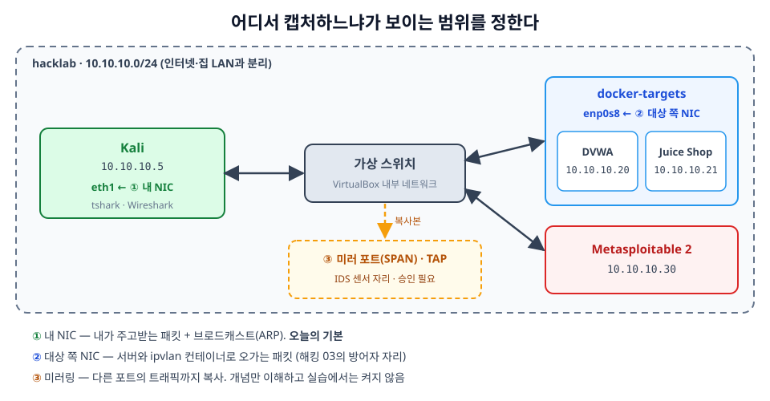
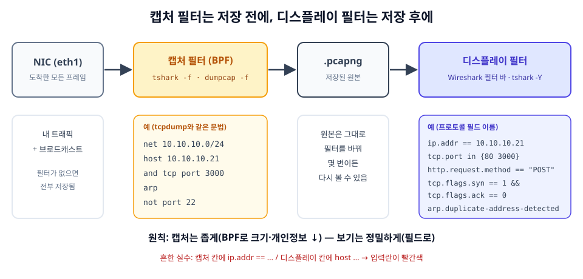
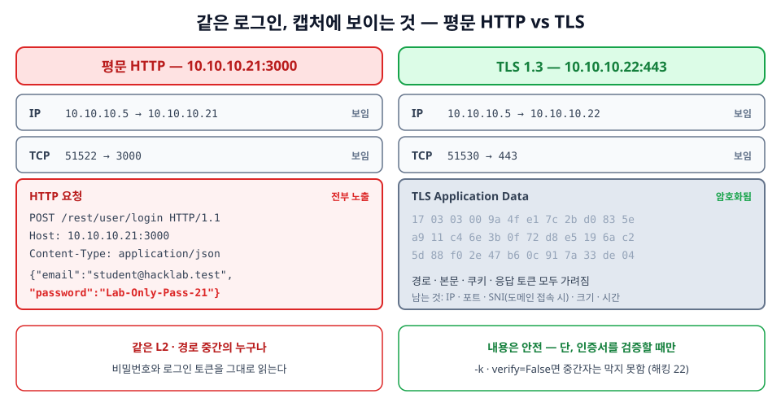

> **해킹 트랙 · 인프라 보안 심화** | 난이도 ★★★☆☆ | 예상 소요 2.5 ~ 3시간

> ⚠️ **실습 전 반드시 읽으세요.** 이 글의 모든 실습은 **본인 소유의 격리된 실습장**(해킹 02의 `hacklab` 네트워크, 10.10.10.0/24)과 **본인이 만든 앱**에서만 합니다. 오늘 캡처하는 것은 **실습장 안에서 내가 만든 트래픽뿐**입니다. 회사·학교·카페·집 LAN에서 **다른 사람의 통신을 캡처하는 것은 감청**에 해당할 수 있어 **통신비밀보호법**으로 처벌될 수 있고, 허가 없는 타인 시스템 대상 스캔·공격은 **정보통신망법** 위반입니다. 업무망 캡처는 반드시 서면 허가와 범위(RoE, 해킹 01)를 받은 뒤에만 합니다.

## 🎯 오늘의 목표

- 패킷을 **어디서** 잡는지(내 NIC, 대상 쪽 NIC, 미러링 포트)에 따라 보이는 것이 달라진다는 것을 이해한다
- **캡처 필터(BPF)** 와 **디스플레이 필터**의 차이를 알고 각각의 문법으로 필요한 패킷만 고른다
- TCP 3-way handshake, DNS, HTTP를 패킷 단위로 해석하고 **Follow Stream**으로 대화를 복원한다
- Juice Shop 로그인을 평문 HTTP로 캡처해 **비밀번호가 그대로 보이는 것**을 확인하고, 같은 요청을 TLS로 보내 무엇이 가려지는지 비교한다
- 해킹 03의 nmap 스캔이 패킷으로 어떻게 보이는지 확인하고, **링 버퍼**로 대용량 캡처를 다루며 **캡처 파일의 개인정보**를 안전하게 취급한다

---

## 1. 왜 패킷을 직접 보는가

해킹 03에서는 tcpdump 한 줄과 Suricata 알림으로 "스캔이 보인다"를 확인했습니다. 해킹 10에서는 그 흔적을 로그로 모았습니다. 로그와 알림은 **누군가 미리 정해 둔 요약**입니다. 요약이 틀렸거나 비어 있을 때, 마지막으로 기댈 곳이 **패킷 원본**입니다.

| 질문 | 로그·알림으로 | 패킷으로 |
|---|---|---|
| 이 앱이 비밀번호를 암호화해서 보내나? | 앱 로그에는 보통 안 남음 | **본문을 직접 확인** |
| 연결이 왜 끊기나? | "timeout" 한 줄 | SYN 재전송인지, RST인지, 누가 먼저 끊었는지 |
| 스캔인가, 정상 트래픽인가? | 임계값 넘은 알림 | 플래그·순서·포트 분포를 직접 확인 |
| 방화벽 규칙이 먹혔나? (Day 67) | 차단 로그 | 응답이 없는지(drop), RST가 오는지(reject) |

| 도구 | 형태 | 쓰임 |
|---|---|---|
| **Wireshark** | GUI | 해석·탐색·Follow Stream·통계 |
| **tshark** | Wireshark의 CLI | 서버에서 캡처, 스크립트로 필드 추출 |
| **dumpcap** | 캡처 전용 엔진 | 장시간·대용량 캡처(링 버퍼). Wireshark·tshark도 내부적으로 이것으로 캡처 |
| tcpdump | 고전 CLI | Day 22·23, 해킹 03에서 사용. pcap 파일은 Wireshark로 열 수 있음 |

> 💡 2026-11-15 기준 Wireshark 공식 안정 버전은 **4.6 계열**(4.6.9), 이전 안정은 4.4 계열입니다. Kali 저장소는 4.6.x를 배포합니다. 오늘 쓰는 기능은 4.x 어디서나 같습니다. `tshark --version | head -n 1`로 확인하세요.

---

## 2. 어디서 캡처하는가 — 캡처 지점



스위치는 프레임을 **목적지 MAC이 있는 포트로만** 보냅니다. 그래서 어떤 NIC에서 캡처하느냐가 보이는 범위를 결정합니다.

| 캡처 지점 | 보이는 것 | 실습장에서 |
|---|---|---|
| **① 내 NIC** (Kali `eth1`) | 내가 보내고 받는 패킷 + 브로드캐스트(ARP 등) | **오늘의 기본.** "내 트래픽만"이 자연스럽게 지켜짐 |
| **② 대상 쪽 NIC** (docker-targets `enp0s8`) | 그 VM과 ipvlan 컨테이너(DVWA·Juice Shop)로 오가는 패킷 | 해킹 03의 "방어자 터미널" 자리. 서버 쪽 시야 |
| **③ 미러링 포트**(SPAN) / **TAP** | 스위치의 다른 포트들을 복사해 받은 전체 트래픽 | 실무 IDS 센서 자리. 개념만 이해 |
| 브리지·veth (Day 22) | 리눅스 브리지 포트 단위 | `tcpdump -i vethXXX` — 컨테이너 하나만 볼 때 |

### 2-1. 미러링(SPAN)과 TAP

- **포트 미러링(SPAN)**: 관리형 스위치가 지정한 포트(또는 VLAN)의 트래픽을 **복사해서** 분석 포트로 보내 줍니다. IDS(Suricata, 해킹 03)와 패킷 브로커가 여기에 붙습니다.
- **TAP**: 케이블 중간에 끼우는 하드웨어로, 스위치 설정과 무관하게 양방향을 복사합니다.
- **가상 환경**: VirtualBox 내부 네트워크는 기본적으로 스위치처럼 동작합니다. NIC의 무차별 모드(promiscuous)를 `allow-vms`로 바꾸면 그 VM이 같은 내부 네트워크의 다른 VM 트래픽까지 받을 수 있습니다(`VBoxManage modifyvm <VM> --nicpromisc2 allow-vms`). OVS(Day 24)와 클라우드(AWS VPC Traffic Mirroring 등)에도 같은 개념의 미러링 기능이 있습니다.

> ⚠️ 미러링은 **남의 트래픽까지 복사하는 기능**입니다. 오늘 실습은 미러링을 켜지 않고 ①·②만 씁니다. 실무에서 미러 포트를 만드는 것은 네트워크 담당과 보안 책임자의 승인 사항이며, 캡처 데이터는 개인정보로 취급해야 합니다(8장).

### 2-2. 준비 (실습 모드)

해킹 02 7장의 **격리 체크리스트**를 먼저 통과시킵니다. Kali에서:

```bash
ip route                              # 10.10.10.0/24 하나만, default 없음
tshark --version | head -n 1          # TShark (Wireshark) 4.6.x ...
mkdir -p ~/hacklab/pcap && chmod 700 ~/hacklab/pcap

# 일반 사용자로 캡처하려면 wireshark 그룹에 추가 (다시 로그인해야 적용)
sudo usermod -aG wireshark "$USER"
# 적용 후: tshark -D 목록에 eth1이 보이면 OK
tshark -D
# 1. eth0
# 2. eth1
# 3. any
# 4. lo (Loopback)
# ...
```

> 💡 Kali의 Wireshark 패키지는 `dumpcap`에만 캡처 권한(capability)을 주고 GUI는 일반 사용자로 돌리는 방식입니다. **Wireshark를 `sudo`로 실행하지 마세요.** 수십만 줄의 파서 코드가 root 권한으로 돌게 됩니다. 그룹 설정이 안 되어 있다면 `sudo dpkg-reconfigure wireshark-common`에서 "Yes"를 고른 뒤 그룹에 추가합니다.

---

## 3. 캡처 필터와 디스플레이 필터



| | **캡처 필터** | **디스플레이 필터** |
|---|---|---|
| 언제 | 캡처하는 **순간** — 걸러진 패킷은 **아예 저장되지 않음** | 저장된 패킷을 **볼 때** — 원본은 그대로 |
| 문법 | **BPF** (tcpdump와 같음) | Wireshark 고유 문법 (프로토콜 필드 이름) |
| 지정 위치 | Wireshark 시작 화면 입력란, `tshark -f`, `dumpcap -f` | Wireshark 상단 필터 바, `tshark -Y` |
| 장점 | 파일 크기·개인정보 최소화 | 프로토콜 해석 결과(HTTP 메서드, DNS 이름 등)로 정밀하게 |

| 목적 | 캡처 필터 (BPF) | 디스플레이 필터 |
|---|---|---|
| 실습망만 | `net 10.10.10.0/24` | `ip.addr == 10.10.10.0/24` |
| Juice Shop만 | `host 10.10.10.21 and tcp port 3000` | `ip.addr == 10.10.10.21 && tcp.port == 3000` |
| ARP만 | `arp` | `arp` |
| SSH 제외 | `not port 22` | `!(tcp.port == 22)` |
| SYN만 (새 연결 시도) | `tcp[tcpflags] & tcp-syn != 0 and tcp[tcpflags] & tcp-ack == 0` | `tcp.flags.syn == 1 && tcp.flags.ack == 0` |
| HTTP POST | (BPF로는 어려움) | `http.request.method == "POST"` |
| DNS 질의 이름 | (BPF로는 어려움) | `dns.qry.name contains "hacklab"` |
| 여러 포트 | `tcp port 80 or tcp port 3000` | `tcp.port in {80 3000}` |
| TCP 이상 징후 | — | `tcp.analysis.flags` (재전송, 중복 ACK, 윈도 0 등) |

> ⚠️ 가장 흔한 실수: 캡처 필터 칸에 `ip.addr == 10.10.10.21`을 넣거나, 디스플레이 필터 칸에 `host 10.10.10.21`을 넣는 것. Wireshark는 문법이 틀리면 입력란을 **빨간색**으로, 맞으면 **초록색**으로 표시합니다.

> 💡 **원칙: 캡처는 넓지 않게, 보기는 정밀하게.** 캡처 필터로 실습망·대상 호스트만 남겨 저장량과 개인정보를 줄이고, 해석은 디스플레이 필터로 합니다.

---

## 4. 실습 ① — TCP 3-way handshake와 HTTP

### 4-1. 캡처 시작

Kali 터미널 A:

```bash
tshark -i eth1 -f "host 10.10.10.21 and tcp port 3000" \
  -w ~/hacklab/pcap/hack21-01-juice-http.pcapng
# Capturing on 'eth1'
```

Kali 터미널 B:

```bash
in_scope 10.10.10.21 && curl -s -o /dev/null -w '%{http_code}\n' http://10.10.10.21:3000/rest/admin/application-version
# 200
```

터미널 A에서 `Ctrl+C`로 멈추고 읽습니다.

```bash
tshark -r ~/hacklab/pcap/hack21-01-juice-http.pcapng
```

```
    1 0.000000000   10.10.10.5 → 10.10.10.21  TCP 74 51522 → 3000 [SYN] Seq=0 Win=64240 Len=0 MSS=1460 SACK_PERM TSval=... WS=128
    2 0.000412300  10.10.10.21 → 10.10.10.5   TCP 74 3000 → 51522 [SYN, ACK] Seq=0 Ack=1 Win=65160 Len=0 MSS=1460 ...
    3 0.000431100   10.10.10.5 → 10.10.10.21  TCP 66 51522 → 3000 [ACK] Seq=1 Ack=1 Win=64256 Len=0 ...
    4 0.000502700   10.10.10.5 → 10.10.10.21  HTTP 175 GET /rest/admin/application-version HTTP/1.1
    5 0.000890100  10.10.10.21 → 10.10.10.5   TCP 66 3000 → 51522 [ACK] Seq=1 Ack=110 ...
    6 0.004211500  10.10.10.21 → 10.10.10.5   HTTP 460 HTTP/1.1 200 OK  (application/json)
    7 0.004230000   10.10.10.5 → 10.10.10.21  TCP 66 51522 → 3000 [ACK] ...
    8 0.004501900   10.10.10.5 → 10.10.10.21  TCP 66 51522 → 3000 [FIN, ACK] ...
    9 0.004981200  10.10.10.21 → 10.10.10.5   TCP 66 3000 → 51522 [FIN, ACK] ...
   10 0.005002300   10.10.10.5 → 10.10.10.21  TCP 66 51522 → 3000 [ACK] ...
```

(포트 번호·시간·크기는 환경마다 다릅니다)

| 번호 | 단계 | 읽는 법 |
|---|---|---|
| 1~3 | **3-way handshake** | SYN → SYN/ACK → ACK. `Seq=0`은 Wireshark가 보기 좋게 바꾼 **상대 순서 번호**(실제 값은 무작위) |
| 4~7 | 요청·응답 | 요청 `Len`만큼 상대의 `Ack`가 늘어남 (`Ack=110`) |
| 8~10 | 정상 종료 | FIN/ACK를 서로 교환. RST로 끝나면 비정상 종료나 거절 |

> 💡 SYN 패킷의 `MSS=1460`은 MTU 1500에서 IP·TCP 헤더 40바이트를 뺀 값입니다. Day 23 VXLAN에서 MTU 1450이었다면 MSS는 1410이 됩니다. 연결은 되는데 큰 응답만 멈추는 문제는 여기서부터 의심합니다.

### 4-2. 필드만 뽑아 보기

```bash
tshark -r ~/hacklab/pcap/hack21-01-juice-http.pcapng -Y http \
  -T fields -e frame.number -e ip.src -e http.request.method -e http.request.uri -e http.response.code
# 4   10.10.10.5    GET   /rest/admin/application-version
# 6   10.10.10.21                                            200
```

### 4-3. Follow Stream — 대화 복원

GUI에서는 패킷을 우클릭 → **Follow → TCP Stream**(단축키 `Ctrl+Alt+Shift+T`). 요청은 빨강, 응답은 파랑으로 이어 붙여 보여 주고, 필터 바에는 자동으로 `tcp.stream eq 0`이 들어갑니다. CLI에서는:

```bash
tshark -r ~/hacklab/pcap/hack21-01-juice-http.pcapng -q -z follow,tcp,ascii,0
```

```
===================================================================
Follow: tcp,ascii
Filter: tcp.stream eq 0
Node 0: 10.10.10.5:51522
Node 1: 10.10.10.21:3000
109
GET /rest/admin/application-version HTTP/1.1
Host: 10.10.10.21:3000
User-Agent: curl/8.x
...
	352
HTTP/1.1 200 OK
Access-Control-Allow-Origin: *
X-Content-Type-Options: nosniff
X-Frame-Options: SAMEORIGIN
...
{"version":"20.4.0"}
===================================================================
```

`tcp.stream`은 Wireshark가 연결마다 붙이는 번호입니다. HTTP/2는 `follow,http2`, TLS는 키가 있을 때만 `follow,tls`로 복원됩니다.

---

## 5. 실습 ② — DNS 해석

실습망은 인터넷과 끊겨 있어 공용 DNS가 없습니다. 대신 Metasploitable 2가 53번 포트로 DNS 서버(BIND)를 돌리고 있으므로(해킹 03 4-3), 그쪽에 질의해 DNS 패킷 구조를 봅니다.

```bash
# 터미널 A
tshark -i eth1 -f "host 10.10.10.30 and port 53" -w ~/hacklab/pcap/hack21-02-dns.pcapng
# 터미널 B
in_scope 10.10.10.30 && dig @10.10.10.30 localhost A +tries=1 +time=2
```

```bash
tshark -r ~/hacklab/pcap/hack21-02-dns.pcapng -V -Y dns | grep -E 'Transaction ID|Flags:|Queries|Name:|Type:|Answer RRs|Address:'
```

```
    Transaction ID: 0x5c1e
    Flags: 0x0120 Standard query
    Answer RRs: 0
    Queries
        Name: localhost
        Type: A (1) (Host Address)
    Transaction ID: 0x5c1e
    Flags: 0x8580 Standard query response, No error
    Answer RRs: 1
        Name: localhost
        Type: A (1) (Host Address)
        Address: 127.0.0.1
```

(BIND 설정에 따라 `Refused`나 `No such name`이 올 수 있습니다. 패킷 구조를 보는 데는 문제없습니다)

| 필드 | 의미 | 보안 관점 |
|---|---|---|
| `Transaction ID` | 질의와 응답을 짝짓는 16비트 번호 | 이 번호와 출발지 포트가 맞으면 응답을 믿음 → 예측 가능하면 위조 응답(캐시 포이즈닝) 위험 |
| UDP 53, 평문 | 질의 이름이 그대로 보임 | 같은 망의 누구나 **내가 어느 사이트에 가는지** 볼 수 있음 → DoH/DoT |
| `Flags` 응답 코드 | No error / No such name / Refused | 대량 NXDOMAIN은 악성코드(DGA)나 오타 도메인 탐지 신호 |

디스플레이 필터 예: `dns.flags.response == 0`(질의만), `dns.flags.rcode != 0`(오류 응답만), `dns.qry.name contains "hacklab"`.

---

## 6. 실습 ③ — 평문 HTTP 로그인 vs TLS



### 6-1. 평문 HTTP로 Juice Shop 로그인

1. Kali Firefox에서 `http://10.10.10.21:3000/#/register`로 **실습 전용 계정**을 만듭니다. 이메일은 `student@hacklab.test`, 비밀번호는 다른 곳에서 쓰지 않는 값(예: `Lab-Only-Pass-21`)으로 합니다. **실제로 쓰는 비밀번호는 절대 넣지 마세요.** 캡처 파일에 그대로 남습니다.
2. 캡처를 시작합니다.

```bash
tshark -i eth1 -f "host 10.10.10.21 and tcp port 3000" -w ~/hacklab/pcap/hack21-03-login-http.pcapng
```

3. 로그인 화면에서 방금 만든 계정으로 로그인하고, 캡처를 멈춥니다.

```bash
tshark -r ~/hacklab/pcap/hack21-03-login-http.pcapng \
  -Y 'http.request.method == "POST" && http.request.uri contains "login"' \
  -T fields -e ip.src -e http.request.uri -e http.file_data
```

```
10.10.10.5   /rest/user/login   {"email":"student@hacklab.test","password":"Lab-Only-Pass-21"}
```

GUI에서는 `http.request.method == "POST"`로 거른 뒤 Follow → HTTP Stream을 열면 같은 내용이 보이고, 응답 쪽에는 **로그인 토큰(JWT)** 이 평문으로 돌아옵니다.

```bash
tshark -r ~/hacklab/pcap/hack21-03-login-http.pcapng -Y 'http.response && http.file_data contains "token"' \
  -T fields -e http.file_data | cut -c1-60
# {"authentication":{"token":"eyJ0eXAiOiJKV1QiLCJhbGciOiJSUzI1...
```

**같은 L2에 있거나 경로 중간에 있는 누구든** 이 비밀번호와 토큰을 가져갈 수 있습니다. 토큰은 비밀번호 없이도 그 사용자로 행세할 수 있는 열쇠입니다(해킹 15). 다음 편(해킹 22)에서 보듯 **"경로 중간에 끼어드는 것"은 같은 LAN에서 생각보다 쉽습니다.**

### 6-2. 같은 요청을 TLS로 — 임시 TLS 프록시

비교를 위해 Juice Shop 앞에 HTTPS 리버스 프록시를 **잠깐** 세웁니다. Homelab 03의 Caddy를 그대로 쓰되, 실습망에는 공인 인증서를 받을 길이 없으므로 Caddy 내부 CA(`--internal-certs`)로 자체 인증서를 발급합니다. 주소는 실습망의 빈 주소 `10.10.10.22`를 **오늘만** 씁니다.

```bash
# docker-targets VM — 이미지는 업데이트 모드에서 미리 받아 둠
docker pull docker.io/library/caddy:2.11.9          # 2026-11-15 기준 최신 안정 태그

# 실습 모드에서 실행 (ports: 없음, hacklab ipvlan에 직접 연결)
docker run -d --name hack21-tls --network hacklab --ip 10.10.10.22 \
  docker.io/library/caddy:2.11.9 \
  caddy reverse-proxy --from https://10.10.10.22 --to 10.10.10.21:3000 --internal-certs
docker logs hack21-tls 2>&1 | tail -n 3
```

Kali에서 같은 로그인을 HTTPS로 보내며 캡처합니다(자체 인증서이므로 실습에서만 `-k`로 검증을 끕니다. 이유는 해킹 22 7장).

```bash
# 터미널 A
tshark -i eth1 -f "host 10.10.10.22 and tcp port 443" -w ~/hacklab/pcap/hack21-04-login-tls.pcapng
# 터미널 B
in_scope 10.10.10.22 && curl -sk -o /dev/null -w '%{http_code}\n' \
  -H 'Content-Type: application/json' \
  -d '{"email":"student@hacklab.test","password":"Lab-Only-Pass-21"}' \
  https://10.10.10.22/rest/user/login
# 200
```

```bash
tshark -r ~/hacklab/pcap/hack21-04-login-tls.pcapng -Y tls \
  -T fields -e frame.number -e tls.handshake.type -e tls.record.content_type -e _ws.col.info
```

```
4    1        22    Client Hello
6    2,8,11,15,20 22  Server Hello, Change Cipher Spec, Application Data ...
8             23    Application Data
10            23    Application Data
```

```bash
# 비밀번호 문자열이 캡처 어디에도 없는지 확인
tshark -r ~/hacklab/pcap/hack21-04-login-tls.pcapng -Y 'frame contains "Lab-Only-Pass-21"' | wc -l
# 0
tshark -r ~/hacklab/pcap/hack21-03-login-http.pcapng -Y 'frame contains "Lab-Only-Pass-21"' | wc -l
# 1
```

| 캡처에 보이는 것 | 평문 HTTP | TLS 1.3 |
|---|---|---|
| 출발지·목적지 IP, 포트 | ✅ | ✅ |
| 접속하는 도메인 이름 | ✅ `Host:` 헤더 | ✅ ClientHello의 **SNI** (ECH를 쓰면 가려짐). IP로 접속하면 SNI 없음 |
| URL 경로 `/rest/user/login` | ✅ | ❌ |
| 요청 본문(이메일·비밀번호) | ✅ | ❌ |
| 응답(토큰·쿠키) | ✅ | ❌ |
| 크기·시간 패턴 | ✅ | ✅ (트래픽 분석은 여전히 가능) |
| 서버 인증서 | — | TLS 1.3에서는 암호화되어 안 보임 (1.2에서는 보임) |

> 💡 **TLS가 지키는 것은 "내용"이지 "누구와 통신하는지"가 아닙니다.** 그리고 TLS는 **인증서를 검증할 때만** 중간자를 막습니다. 오늘 `-k`로 검증을 끈 것은 실습장에서 자체 인증서를 쓰기 때문이며, 실서비스 코드에 `verify=False`·`-k`가 들어가면 TLS는 도청만 막고 **중간자는 막지 못합니다**(해킹 22).

> 💡 **내 트래픽을 디버깅할 때는** TLS를 깨지 않고도 내용을 볼 수 있습니다. 브라우저나 curl을 `SSLKEYLOGFILE=~/hacklab/pcap/keys.log` 환경 변수로 실행하면 세션 키가 파일로 저장되고, Wireshark의 **Preferences → Protocols → TLS → (Pre)-Master-Secret log filename**에 지정하면 복호화됩니다. 이 키 파일은 캡처 파일과 같은 수준의 비밀이며, 실습이 끝나면 함께 지웁니다.

### 6-3. 정리 — 임시 프록시 제거

```bash
# docker-targets VM
docker rm -f hack21-tls
```

### 6-4. 조치 — 그래서 HTTPS가 필요하다

| 수준 | 조치 |
|---|---|
| 서비스 | 모든 엔드포인트를 HTTPS로. Homelab 03 Caddy/Let's Encrypt, K8s는 cert-manager(Day 71) |
| 앱 | HTTP 요청은 HTTPS로 리다이렉트하고 **HSTS** 헤더로 브라우저가 평문 접속을 시도조차 못 하게(해킹 17·22) |
| 쿠키·토큰 | 쿠키에 `Secure`·`HttpOnly`·`SameSite` (해킹 17), 토큰 수명 짧게 (해킹 15) |
| 내부 통신 | "내부망이니 평문 괜찮다"는 가정 버리기 → 서비스 간 mTLS(Day 70) |
| 클라이언트 코드 | 인증서 검증 끄는 코드(`verify=False`, `InsecureSkipVerify`, 모든 인증서를 믿는 `TrustManager`)를 SAST로 차단(해킹 14) |

---

## 7. 실습 ④ — 해킹 03의 nmap 스캔을 패킷으로

해킹 03에서 Suricata 알림으로만 본 스캔을 패킷으로 직접 확인합니다.

```bash
# 터미널 A — Metasploitable 대상 트래픽만
tshark -i eth1 -f "host 10.10.10.30 or arp" -w ~/hacklab/pcap/hack21-05-nmap.pcapng
# 터미널 B — 해킹 03과 같은 스캔 (호스트 발견 + 상위 1000 포트 SYN 스캔)
in_scope 10.10.10.30 && sudo nmap -sn 10.10.10.30
in_scope 10.10.10.30 && sudo nmap -sS 10.10.10.30 -oA ~/hacklab/scans/21-msf2-syn
```

### 7-1. 열린 포트와 닫힌 포트의 패킷 모양

```bash
# open 포트 21 — SYN → SYN/ACK → (Kali가) RST
tshark -r ~/hacklab/pcap/hack21-05-nmap.pcapng -Y 'tcp.port == 21'
#  ... 10.10.10.5 → 10.10.10.30 TCP 58 41022 → 21 [SYN] Seq=0 Win=1024 Len=0 MSS=1460
#  ... 10.10.10.30 → 10.10.10.5 TCP 60 21 → 41022 [SYN, ACK] Seq=0 Ack=1 Win=5840 Len=0 MSS=1460
#  ... 10.10.10.5 → 10.10.10.30 TCP 54 41022 → 21 [RST] Seq=1 Win=0 Len=0

# closed 포트 예 (443) — SYN → RST, ACK
tshark -r ~/hacklab/pcap/hack21-05-nmap.pcapng -Y 'tcp.port == 443'
#  ... 10.10.10.5 → 10.10.10.30 TCP 58 41022 → 443 [SYN] Seq=0 Win=1024 Len=0 MSS=1460
#  ... 10.10.10.30 → 10.10.10.5 TCP 60 443 → 41022 [RST, ACK] Seq=1 Ack=1 Win=0 Len=0
```

해킹 03 4-2 그림의 open / closed가 그대로 보입니다. 정상 클라이언트와 다른 점도 보입니다.

| 특징 | nmap `-sS` | 일반 클라이언트(curl) |
|---|---|---|
| 출발지 포트 | 여러 목적지 포트에 **같은 출발지 포트** 재사용 | 연결마다 새 임시 포트 |
| SYN의 윈도·옵션 | `Win=1024`, 옵션은 MSS 하나 | `Win=64240`, SACK·타임스탬프·윈도 스케일 |
| SYN/ACK 이후 | 바로 **RST** (연결 미완성) | ACK로 연결 완성 |
| 목적지 포트 | 짧은 시간에 수백~수천 개 | 한두 개 |

### 7-2. 통계로 스캔 모양 보기

```bash
# 몇 개의 서로 다른 포트에 SYN을 보냈나
tshark -r ~/hacklab/pcap/hack21-05-nmap.pcapng -Y 'tcp.flags.syn == 1 && tcp.flags.ack == 0' \
  -T fields -e tcp.dstport | sort -u | wc -l
# 1000

# SYN/ACK로 답한(= open) 포트 목록 — nmap 결과와 대조
tshark -r ~/hacklab/pcap/hack21-05-nmap.pcapng -Y 'tcp.flags.syn == 1 && tcp.flags.ack == 1' \
  -T fields -e tcp.srcport | sort -n | tr '\n' ' '; echo
# 21 22 23 25 53 80 111 139 445 512 513 514 1099 1524 2049 2121 3306 5432 5900 6000 6667 8009 8180

# 호스트 발견 단계의 ARP
tshark -r ~/hacklab/pcap/hack21-05-nmap.pcapng -Y 'arp.opcode == 1' | head -n 3
# ... ARP 42 Who has 10.10.10.30? Tell 10.10.10.5

# 대화(conversation) 통계 — 짧은 연결이 1000개 생긴 모양
tshark -r ~/hacklab/pcap/hack21-05-nmap.pcapng -q -z conv,tcp | head -n 12
```

GUI에서는 **Statistics → Conversations → TCP 탭**(연결 수와 바이트), **Statistics → Endpoints**, **Statistics → I/O Graphs**(초당 SYN 수 그래프)로 같은 모양을 봅니다. **Analyze → Expert Information**에는 RST 경고가 무더기로 쌓입니다.

| 탐지 | 조치 |
|---|---|
| "한 출발지 → 짧은 시간 → 많은 목적지 포트 → 대부분 RST로 끝남" 패턴. 해킹 03 8장 Suricata 규칙(sid 9000001)이 바로 이 모양을 센 것 | 해킹 03 9장 — 안 쓰는 서비스 끄기, nftables로 출발지 제한. 패킷으로 **조치 전후**를 확인(drop이면 SYN에 응답 없음, reject면 RST) |

---

## 8. 대용량 캡처와 개인정보

### 8-1. 링 버퍼 — 디스크를 채우지 않는 장시간 캡처

"문제가 다시 생길 때까지" 캡처를 켜 두면 디스크가 금방 찹니다. **링 버퍼**는 정해진 크기·개수의 파일을 돌려 쓰며 **가장 오래된 파일부터 지웁니다.** 장시간 캡처에는 GUI 대신 `dumpcap`을 씁니다.

```bash
# docker-targets VM — 실습망 NIC, 파일당 100MB × 10개 = 최대 약 1GB 유지
sudo mkdir -p /var/lib/hacklab-pcap && sudo chmod 700 /var/lib/hacklab-pcap
sudo dumpcap -i enp0s8 -f "net 10.10.10.0/24" -s 256 \
  -b filesize:102400 -b files:10 \
  -w /var/lib/hacklab-pcap/ring.pcapng
```

| 옵션 | 의미 |
|---|---|
| `-b filesize:102400` | 파일 하나가 102400 kB(약 100MB)가 되면 다음 파일로 (단위는 kB) |
| `-b files:10` | 최대 10개 유지, 넘으면 가장 오래된 파일 삭제 |
| `-b duration:3600` | (대안) 1시간마다 새 파일 |
| `-s 256` | 패킷마다 **앞 256바이트만** 저장(snaplen). 헤더 분석에는 충분하고, 본문(비밀번호·개인정보)이 대부분 잘려 **크기와 개인정보를 함께 줄임** |
| `-f` | 캡처 필터 — 필요한 대역만 |

파일 이름은 `ring_00001_20261115143000.pcapng`처럼 번호와 시각이 붙습니다. 다루는 도구:

```bash
capinfos /var/lib/hacklab-pcap/ring_00001_*.pcapng | grep -E 'Number of packets|File size|First packet|Last packet'
# 시간 구간만 잘라 내기
editcap -A "2026-11-15 14:30:00" -B "2026-11-15 14:35:00" ring_00003_*.pcapng incident-1430.pcapng
# 여러 파일 합치기 (시간순)
mergecap -w merged.pcapng ring_0000[3-4]_*.pcapng
# 관심 있는 것만 새 파일로
tshark -r merged.pcapng -Y 'ip.addr == 10.10.10.21' -w juice-only.pcapng
```

> 💡 큰 파일은 GUI로 바로 열지 말고, tshark로 **먼저 줄인 뒤** Wireshark로 엽니다. Wireshark는 파일 전체를 메모리에 올리고 해석하므로 수 GB 파일에서는 매우 느려집니다.

### 8-2. 캡처 파일은 개인정보다

오늘 만든 `hack21-03-login-http.pcapng`에는 **이메일, 비밀번호, 로그인 토큰**이 들어 있습니다. 실무 캡처에는 고객 정보·세션 쿠키·내부 API 키가 섞여 있다고 가정해야 합니다.

| 원칙 | 실천 |
|---|---|
| **최소 수집** | 캡처 필터로 대상만, `-s`로 본문 자르기, 필요한 시간만 |
| **접근 통제** | 디렉터리 `700`, 파일 `600`, 공유 폴더·메신저·이슈 트래커에 올리지 않기 |
| **보관 기한** | 분석이 끝나면 삭제. 링 버퍼는 자동으로 오래된 것을 지움 |
| **공유 전 마스킹** | `editcap -s`로 본문 자르기, 필터로 필요한 스트림만 추출, 공개 질문용이면 IP·MAC 익명화 도구(TraceWrangler 등) |
| **보고서에는 발췌만** | 해킹 11 보고서에는 pcap 전체가 아니라 필요한 패킷의 **스크린숏이나 텍스트 발췌**를, 비밀번호·토큰은 `****`로 가려서 |
| **키 파일 함께 관리** | `SSLKEYLOGFILE` 로그는 캡처와 같은 등급, 함께 삭제 |

```bash
# 실습 마무리 — 비밀번호가 든 캡처 정리
ls -l ~/hacklab/pcap/
shred -u ~/hacklab/pcap/hack21-03-login-http.pcapng ~/hacklab/pcap/hack21-04-login-tls.pcapng
rm -f ~/hacklab/pcap/keys.log
```

> ⚠️ 실무 캡처 파일은 **개인정보보호법**상 개인정보 처리에 해당할 수 있습니다. 사내 보안 정책의 보관·파기 규정을 따르고, 캡처 사실 자체를 작업 기록(해킹 01 RoE 로그)에 남기세요. `shred`는 SSD·저널링 파일 시스템에서는 완전 삭제를 보장하지 못하므로, 민감한 캡처는 처음부터 **암호화된 볼륨**에 저장하는 것이 낫습니다.

---

## 9. 탐지와 조치 — 오늘 본 것을 방어로

| 오늘 본 것 | 탐지 (패킷·통계에서의 신호) | 조치 |
|---|---|---|
| 평문 HTTP 로그인 | `http.request.method == "POST"` 본문에 `password` 필드, `Authorization:`·`Cookie:` 헤더가 평문 | HTTPS 전면 적용 + HSTS, 쿠키 `Secure` (6-4) |
| 평문 DNS | UDP 53 질의 이름 노출, 대량 NXDOMAIN | 내부 리졸버 + DoT/DoH, NXDOMAIN 급증 알림 |
| 포트 스캔 | SYN 다수 + RST 다수, 고정 출발지 포트, `Win=1024` | 해킹 03 9장 — 서비스 끄기, 접근 범위 제한 |
| 인증서 검증 없는 클라이언트 | 자체 서명 인증서로도 연결이 성공함 | 검증 끄는 코드 SAST 규칙(해킹 14), 내부 CA 배포 |
| 캡처 데이터 유출 | 공유 드라이브·이슈 트래커에 `.pcap(ng)` 첨부 | 보관 정책, 비밀 스캐너(해킹 19)에 확장자 규칙 추가 |

---

## 10. 트러블슈팅

| 증상 | 원인 | 해결 |
|---|---|---|
| `tshark -D`에 `eth1`이 없거나 `permission denied` | `wireshark` 그룹 미적용 | `sudo usermod -aG wireshark $USER` 후 **로그아웃·재로그인**, `id`로 그룹 확인 |
| 필터 입력란이 빨간색 | 캡처/디스플레이 필터 문법 혼동 | 3장 표 — 캡처는 BPF(`host`, `port`), 디스플레이는 필드(`ip.addr`, `tcp.port`) |
| Juice Shop 트래픽이 `HTTP`가 아니라 `TCP`로만 보임 | 3000번 포트를 HTTP로 인식하지 못함(버전·설정에 따라) | 패킷 우클릭 → **Decode As… → TCP port 3000 → HTTP**, tshark는 `-d tcp.port==3000,http` |
| docker-targets에서 캡처했는데 Kali↔Juice Shop 패킷이 없음 | 캡처 NIC 오류(NAT NIC `enp0s3`에서 캡처) | `-i enp0s8`(실습망 NIC) 확인 |
| `http.file_data`가 비어 있음 | 본문이 여러 TCP 세그먼트에 나뉨, 또는 HTTP/2 | Preferences → TCP → *Allow subdissector to reassemble TCP streams* 확인, HTTP/2는 `http2.data.data` |
| Caddy 컨테이너가 바로 종료 | 이미지 미리 받지 않음(실습 모드라 pull 실패), IP 충돌 | 업데이트 모드에서 `docker pull`, `docker network inspect hacklab`으로 `.22` 사용 여부 확인 |
| `curl https://10.10.10.22` 가 `SSL certificate problem` | Caddy 내부 CA를 Kali가 신뢰하지 않음 | 실습에서는 `-k`. 실서비스는 신뢰할 수 있는 CA 인증서 사용 |
| 링 버퍼 캡처 중 패킷 손실 경고 | 디스크·CPU 부족, 버퍼 작음 | 캡처 필터로 범위 축소, `-s` 줄이기, `dumpcap -B <MB>`로 캡처 버퍼 확대 |

---

## 11. 핵심 정리

- 캡처 **지점**이 시야를 정한다: 내 NIC(내 트래픽) / 대상 NIC(서버 시야) / 미러링·TAP(전체 — 실무 IDS 자리, 승인 필요)
- **캡처 필터(BPF)** 는 저장 전에 거르고(크기·개인정보 최소화), **디스플레이 필터**는 저장 후 프로토콜 필드로 정밀하게 본다
- TCP는 SYN → SYN/ACK → ACK로 시작해 FIN 또는 RST로 끝난다. **Follow Stream**으로 대화를 복원한다
- 평문 HTTP 로그인은 비밀번호와 토큰이 **그대로** 보인다. TLS는 내용(경로·본문·쿠키)을 가리지만 IP·SNI·크기는 남고, **인증서 검증을 할 때만** 중간자를 막는다
- nmap `-sS`는 패킷에서 "고정 출발지 포트 + 수많은 목적지 포트 + RST" 모양으로 드러난다
- 장시간 캡처는 `dumpcap -b filesize/files` **링 버퍼**와 `-s` snaplen으로, 캡처 파일은 **개인정보**로 취급해 최소 수집·접근 통제·기한 내 삭제

---

## 12. 셀프 체크

<details>
<summary>Q1. 캡처 필터에 <code>host 10.10.10.21</code>을 넣는 것과 디스플레이 필터에 <code>ip.addr == 10.10.10.21</code>을 넣는 것의 결과는 어떻게 다른가?</summary>

캡처 필터는 캡처하는 순간 걸러서 **조건에 맞지 않는 패킷은 파일에 저장조차 되지 않습니다.** 디스플레이 필터는 이미 캡처한 패킷 중 조건에 맞는 것만 **화면에 보여 줄 뿐** 원본에는 모두 남아 있어 필터를 바꾸면 다른 패킷도 다시 볼 수 있습니다. 크기와 개인정보를 줄이려면 캡처 필터, 정밀 분석에는 디스플레이 필터를 씁니다.
</details>

<details>
<summary>Q2. Kali의 eth1에서 캡처하면 Metasploitable과 Juice Shop 사이의 트래픽이 보이지 않는 이유는?</summary>

내부 네트워크가 스위치처럼 동작해 프레임을 **목적지 MAC이 있는 포트로만** 전달하기 때문입니다. Kali의 NIC에는 Kali가 보내거나 받는 유니캐스트와 브로드캐스트(ARP 등)만 옵니다. 다른 호스트 간 트래픽을 보려면 미러링(SPAN), TAP, 또는 무차별 모드 설정이 필요하며 이는 승인이 필요한 작업입니다.
</details>

<details>
<summary>Q3. 같은 로그인을 HTTPS로 보냈을 때 캡처에서 여전히 알 수 있는 정보는?</summary>

출발지·목적지 IP와 포트, 통신 시각·크기·횟수 패턴, 그리고 도메인으로 접속했다면 ClientHello의 SNI(ECH 미사용 시)입니다. URL 경로, 요청 본문(이메일·비밀번호), 쿠키, 응답 토큰은 보이지 않습니다.
</details>

<details>
<summary>Q4. nmap SYN 스캔을 패킷만 보고 일반 접속과 구별할 수 있는 특징 세 가지는?</summary>

① 짧은 시간에 수많은 목적지 포트로 SYN을 보낸다 ② SYN/ACK를 받으면 ACK 대신 바로 RST를 보내 연결을 완성하지 않는다 ③ 같은 출발지 포트를 여러 목적지 포트에 재사용하고, SYN의 윈도 크기(1024)와 TCP 옵션이 일반 OS의 연결과 다르다.
</details>

<details>
<summary>Q5. 장애 분석용으로 서버에서 일주일간 캡처를 켜 두려 한다. 디스크와 개인정보 측면에서 어떻게 설정하겠나?</summary>

`dumpcap`의 링 버퍼(`-b filesize:` + `-b files:` 또는 `-b duration:`)로 최대 용량을 고정하고, 캡처 필터로 관련 호스트·포트만, `-s`(snaplen)로 헤더 위주로 저장해 본문의 개인정보를 줄입니다. 저장 디렉터리는 권한 700과 암호화된 볼륨에 두고, 분석이 끝나면 삭제하며, 캡처 사실과 범위를 작업 기록에 남깁니다.
</details>

---

## ⏭️ 다음 예고 — 해킹 22. ARP 스푸핑·중간자 공격 — 원리와 탐지

오늘 평문 로그인이 "경로 중간에 있는 누구에게나" 보인다는 것을 확인했습니다. 그런데 공격자가 경로 중간에 있지 않다면요? 같은 LAN에서는 **ARP에 인증이 없다**는 약점 하나로 자신을 경로 중간에 끼워 넣을 수 있습니다. 다음 편에서는 ARP 스푸핑의 원리를 그림으로 이해하고, 본문의 대부분을 **탐지와 방어**에 씁니다. arpwatch, Wireshark의 중복 주소 경고, ARP 테이블 감시 스크립트, 정적 ARP, 스위치의 DAI·DHCP snooping, 그리고 TLS·HSTS·VPN까지 계층별로 막는 방법을 정리합니다.
