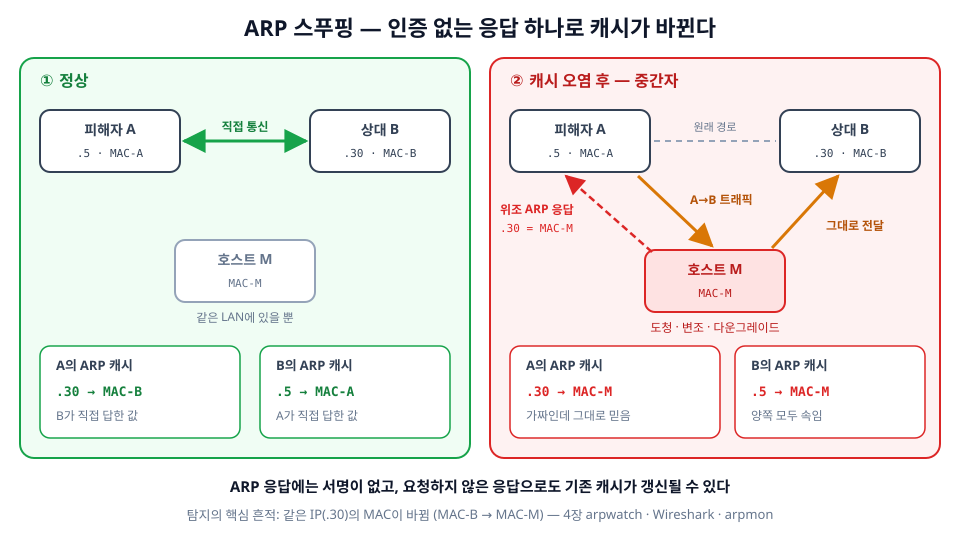
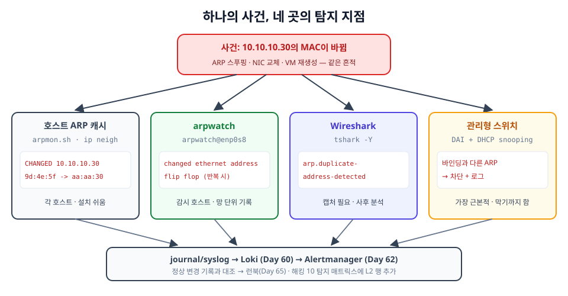
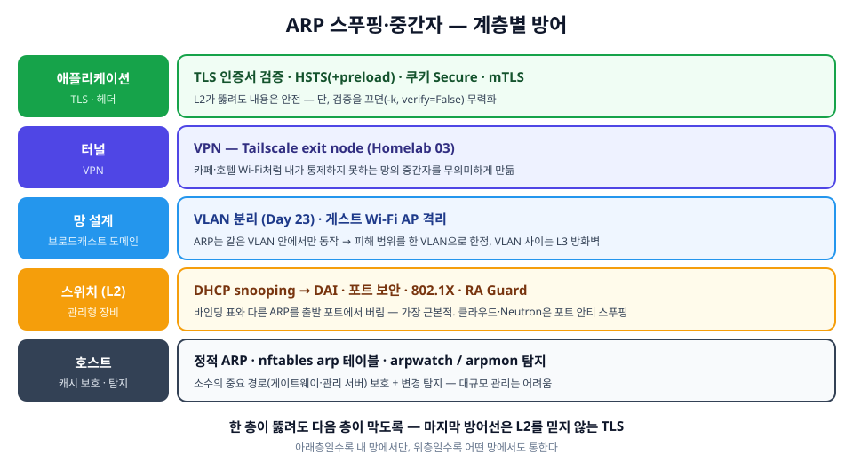

> **해킹 트랙 · 인프라 보안 심화** | 난이도 ★★★☆☆ | 예상 소요 2.5 ~ 3시간

> ⚠️ **실습 전 반드시 읽으세요.** 이 글의 모든 실습은 **본인 소유의 격리된 실습장**(해킹 02의 `hacklab` 네트워크, 10.10.10.0/24)과 **본인 기기**에서만 합니다. ARP 스푸핑은 같은 망의 **다른 사람의 통신을 가로채는 행위**라서 카페·회사·학교·집 공유기 LAN에서 시도하면 **통신비밀보호법**(감청)과 **정보통신망법** 위반으로 처벌될 수 있습니다. 이 글은 공격 도구 사용법을 다루지 않습니다. 원리를 이해한 뒤 **탐지하고 막는 방법**에 집중합니다.

## 🎯 오늘의 목표

- ARP의 동작을 복습하고, **ARP에 인증이 없어서** 생기는 캐시 오염(ARP 스푸핑)과 중간자(MITM) 공격의 원리를 설명할 수 있다
- **arpwatch**, Wireshark의 **중복 주소 경고**, 직접 만든 **ARP 테이블 감시 스크립트**로 MAC 변경을 탐지한다
- 호스트에서 **정적 ARP**와 nftables `arp` 테이블로, 스위치에서 **DAI · DHCP snooping · 포트 보안**으로 막는 원리를 안다
- L2를 완전히 믿을 수 없다는 전제로 **TLS 인증서 검증·HSTS**, 공용 Wi-Fi에서는 **VPN(Homelab 03 Tailscale)**, 망 설계에서는 **VLAN 분리(Day 23)** 로 피해를 줄인다

---

## 1. ARP 복습 — IP를 MAC으로 바꾸는 질문과 대답

Day 22에서 같은 브리지에 붙은 네임스페이스끼리 핑을 보낼 때, 첫 패킷 전에 `ARP, Request who-has ...`가 먼저 지나가는 것을 봤습니다. 이더넷 프레임은 **MAC 주소**로 배달되므로, IP만 아는 상태에서는 "이 IP 가진 사람 MAC 알려 주세요"라고 먼저 물어야 합니다.

```
Kali(10.10.10.5)    → 브로드캐스트(ff:ff:ff:ff:ff:ff):  Who has 10.10.10.30? Tell 10.10.10.5
Metasploitable(.30) → Kali(유니캐스트):                   10.10.10.30 is at 08:00:27:9d:4e:5f
```

답을 받으면 **ARP 캐시(neighbor 테이블)** 에 저장하고 한동안 다시 묻지 않습니다.

```bash
# Kali
ip neigh show dev eth1
# 10.10.10.30 lladdr 08:00:27:9d:4e:5f REACHABLE
# 10.10.10.21 lladdr 08:00:27:3a:1b:2c STALE
# 10.10.10.20 lladdr 08:00:27:3a:1b:2c STALE
```

| 상태 | 의미 |
|---|---|
| `REACHABLE` | 최근 통신으로 확인됨 |
| `STALE` | 오래됨 — 다음에 쓸 때 확인 절차를 거침 |
| `PERMANENT` | 수동으로 넣은 **정적 항목** — 바뀌지 않음(5장) |
| `FAILED` / `INCOMPLETE` | 답이 없음 |

> 💡 `.20`과 `.21`의 MAC이 같은 것은 해킹 02에서 ipvlan으로 컨테이너를 붙였기 때문입니다(해킹 03 3장). **"한 MAC에 여러 IP"는 그 자체로는 공격의 증거가 아닙니다.** 탐지 규칙을 만들 때 이런 정상 예외를 먼저 알아 두어야 오탐에 빠지지 않습니다(4-3).

---

## 2. 왜 위험한가 — ARP에는 인증이 없다



ARP(RFC 826, 1982년)는 **같은 LAN의 모두가 서로를 믿는다**는 전제로 만들어졌습니다.

| 설계 특징 | 결과 |
|---|---|
| 응답에 **서명·인증이 없음** | "10.10.10.30은 내 MAC이야"라는 응답을 **누구나** 보낼 수 있음 |
| **상태가 없음** — 요청하지 않은 응답(gratuitous ARP)도 받아들일 수 있음 | 묻지도 않았는데 온 응답으로 기존 캐시가 **갱신**될 수 있음 |
| 나중에 온 응답이 이김 | 위조 응답을 주기적으로 보내면 캐시가 계속 위조 값으로 유지됨 |

**ARP 스푸핑(ARP 캐시 포이즈닝)** 은 이 점을 이용해, 피해자의 캐시에서 "게이트웨이(또는 통신 상대) IP → **공격자 MAC**"이 되도록 위조 응답을 보내는 것입니다. 양쪽 모두를 속이고 받은 패킷을 원래 목적지로 **다시 넘겨주면**, 통신은 겉보기에 정상이지만 모든 패킷이 공격자를 지나갑니다. 이것이 LAN에서의 **중간자(Man-in-the-Middle, MITM)** 입니다.

| 중간자가 되면 할 수 있는 것 | 해킹 21과 연결 |
|---|---|
| **도청** | 평문 HTTP 로그인의 비밀번호·토큰이 그대로 보임 |
| **변조** | 평문 응답에 스크립트 삽입, 다운로드 파일 바꿔치기 |
| **다운그레이드** | HTTPS로 가려는 첫 평문 요청을 가로채 평문에 머물게 함(SSL stripping) → 7장 HSTS |
| **가짜 인증서 제시** | 사용자가 인증서 경고를 무시하면 TLS 내용까지 노출 → 7장 인증서 검증 |
| **서비스 거부** | 받은 패킷을 넘겨주지 않으면 통신 단절 |

> 💡 같은 원리의 친척들: IPv6의 **NDP 스푸핑**(Neighbor Advertisement 위조)과 **가짜 Router Advertisement**, **가짜 DHCP 서버**(게이트웨이·DNS를 자기 주소로 알려 줌). 방어도 비슷한 구조(RA Guard, DHCP snooping)라 6장에서 함께 봅니다.

### 2-1. 실습장에서의 재현에 대해

이 공격은 Kali에 포함된 **교육용 도구로 격리 실습장 안에서 재현할 수 있습니다.** 이 글은 그 절차를 다루지 않습니다. 대신 **공격과 같은 흔적(같은 IP의 MAC이 바뀜)** 을 안전하게 만드는 방법(4-1, VM의 MAC을 바꾸는 것)으로 탐지 장치가 제대로 동작하는지 확인합니다. 재현이 필요하다면 반드시 해킹 01의 RoE를 쓰고, 해킹 02 체크리스트로 실습망이 격리됐는지 확인한 뒤, 오늘 만든 탐지 장치를 **먼저 켜 둔 상태**에서 하세요. 목적은 "탐지가 되는가"의 확인입니다.

---

## 3. 탐지 지점 한눈에



| 위치 | 도구 | 보는 것 | 장점 / 한계 |
|---|---|---|---|
| 각 호스트 | **ARP 테이블 감시 스크립트**, 정적 ARP | 내 캐시의 IP↔MAC 변화 | 설치가 쉬움 / 호스트마다 필요 |
| 감시용 호스트 | **arpwatch** | 망 전체의 ARP 패킷에서 IP↔MAC 쌍의 변화 | 망 단위 기록 / 브로드캐스트·자기 트래픽만 보임 |
| 패킷 분석 | **Wireshark** (`arp.duplicate-address-detected`) | 캡처 안에서 같은 IP에 다른 MAC | 사후 분석 / 캡처가 있어야 함 |
| 스위치 | **DAI**, DHCP snooping 로그 | 바인딩 표와 다른 ARP를 **차단**하고 기록 | 가장 근본적 / 관리형 스위치 필요 |
| 네트워크 IDS | Suricata·Zeek | ARP 이상, 이어지는 평문 자격 증명 | 해킹 03·10과 연결 |

---

## 4. 탐지 ① — arpwatch, Wireshark, 감시 스크립트

### 4-1. 안전한 "MAC 변경 이벤트" 만들기

탐지를 확인하려면 "같은 IP의 MAC이 바뀌는" 사건이 필요합니다. 공격 대신 **Metasploitable 2의 NIC MAC을 바꾸는 것**으로 같은 흔적을 만듭니다. 실무에서는 NIC 교체, VM 재생성, 장애 조치(failover)가 같은 흔적을 남기므로 **정상 변경과 공격을 구분하는 연습**도 됩니다.

```bash
# 호스트(VirtualBox) — Metasploitable 2를 끈 상태에서
VBoxManage showvminfo metasploitable2 --machinereadable | grep -i '^macaddress1'
# macaddress1="0800279D4E5F"          ← 원래 값을 기록해 둠
VBoxManage modifyvm metasploitable2 --macaddress1 080027AAAA30
VBoxManage startvm metasploitable2 --type headless
# 확인이 끝나면 원래 값으로 되돌리거나 해킹 02의 스냅샷 00-clean 복원
```

이벤트를 만들기 **전에** 아래 4-2~4-4의 탐지 장치를 먼저 켜 두고, 변경 전에 Kali에서 `ping -c 1 10.10.10.30`으로 원래 MAC을 한 번 학습시킵니다.

### 4-2. arpwatch — 망의 IP↔MAC 쌍을 기록하고 변화를 알림

arpwatch는 인터페이스의 ARP 패킷을 듣고 **IP↔MAC 쌍 데이터베이스**를 만든 뒤, 새 장비나 변경을 syslog(와 메일)로 알립니다. 1990년대 LBL에서 만든 도구로, 배포판 패키지는 Debian 계열의 2.1a15 기반(Kali·Ubuntu 24.04), 원 개발처(LBL)는 3.x 계열을 계속 배포합니다. 옵션은 `man arpwatch`로 확인하세요.

설치는 **업데이트 모드**에서, 감시는 실습망 NIC가 있는 docker-targets VM에서 합니다.

```bash
# docker-targets VM (업데이트 모드)
sudo apt install -y arpwatch
```

```bash
# 실습 모드 — 실습망 NIC로 실행 (Debian/Ubuntu 패키지는 인터페이스별 템플릿 유닛 제공)
systemctl list-unit-files 'arpwatch*'
# arpwatch.service   ...
# arpwatch@.service  ...
sudo systemctl enable --now arpwatch@enp0s8
sudo journalctl -u arpwatch@enp0s8 -f
```

> 💡 패키지 버전에 따라 유닛 이름이나 설정 방식(`/etc/default/arpwatch`)이 다를 수 있습니다. 유닛이 없다면 포그라운드로 직접 확인할 수 있습니다: `sudo arpwatch -d -i enp0s8` (`-d`는 디버그 모드로, 데몬이 되지 않고 메일 대신 화면에 보고).

처음 몇 분은 실습망 장비마다 `new station` 기록이 쌓입니다(학습 단계). 4-1의 MAC 변경 후 Metasploitable이 부팅되면:

```
arpwatch: new station 10.10.10.20 08:00:27:3a:1b:2c enp0s8
arpwatch: new station 10.10.10.30 08:00:27:9d:4e:5f enp0s8
...
arpwatch: changed ethernet address 10.10.10.30 08:00:27:aa:aa:30 (08:00:27:9d:4e:5f) enp0s8
```

| arpwatch 메시지 | 의미 | 공격 관점 |
|---|---|---|
| `new station` | 처음 보는 IP↔MAC | 새 장비 — 자산 목록과 대조 |
| `changed ethernet address` | 아는 IP의 MAC이 바뀜 | **스푸핑 또는 정상 교체** — 변경 기록과 대조 |
| `flip flop` | 두 MAC 사이를 왔다 갔다 | **스푸핑의 전형**(진짜와 가짜가 번갈아 응답) |
| `reused old ethernet address` | 예전 MAC으로 되돌아감 | 원복 또는 공격 종료 |
| `ethernet broadcast` / `ethernet mismatch` | 이더넷 헤더와 ARP 본문의 MAC 불일치 등 | 조작된 패킷 의심 |

데이터베이스는 `/var/lib/arpwatch/` 아래(인터페이스별 `.dat` 파일)에 저장됩니다. 이 기록은 **사고 조사 때 "그 시각 그 IP는 어느 MAC이었나"** 를 답해 주는 자료가 됩니다(해킹 27).

> 💡 알림 연결: arpwatch 로그는 syslog/journal에 남으므로 Day 60의 Alloy로 Loki에 보내고, `changed ethernet address|flip flop` LogQL 규칙을 Day 62 Alertmanager로 보내면 됩니다. 해킹 10의 탐지 매트릭스에 "L2 — ARP 변경" 행을 추가하세요.

### 4-3. Wireshark — 중복 주소 경고

Wireshark의 ARP 해석기는 **같은 캡처 안에서 하나의 IP가 서로 다른 MAC으로 나타나면** 경고를 붙입니다.

```bash
# Kali — MAC 변경 전후를 포함해 캡처
tshark -i eth1 -f "arp or host 10.10.10.30" -w ~/hacklab/pcap/hack22-arp.pcapng
# (다른 터미널) 변경 전 ping → 4-1의 MAC 변경·부팅 → 변경 후 ping
```

```bash
tshark -r ~/hacklab/pcap/hack22-arp.pcapng -Y 'arp.duplicate-address-detected'
#  ... 08:00:27:aa:aa:30 → 08:00:27:xx:xx:05 ARP 60 10.10.10.30 is at 08:00:27:aa:aa:30 (duplicate use of 10.10.10.30 detected!)

tshark -r ~/hacklab/pcap/hack22-arp.pcapng -Y 'arp.duplicate-address-detected' -V | grep -A2 'Duplicate IP'
```

| 디스플레이 필터 | 의미 |
|---|---|
| `arp.duplicate-address-detected` | 같은 IP에 다른 MAC이 보인 프레임 |
| `arp.duplicate-address-frame` | 그 IP를 처음 알린 프레임 번호(비교 대상) |
| `arp.opcode == 2` | ARP 응답만 |
| `arp.opcode == 2 && eth.dst != ff:ff:ff:ff:ff:ff` | 유니캐스트 응답 — 요청 없이 반복되면 의심 |
| `arp.isgratuitous` | gratuitous ARP(자기 IP를 스스로 알림) |

GUI에서는 **Analyze → Expert Information**의 Warning 항목에 "Duplicate IP address configured"가 나타납니다. ARP가 비정상적으로 많은지는 Preferences → Protocols → ARP/RARP의 **요청 폭주 감지(Detect ARP request storms)** 옵션으로도 볼 수 있습니다.

> ⚠️ ipvlan 컨테이너처럼 **한 MAC이 여러 IP를 갖는 것**은 이 경고의 대상이 아닙니다. 경고는 "**한 IP가 여러 MAC**"일 때 붙습니다. 공격 탐지에서 핵심도 바로 이 방향입니다.

### 4-4. ARP 테이블 감시 스크립트 — 내 호스트의 캐시를 지킨다

arpwatch는 감시 호스트에서 망을 보고, 이 스크립트는 **각 호스트가 자기 캐시를** 봅니다. 기준선(baseline)을 저장하고 주기적으로 비교합니다.

```bash
# Kali — ~/hacklab/bin/arpmon.sh
mkdir -p ~/hacklab/bin ~/hacklab/notes
cat > ~/hacklab/bin/arpmon.sh <<'EOF'
#!/usr/bin/env bash
# ARP(neighbor) 테이블 감시: 기준선과 다른 IP→MAC 매핑을 찾아 기록한다.
# 사용법: arpmon.sh <인터페이스> [주기초]   예) arpmon.sh eth1 10
set -euo pipefail
IFACE="${1:?인터페이스를 지정하세요}"
INTERVAL="${2:-10}"
BASE="$HOME/hacklab/notes/arp-baseline-$IFACE.txt"

snapshot() {   # "IP MAC" 형식, MAC을 아는 항목만
  ip -4 neigh show dev "$IFACE" | awk '$2=="lladdr"{print $1, $3}' | sort -u
}

if [[ ! -s "$BASE" ]]; then
  snapshot > "$BASE"
  echo "기준선 저장: $BASE"; cat "$BASE"
fi

declare -A known
while read -r ip mac; do known["$ip"]="$mac"; done < "$BASE"

while true; do
  while read -r ip mac; do
    if [[ -z "${known[$ip]:-}" ]]; then
      logger -t arpmon -p user.notice "NEW $IFACE $ip $mac"
      echo "$(date -Is) NEW     $ip $mac"
      known["$ip"]="$mac"
    elif [[ "${known[$ip]}" != "$mac" ]]; then
      logger -t arpmon -p user.warning "CHANGED $IFACE $ip ${known[$ip]} -> $mac"
      echo "$(date -Is) CHANGED $ip ${known[$ip]} -> $mac   <-- 확인 필요"
    fi
  done < <(snapshot)
  sleep "$INTERVAL"
done
EOF
chmod +x ~/hacklab/bin/arpmon.sh
```

```bash
# 실습망 장비를 한 번씩 건드려 캐시를 채운 뒤 기준선 생성 + 감시 시작
for h in 10 20 21 30; do ping -c 1 -W 1 10.10.10.$h > /dev/null; done
~/hacklab/bin/arpmon.sh eth1 5
# 기준선 저장: /home/kali/hacklab/notes/arp-baseline-eth1.txt
# 10.10.10.10 08:00:27:3a:1b:2c
# 10.10.10.20 08:00:27:3a:1b:2c
# 10.10.10.21 08:00:27:3a:1b:2c
# 10.10.10.30 08:00:27:9d:4e:5f
```

4-1의 MAC 변경 후 Kali에서 `ping -c 1 10.10.10.30`을 보내면:

```
2026-11-15T15:02:41+09:00 CHANGED 10.10.10.30 08:00:27:9d:4e:5f -> 08:00:27:aa:aa:30   <-- 확인 필요
```

```bash
journalctl -t arpmon --since "10 min ago"
```

| 설계 포인트 | 이유 |
|---|---|
| **"IP → MAC 변경"** 만 경고 | 한 MAC 다중 IP(ipvlan, 라우터, 로드밸런서)는 정상일 수 있음 |
| 기준선을 **파일**로 | 정상 변경(장비 교체) 후에는 파일을 고치고 그 사실을 변경 기록에 남김 |
| `logger`로 journal에 | Loki(Day 60) → 알림(Day 62)으로 바로 연결 |
| 게이트웨이 IP는 최우선 | 실무에서 가장 노려지는 항목. 기준선에 꼭 포함하고 변경 시 즉시 알림 |

> 💡 계속 돌리려면 systemd 유닛으로 등록합니다(Day 65 런북에 "arpmon CHANGED 알림 대응 절차"도 함께). 다만 이 스크립트는 **캐시가 이미 바뀐 뒤** 알아차리는 탐지 도구입니다. 바뀌지 않게 하는 것은 5·6장입니다.

---

## 5. 방어 ① — 호스트에서: 정적 ARP와 nftables `arp` 테이블

### 5-1. 정적 ARP (PERMANENT 항목)

중요한 상대(게이트웨이, 관리 서버)의 MAC을 **수동으로 고정**하면 위조 응답이 와도 캐시가 바뀌지 않습니다.

```bash
# Kali — Metasploitable(.30)의 MAC을 고정 (4-1 실습 뒤 원래 MAC으로 되돌린 상태에서)
sudo ip neigh replace 10.10.10.30 lladdr 08:00:27:9d:4e:5f dev eth1 nud permanent
ip neigh show 10.10.10.30
# 10.10.10.30 dev eth1 lladdr 08:00:27:9d:4e:5f PERMANENT

# 해제
sudo ip neigh del 10.10.10.30 dev eth1
```

재부팅 후에도 유지하려면 systemd 유닛으로 적용합니다.

```bash
sudo tee /etc/systemd/system/static-arp.service > /dev/null <<'EOF'
[Unit]
Description=Static ARP entries for hacklab
After=network-online.target
Wants=network-online.target

[Service]
Type=oneshot
RemainAfterExit=yes
ExecStart=/usr/sbin/ip neigh replace 10.10.10.30 lladdr 08:00:27:9d:4e:5f dev eth1 nud permanent

[Install]
WantedBy=multi-user.target
EOF
sudo systemctl daemon-reload && sudo systemctl enable --now static-arp.service
```

| 장점 | 한계 |
|---|---|
| 위조 응답으로 **내 캐시가 바뀌지 않음** | **모든 호스트 × 모든 상대**를 관리해야 함 → 대규모에서는 비현실적 |
| 추가 장비 불필요 | 상대방 캐시는 여전히 오염될 수 있음(반쪽짜리 중간자) — **양쪽 모두** 고정해야 함 |
| 서버↔게이트웨이처럼 소수의 중요 경로에 효과적 | NIC 교체 시 수동 갱신 필요 → 잊으면 장애 |

> 💡 Windows에서는 `netsh interface ipv4 add neighbors "<인터페이스 이름>" 10.10.10.30 08-00-27-9d-4e-5f`로 같은 일을 합니다(관리자 권한). `arp -s`는 재부팅 후 유지되지 않을 수 있습니다.

### 5-2. nftables `arp` 패밀리 — "이 IP는 이 MAC에서만"

정적 항목 대신 **방화벽에서 위조 응답 자체를 버리는** 방법도 있습니다. Day 67의 nftables는 `inet` 테이블만 썼지만, nftables에는 ARP 패킷을 다루는 **`arp` 패밀리**가 따로 있습니다(해킹 03 Q1에서 "ARP는 `inet` 규칙으로 막히지 않는다"고 한 이유).

```bash
# Kali — /etc/nftables.d/arpguard.nft
sudo mkdir -p /etc/nftables.d
sudo tee /etc/nftables.d/arpguard.nft > /dev/null <<'EOF'
table arp arpguard
delete table arp arpguard

table arp arpguard {
    chain input {
        type filter hook input priority filter; policy accept;
        # 10.10.10.30이라고 주장하는 ARP는 알려진 MAC에서 온 것만 받는다
        arp saddr ip 10.10.10.30 arp saddr ether != 08:00:27:9d:4e:5f \
            log prefix "arpguard-drop: " drop
    }
}
EOF
sudo nft -c -f /etc/nftables.d/arpguard.nft && sudo nft -f /etc/nftables.d/arpguard.nft
sudo nft list table arp arpguard
```

4-1처럼 MAC을 바꾼 Metasploitable이 응답하면, Kali는 그 응답을 버리고 커널 로그에 남깁니다.

```bash
sudo journalctl -k -g 'arpguard-drop' --since "10 min ago" | tail -n 2
```

**탐지(로그)와 차단을 동시에** 하는 셈입니다. 한계는 정적 ARP와 같습니다(관리 대상이 늘면 힘듦). 그래서 규모가 커지면 이 판단을 **스위치에 맡깁니다.**

### 5-3. 커널 설정 확인 — 오해 바로잡기

```bash
sysctl net.ipv4.conf.eth1.arp_accept
# net.ipv4.conf.eth1.arp_accept = 0
```

`arp_accept = 0`(기본값)은 "요청하지 않은 ARP로 **새 항목을 만들지 않는다**"는 뜻일 뿐, **이미 있는 항목이 갱신되는 것은 막지 못합니다.** "기본 설정이라 안전하다"고 오해하기 쉬운 부분입니다. 호스트 커널 설정만으로는 ARP 스푸핑을 막을 수 없고, 5-1·5-2나 6장의 방어가 필요합니다.

---

## 6. 방어 ② — 스위치에서: DHCP snooping, DAI, 포트 보안



관리형 스위치는 모든 프레임이 지나가는 곳이므로 **위조 ARP를 출발점에서 버릴 수 있는** 가장 좋은 위치입니다. 세 기능은 서로 의존합니다.

| 기능 | 하는 일 | 막는 것 |
|---|---|---|
| **DHCP snooping** | DHCP 응답은 **신뢰 포트**(DHCP 서버·업링크)에서만 허용. 정상 DHCP 교환을 보고 **바인딩 표**(포트·VLAN·MAC·IP) 생성 | 가짜 DHCP 서버, DAI의 기준 데이터 제공 |
| **DAI** (Dynamic ARP Inspection) | 비신뢰 포트에서 들어온 ARP를 **바인딩 표와 대조**해 맞지 않으면 버리고 기록 | **ARP 스푸핑** — "10.10.10.30은 내 MAC" 위조가 그 포트의 바인딩과 다르면 차단 |
| **포트 보안** (Port Security) | 포트당 허용 MAC 수·목록 제한, 위반 시 차단·알림 | MAC 폭주(CAM 테이블 넘침 → 스위치가 허브처럼 동작), 무단 장비 연결 |
| (IPv6) **RA Guard**, ND inspection | 가짜 Router Advertisement·NDP 위조 차단 | IPv6판 같은 공격 |
| **802.1X** | 포트에 장비를 꽂으면 인증 후에만 통신 허용 | 아무 장비나 LAN에 붙이는 것 자체 |

개념을 잡기 위한 설정 모양(Cisco IOS 계열 예시 — 실제 문법은 장비 제조사·모델 문서를 확인):

```
! DHCP snooping — VLAN 10에서 활성화, 업링크만 신뢰
ip dhcp snooping
ip dhcp snooping vlan 10
interface GigabitEthernet0/24
 ip dhcp snooping trust
!
! DAI — 같은 VLAN에서 ARP 검사, 업링크만 신뢰
ip arp inspection vlan 10
interface GigabitEthernet0/24
 ip arp inspection trust
!
! 고정 IP 서버(DHCP를 안 쓰는 장비)는 정적 바인딩·ARP ACL로 따로 허용해야 함
!
! 포트 보안 — 사용자 포트당 MAC 2개까지
interface GigabitEthernet0/1
 switchport mode access
 switchport port-security
 switchport port-security maximum 2
```

> ⚠️ DAI를 켜기 전에 **고정 IP 장비(서버·프린터·게이트웨이)** 의 바인딩을 먼저 등록하세요. 바인딩이 없는 장비의 ARP는 정상이어도 버려져 **장애**가 납니다. 반드시 점검 시간에, 한 VLAN씩 적용합니다.

### 6-1. 가상 환경과 클라우드에서는

| 환경 | 같은 역할의 기능 |
|---|---|
| OpenStack Neutron (Day 30) | **포트 보안(port security)** — 포트에 할당된 MAC·IP가 아닌 출발지의 패킷(ARP 포함)을 차단하는 안티 스푸핑. 예외는 `allowed-address-pairs`로만 |
| AWS·GCP 등 퍼블릭 클라우드 | VPC가 L2를 직접 노출하지 않고 출발지·목적지 검사를 함 → 전통적 ARP 스푸핑이 통하지 않음 |
| Open vSwitch (Day 24) | 플로우 규칙으로 포트별 허용 MAC·IP 지정 |
| 홈 공유기 | 대부분 DAI가 없음. 일부는 "ARP 스푸핑 방어", "AP 격리(클라이언트 격리)" 옵션 제공(해킹 26) |

---

## 7. 방어 ③ — 애플리케이션 계층: L2를 믿지 않는다

스위치 방어는 내 회사 망에서만 통합니다. 카페 Wi-Fi, 호텔 망, 고객사 망은 내가 통제할 수 없습니다. 그래서 마지막 방어선은 **"경로 중간에 누가 있어도 안전한" 통신**입니다.

| 방어 | 막는 것 | 핵심 |
|---|---|---|
| **TLS + 인증서 검증** | 도청·변조·가짜 서버 | 중간자는 **올바른 인증서를 만들 수 없다** → 검증만 제대로 하면 내용이 안전 |
| **HSTS** | SSL stripping(다운그레이드) | 브라우저가 처음부터 HTTPS로만 접속 |
| **HSTS preload** | "첫 방문" 공백 | 브라우저에 내장된 목록 → 첫 요청부터 HTTPS |
| 쿠키 `Secure` | 평문 요청에 쿠키가 실려 나가는 것 | 해킹 17 |
| SSH 호스트 키 확인 | SSH 중간자 | `known_hosts` 경고(`REMOTE HOST IDENTIFICATION HAS CHANGED`)를 무시하지 않기 |
| 서비스 간 mTLS | 내부망 중간자 | Day 70 |

### 7-1. 인증서 검증을 끄면 TLS는 중간자를 막지 못한다

해킹 21에서 자체 인증서 때문에 `curl -k`를 썼습니다. 중간자가 자기 인증서를 내밀어도 `-k`는 받아들입니다. 실서비스 코드에서 이렇게 하면 **암호화는 되지만 상대가 누구인지 모르는** 통신이 됩니다.

```python
# ❌ 취약 — 인증서 검증 끔
requests.post("https://api.internal.example/login", json=body, verify=False)

# ✅ 안전 — 기본값(검증) 유지, 사내 CA는 번들 경로로 지정
requests.post("https://api.internal.example/login", json=body, verify="/etc/ssl/certs/internal-ca.pem")
```

```java
// ❌ 취약 — 모든 인증서를 믿는 TrustManager, 호스트 이름 검증 끄기
// (checkServerTrusted를 빈 메서드로 두는 X509TrustManager, HostnameVerifier가 항상 true)

// ✅ 안전 — Spring Boot의 SSL bundle로 사내 CA만 신뢰 (application.yml)
// spring.ssl.bundle.pem.internal.truststore.certificate: classpath:internal-ca.pem
// 그리고 RestClient/WebClient 빌더에 이 번들을 적용 (Spring Boot 3.1+ SSL bundles)
```

이런 코드는 해킹 14의 Semgrep·CodeQL 규칙으로 PR 단계에서 막습니다.

### 7-2. HSTS — 다운그레이드를 막는 헤더

사용자가 주소창에 `example.com`만 치면 브라우저는 먼저 **평문 HTTP**로 접속합니다. 중간자는 이 첫 요청을 가로채 사용자를 평문에 붙잡아 둘 수 있습니다. HSTS는 "이 사이트는 앞으로 HTTPS로만 접속하라"고 브라우저에 기억시킵니다.

```
Strict-Transport-Security: max-age=31536000; includeSubDomains; preload
```

| 항목 | 의미 |
|---|---|
| `max-age=31536000` | 1년 동안 이 도메인은 HTTPS로만 |
| `includeSubDomains` | 하위 도메인까지 |
| `preload` | hstspreload.org에 등록 신청할 의사 표시 → 등록되면 브라우저 내장 목록에 포함 |

```
# Caddy (Homelab 03) — Caddyfile
example.com {
    header Strict-Transport-Security "max-age=31536000; includeSubDomains"
    reverse_proxy app:8080
}
```

```java
// Spring Security — HTTPS 요청에 HSTS 헤더 (기본 활성화 상태를 명시적으로 조정, SecurityFilterChain 안에서)
http.headers(h -> h.httpStrictTransportSecurity(hsts -> hsts
        .includeSubDomains(true)
        .maxAgeInSeconds(31536000)));
```

> ⚠️ `max-age`를 길게, `includeSubDomains`·`preload`를 켜는 것은 **모든 하위 도메인이 HTTPS를 지원할 때만** 합니다. 처음에는 `max-age=300` 정도로 시작해 문제를 확인하고 늘리세요. preload 목록에서 빠지는 데는 오랜 시간이 걸립니다. 브라우저 보안 헤더 전반은 해킹 17에서 다뤘습니다.

```bash
# 확인 (내 서비스에서)
curl -sI https://<내 도메인>/ | grep -i strict-transport-security
```

---

## 8. 공용 Wi-Fi와 망 설계 — VPN과 VLAN

### 8-1. 공용 Wi-Fi에서 무엇이 위험한가

| 위험 | 설명 | 대응 |
|---|---|---|
| 같은 AP의 다른 사용자 | 같은 L2에 있으므로 ARP 스푸핑 가능 (AP 격리가 없으면) | VPN, TLS |
| **가짜 AP(Evil Twin)** | 같은 이름의 AP를 띄워 접속 유도 → 공격자가 곧 게이트웨이 | 자동 접속 끄기, VPN |
| 캡티브 포털 | 로그인 페이지 때문에 평문 HTTP 요청이 생김 | 포털 통과 후 VPN 연결 |
| 평문 DNS | 어디에 접속하는지 노출(해킹 21 5장) | VPN 또는 DoH/DoT |

**VPN**은 내 기기에서 신뢰할 수 있는 지점까지 **암호화된 터널**을 만들어, 그 사이의 L2·L3 중간자를 의미 없게 만듭니다. 중간자는 터널 패킷(WireGuard UDP)만 볼 수 있습니다.

### 8-2. Tailscale exit node로 "집을 거쳐 나가기" (Homelab 03 연결)

Homelab 03에서 만든 Tailscale은 기본적으로 tailnet(내 기기들) 사이의 트래픽만 암호화합니다. **카페에서 인터넷으로 나가는 트래픽 전체**를 보호하려면 H01을 **exit node**로 지정해, 노트북의 모든 트래픽이 WireGuard 터널로 집까지 간 뒤 인터넷으로 나가게 합니다.

```bash
# H01 (홈랩 서버) — exit node로 광고 (IP 포워딩 필요: Tailscale 문서의 sysctl 안내 참고)
sudo tailscale set --advertise-exit-node
# → 관리 콘솔(login.tailscale.com)의 Machines에서 해당 기기의 exit node 사용을 승인
```

```bash
# 노트북 (Linux 예 — Windows·macOS·모바일은 앱 메뉴의 "Exit node"에서 선택)
sudo tailscale set --exit-node=homelab --exit-node-allow-lan-access=false
tailscale status | head -n 3
# 해제
sudo tailscale set --exit-node=
```

| 구간 | VPN 없음 | exit node 사용 |
|---|---|---|
| 노트북 ↔ 카페 AP ↔ 카페 공유기 | 평문 DNS·HTTP 노출, ARP 스푸핑 위험 | **WireGuard 암호화** — 중간자는 UDP 패킷만 봄 |
| 집 ↔ 인터넷 | — | 일반 인터넷 (여기서부터는 TLS가 보호) |

> 💡 VPN은 **카페 구간**을 지킬 뿐, 목적지 서버까지의 구간은 여전히 TLS가 지켜야 합니다. "VPN을 쓰니 평문 HTTP도 괜찮다"가 아닙니다. 그리고 VPN 제공자(여기서는 내 집 서버)가 새로운 "중간"이 된다는 점도 기억하세요. 그래서 Tailscale exit node처럼 **내가 통제하는 지점**을 쓰는 것이 좋습니다.

### 8-3. VLAN 분리 — 스푸핑이 닿는 범위를 줄인다 (Day 23 연결)

ARP는 **브로드캐스트 도메인 안에서만** 동작합니다. Day 23에서 VLAN이 다르면 같은 대역 IP를 써도 ARP가 넘어가지 못하는 것을 확인했습니다. 즉 ARP 스푸핑의 피해 범위는 **같은 VLAN**으로 한정됩니다.

| 망 | VLAN 예 | 효과 |
|---|---|---|
| 서버망 | 10 | 사용자 PC가 감염돼도 서버 간 통신에 ARP로 끼어들 수 없음 |
| 사용자망 | 20 | |
| 게스트 Wi-Fi | 30 + **AP 격리** | 손님끼리도 서로 보이지 않음 |
| IoT (카메라·스마트 기기) | 40 | 보안 업데이트가 느린 기기를 분리(해킹 26) |
| 관리망 | 99 | 스위치·하이퍼바이저 관리 화면은 여기서만 |

VLAN 사이 통신은 라우터·방화벽(L3)을 거치므로, 거기서 Day 67의 nftables처럼 **필요한 것만 허용**하고 로그를 남길 수 있습니다. 해킹 02의 `hacklab`을 인터넷·집 LAN과 완전히 분리한 것도 같은 원리를 극단까지 적용한 것입니다.

---

## 9. 탐지와 조치 요약

| 계층 | 탐지 | 조치 |
|---|---|---|
| L2 (스위치) | DAI 차단 로그, DHCP snooping 위반, 포트 보안 위반 | DHCP snooping + DAI + 포트 보안, 802.1X, VLAN 분리 |
| L2 (호스트) | arpwatch `changed ethernet address`·`flip flop`, `arpmon` CHANGED, `arpguard-drop` 로그 | 중요 경로 정적 ARP, nftables `arp` 테이블 |
| 패킷 | Wireshark `arp.duplicate-address-detected`, 요청 없는 유니캐스트 ARP 응답 반복 | 사고 조사 시 캡처 보존(해킹 21 개인정보 원칙 준수) |
| 전송 | 인증서 경고 증가, 예상과 다른 인증서 지문 | TLS 전면 적용, 인증서 검증 유지, mTLS(Day 70) |
| 애플리케이션 | HTTPS 사이트에 평문 요청 발생 | HSTS(+preload), 쿠키 `Secure` |
| 사용자 환경 | — | 공용 Wi-Fi에서 VPN(Tailscale exit node), 자동 접속 끄기 |

---

## 10. 트러블슈팅

| 증상 | 원인 | 해결 |
|---|---|---|
| `arpwatch@enp0s8` 유닛이 없음 | 패키지 버전에 따라 유닛 구성이 다름 | `systemctl list-unit-files 'arpwatch*'`, `/etc/default/arpwatch` 확인, 또는 `sudo arpwatch -d -i enp0s8`로 포그라운드 확인 |
| arpwatch가 아무것도 기록하지 않음 | 실습망이 아닌 NIC 감시, 트래픽 없음 | `-i enp0s8` 확인, Kali에서 `ping`으로 ARP 발생시키기 |
| MAC을 바꿨는데 `changed` 대신 `new station`만 | arpwatch가 원래 MAC을 학습하기 전에 변경 | 4-1 순서대로 — 탐지 장치 시작 → 원래 MAC 학습 → 변경 |
| `arpmon.sh`가 ipvlan 컨테이너 때문에 경고 | 경고 조건을 "한 MAC 다중 IP"로 만듦 | "IP → MAC 변경"만 경고하도록 유지(4-4 설계 포인트) |
| `arp.duplicate-address-detected`가 아무것도 안 나옴 | 변경 전후가 같은 캡처에 없음 | 변경 전 ping부터 변경 후 ping까지 한 파일로 캡처 |
| 정적 ARP 적용 후 Metasploitable과 통신 불가 | 4-1에서 바꾼 MAC 그대로인데 원래 MAC으로 고정 | VM MAC을 원래대로 복구하거나 스냅샷 `00-clean` 복원 |
| `nft -f arpguard.nft` 오류 | 줄 끝 `\` 뒤 공백, 패밀리 이름 오타 | `sudo nft -c -f`로 문법 검사, `table arp` 확인 |
| DAI 적용 후 서버가 통신 불가 | 고정 IP 장비의 바인딩 미등록 | 정적 바인딩·ARP ACL 추가, 점검 시간에 VLAN 단위 적용 |
| exit node가 목록에 안 보임 | 관리 콘솔 승인 누락, H01 IP 포워딩 미설정 | 관리 콘솔에서 승인, Tailscale 문서의 exit node sysctl 설정 확인 |

---

## 11. 핵심 정리

- ARP는 **인증이 없고 상태가 없다** → 위조 응답 하나로 "IP → 공격자 MAC" 캐시 오염이 가능하고, 양쪽을 속이면 **중간자**가 된다
- 탐지: **arpwatch**(`changed ethernet address`, `flip flop`), Wireshark **`arp.duplicate-address-detected`**, 호스트별 **ARP 테이블 감시**. 경고 기준은 "**한 IP가 여러 MAC**" (한 MAC 다중 IP는 정상일 수 있음)
- 호스트 방어: 중요 경로의 **정적 ARP**, nftables **`arp` 패밀리**로 위조 응답 버리기. `arp_accept=0`만으로는 막지 못한다
- 망 방어: **DHCP snooping**(바인딩 표) → **DAI**(ARP 대조·차단) → **포트 보안**·802.1X. 클라우드·Neutron은 포트 단위 안티 스푸핑
- 마지막 방어선은 L2를 믿지 않는 것: **TLS 인증서 검증 유지**, **HSTS**, 쿠키 `Secure`, SSH 호스트 키 확인
- 통제할 수 없는 망(공용 Wi-Fi)에서는 **VPN**(Tailscale exit node), 내 망에서는 **VLAN 분리**로 피해 범위를 줄인다

---

## 12. 셀프 체크

<details>
<summary>Q1. ARP 스푸핑이 가능한 근본 이유 두 가지는?</summary>

① ARP 응답에 **인증이 없어** 누구나 "이 IP는 내 MAC"이라고 응답할 수 있고, ② ARP가 **상태를 갖지 않아** 요청하지 않은 응답으로도 기존 캐시 항목이 갱신될 수 있기 때문입니다. 나중에 온 응답이 이기므로 위조 응답을 반복하면 캐시를 계속 오염된 상태로 유지할 수 있습니다.
</details>

<details>
<summary>Q2. 실습장에서 DVWA(.20)와 Juice Shop(.21)이 같은 MAC을 가진다. 이것을 ARP 스푸핑으로 판단하면 안 되는 이유와, 탐지 규칙은 어떤 방향을 봐야 하나?</summary>

ipvlan은 컨테이너가 부모 NIC의 MAC을 공유하므로 **한 MAC에 여러 IP**가 정상적으로 생깁니다(라우터·로드밸런서도 비슷). 스푸핑의 핵심 흔적은 반대 방향인 **한 IP가 다른 MAC으로 바뀌는 것**(특히 두 MAC 사이를 오가는 flip flop)이므로, 탐지는 "IP → MAC 변경"을 기준으로 하고 정상 예외는 기준선에 등록해 둡니다.
</details>

<details>
<summary>Q3. DAI가 DHCP snooping에 의존하는 이유는? 고정 IP 서버에 DAI를 적용할 때 주의할 점은?</summary>

DAI는 ARP 패킷의 IP·MAC이 맞는지 판단할 기준이 필요한데, 그 기준이 DHCP snooping이 정상 DHCP 교환을 보고 만든 **바인딩 표**(포트·VLAN·MAC·IP)이기 때문입니다. 고정 IP 장비는 DHCP를 쓰지 않아 바인딩이 없으므로, 정적 바인딩이나 ARP ACL을 먼저 등록하지 않으면 정상 ARP까지 버려져 장애가 납니다.
</details>

<details>
<summary>Q4. 같은 LAN에 중간자가 있어도 HTTPS 로그인이 안전한 조건은? 어떤 경우에 안전하지 않게 되나?</summary>

클라이언트가 **서버 인증서를 제대로 검증**하고(신뢰할 수 있는 CA, 호스트 이름 일치), 처음부터 HTTPS로 접속할 때(HSTS) 안전합니다. 중간자는 올바른 인증서를 만들 수 없기 때문입니다. 반대로 코드에서 검증을 끄거나(`verify=False`, 모든 인증서를 믿는 TrustManager), 사용자가 인증서 경고를 무시하거나, HSTS 없이 첫 요청이 평문 HTTP로 나가 다운그레이드되면 안전하지 않습니다.
</details>

<details>
<summary>Q5. 카페 Wi-Fi에서 Tailscale exit node를 켜면 무엇이 보호되고, 무엇은 여전히 TLS에 맡겨야 하나?</summary>

노트북에서 집(H01)까지의 구간, 즉 카페 AP·카페 공유기·같은 Wi-Fi의 다른 사용자가 있는 구간이 WireGuard로 암호화되어 ARP 스푸핑·가짜 AP·평문 DNS 노출로부터 보호됩니다. 집에서 목적지 서버까지의 인터넷 구간은 VPN 밖이므로 여전히 TLS(인증서 검증, HSTS)가 보호해야 합니다.
</details>

---

## ⏭️ 다음 예고 — 해킹 23. CI/CD 파이프라인 보안 — Actions 권한·시크릿·서드파티 액션

네트워크의 "중간"을 지켰다면, 이제 코드가 운영 환경까지 가는 **배포 경로의 중간**을 봅니다. GitHub Actions 워크플로는 저장소 쓰기 권한, 클라우드 자격 증명, 레지스트리 토큰을 한곳에 모아 둔 자리라 공격자에게 매력적인 목표입니다. 다음 편에서는 `GITHUB_TOKEN` 권한 최소화, `pull_request_target`의 함정, 시크릿 노출, 서드파티 액션을 커밋 SHA로 고정하는 이유를 Day 51·57과 연결해 점검하고, 탐지와 수정까지 짝으로 정리합니다.
