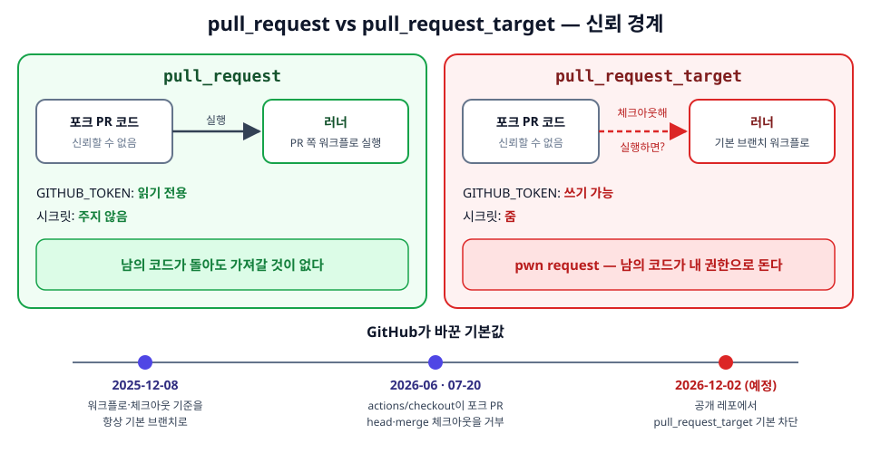
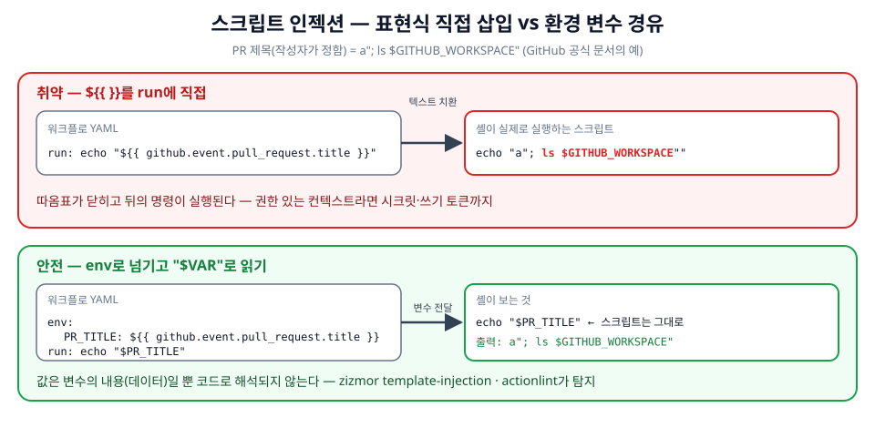
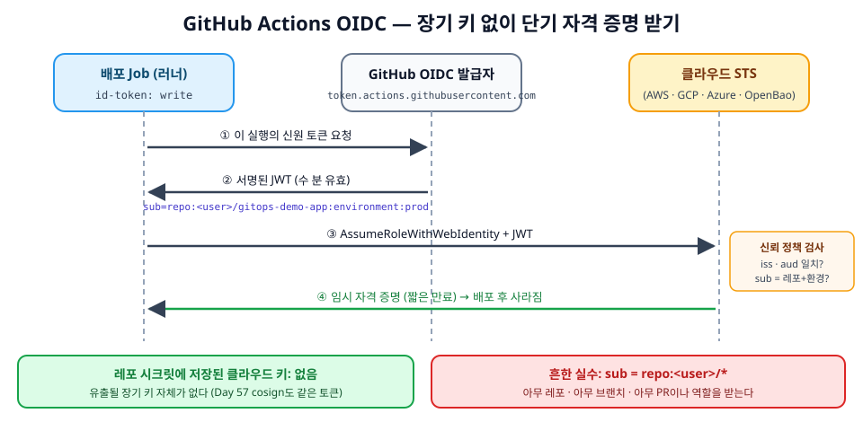

> **해킹 트랙 · 인프라 보안 심화** | 난이도 ★★★★☆ | 예상 소요 2.5 ~ 3시간

> ⚠️ **실습 전 반드시 읽을 것**
> 실습은 **본인 소유의 격리된 실습장**과 **본인이 만든 앱·레포**에서만 합니다. 오늘의 대상은 Day 50~57에서 만든 내 `gitops-demo-app` 레포와 그 워크플로뿐입니다. 남의 공개 레포에 "취약한 워크플로가 동작하는지 보려고" PR·이슈·코멘트를 보내는 것은 **그 레포의 러너에서 코드를 실행시키는 행위**이며, 허가 없는 타인 시스템 공격으로 **정보통신망법 등에 따라 처벌**될 수 있습니다. 다른 레포에서 위험한 패턴을 발견했다면 그 프로젝트의 보안 정책(`SECURITY.md`)에 따라 비공개로 알립니다. 이 글은 공격 페이로드를 다루지 않고, GitHub 공식 문서 수준의 최소 예시로 원리만 보여 줍니다.

## 🎯 오늘의 목표

- CI/CD를 **"시크릿과 쓰기 권한을 들고 남의 입력을 처리하는 원격 실행 서비스"** 로 보고 위협을 나열할 수 있다
- `pull_request_target`이 왜 위험한지, 2025~2026년에 GitHub가 바꾼 기본값까지 설명할 수 있다
- `GITHUB_TOKEN`을 **Job 단위 최소 권한**으로, 클라우드 자격 증명은 **OIDC**로 바꿔 장기 키를 없앤다
- `${{ github.event.* }}` 스크립트 인젝션과 시크릿이 로그에 새는 경로를 찾아 **환경 변수 우회**로 고친다
- **zizmor, actionlint, OpenSSF Scorecard**로 내 워크플로를 점검하고 CI 게이트로 건다

---

## 1. 원리 — 파이프라인은 왜 노려지나

Day 50에서 CI/CD를 "코드가 운영까지 가는 길"이라고 했습니다. 공격자 시각에서 그 길은 이렇게 보입니다.

| 파이프라인이 가진 것 | 공격자가 얻는 것 |
|---|---|
| 레지스트리 푸시 권한(`packages: write`) | 내 이름으로 서명·배포되는 악성 이미지 (Day 57이 막으려던 것) |
| 클라우드·클러스터 자격 증명 | 운영 인프라 |
| 레포 쓰기 권한(`contents: write`) | 코드·태그·릴리스 조작 |
| **외부 입력**(PR 제목, 브랜치 이름, 이슈 본문, 포크의 코드) | 위 권한을 가진 러너에서 **내 명령을 실행**할 기회 |

실제 사고들도 이 표의 조합이었습니다.

| 사고 | 무엇이 이어졌나 | 오늘의 장 |
|---|---|---|
| ultralytics (2024-12) | `pull_request_target` 워크플로 + **브랜치 이름**을 `run`에 그대로 → 러너에서 명령 실행 → 캐시 오염 → PyPI에 악성 릴리스 | 3·5장 |
| tj-actions/changed-files (2025-03, CVE-2025-30066) | 인기 서드파티 액션 태그가 악성 커밋으로 바뀜 → 러너 메모리의 시크릿을 **빌드 로그에 출력** → 공개 레포 로그로 유출 | 6·8장 |
| trivy-action (2026-03) | 보안 스캐너 액션 태그 바꿔치기 (Day 57 1장) | 8장 |



핵심은 **"신뢰하지 않는 입력"과 "높은 권한"이 같은 Job에서 만나는 지점**을 없애는 것입니다.

---

## 2. 실습 환경

| 항목 | 값 |
|---|---|
| 대상 | 내 `gitops-demo-app` 레포 — Day 51 `ci.yaml`(+Day 57 서명), 해킹 19 `secrets-deps.yaml`, 해킹 20 `dast.yaml` |
| 로컬 | Ubuntu 24.04 / WSL2 / macOS, Docker, `gh` CLI, `uv`(또는 pipx) |
| zizmor | **v1.32.0** (2026-11 기준 최신), 액션 `zizmorcore/zizmor-action` v0.8.1 |
| actionlint | **v1.7.12** |
| OpenSSF Scorecard | 액션 `ossf/scorecard-action` **v2.5.0** |
| 실험용 워크플로 | 브랜치 `lab/insecure`에만 두고 **PR을 내지 않음**. 점검 도구의 입력으로만 씀 |

---

## 3. 내 환경 점검 — 먼저 지금 상태부터

### 3-1. 레포 기본 설정

```bash
gh api repos/{owner}/{repo}/actions/permissions/workflow
```

```json
{ "default_workflow_permissions": "read", "can_approve_pull_request_reviews": false }
```

| 값 | 판정 |
|---|---|
| `default_workflow_permissions: "write"` | 🔴 `permissions:`를 안 쓴 워크플로가 전부 쓰기 토큰을 받음. Settings → Actions → General → *Workflow permissions*에서 **Read repository contents and packages permissions**로 |
| `can_approve_pull_request_reviews: true` | 🔴 워크플로가 PR을 만들고 **스스로 승인**할 수 있음 → 브랜치 보호 우회. 끔 |

같은 화면에서 두 가지를 더 봅니다.

- *Actions permissions*: "Allow all actions" 대신 **GitHub·인증된 제작자 + 명시한 액션만** 허용
- *Fork pull request workflows*: 공개 레포라면 **외부 기여자의 첫 실행은 승인 필요**(기본) 이상으로

### 3-2. 실험용 "나쁜 워크플로" 만들기

점검 도구가 무엇을 잡는지 보기 위해, 흔한 실수를 모은 파일을 **실험 브랜치에만** 만듭니다. 실행되지 않게 `on`은 `workflow_dispatch`만 둡니다(점검 도구는 내용을 정적으로 읽기 때문에 트리거와 무관하게 패턴을 잡습니다. 주석의 원래 트리거가 위험의 핵심입니다).

```yaml
# .github/workflows/lab-insecure.yaml  (브랜치 lab/insecure 전용, PR 금지)
name: lab-insecure
on:
  workflow_dispatch:          # 원래 의도: pull_request_target (아래 4장)
permissions: write-all        # ① 과한 권한
jobs:
  greet:
    runs-on: ubuntu-latest
    steps:
      - uses: actions/checkout@v7                       # ② persist-credentials 기본값(true)
        with:
          ref: ${{ github.event.pull_request.head.sha }}   # ③ 신뢰할 수 없는 코드 체크아웃
      - run: echo "PR 제목: ${{ github.event.pull_request.title }}"   # ④ 스크립트 인젝션
      - uses: tj-actions/changed-files@v46              # ⑤ 서드파티 액션을 태그로
      - run: ./scripts/test.sh
        env:
          ALL_SECRETS: ${{ toJSON(secrets) }}           # ⑥ 시크릿 전체를 한 변수로
```

이 파일은 4~8장에서 하나씩 고치고, 9장에서 도구로 확인합니다.

---

## 4. 위험 ① `pull_request_target`

### 4-1. 무엇이 다른가

| | `pull_request` | `pull_request_target` |
|---|---|---|
| 실행되는 워크플로 파일 | **PR 쪽**(포크의) 정의 | **기준 레포의 기본 브랜치** 정의 |
| 포크 PR에서 `GITHUB_TOKEN` | 읽기 전용 | **쓰기 가능**(권한 설정대로) |
| 포크 PR에서 시크릿 | ❌ 주지 않음 | ⭕ **줌** |
| 만든 목적 | 테스트·빌드 | 라벨 달기·코멘트 같은 **PR 코드를 실행하지 않는** 작업 |

`pull_request_target` 자체는 "내 레포의 신뢰할 수 있는 워크플로"를 돌립니다. 문제는 그 안에서 **PR의 코드를 체크아웃해 실행하는 순간**입니다. 포크 작성자가 바꾼 `scripts/test.sh`, `package.json`의 스크립트, 빌드 플러그인이 **시크릿과 쓰기 토큰이 있는 러너**에서 돌아갑니다. 이 패턴을 흔히 "pwn request"라고 부릅니다.

### 4-2. GitHub가 바꾼 것 (2025~2026)

| 시점 | 변경 | 의미 |
|---|---|---|
| 2025-12-08 | `pull_request_target`의 워크플로 파일과 체크아웃 기준이 **항상 기본 브랜치**에서 옴 | 오래된 브랜치에 남은 취약한 워크플로가 PR 기준 브랜치로 지정돼 실행되던 경로 차단 |
| 2026-06 (v7), 2026-07-20 (이전 메이저로 백포트) | `actions/checkout`이 `pull_request_target`·`workflow_run`(PR에서 시작된)에서 **포크 PR의 head/merge 코드 체크아웃을 기본 거부**. `allow-unsafe-pr-checkout: true`로만 해제 | 3-2의 ③이 이제 기본으로 실패. 단 **`run`에서 `git fetch`·`gh pr checkout`으로 가져오는 것은 막지 않음** |
| **2026-12-02 예정** | **공개 레포**에서 `pull_request_target`을 **기본 차단**(Actions 이벤트 정책으로 명시 허용한 경우만 실행). 11-09·11-16에 2시간씩 사전 차단(brownout) | 공개 레포에서 이 트리거가 정말 필요한지 지금 재검토해야 함 |

> 💡 오늘(2026-11-15) 기준으로 기본 차단은 약 2주 뒤입니다. 공개 레포를 운영한다면 Settings → Actions → **Policies**의 Insights에서 "기본 규칙이 막을 실행"을 먼저 확인하세요. 비공개·내부 레포는 이 기본 차단 대상이 아니지만 위험은 같습니다.

### 4-3. 안전한 대안

| 하고 싶은 일 | 안전한 방법 |
|---|---|
| 포크 PR 테스트·빌드 | **`pull_request`** 를 쓴다. 시크릿이 필요 없게 설계 (해킹 20의 일회용 환경처럼) |
| PR에 라벨·코멘트 달기 | `pull_request_target`을 쓰되 **PR 코드를 체크아웃하지 않고**, PR 제목 같은 값은 환경 변수로만 (5장) |
| 테스트 결과를 PR 코멘트로 | `pull_request`가 결과를 **아티팩트로** 올리고, 별도 `workflow_run` 워크플로가 그 아티팩트를 **데이터로만** 읽어 코멘트. 아티팩트 내용을 실행하거나 `run`에 그대로 넣지 않음 |
| 꼭 PR 코드에 시크릿이 필요 | 메인테이너가 코드를 본 뒤 라벨을 달 때만 실행하는 승인 단계 + 최소 시크릿을 **Environment**(필수 리뷰어)에 |

---

## 5. 위험 ② 스크립트 인젝션 — `${{ }}`는 문자열 치환이다

### 5-1. 원리

`run:` 안의 `${{ ... }}`는 셸이 실행되기 **전에** 값이 그대로 박혀 들어갑니다. 따옴표로 감싸도 소용없습니다. 값 안의 따옴표가 따옴표를 닫아 버리기 때문입니다. 해킹 04의 SQL Injection에서 "문자열 이어 붙이기"가 문제였던 것과 똑같은 구조입니다.

```yaml
# ❌ 취약
- run: echo "PR 제목: ${{ github.event.pull_request.title }}"
```

GitHub 공식 문서의 예처럼 PR 제목이 `a"; ls $GITHUB_WORKSPACE"`라면, 러너가 실제로 실행하는 스크립트는 다음이 됩니다.

```bash
echo "PR 제목: a"; ls $GITHUB_WORKSPACE""
```

`echo` 뒤에 **PR 작성자가 고른 명령**이 이어서 실행됩니다. 이 Job이 `pull_request_target`·`issue_comment`처럼 권한이 있는 컨텍스트라면 시크릿과 쓰기 토큰이 그 명령의 손에 들어갑니다.



### 5-2. 신뢰할 수 없는 값 목록

| 컨텍스트 | 누가 정하나 |
|---|---|
| `github.event.pull_request.title` / `.body` / `.head.ref`, `github.head_ref` | PR 작성자 (브랜치 이름 포함!) |
| `github.event.issue.title` / `.body`, `github.event.comment.body`, `github.event.review.body` | 누구나 (공개 레포) |
| `github.event.head_commit.message`, `github.event.commits[*].message` / `.author.name` / `.author.email` | 커밋 작성자 |
| `github.event.pages[*].page_name`, 워크플로 `inputs.*`(외부에서 호출 가능할 때) | 상황에 따라 |
| 이전 Job·Step의 출력이 위 값에서 왔다면 | 그 출처와 같음 |

### 5-3. 수정 — 환경 변수로 우회

```yaml
# ✅ 안전
- name: PR 제목 출력
  env:
    PR_TITLE: ${{ github.event.pull_request.title }}
  run: echo "PR 제목: $PR_TITLE"
```

값이 `env`로 들어가면 셸은 그것을 **변수의 내용(데이터)** 으로만 다룹니다. 코드로 해석되지 않습니다. 원칙을 정리하면 다음과 같습니다.

- `run`에는 `${{ }}`를 **아예 쓰지 않는다**를 기본으로 하고, 필요한 값은 전부 `env`로 넘긴다 (해킹 19의 `BASE_SHA`처럼)
- 셸에서도 변수는 **항상 큰따옴표**로: `"$PR_TITLE"`
- `actions/github-script` 안의 `${{ }}`도 같은 문제(JavaScript 코드로 치환). `process.env.PR_TITLE`로 읽는다
- `>> "$GITHUB_ENV"`, `>> "$GITHUB_OUTPUT"`에 외부 값을 쓸 때 **줄바꿈**이 들어가면 다른 변수를 끼워 넣을 수 있다. 외부 값은 이 파일들에 쓰지 않거나 검증한 뒤 쓴다

---

## 6. 위험 ③ 시크릿이 로그·아티팩트로 새는 경로

GitHub는 시크릿 값을 로그에서 `***`로 가립니다. 하지만 마스킹은 **등록된 문자열과 정확히 같은 경우에만** 동작합니다.

| 새는 경로 | 왜 마스킹이 안 되나 | 대응 |
|---|---|---|
| 변형된 값 (`base64`, URL 인코딩, 일부만 자르기) | 원문과 다른 문자열 | 변형 값을 만들었다면 `echo "::add-mask::$VALUE"` |
| JSON 시크릿에서 꺼낸 필드 | 시크릿 전체만 등록됨 | 필드마다 별도 시크릿으로 저장 |
| `set -x`, 디버그 로깅(`ACTIONS_STEP_DEBUG`) | 명령 전개가 출력됨 | 시크릿을 다루는 Step에서 `set -x` 금지, 디버그 로깅은 일시적으로만 |
| 악성/탈취된 액션이 러너 메모리를 덤프 (tj-actions) | 로그 출력을 공격자가 조작 | 8장 SHA 고정, 시크릿은 **필요한 Step에만** `env`로 |
| `actions/checkout`의 `persist-credentials: true`(기본) | 토큰이 `.git/config` 등에 남아 **아티팩트 업로드·캐시**에 포함 | `persist-credentials: false` |
| `toJSON(secrets)`, 재사용 워크플로의 `secrets: inherit` | 필요 없는 시크릿까지 전달 | 필요한 시크릿만 이름으로 |
| 포크 PR에서 시크릿이 비어 실패 → "시크릿이 필요해서" `pull_request_target`으로 변경 | 4장 위험으로 이동 | 설계를 바꾼다 (4-3) |

> 💡 운영 배포용 시크릿은 레포 시크릿이 아니라 **Environment 시크릿**(Settings → Environments)에 두고, 그 Environment에 **필수 리뷰어**와 **배포 가능 브랜치(main만)** 를 걸면 PR이나 다른 브랜치의 Job은 그 시크릿을 받지 못합니다. 2025-12-08 변경 이후 Environment의 브랜치 필터는 `pull_request`에서는 merge ref, `pull_request_target`에서는 기본 브랜치 기준으로 평가된다는 점도 알아 두세요.

---

## 7. 위험 ④ 장기 클라우드 키 → OIDC로 없애기

`AWS_ACCESS_KEY_ID`/`AWS_SECRET_ACCESS_KEY`를 레포 시크릿에 넣는 방식은 ① 만료가 없고 ② 유출되면 (해킹 19 10장) 폐기 전까지 어디서든 쓸 수 있습니다. **OIDC**를 쓰면 클라우드에 저장된 키가 아예 없습니다.



1. Job에 `id-token: write`를 주면 러너가 GitHub OIDC 발급자(`token.actions.githubusercontent.com`)에게서 **이 실행의 신원**을 담은 JWT를 받습니다. `sub` 클레임 예: `repo:<user>/gitops-demo-app:ref:refs/heads/main`, Environment를 쓰면 `repo:<user>/gitops-demo-app:environment:prod`
2. 클라우드는 미리 등록한 신뢰 정책으로 **발급자·`aud`·`sub`** 를 검사하고, 맞으면 **수십 분짜리 임시 자격 증명**을 줍니다
3. Job이 끝나면 자격 증명도 곧 만료됩니다

Day 57의 cosign 키리스 서명이 바로 이 토큰을 Sigstore에 보여 준 것입니다. 해킹 09에서 본 AWS로 예를 들면:

```json
{
  "Version": "2012-10-17",
  "Statement": [{
    "Effect": "Allow",
    "Principal": { "Federated": "arn:aws:iam::<계정ID>:oidc-provider/token.actions.githubusercontent.com" },
    "Action": "sts:AssumeRoleWithWebIdentity",
    "Condition": {
      "StringEquals": {
        "token.actions.githubusercontent.com:aud": "sts.amazonaws.com",
        "token.actions.githubusercontent.com:sub": "repo:<user>/gitops-demo-app:environment:prod"
      }
    }
  }]
}
```

```yaml
jobs:
  deploy:
    runs-on: ubuntu-latest
    environment: prod                 # 필수 리뷰어 + main 브랜치만 (6장)
    permissions:
      contents: read
      id-token: write                 # OIDC 토큰 요청은 이 Job에만
    steps:
      - uses: aws-actions/configure-aws-credentials@v6
        with:
          role-to-assume: arn:aws:iam::<계정ID>:role/gha-demo-deploy
          aws-region: ap-northeast-2
      - run: aws sts get-caller-identity
```

> ⚠️ 가장 흔한 실수는 `sub` 조건을 `repo:<user>/*`나 `StringLike`의 `*`로 넓게 거는 것입니다. 그러면 **그 계정의 아무 레포, 아무 브랜치, 아무 PR**이나 역할을 받을 수 있습니다(해킹 09의 "과한 신뢰 정책"). 레포와 Environment(또는 브랜치)까지 정확히 고정하세요. 홈랩이라면 같은 원리로 OpenBao(Day 71)의 JWT 인증에 GitHub 발급자를 등록하고 `bound_claims`로 `sub`를 고정할 수 있습니다.

---

## 8. 위험 ⑤ 서드파티 액션과 셀프 호스티드 러너

### 8-1. 서드파티 액션

Day 57에서 **서드파티 액션은 커밋 SHA로 고정**하고, Day 51 Dependabot이 갱신 PR을 올리게 했습니다. 오늘은 반복하지 않고 두 가지만 더합니다.

| 추가 수단 | 내용 |
|---|---|
| **워크플로 lockfile** (2026-10-28 GA) | `gh extension install github/gh-actions-lock` 후 `gh actions-lock`으로 `.github/workflows/actions.lock`을 만들면, 워크플로에는 `@v4` 같은 읽기 쉬운 태그를 두면서 **잠근 커밋**만 실행됨. 전이 의존(액션이 부르는 액션)까지 잠김. CI에서 `gh actions-lock --verify`로 확인. 재사용 워크플로·컨테이너 이미지·러너 이미지는 잠기지 않음 |
| 허용 목록 | Settings → Actions → *Allow select actions*에 쓰는 액션만 |
| Dependabot `cooldown` | 해킹 19 6장. 갓 나온 (탈취됐을 수 있는) 릴리스를 며칠 미룸 |

### 8-2. 셀프 호스티드 러너

| 위험 | 이유 | 대응 |
|---|---|---|
| 공개 레포에 연결 | **누구나 PR로 내 서버에서 코드 실행** | 공개 레포에는 쓰지 않는다 (GitHub 공식 권고) |
| 상태가 남음 | 이전 Job이 남긴 파일·프로세스·캐시·도커 이미지가 다음 Job에 영향 → 한 번 오염되면 계속 | `--ephemeral`(Job 하나 실행 후 등록 해제), Actions Runner Controller(ARC)로 Pod 1회용 |
| 내부망 위치 | 러너가 홈랩·사내망 안에 있으면 **CI가 내부망 발판** | 전용 네트워크 구간, 나가는 트래픽 제한 (Day 70 NetworkPolicy) |
| 호스트 권한 | 러너가 `docker` 그룹이거나 `docker.sock`을 마운트 = 사실상 root (해킹 07) | rootless 빌더, 러너 전용 VM |
| 러너 그룹 | 조직의 모든 레포가 같은 러너를 씀 | 러너 그룹으로 레포 제한 |

---

## 9. 탐지 — 도구로 점검하기

| 도구 | 무엇을 보나 | 실행 |
|---|---|---|
| **actionlint** | 워크플로 **문법·타입** 오류 + 셸 스크립트(shellcheck) + **신뢰할 수 없는 입력의 인라인 사용** | 로컬·CI, 빠름 |
| **zizmor** | 보안 전용 정적 분석: `template-injection`, `dangerous-triggers`, `excessive-permissions`, `artipacked`, `unpinned-uses`, `overprovisioned-secrets`, `self-hosted-runner`, `cache-poisoning` 등 | 로컬·CI, SARIF |
| **OpenSSF Scorecard** | 레포 전체 습관 점수: `Token-Permissions`, `Pinned-Dependencies`, `Dangerous-Workflow`, `Branch-Protection`, `Dependency-Update-Tool`, `SAST` 등 | 주 1회 CI |

### 9-1. actionlint

```bash
git switch lab/insecure
docker run --rm -v "$PWD:/repo" --workdir /repo rhysd/actionlint:1.7.12 -color
```

출력 예:

```
.github/workflows/lab-insecure.yaml:14:30: "github.event.pull_request.title" is potentially untrusted. avoid using it directly in inline scripts. instead, pass it through an environment variable. see https://docs.github.com/... for more details [expression]
   |
14 |       - run: echo "PR 제목: ${{ github.event.pull_request.title }}"
   |                              ^~~~~~~~~~~~~~~~~~~~~~~~~~~~~~~~~~~~~~~~~
```

### 9-2. zizmor

```bash
uvx zizmor@1.32.0 .github/workflows/
# 또는: pipx run zizmor .github/workflows/
```

출력 예(일부):

```
error[template-injection]: code injection via template expansion
  --> .github/workflows/lab-insecure.yaml:14:9
   |
14 |       - run: echo "PR 제목: ${{ github.event.pull_request.title }}"
   |         ^^^ this run block              ^^^^^^^^^^^^^^^^^^^^^^^^^^^^ may expand into attacker-controllable code
   |
warning[artipacked]: credential persistence through GitHub Actions artifacts
  --> .github/workflows/lab-insecure.yaml:10:9
error[excessive-permissions]: overly broad permissions
  --> .github/workflows/lab-insecure.yaml:4:1
   |
 4 | permissions: write-all
error[unpinned-uses]: unpinned action reference
  --> .github/workflows/lab-insecure.yaml:16:9
warning[overprovisioned-secrets]: excessively provisioned secrets
  --> .github/workflows/lab-insecure.yaml:20:26
...
```

| 옵션 | 의미 |
|---|---|
| `--persona pedantic` / `auditor` | 더 많이(코드 스멜, 오탐 가능성까지) 보기. 기본은 `regular` |
| `--min-severity medium` | 낮은 심각도 숨김 |
| `--format sarif` / `github` | Code scanning 업로드 / Actions 주석 |
| `GH_TOKEN` 설정 | 온라인 감사(알려진 취약 액션, impostor 커밋 등) 활성화. 없으면 오프라인 |

`known-vulnerable-actions` 감사는 3-2의 ⑤처럼 **알려진 권고가 있는 액션 버전**도 잡습니다(GH_TOKEN 필요). 오탐은 해당 줄 끝에 `# zizmor: ignore[감사이름]` 주석으로 사유와 함께 제외합니다.

### 9-3. CI 게이트

```yaml
# .github/workflows/workflow-lint.yaml
name: workflow-lint
on:
  pull_request:
    paths: [".github/**"]
  push:
    branches: [main]
    paths: [".github/**"]

permissions: {}

jobs:
  actionlint:
    runs-on: ubuntu-latest
    permissions:
      contents: read
    steps:
      - uses: actions/checkout@v7
        with:
          persist-credentials: false
      - run: docker run --rm -v "$PWD:/repo" --workdir /repo rhysd/actionlint:1.7.12 -color

  zizmor:
    runs-on: ubuntu-latest
    permissions:
      contents: read
      security-events: write          # SARIF를 Security 탭으로
    steps:
      - uses: actions/checkout@v7
        with:
          persist-credentials: false
      - uses: zizmorcore/zizmor-action@45d7276c9ca790aabd705e31ca99c6185c3e76dd  # v0.8.1
        with:
          persona: regular
          min-severity: medium
```

Scorecard는 주 1회로 충분합니다.

```yaml
# .github/workflows/scorecard.yaml
name: scorecard
on:
  schedule:
    - cron: "30 1 * * 1"
  push:
    branches: [main]

permissions: read-all

jobs:
  analysis:
    runs-on: ubuntu-latest
    permissions:
      security-events: write
      id-token: write                 # 결과 공개(publish_results) 시 신원 증명
    steps:
      - uses: actions/checkout@v7
        with:
          persist-credentials: false
      - uses: ossf/scorecard-action@fa7117db83c52d787ae5a89f350999701505d78e  # v2.5.0
        with:
          results_file: results.sarif
          results_format: sarif
          publish_results: true       # 공개 레포만. 비공개면 false
      - uses: github/codeql-action/upload-sarif@v4
        with:
          sarif_file: results.sarif
```

> 💡 `.github/workflows/`와 `actions.lock`은 **CODEOWNERS**로 보안 담당(혼자라면 나 자신)의 리뷰를 필수로 거세요. 워크플로 변경은 곧 "CI가 가진 모든 권한의 변경"입니다. 누가 언제 워크플로·시크릿·러너 설정을 바꿨는지는 조직/레포 **감사 로그**에 남으니, 해킹 27의 사고 대응 타임라인에서 첫 번째로 볼 곳이기도 합니다.

---

## 10. 수정 — 3-2의 나쁜 워크플로 고치기

```yaml
# 수정 후: PR 제목 확인 같은 가벼운 작업은 pull_request로 충분
name: pr-check
on:
  pull_request:

permissions: {}                       # ① 기본은 아무 권한 없음

jobs:
  greet:
    runs-on: ubuntu-latest
    permissions:
      contents: read                  # ① 필요한 것만, Job 단위
    steps:
      - uses: actions/checkout@v7     # ③ pull_request는 PR 코드를 체크아웃해도 시크릿·쓰기 토큰이 없음
        with:
          fetch-depth: 0              # 기준 커밋과 비교하려고 히스토리 전체
          persist-credentials: false  # ② 토큰을 디스크에 남기지 않음
      - name: PR 제목 출력
        env:
          PR_TITLE: ${{ github.event.pull_request.title }}   # ④ env로 우회
        run: echo "PR 제목: $PR_TITLE"
      - name: 변경 파일 목록 (서드파티 액션 대신 git으로)          # ⑤ 의존성 자체를 줄임
        env:
          BASE_SHA: ${{ github.event.pull_request.base.sha }}
        run: git diff --name-only "$BASE_SHA" HEAD
      - run: ./scripts/test.sh        # ⑥ 시크릿 없이 도는 테스트
```

| 번호 | 문제 | 수정 |
|---|---|---|
| ① | `write-all` | `permissions: {}` + Job 단위 `contents: read` |
| ② | 토큰 디스크 잔류 | `persist-credentials: false` |
| ③ | 권한 있는 컨텍스트에서 PR 코드 실행 | 트리거를 `pull_request`로 |
| ④ | 스크립트 인젝션 | `env` 경유 |
| ⑤ | 태그 고정 서드파티 액션 | 꼭 필요하지 않으면 제거, 필요하면 SHA 고정·lockfile |
| ⑥ | 시크릿 전체 전달 | 테스트는 시크릿 없이. 배포는 Environment + OIDC |

다시 점검하면 경고가 사라져야 합니다.

```bash
uvx zizmor@1.32.0 .github/workflows/pr-check.yaml
# No findings to report. Good job!
git switch main && git branch -D lab/insecure     # 실험 브랜치 정리 (원격에 푸시했다면 그것도 삭제)
```

---

## 11. 트러블슈팅

| 증상 | 원인 | 해결 |
|---|---|---|
| `Resource not accessible by integration` | `permissions`를 줄인 뒤 필요한 권한이 빠짐 | 에러가 난 API에 맞는 권한만 그 Job에 추가 (예: 코멘트 → `pull-requests: write`) |
| 포크 PR에서 시크릿이 빈 값 | `pull_request`의 정상 동작 | 시크릿이 필요 없게 설계. 필요하면 4-3의 승인·Environment 방식 |
| `actions/checkout`이 "unsafe PR checkout" 거부 | 2026-06 기본 보호 (`pull_request_target`/`workflow_run`) | 트리거를 바꾸는 것이 정답. `allow-unsafe-pr-checkout`은 이유를 문서화할 수 없다면 쓰지 않음 |
| 2026-12-02 이후 공개 레포의 `pull_request_target`이 안 돎 | 기본 차단 규칙 | 정말 필요하면 Actions 이벤트 정책에서 **해당 워크플로 파일만** 허용 |
| OIDC `Not authorized to perform sts:AssumeRoleWithWebIdentity` | `sub`가 신뢰 정책과 다름 (브랜치 vs environment) | 토큰 클레임을 확인해 정책의 `sub`와 정확히 맞춤 |
| OIDC `Unable to get ACTIONS_ID_TOKEN_REQUEST_URL` | `id-token: write` 누락 | 그 Job의 `permissions`에 추가 |
| zizmor가 사내 액션을 `unpinned-uses`로 계속 경고 | 같은 조직의 액션도 태그로 씀 | SHA 고정 또는 설정 파일로 정책 조정(근거 기록) |

---

## 12. 핵심 정리

- CI/CD = **시크릿과 쓰기 권한을 가진 러너가 외부 입력을 처리하는 곳**. "신뢰할 수 없는 입력 × 높은 권한"이 같은 Job에서 만나면 사고
- `pull_request_target`에서 PR 코드를 실행하면 pwn request. 2025-12 기본 브랜치 기준, 2026-06 checkout 거부, **2026-12-02 공개 레포 기본 차단**. 테스트는 `pull_request`로
- `${{ github.event.* }}`를 `run`에 직접 쓰지 않는다. **`env`로 넘기고 `"$VAR"`로 읽는다**
- `GITHUB_TOKEN`은 레포 기본 **read**, 워크플로 `permissions: {}`, Job 단위로 필요한 것만
- 시크릿 마스킹은 **정확히 같은 문자열**만 가린다. `persist-credentials: false`, `toJSON(secrets)`·`secrets: inherit` 금지, 운영 시크릿은 Environment
- 클라우드 키는 **OIDC**로 없앤다. 신뢰 정책의 `sub`를 레포+Environment까지 정확히
- 서드파티 액션은 SHA 고정(Day 57) + lockfile + cooldown, 셀프 호스티드 러너는 공개 레포 금지·ephemeral
- 점검: **actionlint**(문법·인라인 입력) + **zizmor**(보안 감사, SARIF) + **Scorecard**(레포 습관), 워크플로 변경은 CODEOWNERS 리뷰

---

## 13. 셀프 체크

<details>
<summary>Q1. <code>pull_request_target</code> 워크플로에서 PR 코드를 체크아웃하지 않고 <code>npm test</code>만 했다. 안전한가?</summary>

PR 코드를 체크아웃하지 않았다면 `npm test`가 도는 대상은 **기본 브랜치의 코드**이므로 그 자체로 PR 작성자의 코드가 실행되지는 않습니다. 하지만 ① 이후 누가 체크아웃을 추가하거나 `gh pr checkout`을 `run`에 넣으면 바로 pwn request가 되고, ② PR 제목·브랜치 이름을 `run`에 쓰면 인젝션이 됩니다. 애초에 테스트에는 `pull_request`를 쓰는 것이 맞고, 공개 레포는 2026-12-02부터 기본 차단입니다.
</details>

<details>
<summary>Q2. <code>run: echo "${{ github.head_ref }}"</code>처럼 큰따옴표로 감쌌는데 왜 인젝션인가?</summary>

`${{ }}`는 셸이 실행되기 전에 **텍스트로 치환**되므로, 값 안에 `"`가 있으면 내가 쓴 따옴표를 닫고 그 뒤를 명령으로 만들 수 있습니다. 브랜치 이름도 PR 작성자가 정합니다(ultralytics 사고). `env: HEAD_REF: ${{ github.head_ref }}` 후 `"$HEAD_REF"`로 읽어야 셸이 값을 데이터로만 다룹니다.
</details>

<details>
<summary>Q3. 워크플로 최상위에 <code>permissions: contents: read</code>를 썼다. Job 하나가 GHCR에 푸시하려면? 그리고 왜 최상위에 <code>packages: write</code>를 두면 안 되나?</summary>

그 Job에 `permissions: { contents: read, packages: write }`를 지정합니다(Day 51). 최상위에 쓰기 권한을 두면 PR 테스트·린트 같은 **모든 Job**이 쓰기 토큰을 갖게 되어, 그중 하나에서 인젝션이나 악성 액션이 생기면 레지스트리 푸시까지 가능해집니다. 권한은 쓰는 Job에만 둡니다.
</details>

<details>
<summary>Q4. OIDC 신뢰 정책에 <code>sub</code>를 <code>repo:myname/*</code>로 걸었다. 무엇이 문제인가?</summary>

`myname` 계정의 **아무 레포·아무 브랜치·아무 PR 워크플로**나 그 역할을 받을 수 있습니다. 실험용 레포 하나에서 스크립트 인젝션이 생기면 운영 클라우드 권한까지 넘어갑니다. `repo:myname/gitops-demo-app:environment:prod`처럼 레포와 Environment(또는 브랜치)를 정확히 고정하고, 그 Environment에 필수 리뷰어를 겁니다.
</details>

<details>
<summary>Q5. 시크릿은 로그에서 <code>***</code>로 가려지는데, tj-actions 사고에서는 왜 공개 로그로 시크릿이 샜나?</summary>

탈취된 액션이 러너 프로세스 메모리에서 시크릿을 꺼내 **변형(인코딩)한 형태로** 출력했기 때문입니다. 마스킹은 등록된 원문과 정확히 같은 문자열만 가리므로 변형된 값은 그대로 찍힙니다. 대응은 액션 SHA 고정·lockfile로 바꿔치기를 막고, 시크릿을 필요한 Step에만 주고, 유출 시에는 해킹 19 10장의 순서(폐기 → 조사 → 정리)를 따르는 것입니다.
</details>

---

## ⏭️ 다음 예고 — 해킹 24. IaC 보안 점검 — Checkov, Trivy로 Terraform·K8s 매니페스트

오늘은 파이프라인 **자체**를 단단하게 만들었습니다. 다음은 그 파이프라인이 실어 나르는 **인프라 코드**입니다. Day 35의 Terraform에는 `admin_cidr` 기본값 `0.0.0.0/0`이 있었고, Day 69 이전의 매니페스트에는 securityContext가 없었습니다. 다음 편에서는 Checkov와 Trivy config 스캔으로 이런 설정 실수를 **PR 단계에서** 찾고, 예외를 사유와 함께 남기는 법, CI 게이트, 그리고 클러스터 입구의 Kyverno·OPA와 역할을 어떻게 나누는지 정리합니다.
