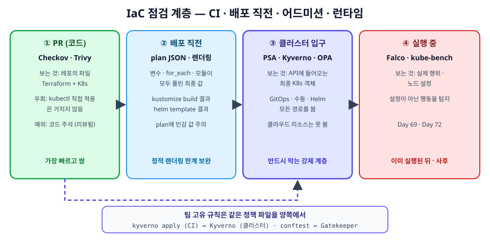
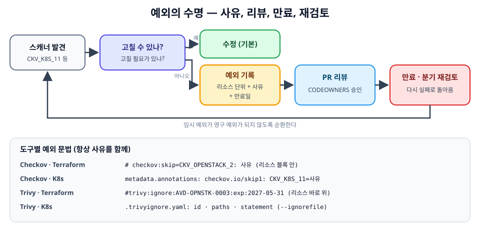

> **해킹 트랙 · 인프라 보안 심화** | 난이도 ★★★☆☆ | 예상 소요 2.5 ~ 3시간

> ⚠️ **실습 전 반드시 읽을 것**
> 실습은 **본인 소유의 격리된 실습장**과 **본인이 만든 앱·인프라 코드**에서만 합니다. 오늘의 대상은 Day 35의 `k8s-openstack-tf`, Day 69의 매니페스트, Day 52의 `gitops-demo-config` 레포뿐입니다. IaC 스캔은 파일을 읽기만 하는 정적 분석이지만, 남의 공개 레포에서 찾은 설정 실수를 근거로 **그 인프라에 접속을 시도하는 것은 허가 없는 접근**이며 **정보통신망법 등으로 처벌**될 수 있습니다. 발견한 문제는 그 프로젝트의 보안 정책에 따라 비공개로 알립니다.

## 🎯 오늘의 목표

- IaC 설정 실수가 왜 **그대로 인프라 취약점**이 되는지, 왜 PR 단계에서 잡아야 하는지 설명할 수 있다
- **Checkov**와 **Trivy config**로 Day 35 Terraform과 K8s 매니페스트를 스캔하고 결과를 읽는다
- 고칠 수 없는 항목을 **skip 주석 + 사유 + 만료일**로 남기는 예외 규칙을 만든다
- 두 도구를 **CI 게이트**로 걸고, 기존 문제는 baseline으로 분리한다
- CI 스캔, **Kyverno·OPA**(어드미션), PSA, Falco의 **역할을 겹치지 않게 나눈다**

---

## 1. 원리 — 코드가 된 인프라는 코드처럼 틀린다

Day 35에서 OpenStack 위 K8s 클러스터를 Terraform으로 만들었습니다. 그 코드의 한 줄을 다시 봅니다.

```hcl
variable "admin_cidr" {
  description = "SSH / kube-apiserver(6443) 접속을 허용할 대역"
  type        = string
  default     = "0.0.0.0/0"
}
```

실습 편의를 위한 기본값이었지만, 이 값이 그대로 `apply`되면 **SSH(22)와 kube-apiserver(6443)가 인터넷 전체에 열립니다.** 해킹 03에서 nmap으로 확인하던 "열린 포트"가 코드 한 줄에서 만들어지는 것입니다. 클라우드 침해 사고의 상당수는 해킹 09에서 본 것처럼 **취약점이 아니라 설정 실수**에서 시작합니다.

IaC의 장점(리뷰·재현·버전 관리)은 보안에도 그대로 적용됩니다. **만들어진 뒤에 점검하는 대신, 만들어지기 전에 코드를 점검**할 수 있습니다.

| 시점 | 무엇으로 | 비용 |
|---|---|---|
| PR(코드) | **Checkov, Trivy config** — 오늘 | 가장 쌈. 리뷰 코멘트 수준 |
| 배포 직전 | Terraform plan JSON 스캔, Kustomize 렌더링 결과 스캔 | 쌈 |
| 클러스터 입구 | **PSA(Day 69), Kyverno(Day 57), OPA Gatekeeper** | 배포 실패 → 롤백 |
| 실행 중 | kube-bench(Day 69), Falco(Day 72), 클라우드 설정 점검 | 이미 노출된 상태 |



### 1-1. Checkov와 Trivy

| | **Checkov** | **Trivy (`trivy config`)** |
|---|---|---|
| 만든 곳 | Bridgecrew → Palo Alto Networks (오픈소스) | Aqua Security (오픈소스) |
| 대상 | Terraform(+plan JSON), K8s, Helm, Kustomize, Dockerfile, CloudFormation, GitHub Actions 등 | Terraform(+plan JSON), K8s, Helm, Dockerfile, CloudFormation 등 |
| 규칙 ID 예 | `CKV_OPENSTACK_2`, `CKV_K8S_20` | `AVD-OPNSTK-0003`, `AVD-KSV-0001` (버전에 따라 `OPNSTK-0003`·`KSV001`처럼 표시) |
| 심각도 | 오픈소스 단독 실행 시 **심각도 없음**(플랫폼 연동 시 제공) → 게이트는 **규칙 ID 목록**으로 | LOW~CRITICAL 제공 → `--severity`로 게이트 |
| 커스텀 정책 | Python 또는 YAML | Rego |
| 이 시리즈 | 오늘 처음 | Day 57 이미지·설정 스캔에서 사용 |

둘의 규칙이 상당 부분 겹치지만 **커버리지가 다른 부분**이 있습니다. 예를 들어 OpenStack Terraform 규칙은 두 도구 모두 몇 개뿐이고 서로 다른 것을 봅니다. 하나만 고르기보다 **주 도구 하나 + 보조 하나**로 쓰는 경우가 많습니다.

---

## 2. 실습 환경

| 항목 | 값 |
|---|---|
| Terraform | Day 35의 `k8s-openstack-tf/` (versions.tf, variables.tf, network.tf, compute.tf ...) |
| K8s | Day 69의 `demo-before.yaml`(securityContext 없음), `demo-restricted.yaml`(수정본), Day 52의 `gitops-demo-config` |
| Checkov | **3.4.5** (2026-11 기준 최신) — `bridgecrew/checkov:3.4.5` 이미지 또는 `pipx install checkov==3.4.5` |
| Trivy | **0.76.2** (Day 57과 같은 버전, 2026-11 기준 최신) |
| 실행 | Ubuntu 24.04 / WSL2 / macOS + Docker |

```bash
mkdir -p ~/iac-lab && cd ~/iac-lab
cp -r ~/k8s-openstack-tf .                   # Day 35
cp ~/day69/demo-before.yaml ~/day69/demo-restricted.yaml .   # Day 69에서 만든 위치에 맞게
docker pull bridgecrew/checkov:3.4.5
docker pull aquasec/trivy:0.76.2
```

---

## 3. 내 환경 점검 ① — Day 35 Terraform

### 3-1. Checkov

```bash
docker run --rm -v "$PWD:/src" --workdir /src bridgecrew/checkov:3.4.5 \
  -d k8s-openstack-tf --framework terraform --compact
```

출력 예(일부. 통과·실패 개수는 버전에 따라 다릅니다):

```
terraform scan results:

Passed checks: 9, Failed checks: 1, Skipped checks: 0

Check: CKV_OPENSTACK_2: "Ensure no security groups allow ingress from 0.0.0.0:0 to port 22 (tcp / udp)"
	FAILED for resource: openstack_networking_secgroup_rule_v2.external["ssh"]
	File: /network.tf:43-52
```

`var.admin_cidr`의 **기본값 `0.0.0.0/0`을 대입해서** 평가한 결과입니다. Checkov는 변수 기본값과 `--var-file`로 준 값을 렌더링해 봅니다.

> 💡 같은 리소스의 `api`(6443) 규칙은 Checkov에 해당 포트 전용 규칙이 없어 잡히지 않습니다(OpenStack 규칙은 22·3389 포트 정도만). 또 `for_each`로 만든 리소스에서 `each.value`를 해석하지 못하면 포트를 모르고 통과로 볼 수도 있습니다. **"통과 = 안전"이 아니라 "이 규칙에 걸리지 않음"** 입니다. 그래서 3-3의 plan JSON 스캔과 Trivy를 함께 씁니다.

### 3-2. Trivy

```bash
docker run --rm -v "$PWD:/src" aquasec/trivy:0.76.2 config /src/k8s-openstack-tf
```

출력 예:

```
network.tf (terraform)
======================
Tests: 12 (SUCCESSES: 10, FAILURES: 2)
Failures: 2 (UNKNOWN: 0, LOW: 0, MEDIUM: 2, HIGH: 0, CRITICAL: 0)

AVD-OPNSTK-0003 (MEDIUM): Security group rule allows ingress from multiple public addresses.
════════════════════════════════════════
 network.tf:49
   via network.tf:43-52 (openstack_networking_secgroup_rule_v2.external["ssh"])
...
```

Trivy의 `OPNSTK-0003`은 포트와 상관없이 **출처가 공인 대역 전체인 ingress 규칙**을 봅니다. 그래서 22와 6443 두 규칙이 모두 잡힙니다. 같은 실수를 두 도구가 **다른 기준**으로 본다는 것이 1-1에서 말한 "보조 도구"의 이유입니다.

| 리소스 | Checkov | Trivy | 실제 위험 |
|---|---|---|---|
| `external["ssh"]` (22, admin_cidr) | ❌ CKV_OPENSTACK_2 | ❌ OPNSTK-0003 | 🔴 인터넷에 SSH |
| `external["api"]` (6443, admin_cidr) | 통과 (규칙 없음) | ❌ OPNSTK-0003 | 🔴 인터넷에 API 서버 |
| `internal` (remote_group_id, 노드끼리) | 통과 | 버전에 따라 "출처 IP 없음"으로 표시될 수 있음 | 🟢 보안 그룹 자신만 허용 — 오탐이면 예외 (5장) |
| `nodeport` (30000-32767, subnet_cidr) | 통과 | 통과 | 🟢 내부 서브넷만 |

### 3-3. plan JSON으로 한 번 더 (Day 35 환경이 있을 때)

변수·`for_each`·모듈이 모두 풀린 **최종 계획**을 스캔하면 렌더링 한계를 피할 수 있습니다. OpenStack 인증(Day 35 3-2)이 필요합니다.

```bash
cd k8s-openstack-tf
terraform plan -out tfplan
terraform show -json tfplan > tfplan.json
cd ..
docker run --rm -v "$PWD:/src" --workdir /src bridgecrew/checkov:3.4.5 \
  -f k8s-openstack-tf/tfplan.json --framework terraform_plan --compact
docker run --rm -v "$PWD:/src" aquasec/trivy:0.76.2 config /src/k8s-openstack-tf/tfplan.json
```

> ⚠️ `tfplan`·`tfplan.json`에는 Day 35 6-2에서 경고한 **state와 같은 민감 값**(부트스트랩 토큰 등)이 들어갈 수 있습니다. `.gitignore`에 `tfplan*`을 추가하고, CI에서 만들었다면 아티팩트로 올리지 마세요.

---

## 4. 내 환경 점검 ② — K8s 매니페스트 (Day 69 연결)

### 4-1. 수정 전 매니페스트

```bash
docker run --rm -v "$PWD:/src" --workdir /src bridgecrew/checkov:3.4.5 \
  -f demo-before.yaml --framework kubernetes --compact --quiet
```

출력 예(`--quiet`는 실패만):

```
kubernetes scan results:

Passed checks: 70, Failed checks: 14, Skipped checks: 0

Check: CKV_K8S_20: "Containers should not run with allowPrivilegeEscalation"
	FAILED for resource: Deployment.secure-demo.demo-app
Check: CKV_K8S_22: "Use read-only filesystem for containers where possible"
Check: CKV_K8S_23: "Minimize the admission of root containers"
Check: CKV_K8S_28: "Minimize the admission of containers with the NET_RAW capability"
Check: CKV_K8S_31: "Ensure that the seccomp profile is set to docker/default or runtime/default"
Check: CKV_K8S_37: "Minimize the admission of containers with capabilities assigned"
Check: CKV_K8S_38: "Ensure that Service Account Tokens are only mounted where necessary"
Check: CKV_K8S_8:  "Liveness Probe Should be Configured"
Check: CKV_K8S_11: "CPU limits should be set"
Check: CKV_K8S_15: "Image Pull Policy should be Always"
Check: CKV_K8S_43: "Image should use digest"
...
```

Day 69에서 PSA `restricted` 경고로 본 항목(`allowPrivilegeEscalation`, `capabilities.drop`, `runAsNonRoot`, `seccompProfile`)이 그대로 있고, **PSA가 보지 않는 항목**(읽기 전용 루트 FS, SA 토큰, 프로브, 리소스, 이미지 다이제스트)이 더해졌습니다.

```bash
docker run --rm -v "$PWD:/src" aquasec/trivy:0.76.2 config /src/demo-before.yaml
```

Trivy도 같은 범주를 `KSV` 규칙으로 보여 줍니다(Day 57 4-2에서 Rollout에 대해 본 것과 같은 계열).

### 4-2. 수정본은 통과할까?

```bash
docker run --rm -v "$PWD:/src" --workdir /src bridgecrew/checkov:3.4.5 \
  -f demo-restricted.yaml --framework kubernetes --compact --quiet
```

```
Passed checks: 80, Failed checks: 4, Skipped checks: 0

Check: CKV_K8S_8:  "Liveness Probe Should be Configured"
Check: CKV_K8S_11: "CPU limits should be set"
Check: CKV_K8S_15: "Image Pull Policy should be Always"
Check: CKV_K8S_43: "Image should use digest"
```

Day 69의 securityContext 세트가 보안 항목을 전부 닫았습니다. 남은 네 개는 성격이 다릅니다.

| 남은 항목 | 판단 | 처리 |
|---|---|---|
| `CKV_K8S_8` 라이브니스 프로브 | 앱이 멈췄을 때 재시작이 안 됨. 고칠 수 있음 | **수정** (7장) |
| `CKV_K8S_43` 이미지 다이제스트 | 태그는 바뀔 수 있음(Day 50 원칙 2, Day 57) | **수정** — Kustomize `images`에 `digest` |
| `CKV_K8S_11` CPU limit | CPU limit은 스로틀링으로 지연을 키울 수 있어 **request만 두는 운영 정책**도 흔함 (Day 18) | **예외** + 사유 |
| `CKV_K8S_15` `imagePullPolicy: Always` | 다이제스트로 고정하면 `IfNotPresent`도 항상 같은 이미지 | **예외** + 사유 (다이제스트 적용 후) |

> 💡 **Kustomize·Helm은 렌더링 결과를 스캔**하세요. `base`만 스캔하면 overlay의 패치(Day 52)가 반영되지 않습니다. `kubectl kustomize apps/demo-app/overlays/prod > rendered-prod.yaml` 후 그 파일을 스캔하거나, Checkov의 `--framework kustomize`, Trivy의 Helm 차트 스캔을 씁니다. Argo Rollouts의 `Rollout` 같은 CRD는 도구가 워크로드로 인식하는 범위가 달라서, 결과가 비었다면 "안전"이 아니라 "안 봤다"일 수 있습니다.

---

## 5. 예외 처리 — skip 주석에는 사유를

스캐너를 CI에 걸면 반드시 "이건 고칠 수 없다/고칠 필요가 없다"는 항목이 나옵니다. 예외를 허용하지 않으면 사람들은 **스캐너 자체를 끕니다.** 예외는 허용하되 **흔적이 남게** 합니다.



### 5-1. Checkov

```hcl
# network.tf — 리소스 블록 안에 주석
resource "openstack_networking_secgroup_rule_v2" "internal" {
  # checkov:skip=CKV_OPENSTACK_2: 출처는 remote_group_id(같은 보안 그룹)뿐. IP 대역 개방 아님. 2026-11 리뷰 @yeom
  for_each          = toset(["tcp", "udp", "icmp"])
  ...
}
```

```yaml
# K8s — 리소스의 metadata.annotations
metadata:
  name: demo-app
  namespace: secure-demo
  annotations:
    checkov.io/skip1: CKV_K8S_11=CPU limit 미설정은 운영 정책(Day 18 스로틀링 회피). request만 둠
    checkov.io/skip2: CKV_K8S_15=이미지를 다이제스트로 고정하므로 IfNotPresent로도 동일 이미지 보장
```

### 5-2. Trivy

```hcl
# Terraform — 리소스 바로 위 줄. :exp: 로 만료일을 줄 수 있다
# 사유: 노드 간 통신 규칙, remote_group_id만 허용(IP 개방 아님). 2026-11 리뷰
#trivy:ignore:AVD-OPNSTK-0003:exp:2027-05-31
resource "openstack_networking_secgroup_rule_v2" "internal" {
```

K8s 매니페스트처럼 인라인 주석을 쓰기 어려운 곳은 파일로 관리합니다.

```yaml
# .trivyignore.yaml — 실행 시 --ignorefile 로 지정
misconfigurations:
  - id: AVD-KSV-0011                 # CPU limits
    paths:
      - "apps/demo-app/base/*.yaml"
    statement: "CPU limit 미설정은 운영 정책(Day 18). request만 둠. 2026-11 리뷰"
```

```bash
docker run --rm -v "$PWD:/src" --workdir /src aquasec/trivy:0.76.2 \
  config --ignorefile .trivyignore.yaml .
```

> 💡 결과에 표시된 ID 형식(`AVD-KSV-0011`, `KSV-0011`, `KSV011`)이 버전에 따라 달라도, Trivy는 규칙 메타데이터의 **ID·별칭·short code 중 아무것이나** 맞으면 무시합니다. 출력에 찍힌 ID를 그대로 복사해 쓰는 것이 가장 안전합니다.

### 5-3. 예외 규칙 (팀 합의로 문서화)

| 규칙 | 이유 |
|---|---|
| 사유 없는 skip은 리뷰에서 거절 | "왜 괜찮은가"가 남아야 다음 사람이 판단할 수 있음 |
| 가능하면 만료일 (`:exp:`, 리뷰 날짜) | 임시 예외가 영구 예외가 되는 것을 막음 (해킹 19의 `effectiveUntil`과 같은 원칙) |
| 예외는 **리소스 단위**로, 레포 전체 `--skip-check`는 최소 | 레포 전체 skip은 새로 추가되는 리소스까지 눈감음 |
| 예외 파일·주석 변경은 CODEOWNERS 리뷰 | 해킹 23의 워크플로 변경과 같은 이유 |
| 분기마다 `grep -rn "checkov:skip\|trivy:ignore"`로 재검토 | 해킹 11 보고서의 "수용된 위험" 목록과 맞춤 |

---

## 6. 탐지 — CI 게이트

### 6-1. 처음 도입할 때 — baseline으로 "새 문제만"

기존 코드에서 수십 개가 나오면 첫 PR부터 전부 막을 수 없습니다. Checkov의 baseline으로 **지금 있는 것은 기록해 두고 새로 생기는 것만** 실패시킵니다.

```bash
docker run --rm -v "$PWD:/src" --workdir /src bridgecrew/checkov:3.4.5 \
  -d . --create-baseline          # .checkov.baseline 생성 → 커밋
# 이후 CI는 --baseline .checkov.baseline 으로 새 문제만 보고
```

baseline에 남은 항목은 이슈로 만들어 해킹 19의 우선순위 방식(외부 노출 여부 + 심각도)으로 줄여 나갑니다.

### 6-2. 워크플로

```yaml
# gitops-demo-config/.github/workflows/iac-scan.yaml (k8s-openstack-tf 레포도 같은 방식)
name: iac-scan
on:
  pull_request:
  push:
    branches: [main]

permissions: {}

jobs:
  checkov:
    runs-on: ubuntu-latest
    permissions:
      contents: read
      security-events: write                       # SARIF 업로드
    steps:
      - uses: actions/checkout@v7
        with:
          persist-credentials: false
      - name: Kustomize 렌더링 (overlay 반영본을 스캔)
        run: |
          mkdir -p rendered
          for env in dev stage prod; do
            kubectl kustomize apps/demo-app/overlays/$env > rendered/demo-app-$env.yaml
          done
      - name: Checkov
        uses: bridgecrewio/checkov-action@3f0caf0c3aa9f56ade6b49f6e60b63aaeafb75a3  # v12.3141.0 (Checkov 3.4.5)
        with:
          directory: .
          framework: kubernetes,terraform
          baseline: .checkov.baseline
          hard_fail_on: CKV_K8S_20,CKV_K8S_23,CKV_K8S_31,CKV_K8S_37,CKV_OPENSTACK_2   # 반드시 막을 규칙
          output_format: cli,sarif
          output_file_path: console,checkov.sarif
      - uses: github/codeql-action/upload-sarif@v4
        if: always()
        with:
          sarif_file: checkov.sarif
          category: checkov

  trivy:
    runs-on: ubuntu-latest
    permissions:
      contents: read
    steps:
      - uses: actions/checkout@v7
        with:
          persist-credentials: false
      - name: Trivy config (HIGH·CRITICAL이면 실패)
        uses: aquasecurity/trivy-action@ed142fd0673e97e23eac54620cfb913e5ce36c25  # v0.36.0 (Day 57과 동일)
        with:
          scan-type: config
          scan-ref: .
          severity: HIGH,CRITICAL
          exit-code: '1'
          trivyignores: .trivyignore.yaml
```

| 포인트 | 이유 |
|---|---|
| `kubectl kustomize`로 렌더링 | base만 보면 overlay 패치가 빠짐 (4-2 💡). `ubuntu-latest` 러너에는 `kubectl`이 설치돼 있음 |
| `hard_fail_on`에 **규칙 ID** | Checkov 오픈소스는 심각도를 주지 않으므로 "반드시 막을 것"을 ID로 명시. 나머지는 리포트로 |
| `baseline` | 기존 문제는 이슈로, PR은 새 문제만 |
| Trivy `severity` + `exit-code` | Trivy는 심각도가 있으므로 등급으로 게이트 |
| SHA 고정, `permissions: {}` | Day 57, 해킹 23 |

> ⚠️ `trivyignores` 입력은 원래 `.trivyignore` 형식을 위한 것입니다. YAML 형식(`.trivyignore.yaml`)을 쓰는데 무시가 적용되지 않는다면, 액션 대신 `docker run ... trivy config --ignorefile .trivyignore.yaml .`을 `run` 단계로 실행하세요. 어느 쪽이든 **로컬에서 먼저 같은 명령으로** 결과를 확인한 뒤 CI에 겁니다.

---

## 7. 수정 — 고칠 것은 고친다

### 7-1. Terraform: 위험한 기본값 없애기

```hcl
# variables.tf — 기본값을 없애고, 전체 개방을 코드로 금지
variable "admin_cidr" {
  description = "SSH / kube-apiserver(6443) 접속을 허용할 대역 (예: 내 공인 IP/32, VPN 대역)"
  type        = string
  # default 없음 → terraform.tfvars 나 -var 로 반드시 지정

  validation {
    condition     = can(cidrhost(var.admin_cidr, 0)) && !contains(["0.0.0.0/0", "::/0"], var.admin_cidr)
    error_message = "admin_cidr 에 0.0.0.0/0 은 쓸 수 없습니다. 관리용 좁은 대역(/32, VPN)을 지정하세요."
  }
}
```

```hcl
# terraform.tfvars
admin_cidr = "203.0.113.10/32"     # 예시: 문서용 주소. 내 관리 PC/VPN의 공인 IP로
```

```bash
cd k8s-openstack-tf && terraform validate
terraform plan -var 'admin_cidr=0.0.0.0/0'
# Error: Invalid value for variable ... admin_cidr 에 0.0.0.0/0 은 쓸 수 없습니다 ...
```

스캐너가 "찾는" 것에서 한 걸음 더 나아가 **Terraform 자체가 위험한 값을 거부**하게 만들었습니다. 이것이 가장 강한 수정입니다. 더 나아가 6443은 인터넷에 열지 않고 VPN·배스천 같은 관리망(Day 67의 SSH 하드닝과 함께)으로만 접근하게 바꾸는 것이 근본 해결입니다.

### 7-2. K8s: 라이브니스 프로브와 다이제스트

```yaml
# apps/demo-app/base/deployment.yaml — 컨테이너에 추가 (Day 69 securityContext는 그대로)
        livenessProbe:
          httpGet:
            path: /healthz
            port: http
          initialDelaySeconds: 5
          periodSeconds: 10
```

```yaml
# apps/demo-app/overlays/prod/kustomization.yaml — 태그 대신 다이제스트 (Day 57 서명 대상과 같은 값)
images:
  - name: gitops-demo-app
    newName: ghcr.io/<user>/gitops-demo-app
    digest: sha256:9f2c...          # Day 51 실행 요약의 digest
```

다시 스캔하면 `CKV_K8S_8`, `CKV_K8S_43`은 통과하고, `CKV_K8S_11`·`CKV_K8S_15`는 5장의 예외 주석으로 `Skipped`에 사유와 함께 표시됩니다.

---

## 8. 역할 구분 — Checkov·Trivy vs Kyverno·OPA vs PSA

"Kyverno가 클러스터에서 막아 주는데 CI 스캔이 왜 필요하냐", 반대로 "CI에서 다 잡는데 Kyverno가 왜 필요하냐"는 질문이 자주 나옵니다. 답은 **보는 위치와 우회 가능성이 다르다**는 것입니다.

| | CI 스캔 (Checkov·Trivy) | 어드미션 (Kyverno·OPA Gatekeeper·PSA) | 런타임 (Falco·kube-bench) |
|---|---|---|---|
| 보는 것 | **레포의 파일** (Terraform·매니페스트) | API 서버에 **들어오는 최종 객체** | 실행 중인 행위·노드 설정 |
| 커버 | Terraform·클라우드 리소스까지 (클러스터 밖) | K8s 객체만 | 노드·컨테이너 |
| 우회 | `kubectl apply`를 직접 하면 거치지 않음 | API를 거치는 모든 경로를 봄 (GitOps·수동·Helm) | 우회 어려움, 사후 |
| 피드백 | PR 코멘트 — **가장 빠르고 쌈** | 배포 실패 | 알림 |
| 예외 | 코드 주석·파일 (리뷰됨) | PolicyException 등 (클러스터 객체) | 룰 튜닝 |
| 이 시리즈 | 오늘 | Day 57(Kyverno), Day 69(PSA) | Day 69, 72 |

정리하면 **CI 스캔은 "빨리 알려 주는" 계층, 어드미션은 "반드시 막는" 계층**입니다. 둘은 대체 관계가 아닙니다.

| 도구 | 언어·방식 | CI에서도 같은 정책을 쓰려면 |
|---|---|---|
| **Kyverno** | K8s YAML(CEL) 정책. Day 57의 `ValidatingPolicy` | `kyverno apply policy.yaml --resource rendered-prod.yaml`로 **같은 정책을 PR에서** 미리 실행 |
| **OPA Gatekeeper** | Rego 정책을 ConstraintTemplate로 | `conftest test`로 같은 Rego를 CI에서 |
| PSA | 내장, 레벨 3개 | `kubectl label --dry-run=server`(Day 69 6-1) |
| Checkov·Trivy | 내장 규칙 수백 개 + 커스텀 | (이미 CI 도구) |

> 💡 실무에서 흔한 배치: **Checkov/Trivy의 내장 규칙**으로 넓게 훑고(클라우드 리소스 포함), **팀 고유 규칙**(예: `latest` 금지, 서명 필수, 특정 레지스트리만)은 Kyverno로 작성해 **CI(`kyverno apply`)와 클러스터 양쪽에서 같은 정책 파일**을 씁니다. 규칙을 두 번 쓰지 않는 것이 핵심입니다.

---

## 9. 정리

```bash
cd ~/iac-lab
rm -f k8s-openstack-tf/tfplan k8s-openstack-tf/tfplan.json
grep -qxF 'tfplan*' k8s-openstack-tf/.gitignore || echo 'tfplan*' >> k8s-openstack-tf/.gitignore
grep -rn "checkov:skip\|trivy:ignore" .      # 남긴 예외 목록 한 번 더 확인
```

`variables.tf` 수정, 예외 주석, `.checkov.baseline`, `.trivyignore.yaml`, `iac-scan.yaml`은 각 레포에 커밋합니다.

---

## 10. 트러블슈팅

| 증상 | 원인 | 해결 |
|---|---|---|
| Checkov 결과에 OpenStack 리소스가 하나도 없음 | `--framework`를 `kubernetes`만 줌, 또는 디렉터리 경로 오류 | `--framework terraform`, `-d` 경로 확인 |
| `for_each` 리소스가 전부 통과로 나옴 | 정적 렌더링 한계 | plan JSON 스캔(3-3) 병행, Trivy로 교차 확인 |
| Kustomize overlay의 수정이 반영 안 됨 | base 디렉터리만 스캔 | `kubectl kustomize`로 렌더링한 파일을 스캔 |
| `checkov:skip` 주석이 무시됨 | 리소스 블록 **밖**에 씀, ID 오타 | 리소스 블록 안에 `# checkov:skip=<ID>:<사유>` |
| Trivy 인라인 무시가 안 됨 | 같은 줄에 씀, 또는 K8s YAML에 인라인 사용 | Terraform은 **리소스 바로 위 줄**, K8s는 `.trivyignore.yaml` |
| `.trivyignore.yaml`이 안 먹음 | 파일 이름만으로는 자동 적용되지 않음 | `--ignorefile .trivyignore.yaml` 명시 |
| CI에서 Checkov가 모든 PR을 막음 | 기존 문제 전체가 실패로 | `--create-baseline` 후 `baseline` 입력, `hard_fail_on`을 핵심 ID로 |
| `terraform plan`에서 validation 에러 | 7-1 수정 후 `admin_cidr` 미지정 | `terraform.tfvars`에 좁은 대역 지정 — **의도한 동작** |

---

## 11. 핵심 정리

- IaC의 설정 실수는 **그대로 인프라 취약점**이다. Day 35의 `admin_cidr = 0.0.0.0/0`은 SSH·API 서버 전체 개방
- **Checkov**(규칙 ID, 오픈소스는 심각도 없음)와 **Trivy config**(심각도 있음)는 겹치면서도 커버리지가 다르다. 주 도구 + 보조로
- "통과"는 "그 규칙에 안 걸림"일 뿐. `for_each`·변수 한계는 **plan JSON**, Kustomize·Helm은 **렌더링 결과**를 스캔
- Day 69 securityContext 세트가 보안 항목을 닫고, 남은 운영 항목(프로브·다이제스트·리소스)은 **고칠 것과 예외를 구분**
- 예외는 **리소스 단위 + 사유 + 만료일**: `# checkov:skip=ID:사유`, `checkov.io/skipN` 어노테이션, `#trivy:ignore:ID:exp:날짜`, `.trivyignore.yaml`의 `statement`
- CI 게이트: baseline으로 새 문제만, Checkov는 `hard_fail_on` ID 목록, Trivy는 `--severity` + `exit-code`
- 가장 강한 수정은 **Terraform validation처럼 위험한 값을 코드가 거부**하게 만드는 것
- CI 스캔 = 빠른 피드백(우회 가능), 어드미션(Kyverno·OPA·PSA) = 강제, 런타임 = 사후 탐지. **같은 정책을 CI와 클러스터에서 함께** 쓴다

---

## 12. 셀프 체크

<details>
<summary>Q1. Checkov는 <code>external["api"]</code>(6443, 0.0.0.0/0) 규칙을 통과로, Trivy는 실패로 봤다. 어느 쪽이 맞나?</summary>

실제 위험은 Trivy 쪽이 맞습니다. Checkov의 OpenStack 규칙은 22·3389 같은 **특정 포트**만 보고, Trivy의 `OPNSTK-0003`은 **포트와 무관하게 공인 대역 전체 개방**을 봅니다. 도구의 "통과"는 "그 도구의 규칙에 걸리지 않았다"는 뜻일 뿐이므로, 중요한 리소스는 두 도구로 교차 확인하고 결국 사람이 판단합니다.
</details>

<details>
<summary>Q2. Day 69 수정본에서 <code>CKV_K8S_11</code>(CPU limit)이 실패했다. 고칠까, 예외로 둘까?</summary>

팀의 운영 정책에 따릅니다. CPU limit은 CFS 스로틀링으로 지연을 키울 수 있어 request만 두는 정책도 흔합니다(Day 18). 그 정책이 문서로 있다면 리소스 단위 skip에 **사유**를 남기고, 정책이 없다면 limit을 설정하는 것이 기본입니다. 중요한 것은 결정과 근거가 코드 옆에 남는 것입니다.
</details>

<details>
<summary>Q3. Kyverno가 클러스터에서 막아 주는데 CI에 Checkov를 또 거는 이유는?</summary>

① Checkov는 **Terraform 같은 클러스터 밖 리소스**도 봅니다(Kyverno는 K8s 객체만). ② PR 단계에서 알려 주므로 배포 실패보다 훨씬 싸게 고칩니다. 반대로 CI는 `kubectl apply` 직접 실행 같은 경로를 거치지 않으므로, **강제**는 어드미션이 맡습니다. 팀 고유 규칙은 Kyverno로 작성해 `kyverno apply`로 CI에서도 같은 정책을 돌리면 중복 없이 양쪽을 덮습니다.
</details>

<details>
<summary>Q4. 레포 전체에 <code>--skip-check CKV_OPENSTACK_2</code>를 거는 것과 리소스 블록 안의 <code>checkov:skip</code> 주석은 무엇이 다른가?</summary>

레포 전체 skip은 **앞으로 추가될 모든 리소스**에도 적용되어, 나중에 누가 진짜로 SSH를 인터넷에 열어도 잡히지 않습니다. 리소스 단위 주석은 **그 리소스 하나**에만, 사유와 함께 적용되고 코드 리뷰에서 보입니다. 예외는 항상 가장 좁은 범위로 겁니다.
</details>

<details>
<summary>Q5. 스캐너 대신 Terraform <code>validation</code>으로 0.0.0.0/0을 막는 것이 왜 더 강한가?</summary>

스캐너는 CI에서 돌 때만, 그리고 규칙이 있는 경우에만 경고합니다. `validation`은 **누가 어디서 `plan`/`apply`를 하든** Terraform 자체가 그 값을 거부합니다. 로컬에서 CI를 거치지 않고 apply해도 막힙니다. "찾아서 알려 주는" 것보다 "애초에 만들 수 없게" 하는 것이 더 강한 수정입니다.
</details>

---

## ⏭️ 다음 예고 — 해킹 25. Windows·Active Directory 보안 기초 — 흔한 설정 실수와 방어

해킹 19~24에서는 **코드·파이프라인·IaC**를 따라가며 리눅스와 클라우드 네이티브 쪽을 점검했습니다. 하지만 많은 회사의 내부망 중심에는 여전히 **Windows와 Active Directory**가 있습니다. 다음 편에서는 격리된 랩 도메인 하나를 직접 만들고, 과한 관리자 그룹, 오래된 인증 프로토콜, 서비스 계정 관리, 계층(Tier) 모델 같은 **흔한 설정 실수**를 관리자·방어자 관점에서 점검하고 고치는 방법을 다룹니다.
