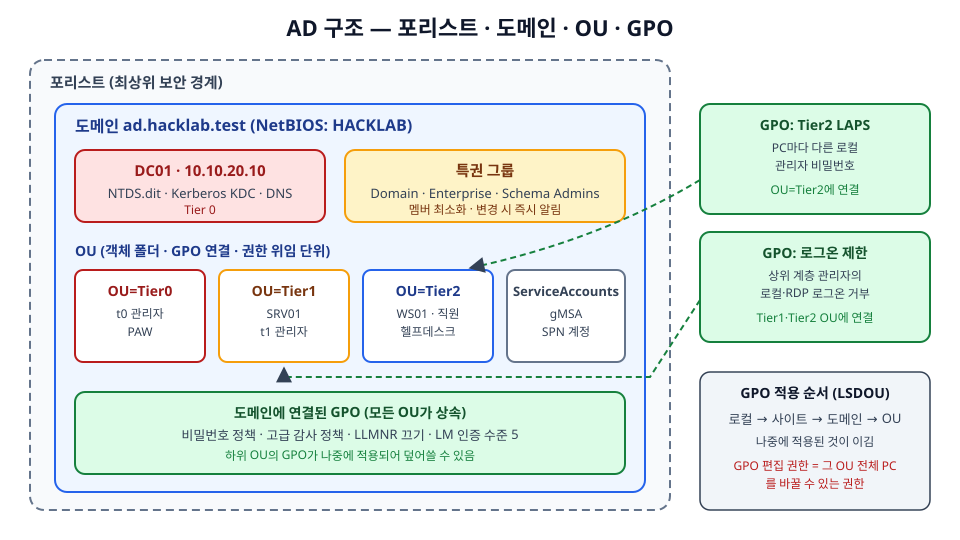
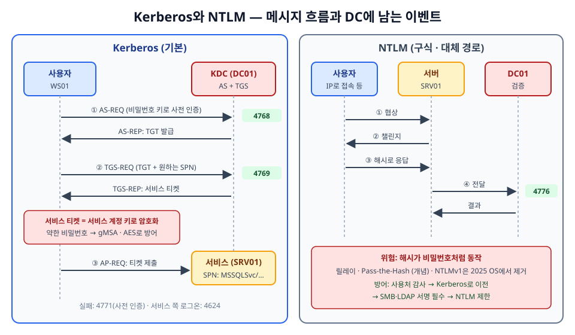
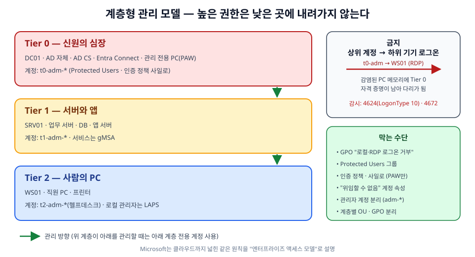

> **해킹 트랙 · 인프라 보안 심화** | 난이도 ★★★★☆ | 예상 소요 3 ~ 4시간 (랩 도메인 구축 포함)

> ⚠️ **실습 전 반드시 읽을 것**
> 실습은 **본인 소유의 격리된 실습장**과 **본인이 만든 앱·시스템**에서만 합니다. 오늘의 대상은 평가판 Windows Server로 직접 만든 **격리 랩 도메인 `ad.hacklab.test`** 하나뿐입니다. 회사·학교 도메인에 점검 도구를 돌리는 것도 **관리 책임자의 서면 허가 없이는 하면 안 됩니다**. 허가 없는 타인 시스템 대상 스캔·공격은 **정보통신망법 등으로 처벌**될 수 있습니다. 이 글은 **관리자·방어자 관점**만 다루며, 자격 증명 덤프나 티켓 공격 같은 공격 도구 사용법은 쓰지 않습니다.

## 🎯 오늘의 목표

- Active Directory의 **포리스트·도메인·OU·GPO**와 인증 프로토콜 **Kerberos·NTLM**의 흐름을 그림으로 설명할 수 있다
- AD에서 가장 흔한 설정 실수 다섯 가지(과도한 관리자 그룹, 약한 서비스 계정과 SPN, 비밀번호 재사용, 로컬 관리자 비밀번호 공유, 오래된 프로토콜)를 **PowerShell AD 모듈과 점검 도구로 찾아낼** 수 있다
- 공격 흔적이 남는 **보안 이벤트 ID**(4625, 4769, 4720 등)와 **Sysmon** 이벤트를 알고, 무엇을 감사(audit)해야 하는지 설정할 수 있다
- **Windows LAPS**, gMSA, 계층형 관리 모델(Tier 0/1/2)로 실수를 구조적으로 고칠 수 있다

---

## 1. 왜 개발자가 AD를 알아야 하나

해킹 01~24는 리눅스·컨테이너·K8s·웹 앱이 중심이었습니다. 그런데 많은 회사에서 **사람의 계정과 PC는 여전히 Windows와 Active Directory(AD)** 로 관리합니다. 사내 Git, Jenkins, VPN, 심지어 K8s(Day 73의 Keycloak)도 AD를 사용자 저장소(LDAP)로 붙이는 경우가 많습니다.

> **AD가 넘어가면 회사의 모든 계정이 넘어간다.** 그래서 침해 보고서에서 "도메인 관리자 권한 획득"은 거의 언제나 마지막 장입니다.

실제 사고를 보면 AD가 넘어가는 이유는 대개 **새로운 0-day가 아니라 오래 쌓인 설정 실수**입니다. 오늘은 그 실수를 **관리자가 먼저 찾아서 고치는 법**을 봅니다.

| 해킹 트랙에서 본 것 | AD에서 같은 모양 |
|---|---|
| 해킹 06 리눅스 sudo 설정 실수 | 너무 많은 사람이 Domain Admins |
| 해킹 09 클라우드 IAM 과잉 권한 | 서비스 계정에 관리자 권한 + 약한 비밀번호 |
| Day 67 SSH 비밀번호 로그인 끄기 | NTLMv1·SMBv1 같은 오래된 프로토콜 끄기 |
| Day 19·69 RBAC 최소 권한 | 계층형 관리 모델(Tier 0/1/2) |

---

## 2. AD 구조 — 포리스트, 도메인, OU, GPO



| 구성 요소 | 비유 | 설명 | 보안 관점 |
|---|---|---|---|
| **포리스트(Forest)** | 회사 전체 | 하나 이상의 도메인을 묶는 **최상위 보안 경계** | 포리스트 안의 도메인끼리는 서로 신뢰. **진짜 경계는 도메인이 아니라 포리스트** |
| **도메인(Domain)** | 법인 | 사용자·컴퓨터·그룹을 담는 디렉터리 파티션. DNS 이름(`ad.hacklab.test`) | 도메인 컨트롤러(DC)가 모든 비밀번호 해시를 보관 |
| **도메인 컨트롤러(DC)** | 인사팀 + 출입관리실 | AD 데이터베이스(`NTDS.dit`)를 들고 인증(Kerberos KDC)을 처리하는 서버 | DC가 넘어가면 끝. **Tier 0** |
| **OU(조직 구성 단위)** | 부서 폴더 | 객체를 담는 폴더. GPO를 연결하고 관리 권한을 **위임**하는 단위 | OU 설계 = 권한 위임 설계 |
| **GPO(그룹 정책 개체)** | 사내 규정 | OU·도메인에 연결해 비밀번호 정책, 감사 정책, 보안 설정을 **일괄 적용** | GPO를 고칠 수 있는 사람 = 그 OU의 모든 PC를 고칠 수 있는 사람 |
| **보안 그룹** | 직무 | 권한을 사람 대신 그룹에 줌 | Domain Admins, Enterprise Admins, Schema Admins, Administrators는 특별 관리 |

> 💡 GPO 적용 순서는 **로컬 → 사이트 → 도메인 → OU**(LSDOU)이고, 나중에 적용된 것이 이깁니다. 감사 정책을 도메인에 걸었는데 어떤 PC에만 안 먹는다면, 하위 OU의 GPO나 "상속 차단"부터 의심합니다. 실제 적용 결과는 대상 PC에서 `gpresult /r`로 봅니다.

---

## 3. 인증 — Kerberos와 NTLM



### 3-1. Kerberos (기본)

| 단계 | 메시지 | 무슨 일 | 남는 이벤트(DC) |
|---|---|---|---|
| ① AS-REQ / AS-REP | 사용자 → KDC | 비밀번호에서 만든 키로 **사전 인증**, KDC가 **TGT**(입장권) 발급 | **4768** (TGT 요청), 실패 시 **4771** |
| ② TGS-REQ / TGS-REP | 사용자 → KDC | TGT를 보여 주고 특정 서비스(SPN)용 **서비스 티켓** 발급. 티켓은 **서비스 계정의 키로 암호화** | **4769** (서비스 티켓 요청) |
| ③ AP-REQ | 사용자 → 서비스 | 서비스 티켓 제출. 서비스는 자기 키로 풀어 확인 | 서비스 서버의 **4624** (로그온) |

핵심은 ②입니다. 서비스 티켓은 **서비스 계정 비밀번호에서 나온 키**로 암호화됩니다. 그래서 서비스 계정 비밀번호가 짧고 오래됐다면, 도메인 사용자 누구나 받을 수 있는 티켓이 **오프라인 추측 대상**이 됩니다. 이 위험의 이름이 **Kerberoasting**이고, 사전 인증을 끈 계정에서 비슷한 일이 생기는 것을 **AS-REP Roasting**이라고 부릅니다. 이 글에서는 이름과 **방어(4장의 SPN 점검, 6장의 4769 탐지, 7장의 gMSA)** 만 다룹니다.

### 3-2. NTLM (구식, 대체 경로)

Kerberos를 쓸 수 없을 때(IP로 접속, 도메인 밖 기기, 오래된 앱) 쓰는 **챌린지-응답** 방식입니다.

| 버전 | 상태 (2026-11 기준) | 위험 |
|---|---|---|
| **NTLMv1** | Windows 11 24H2·Windows Server 2025부터 **제거됨**. Microsoft는 남은 NTLMv1 파생 자격 증명 사용도 단계적으로 막는 중(KB5066470) | 응답에서 비밀번호 해시를 쉽게 복원 |
| **NTLMv2** | 동작하지만 2024년에 **모든 NTLM이 사용 중단(deprecated) 예고**, 기본 비활성화 로드맵 진행 중 | **릴레이**(중간에서 응답을 다른 서버로 전달), 해시만으로 인증되는 **Pass-the-Hash** |

> 💡 NTLM이 위험한 근본 이유는 **"비밀번호 해시 = 비밀번호"** 처럼 동작한다는 점입니다. 그래서 방어의 방향은 ① NTLM 사용처를 **감사(audit)로 찾고** ② Kerberos로 옮기고 ③ SMB·LDAP 서명으로 릴레이를 막는 것입니다.

---

## 4. 실습 환경 — 격리 랩 도메인 `ad.hacklab.test`

### 4-1. 평가판 라이선스 확인 (2026-11-15 확인)

| 항목 | 내용 |
|---|---|
| 제품 | **Windows Server 2025 평가판**(Microsoft Evaluation Center). ISO는 Standard·Datacenter, Server Core·데스크톱 환경 선택 |
| 기간 | **180일** 후 만료 |
| 활성화 | **처음 10일 안에 인터넷으로 활성화**해야 하며, 안 하면 자동 종료됨 |
| 클라이언트 | Windows 11 Enterprise 평가판(Evaluation Center, 기간은 다운로드 페이지에서 확인) — 선택 사항 |
| 용도 | 평가·학습용. **운영 사용은 정식 라이선스로 전환**해야 함(페이지의 "평가판을 정식으로 전환" 안내 참고) |

> ⚠️ 해킹 02에서 실습망은 인터넷과 끊어 두기로 했습니다. 그래서 **설치 직후 업데이트 모드(NAT 케이블 연결)에서 활성화와 Windows Update를 끝내고**, 그다음 실습 모드로 바꿉니다. 만료 전에 스냅샷에서 다시 만드는 편이 정신 건강에 좋습니다.

### 4-2. 구성

해킹 02의 `hacklab`과 **다른 Internal Network `adlab`** 을 씁니다. Metasploitable 같은 취약 대상과 도메인을 같은 망에 두지 않기 위해서입니다.

| VM | 역할 | 주소 | RAM |
|---|---|---|---|
| **DC01** | Windows Server 2025 평가판, AD DS + DNS | `10.10.20.10` | 4GB |
| **SRV01** (선택) | Windows Server 2025 평가판, 멤버 서버(Tier 1 예시) | `10.10.20.20` | 2~3GB |
| **WS01** (선택) | Windows 11 Enterprise 평가판, 멤버 PC(Tier 2 예시) | `10.10.20.21` | 4GB |

```powershell
# 호스트 PC (VirtualBox) — DC01 VM 만들기
VBoxManage createvm --name DC01 --ostype Windows2022_64 --register
VBoxManage modifyvm DC01 --memory 4096 --cpus 2 --nic1 nat --nic2 intnet --intnet2 adlab
VBoxManage createmedium disk --filename "$HOME\VirtualBox VMs\DC01\DC01.vdi" --size 60000
VBoxManage storagectl DC01 --name SATA --add sata
VBoxManage storageattach DC01 --storagectl SATA --port 0 --type hdd --medium "$HOME\VirtualBox VMs\DC01\DC01.vdi"
VBoxManage storageattach DC01 --storagectl SATA --port 1 --type dvddrive --medium "C:\ISO\WindowsServer2025_Eval.iso"
```

> 💡 VirtualBox 버전에 따라 `Windows2025_64` OS 타입이 있으면 그것을 고르세요(`VBoxManage list ostypes`로 확인). ISO 파일 이름은 받은 것에 맞춥니다.

### 4-3. 도메인 만들기 (DC01 안, 관리자 PowerShell)

```powershell
# (1) 실습망 NIC에 고정 IP. 인터페이스 이름은 Get-NetAdapter로 확인
New-NetIPAddress -InterfaceAlias "Ethernet 2" -IPAddress 10.10.20.10 -PrefixLength 24
Set-DnsClientServerAddress -InterfaceAlias "Ethernet 2" -ServerAddresses 127.0.0.1
Rename-Computer -NewName DC01 -Restart

# (2) AD DS 역할 설치 + 새 포리스트
Install-WindowsFeature AD-Domain-Services -IncludeManagementTools
Install-ADDSForest -DomainName "ad.hacklab.test" -DomainNetbiosName "HACKLAB" -InstallDns
# DSRM(복구 모드) 비밀번호를 물어봄 → 랩 전용 비밀번호를 비밀번호 관리자에 저장. 끝나면 자동 재부팅
```

```powershell
# (3) 재부팅 후 확인
Get-ADDomain | Select-Object DNSRoot, NetBIOSName, DomainMode
# DNSRoot          NetBIOSName DomainMode
# -------          ----------- ----------
# ad.hacklab.test  HACKLAB     Windows2025Domain
```

`.test`는 RFC 6761이 **테스트용으로 예약한 최상위 도메인**이라 실제 인터넷 이름과 절대 겹치지 않습니다. 회사 도메인 이름을 흉내 내지 마세요.

### 4-4. 점검 대상이 될 "일부러 만든 실수"

점검 도구가 무엇을 찾는지 보려면 실수가 있어야 합니다. 아래는 **랩에서만** 만드는 설정 실수입니다(비밀번호는 랩 전용 임의 값).

```powershell
# OU 설계: Tier별로 나눔
"Tier0","Tier1","Tier2","ServiceAccounts" | ForEach-Object {
  New-ADOrganizationalUnit -Name $_ -Path "DC=ad,DC=hacklab,DC=test"
}

# 실수 ① 일반 직원 계정이 Domain Admins
New-ADUser -Name "kim.dev" -Path "OU=Tier2,DC=ad,DC=hacklab,DC=test" `
  -AccountPassword (Read-Host -AsSecureString "pw") -Enabled $true
Add-ADGroupMember -Identity "Domain Admins" -Members "kim.dev"

# 실수 ② SPN이 달린 서비스 계정, 비밀번호 만료 없음
New-ADUser -Name "svc-sql" -Path "OU=ServiceAccounts,DC=ad,DC=hacklab,DC=test" `
  -AccountPassword (Read-Host -AsSecureString "pw") -Enabled $true -PasswordNeverExpires $true
Set-ADUser svc-sql -ServicePrincipalNames @{Add="MSSQLSvc/srv01.ad.hacklab.test:1433"}
Add-ADGroupMember -Identity "Domain Admins" -Members "svc-sql"   # 흔한 "일단 되게 하자"
```

> 💡 이 상태에서 스냅샷 `ad-baseline-mistakes`를 떠 두면, 고친 뒤 다시 돌아와 **점검 도구가 정말 찾아내는지** 반복 확인할 수 있습니다(해킹 10의 퍼플팀 루프).

---

## 5. 흔한 설정 실수와 점검 방법

모든 명령은 DC01(또는 RSAT를 설치한 관리 PC)에서 **읽기만 하는** 조회입니다.

### 5-1. 실수 ① 과도한 관리자 그룹 멤버십

| 원리 | 점검 |
|---|---|
| Domain Admins는 **모든 DC와 모든 도메인 PC의 관리자**. 멤버가 많을수록, 그 사람들이 로그온하는 PC가 많을수록 공격면이 넓어짐 | 특권 그룹 멤버를 **중첩까지 풀어서** 보고, 각 계정의 마지막 로그온과 비밀번호 변경일을 확인 |

```powershell
$priv = "Domain Admins","Enterprise Admins","Schema Admins","Administrators",
        "Account Operators","Backup Operators","Server Operators","Print Operators"
foreach ($g in $priv) {
  Get-ADGroupMember -Identity $g -Recursive -ErrorAction SilentlyContinue |
    Where-Object objectClass -eq 'user' |
    Get-ADUser -Properties LastLogonDate, PasswordLastSet, Enabled |
    Select-Object @{n='Group';e={$g}}, SamAccountName, Enabled, LastLogonDate, PasswordLastSet
} | Format-Table -AutoSize
# Group          SamAccountName Enabled LastLogonDate        PasswordLastSet
# Domain Admins  Administrator  True    2026-11-15 오전 9:12 2026-11-15 ...
# Domain Admins  kim.dev        True                         2026-11-15 ...   ← 실수 ①
# Domain Admins  svc-sql        True                         2026-11-15 ...   ← 실수 ②
```

```powershell
# adminCount=1: 한 번이라도 보호 그룹에 들어갔던 계정 (빠진 뒤에도 남는 흔적 → 정리 대상)
Get-ADUser -Filter 'adminCount -eq 1' -Properties adminCount | Select-Object SamAccountName

# 제약 없는 위임(Unconstrained Delegation)이 켜진 컴퓨터 — DC 말고는 없어야 정상
Get-ADComputer -Filter 'TrustedForDelegation -eq $true' | Select-Object Name
```

> ⚠️ **Account Operators, Backup Operators, Server Operators, Print Operators**는 이름은 순해 보여도 DC에 로그온하거나 백업 권한으로 민감 파일을 읽을 수 있는 **사실상 Tier 0 그룹**입니다. Microsoft도 비워 두기를 권합니다.

### 5-2. 실수 ② 서비스 계정의 약한 비밀번호와 SPN

| 원리 | 점검 |
|---|---|
| SPN이 달린 **사람이 만든 사용자 계정**은 서비스 티켓이 그 비밀번호로 암호화됨(3-1). 비밀번호가 짧고 안 바뀌고, 게다가 관리자 그룹이면 최악 | SPN 보유 사용자 계정 목록, 비밀번호 변경일, 허용 암호화 형식(RC4 허용 여부), 특권 그룹 여부 |

```powershell
Get-ADUser -Filter 'ServicePrincipalName -like "*"' `
  -Properties ServicePrincipalName, PasswordLastSet, PasswordNeverExpires, `
              'msDS-SupportedEncryptionTypes', MemberOf |
  Select-Object SamAccountName, PasswordLastSet, PasswordNeverExpires,
    @{n='EncTypes';e={$_.'msDS-SupportedEncryptionTypes'}},
    @{n='Privileged';e={($_.MemberOf -match 'CN=Domain Admins').Count -gt 0}},
    @{n='SPN';e={$_.ServicePrincipalName -join ';'}}
# SamAccountName PasswordLastSet PasswordNeverExpires EncTypes Privileged SPN
# krbtgt         ...             False                         False      kadmin/changepw
# svc-sql        2026-11-15      True                          True       MSSQLSvc/srv01...
```

| 결과 읽는 법 | 의미 |
|---|---|
| `krbtgt` | 정상(내장 계정). 대신 **비밀번호 변경일**을 봅니다. 몇 년째 그대로면 정기 교체 절차(두 번 교체) 대상 |
| `EncTypes` 비어 있음 | 계정에 명시 설정이 없어 도메인 기본값을 따름. **AES만 허용(값 24 = AES128+AES256)** 으로 명시하는 것이 목표 |
| `PasswordNeverExpires = True` + `Privileged = True` | 오늘 가장 먼저 고칠 항목 → 7-2의 **gMSA** 로 교체 |

```powershell
# 사전 인증(Kerberos pre-auth)을 끈 계정 — 있으면 안 됨 (AS-REP Roasting 위험)
Get-ADUser -Filter 'DoesNotRequirePreAuth -eq $true' | Select-Object SamAccountName
```

> 💡 Microsoft는 Kerberos에서 **RC4를 기본으로 쓰지 않도록** 단계적으로 바꾸는 중입니다. 정확한 적용 시점은 바뀔 수 있으니 Microsoft Learn의 Kerberos 암호화 형식 문서와 해당 월 보안 업데이트 KB를 확인하세요. 6장의 4769 이벤트로 **아직 RC4 티켓을 쓰는 곳**을 먼저 찾아 두면 전환이 안전합니다.

### 5-3. 실수 ③ 비밀번호 재사용과 약한 비밀번호 정책

| 원리 | 점검 |
|---|---|
| 관리자가 일반 계정과 관리자 계정에 **같은 비밀번호**를 쓰거나, 사이트 간 재사용하면 한 곳의 유출이 도메인까지 이어짐 | 도메인 기본 정책, 세분화된 비밀번호 정책(FGPP), 만료 없는 계정, 비밀번호 불필요(`PasswordNotRequired`) 계정 |

```powershell
Get-ADDefaultDomainPasswordPolicy |
  Select-Object MinPasswordLength, ComplexityEnabled, LockoutThreshold, MaxPasswordAge
Get-ADFineGrainedPasswordPolicy -Filter * | Select-Object Name, Precedence, MinPasswordLength, AppliesTo

Get-ADUser -Filter 'PasswordNeverExpires -eq $true -and Enabled -eq $true' | Select-Object SamAccountName
Get-ADUser -Filter 'PasswordNotRequired -eq $true' | Select-Object SamAccountName

# 90일 넘게 로그온하지 않은 활성 계정 — 퇴사자·잊힌 계정
Search-ADAccount -AccountInactive -TimeSpan 90.00:00:00 -UsersOnly |
  Where-Object Enabled | Select-Object SamAccountName, LastLogonDate
```

재사용 자체는 해시를 꺼내 비교하지 않는 한 PowerShell 조회로 직접 보이지 않습니다. 그래서 **관리자가 해시를 다루는 대신** 아래처럼 구조로 막습니다.

| 대책 | 무엇을 막나 |
|---|---|
| **관리자 계정 분리**(`kim.dev` / `adm-kim.dev`)와 서로 다른 비밀번호, 관리자 계정은 메일·웹 사용 금지 | 일반 계정 유출이 곧 관리자 유출이 되는 것 |
| **긴 암호문(passphrase) + FGPP**로 관리자 그룹에 더 긴 최소 길이 | 짧은 비밀번호 추측 |
| **금지 비밀번호 목록**(예: Microsoft Entra Password Protection의 온프레미스 에이전트) | 회사 이름+연도 같은 뻔한 패턴 |
| PingCastle·Purple Knight 보고서의 비밀번호 관련 항목 | 정책 수준 문제를 한 번에 확인 |

### 5-4. 실수 ④ 로컬 관리자 비밀번호 공유 → Windows LAPS

| 원리 | 점검 |
|---|---|
| PC 이미지를 복제하면서 **모든 PC의 로컬 Administrator 비밀번호가 같으면**, PC 하나의 해시로 나머지 PC 전체에 들어갈 수 있음(측면 이동) | LAPS 적용 여부와 **비밀번호를 읽을 수 있는 사람이 누구인지** |

**Windows LAPS**는 Windows 11·Windows Server 2025(및 업데이트된 2019·2022 등)에 **내장**되어 별도 설치가 필요 없고, PC마다 다른 로컬 관리자 비밀번호를 자동으로 만들고 주기적으로 바꿔 AD(또는 Entra ID)에 저장합니다. 예전의 별도 설치형 "Microsoft LAPS(레거시)"는 지원 종료 수순입니다.

```powershell
# (1) 스키마 확장 (포리스트당 한 번, Schema Admins 권한)
Update-LapsADSchema

# (2) Tier2 OU의 컴퓨터가 자기 비밀번호를 AD에 쓸 수 있게 권한 부여
Set-LapsADComputerSelfPermission -Identity "OU=Tier2,DC=ad,DC=hacklab,DC=test"

# (3) GPO: 컴퓨터 구성 → 관리 템플릿 → 시스템 → LAPS
#     "Configure password backup directory" = Active Directory
#     "Password Settings" = 복잡도·길이·기간
#     (Server 2025 포리스트 스키마라면 "Enable password encryption"도 검토)

# (4) 점검 — 누가 이 OU의 LAPS 비밀번호를 읽을 수 있나 (가장 중요)
Find-LapsADExtendedRights -Identity "OU=Tier2,DC=ad,DC=hacklab,DC=test"

# (5) WS01에 적용됐는지 (비밀번호 값을 화면에 띄우지 않고 만료 시각만 확인)
Get-LapsADPassword -Identity WS01 | Select-Object ComputerName, PasswordUpdateTime, ExpirationTimestamp
```

> ⚠️ LAPS는 "비밀번호가 PC마다 다르다"는 문제를 풀지만, **읽기 권한을 넓게 주면 새 공격 경로**가 됩니다. `Find-LapsADExtendedRights` 결과에 헬프데스크 그룹 하나와 Tier 관리 그룹만 보여야 정상입니다.

### 5-5. 실수 ⑤ 오래된 프로토콜 — SMBv1, NTLMv1, LLMNR·NBT-NS

| 프로토콜 | 왜 위험한가 | 점검 | 끄는 방법 |
|---|---|---|---|
| **SMBv1** | 서명·암호화가 약하고 과거 대형 웜(WannaCry 등)의 통로 | `Get-WindowsOptionalFeature -Online -FeatureName SMB1Protocol` / `Get-SmbServerConfiguration \| Select EnableSMB1Protocol, RequireSecuritySignature` | 기능 제거, SMB 서명 필수(Windows Server 2025·Windows 11 24H2는 기본 강화) |
| **NTLMv1 / LM** | 응답에서 해시 복원이 쉬움 | 레지스트리 `HKLM:\SYSTEM\CurrentControlSet\Control\Lsa` 의 `LmCompatibilityLevel` | GPO "네트워크 보안: LAN Manager 인증 수준" = **NTLMv2 응답만 보냄, LM·NTLM 거부(값 5)** |
| **LLMNR** | DNS에 없는 이름을 **같은 망 아무에게나 물어봄** → 가짜 응답(이름 응답 스푸핑, 해킹 22의 ARP 스푸핑과 같은 부류)으로 인증 시도를 엉뚱한 곳으로 유도 | `HKLM:\SOFTWARE\Policies\Microsoft\Windows NT\DNSClient` 의 `EnableMulticast` | GPO "멀티캐스트 이름 확인 끄기" = 사용 (`EnableMulticast=0`) |
| **NBT-NS** | LLMNR과 같은 문제를 NetBIOS 브로드캐스트로 | NIC별 `NetbiosOptions` | DHCP 옵션 또는 NIC 설정에서 NetBIOS over TCP/IP 사용 안 함(값 2) |

```powershell
# 한 번에 보는 점검 스크립트 (각 서버·PC에서)
[pscustomobject]@{
  Host        = $env:COMPUTERNAME
  SMB1Server  = (Get-SmbServerConfiguration).EnableSMB1Protocol
  SMBSignReq  = (Get-SmbServerConfiguration).RequireSecuritySignature
  LmCompat    = (Get-ItemProperty 'HKLM:\SYSTEM\CurrentControlSet\Control\Lsa' -ErrorAction SilentlyContinue).LmCompatibilityLevel
  LLMNR       = (Get-ItemProperty 'HKLM:\SOFTWARE\Policies\Microsoft\Windows NT\DNSClient' -ErrorAction SilentlyContinue).EnableMulticast
  NetBIOS     = (Get-ChildItem 'HKLM:\SYSTEM\CurrentControlSet\Services\NetBT\Parameters\Interfaces' |
                 Get-ItemProperty | Select-Object -ExpandProperty NetbiosOptions) -join ','
}
# Host SMB1Server SMBSignReq LmCompat LLMNR NetBIOS
# DC01      False       True        5     0 2,2      ← 목표 상태
```

| 값 | 해석 |
|---|---|
| `LmCompat` 비어 있음 | 레지스트리에 명시 안 됨 → OS 기본값. **GPO로 5를 명시**하는 것이 감사에 유리 |
| `LLMNR` 비어 있음 | 정책 미적용 = LLMNR **켜짐** |
| `NetBIOS` 0 | DHCP 설정을 따름(대개 켜짐). 2가 꺼짐 |

> 💡 끄기 전에 **누가 아직 쓰는지**부터 봅니다. NTLM은 GPO "NTLM 제한: 이 도메인에서 NTLM 인증 감사"를 켜면 DC의 `Microsoft-Windows-NTLM/Operational` 로그에 사용처가 남고, SMBv1은 `Set-SmbServerConfiguration -AuditSmb1Access $true` 후 `Microsoft-Windows-SMBServer/Audit` 로그를 봅니다. **감사 → 이전 → 차단** 순서가 장애 없는 길입니다.

### 5-6. 점검 도구 — 한 번에 보는 건강검진

| 도구 | 만든 곳 | 성격 | 비고 (2026-11 확인) |
|---|---|---|---|
| **PingCastle** | Netwrix (원저자 Vincent Le Toux) | AD 위험 점수와 성숙도 보고서(HTML). 특권 그룹, 위임, 오래된 프로토콜, 비밀번호 정책 등 | 무료 에디션은 수동 실행 보고서. 유료 에디션에 예약 실행·다중 도메인. **사용 조건은 다운로드 시 라이선스로 확인** |
| **Purple Knight** | Semperis | AD·Entra ID(·Okta) 노출 지표(IOE)·침해 지표(IOC) 점검, 0~100점과 A+~F 등급 | 무료, GUI. **읽기 전용 점검**으로 AD를 바꾸지 않음 |
| **PowerShell AD 모듈** | Microsoft (RSAT) | 위 5-1~5-5의 조회 | 결과를 CSV로 남겨 다음 점검과 비교 |
| **Microsoft Security Compliance Toolkit** | Microsoft | 보안 기준(Security Baseline) GPO와 비교 도구(Policy Analyzer) | 기준선 대비 차이 확인 |

```powershell
# 점검 결과를 날짜별로 남겨 비교 (해킹 06의 기준선 방식)
$d = Get-Date -Format yyyyMMdd
Get-ADGroupMember "Domain Admins" -Recursive | Select-Object SamAccountName |
  Export-Csv "C:\audit\$d-domain-admins.csv" -NoTypeInformation -Encoding UTF8
Compare-Object (Import-Csv C:\audit\20261101-domain-admins.csv) (Import-Csv "C:\audit\$d-domain-admins.csv") -Property SamAccountName
# SamAccountName SideIndicator
# kim.dev        =>              ← 지난 점검 이후 새로 들어온 관리자
```

> ⚠️ 이런 점검 도구는 **AD 전체 구성을 한 파일에 모은 보고서**를 만듭니다. 그 보고서 자체가 공격자에게 지도입니다. 보고서는 암호화된 위치에 두고, 공유는 해킹 11의 보고서 배포 규칙대로 최소 인원에게만 합니다.

---

## 6. 탐지 — 이벤트 ID와 Sysmon

### 6-1. 먼저 감사 정책을 켠다

기본 감사 설정만으로는 중요한 이벤트가 안 남는 경우가 많습니다. **고급 감사 정책**을 GPO로 DC와 서버에 적용합니다(GPO: 컴퓨터 구성 → 정책 → Windows 설정 → 보안 설정 → 고급 감사 정책 구성).

| 하위 범주 (영문 이름) | 성공/실패 | 남는 이벤트 |
|---|---|---|
| Credential Validation | 둘 다 | 4776 (NTLM 검증) |
| Kerberos Authentication Service | 둘 다 | 4768, 4771 |
| Kerberos Service Ticket Operations | 둘 다 | 4769 |
| Logon / Account Lockout | 둘 다 / 실패 | 4624, 4625 / 4740 |
| User Account Management | 둘 다 | 4720, 4722, 4724, 4738 |
| Security Group Management | 성공 | 4728, 4732, 4756 |
| Directory Service Changes | 성공 | 5136 (GPO·객체 변경) |
| Special Logon | 성공 | 4672 (특권 로그온) |

```powershell
# 적용 확인 (영문 OS 기준. 한글 OS는 하위 범주 이름이 한글로 표시됨)
auditpol /get /subcategory:"Kerberos Service Ticket Operations","Security Group Management"
```

### 6-2. 꼭 볼 이벤트 ID

| ID | 의미 | 무엇을 의심하나 (방어 관점) |
|---|---|---|
| **4625** | 로그온 실패 | 한 IP에서 여러 계정 실패 = 비밀번호 스프레이, 한 계정 연속 실패 = 무차별 대입 |
| **4740** | 계정 잠김 | 4625 폭주의 결과. 잠김이 여러 계정에 동시에 나면 스프레이 |
| **4624** | 로그온 성공 | `LogonType` 3(네트워크)·10(원격 데스크톱). **관리자 계정이 Tier 2 PC에 로그온**하면 계층 위반 |
| **4672** | 특권 할당 로그온 | 관리자급 로그온. 평소 없는 시간·호스트면 확인 |
| **4768 / 4771** | TGT 요청 / 사전 인증 실패 | 존재하지 않는 계정 대량 요청 = 계정 열거 |
| **4769** | 서비스 티켓 요청 | **짧은 시간에 한 계정이 많은 SPN 티켓**, 특히 `TicketEncryptionType 0x17`(RC4) = Kerberoasting 의심 |
| **4776** | NTLM 자격 증명 검증 | 아직 NTLM을 쓰는 곳 찾기, 실패 폭주 |
| **4720** | 사용자 생성 | 업무 시간 밖·변경 요청 없이 생긴 계정 = 지속성(persistence) |
| **4728 / 4732 / 4756** | 전역/로컬/유니버설 보안 그룹에 멤버 추가 | **Domain Admins 등 특권 그룹 추가는 무조건 알림** |
| **4738** | 사용자 계정 변경 | `DoesNotRequirePreAuth` 켜기, SPN 추가 등 위험 속성 변경 |
| **5136** | 디렉터리 객체 변경 | GPO 수정, 위임 권한 변경 |
| **1102** | 보안 로그 삭제 | 흔적 지우기 시도. **항상 최고 우선순위** |

```powershell
# 최근 24시간 특권 그룹 멤버 추가
Get-WinEvent -FilterHashtable @{LogName='Security'; Id=4728,4732,4756; StartTime=(Get-Date).AddDays(-1)} |
  ForEach-Object { $x=[xml]$_.ToXml(); [pscustomobject]@{
    Time   = $_.TimeCreated
    Group  = ($x.Event.EventData.Data | Where-Object Name -eq 'TargetUserName').'#text'
    Member = ($x.Event.EventData.Data | Where-Object Name -eq 'MemberName').'#text'
    By     = ($x.Event.EventData.Data | Where-Object Name -eq 'SubjectUserName').'#text' } }
# Time                 Group          Member                                         By
# 2026-11-15 오전 9:40 Domain Admins  CN=kim.dev,OU=Tier2,DC=ad,DC=hacklab,DC=test   Administrator
```

```powershell
# RC4로 발급된 서비스 티켓 — 남아 있는 RC4 사용처 찾기 + Kerberoasting 의심 신호
$xp = "*[System[EventID=4769] and EventData[Data[@Name='TicketEncryptionType']='0x17']]"
Get-WinEvent -LogName Security -FilterXPath $xp -MaxEvents 200 |
  ForEach-Object { $x=[xml]$_.ToXml(); [pscustomobject]@{
    Time    = $_.TimeCreated
    Account = ($x.Event.EventData.Data | Where-Object Name -eq 'TargetUserName').'#text'
    Service = ($x.Event.EventData.Data | Where-Object Name -eq 'ServiceName').'#text'
    Client  = ($x.Event.EventData.Data | Where-Object Name -eq 'IpAddress').'#text' } } |
  Group-Object Account | Sort-Object Count -Descending | Select-Object Count, Name
```

> 💡 **허니 계정(미끼 계정)** 은 방어자가 쓰기 좋은 장치입니다. 아무도 쓰지 않는 그럴듯한 SPN 계정을 하나 만들어 두면, 그 SPN에 대한 4769는 **정상일 이유가 없으므로** 오탐 거의 없는 알림이 됩니다(해킹 10의 "오탐 적은 룰은 높은 우선순위").

### 6-3. Sysmon — 프로세스 수준의 눈

보안 로그는 "누가 로그온했나"에 강하고, **"어떤 프로세스가 무엇을 했나"** 에는 약합니다. 그 공백을 메우는 것이 Sysinternals **Sysmon**입니다(리눅스의 auditd·Falco 역할, 해킹 10의 "원천마다 보는 층이 다르다").

| Sysmon ID | 이벤트 | 방어 관점 |
|---|---|---|
| 1 | 프로세스 생성(명령줄·해시·부모) | Office·브라우저 밑에서 PowerShell이 뜸 |
| 3 | 네트워크 연결 | 평소 통신하지 않는 프로세스의 외부 연결 |
| 10 | 프로세스 접근 | **LSASS(자격 증명 보관 프로세스)에 접근**하는 비정상 프로세스 |
| 11 | 파일 생성 | 시작 프로그램 폴더 등 지속성 위치 |
| 13 | 레지스트리 값 설정 | Run 키 등 자동 실행 등록 |
| 22 | DNS 질의 | 프로세스별 도메인 조회 |

| 설치 방식 (2026-11 확인) | 방법 |
|---|---|
| **독립형** | Sysinternals에서 Sysmon을 받아 `sysmon64.exe -accepteula -i <설정.xml>` |
| **Windows 내장** | Windows 11·Windows Server 2025에 **선택적 기능**으로 들어옴(기본 꺼짐, `Dism /Online /Enable-Feature /FeatureName:Sysmon` 등). **독립형과 함께 쓸 수 없으니** 독립형을 먼저 제거 |

설정 파일은 처음부터 쓰지 말고 커뮤니티 기준(예: SwiftOnSecurity `sysmon-config`, Olaf Hartong `sysmon-modular`)에서 시작해 소음을 줄여 갑니다. 결과는 `Applications and Services Logs/Microsoft/Windows/Sysmon/Operational`에 쌓입니다.

> 💡 운영에서는 이 로그들을 DC에만 두지 않고 **중앙으로** 보냅니다. Windows 기본 기능인 **WEF(Windows Event Forwarding)** 로 수집 서버에 모으거나, Grafana Alloy의 `loki.source.windowsevent` 컴포넌트로 Day 60의 Loki에 넣으면 해킹 10의 LogQL·알림 체계를 그대로 씁니다. 공격자가 1102로 로그를 지워도 **이미 밖으로 나간 사본**은 남습니다.

---

## 7. 수정 — 실수를 구조로 막기

### 7-1. 계층형 관리 모델 (Tier 0 / 1 / 2)



| 계층 | 자산 | 관리 계정 | 규칙 |
|---|---|---|---|
| **Tier 0** | DC, AD 자체, AD CS(인증서), AD FS·Entra Connect, 이들을 관리하는 PC(PAW) | `t0-adm-*` | Tier 0 계정은 **Tier 0 자산에만 로그온** |
| **Tier 1** | 업무 서버, 앱·DB 서버(SRV01) | `t1-adm-*` | Tier 2 PC에 로그온 금지 |
| **Tier 2** | 직원 PC(WS01), 프린터 | `t2-adm-*`(헬프데스크) | 서버·DC에 로그온 금지 |

원칙은 하나입니다. **높은 계층의 자격 증명이 낮은 계층 기기에 절대 남지 않게** 합니다. 감염된 PC에 도메인 관리자가 원격 데스크톱으로 한 번 로그온하는 순간, 그 PC 메모리에 남은 자격 증명이 Tier 0으로 가는 다리가 됩니다.

| 구현 수단 | 효과 |
|---|---|
| GPO 사용자 권한 할당: "로컬 로그온 거부", "원격 데스크톱 서비스를 통한 로그온 거부"에 상위 계층 그룹 추가 | Tier 0 계정이 Tier 1·2 기기에 로그온 못 함 |
| **Protected Users** 그룹에 관리자 계정 추가 | NTLM·RC4·위임 불가, 자격 증명 캐시 제한 |
| **인증 정책·사일로(Authentication Policy Silo)** | Tier 0 계정은 지정한 PAW에서만 TGT를 받게 제한 |
| 계정 속성 "계정은 중요하므로 위임할 수 없음" | 위임을 통한 자격 증명 재사용 차단 |

> 💡 Microsoft는 이 계층 모델을 클라우드까지 넓혀 **엔터프라이즈 액세스 모델**(컨트롤 플레인 / 관리 플레인 / 데이터·워크로드 플레인)이라는 이름으로 설명합니다. 이름은 달라도 "높은 권한은 낮은 곳에 내려가지 않는다"는 원칙은 같습니다. K8s에서 cluster-admin 토큰을 개발자 노트북에 두지 않는 것(Day 19·73)과 같은 생각입니다.

### 7-2. 실수별 수정 요약

| 실수 | 수정 | 랩에서 확인 |
|---|---|---|
| ① 과도한 관리자 | `kim.dev`를 Domain Admins에서 빼고, 필요한 작업만 OU에 **위임**. 관리자는 별도 `adm-` 계정 + Protected Users | 5-1 스크립트 재실행, 4729(전역 그룹 멤버 제거) 이벤트 |
| ② 서비스 계정 | **gMSA(그룹 관리 서비스 계정)** 로 교체 → 비밀번호를 사람이 모르고 AD가 자동으로 긴 무작위 값으로 교체. 특권 그룹에서 제거, AES만 허용 | 5-2 스크립트에서 `svc-sql` 사라짐 |
| ③ 비밀번호 재사용 | 관리자 계정 분리, FGPP로 관리자 최소 길이 상향, 금지 비밀번호 목록 | 5-3 정책 출력 |
| ④ 로컬 관리자 공유 | Windows LAPS + 읽기 권한 최소화 | `Find-LapsADExtendedRights` |
| ⑤ 오래된 프로토콜 | 감사 → 이전 → GPO로 차단(SMBv1 제거, LM 인증 수준 5, LLMNR·NBT-NS 끄기, SMB·LDAP 서명) | 5-5 점검 스크립트 |

```powershell
# gMSA로 교체하는 최소 예시 (랩)
Add-KdsRootKey -EffectiveTime ((Get-Date).AddHours(-10))   # 랩 전용: 즉시 사용. 운영은 기본값(복제 대기)
New-ADServiceAccount -Name gmsa-sql -DNSHostName gmsa-sql.ad.hacklab.test `
  -PrincipalsAllowedToRetrieveManagedPassword "SRV01$" `
  -ServicePrincipalNames "MSSQLSvc/srv01.ad.hacklab.test:1433" `
  -KerberosEncryptionType AES128,AES256

# 옛 계정의 SPN 제거 → 그룹에서 제거 → 비활성화 (삭제는 서비스 이전 확인 후)
Set-ADUser svc-sql -ServicePrincipalNames @{Remove="MSSQLSvc/srv01.ad.hacklab.test:1433"}
Remove-ADGroupMember -Identity "Domain Admins" -Members svc-sql -Confirm:$false
Disable-ADAccount svc-sql

# SRV01에서: 설치·검증
Install-ADServiceAccount gmsa-sql
Test-ADServiceAccount gmsa-sql
# True
```

> ⚠️ `Add-KdsRootKey -EffectiveTime` 을 과거로 당기는 것은 **DC가 하나뿐인 랩에서만** 쓰는 지름길입니다. 운영에서는 모든 DC에 복제될 시간을 기다려야 합니다. 또 Windows Server 2025에 새로 생긴 **dMSA(위임 관리 서비스 계정)** 는 OU 권한 설정에 따라 오남용 위험이 보고된 바 있으므로, 쓸 계획이면 최신 보안 업데이트와 OU의 객체 생성 권한부터 점검하세요.

### 7-3. 점검 → 탐지 → 수정 루프

1. 스냅샷 `ad-baseline-mistakes`에서 PingCastle·Purple Knight와 5장 스크립트로 **점검** → 결과 저장
2. 6장의 감사 정책·Sysmon을 켜고, 일부러 만든 변경(그룹 추가, SPN 추가)이 **이벤트로 보이는지** 확인
3. 7-2대로 **수정**하고 다시 1로 → 점수와 목록이 바뀌었는지 비교
4. 결과를 해킹 11 보고서 양식(발견 사항 → 영향 → 조치 → 재점검)으로 정리

---

## 8. 트러블슈팅

| 증상 | 원인 | 해결 |
|---|---|---|
| 평가판 서버가 며칠 뒤 저절로 꺼짐 | 10일 안에 인터넷 활성화를 안 함 | 업데이트 모드에서 `slmgr /ato`로 활성화, 상태는 `slmgr /dlv` |
| WS01이 도메인 가입 실패("도메인을 찾을 수 없음") | WS01의 DNS가 DC01(10.10.20.10)이 아님 | `Set-DnsClientServerAddress`로 DNS를 DC01로, `Resolve-DnsName ad.hacklab.test` 확인 |
| `Get-ADUser`가 인식 안 됨 | RSAT AD 모듈 미설치 | 서버: `Install-WindowsFeature RSAT-AD-PowerShell`, Windows 11: 선택적 기능에서 RSAT 설치 |
| 4769가 하나도 안 보임 | 고급 감사 정책 미적용 또는 기본 감사와 충돌 | `auditpol /get /category:*` 확인, GPO "감사 정책 하위 범주 설정을 강제로 사용" 켜기, `gpupdate /force` |
| GPO가 특정 PC에 안 먹음 | 링크 위치·상속 차단·보안 필터링 | 대상 PC에서 `gpresult /h report.html` |
| `Update-LapsADSchema` 실패 | Schema Admins 권한 없음 | 랩 Administrator로 실행(운영은 변경 승인 후 일시적으로 Schema Admins 부여) |
| `Install-ADServiceAccount` 실패 | KDS 루트 키가 아직 유효하지 않음, 또는 SRV01이 `PrincipalsAllowedToRetrieveManagedPassword`에 없음 | `Get-KdsRootKey`, 서비스 계정 속성 확인 후 SRV01 재부팅(그룹 멤버십 갱신) |
| Sysmon 내장 기능이 안 켜짐 | 독립형 Sysmon이 이미 설치됨 | `sysmon64 -u`로 제거 후 다시 시도 |

---

## 9. 핵심 정리

- AD의 진짜 보안 경계는 **포리스트**, 가장 중요한 자산은 **DC(Tier 0)**. GPO를 고칠 수 있으면 그 OU 전체를 고칠 수 있다
- Kerberos 서비스 티켓은 **서비스 계정 비밀번호로 암호화**되므로, SPN 달린 사람 계정의 약한 비밀번호가 위험의 핵심. 답은 **gMSA + AES만 허용**
- 흔한 실수 다섯: 과도한 관리자, 약한 서비스 계정, 비밀번호 재사용, **로컬 관리자 공유(→ Windows LAPS)**, **SMBv1·NTLMv1·LLMNR·NBT-NS**
- 점검은 **PowerShell AD 모듈 + PingCastle·Purple Knight**, 결과는 날짜별로 남겨 비교
- 탐지는 **고급 감사 정책**을 켜는 것부터: 4625·4740(실패), 4769(티켓, RC4), 4720·4728/4732/4756(계정·그룹 변경), 1102(로그 삭제) + **Sysmon**, 그리고 중앙 수집
- 구조적 해법은 **계층형 관리 모델** — 높은 권한의 자격 증명을 낮은 계층 기기에 절대 남기지 않는다

---

## 10. 셀프 체크

<details>
<summary>Q1. 서비스 계정에 SPN이 있고 비밀번호가 짧으면 왜 위험한가? 방어 쪽 해법은?</summary>

Kerberos 서비스 티켓은 그 서비스 계정 비밀번호에서 나온 키로 암호화되고, 도메인 사용자라면 누구나 티켓을 요청할 수 있습니다. 비밀번호가 약하면 티켓이 오프라인 추측 대상이 됩니다(Kerberoasting). 해법은 **gMSA**로 바꿔 AD가 긴 무작위 비밀번호를 자동 교체하게 하고, AES만 허용하며, 서비스 계정을 특권 그룹에서 빼는 것입니다. 탐지는 RC4(`0x17`) 4769 이벤트 집계와 허니 SPN 계정입니다.
</details>

<details>
<summary>Q2. Windows LAPS를 켠 뒤에도 반드시 점검해야 할 것은?</summary>

**누가 LAPS 비밀번호를 읽을 수 있는지**입니다(`Find-LapsADExtendedRights`). 읽기 권한이 넓으면 PC마다 비밀번호가 달라도 한 계정으로 모든 PC의 비밀번호를 얻을 수 있어 새 공격 경로가 됩니다.
</details>

<details>
<summary>Q3. LLMNR을 끄면 무엇이 막히고, 끄기 전에 무엇을 확인해야 하나?</summary>

DNS에 없는 이름을 같은 망에 브로드캐스트로 묻는 동작이 사라져, 가짜 응답으로 인증 시도를 엉뚱한 기기로 유도하는 이름 응답 스푸핑이 막힙니다. 끄기 전에는 **DNS에 등록되지 않은 이름에 의존하는 앱·공유 폴더가 없는지** 확인하고, 필요하면 DNS 레코드를 먼저 만듭니다.
</details>

<details>
<summary>Q4. 도메인 관리자가 직원 PC에 원격 데스크톱으로 로그온하면 왜 계층 모델 위반인가? 무엇으로 막나?</summary>

로그온한 PC의 메모리에 Tier 0 자격 증명이 남아, 그 PC가 감염돼 있으면 Tier 0으로 가는 다리가 됩니다. GPO의 "로그온 거부" 사용자 권한, Protected Users, 인증 정책·사일로로 Tier 0 계정이 Tier 0 자산(DC, PAW)에서만 로그온하게 막고, 4624(LogonType 10)·4672를 계층별로 감시합니다.
</details>

<details>
<summary>Q5. 1102 이벤트가 "항상 최고 우선순위"인 이유와, 이 이벤트가 생겨도 흔적을 잃지 않으려면?</summary>

보안 로그 삭제는 정상 운영에서 거의 없고 흔적 지우기의 전형이기 때문입니다. WEF나 Alloy 같은 **중앙 수집**으로 이벤트가 생기는 즉시 밖으로 보내 두면, 원본 로그가 지워져도 사본이 남습니다.
</details>

---

## ⏭️ 다음 예고 — 해킹 26. 홈랩 공유기·IoT 기기 보안 점검 (본인 소유 기기만)

회사 도메인에서 집으로 돌아옵니다. Homelab 02에서 포트포워딩을 열었던 그 **공유기**, 그리고 집 안의 스마트 플러그·카메라·TV 같은 **IoT 기기**가 오늘 본 "오래된 프로토콜·기본 비밀번호·과잉 노출"을 똑같이 안고 있습니다. 펌웨어 업데이트와 기본 계정 변경, 원격 관리·UPnP·WPS 끄기, Day 23의 VLAN으로 IoT 망 분리, 해킹 03의 범위 가드를 **내 기기 목록**에 맞춰 바꾼 nmap 점검, DNS 설정 확인과 단종 기기 교체 기준까지 다룹니다.
