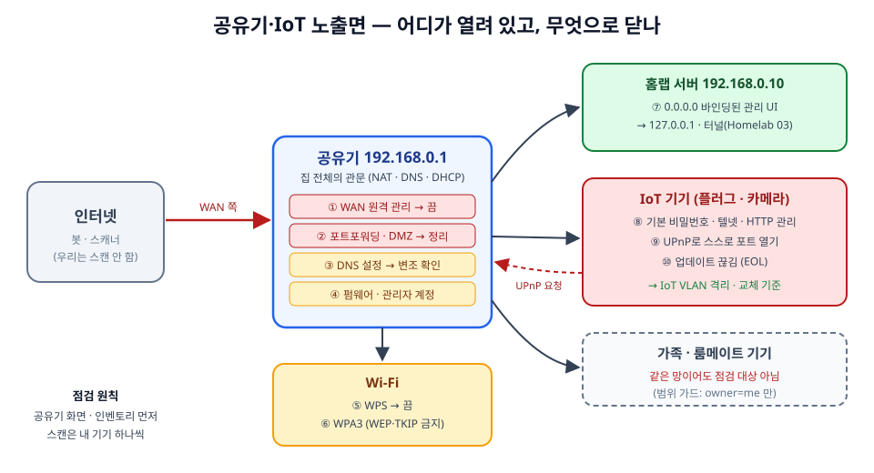
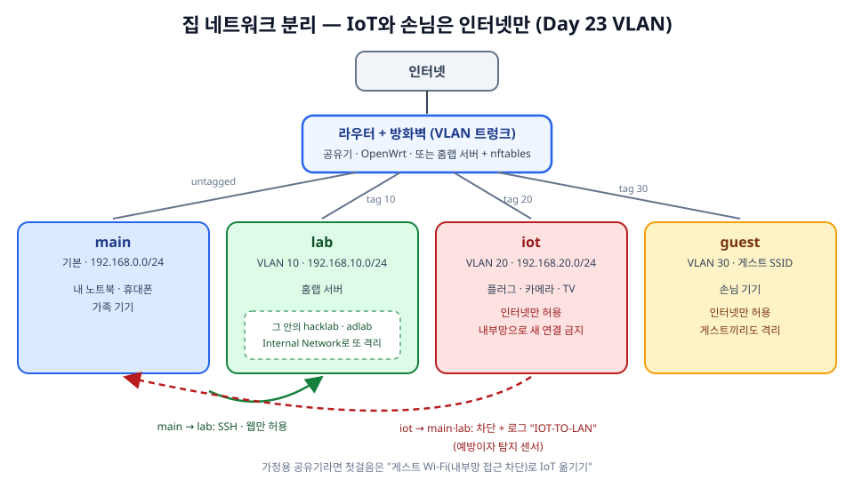

> **해킹 트랙 · 인프라 보안 심화** | 난이도 ★★★☆☆ | 예상 소요 2.5 ~ 3시간

> ⚠️ **실습 전 반드시 읽을 것**
> 오늘의 대상은 **내가 소유하고 관리하는 공유기와 IoT 기기**뿐입니다. 같은 집에 사는 가족·룸메이트의 노트북·휴대폰, 이웃의 Wi-Fi, 건물·아파트 공용망, 카페 Wi-Fi는 **같은 망에 있어도 내 것이 아닙니다.** 허가 없이 스캔하면 **정보통신망법 등으로 처벌**될 수 있습니다. 통신사 **임대 공유기**는 소유자가 통신사이므로 관리 페이지 설정 점검까지만 하고, 포트 스캔은 약관을 확인한 뒤 LAN 쪽 가벼운 확인으로 제한합니다. 내 **공인 IP를 인터넷 쪽에서 전체 스캔하는 것도 하지 않습니다**(통신사 망을 지나는 트래픽입니다). 해킹 03의 범위 가드는 오늘 **"내 기기 목록"** 에 맞춰 다시 만듭니다.

## 🎯 오늘의 목표

- 공유기와 IoT 기기가 왜 집 네트워크의 **가장 약한 고리**인지, 노출면(WAN 관리, UPnP, WPS, 포트포워딩, DNS)을 그림으로 설명할 수 있다
- **기기 목록(인벤토리)** 을 만들고, 그 목록에 있는 IP만 허용하는 **범위 가드**로 nmap 점검을 할 수 있다
- 펌웨어·기본 계정·원격 관리·UPnP·WPS·DNS 설정을 **체크리스트로 점검**하고 고칠 수 있다
- Day 23의 VLAN으로 **IoT·게스트 네트워크를 분리**하고, 새 기기 등장을 **탐지**할 수 있다
- Homelab 02의 포트포워딩을 다시 점검하고, **단종 기기 교체 기준**을 세울 수 있다

---

## 1. 원리 — 왜 공유기와 IoT가 가장 약한 고리인가

해킹 25의 AD는 적어도 **관리자가 있고, 패치 체계가 있고, 로그가 남습니다.** 집 공유기와 스마트 플러그는 대개 셋 다 없습니다.

| 특성 | 서버(Homelab 01) | 공유기·IoT |
|---|---|---|
| 업데이트 | `unattended-upgrades`로 자동(Day 67) | 수동이거나, 제조사가 지원을 끊으면 **영원히 없음** |
| 계정 | SSH 키 인증, 비밀번호 로그인 끔 | **기본 비밀번호**, 관리 화면이 HTTP |
| 로그 | journald, auditd, Loki | 거의 없음, 재부팅하면 사라짐 |
| 위치 | 방화벽 뒤 | **인터넷과 집 LAN의 경계 그 자체**(공유기) |
| 수명 | 내가 교체 시점을 정함 | 제조사가 정함(단종) |

공유기는 **모든 트래픽이 지나가는 관문**입니다. 공유기 관리 권한을 잃으면 DNS를 바꿔 가짜 사이트로 보내거나, 포트포워딩을 몰래 열거나, 트래픽을 엿볼 수 있습니다. IoT 기기는 그 자체보다 **같은 망의 노트북·홈랩 서버로 가는 발판**이 된다는 점이 더 위험합니다. 실제로 기본 비밀번호를 쓰는 IoT 기기를 대량으로 감염시켜 봇넷을 만든 사례(Mirai 계열)가 반복해서 보고되었습니다.



| 노출면 | 위험 | 오늘 점검 |
|---|---|---|
| **WAN 쪽 원격 관리** | 인터넷에서 관리 화면에 바로 접근 | 3-2 |
| **UPnP** | LAN 기기(감염된 IoT 포함)가 **스스로 포트포워딩을 열 수 있음** | 3-3 |
| **WPS** | PIN 방식은 설계 결함으로 알려져 있고, 버튼 방식도 물리 접근 시 위험 | 3-4 |
| **포트포워딩·DMZ** | 열어 둔 것을 잊음 (Homelab 02) | 6장 |
| **DNS 설정** | 공유기 DNS가 바뀌면 집 전체가 엉뚱한 곳으로 | 3-5 |
| **평평한 LAN** | IoT와 홈랩 서버가 같은 망 | 5장 (VLAN) |
| **오래된 펌웨어** | 알려진 취약점이 그대로 | 3-1, 7장 |

> 💡 해킹 25에서 본 "오래된 프로토콜 + 기본 설정 + 과잉 노출" 패턴이 집에서는 **WPS + 기본 비밀번호 + UPnP**로 바뀌었을 뿐입니다.

---

## 2. 내 환경 점검 ① 기기 목록과 범위 가드

### 2-1. 실습 환경

| 대상 | 주소 (Homelab 02 기준) | 비고 |
|---|---|---|
| 공유기 | `192.168.0.1` | 관리 페이지. 기종은 ipTIME 예시(메뉴 이름은 펌웨어마다 다름) |
| 홈랩 서버 `homelab` | `192.168.0.10` | Ubuntu 24.04, 점검을 실행하는 곳 |
| 내 IoT 기기 | 예: 스마트 플러그 `192.168.0.50`, IP 카메라 `192.168.0.51` | **반드시 내가 산 기기만** |

### 2-2. 기기 목록 먼저 — 스캔보다 공유기 화면이 먼저다

망 전체에 핑 스캔(`nmap -sn 192.168.0.0/24`)을 돌리면 **가족의 기기까지 건드립니다.** 그래서 목록은 스캔이 아니라 **공유기의 DHCP 할당 목록**과 내 서버의 ARP 테이블에서 시작합니다.

```bash
# 홈랩 서버에서 — 최근 통신한 이웃 (스캔이 아니라 이미 알고 있는 정보)
ip neigh show dev enp3s0
# 192.168.0.1 lladdr a0:b1:c2:00:00:01 REACHABLE
# 192.168.0.50 lladdr d4:e5:f6:00:00:50 STALE
# 192.168.0.23 lladdr 11:22:33:00:00:23 STALE      ← 누구 기기? 목록에서 확인
```

공유기 관리 페이지(ipTIME: 고급 설정 → 네트워크 관리 → 내부 네트워크 설정의 "사용 중인 IP 주소")의 목록과 합쳐 **인벤토리 파일**을 만듭니다.

```csv
# ~/home-assets/inventory.csv
ip,mac,name,owner,segment,model,firmware,last_update,eol,default_pw_changed
192.168.0.1,a0:b1:c2:00:00:01,router,me,core,ipTIME A3004T(예시),15.x,2026-10-02,,yes
192.168.0.10,aa:bb:cc:00:00:10,homelab,me,lab,custom,Ubuntu 24.04,auto,,yes
192.168.0.50,d4:e5:f6:00:00:50,plug-living,me,iot,스마트플러그(예시),1.2.3,2025-03-01,,yes
192.168.0.51,d4:e5:f6:00:00:51,cam-door,me,iot,IP카메라(예시),2.0.1,2024-06-10,2026-12-31,no
192.168.0.23,11:22:33:00:00:23,family-phone,family,main,,,,,
```

| 열 | 왜 필요한가 |
|---|---|
| `owner` | **`me`인 것만 점검 대상.** 범위 가드가 이 열을 봅니다 |
| `segment` | 5장의 VLAN 분리 계획 |
| `firmware`, `last_update`, `eol` | 7장 교체 기준 |
| `default_pw_changed` | 3장 체크리스트 |

### 2-3. 범위 가드 — "내 기기 목록에 있는 IP만"

해킹 01의 `in_scope`는 `10.10.10.0/24` 대역만 허용했습니다. 집에서는 대역이 아니라 **목록의 개별 IP**만 허용해야 합니다. 같은 `/24` 안에 가족 기기가 섞여 있기 때문입니다.

```bash
# ~/.bashrc 에 추가 (홈랩 서버)
HOME_INVENTORY="$HOME/home-assets/inventory.csv"
in_home_scope() {
  python3 - "$HOME_INVENTORY" "$@" <<'PY'
import csv, ipaddress, sys
inv, targets = sys.argv[1], sys.argv[2:]
mine = set()
with open(inv, encoding="utf-8") as f:
    rows = (l for l in f if not l.startswith("#"))
    for r in csv.DictReader(rows):
        if r.get("owner", "").strip() == "me":
            mine.add(r["ip"].strip())
bad = []
for t in targets:
    try:
        ip = ipaddress.ip_address(t)          # 대역(CIDR)·호스트 이름은 받지 않음
    except ValueError:
        bad.append(t + " (단일 IP 아님)"); continue
    if str(ip) not in mine:
        bad.append(t)
if not targets or bad:
    print("[범위 밖] " + (", ".join(bad) or "대상 없음") + "  → 실행하지 않습니다 (inventory.csv의 owner=me만)")
    sys.exit(1)
PY
}
```

```bash
source ~/.bashrc
in_home_scope 192.168.0.50 && echo OK
# OK
in_home_scope 192.168.0.23 && echo OK
# [범위 밖] 192.168.0.23  → 실행하지 않습니다 (inventory.csv의 owner=me만)
in_home_scope 192.168.0.0/24 && echo OK
# [범위 밖] 192.168.0.0/24 (단일 IP 아님)  → 실행하지 않습니다 (inventory.csv의 owner=me만)
```

> 💡 해킹 01의 가드와 다른 점은 **CIDR을 아예 받지 않는다**는 것입니다. "실수로 망 전체를 스캔"하는 경로를 구조적으로 없앴습니다.

### 2-4. nmap 점검 — 내 공유기와 내 기기

해킹 03에서 쓴 옵션을 그대로 쓰되, **대상은 한 번에 하나**, 스크립트는 `safe` 범주의 정보 수집만 씁니다.

```bash
sudo apt install -y nmap
mkdir -p ~/home-assets/scans && cd ~/home-assets/scans

# (1) 공유기 LAN 쪽: TCP 전체 포트 + 서비스 버전
in_home_scope 192.168.0.1 && sudo nmap -sS -sV -p- 192.168.0.1 -oA router-tcp

# (2) 공유기 UDP 주요 포트 (DNS 53, DHCP 67, UPnP/SSDP 1900, mDNS 5353)
in_home_scope 192.168.0.1 && sudo nmap -sU -p 53,67,1900,5353 192.168.0.1 -oA router-udp

# (3) UPnP 정보 (safe 범주 NSE 스크립트 — 장치 정보만 읽음)
in_home_scope 192.168.0.1 && sudo nmap -sU -p 1900 --script upnp-info 192.168.0.1 -oA router-upnp

# (4) 내 IoT 기기 하나씩
in_home_scope 192.168.0.51 && sudo nmap -sS -sV --top-ports 1000 192.168.0.51 -oA cam-door
```

```
# router-tcp.nmap (예시 출력 — 기종마다 다름)
PORT     STATE SERVICE  VERSION
53/tcp   open  domain   dnsmasq 2.x
80/tcp   open  http     (공유기 관리 웹)
443/tcp  open  ssl/http
# cam-door.nmap
PORT     STATE SERVICE VERSION
23/tcp   open  telnet                  ← 🔴 텔넷이 열려 있음
80/tcp   open  http    (관리 웹, HTTPS 아님)
554/tcp  open  rtsp                    ← 영상 스트림. 인증 여부 확인
```

| 발견 | 판단 | 조치 |
|---|---|---|
| IoT 기기에 **텔넷(23)** | 평문 관리 채널, 기본 계정이면 그대로 장악 | 설정에서 끄기. 못 끄면 7장 교체 기준 |
| 관리 웹이 **HTTP(80)만** | 같은 망에서 비밀번호가 평문으로 흐름 | HTTPS 옵션 확인, 안 되면 IoT VLAN에 가두기 |
| RTSP(554) | 인증 없이 영상이 보이면 사생활 유출 | 앱에서 RTSP 인증 켜기 또는 기능 끄기 |
| 공유기 22/23 | 공유기 셸 관리 포트 | 쓰지 않으면 끄기 |

> ⚠️ 비밀번호 대입(`brute` 범주) NSE 스크립트, 취약점 공격(`exploit`·`intrusive` 범주) 스크립트는 **내 기기라도 쓰지 않습니다.** 기기를 먹통으로 만들 수 있고, 오늘의 목적은 "열려 있는 것을 알고 닫는 것"입니다.

---

## 3. 내 환경 점검 ② 공유기 설정 체크리스트

| # | 항목 | 확인 위치 / 방법 | 목표 상태 |
|---|---|---|---|
| 1 | 펌웨어 | 관리 페이지 → 펌웨어 업그레이드 | 최신, 자동 업데이트 켬 |
| 2 | 관리자 계정 | 관리 페이지 로그인 설정 | 기본 ID·비밀번호 변경, 긴 비밀번호 |
| 3 | 원격 관리 | 보안 기능 / 원격 관리 포트 | **끔** |
| 4 | UPnP | 고급 설정 → NAT/라우터 관리 | **끔** (필요한 기기만 수동 포워딩) |
| 5 | WPS | 무선 설정 | **끔** |
| 6 | 무선 보안 | 무선 설정 | WPA3-Personal 또는 WPA2/WPA3 혼합, WEP·TKIP 금지 |
| 7 | DNS | 인터넷 연결 설정, DHCP 서버 설정 | 내가 정한 값 그대로 |
| 8 | 포트포워딩·DMZ | NAT/라우터 관리 | 목록이 문서와 일치, DMZ 끔 |
| 9 | 게스트·IoT 분리 | 게스트 네트워크 / VLAN | 5장 |

### 3-1. 펌웨어 업데이트

제조사 사이트의 **최신 버전과 배포일**을 확인해 인벤토리의 `firmware`, `last_update`에 적습니다. 자동 업데이트 기능이 있으면 켭니다. 업데이트 파일은 **반드시 제조사 공식 사이트나 관리 페이지의 온라인 업데이트**로만 받습니다.

### 3-2. 기본 계정과 원격 관리

Homelab 02 2장에서 이미 경고했던 항목입니다. 오늘은 **실제로 꺼져 있는지 확인**합니다.

```bash
# 공유기 관리 페이지가 LAN에서만 열리는지 — 서버에서 (LAN 쪽)
curl -sI http://192.168.0.1/ | head -1
# HTTP/1.1 200 OK
```

WAN 쪽 확인은 인터넷 쪽 전체 스캔 대신, Homelab 02 8-1처럼 **LTE 핫스팟에 연결한 내 노트북에서 관리 포트 하나만** 확인합니다.

```powershell
# 내 노트북 (LTE 핫스팟 연결), <공인IP>는 공유기 상태 화면에서 확인한 내 주소
Test-NetConnection <공인IP> -Port 80 -InformationLevel Quiet     # False 여야 정상
Test-NetConnection <공인IP> -Port 8080 -InformationLevel Quiet   # 원격 관리 포트로 흔히 쓰는 값
```

### 3-3. UPnP — 기기가 스스로 문을 연다

UPnP IGD는 LAN 안의 프로그램이 **공유기에게 "이 포트를 나한테 열어 줘"라고 요청**하는 기능입니다. 게임기와 P2P에는 편하지만, 감염된 IoT 기기도 같은 요청을 할 수 있습니다.

```bash
# 끄기 전에 지금 열려 있는 UPnP 매핑 확인 (읽기만)
sudo apt install -y miniupnpc
upnpc -l
#  i protocol exPort->inAddr:inPort description remoteHost leaseTime
#  0 UDP     3074->192.168.0.40:3074  'Xbox'  '' 0
#  1 TCP    34567->192.168.0.51:554  'cam'   '' 0        ← 🔴 카메라 영상이 인터넷에 열려 있음
```

> ⚠️ 위 예시처럼 **내가 연 적 없는 매핑**이 보이면 그 기기를 의심하고, 공유기에서 UPnP를 끈 뒤 매핑이 사라졌는지 `upnpc -l`로 다시 봅니다(`No IGD UPnP Device found`가 나오면 꺼진 것).

### 3-4. WPS

WPS PIN은 8자리지만 구조상 **두 부분을 따로 확인**하는 설계 결함 때문에 추측이 쉬운 것으로 알려져 있습니다. 버튼(PBC) 방식만 쓰더라도 쓸 일이 거의 없으니 끕니다. 내 AP가 WPS를 광고하는지는 무선 카드가 있는 서버·노트북에서 확인할 수 있습니다.

```bash
# 내 AP만 골라서 (SSID로 필터). 인터페이스 이름은 `iw dev`로 확인
sudo iw dev wlan0 scan | awk '/^BSS/{b=$2; f=0} /SSID: MyHome$/{f=1} f&&/WPS/{print b, "WPS 광고 중"; f=0}'
# (출력 없음 = WPS 꺼짐)
```

### 3-5. DNS 설정 점검

공유기 DNS 변조는 **조용하고 치명적**입니다. 집의 모든 기기가 공유기가 알려 준 DNS를 쓰기 때문입니다.

| 확인 | 명령 / 위치 | 정상 |
|---|---|---|
| 공유기 WAN DNS | 관리 페이지 인터넷 연결 정보 | 통신사 자동 또는 **내가 정한** 공개 리졸버 |
| DHCP가 나눠 주는 DNS | 관리 페이지 DHCP 서버 설정 | 공유기 자신(192.168.0.1) 또는 내 Pi-hole·AdGuard Home |
| 서버가 실제로 쓰는 DNS | `resolvectl status` | 위와 일치 |
| 실제로 밖에 나가는 리졸버 | `dig +short whoami.akamai.net` | 내가 쓰는 리졸버 업체의 주소 |

```bash
resolvectl status | grep -E "Current DNS|DNS Servers"
#   Current DNS Server: 192.168.0.1
dig +short whoami.akamai.net
# 203.0.113.53      ← 이 주소의 소유자(whois)가 내가 정한 리졸버 업체인지 확인
```

> 💡 홈랩에 **Pi-hole이나 AdGuard Home** 같은 DNS 필터를 두면, 어느 IoT 기기가 어느 도메인을 얼마나 부르는지가 **질의 로그**로 남습니다. 4장의 탐지에 그대로 씁니다.

---

## 4. 탐지 — 집에서도 "보이게" 만들기

해킹 10의 원칙(❌ 보이지 않음 → ✅ 알림)을 집에 적용합니다. 회사만큼은 못 해도, **새 기기**와 **설정 변경**은 볼 수 있습니다.

| 무엇을 | 도구 | 단계 |
|---|---|---|
| 처음 보는 MAC이 망에 등장 | `arpwatch` (홈랩 서버) | ✅ 알림 |
| 인벤토리와 실제 기기의 차이 | 아래 스크립트 (cron) | 🟠 → ✅ |
| IoT가 부르는 도메인 | Pi-hole·AdGuard Home 질의 로그 | 🟠 |
| 공유기 로그인·설정 변경 | 공유기 시스템 로그(원격 syslog를 지원하는 기종이면 홈랩 서버로) | 🟡 ~ 🟠 |
| 공유기 설정 변조 | 정기적으로 설정 화면·UPnP 목록 확인 | 🟡 (사람이 보는 것) |

```bash
# (1) arpwatch — 새 MAC·MAC 변경을 syslog(journald)에 남김
sudo apt install -y arpwatch
sudo systemctl enable --now arpwatch@enp3s0
journalctl -u arpwatch@enp3s0 -n 5
# arpwatch: new station 192.168.0.77 aa:aa:aa:00:00:77 enp3s0
```

> 💡 Ubuntu 24.04의 arpwatch 패키지는 인터페이스별 템플릿 유닛(`arpwatch@<인터페이스>`)을 씁니다. 패키지 버전에 따라 다르면 `systemctl list-unit-files | grep arpwatch`로 확인하세요.

```bash
# (2) 인벤토리 차이 — 목록에 없는 MAC이 ARP 테이블에 보이면 출력
cat > ~/home-assets/diff-inventory.sh <<'EOF'
#!/usr/bin/env bash
set -euo pipefail
known=$(grep -v '^#' ~/home-assets/inventory.csv | tail -n +2 | cut -d, -f2 | tr 'A-Z' 'a-z' | sort -u)
seen=$(ip neigh show dev enp3s0 | awk '/lladdr/{print tolower($3)}' | sort -u)
comm -13 <(echo "$known") <(echo "$seen") | sed 's/^/UNKNOWN_DEVICE mac=/'
EOF
chmod +x ~/home-assets/diff-inventory.sh
(crontab -l 2>/dev/null; echo '*/30 * * * * $HOME/home-assets/diff-inventory.sh | logger -t home-inventory') | crontab -
```

Day 60의 Alloy가 홈랩 서버의 journald를 Loki로 보내고 있다면, Day 62 방식으로 알림 규칙을 하나 둡니다.

```logql
# 새 기기 등장 (arpwatch) 또는 인벤토리에 없는 MAC
sum(count_over_time({job="systemd-journal"} |~ "new station|UNKNOWN_DEVICE" [30m])) > 0
```

> ⚠️ 라벨 이름(`job="systemd-journal"`)은 Day 60에서 `loki.source.journal`에 붙인 값에 맞추세요. Grafana Explore의 라벨 브라우저로 먼저 확인합니다.

> 💡 새 기기 알림이 왔을 때 할 일은 **스캔이 아니라 확인**입니다. 공유기 DHCP 목록의 호스트 이름과 MAC 제조사(OUI)를 보고, 가족에게 묻고, 내 것이면 인벤토리에 추가합니다. 모르는 기기면 공유기에서 차단하고 Wi-Fi 비밀번호를 바꿉니다.

---

## 5. 수정 ① 게스트·IoT 네트워크 분리 (Day 23 연결)



Day 23에서 VLAN 태그로 **하나의 스위치를 여러 개의 독립된 L2 망**으로 나눴습니다. 집에서도 같은 원리로 망을 나눕니다.

| 세그먼트 | 예시 VLAN / 대역 | 구성원 | 허용되는 통신 |
|---|---|---|---|
| **main** | 기본 / `192.168.0.0/24` | 내 노트북·휴대폰, 가족 기기 | 인터넷, lab의 필요한 포트, IoT 제어 |
| **lab** | VLAN 10 / `192.168.10.0/24` | 홈랩 서버, (해킹 02의 실습장은 그 안의 Internal Network로 또 격리) | 인터넷, main에서 들어오는 SSH·웹 |
| **iot** | VLAN 20 / `192.168.20.0/24` | 플러그, 카메라, TV | **인터넷만**. main·lab으로 새 연결 금지 |
| **guest** | VLAN 30 또는 공유기 게스트 SSID | 손님 | 인터넷만, 게스트끼리도 격리 |

| 장비 수준 | 할 수 있는 것 |
|---|---|
| 일반 가정용 공유기 | **게스트 Wi-Fi**(내부망 접근 차단 옵션)를 IoT 전용으로 쓰는 것이 현실적인 첫걸음 |
| VLAN 지원 공유기·OpenWrt·관리형 스위치 | 위 표처럼 VLAN별 SSID와 방화벽 규칙 |
| 홈랩 서버를 라우터로 | Day 22·23의 리눅스 브리지·VLAN + nftables (아래 예시) |

홈랩 서버가 VLAN 트렁크 포트에 연결되어 있다면 netplan으로 VLAN 인터페이스를 만듭니다(Day 23의 VLAN 서브인터페이스와 같은 개념).

```yaml
# /etc/netplan/60-vlans.yaml (홈랩 서버, 트렁크 포트에 연결된 경우)
network:
  version: 2
  ethernets:
    enp3s0:
      dhcp4: false
  vlans:
    vlan10:
      id: 10
      link: enp3s0
      addresses: [192.168.10.10/24]
      routes:
        - to: default
          via: 192.168.10.1
    vlan20:
      id: 20
      link: enp3s0
      addresses: [192.168.20.1/24]
```

IoT 망의 게이트웨이를 서버가 맡는 구성이라면, **IoT → 내부망은 새 연결 금지**를 nftables로 둡니다.

```bash
# /etc/nftables.d/iot.nft  — 핵심만 (/etc/nftables.conf 에 include "/etc/nftables.d/*.nft" 추가)
table inet home {
  chain forward {
    type filter hook forward priority 0; policy drop;
    ct state established,related accept
    iifname "vlan20" ip daddr { 192.168.0.0/24, 192.168.10.0/24 } counter log prefix "IOT-TO-LAN " drop
    iifname "vlan20" accept                         # IoT → 인터넷
    iifname { "vlan10", "enp3s0" } oifname "vlan20" accept   # 내 기기 → IoT 제어
  }
}
```

> ⚠️ 이 구성은 **망 설계 전체(라우팅, DHCP, NAT)** 가 맞아야 동작합니다. 처음이라면 공유기의 게스트 Wi-Fi로 IoT를 옮기는 것만으로도 효과의 대부분을 얻습니다. 스마트홈 앱이 같은 망에서 기기를 찾는 방식(mDNS·SSDP)이면 분리 후 앱이 기기를 못 찾을 수 있으니, 기기 제조사 안내를 먼저 확인하세요.

> 💡 nftables의 `log prefix "IOT-TO-LAN "`이 journald에 남으므로, **IoT 기기가 내부망을 두드리는 순간**이 그대로 4장의 Loki 탐지 대상이 됩니다. 분리는 예방이면서 동시에 탐지 센서입니다.

---

## 6. 수정 ② Homelab 02 포트포워딩 재점검

Homelab 02에서 `homelab-ssh`(외부 22222 → 192.168.0.10:22)를 열었고, Homelab 03에서 Tailscale·Cloudflare Tunnel로 **포트를 열지 않는 공개**를 배웠습니다. 오늘은 둘이 정리됐는지 봅니다.

| # | 확인 | 방법 | 기대 |
|---|---|---|---|
| 1 | 공유기 포트포워드 목록 | 관리 페이지 | 문서(인벤토리 메모)와 **정확히 일치**. 모르는 규칙 없음 |
| 2 | DMZ | 관리 페이지 | 꺼짐 |
| 3 | UPnP 매핑 | `upnpc -l` | 없음(UPnP 끔) |
| 4 | 서버가 듣는 포트 | `sudo ss -tlnp` | 포워딩한 포트에만 의도한 서비스 |
| 5 | 아직 필요한가 | Homelab 03의 Tailscale로 대체 가능? | 가능하면 **포워딩 삭제** |
| 6 | 그 포트의 방어 | Day 67·Homelab 02의 키 인증, fail2ban | `sudo sshd -T \| grep -E "passwordauth\|permitroot"` → `no` |
| 7 | 밖에서 실제로 열린 것 | LTE 핫스팟에서 **포워딩한 포트만** `Test-NetConnection` | 의도한 것만 True |

```bash
sudo ss -tlnp | awk 'NR==1 || /0.0.0.0|\[::\]/'
# State  Recv-Q Send-Q Local Address:Port  Peer Address:Port Process
# LISTEN 0      4096   0.0.0.0:22          0.0.0.0:*         users:(("sshd",...))
# LISTEN 0      4096   0.0.0.0:3000        0.0.0.0:*         users:(("docker-proxy",...))  ← 🔴 Grafana가 모든 주소에
```

> ⚠️ 위 예시의 `0.0.0.0:3000`은 포워딩하지 않았더라도 **같은 LAN의 모든 기기(IoT 포함)** 가 접근할 수 있다는 뜻입니다. 해킹 10에서 본 것처럼 관리 UI는 `127.0.0.1`이나 특정 주소에만 바인딩하고, 외부 접근은 Homelab 03 방식으로 합니다.

---

## 7. 수정 ③ 단종 기기 교체 기준

모든 기기는 언젠가 **보안 업데이트가 끊깁니다.** 끊긴 기기는 고칠 방법이 없으므로 "언제 바꿀지"를 미리 정해 둡니다.

| 기준 | 판단 | 조치 |
|---|---|---|
| 제조사가 **지원 종료(EOL)** 를 공지 | 앞으로 취약점이 나와도 패치 없음 | 교체 계획, 그때까지 IoT VLAN에 격리 |
| **12개월 이상 펌웨어 업데이트 없음** + 최근 취약점 공지 | 사실상 방치 | 교체 우선순위 상향 |
| 기본 비밀번호를 **바꿀 수 없음**, 텔넷을 끌 수 없음 | 설계 결함 | 즉시 교체 |
| WEP·WPA(TKIP)만 지원 | 무선 암호화가 깨진 방식 | 교체 (이 기기 때문에 공유기 보안을 낮추지 않기) |
| 클라우드 서비스 종료로 앱이 안 됨 | 기능도 보안도 끝 | 교체 또는 폐기 |
| 공유기 자체가 위 조건 | **망 전체가 위험** | 최우선 교체 |

> 💡 살 때부터 고르는 것이 가장 쉽습니다. 기본 비밀번호 없이 첫 설정 시 비밀번호를 만들게 하는지, **보안 업데이트 지원 기간**을 명시하는지, 취약점 신고 창구가 있는지를 봅니다. 영국은 2024년부터 공통 기본 비밀번호를 금지하고 지원 기간 공개를 요구하는 법(PSTI)을 시행했고, EU는 사이버 복원력법(CRA)으로 비슷한 의무를 단계적으로 도입하고 있습니다. 국내에는 KISA의 **IoT 보안인증** 제도가 있으니 인증 여부도 참고할 수 있습니다.

폐기할 때는 **공장 초기화**로 Wi-Fi 비밀번호와 계정 정보를 지우고, 제조사 앱·클라우드 계정에서 기기를 삭제한 뒤 인벤토리의 행을 지웁니다.

---

## 8. 트러블슈팅

| 증상 | 원인 | 해결 |
|---|---|---|
| `in_home_scope`가 내 기기를 범위 밖이라고 함 | 인벤토리 IP가 바뀜(DHCP), `owner`가 `me`가 아님, CSV 공백 | 공유기에서 DHCP 예약(Homelab 02 3장), CSV 확인 |
| nmap 결과가 전부 `filtered` | 대상 기기의 방화벽, 또는 게스트망이라 서버에서 안 닿음 | 같은 세그먼트에서 실행, 분리가 잘 된 것일 수도 있음 |
| `upnpc -l`이 `No IGD UPnP Device found` | UPnP가 꺼져 있음(정상) 또는 서버가 다른 VLAN | 목표 상태라면 그대로 둠 |
| UPnP를 껐더니 게임·화상 통화가 느림 | NAT 유형이 엄격해짐 | 필요한 기기만 고정 IP + 수동 포트포워딩 |
| IoT를 게스트망으로 옮겼더니 앱이 기기를 못 찾음 | 앱이 같은 망의 mDNS·SSDP로 기기를 찾음 | 제조사 클라우드 모드 사용, 또는 VLAN 구성에서 mDNS 리피터 검토 |
| arpwatch 알림이 너무 많음 | 휴대폰의 **MAC 주소 무작위화**(사설 Wi-Fi 주소) | 내 기기는 집 SSID에서 고정 MAC 사용, 손님 기기는 게스트망으로 |
| `dig whoami.akamai.net` 결과가 예상과 다름 | 공유기·통신사가 DNS를 가로채 전달, 또는 설정 변조 | 공유기 DNS 설정 재확인, 펌웨어 업데이트, 관리자 비밀번호 변경 |

---

## 9. 핵심 정리

- 공유기는 **집 전체의 관문**, IoT는 **내부망으로 가는 발판**. 업데이트·계정·로그가 없는 것이 약점
- 점검은 **인벤토리부터**. 망 전체 스캔 대신 공유기 DHCP 목록과 ARP 테이블로 시작하고, 범위 가드는 **CIDR이 아닌 `owner=me` IP 목록**
- 체크리스트: 펌웨어 최신, 기본 계정 변경, **원격 관리·UPnP·WPS 끔**, WPA3, DNS 확인, 포트포워딩·DMZ 정리
- **IoT·게스트 분리**(Day 23 VLAN 또는 게스트 Wi-Fi)는 예방이자 탐지 센서
- 탐지: arpwatch·인벤토리 차이·DNS 질의 로그 → Loki 알림
- 교체 기준을 미리 정한다: EOL, 장기 미업데이트, 바꿀 수 없는 기본 비밀번호, 구식 무선 암호화

---

## 10. 셀프 체크

<details>
<summary>Q1. 집에서 <code>nmap -sn 192.168.0.0/24</code>로 기기 목록을 만들면 안 되는 이유는?</summary>

같은 대역에 **가족·룸메이트 등 내 것이 아닌 기기**가 섞여 있어, 허가 없는 대상에게 스캔 트래픽을 보내게 됩니다. 목록은 공유기의 DHCP 할당 목록과 서버의 ARP 테이블처럼 **이미 가진 정보**로 만들고, 점검은 인벤토리에서 `owner=me`인 IP만 하나씩 합니다.
</details>

<details>
<summary>Q2. UPnP가 켜져 있으면 왜 위험한가? 끄기 전에 무엇을 확인하나?</summary>

LAN 안의 아무 기기나 공유기에게 포트포워딩을 요청할 수 있어, 감염된 IoT 기기가 스스로 인터넷에 문을 열 수 있습니다. 끄기 전에 `upnpc -l`로 현재 매핑을 보고, 내가 열지 않은 매핑의 주인 기기를 조사합니다.
</details>

<details>
<summary>Q3. IoT 망 분리가 "예방이면서 탐지 센서"라는 말의 뜻은?</summary>

분리 자체가 IoT에서 내부망으로 가는 연결을 막는 예방이고, 그 차단 규칙에 로그(`log prefix "IOT-TO-LAN "`)를 달면 **IoT가 내부망을 두드리는 순간**이 기록되어 알림으로 만들 수 있기 때문입니다.
</details>

<details>
<summary>Q4. 서버에서 <code>0.0.0.0:3000</code>으로 듣는 Grafana는 포트포워딩을 안 했는데도 왜 문제인가?</summary>

모든 인터페이스에서 듣고 있어 **같은 LAN의 모든 기기**, 특히 분리되지 않은 IoT 기기도 접근할 수 있기 때문입니다. 관리 UI는 `127.0.0.1`이나 필요한 주소에만 바인딩하고, 외부 접근은 Homelab 03의 터널 방식으로 합니다.
</details>

<details>
<summary>Q5. 다음 중 즉시 교체해야 하는 기기는? (a) 6개월 전 업데이트된 플러그 (b) 기본 비밀번호를 바꿀 수 없는 카메라 (c) EOL 공지가 났지만 IoT VLAN에 격리된 TV</summary>

(b)입니다. 바꿀 수 없는 기본 비밀번호는 설정으로 고칠 수 없는 설계 결함입니다. (c)는 격리로 위험을 낮춘 상태에서 교체 계획을 세우고, (a)는 정상 관리 대상입니다.
</details>

---

## ⏭️ 다음 예고 — 해킹 27. 침해사고 대응·포렌식 기초 — 로그·타임라인, 증거 보존

지금까지는 "막고, 보이게" 했습니다. 그런데 알림이 울렸고 **정말 뭔가 일어났다면?** 다음 편에서는 NIST SP 800-61 최신판(Rev. 3)의 대응 단계, 휘발성 순서에 따른 **증거 보존**과 해시로 무결성 지키기, chain of custody를 배우고, journalctl·auth.log·auditd·Loki(Day 60)·Falco(Day 72) 이벤트를 하나의 **타임라인**으로 합칩니다. 컨테이너·K8s에서 증거를 망가뜨리지 않고 모으는 법(`kubectl debug`, 노드 격리, `docker export`, checkpoint)과 Velociraptor·Volatility·plaso 같은 도구도 소개하고, 해킹 10 실습 흔적으로 만든 가상 사고의 타임라인과 Day 65 포스트모템까지 이어 갑니다.
