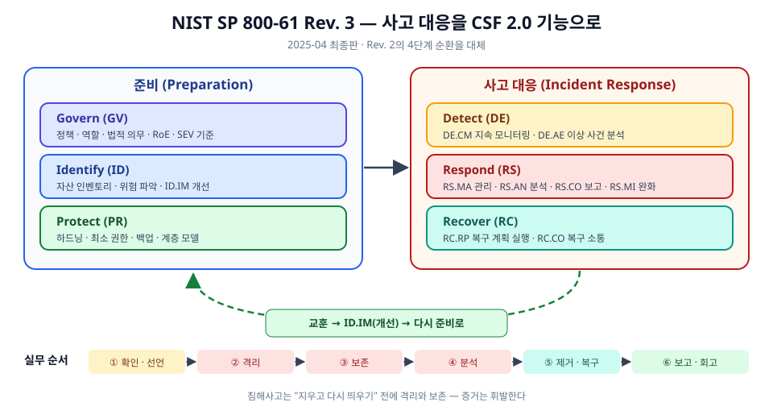
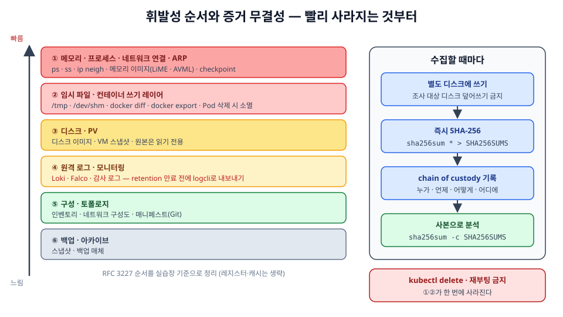
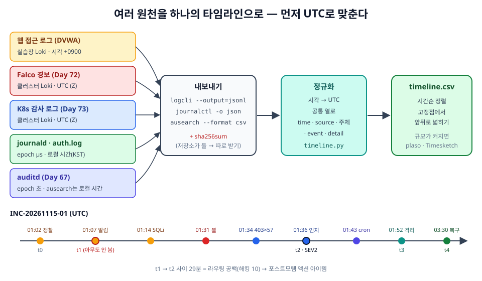

> **해킹 트랙 · 인프라 보안 심화** | 난이도 ★★★★☆ | 예상 소요 3 ~ 3.5시간

> ⚠️ **실습 전 반드시 읽을 것**
> 실습은 **본인 소유의 격리된 실습장**(해킹 02의 `hacklab`, Day 09의 kind `infra-lab`)과 **본인이 만든 앱**에서만 합니다. 오늘의 "사고"는 해킹 10에서 우리가 직접 남긴 실습 흔적을 사고로 가정한 **가상 시나리오**입니다. 실제 회사 시스템에서 사고가 의심되면 혼자 조사하지 말고 **보안 담당·법무와 정해진 절차**를 따르세요. 임의로 증거를 수집하면 증거 능력이 사라지거나 개인정보 문제가 생길 수 있습니다. 허가 없는 타인 시스템 대상 스캔·공격은 **정보통신망법 등으로 처벌**될 수 있습니다.

## 🎯 오늘의 목표

- **NIST SP 800-61 Rev. 3**(2025년 4월 최종판)이 사고 대응을 CSF 2.0 기능(Govern·Identify·Protect·Detect·Respond·Recover)으로 다시 정리한 방식을 설명할 수 있다
- **휘발성 순서**에 따라 증거를 모으고, **해시로 무결성**을 남기고, **chain of custody**(증거 관리 연속성) 기록을 쓸 수 있다
- journalctl·auth.log·auditd·Loki(Day 60)·Falco(Day 72) 이벤트를 **UTC로 맞춰 하나의 타임라인**으로 합칠 수 있다
- 컨테이너·K8s에서 증거를 망가뜨리지 않고 **격리하고 수집**하는 순서(`kubectl debug`, 노드 cordon, `docker export`, checkpoint)를 안다
- 해킹 10의 실습 흔적으로 만든 가상 사고의 **타임라인과 포스트모템**(Day 65)을 작성할 수 있다

---

## 1. 원리 — 장애 대응과 침해사고 대응은 무엇이 다른가

Day 65에서 장애 대응의 원칙을 "**완화가 먼저, 원인은 나중**"으로 배웠습니다. 침해사고에서도 피해를 멈추는 것이 먼저지만, 한 가지가 크게 다릅니다.

| | 장애 (Day 65) | 침해사고 (오늘) |
|---|---|---|
| 상대 | 버그, 용량, 사람의 실수 | **의도를 가진 사람** — 우리가 움직이면 같이 움직임 |
| 완화 수단 | 롤백, 재시작, 노드 교체 | 같은 수단이지만 **재시작·삭제가 증거를 지움** |
| 원인 분석 | 메트릭·로그로 사후에 | **증거가 휘발**되므로 완화와 동시에 보존 |
| 소통 | 넓게 공유(상태 페이지) | **알아야 할 사람만**(공격자가 사내 채널을 볼 수도 있음) |
| 외부 보고 | 고객 공지 | 고객 공지 + **법적 신고 의무**가 생길 수 있음 |

> 💡 그래서 침해사고에서는 "Pod를 지우고 새로 띄우면 끝" 대신 **"격리 → 보존 → 그다음 제거"** 순서를 지킵니다. 5장에서 K8s로 이 순서를 그대로 연습합니다.

### 1-1. NIST SP 800-61 Rev. 3 (2026-11-15 확인)



NIST는 2025년 4월 3일 **SP 800-61 Rev. 3** *Incident Response Recommendations and Considerations for Cybersecurity Risk Management*를 최종 발표하고 Rev. 2를 대체했습니다. 가장 큰 변화는 Rev. 2의 4단계 순환(준비 → 탐지·분석 → 봉쇄·제거·복구 → 사후 활동)을 **CSF 2.0의 여섯 기능**으로 다시 짠 것입니다. 사고 대응을 따로 떨어진 절차가 아니라 **조직 전체 위험 관리의 일부**로 본다는 뜻입니다.

| CSF 2.0 기능 | Rev. 3에서의 역할 | Rev. 2의 대응 단계 | 이 시리즈에서 |
|---|---|---|---|
| **Govern (GV)** | 대응 정책·역할·법적 의무를 정함 | 준비 | 해킹 01 RoE, Day 65 SEV 기준 |
| **Identify (ID)** | 자산·위험 파악, **개선(ID.IM)** — 교훈을 다시 반영 | 준비 + 사후 활동 | 해킹 26 인벤토리, 포스트모템 액션 아이템 |
| **Protect (PR)** | 사고가 덜 나게, 나도 덜 아프게 | 준비 | Day 67~71 하드닝, 해킹 25 계층 모델 |
| **Detect (DE)** | 지속 모니터링(DE.CM), 이상 사건 분석(DE.AE) | 탐지·분석 | 해킹 10 탐지 룰, Day 72 Falco |
| **Respond (RS)** | 사고 관리(RS.MA), 분석(RS.AN), 보고·소통(RS.CO), 완화(RS.MI) | 탐지·분석 + 봉쇄·제거 | **오늘 3~6장** |
| **Recover (RC)** | 복구 계획 실행(RC.RP), 복구 소통(RC.CO) | 복구 | Ch7 GitOps로 깨끗한 상태 재배포 |

> 💡 Rev. 3는 "준비(GV·ID·PR)"와 "대응(DE·RS·RC)"을 두 묶음으로 보여 주고, **ID.IM(개선)** 이 대응에서 얻은 교훈을 다시 준비 쪽으로 돌려보내는 고리입니다. Day 65의 "포스트모템 액션 아이템이 진짜 결과물"이라는 말과 같은 이야기입니다. 정확한 문구는 csrc.nist.gov의 SP 800-61r3 PDF를 보세요.

실무에서 손이 움직이는 순서는 여전히 익숙한 흐름입니다. 오늘은 이 순서로 진행합니다.

| 순서 | 할 일 | CSF |
|---|---|---|
| ① 확인·선언 | 알림이 진짜인지 확인, SEV 선언, IC 지정(Day 65) | DE.AE → RS.MA |
| ② 격리(봉쇄) | 피해 확산 차단 — **지우지 않고 떼어 놓기** | RS.MI |
| ③ 보존 | 휘발성 순서로 증거 수집, 해시, chain of custody | RS.AN |
| ④ 분석 | 타임라인, 범위(어디까지 퍼졌나), 최초 침입 경로 | RS.AN |
| ⑤ 제거·복구 | 취약점 수정, 자격 증명 교체, 깨끗한 이미지로 재배포 | RS.MI → RC.RP |
| ⑥ 보고·회고 | 내부·외부 보고, 포스트모템, 액션 아이템 | RS.CO, RC.CO, ID.IM |

---

## 2. 증거 보존 — 무엇을, 어떤 순서로, 어떻게 지키나



### 2-1. 휘발성 순서 (RFC 3227)

증거는 **사라지는 속도가 빠른 것부터** 모읍니다. RFC 3227(증거 수집·보관 지침)이 정리한 순서를 실습장 기준으로 옮기면 이렇습니다.

| 순서 | 대상 | 리눅스·컨테이너에서 | 언제 사라지나 |
|---|---|---|---|
| 1 | CPU 레지스터·캐시 | (일반적으로 수집 대상 아님) | 나노초 |
| 2 | **메모리**, 프로세스 목록, 네트워크 연결, ARP·라우팅 테이블, 커널 모듈 | `ps`, `ss`, `ip neigh`, `lsmod`, 메모리 이미지 | 재부팅·프로세스 종료 |
| 3 | 임시 파일 시스템 | `/tmp`, `/dev/shm`, **컨테이너의 쓰기 레이어** | Pod 삭제·재시작 |
| 4 | 디스크 | 호스트 디스크, PV | 덮어쓰기 |
| 5 | 원격 로그·모니터링 | **Loki, Falco 경보, K8s 감사 로그** | 보존 기간(retention) 만료 |
| 6 | 물리 구성·네트워크 토폴로지 | 인벤토리, 네트워크 구성도 | 변경 시 |
| 7 | 아카이브 매체 | 백업, 스냅샷 | 거의 안 사라짐 |

> ⚠️ 5번(원격 로그)은 순서상 뒤지만 **보존 기간**이 함정입니다. Day 60 Loki의 retention이 7일이면 일주일 뒤에 발견한 사고의 첫날 로그는 이미 없습니다. 사고를 선언하면 **해당 기간 로그를 즉시 내보내** 따로 보관합니다(3-3).

### 2-2. 디스크·메모리 이미지 — 개념

| 종류 | 무엇 | 도구 예 | 주의 |
|---|---|---|---|
| **디스크 이미지** | 블록 장치 전체를 비트 단위로 복제(삭제된 영역 포함) | `dd`, `dc3dd`, `ewfacquire`(E01 형식) / VM이면 **하이퍼바이저 스냅샷·디스크 파일 복사** | 원본에는 쓰기 금지(쓰기 방지 장치 또는 읽기 전용 마운트) |
| **메모리 이미지** | 실행 중인 RAM 전체 | 리눅스: **LiME**(커널 모듈), **AVML**(Microsoft의 리눅스용 수집 도구) / VM: `VBoxManage debugvm <VM> dumpvmcore` | 수집 자체가 메모리를 조금 바꿈 → 기록에 남김 |
| **논리 수집** | 파일·로그·명령 출력만 | `tar`, `journalctl -o export`, 아래 스크립트 | 빠르지만 삭제된 데이터는 없음 |

> 💡 실습장은 전부 VM과 컨테이너이므로 **VM 스냅샷(해킹 02)** 이 가장 손쉬운 "디스크 + 메모리" 보존입니다. 켜진 VM의 `--live` 스냅샷은 메모리 상태까지 담습니다. 실제 서버라면 클라우드 디스크 스냅샷이 같은 역할을 합니다.

### 2-3. 해시로 무결성 확보

증거 파일을 만든 **그 순간** 해시를 계산해 기록하면, 나중에 "분석 중에 바뀌지 않았다"를 증명할 수 있습니다.

```bash
# 증거 폴더 (조사 대상 디스크가 아닌 별도 디스크·USB에)
EVD=/mnt/evidence/INC-20261115-01
cd "$EVD"
sha256sum * > SHA256SUMS
chmod 0444 * && chmod 0555 .            # 읽기 전용으로

# 분석 전·후, 보고서 제출 전에 다시 확인
sha256sum -c SHA256SUMS
# docker-targets-live.txt: OK
# falco-20261115.jsonl: OK
# ...
```

| 규칙 | 이유 |
|---|---|
| **원본은 건드리지 않고 사본으로 분석** | 분석 도구가 원본을 바꿀 수 있음 |
| MD5·SHA-1이 아닌 **SHA-256** 이상 | 충돌 공격이 알려진 해시는 증명력이 약함 |
| 해시 목록 자체도 별도 위치(티켓, 서명된 메일)에 사본 | 목록과 증거가 같이 바뀌면 의미 없음 |

### 2-4. Chain of custody (증거 관리 연속성)

"이 증거를 **누가, 언제, 어디서, 왜** 만졌는가"를 끊김 없이 기록한 문서입니다. 법정까지 가지 않더라도, 기록이 있어야 나중에 분석 결과를 믿을 수 있습니다.

```markdown
# Chain of Custody — INC-20261115-01

| # | 증거 ID | 설명 | SHA-256 (앞 16자) | 수집 시각 (UTC) | 수집자 | 수집 방법 | 보관 위치 |
|---|---|---|---|---|---|---|---|
| E01 | docker-targets-live.txt | 라이브 응답 명령 출력 | 3f9a1c0e7b2d4a55 | 2026-11-15T02:05:10Z | 분석가A | live-collect.sh (3-1) | /mnt/evidence/... |
| E02 | dvwa-fs.tar | DVWA 컨테이너 파일 시스템 | a81d...          | 2026-11-15T02:09:44Z | 분석가A | docker export (5-3) | 같은 위치 |

## 이동·접근 기록
| 시각 (UTC) | 증거 ID | 행위 (생성/복사/열람/이관) | 누가 | 목적 | 해시 재확인 |
|---|---|---|---|---|---|
| 2026-11-15T03:00Z | E01~E06 | 분석용 사본 생성 | 분석가A | 타임라인 작성 | OK |
```

---

## 3. 내 환경에서 수집 — 리눅스 로그와 타임라인

**실습 환경**: 해킹 02의 실습장(docker-targets VM `10.10.10.10`의 DVWA `10.10.10.20`, 관측 구역 Loki)과 Day 09의 kind `infra-lab`(Day 60 Loki, Day 72 Falco + Falcosidekick, Day 73 감사 로그). 해킹 10의 탐지 규칙이 그대로 켜져 있다고 가정합니다.

### 3-1. 라이브 응답 — 휘발성 정보부터

사고 호스트(여기서는 docker-targets VM)에서, 결과는 **그 VM의 디스크가 아닌 곳**에 씁니다. 실습에서는 VM에 증거용 가상 디스크를 하나 더 붙여 `/mnt/evidence`로 마운트했다고 가정합니다.

```bash
#!/usr/bin/env bash
# live-collect.sh — 읽기만 하는 명령, 출력은 증거 디스크로
set -u
OUT=/mnt/evidence/INC-20261115-01/$(hostname)-live.txt
run() { echo "===== $(date -u +%FT%TZ) \$ $*"; "$@" 2>&1; }
{
  run date -u
  run uptime
  run who -a
  run ps auxwwf                     # 프로세스 트리 (2번: 메모리 다음으로 휘발)
  run ss -tanpu                     # 연결과 프로세스
  run ip -br addr
  run ip route
  run ip neigh
  run lsmod
  run mount
  run docker ps -a --no-trunc
  run ls -la /tmp /dev/shm /var/tmp
  run last -Fx -n 50
  run crontab -l -u root
  run ls -la /etc/cron.d
} > "$OUT"
sha256sum "$OUT" | tee -a /mnt/evidence/INC-20261115-01/SHA256SUMS
```

> ⚠️ 조사 대상 호스트의 바이너리(`ps`, `ss`)가 이미 바꿔치기됐을 수도 있습니다. 실무에서는 신뢰할 수 있는 정적 바이너리 묶음이나 7장의 Velociraptor 같은 수집 에이전트를 씁니다. 오늘은 원리만 봅니다.

### 3-2. 호스트 로그 — journalctl, auth.log, auditd

| 원천 | 명령 | 시간 형식 |
|---|---|---|
| **journald** | `journalctl --since ... --until ... -o json` | `__REALTIME_TIMESTAMP`(epoch 마이크로초, UTC 기준) |
| **auth.log** (rsyslog) | `grep -E "sshd|sudo" /var/log/auth.log` | 로컬 시간대(KST). 형식은 rsyslog 설정에 따라 다름 — 첫 줄로 확인 |
| **auditd** (Day 67·해킹 10 규칙) | `ausearch --start ... --end ... -i` / `--format csv` | epoch 초(원본), `-i`는 로컬 시간으로 해석 |

```bash
cd /mnt/evidence/INC-20261115-01

# journald: SSH·sudo (Ubuntu 24.04의 ssh 유닛 이름은 ssh)
journalctl --since "2026-11-15 10:00:00" --until "2026-11-15 11:30:00" \
  -u ssh -o json > journal-ssh.jsonl
journalctl --since "2026-11-15 10:00:00" --until "2026-11-15 11:30:00" \
  _COMM=sudo -o json > journal-sudo.jsonl

# auth.log 원본 사본 (회전된 파일 포함)
cp -p /var/log/auth.log* .

# auditd: 해킹 10의 키(root-cmd, cron, sudoers, perm_mod)
# --start 날짜 형식은 로케일을 따름 (en_US: MM/DD/YYYY) — `ausearch --start today`로 먼저 확인
sudo ausearch --start 11/15/2026 10:00:00 --end 11/15/2026 11:30:00 --format csv > audit.csv
sudo ausearch --start 11/15/2026 10:00:00 --end 11/15/2026 11:30:00 -k root-cmd -i > audit-root-cmd.txt
sha256sum journal-*.jsonl auth.log* audit*.{csv,txt} >> SHA256SUMS
```

### 3-3. 원격 로그 — Loki에서 내보내기 (Day 60)

Loki의 데이터는 retention이 지나면 사라지므로 **사고 기간을 파일로 내보내 보존**합니다. Loki CLI인 `logcli`를 씁니다(Day 60의 Loki 주소로 `LOKI_ADDR` 지정).

```bash
# K8s 쪽 (infra-lab Loki) — 포트포워드 후
kubectl -n loki port-forward svc/loki-gateway 3100:80 &
export LOKI_ADDR=http://127.0.0.1:3100
FROM=2026-11-15T01:00:00Z ; TO=2026-11-15T02:30:00Z

# Falco 경보 (Falcosidekick이 붙인 라벨, Day 72)
logcli query --from="$FROM" --to="$TO" --limit=5000 --output=jsonl \
  '{source="syscall"}' > falco.jsonl

# K8s 감사 로그 (Day 73)
logcli query --from="$FROM" --to="$TO" --limit=20000 --output=jsonl \
  '{job="kubernetes-audit"} | json | user_username=~"system:serviceaccount:.*"' > k8s-audit-sa.jsonl
```

```bash
# 실습장 쪽 (docker-targets VM의 관측 구역 Loki, 해킹 10의 3-1) — VM 안에서
export LOKI_ADDR=http://127.0.0.1:3100
logcli query --from="$FROM" --to="$TO" --limit=20000 --output=jsonl \
  '{job="hacklab", container="dvwa"}' > dvwa-access.jsonl
```

> 💡 `logcli`의 `--limit`보다 결과가 많으면 잘립니다. 줄 수(`wc -l`)가 limit과 같으면 기간을 나눠 다시 받으세요. 해킹 10에서 정리한 **저장소가 두 개라는 공백**(실습장 Loki ↔ 클러스터 Loki)이 바로 여기서 비용이 됩니다. 두 곳에서 따로 받아 손으로 합쳐야 합니다.

### 3-4. 타임라인 만들기 — 모두 UTC로



타임라인의 첫 규칙은 **시간대 통일**입니다. Apache 접근 로그는 `+0900`, Falco와 K8s 감사 로그는 UTC(`Z`), journald·auditd는 epoch입니다. 섞어서 정렬하면 9시간 어긋난 엉뚱한 이야기가 나옵니다.

```python
#!/usr/bin/env python3
# timeline.py — 여러 원천을 UTC 기준 CSV 타임라인으로 (Python 3.12, 표준 라이브러리만)
import csv, json, sys
from datetime import datetime, timezone, timedelta

rows = []
def add(ts: datetime, source: str, host: str, event: str, detail: str):
    rows.append([ts.astimezone(timezone.utc).isoformat(timespec="seconds"), source, host, event, detail[:300]])

def logcli(path, source):
    for line in open(path, encoding="utf-8"):
        r = json.loads(line)
        ts = datetime.fromisoformat(r["timestamp"].replace("Z", "+00:00"))
        lab = r.get("labels", {})
        yield ts, lab, r["line"]

# (1) Falco 경보
for ts, lab, line in logcli("falco.jsonl", "falco"):
    add(ts, "falco", lab.get("k8s_pod_name", "?"), lab.get("rule", "?"), line)

# (2) K8s 감사 로그
for ts, lab, line in logcli("k8s-audit-sa.jsonl", "k8s-audit"):
    a = json.loads(line)
    add(ts, "k8s-audit", a.get("user", {}).get("username", "?"),
        f'{a.get("verb")} {a.get("objectRef", {}).get("resource")} -> {a.get("responseStatus", {}).get("code")}',
        a.get("requestURI", ""))

# (3) DVWA 접근 로그 (Apache combined, +0900 포함)
for ts, lab, line in logcli("dvwa-access.jsonl", "web"):
    try:
        t = line.split("[", 1)[1].split("]", 1)[0]          # 15/Nov/2026:10:02:11 +0900
        add(datetime.strptime(t, "%d/%b/%Y:%H:%M:%S %z"), "web", "dvwa", line.split('"')[1], line)
    except (IndexError, ValueError):
        pass

# (4) journald (epoch 마이크로초)
for f in ("journal-ssh.jsonl", "journal-sudo.jsonl"):
    for line in open(f, encoding="utf-8"):
        j = json.loads(line)
        ts = datetime.fromtimestamp(int(j["__REALTIME_TIMESTAMP"]) / 1e6, tz=timezone.utc)
        add(ts, "journald", j.get("_HOSTNAME", "?"), j.get("SYSLOG_IDENTIFIER", "?"), str(j.get("MESSAGE", "")))

# (5) auditd CSV (DATE·TIME은 수집한 호스트의 로컬 시간 = KST)
KST = timezone(timedelta(hours=9))
for r in csv.DictReader(open("audit.csv", encoding="utf-8")):
    try:
        ts = datetime.strptime(f'{r["DATE"]} {r["TIME"]}', "%m/%d/%Y %H:%M:%S").replace(tzinfo=KST)
    except (KeyError, ValueError):
        continue
    add(ts, "auditd", r.get("NODE", "docker-targets"), r.get("EVENT", "?"),
        f'{r.get("SUBJ_PRIME","")} {r.get("ACTION","")} {r.get("OBJ_PRIME","")} {r.get("HOW","")}')

rows.sort(key=lambda r: r[0])
w = csv.writer(sys.stdout)
w.writerow(["time_utc", "source", "host_or_subject", "event", "detail"])
w.writerows(rows)
```

```bash
python3 timeline.py > timeline.csv
wc -l timeline.csv
sha256sum timeline.csv >> SHA256SUMS
```

> 💡 `audit.csv`의 열 이름과 날짜 형식은 auditd 버전·로케일에 따라 다를 수 있습니다. 먼저 `head -2 audit.csv`로 헤더를 보고 스크립트를 맞추세요. **스크립트도 증거 폴더에 함께 보관**해야 "타임라인을 어떻게 만들었는지"를 재현할 수 있습니다.

수천 줄짜리 CSV를 그대로 읽을 수는 없습니다. 타임라인 분석의 요령은 **고정점(pivot)** 에서 앞뒤로 넓히는 것입니다.

| 요령 | 예 |
|---|---|
| 확실한 첫 알림 시각을 고정점으로 | `K8sServiceAccountForbiddenBurst` 발화 시각 |
| 고정점의 **주체**(IP, 사용자, Pod)로 거르기 | `grep -E "10.10.10.5|falco-lab" timeline.csv` |
| 그 주체의 **가장 이른 흔적**까지 거슬러 올라가기 | 최초 침입 시각 = 사고 시작(t0) |
| 같은 시각대 **다른 원천**도 확인 | Falco는 조용한데 감사 로그만 있다면 API 경로 |

---

## 4. 탐지에서 대응으로 — 무엇이 첫 신호였나

해킹 10에서 만든 규칙들이 오늘은 **사고의 시작점**이 됩니다.

| 알림 (해킹 10) | 원천 | 대응에서의 의미 |
|---|---|---|
| `HacklabDirectoryBruteforce` | 웹 접근 로그 | 정찰 단계. 보통 사고의 **가장 이른 흔적** |
| `HacklabSQLiPattern` | 웹 접근 로그 | 침입 시도. 성공했는지는 다른 원천으로 확인 |
| *Web server spawned shell (hacklab)* / *Terminal shell in container* | Falco | **실행 확인** — 사고 선언 근거로 충분 |
| *SA token read in no-API namespace* | Falco | 자격 증명 접근 → K8s API로 확산 가능성 |
| `K8sServiceAccountForbiddenBurst` | K8s 감사 로그 | 권한 탐색. **영향 범위 조사**의 출발점 |
| `HostPersistenceChange` | auditd | 지속성 확보 시도 → 제거 단계에서 반드시 되돌릴 것 |

> 💡 해킹 10의 커버리지 표에서 ❌였던 행위(POST 본문의 SQLi, Metasploitable 내부 활동)는 **타임라인에서도 빈칸**으로 남습니다. 타임라인의 빈칸은 "아무 일도 없었다"가 아니라 "**보지 못했다**"입니다. 보고서에 그렇게 적습니다.

---

## 5. 컨테이너·K8s 증거 수집과 격리

컨테이너는 **지우고 다시 띄우는 것이 기본 동작**이라 증거가 특히 쉽게 사라집니다. Deployment의 Pod를 `kubectl delete`하면 쓰기 레이어(공격자가 떨군 파일), 프로세스, 메모리가 한 번에 사라집니다.

### 5-1. 순서: 격리 → 보존 → 제거

| 순서 | K8s에서 | 하지 말 것 |
|---|---|---|
| ① 메타데이터 보존 | `kubectl get pod -o yaml`, `describe`, 이벤트, 로그 | — |
| ② 트래픽에서 떼어 내기 | **라벨을 바꿔** Service·ReplicaSet에서 분리 | Pod 삭제, Deployment 재시작 |
| ③ 네트워크 격리 | `quarantine=true`에 deny-all NetworkPolicy(Day 70) | — |
| ④ 노드 격리 | `kubectl cordon` (새 Pod 배치 금지) | **`drain`은 Pod를 쫓아내므로 보존 후에** |
| ⑤ 증거 수집 | 파일 시스템·프로세스·(가능하면) checkpoint | 대상 컨테이너에 도구 설치 |
| ⑥ 제거·복구 | 원인 수정 후 깨끗한 이미지로 재배포(GitOps) | 같은 이미지로 그냥 재시작 |

```bash
NS=falco-lab ; POD=web-7d9c6b8f5-x2k4q ; EVD=~/evidence/INC-20261115-01 ; mkdir -p $EVD

# ① 메타데이터·로그
kubectl -n $NS get pod $POD -o yaml          > $EVD/pod.yaml
kubectl -n $NS describe pod $POD             > $EVD/pod-describe.txt
kubectl -n $NS get events --sort-by=.lastTimestamp > $EVD/events.txt
kubectl -n $NS logs $POD --all-containers --timestamps > $EVD/pod-logs.txt
kubectl -n $NS logs $POD --all-containers --timestamps --previous > $EVD/pod-logs-prev.txt 2>/dev/null

# ② 라벨 변경: Service 셀렉터·ReplicaSet에서 빠짐 → RS는 새 Pod를 띄우고, 이 Pod는 남음
kubectl -n $NS label pod $POD app- quarantine=true incident=INC-20261115-01

# ③ 격리 NetworkPolicy (Day 70의 CNI가 NetworkPolicy를 지원해야 함)
cat <<'EOF' | kubectl -n $NS apply -f -
apiVersion: networking.k8s.io/v1
kind: NetworkPolicy
metadata:
  name: quarantine-deny-all
spec:
  podSelector:
    matchLabels:
      quarantine: "true"
  policyTypes: [Ingress, Egress]
EOF

# ④ 노드 격리
NODE=$(kubectl -n $NS get pod $POD -o jsonpath='{.spec.nodeName}')
kubectl cordon $NODE
```

> ⚠️ ②의 `app-`는 이 Pod의 Deployment 셀렉터 라벨 이름에 맞춰야 합니다(`kubectl get deploy -o jsonpath='{.spec.selector}'`로 확인). Ch7 데모 앱이라면 `app.kubernetes.io/name-`입니다. 라벨을 바꾸면 Service 엔드포인트에서 빠지므로 **서비스 영향(완화)과 보존을 동시에** 얻습니다.

### 5-2. 안을 들여다보기 — `kubectl debug`

| 방법 | 명령 | 특징 |
|---|---|---|
| **임시 컨테이너**(ephemeral container) | `kubectl debug -it -n $NS $POD --image=busybox:1.37 --target=<컨테이너> --profile=general` | 대상 컨테이너의 **프로세스 네임스페이스를 공유**해 `ps`로 프로세스를 봄. 대상 이미지에 도구가 없어도 됨 |
| **노드 디버그** | `kubectl debug node/$NODE -it --image=busybox:1.37 --profile=sysadmin` | 노드의 파일 시스템이 `/host`에 마운트된 Pod. `chroot /host`로 노드의 `crictl` 사용 |

```bash
# 임시 컨테이너 안에서 (대상 컨테이너의 프로세스가 보임)
ps -ef
ls -la /proc/1/root/tmp          # 대상 컨테이너의 /tmp (공격자가 떨군 파일)
cat /proc/1/cmdline | tr '\0' ' '

# 노드 디버그 Pod 안에서
chroot /host crictl ps --name <컨테이너>
chroot /host crictl inspect <컨테이너ID> > /host/tmp/inspect.json   # 노드에 남음 → 바로 밖으로 복사
```

> ⚠️ 임시 컨테이너는 **Pod 스펙에 `ephemeralContainers`로 영구히 기록**되고 지울 수 없습니다. 증거에 손을 댄 셈이므로 chain of custody에 "언제, 어떤 이미지로 붙었는지"를 적습니다. 또 `--profile=sysadmin`은 특권 Pod를 만들므로 Day 69의 PSA가 `restricted`인 네임스페이스에서는 막힙니다(노드 디버그는 별도 네임스페이스에서).

kind 클러스터에서는 노드가 Docker 컨테이너이므로 호스트에서 바로 들어갈 수도 있습니다: `docker exec -it infra-lab-worker crictl ps`.

### 5-3. 파일 시스템과 checkpoint — `docker export`와 그 너머

docker-targets VM의 DVWA처럼 **Docker로 도는 컨테이너**는 이렇게 보존합니다.

```bash
cd /mnt/evidence/INC-20261115-01
docker inspect dvwa              > dvwa-inspect.json     # 이미지, 마운트, 네트워크, 시작 시각
docker diff dvwa                 > dvwa-diff.txt         # 이미지 대비 추가(A)·변경(C)·삭제(D)된 파일
docker logs --timestamps dvwa    > dvwa-logs.txt 2>&1
docker export dvwa -o dvwa-fs.tar                        # 컨테이너 파일 시스템 전체 (tar)
sha256sum dvwa-* >> SHA256SUMS
```

| 방법 | 담기는 것 | 안 담기는 것 |
|---|---|---|
| `docker diff` | 쓰기 레이어의 변경 **목록** | 내용 |
| `docker export` | 컨테이너 **파일 시스템 전체**(tar) | **볼륨**(따로 복사), 메모리·프로세스 |
| `docker commit` | 현재 상태를 새 이미지로 | 볼륨. 기본적으로 커밋 중 컨테이너를 **일시 정지** |
| **checkpoint** (CRIU) | **실행 중인 프로세스와 메모리 상태**까지 | — (런타임 지원 필요) |

**Checkpoint**는 실행 중인 컨테이너를 멈추지 않고(또는 아주 잠깐 멈추고) 프로세스 상태를 파일로 떠내는 기능입니다.

| 환경 | 상태 (2026-11 확인) |
|---|---|
| Docker | `docker checkpoint create` — **experimental** 기능, 호스트에 CRIU 필요 |
| Kubernetes | **kubelet Checkpoint API** (`ContainerCheckpoint` 기능 게이트) — v1.25 alpha, **v1.30부터 beta·기본 켜짐**. kubelet(10250)에 `POST /checkpoint/{namespace}/{pod}/{container}`로 요청하고, 결과 tar는 노드의 `/var/lib/kubelet/checkpoints/`에 생김. `kubectl` 명령은 없음 |
| 컨테이너 런타임 | CRI-O, containerd가 CRIU로 구현 — **사용 중인 런타임 버전의 지원 여부를 먼저 확인** |

> 💡 Kubernetes가 이 기능을 소개한 블로그 제목이 *Forensic container checkpointing*입니다. 원래 목적 자체가 **"컨테이너가 눈치채지 못하게 사본을 떠서 다른 곳에서 분석"** 하는 포렌식입니다. 다만 checkpoint 파일에는 메모리 내용(비밀 값 포함)이 들어 있으므로 증거와 같은 수준으로 보관합니다.

---

## 6. 도구 소개 (2026-11-15 확인, 사용법은 각 공식 문서로)

| 도구 | 하는 일 | 상태 |
|---|---|---|
| **Velociraptor** | 엔드포인트에 에이전트를 두고 VQL(쿼리 언어)로 **여러 호스트에서 동시에 증거 수집·헌팅**. Windows·리눅스·macOS | 오픈 소스(Rapid7 후원). 최신 0.77.3(2026-10) — 여러 CVE 수정 공지가 있으니 **최신으로 유지** |
| **Volatility 3** | **메모리 이미지 분석**(프로세스 목록, 네트워크 연결, 로드된 모듈 등을 이미지에서 복원) | 최신 v2.27.0. **Volatility 2는 2025년 사용 중단(deprecated)·저장소 보관** — 새로 배우면 3만 |
| **plaso** (`log2timeline.py`, `psort.py`, `psteal.py`) | 디스크 이미지·로그 수백 종을 파싱해 **슈퍼 타임라인** 생성 | 최신 20260512 릴리스. 결과는 **Timesketch**(협업 타임라인 분석 웹)로 보기도 함 |
| **LiME / AVML** | 리눅스 메모리 이미지 수집 | LiME: 커널 모듈, AVML: Microsoft의 정적 바이너리 |
| **Sysmon / Windows 이벤트** | 해킹 25의 Windows 쪽 원천 | Velociraptor·plaso가 그대로 파싱 |

> 💡 오늘 3-4에서 손으로 만든 `timeline.py`는 plaso가 하는 일의 아주 작은 버전입니다. 원천이 다섯 개를 넘으면 plaso + Timesketch 같은 도구로 넘어갈 때입니다.

---

## 7. 연습 시나리오 — INC-20261115-01

해킹 10의 실습을 그대로 다시 실행했다고 보고, 그 흔적을 **실제 사고처럼** 다룹니다. 아래 타임라인은 3-4의 `timeline.csv`를 고정점에서 거슬러 올라가며 정리한 결과의 예시입니다.

### 7-1. 정리된 타임라인 (UTC, KST = UTC+9)

| 시각 (UTC) | 원천 | 사건 | 해석 / ATT&CK |
|---|---|---|---|
| 01:02:11 | web (dvwa) | `10.10.10.5`에서 404 대량 시작, 5분간 1,200건 | 정찰 — T1595.003 |
| 01:07:30 | Grafana 알림 | `HacklabDirectoryBruteforce` 발화 | **최초 탐지(t1)** — 그러나 아무도 확인 안 함 |
| 01:14:02 | web (dvwa) | 쿼리 문자열에 `UNION SELECT` 패턴 | 침입 시도 — T1190 |
| 01:31:45 | falco | *Terminal shell in container* (`falco-lab/web-…`) | 실행 — T1609 |
| 01:33:10 | falco | *SA token read in no-API namespace (hacklab)* | 자격 증명 접근 — T1528 |
| 01:34:00 ~ 01:36:30 | k8s-audit | `system:serviceaccount:falco-lab:default`가 `secrets` list → **403 × 57** | 권한 탐색 — T1613 |
| 01:36:40 | Alertmanager | `K8sServiceAccountForbiddenBurst`(critical) → security-team | **사람이 인지(t2), SEV2 선언** |
| 01:40:12 | journald (docker-targets) | `sshd: Accepted password for labuser from 10.10.10.5` | 실습장 VM 접근 |
| 01:41:05 | auditd | `key="root-cmd"` auid=1000 → euid=0, `exe=/usr/bin/crontab` | 권한 상승 — T1548 |
| 01:43:20 | auditd | `key="cron"` `/etc/cron.d/` 쓰기 | 지속성 — T1053.003 |
| 01:52:00 | 대응 | Pod 라벨 변경·격리 NetworkPolicy·노드 cordon | **봉쇄(t3)** |
| 02:05 ~ 02:20 | 대응 | 라이브 응답, `docker export`, logcli 내보내기, 해시 | 보존 |
| 03:30 | 대응 | cron 항목 제거, SSH 비밀번호 로그인 끔, SA 토큰 자동 마운트 끔, 깨끗한 이미지 재배포 | 제거·복구(t4) |

> 💡 이 표에서 가장 중요한 줄은 **01:07:30**입니다. 탐지는 있었는데 **라우팅 공백**(해킹 10의 분류) 때문에 사람이 29분 뒤에야 알았습니다. 포스트모템의 핵심 액션 아이템이 여기서 나옵니다.

### 7-2. 보고와 포스트모템 (Day 65 연결)

Day 65의 포스트모템 템플릿을 그대로 쓰되, 침해사고에는 아래를 덧붙입니다.

| Day 65 템플릿 항목 | 침해사고에서 추가할 것 |
|---|---|
| 1. 요약 | 공격자 행위의 한 문장 요약, 확인된 범위와 **확인 못 한 범위** |
| 2. 영향 | 유출 가능성이 있는 데이터 종류(개인정보 여부), 영향받은 자격 증명 목록 |
| 3. 시간 지표 | t0(최초 흔적) · t1(최초 탐지) · t2(인지·선언) · t3(봉쇄) · t4(복구) → **MTTD, 체류 시간(dwell time)** |
| 4. 타임라인 | 7-1 표 + 사용한 원천 목록 + **빈칸(보지 못한 구간)** |
| 5. 원인 분석 | 최초 침입 경로, 확산 경로, 왜 막히지 않았나(예방), 왜 늦게 알았나(탐지) |
| 7. 액션 아이템 | 예방(하드닝) / 탐지(룰·라우팅) / 대응(런북·도구) 세 갈래로 |
| 부록 | **IOC 목록**(IP, 파일 해시, 도메인), **증거 목록과 chain of custody**, ATT&CK 매핑 |

```markdown
## 7. 액션 아이템 (예시)
| # | 분류 | 내용 | 담당 | 기한 |
|---|---|---|---|---|
| 1 | 탐지(라우팅) | 실습장 Grafana 알림도 security-team 채널로 (해킹 10 공백 #8 해소) | 분석가A | 11/22 |
| 2 | 예방 | falco-lab 네임스페이스 `automountServiceAccountToken: false` (Day 69) | 분석가A | 11/18 |
| 3 | 예방 | docker-targets SSH 비밀번호 로그인 금지 (Day 67) | 분석가A | 11/16 |
| 4 | 대응 | Loki retention 7일 → 보안 로그만 30일, 사고 시 logcli 내보내기 런북화 | 분석가A | 11/29 |
| 5 | 대응 | live-collect.sh·timeline.py를 런북 저장소에, 분기마다 연습 | 분석가A | 12/15 |
```

| 보고 대상 | 언제 | 비고 |
|---|---|---|
| 내부 (IC, 경영진, 법무) | 선언 즉시, Day 65의 SEV 공유 주기로 | **보안 사고 전용 채널**(공격자가 볼 수 없는 곳) |
| 개인정보 유출이 의심되면 | 개인정보 보호법상 정보주체 통지·신고 의무와 기한이 있음 | 기한과 요건은 **현행 법령과 개인정보보호위원회 안내**로 확인 |
| 침해사고 신고 | 정보통신망법상 침해사고 신고 의무(KISA 118 등) | 대상·기한을 현행 법령으로 확인. 판단은 법무와 함께 |

> ⚠️ 오늘 시나리오는 실습장이라 외부 신고 대상이 아닙니다. 실제 사고에서 신고 여부·시점을 개인이 판단하지 마세요. Day 65의 "애매하면 높은 등급으로"처럼, 애매하면 **법무에 먼저 알리는 쪽**이 안전합니다.

---

## 8. 트러블슈팅

| 증상 | 원인 | 해결 |
|---|---|---|
| 타임라인 순서가 이상함(원인보다 결과가 먼저) | 시간대 혼합(KST·UTC), 호스트 시계 어긋남 | 모든 원천을 UTC로 변환, 각 호스트 `timedatectl`·chrony 동기화 상태를 증거로 함께 기록 |
| `logcli` 결과가 딱 limit 줄에서 끊김 | `--limit` 초과 | 기간을 나눠 여러 번 받기 |
| 사고 기간 Loki 로그가 없음 | retention 만료 | 원천(노드 journald, 감사 로그 파일)에서 직접 수집, 이후 보안 로그 retention 연장 |
| `ausearch --start` 날짜 오류 | 로케일별 날짜 형식 | `ausearch --start today` 또는 `LC_TIME=en_US.UTF-8` 지정 |
| 라벨을 바꿨는데 Pod가 계속 트래픽을 받음 | Service 셀렉터가 다른 라벨을 씀 | `kubectl get svc -o yaml`의 selector 확인 후 그 라벨을 제거 |
| 격리 NetworkPolicy가 효과 없음 | CNI가 NetworkPolicy 미지원 | Day 70의 CNI 확인, 안 되면 노드 수준 차단 또는 Pod를 노드와 함께 격리 |
| `kubectl debug --profile=sysadmin` 거부 | PSA `restricted` 네임스페이스 | 노드 디버그는 전용 네임스페이스에서, 또는 kind는 `docker exec`로 노드 접근 |
| checkpoint 요청이 404 | 기능 게이트 꺼짐 또는 런타임 미지원 | kubelet 설정·런타임 버전 확인. 안 되면 `crictl`·VM 스냅샷으로 대체 |
| `sha256sum -c`가 FAILED | 분석 중 원본을 수정 | 원본은 읽기 전용으로, 분석은 항상 사본에서. 실패 사실도 기록 |

---

## 9. 핵심 정리

- 침해사고는 **상대가 움직이고 증거가 휘발**한다는 점이 장애와 다르다 → **격리 → 보존 → 제거** 순서
- **NIST SP 800-61 Rev. 3**(2025-04)는 대응을 CSF 2.0의 Govern·Identify·Protect·Detect·Respond·Recover로 다시 짰고, **ID.IM(개선)** 으로 교훈을 준비에 돌려보낸다
- 증거는 **휘발성 순서**(메모리·연결 → 임시 파일 → 디스크 → 원격 로그)로, 만들자마자 **SHA-256**, 그리고 **chain of custody**
- 타임라인은 **UTC 통일**이 첫 규칙. journald·auth.log·auditd·Loki(logcli)·Falco를 합치고, **빈칸은 "보지 못함"** 으로 적는다
- K8s에서는 Pod를 지우지 말고 **라벨 변경 + 격리 NetworkPolicy + cordon**, 들여다보기는 `kubectl debug`(기록이 남음을 인지), 보존은 `docker export`·checkpoint
- Velociraptor(수집·헌팅), Volatility 3(메모리), plaso(슈퍼 타임라인)는 손으로 한 일을 대규모로 해 주는 도구
- 보고서는 Day 65 포스트모템 + **IOC·증거 목록·ATT&CK 매핑·보지 못한 범위**

---

## 10. 셀프 체크

<details>
<summary>Q1. 침해가 의심되는 Pod를 바로 <code>kubectl delete</code> 하면 안 되는 이유와 대신 할 일은?</summary>

쓰기 레이어(공격자가 떨군 파일), 프로세스, 메모리가 한 번에 사라져 침입 경로와 범위를 알 수 없게 됩니다. 대신 메타데이터·로그를 먼저 저장하고, **라벨을 바꿔 Service·ReplicaSet에서 분리**하고, 격리 NetworkPolicy와 노드 cordon으로 봉쇄한 뒤, 파일 시스템·프로세스 정보를 수집하고 나서 제거합니다.
</details>

<details>
<summary>Q2. Loki 로그는 휘발성 순서상 뒤쪽인데 왜 사고 선언 직후 내보내야 하나?</summary>

**retention(보존 기간)** 이 지나면 자동으로 지워지기 때문입니다. 사고는 며칠 늦게 발견되는 경우가 많아, 최초 침입 시각의 로그가 만료 직전일 수 있습니다. `logcli`로 사고 기간을 파일로 내보내고 해시를 남깁니다.
</details>

<details>
<summary>Q3. Apache 로그(+0900), Falco(UTC), journald(epoch)를 그대로 합쳐 정렬하면 무슨 일이 생기나?</summary>

같은 순간의 사건이 최대 9시간 차이로 흩어져, 원인과 결과의 순서가 뒤집힌 타임라인이 나옵니다. 모든 시각을 **UTC로 변환한 뒤** 정렬하고, 호스트 시계 동기화 상태도 함께 기록합니다.
</details>

<details>
<summary>Q4. <code>docker export</code>로 얻을 수 있는 것과 없는 것은? 없는 것은 무엇으로 보완하나?</summary>

컨테이너의 파일 시스템 전체는 얻지만 **볼륨, 메모리, 실행 중인 프로세스 상태**는 없습니다. 볼륨은 따로 복사하고, 프로세스·연결은 라이브 응답(`ps`, `ss`)과 `kubectl debug`로, 메모리 상태는 checkpoint(CRIU)나 VM 스냅샷·메모리 이미지로 보완합니다.
</details>

<details>
<summary>Q5. 연습 시나리오에서 탐지(t1)와 인지(t2) 사이 29분의 원인과 액션 아이템은?</summary>

실습장 Grafana의 `HacklabDirectoryBruteforce` 알림이 화면에만 떠 있고 보안 채널로 가지 않은 **라우팅 공백**이 원인입니다. 액션 아이템은 그 알림을 security-team으로 보내는 것이고, 근본적으로는 해킹 10의 공백 #8(저장소 분리)을 해소해 한 곳에서 상관 분석하는 것입니다.
</details>

---

## ⏭️ 다음 예고 — 해킹 28. 종합 실습 — RAG 챗봇 점검과 보고서

인프라 보안 심화의 마지막 편입니다. Day 49에서 홈랩 K8s에 올린 **사내 문서 RAG 챗봇**을 하나의 점검 대상으로 놓고, 해킹 13~27에서 익힌 것을 모두 꺼냅니다. 범위와 RoE 정하기부터 코드(SAST)·의존성·시크릿·IaC 점검, API·인증, 프롬프트 인젝션과 문서 권한 같은 LLM 고유 위험(Day 48), 컨테이너·K8s 설정과 탐지 커버리지 확인까지 진행하고, 해킹 11 양식으로 **조치 권고가 담긴 보고서**를 완성합니다. 오늘 만든 타임라인과 포스트모템 양식도 "만약 이 챗봇이 사고를 당했다면"을 가정한 대응 계획 부록으로 이어 붙입니다.
