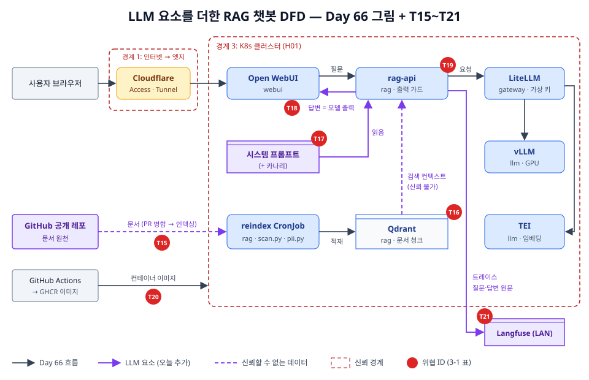
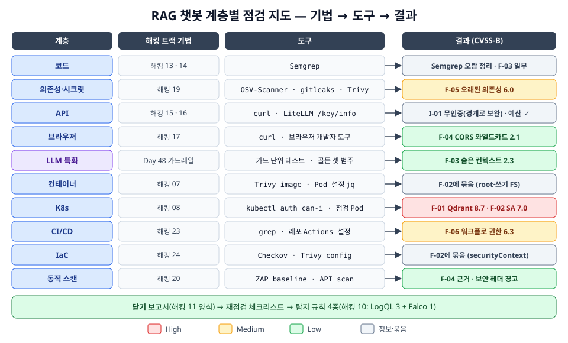
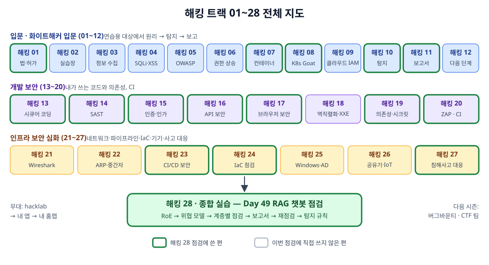

> **해킹 트랙 · 인프라 보안 심화** | 난이도 ★★★★★ | 예상 소요 5 ~ 7시간 (이틀에 나눠도 좋음)

> ⚠️ **실습 범위 경고** — 오늘의 대상은 **Day 49에서 내가 직접 만든 홈랩 RAG 챗봇 하나뿐**입니다. 같은 구성이라도 회사·친구·클라우드 사업자의 시스템, 그리고 챗봇이 기대는 외부 서비스(Cloudflare, GitHub·GHCR, Hugging Face)는 대상이 아닙니다. 허가 없이 타인의 시스템을 스캔하거나 공격하면 **정보통신망법** 등에 따라 처벌될 수 있습니다. 이 글은 공격 절차와 페이로드를 다루지 않습니다. **설정과 코드를 점검하고, 가드레일이 작동하는지 확인하고, 고치고, 다시 확인하는 것**만 다룹니다.

## 🎯 오늘의 목표

- 해킹 01의 RoE 템플릿으로 **내 시스템에 대한 점검 범위와 규칙**을 문서로 정한다
- Day 66의 DFD에 **LLM 요소**(시스템 프롬프트, 검색 컨텍스트, 문서 원천, 모델 출력, 트레이스)를 더해 위협 모델을 갱신한다
- 해킹 13~27의 기법을 **코드 · API · 브라우저 · LLM · 인프라 · 동적 스캔** 계층에 매핑한 점검 계획을 세우고 도구를 돌려 결과를 정리한다
- 발견 사항 6개에 **CVSS v4.0** 점수와 조치 권고를 붙여 해킹 11 양식의 **보고서 전문**을 쓴다
- 재점검 체크리스트와 **탐지 규칙**(해킹 10)으로 점검을 닫고, 해킹 트랙 01~28을 돌아본다

---

## 1. 왜 마지막이 "내 챗봇"인가

해킹 01~12는 DVWA·Juice Shop처럼 **일부러 취약하게 만든 대상**을 봤습니다. 해킹 13~27은 시선을 **내가 만드는 코드와 내가 운영하는 인프라**로 옮겼습니다. 오늘은 그 둘을 한 번에 씁니다. 대상은 Chapter 6의 마지막 날(Day 49) 만든 **사내 문서 RAG 챗봇**입니다.

| 지금까지 | 오늘 |
|---|---|
| 정답이 있는 연습용 대상 | 정답이 없는 **내 시스템** — 무엇이 나올지 모른다 |
| 기법 하나씩 따로 | 계층 전체를 **한 계획**으로 |
| 실습 노트 | **보고서 → 조치 → 재점검 → 탐지 규칙**까지 한 바퀴 |

진행 순서는 해킹 01에서 본 모의해킹 표준 흐름 그대로입니다.

| 단계 | 오늘의 장 | 산출물 |
|---|---|---|
| 1. 사전 합의 | 2장 | `ROE-rag.md` |
| 2. 위협 모델 | 3장 | 갱신된 DFD, STRIDE 추가 행 |
| 3. 점검 계획 | 4장 | 계층 × 기법 매핑 표 |
| 4. 점검 실행 | 5장 | `evidence/` 디렉터리, 원시 결과 |
| 5. 분석·평가 | 6장 | 발견 사항 6개 + CVSS v4.0 |
| 6. 보고 | 7장 | 보고서 v1.0 |
| 7. 재점검·탐지 | 8장 | 재점검 체크리스트, 탐지 규칙 |

> 💡 **"내 것이니까 대충 해도 된다"가 가장 위험한 생각**입니다. 내 시스템이라도 RoE를 쓰는 이유는 두 가지입니다. ① 점검 중 GPU를 태우거나 Qdrant 컬렉션을 지우는 실수를 막기 위해(금지 기법), ② 챗봇을 쓰는 다른 사람(가족, 팀원)의 대화 기록을 들여다보지 않기 위해(데이터 처리).

---

## 2. 범위와 RoE — 해킹 01 템플릿으로

해킹 01의 5-1 템플릿을 복사해 `~/hacklab/ROE-rag.md`로 채웁니다. 바뀐 칸만 보여 줍니다.

```markdown
# 모의해킹 수행 허가서 및 범위 합의서 (Rules of Engagement) — homelab RAG 챗봇

## 1. 당사자와 승인
- 의뢰 조직(자산 소유자) / 승인권자 / 수행자: 나 (H01 서버, homelab-rag 레포, GHCR 패키지 소유자)
- ※ 챗봇 사용자(가족·팀원)에게 점검 기간을 미리 알림

## 2. 목적
- Day 49 RAG 챗봇의 코드·API·브라우저·LLM·인프라 계층 보안 점검과 조치 권고

## 3. 범위 (In-Scope)
| 유형 | 대상 | 비고 |
|---|---|---|
| K8s 클러스터 | H01 단일 노드 kubeadm 클러스터 (Day 20), 컨텍스트 kubernetes-admin@kubernetes | 네임스페이스 llm, gateway, rag, webui, edge |
| 애플리케이션 | Open WebUI, rag-api, LiteLLM, Qdrant, TEI, vLLM | **port-forward(127.0.0.1)로만** 접근 |
| 코드·설정 | 본인 GitHub의 homelab-rag 레포 (rag/ 소스, 매니페스트, .github/workflows) | 로컬 clone 대상 |
| 이미지 | ghcr.io/<user>/infra-rag:0.2 | 본인 패키지 |
| 점검용 계정 | Open WebUI 테스트 계정 tester-a(일반), 관리자 계정 | 종료 후 tester-a 삭제 |

## 4. 범위 제외 (Out-of-Scope)
- Cloudflare 엣지·Access·Tunnel 인프라 자체 (chat.example.com으로 스캐너를 돌리지 않음)
- GitHub·GHCR·Hugging Face 플랫폼, 집 LAN의 다른 기기, 공유기(H02)
- 다른 사용자의 대화 기록·업로드 파일 열람, Langfuse 트레이스 원문 열람(메타데이터만)

## 5. 기간과 시간대
- 2026-11-16 ~ 2026-11-17, 사용량이 적은 시간대. 재인덱싱 CronJob(0 */6 * * *) 시각은 피함

## 6. 허용 / 금지 기법
- 허용: 정적 분석, 의존성·시크릿·이미지·IaC 스캔, 설정·권한 조회, 헤더·CORS 확인,
        ZAP baseline(수동 규칙) 및 rag-api 대상 API 스캔(동시성 1), 가드레일 단위 테스트,
        Day 48 골든 셋 기반 평가
- 금지: 부하·DoS 테스트(GPU 1장), Qdrant 컬렉션·포인트 쓰기/삭제, 운영 Secret 값 출력,
        탐지 회피, 범위 밖 호스트로의 요청, 실제 사용자 계정 사용

## 7. 출발지 정보
- 관리 노트북(Tailscale, H03) → kubectl port-forward. 점검용 Pod는 네임스페이스 sec-check 에서만

## 8. 데이터 처리
- 문서 원문·대화 내용이 증거에 섞이면 마스킹. 증거는 ~/hacklab/rag-assess/evidence (암호화 디스크)
- 보고서 승인 후 30일 뒤 원시 결과 파기, 보고서만 보관

## 9. 연락 체계와 비상 중단
- 비상 중단: vLLM TTFT 알림(Day 47) 발생, Pod 재시작 반복, 사용자 불편 신고, 침해 흔적 발견
- 침해 흔적 발견 시: 점검 중지 → 해킹 27 방식으로 증거 보존 → Day 65 SEV 선언

## 10. 결과물
- 해킹 11 양식 보고서 v1.0, 재점검 v1.1, 탐지 규칙 PR
```

### 2-1. 범위 가드 — 이번엔 kubectl 컨텍스트

해킹 01의 `in_scope`는 IP 대역을 검사했습니다. 오늘의 대상은 클러스터이므로 **현재 kubectl 컨텍스트와 네임스페이스**를 검사합니다.

```bash
mkdir -p ~/hacklab/rag-assess/evidence/{sast,deps,secrets,image,k8s,iac,cicd,api,dast,llm}
cd ~/hacklab/rag-assess

cat >> ~/.bashrc <<'EOF'

# --- RAG 점검 범위 가드: 홈랩 컨텍스트 + 허용 네임스페이스일 때만 true ---
RAG_CTX="kubernetes-admin@kubernetes"
RAG_NS="llm gateway rag webui edge sec-check"
rag_scope() {
  local ctx; ctx=$(kubectl config current-context 2>/dev/null)
  if [ "$ctx" != "$RAG_CTX" ]; then echo "[범위 밖] 컨텍스트 $ctx"; return 1; fi
  for ns in "$@"; do
    case " $RAG_NS " in *" $ns "*) ;; *) echo "[범위 밖] 네임스페이스 $ns"; return 1;; esac
  done
}
EOF
source ~/.bashrc
rag_scope rag webui && echo "OK"
# OK
rag_scope kube-system
# [범위 밖] 네임스페이스 kube-system
```

> 💡 회사 클러스터와 홈랩 클러스터를 같은 노트북에서 오가는 사람이 많습니다. 컨텍스트 하나를 잘못 잡은 채 스캐너를 돌리면 그 순간 **허가 범위 밖**입니다. 해킹 01의 "사람은 오타를 낸다"는 원칙이 클러스터에도 그대로 적용됩니다.

---

## 3. 위협 모델 갱신 — Day 66 DFD에 LLM 요소 더하기

Day 66의 DFD는 사용자 → Cloudflare → Gateway → Open WebUI → rag-api → Qdrant/LiteLLM/vLLM의 **인프라 흐름**을 그렸습니다. LLM 애플리케이션에는 인프라 그림에 잘 드러나지 않는 **데이터 요소**가 더 있습니다. Day 48에서 본 대원칙 "모델은 속는다"를 그림에 반영하려면 이것들을 따로 표시해야 합니다.



| 새 요소 | DFD 기호 | 왜 따로 그리나 |
|---|---|---|
| **문서 원천** (GitHub 공개 레포 → reindex CronJob) | 외부 엔터티 + 흐름 | 레포에 글을 넣을 수 있는 사람은 **챗봇에 접근하지 않고도** 프롬프트에 글을 넣을 수 있다(간접 인젝션, Day 48 3장) |
| **검색 컨텍스트** (Qdrant → rag-api) | 데이터 흐름 (신뢰 불가 표시) | DB에서 왔어도 **사용자 입력과 같은 신뢰 수준** |
| **시스템 프롬프트** | 데이터 저장소 (rag-api 이미지·ConfigMap) | 출력으로 새어 나갈 수 있다고 가정해야 함 (LLM08) |
| **모델 출력** (vLLM → rag-api → Open WebUI) | 데이터 흐름 | 브라우저에 렌더링되는 **신뢰할 수 없는 입력** (LLM10) |
| **트레이스** (rag-api·LiteLLM → Langfuse) | 데이터 저장소 | 질문·답변 원문이 남음 → 민감정보 저장소 (LLM02) |
| **가상 키·예산** (LiteLLM) | 프로세스 속성 | 키가 새면 GPU를 남이 씀 (LLM06) |

### 3-1. STRIDE 표 추가 행

Day 66 4-3의 T01~T14에 이어 붙입니다. 새로 생긴 경계와 데이터 요소만 다룹니다.

| ID | 대상 요소 | STRIDE | 시나리오 | 가능성 | 영향 | 현재 통제 | 오늘 확인할 것 |
|---|---|---|---|---|---|---|---|
| T15 | 문서 원천 → reindex | T | 공개 레포에 지시문이 숨은 문서가 병합되어 인덱싱 | 중 | 중 | `scan.py`(Day 48) | reindex 경로에도 스캔이 걸리나, 브랜치 보호 |
| T16 | Qdrant | I/T | 클러스터 안 다른 Pod가 키 없이 컬렉션을 읽거나 고침 | 중 | 상 | apiKey(Day 49), rag-api egress 정책 | **Qdrant 인그레스 정책, 키 적용 여부** |
| T17 | 시스템 프롬프트 | I | 답변에 시스템 프롬프트·내부 정보가 섞여 나감 | 상 | 하~중 | 프롬프트 규칙 | 프롬프트에 비밀이 있나, 유출 탐지가 있나 |
| T18 | 모델 출력 → 브라우저 | T | 답변 속 링크·마크업이 사용자 브라우저에서 동작 | 중 | 중 | `output_guard.py` | 가드 단위 테스트, 브라우저 보안 헤더 |
| T19 | rag 네임스페이스 SA | E | 침투한 Pod의 SA 토큰으로 Secret 조회 | 하 | 상 | 없음 | SA 권한, 토큰 자동 마운트 |
| T20 | CI → GHCR → 클러스터 | T | 서드파티 액션 변조로 이미지 오염 | 하 | 상 | cosign·Kyverno(Day 57) | 워크플로 권한, 액션 고정 방식 |
| T21 | Langfuse 트레이스 | I | 트레이스에 PII 원문 저장 | 중 | 중 | `pii.py`(Day 48) | 트레이스 전 마스킹 순서 |

> ⚠️ T17의 영향이 "하~중"인 이유는 **시스템 프롬프트에 비밀이 없다는 전제** 때문입니다. 누군가 프롬프트에 키나 내부 주소를 넣는 순간 영향은 "상"으로 바뀝니다. 그래서 오늘은 "유출되는가?"보다 **"유출돼도 괜찮은가?"** 를 먼저 확인합니다.

---

## 4. 점검 계획 — 계층별 기법 매핑

해킹 13~27에서 다룬 주제를 이 챗봇의 계층에 하나씩 대응시킵니다. 계획 표가 있어야 "도구를 아무거나 돌려 보는" 점검이 되지 않습니다.



| 계층 | 대상 | 기법 (해킹 트랙) | 도구 | 무엇을 확인하나 | 위협 ID |
|---|---|---|---|---|---|
| **코드** | `rag/*.py` | SAST (해킹 14) · 시큐어 코딩 (해킹 13) | Semgrep | 위험한 함수, 입력 검증, 예외 처리 | T18 |
| **의존성·시크릿** | `requirements.txt`, Git 이력 | 의존성·시크릿 (해킹 19) | OSV-Scanner, gitleaks | 공개 취약점 있는 패키지, 커밋된 키 | T07, T20 |
| **API** | rag-api, LiteLLM | API 보안 (해킹 16) · 인증·인가 (해킹 15) | curl, `kubectl` | 인증 유무, 데이터 노출, rate limit·예산 | T13, T16 |
| **브라우저** | Open WebUI | 브라우저 보안 (해킹 17) | curl, 브라우저 개발자 도구 | CORS, 쿠키 속성, 보안 헤더 | T18 |
| **LLM 특화** | 프롬프트·가드레일·평가 | Day 48 (LLM 보안·가드레일) | pytest, Day 48 평가 스크립트 | 인젝션 방어 다섯 겹, 숨은 컨텍스트, PII, 출력 검증 | T15, T17, T21 |
| **컨테이너** | 이미지, Pod 설정 | 컨테이너 탈출 위험 (해킹 07) | Trivy, `jq` | 이미지 취약점, root·privileged·쓰기 가능 FS | T05 |
| **K8s** | RBAC, NetworkPolicy | K8s 공격 시나리오 (해킹 08) | `kubectl auth can-i`, 점검용 Pod | SA 권한, 네임스페이스 간 접근 | T16, T19 |
| **CI/CD** | `.github/workflows` | CI/CD 파이프라인 보안 (해킹 23) | grep, Checkov | `permissions`, 액션 고정, 시크릿 사용 | T20 |
| **IaC** | 매니페스트, Helm values | IaC 보안 점검 (해킹 24) | Checkov, Trivy config | securityContext, 리소스 제한, 기본값 | T05 |
| **동적 스캔** | Open WebUI, rag-api | ZAP을 CI에 (해킹 20) | OWASP ZAP baseline / API scan | 실제 응답에서 보이는 설정 문제 | T18 |
| (탐지) | Loki, Falco | 탐지 관점 (해킹 10) | LogQL, Falco 룰 | 점검 행위가 보였나 | 전체 |

> 💡 해킹 21(Wireshark), 22(ARP·중간자), 25(Windows·AD), 26(공유기·IoT)은 이번 대상의 계층에 직접 걸리지 않아 계획에서 뺐습니다. **"하지 않은 것"도 계획 표에 적어 두면** 보고서 범위 장(2장)이 저절로 정리됩니다. 해킹 27(침해사고 대응)은 비상 중단 절차로만 씁니다.

---

## 5. 실습 — 도구를 돌리고 결과를 모은다

> **실습 환경**: H01(Ubuntu 24.04) 단일 노드 kubeadm 클러스터 위의 Day 49 구성, 관리 노트북(Linux 또는 WSL2)에 `kubectl`·`jq`·Docker. 도구 버전은 각 편에서 고정한 버전을 그대로 쓰고, 이번 점검에 쓴 버전은 `evidence/TOOLS.txt`에 기록합니다. 아래 출력은 **설명을 위한 가상의 결과**입니다.

```bash
cd ~/hacklab/rag-assess
git clone git@github.com:<user>/homelab-rag.git
{ semgrep --version; osv-scanner --version; gitleaks version; trivy --version | head -1; checkov --version; } \
  > evidence/TOOLS.txt 2>&1
```

### 5-1. 코드 — SAST, 의존성, 시크릿

```bash
# SAST: Python 규칙 + 시크릿 규칙
semgrep scan --config p/python --config p/secrets \
  --sarif --output evidence/sast/semgrep.sarif homelab-rag/rag/

# 의존성: requirements.txt 기준 공개 취약점 (OSV DB)
osv-scanner scan source -r homelab-rag/rag/ --format json > evidence/deps/osv.json

# 시크릿: Git 이력 전체, 값은 가려서 기록
gitleaks git --redact --report-format json --report-path evidence/secrets/gitleaks.json homelab-rag/
```

```
semgrep   : 4 findings (WARNING 3, INFO 1)       → 1건 진짜(예외 메시지에 내부 URL), 3건 오탐/정보
osv       : 3 packages affected (High 1, Medium 2) → F-05
gitleaks  : leaks found: 1                        → secrets.example.yaml의 자리표시자 "sk-<...>" (오탐)
```

> 💡 gitleaks가 잡은 `sk-<rag-api 가상 키>`는 **자리표시자**라 오탐입니다. 그래도 "왜 오탐인지"를 결과 정리 표(5-7)에 한 줄 남기고, `.gitleaksignore`에 지문(fingerprint)을 등록해 다음 점검의 소음을 줄입니다.

### 5-2. 컨테이너와 K8s

```bash
rag_scope rag webui llm gateway edge || exit 1

# 이미지 취약점 (고칠 수 있는 High 이상만)
trivy image --severity HIGH,CRITICAL --ignore-unfixed ghcr.io/<user>/infra-rag:0.2 \
  > evidence/image/infra-rag.txt

# 앱 네임스페이스의 Pod 보안 설정 한눈에 (Day 66 ⑤를 앱 네임스페이스로 좁힘)
for ns in llm gateway rag webui edge; do
  kubectl get pods -n "$ns" -o json | jq -r '.items[] | .metadata.namespace + "/" + .metadata.name
    + " sa=" + (.spec.serviceAccountName // "default")
    + " automount=" + ((.spec.automountServiceAccountToken // true) | tostring)
    + " runAsNonRoot=" + ((.spec.securityContext.runAsNonRoot // false) | tostring)'
done | tee evidence/k8s/pods.txt
```

```
rag/rag-api-7d9c…-x2k  sa=default automount=true runAsNonRoot=false
rag/qdrant-0           sa=qdrant  automount=true runAsNonRoot=true
rag/reindex-2911…-q8   sa=default automount=true runAsNonRoot=false
...
```

`rag` 네임스페이스의 `default` SA가 무엇을 할 수 있는지 봅니다. **rag-api와 재인덱싱 Job은 K8s API를 부를 일이 전혀 없으므로** 기대 결과는 "거의 아무것도 못 함"입니다.

```bash
kubectl auth can-i --list -n rag --as=system:serviceaccount:rag:default | tee evidence/k8s/sa-default.txt
kubectl get rolebindings -n rag -o json | jq -r '.items[]
  | select(any(.subjects[]?; .kind=="ServiceAccount" and .name=="default"))
  | .metadata.name + " -> " + .roleRef.kind + "/" + .roleRef.name'
```

```
Resources          Non-Resource URLs   Resource Names   Verbs
secrets            []                  []               [get list watch create update patch delete]
pods               []                  []               [get list watch create update patch delete]
jobs.batch         []                  []               [get list watch create update patch delete]
...
reindex-trigger -> ClusterRole/edit                                          → F-02
```

> 💡 이 RoleBinding은 Day 49의 팁("Actions에서 `kubectl create job --from=cronjob/reindex`를 호출")을 따라 하다가 **급하게 `edit`을 붙인** 흔적이라는 설정입니다. 실제 홈랩에서도 "디버깅하려고 잠깐"이 가장 흔한 과도한 권한의 출처입니다.

**Qdrant 접근 경계** — 점검용 네임스페이스에서 Qdrant에 **키 없이** 컬렉션 목록을 요청해, 응답 코드만 봅니다. 데이터는 읽지 않습니다.

```bash
kubectl create namespace sec-check
kubectl label namespace sec-check pod-security.kubernetes.io/enforce=restricted
kubectl -n sec-check run qd-check --rm -i --restart=Never --image=curlimages/curl:8.10.1 \
  --overrides='{"spec":{"securityContext":{"runAsNonRoot":true,"seccompProfile":{"type":"RuntimeDefault"}},
    "containers":[{"name":"qd-check","image":"curlimages/curl:8.10.1",
      "args":["-s","-o","/dev/null","-m","5","-w","%{http_code}\n","http://qdrant.rag.svc.cluster.local:6333/collections"],
      "securityContext":{"allowPrivilegeEscalation":false,"capabilities":{"drop":["ALL"]}}}]}}'
```

| 응답 | 의미 | 판정 |
|---|---|---|
| 타임아웃(`000`) | NetworkPolicy가 막음 | ✅ 기대 결과 |
| `401` / `403` | 닿긴 하지만 키가 필요 | 🟡 키는 적용됨, 네트워크 경계 없음 |
| `200` | **아무 Pod나 키 없이 접근** | ❌ 발견 사항 |

가상의 결과는 `200`이었고, 원인을 찾으니 두 가지가 겹쳐 있었습니다.

```bash
helm get values qdrant -n rag | tee evidence/k8s/qdrant-values.txt
# USER-SUPPLIED VALUES:
# persistence:
#   size: 10Gi                ← apiKey 없음
kubectl get networkpolicy -n rag
# NAME            POD-SELECTOR   ...
# rag-api-egress  app=rag-api    ← Qdrant로 "들어오는" 트래픽을 고르는 정책이 없음
```

차트를 올리면서 `helm upgrade qdrant qdrant/qdrant -n rag --set persistence.size=10Gi`처럼 **`-f` 없이 일부 값만** 넘긴 탓에 apiKey가 차트 기본값(없음)으로 돌아갔다는 설정입니다. Day 48의 정책은 rag-api의 **나가는** 트래픽만 제한했기 때문에, Qdrant로 **들어오는** 쪽은 열려 있었습니다. → **F-01**

### 5-3. IaC와 CI/CD

```bash
checkov -d homelab-rag --framework kubernetes github_actions --compact --quiet \
  | tee evidence/iac/checkov.txt
trivy config --severity HIGH,CRITICAL homelab-rag/ | tee evidence/iac/trivy-config.txt

# 워크플로: 최상위 permissions가 없는 파일, SHA로 고정되지 않은 서드파티 액션
grep -L "^permissions:" homelab-rag/.github/workflows/*.yml
grep -rnE "uses: [^./][^@]*@" homelab-rag/.github/workflows | grep -vE "@[0-9a-f]{40}"
```

```
Check: CKV_K8S_40 "Containers should run as a high UID to avoid host conflict"  FAILED  40-rag/rag-api.yaml
Check: CKV_K8S_22 "Use read-only filesystem for containers where possible"     FAILED  40-rag/rag-api.yaml
...
homelab-rag/.github/workflows/build-rag.yml                  ← 최상위 permissions 없음
build-rag.yml:21: uses: some-org/setup-something@v1          ← 태그 고정 서드파티 액션
```

> 💡 Checkov의 securityContext 계열 실패는 Day 69에서 이미 아는 내용이라 발견 사항을 따로 만들지 않고 **F-02의 조치 권고에 묶었습니다.** 같은 뿌리(rag 네임스페이스 하드닝 누락)는 한 발견 사항으로 묶는 것이 개발자가 읽기 좋습니다. 저장소 기본 워크플로 권한이 "읽기·쓰기"로 되어 있는지는 GitHub 레포 **Settings → Actions → General → Workflow permissions**에서 확인합니다. → **F-06**

### 5-4. API와 브라우저

```bash
kubectl -n webui port-forward svc/open-webui 8080:80 >/dev/null &
kubectl -n rag   port-forward svc/rag-api    8000:8000 >/dev/null &

# CORS: 허용하지 않은 출처(예약 도메인)로 보낸 요청에 무엇이 돌아오나
curl -s -D - -o /dev/null -H "Origin: https://not-allowed.example" \
  http://127.0.0.1:8080/api/config | grep -i "^access-control" | tee evidence/api/cors.txt
# access-control-allow-origin: https://not-allowed.example   ← 아무 출처나 되비춤
# access-control-allow-credentials: true                       → F-04

# 보안 헤더와 쿠키 속성
curl -s -D - -o /dev/null http://127.0.0.1:8080/ \
  | grep -iE "^(content-security-policy|x-frame-options|x-content-type-options|referrer-policy|set-cookie)" \
  | tee evidence/api/headers.txt

# rag-api: 인증 없이 응답하나 / 문서 페이지가 열려 있나 (응답 코드만)
curl -s -o /dev/null -w "%{http_code}\n" http://127.0.0.1:8000/v1/models     # 200 → 정보 I-01
curl -s -o /dev/null -w "%{http_code}\n" http://127.0.0.1:8000/docs          # 200 → 정보 I-02

# LiteLLM 가상 키의 예산·rate limit이 실제로 걸려 있나 (Day 48 6장)
kubectl -n gateway port-forward svc/litellm 4000:4000 >/dev/null &
curl -s "localhost:4000/key/info?key=$RAG_API_KEY" -H "Authorization: Bearer $MASTER" \
  | jq '.info | {key_alias, max_budget, budget_duration, rpm_limit, models}'
```

> ⚠️ `port-forward`는 kubelet을 거쳐 Pod에 직접 붙기 때문에 **NetworkPolicy를 거치지 않습니다.** rag-api가 인증 없이 `200`을 준 것은 "외부에 열려 있다"는 뜻이 아니라 "**네트워크 경계 하나에만 기대고 있다**"는 뜻입니다. 그래서 위험도는 정보(I-01)로 두고, F-01처럼 경계가 실제로 뚫린 곳과 구분합니다.

Open WebUI의 CORS 설정은 환경 변수 `CORS_ALLOW_ORIGIN`이며 **기본값이 `*`** 입니다. Open WebUI는 이 상태로 시작하면 로그에 경고를 남기므로, 로그에서도 확인할 수 있습니다.

```bash
kubectl -n webui logs deploy/open-webui 2>/dev/null | grep -i cors | head -3
```

### 5-5. 동적 스캔 — ZAP

```bash
chmod 777 evidence/dast   # ZAP 컨테이너(uid 1000)가 보고서를 쓸 수 있게
# Open WebUI: baseline = 스파이더 + 수동(passive) 규칙만
docker run --rm --network host -v "$PWD/evidence/dast:/zap/wrk:rw" ghcr.io/zaproxy/zaproxy:stable \
  zap-baseline.py -t http://127.0.0.1:8080 -r webui-baseline.html -J webui-baseline.json

# rag-api: OpenAPI 정의 기반 API 스캔 (능동 규칙 포함 → RoE 6항 범위 안에서만)
docker run --rm --network host -v "$PWD/evidence/dast:/zap/wrk:rw" ghcr.io/zaproxy/zaproxy:stable \
  zap-api-scan.py -t http://127.0.0.1:8000/openapi.json -f openapi -r rag-api.html -J rag-api.json
```

```
webui baseline : WARN-NEW 6  (CSP 헤더 없음, 쿠키 속성, CORS 설정 …)  FAIL-NEW 0
rag-api scan   : WARN-NEW 3  (보안 헤더, 서버 정보 …)                  FAIL-NEW 0
```

> ⚠️ rag-api의 `/v1/chat/completions`는 요청마다 **GPU 추론**을 일으킵니다. API 스캔이 이 경로에 수백 건을 보내면 LiteLLM 예산이 바닥나거나 TTFT 알림이 울립니다. 이것이 RoE에서 "동시성 1"과 "TTFT 알림 시 비상 중단"을 정한 이유입니다. 스캔 뒤 LiteLLM의 키 사용량(`/key/info`의 `spend`)이 얼마나 늘었는지도 증거로 남깁니다. 해킹 20처럼 CI에서 돌릴 때는 LLM을 **가짜 응답 서버로 바꾼 테스트 환경**을 쓰는 것이 원칙입니다.

### 5-6. LLM 특화 — 공격 문구가 아니라 "가드레일이 켜져 있는가"

LLM 점검은 공격 문구 목록을 늘어놓는 일이 아닙니다. Day 48의 방어 다섯 겹과 OWASP Top 10 for LLM Applications 2026 항목을 **점검 관점**으로 바꿔, 각 가드레일이 **존재하고, 경로에 연결돼 있고, 테스트로 증명되는가**를 봅니다.

| 관점 (OWASP LLM 2026) | 확인 질문 | 확인 방법 | 결과 |
|---|---|---|---|
| LLM01 인젝션 — 구분자 | 검색 결과가 `<document>` 태그 안에 들어가고, 시스템 프롬프트에 "문서 속 지시는 데이터"가 있나 | `build_messages()` 코드 리뷰 | ✅ |
| LLM01 간접 인젝션 — 입구 | `scan.py`가 **reindex.py 경로에도** 호출되나 (ingest.py만이 아니라) | `grep -n "scan" rag/reindex.py` | ✅ |
| LLM05 오염 — 원천 통제 | 인덱싱 대상 레포의 `main`에 브랜치 보호·리뷰가 있나 | 레포 설정 확인 | 🟡 리뷰 없음 (권고) |
| LLM03 과도한 권한 | rag-api가 모델에 넘기는 도구(tool)가 0개인가 | 코드에서 `tools=` 검색 | ✅ |
| LLM08 숨은 컨텍스트 | 시스템 프롬프트에 비밀·내부 주소가 있나 / 유출 탐지가 있나 | 아래 grep + 가드 코드 리뷰 | ❌ **F-03** |
| LLM02 민감정보 | PII 마스킹이 **트레이스 전송 전에** 실행되나 | `pii.py` 호출 순서, 가짜 번호로 단위 테스트 | ✅ |
| LLM10 출력 처리 | 허용 목록 밖 링크·HTML이 제거되나 | `output_guard.py` 단위 테스트 | ✅ |
| LLM06 무제한 소비 | 가상 키에 예산·rpm이 걸려 있나 | 5-4의 `/key/info` | ✅ |
| LLM09 벡터 DB | 벡터 DB에 인증과 네트워크 경계가 있나 | 5-2 Qdrant 접근 확인 | ❌ **F-01** |
| 회귀 | Day 48 골든 셋 평가에 "숨은 컨텍스트 요청"·"문서 속 지시" **범주**가 있고 판정 기준이 있나 | `eval/golden.jsonl`의 `category` 필드 | 🟡 범주 없음 (권고) |

```bash
# 시스템 프롬프트에 비밀·내부 주소가 섞였나 (프롬프트는 "공개된다"고 가정)
grep -nE "SYSTEM|system_prompt" -A25 homelab-rag/rag/app.py \
  | grep -nE "sk-|svc\.cluster\.local|https?://[0-9]|password|token|@[a-z0-9-]+\." \
  | tee evidence/llm/prompt-grep.txt
# 31:  "참고: 게이트웨이 http://litellm.gateway.svc.cluster.local:4000, 컬렉션 infra_docs,
# 32:   문의는 admin@<내 도메인>으로 안내"                                       → F-03

# 가드레일 단위 테스트 (Day 48 모듈 대상, 가짜 데이터만 사용)
cd homelab-rag/rag && python -m pytest -q tests/test_output_guard.py tests/test_pii.py
# 9 passed in 0.41s
```

> 💡 "모델이 시스템 프롬프트를 실제로 말하는가?"를 확인하려고 유도 문구를 수십 개 시도하는 것은 오늘의 방식이 아닙니다. 결과가 비결정적이라 **"안 나왔다"가 "안전하다"를 뜻하지 않기** 때문입니다. 대신 ① 프롬프트에 **나가도 되는 것만** 두고, ② 나가면 **알아채는 장치**(8-2의 카나리)를 두고, ③ 골든 셋의 범주로 **회귀를 측정**합니다. 이것이 Day 48 3-1의 "완벽한 방어는 없다, 피해를 줄인다"를 점검으로 옮긴 모양입니다.

### 5-7. 결과 정리 — 원시 결과에서 발견 사항으로

도구 출력은 발견 사항이 아닙니다. **중복을 묶고, 오탐을 걸러 내고, 같은 뿌리를 합치는** 과정을 거쳐야 보고서에 들어갑니다.

| 원시 결과 | 건수 | 처리 | 결과 |
|---|---|---|---|
| Qdrant `200` + values에 apiKey 없음 + 인그레스 정책 없음 | 3 | 같은 뿌리 → 하나로 | **F-01** |
| `default` SA `edit` 바인딩 + Checkov securityContext 실패 4건 + automount | 6 | rag 네임스페이스 하드닝으로 묶음 | **F-02** |
| 프롬프트 grep 1건 + Semgrep "예외 메시지에 내부 URL" 1건 | 2 | 내부 정보 노출로 묶음 | **F-03** |
| CORS 되비춤 + ZAP CORS 경고 | 2 | 하나로 | **F-04** |
| OSV 3건 + Trivy 이미지 High 4건 | 7 | "오래된 의존성·베이스 이미지" 하나로 | **F-05** |
| 워크플로 permissions 없음 + 태그 고정 액션 | 2 | 하나로 | **F-06** |
| rag-api 무인증 응답, `/docs` 노출 | 2 | 경계로 보완됨 → 정보 | I-01, I-02 |
| gitleaks 자리표시자, Semgrep INFO 2건 | 3 | 오탐 — 사유 기록 | 제외 |
| ZAP 기타 헤더 경고 | 5 | F-04 조치 권고에 포함 | — |

> 💡 **잘 된 점도 결과입니다.** 이번 점검에서는 rag 네임스페이스에서 vLLM으로 직접 가는 요청이 막혔고(Day 48 7장), 가상 키 예산·rpm이 걸려 있었고, PII 마스킹이 트레이스 전에 실행됐고, 외부에서는 Cloudflare Access 없이 Open WebUI에 닿지 않았습니다. 보고서 경영진 요약에 함께 씁니다.

---

## 6. 발견 사항과 CVSS v4.0

점수는 해킹 11처럼 **벡터와 메트릭 근거를 함께** 적습니다. 아래 점수는 FIRST CVSS v4.0 계산 방식(MacroVector 표)으로 구한 **CVSS-B**이며, 모두 이번 실습을 위한 **가상의 결과**입니다.

| ID | 제목 | 계층 | CVSS-B | 위험도 | 우선순위 |
|---|---|---|---|---|---|
| F-01 | Qdrant가 인증·인그레스 정책 없이 클러스터 전체에 노출 | K8s·LLM | **8.7** | High | 즉시 |
| F-02 | rag 네임스페이스 default SA에 `edit` 권한, 토큰 자동 마운트 | K8s | **7.0** | High | 즉시 |
| F-05 | rag 이미지의 오래된 의존성·베이스 이미지 | 의존성 | **6.0** | Medium | 30일 |
| F-06 | 이미지 빌드 워크플로의 토큰 권한 과다와 태그 고정 액션 | CI/CD | **6.3** | Medium | 30일 |
| F-03 | 시스템 프롬프트에 내부 정보, 유출 탐지 없음 | LLM | **2.3** | Low (구조적 위험 있음) | 30일 |
| F-04 | Open WebUI CORS 와일드카드(출처 되비춤 + 자격증명 허용) | 브라우저 | **2.1** | Low | 30일 |

> 💡 F-06(6.3)보다 F-05(6.0)를 위에 둔 이유: CVSS는 **심각도**이고 우선순위는 노출·자산 중요도·악용 현황을 함께 봅니다(해킹 11 3-5). F-05는 로그인한 사용자가 매일 닿는 경로이고, F-06은 서드파티 액션 변조라는 외부 전제가 필요합니다. 두 개의 기한은 같지만 순서는 이렇게 둡니다.

### F-01. Qdrant 무인증 노출

| 메트릭 | 값 | 근거 |
|---|---|---|
| AV | A | 클러스터 Pod 네트워크 안에서만 닿음 (외부 공개 없음) |
| AC / AT | L / N | 특별한 조건 없이 재현 |
| PR / UI | N / N | 키 없이 응답 |
| VC / VI / VA | H / H / H | 모든 문서 청크 열람, 포인트 쓰기·삭제 **가능한 구성**(이번 점검은 응답 코드만 확인, 쓰기는 RoE상 미시험) |
| SC / SI / SA | N / L / N | 오염된 청크가 검색되면 **사용자 답변**(후속 시스템)이 바뀜 — 간접 인젝션 입구 |

**8.7 High** — `CVSS:4.0/AV:A/AC:L/AT:N/PR:N/UI:N/VC:H/VI:H/VA:H/SC:N/SI:L/SA:N`

| 조치 | 내용 |
|---|---|
| 근본 | ① `qdrant-values.yaml`에 `apiKey`를 다시 넣되 값은 Secret 참조로(차트의 기존 Secret 참조 옵션은 `helm show values qdrant/qdrant`로 확인), **`helm upgrade`는 항상 `-f`로** ② `rag` 네임스페이스에 Qdrant 인그레스 정책: `app=rag-api`, `app=reindex`에서 6333/6334만 허용 ③ Qdrant의 읽기 전용 API 키를 rag-api에, 쓰기 키는 reindex에만 (차트 값 이름은 같은 `helm show values`로 확인) |
| 임시 | 인그레스 NetworkPolicy부터 적용 (차트 재배포 없이 즉시 가능) |
| 검증 | 5-2의 점검 Pod가 **타임아웃**, rag-api Pod 안에서 키 없이 요청 시 `401` |

```yaml
# 40-rag/netpol-qdrant-ingress.yaml
apiVersion: networking.k8s.io/v1
kind: NetworkPolicy
metadata: { name: qdrant-ingress, namespace: rag }
spec:
  podSelector:
    matchLabels: { app.kubernetes.io/name: qdrant }   # 차트 라벨은 kubectl get pod --show-labels로 확인
  policyTypes: [Ingress]
  ingress:
    - from:
        - podSelector: { matchExpressions: [{ key: app, operator: In, values: [rag-api, reindex] }] }
      ports: [{ port: 6333 }, { port: 6334 }]
```

### F-02. 과도한 ServiceAccount 권한

| 메트릭 | 값 | 근거 |
|---|---|---|
| AV | L | rag 네임스페이스 Pod 안에서 코드 실행이 먼저 필요 |
| AC / AT | L / P | 토큰은 자동 마운트됨. 단 reindex Pod는 6시간마다 잠깐만 존재 |
| PR / UI | L / N | 컨테이너 안 일반 프로세스 권한 |
| VC / VI / VA | H / L / L | `rag-api-env`(LLM 가상 키·Qdrant 키) 열람, 네임스페이스 리소스 변경 |
| SC / SI / SA | H / L / N | 읽은 키로 **게이트웨이(후속 시스템)** 사용, 예산 소진 |

**7.0 High** — `CVSS:4.0/AV:L/AC:L/AT:P/PR:L/UI:N/VC:H/VI:L/VA:L/SC:H/SI:L/SA:N`

| 조치 | 내용 |
|---|---|
| 근본 | `reindex-trigger` RoleBinding 삭제 → 트리거 전용 SA `reindex-trigger`(Pod에 마운트하지 않음)에 `cronjobs` get + `jobs` create만 있는 Role. rag-api·reindex에 전용 SA + `automountServiceAccountToken: false` |
| 함께 | Checkov 실패 항목: `runAsNonRoot`, `readOnlyRootFilesystem`, `allowPrivilegeEscalation: false`, `capabilities.drop: [ALL]` (Day 69), 네임스페이스 PSA `restricted` |
| 검증 | `kubectl auth can-i --list --as=system:serviceaccount:rag:rag-api`에 리소스 권한 없음, Pod 안 `/var/run/secrets/kubernetes.io/serviceaccount` 없음 |

### F-03. 시스템 프롬프트 내부 정보와 유출 탐지 부재

| 메트릭 | 값 | 근거 |
|---|---|---|
| AV / AC / AT | N / L / **P** | Access·로그인 뒤 채팅으로 닿음. 모델이 따라 말할지는 비결정적 |
| PR / UI | L / N | 승인된 사용자 계정 필요 |
| VC / VI / VA | L / N / N | 내부 서비스 주소·컬렉션 이름·관리자 메일 — **비밀은 아님** |
| SC / SI / SA | N / N / N | |

**2.3 Low** — `CVSS:4.0/AV:N/AC:L/AT:P/PR:L/UI:N/VC:L/VI:N/VA:N/SC:N/SI:N/SA:N`

| 조치 | 내용 |
|---|---|
| 근본 | 시스템 프롬프트에서 내부 주소·메일 제거 (모델이 알 필요 없음). 프롬프트는 **공개 문서로 취급**하고 레포에 그대로 둔다 |
| 탐지 | 배포마다 랜덤 **카나리 문자열**을 프롬프트에 넣고, 출력 가드가 카나리나 프롬프트의 긴 줄이 답변에 나오면 차단·기록 (8-2) |
| 회귀 | 골든 셋에 "숨은 컨텍스트 요청" 범주와 판정 기준(카나리·프롬프트 줄 미포함) 추가 |
| 검증 | grep 결과 0줄, 가드 단위 테스트 통과, 범주 평가 통과율 기록 |

> ⚠️ 점수는 Low지만 **구조적 위험**입니다. 다음 기능 추가 때 누군가 프롬프트에 키를 넣으면 같은 벡터의 VC가 H로 바뀌고 점수가 크게 오릅니다. 그래서 조치 권고에 "프롬프트에 비밀 금지"를 **코드 리뷰 체크리스트와 CI grep**으로 넣습니다.

### F-04. Open WebUI CORS 와일드카드

| 메트릭 | 값 | 근거 |
|---|---|---|
| AV / AC / AT | N / **H** / **P** | 피해자가 악성 페이지를 열어야 하고, 세션 쿠키가 교차 사이트 요청에 실려야 함 — 현재 쿠키 `SameSite=Lax`와 Cloudflare Access가 대부분 막음 |
| PR / UI | N / A | 피해자의 능동 행동 필요 |
| VC / VI / VA | L / N / N | 조건이 맞으면 피해자 세션 범위의 정보 일부 |

**2.1 Low** — `CVSS:4.0/AV:N/AC:H/AT:P/PR:N/UI:A/VC:L/VI:N/VA:N/SC:N/SI:N/SA:N`

| 조치 | 내용 |
|---|---|
| 근본 | `CORS_ALLOW_ORIGIN=https://chat.example.com` (여러 개면 `;`로 구분). Helm values의 `extraEnvVars`로 주입 |
| 함께 | ZAP 경고: CSP, `X-Content-Type-Options`, `Referrer-Policy` 등은 Cloudflare 변환 규칙 또는 앞단 프록시에서 추가 (해킹 17) |
| 검증 | 5-4의 CORS 요청에 `access-control-allow-origin`이 **없음**, 시작 로그의 CORS 경고 사라짐 |

### F-05. 오래된 의존성과 베이스 이미지

| 메트릭 | 값 | 근거 |
|---|---|---|
| AV / AC / AT | N / L / P | 가장 심각한 1건(요청 파싱 라이브러리의 처리 지연)이 특정 입력 형태에서만 발생 |
| PR / UI | L / N | 로그인한 사용자 경로 |
| VC / VI / VA | N / N / H | rag-api 워커 지연 → 챗봇 응답 불가 |

**6.0 Medium** — `CVSS:4.0/AV:N/AC:L/AT:P/PR:L/UI:N/VC:N/VI:N/VA:H/SC:N/SI:N/SA:N` (가상의 결과라 CVE 번호는 생략. 실제 보고서에는 CVE·GHSA ID와 공개 점수를 함께 적습니다)

| 조치 | 내용 |
|---|---|
| 근본 | 고정 버전을 수정 버전으로 올리고 이미지 재빌드(`infra-rag:0.3`), 베이스 이미지 갱신 |
| 구조 | Dependabot(또는 Renovate)으로 정기 PR, CI에 OSV-Scanner·Trivy 게이트 (해킹 19, Day 57) |
| 검증 | 같은 OSV·Trivy 명령에서 High 이상 0건 |

### F-06. CI 워크플로 토큰 권한 과다와 태그 고정 액션

| 메트릭 | 값 | 근거 |
|---|---|---|
| AV / AC / AT | N / H / P | 서드파티 액션 저장소가 먼저 변조되어야 함 (공급망 전제) |
| PR / UI | N / N | 워크플로가 자동 실행 |
| VC / VI / VA | L / L / N | 레포 내용·`GITHUB_TOKEN` 범위 안 쓰기 |
| SC / SI / SA | N / L / N | 오염 이미지가 GHCR로 → 클러스터(후속 시스템). Day 57 서명 검증이 일부 완화 |

**6.3 Medium** — `CVSS:4.0/AV:N/AC:H/AT:P/PR:N/UI:N/VC:L/VI:L/VA:N/SC:N/SI:L/SA:N`

| 조치 | 내용 |
|---|---|
| 근본 | 최상위 `permissions: { contents: read }`, 푸시 job에만 `packages: write`·`id-token: write`. 서드파티 액션은 **커밋 SHA로 고정**(주석에 버전), Dependabot `github-actions` 생태계로 갱신 |
| 검증 | 5-3의 grep 두 줄 모두 출력 없음, 레포 기본 워크플로 권한 "읽기 전용" |

---

## 7. 보고서 전문 — 해킹 11 양식

해킹 11 9장의 샘플과 같은 뼈대입니다. 상세는 6장을 가리키고, 여기서는 독자가 받는 **한 부**의 모양을 보여 줍니다.

```markdown
# 보안 점검 결과 보고서 — homelab RAG 챗봇 (Day 49 구성)

| 항목 | 내용 |
|---|---|
| 문서 등급 | 대외비 (개인 홈랩) |
| 버전 | v1.0 (2026-11-17) / v1.1 재점검 반영 예정 |
| 배포 대상 | 시스템 소유자 본인 |
| 점검자 | <이름> |

## 1. 경영진 요약
전체 위험 수준은 **중간~높음**입니다. 외부(인터넷)에서 바로 닿는 심각한 문제는 없었습니다.
Cloudflare Access와 로그인 승인 절차가 외부 접근을 잘 막고 있습니다. 다만 클러스터 **안쪽**의 경계가 약합니다.
챗봇의 문서 저장소(벡터 DB)가 인증 없이 열려 있었고(F-01), 문서 처리 작업의 계정이 필요 이상의
권한을 갖고 있었습니다(F-02). 이 두 가지가 겹치면 내부 Pod 하나만 침해되어도
문서 열람·변조와 AI 게이트웨이 키 유출로 이어질 수 있습니다.
발견 사항: High 2 · Medium 2 · Low 2 (정보 2).
잘 된 점: 외부 인증 두 겹, LLM 직접 호출 차단, 키별 예산·속도 제한, 개인정보 마스킹이 작동함.
권고: ① F-01·F-02 즉시(3일) ② 의존성·CI 권한 정리와 자동 갱신(30일)
③ 프롬프트 비밀 금지 규칙과 유출 탐지, 탐지 규칙 4종 추가(30일).

## 2. 범위
- 대상: H01 kubeadm 클러스터의 llm·gateway·rag·webui·edge 네임스페이스, homelab-rag 레포,
  ghcr.io/<user>/infra-rag:0.2
- 기간: 2026-11-16 ~ 2026-11-17
- 제외: Cloudflare 엣지·Access, GitHub·GHCR·Hugging Face 플랫폼, 다른 사용자의 대화 기록,
  부하 테스트, 해킹 21·22·25·26 주제(대상 계층 아님)
- 허가 근거: 소유자 본인, ROE-rag.md (해킹 01 양식)
- 방식: 화이트박스 (소스·매니페스트·클러스터 관리자 권한 보유)

## 3. 방법론
위협 모델(Day 66 DFD + LLM 요소, STRIDE T15~T21) 기반 계층별 점검.
OWASP ASVS·API Security Top 10·Top 10 for LLM Applications 2026 관점,
CIS 계열 K8s 설정 점검. 도구: Semgrep, OSV-Scanner, gitleaks, Trivy, Checkov, OWASP ZAP,
kubectl, pytest (버전은 부록 A).

## 4. 발견 사항 요약
| ID | 제목 | 위험도 | CVSS v4.0 | 상태 |
|---|---|---|---|---|
| F-01 | Qdrant 인증·인그레스 정책 없이 클러스터 전체 노출 | High | 8.7 (B) | 신규 |
| F-02 | rag default SA에 edit 권한, 토큰 자동 마운트 | High | 7.0 (B) | 신규 |
| F-05 | rag 이미지의 오래된 의존성·베이스 이미지 | Medium | 6.0 (B) | 신규 |
| F-06 | 빌드 워크플로 토큰 권한 과다, 태그 고정 액션 | Medium | 6.3 (B) | 신규 |
| F-03 | 시스템 프롬프트 내부 정보, 유출 탐지 없음 | Low | 2.3 (B) | 신규 |
| F-04 | Open WebUI CORS 와일드카드 | Low | 2.1 (B) | 신규 |
| I-01 | rag-api 자체 인증 없음 (NetworkPolicy로 보완) | 정보 | — | 위험 수용 검토 |
| I-02 | rag-api /docs 공개 | 정보 | — | 신규 |

## 5. 발견 사항 상세
### F-01. Qdrant가 인증·인그레스 정책 없이 클러스터 전체에 노출
| 항목 | 내용 |
|---|---|
| CVSS | 8.7 (CVSS-B) — `CVSS:4.0/AV:A/AC:L/AT:N/PR:N/UI:N/VC:H/VI:H/VA:H/SC:N/SI:L/SA:N` |
| 대상 | qdrant.rag.svc.cluster.local:6333 (Helm 릴리스 qdrant, 차트 1.20.1) |
| 분류 | CWE-306 Missing Authentication for Critical Function, OWASP LLM09 |
| ATT&CK | T1613 Container and Resource Discovery (탐색 단계) |

**설명** apiKey가 Helm 업그레이드 중 기본값으로 돌아갔고, Qdrant로 들어오는 트래픽을
고르는 NetworkPolicy가 없다.
**영향** 확인됨: 다른 네임스페이스 Pod에서 키 없이 컬렉션 목록 응답(200).
미확인(RoE상 미시험): 포인트 쓰기·삭제 — 구성상 가능.
**재현 절차** (전제: sec-check 네임스페이스, restricted PSA)
1. 5-2의 점검 Pod로 /collections 요청 → 기대(정상): 타임아웃 또는 401
2. 실제(취약): 200 (증거 evidence/k8s/qd-check.txt)
3. `helm get values qdrant -n rag`에 apiKey 없음 (evidence/k8s/qdrant-values.txt)
**조치 권고** 근본: apiKey(Secret 참조) 복구 + 읽기 전용 키 분리 + 인그레스 정책.
임시: 인그레스 정책 즉시 적용. 검증: 1단계가 타임아웃, rag-api Pod에서 키 없이 401.
**탐지** 현재: 보이지 않음 → `RagQdrantUnauthorized`, Falco `Unexpected Qdrant client` 추가 권장.

(F-02 ~ F-06은 6장 형식과 같음 — 설명·영향·재현·증거·조치·탐지)

## 6. 위험도 기준
CVSS v4.0 기본 점수(CVSS-B), E 미정의. 우선순위는 노출(외부/클러스터 내부), 자산 중요도
(문서·키), 보완 통제(Access, NetworkPolicy, 서명 검증)를 함께 고려.

## 7. 조치 로드맵
| 기한 | 항목 |
|---|---|
| 3일 | F-01 인그레스 정책·apiKey, F-02 RoleBinding 삭제·전용 SA |
| 30일 | F-05 의존성·이미지, F-06 워크플로 권한·SHA 고정, F-03 프롬프트·카나리, F-04 CORS·헤더 |
| 30일 | 탐지 규칙 4종(8-2), 골든 셋 범주 추가, 인덱싱 레포 브랜치 보호 |
| 90일 | 재점검, 위협 모델·커버리지 표 갱신, 점검 일부를 CI로(해킹 20·23·24) |

## 8. 재점검 결과
(조치 후 작성 — 8장 체크리스트 기준)

## 부록
- A. 도구 버전(evidence/TOOLS.txt), 이미지 다이제스트
- B. 탐지 커버리지 표 (해킹 10 7장 형식, 8-3)
- C. 증거 파일 목록과 SHA-256
- D. 오탐 처리 기록 (5-7 표)
```

> 💡 경영진 요약의 "외부에서 바로 닿는 심각한 문제는 없었다"는 문장이 중요합니다. 이 문장이 없으면 High 2건이 "인터넷에서 뚫린다"로 읽힙니다. **위험의 위치(안쪽 경계)** 를 한 줄로 정확히 적는 것이 해킹 11에서 말한 "공포 마케팅 하지 않기"입니다.

---

## 8. 재점검과 탐지 규칙

### 8-1. 재점검(retest) 체크리스트

조치 PR이 병합되면 **5장과 같은 명령**으로 다시 확인합니다. 결과는 보고서 v1.1의 8장에 그대로 옮깁니다.

| ID | 재점검 항목 | 명령·방법 | 합격 기준 | 결과 |
|---|---|---|---|---|
| F-01 | 점검 Pod → Qdrant | 5-2의 `qd-check` | 타임아웃 (`000`) | ☐ |
| F-01 | rag-api Pod 안에서 키 없이 요청 | `kubectl exec`로 응답 코드만 | `401` | ☐ |
| F-01 | Helm 값 | `helm get values qdrant -n rag` | apiKey가 Secret 참조로 존재 | ☐ |
| F-02 | SA 권한 | `kubectl auth can-i --list --as=system:serviceaccount:rag:rag-api` | 리소스 권한 없음 | ☐ |
| F-02 | 토큰 마운트 | 5-2의 Pod jq | `automount=false`, `runAsNonRoot=true` | ☐ |
| F-02 | 트리거 SA | `kubectl auth can-i create jobs -n rag --as=…:reindex-trigger` | `yes`, secrets get은 `no` | ☐ |
| F-03 | 프롬프트 grep | 5-6의 grep | 출력 0줄 | ☐ |
| F-03 | 유출 가드 | `pytest tests/test_output_guard.py` | 카나리 케이스 포함 통과 | ☐ |
| F-04 | CORS | 5-4의 curl | `access-control-allow-origin` 없음 | ☐ |
| F-05 | 의존성·이미지 | OSV-Scanner, Trivy (새 태그) | High 이상 0건 | ☐ |
| F-06 | 워크플로 | 5-3의 grep 두 줄 | 출력 없음 | ☐ |
| 전체 | 회귀 | Day 48 평가(`eval_retrieval.py`) | 조치 전과 hit@5·MRR 차이 ±0.02 이내 | ☐ |
| 전체 | 탐지 | 8-2 규칙을 같은 점검 행위로 발화 | 알림 도착 (해킹 10 1-1의 ✅) | ☐ |

> ⚠️ 마지막 두 줄을 빼먹기 쉽습니다. 보안 조치(NetworkPolicy, readOnlyRootFilesystem)가 **챗봇 기능을 조용히 망가뜨리지 않았는지**(회귀), 그리고 **이제 보이는지**(탐지)까지 확인해야 재점검이 끝납니다. Day 49의 "적용 후 반드시 질문 하나를 끝까지"와 같은 원칙입니다.

### 8-2. 탐지 규칙 추가 — 해킹 10 연결

해킹 10에서 만든 규칙 파일들에 이번 점검이 남긴 공백을 채웁니다. 먼저 공백을 판정합니다.

| 점검 행위 | 원천 | 조치 전 단계 | 공백 분류 | 추가할 것 |
|---|---|---|---|---|
| 다른 Pod → Qdrant 접근 | Qdrant 접근 로그, Falco | ❌ | 룰 공백 | `RagQdrantUnauthorized`, Falco 룰 |
| rag SA의 Secret 조회 | K8s 감사 로그 | 🟠 검색 가능 | 룰 공백 | `RagServiceAccountSecretRead` |
| 시스템 프롬프트 유출 | rag-api 앱 로그 | ❌ | 수집 공백 | 카나리 가드 + `RagHiddenContextLeak` |
| 가상 키 예산 급소진 | LiteLLM 지표 | 🟡 기록만 | 라우팅 공백 | Day 47 알림에 `team: security` |

**① 앱 로그 — 숨은 컨텍스트 유출 가드** (Day 48 `output_guard.py` 확장)

```python
# rag/output_guard.py 에 추가 — 카나리와 시스템 프롬프트 줄이 답변에 나오면 차단·기록
import json
import logging
import os

log = logging.getLogger("rag.guard")
CANARY = os.environ["PROMPT_CANARY"]          # 배포마다 랜덤 값, Secret으로 주입


def leaks_hidden_context(answer: str, system_prompt: str, min_len: int = 30) -> bool:
    if CANARY in answer:
        return True
    lines = (line.strip() for line in system_prompt.splitlines())
    return any(len(line) >= min_len and line in answer for line in lines)


def guard_hidden_context(answer: str, system_prompt: str, request_id: str) -> str:
    if leaks_hidden_context(answer, system_prompt):
        log.warning(json.dumps({"event": "hidden_context_leak", "request_id": request_id}))
        return "죄송합니다. 이 질문에는 문서 근거로 답할 수 없습니다."
    return answer
```

```bash
kubectl -n rag create secret generic rag-canary \
  --from-literal=PROMPT_CANARY="cnry-$(openssl rand -hex 8)"
# rag-api Deployment의 envFrom에 secretRef: rag-canary 추가, 시스템 프롬프트 끝에
# "내부 식별자: ${PROMPT_CANARY}" 한 줄을 넣는다 (모델에게 의미 없는 문자열)
```

**② LogQL 규칙** — 해킹 10의 `hacklab-loki-rules.yaml`과 같은 형식, `infra-lab`이 아니라 **홈랩 클러스터의 Loki ruler**에 넣습니다.

```yaml
# rag-security-rules.yaml
groups:
- name: rag-security
  rules:
  - alert: RagHiddenContextLeak
    expr: |
      sum(count_over_time({namespace="rag", container="rag-api"} |= `hidden_context_leak` [5m])) > 0
    labels: { severity: critical, team: security }
    annotations:
      summary: "rag-api 출력 가드가 시스템 프롬프트 유출을 차단함 ({{ $value }}건)"

  - alert: RagServiceAccountSecretRead
    expr: |
      sum by (user_username) (count_over_time({job="kubernetes-audit"} | json
        | user_username =~ "system:serviceaccount:rag:.*"
        | objectRef_resource = "secrets" [5m])) > 0
    labels: { severity: critical, team: security }
    annotations:
      summary: "{{ $labels.user_username }}가 Secret을 조회함 — rag 워크로드는 API를 쓰지 않음"

  - alert: RagQdrantUnauthorized
    expr: |
      sum(count_over_time({namespace="rag", container="qdrant"} |~ `" (401|403) ` [5m])) > 5
    labels: { severity: warning, team: security }
    annotations:
      summary: "Qdrant 인증 실패 {{ $value }}건 — 키 없는 클라이언트 접근 시도"
```

> 💡 `RagQdrantUnauthorized`의 패턴은 Qdrant 접근 로그 한 줄을 실제로 보고 맞추세요. 로그 형식은 버전과 로그 수준 설정에 따라 다릅니다. 해킹 10 8장의 "탐지도 코드다" 원칙대로, 규칙 파일은 homelab-rag 레포의 `70-observability/`에 두고 PR로 바꿉니다.

**③ Falco 룰** — 해킹 10 5-1의 `customRules`에 추가합니다. NetworkPolicy가 막더라도 "누가 시도했는지"를 커널 층에서 봅니다.

```yaml
customRules:
  rag-detections.yaml: |-
    - list: rag_qdrant_clients
      items: [rag-api, reindex]

    - rule: Unexpected Qdrant client (rag)
      desc: rag-api·reindex가 아닌 Pod가 Qdrant 포트로 연결을 시도함
      condition: >
        evt.type = connect and evt.dir = < and container
        and fd.sport in (6333, 6334)
        and not k8s.pod.label[app] in (rag_qdrant_clients)
      output: >-
        Unexpected Qdrant client
        (pod=%k8s.pod.name ns=%k8s.ns.name dest=%fd.name proc=%proc.name image=%container.image.repository)
      priority: WARNING
      tags: [rag, k8s, mitre_discovery, T1613]
```

그리고 해킹 10의 `hacklab_no_api_namespaces` 리스트에 `rag`, `webui`를 더해, 이 네임스페이스에서 SA 토큰 파일을 읽으면 경보가 나게 합니다. F-02 조치로 토큰이 마운트되지 않으면 이 룰은 **울릴 일이 없어야 정상**이고, 울린다면 누군가 설정을 되돌렸다는 신호입니다.

> ⚠️ `k8s.pod.label[...]` 같은 K8s 메타데이터 필드는 Falco의 K8s 메타데이터 수집(차트의 k8smeta 관련 설정)이 켜져 있어야 채워집니다. Day 72의 values에서 켜져 있는지 확인하고, 아니라면 `k8s.pod.name startswith` 조건으로 대신합니다.

### 8-3. 커버리지 표 갱신

| 행위 | 조치 전 | 조치 후 | 근거 |
|---|---|---|---|
| 다른 Pod → Qdrant | ❌ | ✅ | 정책으로 차단 + Falco 경보 |
| rag SA Secret 조회 | 🟠 | ✅ | `RagServiceAccountSecretRead` |
| 시스템 프롬프트 유출 | ❌ | ✅ | 카나리 가드 + `RagHiddenContextLeak` |
| 예산 급소진 | 🟡 | ✅ | Day 47 알림 라우팅 |
| 간접 인젝션 문서 인덱싱 | 🟡 (scan.py 로그만) | 🟠 | scan 격리 건수 LogQL — 알림은 오탐 확인 후 |

---

## 9. 해킹 트랙 회고 — 13~28과 01~28 전체 지도

### 9-1. 해킹 13~28 회고

| 편 | 주제 | 오늘 쓴 곳 | 남긴 것 |
|---|---|---|---|
| 13 | 시큐어 코딩 기초 — 입력 검증, 출력 인코딩, 에러 처리 | Semgrep 결과 판정, 예외 메시지의 내부 URL | 코드 리뷰 체크리스트 |
| 14 | 소스코드 정적 분석 — Semgrep, CodeQL | 5-1 SAST | CI의 SAST 게이트 |
| 15 | 인증·인가 실수 — JWT, 세션, OAuth2/OIDC | Open WebUI 로그인·승인, Access 앞단 | 인증 겹 지도 |
| 16 | API 보안 — OWASP API Top 10, rate limiting | rag-api 무인증(I-01), 가상 키 rpm | API 노출 표 |
| 17 | 브라우저 보안 — CORS, CSRF, 쿠키, 보안 헤더 | F-04 | 헤더·CORS 기준 |
| 18 | 역직렬화·XXE·SSTI | 문서 파서·템플릿 사용 여부 확인(해당 없음) | "해당 없음"도 근거와 함께 |
| 19 | 의존성·시크릿 — OSV-Scanner, Dependabot, gitleaks | F-05, gitleaks 오탐 처리 | 자동 갱신 PR |
| 20 | ZAP을 CI에 | 5-5 baseline·API scan | LLM 가짜 응답 테스트 환경 |
| 21 | Wireshark 트래픽 분석 | 이번 범위 밖 | — |
| 22 | ARP 스푸핑·중간자 — 원리와 탐지 | 이번 범위 밖 | — |
| 23 | CI/CD 파이프라인 보안 | F-06 | 최소 권한 워크플로 |
| 24 | IaC 보안 점검 — Checkov, Trivy | 5-3, F-02 묶음 | 매니페스트 게이트 |
| 25 | Windows·AD 보안 기초 | 이번 범위 밖 | — |
| 26 | 공유기·IoT 점검 | 범위 제외(RoE 4항) | — |
| 27 | 침해사고 대응·포렌식 기초 | 비상 중단 절차 | 증거 보존 습관 |
| 28 | **종합 실습** | 전부 | 보고서 v1.0, 탐지 규칙 4종 |

### 9-2. 해킹 01~28 전체 지도



| 구간 | 편 | 질문 | 무대 |
|---|---|---|---|
| 입문 | 01~12 | 공격은 어떻게 성립하고, 어디에 흔적이 남고, 어떻게 보고하나? | `hacklab` 10.10.10.0/24 연습용 대상 |
| 개발 보안 | 13~20 | 내가 쓰는 코드와 그 의존성은 안전한가? | Java/Spring·FastAPI 앱, CI |
| 인프라 보안 심화 | 21~27 | 네트워크·파이프라인·IaC·기기·사고 대응은? | 실습장 트래픽, 홈랩, Actions |
| 종합 | 28 | 내가 운영하는 시스템 하나를 처음부터 끝까지 점검할 수 있나? | Day 49 RAG 챗봇 |

> 💡 해킹 트랙 전체를 한 문장으로 줄이면 **"허가받고(01), 이해하고(02~09·13~27), 보고(10), 쓰고(11), 고치고 다시 본다(28)"** 입니다. 오늘 한 일은 그 문장을 한 시스템에 한 번 끝까지 적용한 것입니다.

---

## 10. 트러블슈팅

| 증상 | 원인 | 해결 |
|---|---|---|
| `qd-check` Pod가 생성되지 않음 | `sec-check`의 restricted PSA가 securityContext 누락을 거부 | 5-2의 `--overrides`를 그대로 쓰고, `kubectl get events -n sec-check`로 거부 사유 확인 |
| ZAP 보고서 파일이 안 생김 | 마운트 디렉터리에 ZAP 사용자(uid 1000) 쓰기 권한 없음 | `chmod 777 evidence/dast` 또는 `--user $(id -u)` |
| ZAP이 `127.0.0.1:8080`에 연결 못 함 | Docker Desktop(Windows/macOS)에서는 `--network host`가 호스트 루프백과 다름 | 대상 주소를 `host.docker.internal:8080`으로, 또는 Linux 관리 호스트에서 실행 |
| API 스캔 중 TTFT 알림 | `/v1/chat/completions`에 요청 다수 | RoE 비상 중단 → 해당 경로 제외 또는 LLM 가짜 응답 환경에서 재실행 |
| 인그레스 정책 적용 후 챗봇이 "검색 실패" | 정책의 Pod 라벨이 실제와 다름 (차트 라벨 `app.kubernetes.io/name`) | `kubectl get pod -n rag --show-labels`로 맞추고 질문 하나 끝까지 |
| 카나리 가드가 정상 답변도 막음 | `min_len`이 짧아 흔한 문장이 겹침 | 길이 기준을 올리고, 프롬프트 줄을 고유한 표현으로 |
| Checkov 결과가 수백 건 | 차트 렌더링 결과·`kube-system`까지 스캔 | 디렉터리를 앱 매니페스트로 좁히고, 수용한 항목은 사유와 함께 skip |

---

## 11. 핵심 정리

- 내 시스템이라도 **RoE부터** — 범위(컨텍스트·네임스페이스), 금지 기법(부하·쓰기), 데이터 처리(다른 사용자 대화), 비상 중단 조건
- 위협 모델에 LLM 요소를 더한다: **문서 원천, 검색 컨텍스트, 시스템 프롬프트, 모델 출력, 트레이스**는 모두 신뢰 경계를 넘는 데이터다
- 점검 계획은 **계층 × 기법** 표로. 하지 않은 것도 적는다
- LLM 점검은 공격 문구 수집이 아니라 **가드레일이 존재하고, 연결돼 있고, 테스트로 증명되는가**의 확인이다. "안 나왔다"는 "안전하다"가 아니다
- 원시 결과 → **중복 묶기, 오탐 거르기, 같은 뿌리 합치기** → 발견 사항. CVSS는 벡터·근거와 함께, 우선순위는 노출과 함께
- 점검은 **재점검(회귀 포함)과 탐지 규칙**까지 해야 닫힌다

---

## 12. 셀프 체크

<details>
<summary>Q1. 내 홈랩인데도 RoE에 "Cloudflare 엣지는 범위 제외"를 적은 이유는?</summary>

`chat.example.com`의 트래픽은 Cloudflare 인프라를 지나갑니다. 내 서비스여도 그 인프라는 Cloudflare 소유이고, 스캐너 트래픽은 그들의 정책을 따라야 합니다. 그래서 내 소유가 확실한 부분(클러스터)에 **port-forward로 직접** 붙어 점검합니다. 해킹 09에서 본 "클라우드 사업자의 정책" 원칙과 같습니다.
</details>

<details>
<summary>Q2. 검색 컨텍스트(Qdrant → rag-api)를 DFD에서 "신뢰할 수 없는 흐름"으로 표시하는 이유는?</summary>

검색 결과의 원천은 공개 레포의 문서이고, 그 문서를 쓸 수 있는 사람은 챗봇 사용자가 아니어도 됩니다. DB에 저장됐다고 신뢰가 올라가지 않으며, 프롬프트에 들어가면 사용자 입력과 똑같이 모델의 행동을 바꿀 수 있습니다(간접 인젝션, Day 48). F-01처럼 벡터 DB 자체가 열려 있으면 이 입구가 하나 더 생깁니다.
</details>

<details>
<summary>Q3. F-03(시스템 프롬프트)의 CVSS가 2.3인데도 30일 안에 고치라고 권한 이유는?</summary>

점수가 낮은 것은 지금 프롬프트에 **비밀이 없기** 때문입니다. 프롬프트가 유출될 수 있는 구조와 유출을 알아챌 장치가 없다는 사실은 그대로라, 누군가 프롬프트에 키를 넣는 순간 VC가 H로 바뀌어 심각도가 크게 오릅니다. 그래서 "비밀 금지" 규칙과 카나리 탐지를 구조적 조치로 권합니다.
</details>

<details>
<summary>Q4. rag-api가 인증 없이 200을 준 것(I-01)을 발견 사항이 아니라 "정보"로 둔 이유는?</summary>

port-forward는 NetworkPolicy를 거치지 않으므로, 이 결과는 "외부에 열렸다"가 아니라 "인증 없이 네트워크 경계에만 기댄다"는 뜻입니다. 경계(webui에서만 허용)가 확인됐으므로 현재 위험은 낮고, 위험 수용 여부를 소유자가 판단하도록 정보로 남깁니다. 반면 F-01은 그 경계 자체가 없었습니다.
</details>

<details>
<summary>Q5. 재점검에서 "Day 48 평가 점수 비교"를 넣은 이유는?</summary>

NetworkPolicy, readOnlyRootFilesystem, 카나리 가드 같은 조치가 검색이나 답변을 조용히 망가뜨릴 수 있습니다. 보안 조치 뒤 hit@5·MRR이 떨어지지 않았는지 확인해야 "고쳤다"와 "서비스는 그대로다"를 함께 말할 수 있습니다.
</details>

---

## ⏭️ 다음 시즌 예고

해킹 트랙은 여기서 마칩니다. 연습용 대상에서 시작해 내 코드와 인프라를 거쳐, 내가 운영하는 시스템 하나를 보고서로 닫았습니다. 다음 시즌은 **허가 문서가 내 것이 아닌 곳**으로 나갑니다.

- **버그바운티 실전 준비** — 해킹 12에서 정책 읽는 법을 봤다면, 다음은 프로그램 하나를 골라 범위를 자산 목록으로 정리하고, 해킹 28의 보고서 양식을 **신고서 한 장**으로 줄이고, 중복·범위 밖으로 닫힌 신고에서 배우는 연습입니다. 원칙은 같습니다. 정책이 허가한 만큼만, 증명은 최소한으로.
- **CTF 팀 활동** — 혼자 푸는 단계를 넘어 팀에서 **역할**(Web·Forensics·Cloud 담당)을 나누고, Attack-Defense 형식에서 **패치와 탐지로 점수를 지키는** 경험, 대회 뒤 팀 write-up과 회고를 해킹 11·Day 65 방식으로 정리하는 법을 다룹니다.
- **자격증 심화** — 입문 자격(해킹 12) 다음 단계로, K8s 보안(CKS)을 홈랩 하드닝과 묶어 준비하는 법, 클라우드 보안 전문 자격, 웹·API 심화 실기 자격처럼 **이번 트랙의 결과물(보고서·탐지 규칙·IaC)을 포트폴리오로 쓰는** 방향을 봅니다. 시험 형식과 일정은 그때 공식 페이지에서 다시 확인합니다.

그리고 언제나 — **허가된 곳에서만.**
